# Algorithmic Complexity — Drills

Original mini-drills for Big O skills. Each card is one exercise: read the snippet, state the bound, then check the answer. No copyrighted book text.

## Single pass / early exit

State the tightest practical time and space for `find_first_negative` (linear scan with possible early exit). Justify in one sentence.

```python
def find_first_negative(xs: list[int]) -> int | None:
    for x in xs:
        if x < 0:
            return x
    return None
```

**Answer:** Worst-case time O(N), best-case O(1) if the first element is negative; O(1) extra space. One linear scan with possible early exit.

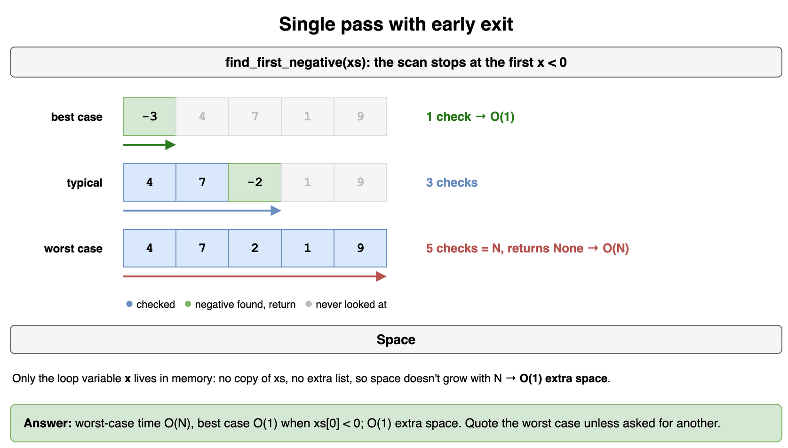

*Source: [`diagrams/algorithmic-complexity-drills.drawio`](/content/07_Data_Structures_and_Algorithms/01_Algorithmic_Complexity/diagrams/algorithmic-complexity-drills.drawio), page 1.*

## Nested loops, same length → N²

Read `count_pairs`: outer and inner both run over length N. State time and space, and whether you add or multiply the loop costs.

```python
def count_pairs(xs: list[int]) -> int:
    n = len(xs)
    c = 0
    for i in range(n):
        for j in range(n):
            if xs[i] < xs[j]:
                c += 1
    return c
```

**Answer:** Time O(N²), space O(1). Outer and inner both run N times → multiply.

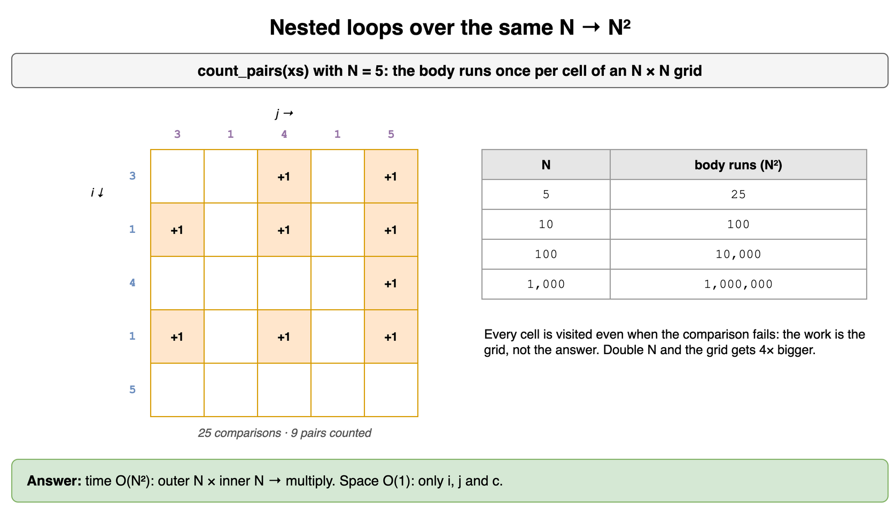

*Source: [`diagrams/algorithmic-complexity-drills.drawio`](/content/07_Data_Structures_and_Algorithms/01_Algorithmic_Complexity/diagrams/algorithmic-complexity-drills.drawio), page 2.*

## Triangle nested loops still N²

`count_ordered_pairs` uses `j` from `i+1..n` (~N(N−1)/2 iterations). What is the tight practical bound after dropping constants?

```python
def count_ordered_pairs(xs: list[int]) -> int:
    n = len(xs)
    c = 0
    for i in range(n):
        for j in range(i + 1, n):
            c += 1
    return c
```

**Answer:** Time O(N²), space O(1). ~N(N−1)/2 iterations — drop the constant, still O(N²).

```python
n = 10
iterations = sum(1 for i in range(n) for _ in range(i + 1, n))
print(iterations, n * (n - 1) // 2)  # 45 45 — still quadratic
```

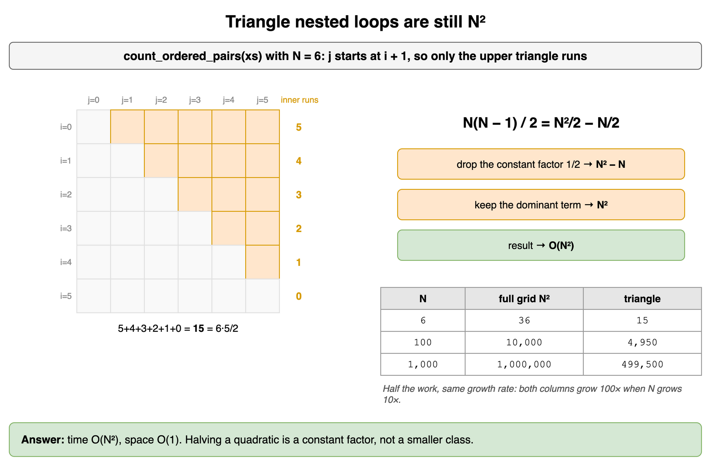

*Source: [`diagrams/algorithmic-complexity-drills.drawio`](/content/07_Data_Structures_and_Algorithms/01_Algorithmic_Complexity/diagrams/algorithmic-complexity-drills.drawio), page 3.*

## Independent loops → add

`prep_then_scan` does a filter pass then a sum pass. Do you add or multiply the costs? Name time and extra space.

```python
def prep_then_scan(xs: list[int]) -> int:
    positives = [x for x in xs if x > 0]  # pass 1
    total = 0
    for x in positives:                   # pass 2
        total += x
    return total
```

**Answer:** Time O(N), space O(N) for the filtered list. Two sequential O(N) passes → add → O(N).

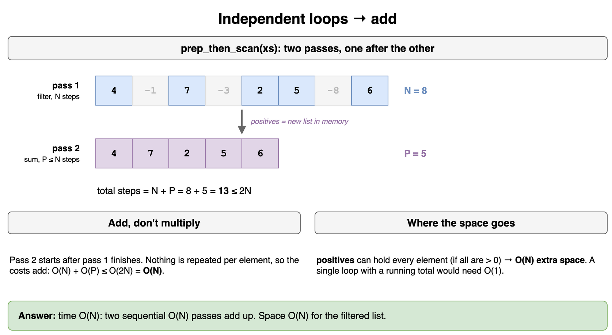

*Source: [`diagrams/algorithmic-complexity-drills.drawio`](/content/07_Data_Structures_and_Algorithms/01_Algorithmic_Complexity/diagrams/algorithmic-complexity-drills.drawio), page 4.*

## Loop to N/2 is still O(N)

`sum_first_half` only iterates `n // 2` times. What does Big O say after dropping the constant factor?

```python
def sum_first_half(xs: list[int]) -> int:
    n = len(xs)
    total = 0
    for i in range(n // 2):
        total += xs[i]
    return total
```

**Answer:** Time O(N), space O(1). N/2 iterations drop the constant → O(N).

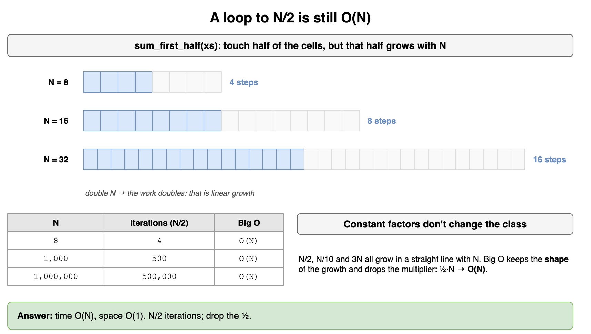

*Source: [`diagrams/algorithmic-complexity-drills.drawio`](/content/07_Data_Structures_and_Algorithms/01_Algorithmic_Complexity/diagrams/algorithmic-complexity-drills.drawio), page 5.*

## Loop to √N

`is_prime` loops while `d * d <= n`. Name the time bound implied by that loop condition.

```python
def is_prime(n: int) -> bool:
    if n < 2:
        return False
    d = 2
    while d * d <= n:
        if n % d == 0:
            return False
        d += 1
    return True
```

**Answer:** Time O(√N), space O(1). The loop bound is √N, not N.

```python
n = 97  # prime, so the loop runs to completion
steps, d = 0, 2
while d * d <= n:
    steps += 1
    d += 1
print(steps)  # 8, on the order of sqrt(97) rather than 97
```

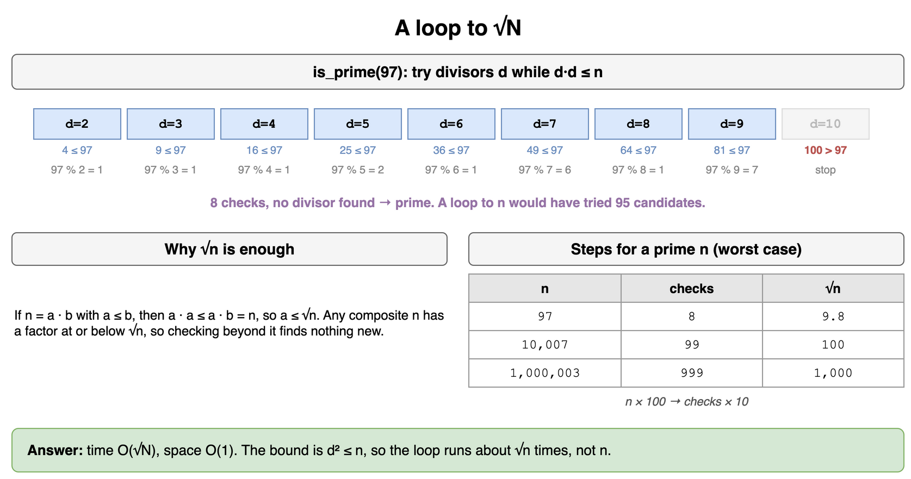

*Source: [`diagrams/algorithmic-complexity-drills.drawio`](/content/07_Data_Structures_and_Algorithms/01_Algorithmic_Complexity/diagrams/algorithmic-complexity-drills.drawio), page 6.*

## Doubling step → log N

`highest_power_of_two` doubles `p` each step until it would exceed `n`. How many iterations in Big O?

```python
def highest_power_of_two(n: int) -> int:
    p = 1
    while p * 2 <= n:
        p *= 2
    return p
```

**Answer:** Time O(log N), space O(1). Each step doubles p → about log₂ N iterations.

```python
n, steps, p = 1000, 0, 1
while p * 2 <= n:
    p *= 2
    steps += 1
print(steps, p)  # 9 512 — about log2(1000) steps
```

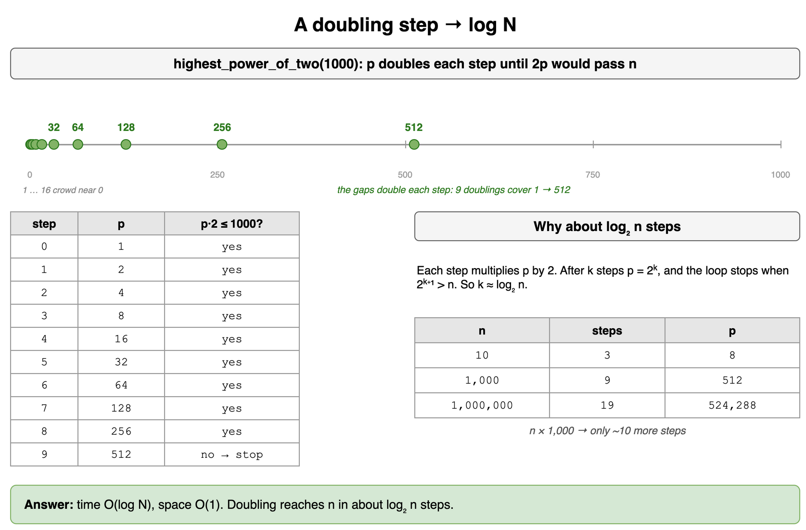

*Source: [`diagrams/algorithmic-complexity-drills.drawio`](/content/07_Data_Structures_and_Algorithms/01_Algorithmic_Complexity/diagrams/algorithmic-complexity-drills.drawio), page 7.*

## Two input sizes — keep A and B

`any_in_set` walks `needles` against a hash set `haystack`. Express complexity with A and B — do not collapse to a fake single N.

```python
def any_in_set(needles: list[int], haystack: set[int]) -> bool:
    for x in needles:
        if x in haystack:
            return True
    return False
```

**Answer:** Time O(A) average with a hash set of size B already built; building the set from a list of length B would be O(A + B). Do not collapse to a fake single N.

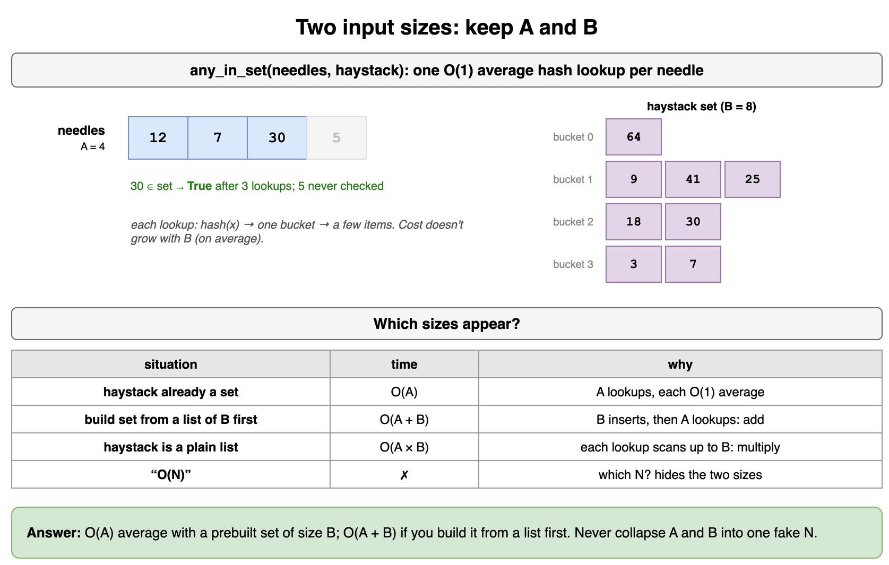

*Source: [`diagrams/algorithmic-complexity-drills.drawio`](/content/07_Data_Structures_and_Algorithms/01_Algorithmic_Complexity/diagrams/algorithmic-complexity-drills.drawio), page 8.*

## Nested over A and B → multiply

`cross_count` nests a loop over `a` inside a loop over `b`. Add or multiply? State the product form.

```python
def cross_count(a: list[int], b: list[int]) -> int:
    c = 0
    for x in a:
        for y in b:
            if x < y:
                c += 1
    return c
```

**Answer:** Time O(A · B), space O(1). For each of A elements, scan all B → multiply.

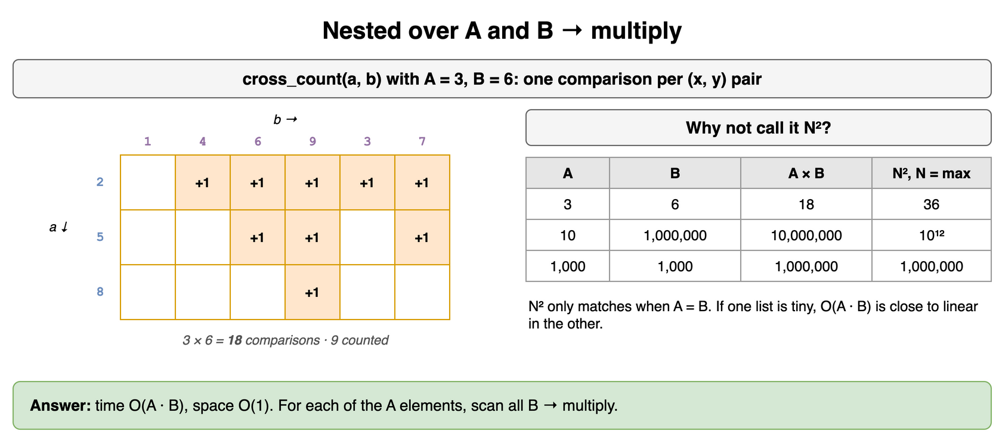

*Source: [`diagrams/algorithmic-complexity-drills.drawio`](/content/07_Data_Structures_and_Algorithms/01_Algorithmic_Complexity/diagrams/algorithmic-complexity-drills.drawio), page 9.*

## One recursive call down by 1

`sum_to_zero(n)` makes one recursive call with `n - 1`. What are its time and stack space?

```python
def sum_to_zero(n: int) -> int:
    if n <= 0:
        return 0
    return n + sum_to_zero(n - 1)
```

**Answer:** Time O(N), space O(N) stack. N frames, constant work each.

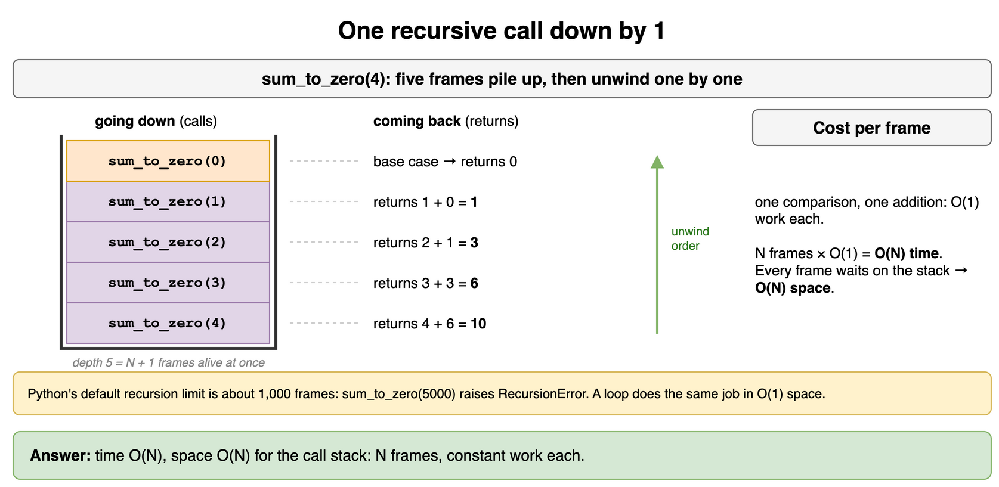

*Source: [`diagrams/algorithmic-complexity-drills.drawio`](/content/07_Data_Structures_and_Algorithms/01_Algorithmic_Complexity/diagrams/algorithmic-complexity-drills.drawio), page 10.*

## Two branches without memo → exponential

`count_paths` branches into `steps - 1` and `steps - 2` with no cache. What class of runtime?

```python
def count_paths(steps: int) -> int:
    if steps <= 1:
        return 1
    return count_paths(steps - 1) + count_paths(steps - 2)
```

**Answer:** Time O(2^N), space O(N) stack. Two recursive calls per level without caching.

```python
def count_calls(steps: int) -> int:
    """How many calls this recursion makes, including itself."""
    if steps <= 1:
        return 1
    return 1 + count_calls(steps - 1) + count_calls(steps - 2)

print(count_calls(10))  # 177 calls — far more than 10
```

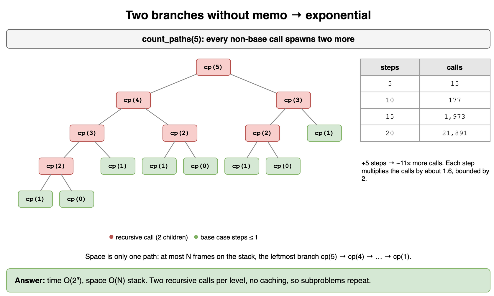

*Source: [`diagrams/algorithmic-complexity-drills.drawio`](/content/07_Data_Structures_and_Algorithms/01_Algorithmic_Complexity/diagrams/algorithmic-complexity-drills.drawio), page 11.*

## Sum the recursion tree (balanced)

`merge_sort_work` models a balanced split plus O(n) merge work. Sum the tree — what total bound?

```python
def merge_sort_work(n: int) -> int:
    """Toy model: cost of merge-sort-style recursion on size n."""
    if n <= 1:
        return 1
    return merge_sort_work(n // 2) + merge_sort_work(n // 2) + n
```

**Answer:** Time O(N log N). log N levels, ~N work per level → sum the tree, do not stop at branches^depth.

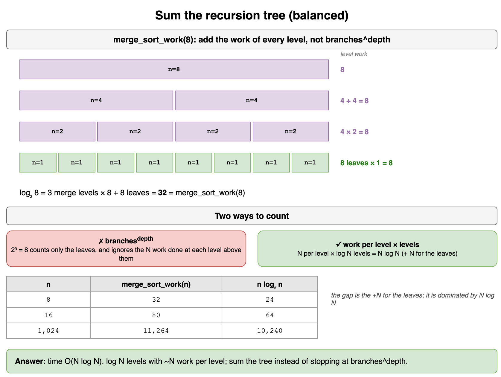

*Source: [`diagrams/algorithmic-complexity-drills.drawio`](/content/07_Data_Structures_and_Algorithms/01_Algorithmic_Complexity/diagrams/algorithmic-complexity-drills.drawio), page 12.*

## Memoization collapses exponential

`count_paths_memo` uses `lru_cache`. How does caching change time and space compared with the uncached version?

```python
from functools import lru_cache

@lru_cache(None)
def count_paths_memo(steps: int) -> int:
    if steps <= 1:
        return 1
    return count_paths_memo(steps - 1) + count_paths_memo(steps - 2)
```

**Answer:** Time O(N), space O(N) for the cache (+ stack). Each `steps` value computed once.

```python
from functools import lru_cache

@lru_cache(None)
def count_paths_memo(steps: int) -> int:
    if steps <= 1:
        return 1
    return count_paths_memo(steps - 1) + count_paths_memo(steps - 2)

count_paths_memo(10)
print(count_paths_memo.cache_info().misses)  # 11: steps 0..10, once each
```

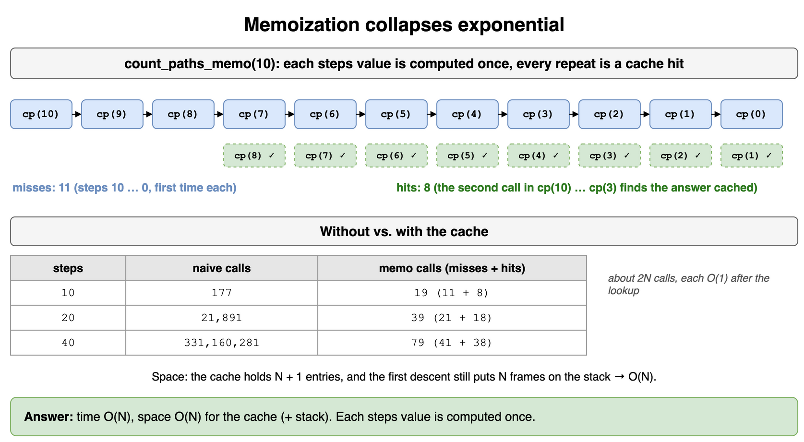

*Source: [`diagrams/algorithmic-complexity-drills.drawio`](/content/07_Data_Structures_and_Algorithms/01_Algorithmic_Complexity/diagrams/algorithmic-complexity-drills.drawio), page 13.*

## Permutation branching → factorial class

`permutations` lists every ordering of `chars`: it picks each character in turn as the first one, then recurses on the characters that are left. Each base-case call (a leaf of the recursion tree) finishes one permutation. For N characters, how many leaves are there, which complexity class (polynomial, exponential, factorial) does the running time fall in, and how much extra space does it use besides the output?

```python
def permutations(chars: list[str]) -> list[list[str]]:
    if len(chars) <= 1:
        return [chars[:]]
    out: list[list[str]] = []
    for i, ch in enumerate(chars):
        rest = chars[:i] + chars[i + 1 :]
        for p in permutations(rest):
            out.append([ch] + p)
    return out
```

**Answer:** N! leaves: N choices for the first character, N − 1 for the second, down to 1 for the last. Each permutation also costs O(N) to build, so the work is about N · N!; interviews drop the polynomial factor and call it the Θ(N!) class. The recursion is only N levels deep, but every level keeps its own `rest` slice (N − 1, N − 2, ... characters), so extra space is O(N²) besides the N! output lists.

```python
def leaf_count(n: int) -> int:
    return 1 if n <= 1 else n * leaf_count(n - 1)

print(leaf_count(4))  # 24 == 4! leaves
```

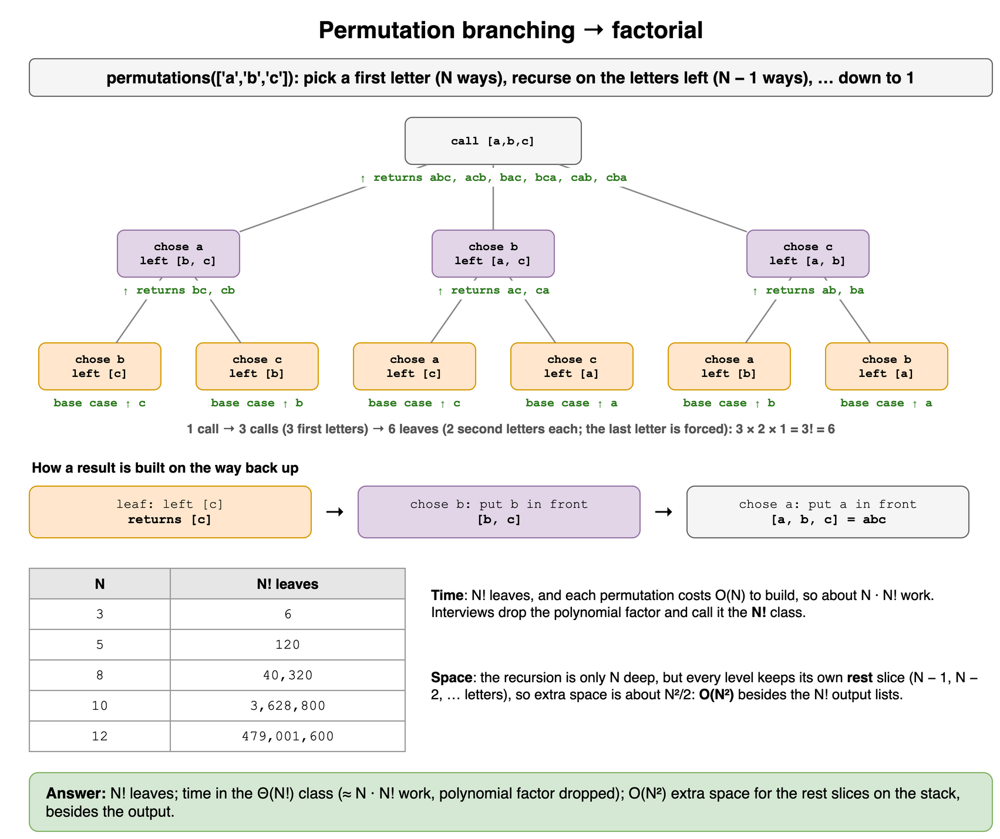

*Source: [`diagrams/algorithmic-complexity-drills.drawio`](/content/07_Data_Structures_and_Algorithms/01_Algorithmic_Complexity/diagrams/algorithmic-complexity-drills.drawio), page 14.*

## Hidden quadratic from repeated copy

`join_chars` builds a string with repeated `s = s + ch`. Why is that worse than `''.join`, and what are the bounds?

```python
def join_chars(chars: list[str]) -> str:
    s = ""
    for ch in chars:
        s = s + ch   # builds a new string each time
    return s
```

**Answer:** Time O(N²) with immutable strings (each concat copies), space O(N) for the result. Prefer a builder / `''.join` for O(N).

```python
def join_chars(chars: list[str]) -> str:
    return "".join(chars)  # one pass, O(N)

print(join_chars(["a", "b", "c", "d"]))  # abcd
```

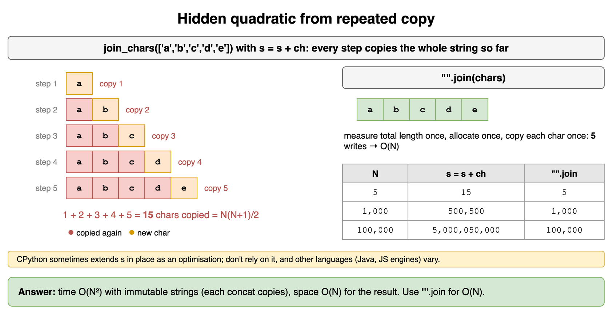

*Source: [`diagrams/algorithmic-complexity-drills.drawio`](/content/07_Data_Structures_and_Algorithms/01_Algorithmic_Complexity/diagrams/algorithmic-complexity-drills.drawio), page 15.*

## Interview answer: time, space, case

For `has_pair_sum` with a seen set, write the one-liner you would say in an interview (time, space, case if they differ).

```python
def has_pair_sum(items: list[int], target: int) -> bool:
    seen: set[int] = set()
    for x in items:
        if (target - x) in seen:
            return True
        seen.add(x)
    return False
```

**Answer:** "Average/expected time O(N) from one pass with O(1) hash lookups; O(N) extra space for the set; worst-case hash degradation is rare and usually not the focus unless asked."

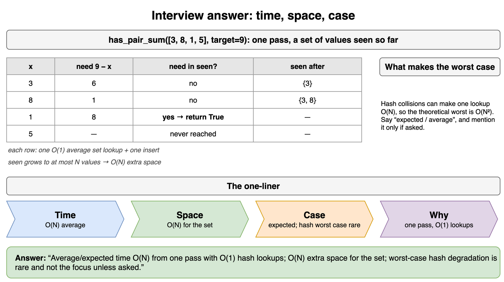

*Source: [`diagrams/algorithmic-complexity-drills.drawio`](/content/07_Data_Structures_and_Algorithms/01_Algorithmic_Complexity/diagrams/algorithmic-complexity-drills.drawio), page 16.*
