## Tree structure

A tree is a connected, acyclic graph with a designated root node. Every node except the root has exactly one parent, and each node can have zero or more children. Nodes with no children are called leaves. The depth of a node is the number of edges from the root to that node. The height of a tree is the number of edges on the longest path from the root to any leaf.

Trees appear everywhere in computing: file systems, the DOM, syntax trees, decision trees, database indexes. The recursive definition -- a tree is a root connected to zero or more subtrees -- maps directly to recursive algorithms, which is why most tree code is naturally recursive.

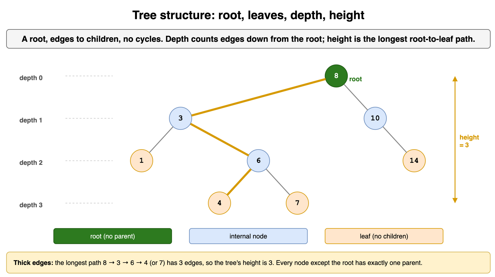

*Source: [`diagrams/trees.drawio`](/content/07_Data_Structures_and_Algorithms/05_Trees/diagrams/trees.drawio), page 1.*

In the diagram above, the green node is the root and the orange nodes are leaves. The height of this tree is 3 (the longest path from root 8 down to leaf 4 or 7).

## Binary tree

A binary tree restricts each node to at most two children, conventionally called `left` and `right`. This constraint makes the structure simple enough for efficient algorithms while still being expressive enough for search, sorting, and expression parsing.

The `TreeNode` class is the building block for nearly every tree problem you will encounter in interviews and production code.

```python
class TreeNode:
    def __init__(self, val, left=None, right=None):
        self.val = val
        self.left = left
        self.right = right

# Build a small tree:
#       5
#      / \
#     3   8
#    / \
#   1   4
root = TreeNode(5,
    TreeNode(3, TreeNode(1), TreeNode(4)),
    TreeNode(8))
```

Every node stores a value and two optional child references. When both children are `None`, the node is a leaf. This class (or a minor variant of it) is reused by BSTs, heaps implemented as linked structures, expression trees, and most tree-based interview problems.

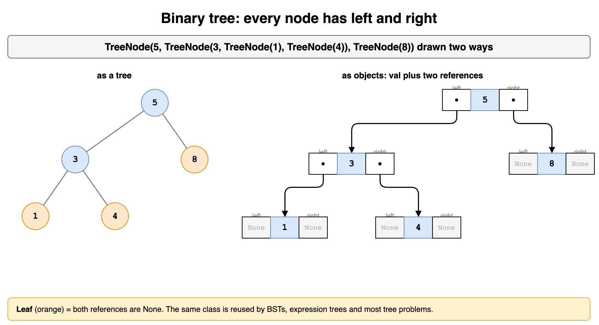

*Source: [`diagrams/trees.drawio`](/content/07_Data_Structures_and_Algorithms/05_Trees/diagrams/trees.drawio), page 2.*

## Binary search tree (BST)

A binary search tree maintains a strict ordering invariant: for every node, all values in the left subtree are less than or equal to the node's value, and all values in the right subtree are greater. This invariant enables binary search on a tree structure, giving O(log N) search, insert, and delete when the tree is balanced.

The search algorithm follows a single path from root to target by comparing at each node and going left or right. Insertion works the same way but places a new leaf at the point where the search would fail.

```python
def bst_search(root: TreeNode, target: int) -> TreeNode | None:
    """Search for target in a BST. O(log N) average, O(N) worst."""
    node = root
    while node:
        if target == node.val:
            return node
        elif target < node.val:
            node = node.left
        else:
            node = node.right
    return None


def bst_insert(root: TreeNode | None, val: int) -> TreeNode:
    """Insert val into a BST and return the root. O(log N) average."""
    if root is None:
        return TreeNode(val)
    if val <= root.val:
        root.left = bst_insert(root.left, val)
    else:
        root.right = bst_insert(root.right, val)
    return root
```

The recursive insert works by finding the correct empty spot and placing the new node there. Each call descends one level, so the depth of the tree determines the cost.

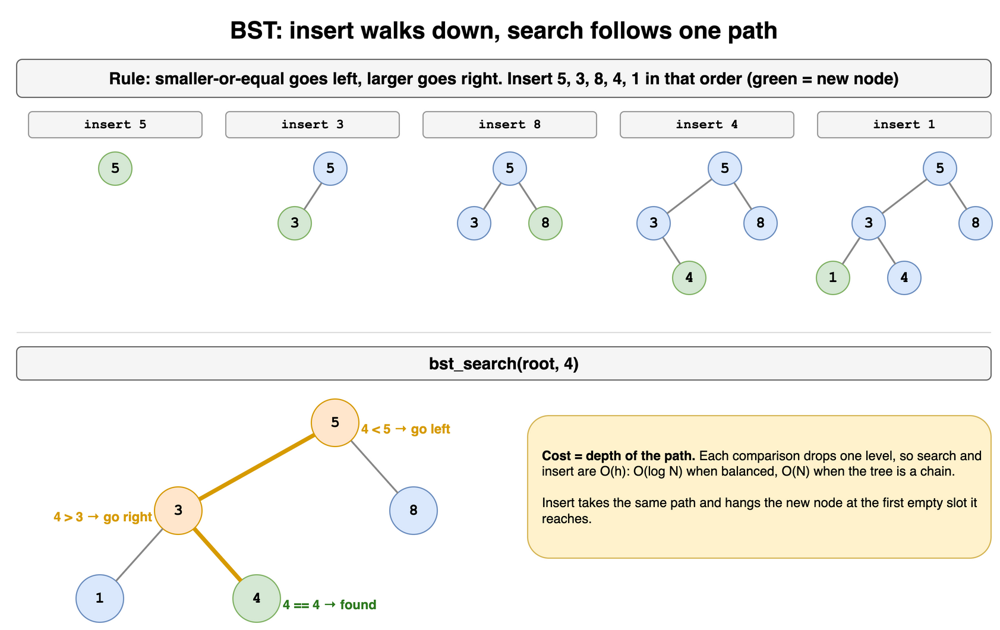

*Source: [`diagrams/trees.drawio`](/content/07_Data_Structures_and_Algorithms/05_Trees/diagrams/trees.drawio), page 3.*

Each green node is the newly inserted value. At every step, the new value walks down the tree comparing at each node until it finds an empty child slot.

## BST deletion

Deleting a node from a BST must preserve the ordering invariant. There are three cases depending on how many children the target node has.

**Case 1: leaf node** -- simply remove it. **Case 2: one child** -- replace the node with its only child. **Case 3: two children** -- find the in-order successor (the smallest node in the right subtree), copy its value into the target node, and then delete the successor (which will be case 1 or 2).

```python
def bst_delete(root: TreeNode | None, val: int) -> TreeNode | None:
    """Delete val from a BST and return the new root."""
    if root is None:
        return None
    if val < root.val:
        root.left = bst_delete(root.left, val)
    elif val > root.val:
        root.right = bst_delete(root.right, val)
    else:
        # Found the node to delete
        if root.left is None:          # Case 1 & 2: no left child
            return root.right
        if root.right is None:         # Case 2: no right child
            return root.left
        # Case 3: two children -- find in-order successor
        successor = root.right
        while successor.left:
            successor = successor.left
        root.val = successor.val       # copy successor value
        root.right = bst_delete(root.right, successor.val)  # delete successor
    return root
```

The two-children case is the one interviewers focus on. The in-order successor is the leftmost node in the right subtree -- the smallest value that is still larger than the deleted node. Swapping it in preserves the BST invariant because it is greater than everything in the left subtree and smaller than everything remaining in the right subtree.

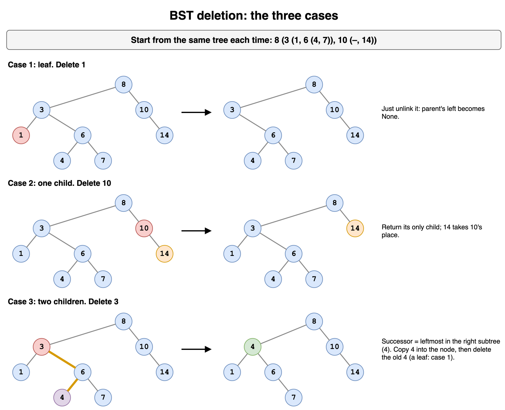

*Source: [`diagrams/trees.drawio`](/content/07_Data_Structures_and_Algorithms/05_Trees/diagrams/trees.drawio), page 4.*

## Balanced trees

A BST's operations are O(h) where h is the height of the tree. In the best case a tree with N nodes has height log N, but if elements are inserted in sorted order, the tree degenerates into a linked list with height N, making every operation O(N).

Self-balancing trees solve this by automatically restructuring after insertions and deletions to keep the height at O(log N). The two most important variants are:

- **AVL trees** maintain the invariant that for every node, the heights of the left and right subtrees differ by at most 1. After each insert or delete, the tree performs rotations to restore balance. AVL trees are strictly balanced, so lookups are fast, but insertions and deletions require more rotations.

- **Red-Black trees** maintain balance through coloring rules: every node is red or black, the root is black, red nodes cannot have red children, and every path from root to a null leaf contains the same number of black nodes. These rules guarantee the tree height is at most 2 * log(N+1). Red-Black trees are used in Java's `TreeMap`, C++'s `std::map`, and Linux's process scheduler because they offer a good balance between lookup speed and modification cost.

| Property | Unbalanced BST | AVL Tree | Red-Black Tree |
|----------|---------------|----------|----------------|
| Search   | O(N) worst    | O(log N) | O(log N)       |
| Insert   | O(N) worst    | O(log N) | O(log N)       |
| Delete   | O(N) worst    | O(log N) | O(log N)       |
| Balance strictness | None | Strict   | Relaxed        |

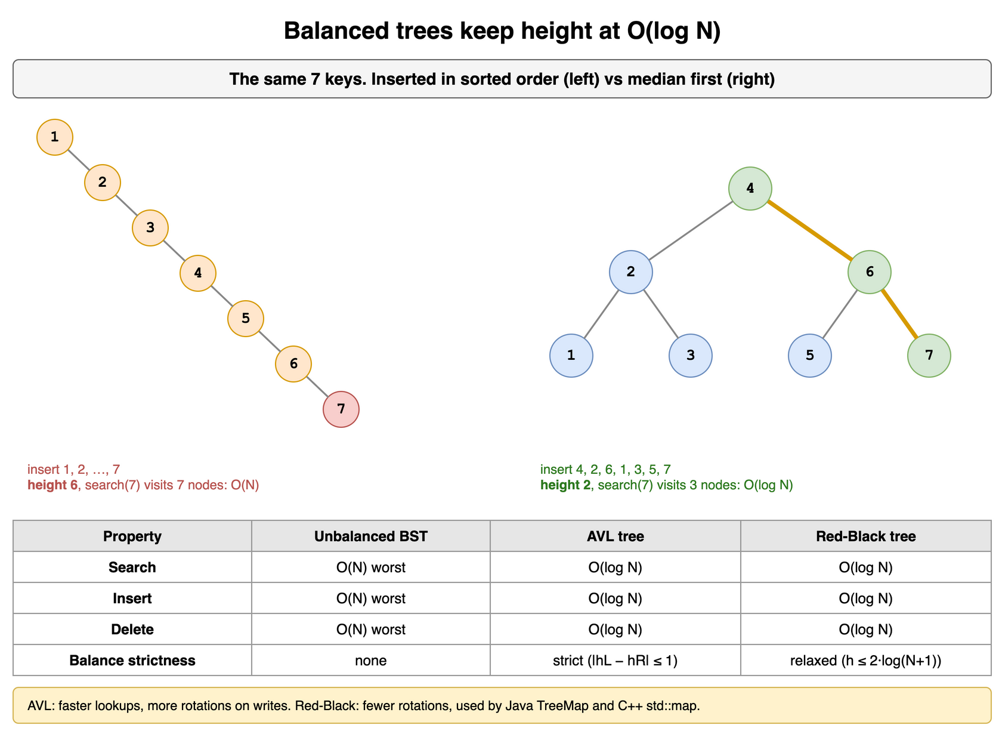

*Source: [`diagrams/trees.drawio`](/content/07_Data_Structures_and_Algorithms/05_Trees/diagrams/trees.drawio), page 5.*

## Complete, full, and perfect binary trees

These three terms describe specific structural constraints on binary trees. They come up constantly in heap implementations, tree serialization, and interview questions.

- **Full binary tree**: every node has exactly 0 or 2 children. No node has just one child.
- **Complete binary tree**: every level is fully filled except possibly the last, which is filled left to right. This is the shape a binary heap maintains.
- **Perfect binary tree**: every internal node has exactly 2 children and all leaves are at the same depth. A perfect tree with height h has exactly 2^(h+1) - 1 nodes.

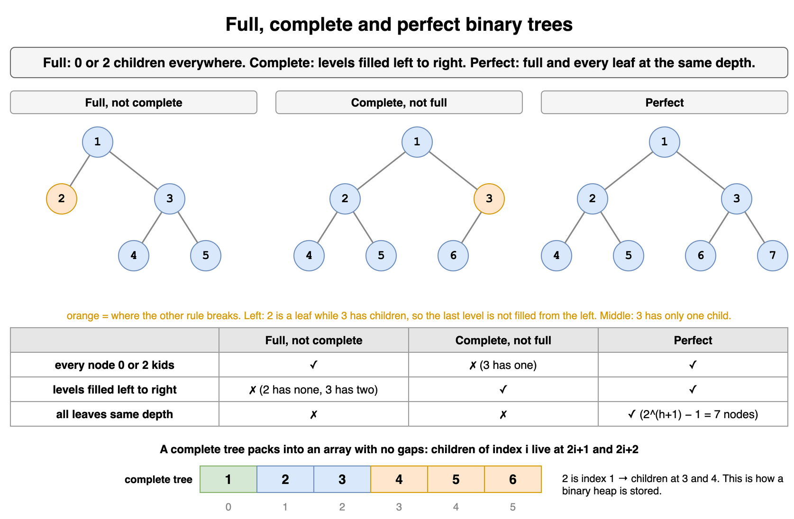

*Source: [`diagrams/trees.drawio`](/content/07_Data_Structures_and_Algorithms/05_Trees/diagrams/trees.drawio), page 6.*

A perfect tree is always both full and complete. A complete tree is the structure you get when you fill positions left-to-right, level by level -- this is exactly how a binary heap is stored in an array, which is why complete trees are important for heap operations.

## In-order traversal

In-order traversal visits the left subtree, then the current node, then the right subtree. When applied to a BST, this produces values in sorted order, which is why it is called "in-order."

This traversal is the foundation for operations like printing a BST's contents in sorted order, converting a BST to a sorted list, and validating that a tree is actually a valid BST.

```python
def inorder(root: TreeNode | None) -> list[int]:
    """In-order traversal: left, node, right. O(N) time and space."""
    if root is None:
        return []
    return inorder(root.left) + [root.val] + inorder(root.right)


# Generator version -- avoids building full list in memory
def inorder_gen(root: TreeNode | None):
    if root:
        yield from inorder_gen(root.left)
        yield root.val
        yield from inorder_gen(root.right)


#       5
#      / \
#     3   8
#    / \
#   1   4
root = TreeNode(5, TreeNode(3, TreeNode(1), TreeNode(4)), TreeNode(8))
print(inorder(root))  # [1, 3, 4, 5, 8]  -- sorted!
```


*Source: [`diagrams/trees.drawio`](/content/07_Data_Structures_and_Algorithms/05_Trees/diagrams/trees.drawio), page 7.*

The numbered visit order shows the pattern: go as far left as possible first, visit the node, then go right.

## Pre-order traversal

Pre-order traversal visits the current node first, then the left subtree, then the right subtree. This produces a top-down view of the tree, which makes it natural for operations like serialization (saving a tree to disk), cloning a tree, and building expression prefix notation.

```python
def preorder(root: TreeNode | None) -> list[int]:
    """Pre-order traversal: node, left, right."""
    if root is None:
        return []
    return [root.val] + preorder(root.left) + preorder(root.right)

#       5
#      / \
#     3   8
#    / \
#   1   4
print(preorder(root))  # [5, 3, 1, 4, 8]
```


*Source: [`diagrams/trees.drawio`](/content/07_Data_Structures_and_Algorithms/05_Trees/diagrams/trees.drawio), page 8.*

Pre-order is useful for serialization because the root is output first: when you later reconstruct the tree, you process nodes in exactly the order you need to build top-down.

## Post-order traversal

Post-order traversal visits the left subtree, then the right subtree, then the current node. This bottom-up order is natural for operations that need to process children before their parent: deleting a tree (free children before the parent), evaluating an expression tree (compute operands before applying the operator), and calculating subtree sizes.

```python
def postorder(root: TreeNode | None) -> list[int]:
    """Post-order traversal: left, right, node."""
    if root is None:
        return []
    return postorder(root.left) + postorder(root.right) + [root.val]

#       5
#      / \
#     3   8
#    / \
#   1   4
print(postorder(root))  # [1, 4, 3, 8, 5]
```

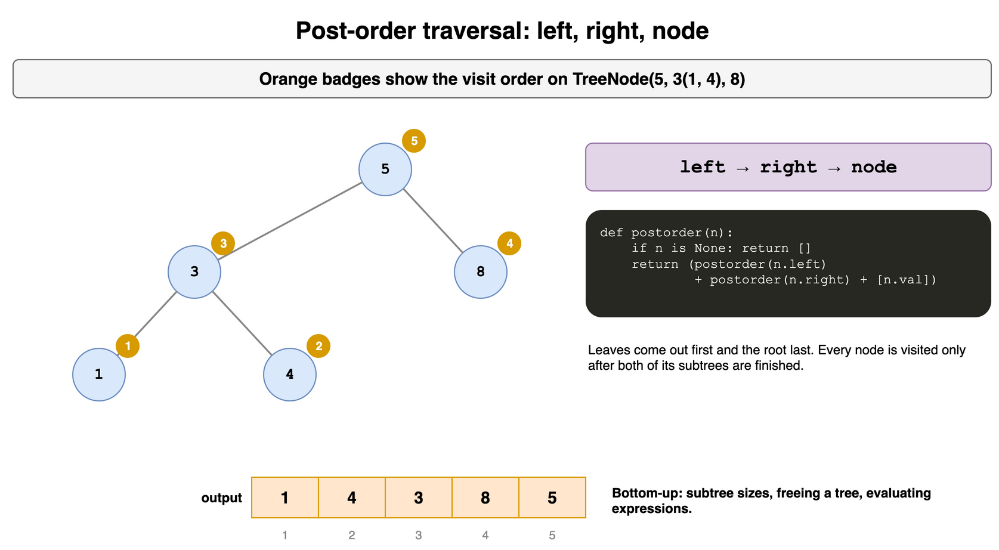

*Source: [`diagrams/trees.drawio`](/content/07_Data_Structures_and_Algorithms/05_Trees/diagrams/trees.drawio), page 9.*

Notice the pattern: leaves are always visited first, and the root is always visited last. This is the opposite of pre-order.

## Level-order traversal (BFS)

Level-order traversal visits nodes level by level, from left to right, using a queue. This is breadth-first search applied to a tree. Unlike the three depth-first traversals (in-order, pre-order, post-order), BFS explores all nodes at distance d from the root before any node at distance d+1.

Level-order is essential for problems involving levels: finding the maximum value per level, right-side view of a tree, connecting nodes at the same level, and checking whether a tree is complete.

```python
from collections import deque


def level_order(root: TreeNode | None) -> list[list[int]]:
    """BFS level-order traversal. Returns values grouped by level."""
    if root is None:
        return []
    result = []
    queue = deque([root])
    while queue:
        level = []
        for _ in range(len(queue)):   # process entire current level
            node = queue.popleft()
            level.append(node.val)
            if node.left:
                queue.append(node.left)
            if node.right:
                queue.append(node.right)
        result.append(level)
    return result


#       5
#      / \
#     3   8
#    / \
#   1   4
root = TreeNode(5, TreeNode(3, TreeNode(1), TreeNode(4)), TreeNode(8))
print(level_order(root))
# [[5], [3, 8], [1, 4]]
```

The queue-based approach is critical to understand. Each iteration processes one full level: dequeue all nodes at the current depth, enqueue their children. The `for _ in range(len(queue))` pattern is the idiomatic way to process one level at a time.

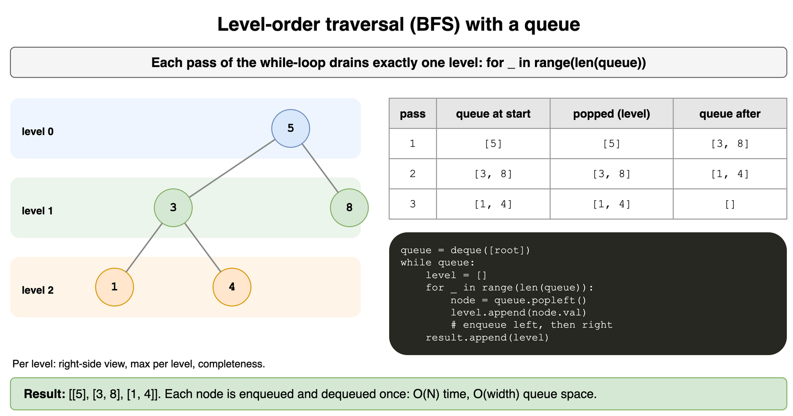

*Source: [`diagrams/trees.drawio`](/content/07_Data_Structures_and_Algorithms/05_Trees/diagrams/trees.drawio), page 10.*

## Tree height and depth

Height and depth are related but measured from opposite ends. The depth of a node is the number of edges from the root down to that node (root has depth 0). The height of a node is the number of edges on the longest downward path from that node to a leaf (leaves have height 0). The height of the tree is the height of the root.

These measurements are fundamental to balance checking, complexity analysis, and many interview questions. An O(log N) guarantee on BST operations is really a guarantee that the tree height stays proportional to log N.

```python
def height(root: TreeNode | None) -> int:
    """Return the height of the tree. O(N) -- must visit every node."""
    if root is None:
        return -1  # convention: empty tree has height -1
    return 1 + max(height(root.left), height(root.right))


def depth(root: TreeNode | None, target: int, d: int = 0) -> int:
    """Return the depth of the node with the given value, or -1 if not found."""
    if root is None:
        return -1
    if root.val == target:
        return d
    left = depth(root.left, target, d + 1)
    if left != -1:
        return left
    return depth(root.right, target, d + 1)


#       5          height=2
#      / \
#     3   8        height=1 (for node 3), height=0 (for node 8)
#    / \
#   1   4          height=0 (leaves)

root = TreeNode(5, TreeNode(3, TreeNode(1), TreeNode(4)), TreeNode(8))
print(height(root))         # 2
print(depth(root, 4))       # 2
print(depth(root, 5))       # 0 (root)
```

The height function is the basis for checking whether a tree is balanced: compute the height of the left and right subtrees and verify they differ by at most 1 at every node. This check runs in O(N) and is a common interview problem.

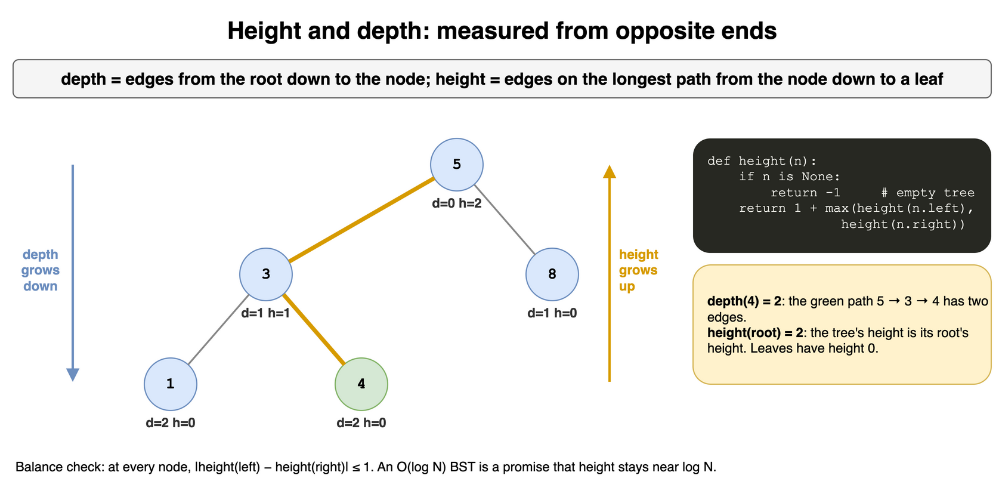

*Source: [`diagrams/trees.drawio`](/content/07_Data_Structures_and_Algorithms/05_Trees/diagrams/trees.drawio), page 11.*

## Empty tree base case

Almost every tree function has the same skeleton: decide what the answer is for an empty tree (`None`), then combine the answers from the left and right subtrees with the current node. Treating `None` as a real, valid input -- not an error to guard against at every call site -- removes most special cases. You never need to check `if node.left:` before recursing; the callee handles it.

The value you return for `None` must be the identity for your combining step: `0` for a count or a sum, `-1` (or `0`, by convention) for height, `True` for an "every node satisfies X" check, `float("-inf")` for a maximum.

```python
class TreeNode:
    def __init__(self, val, left=None, right=None):
        self.val = val
        self.left = left
        self.right = right


def count(node):
    if node is None:          # base case: empty tree has 0 nodes
        return 0
    return 1 + count(node.left) + count(node.right)


def total(node):
    if node is None:          # identity for addition
        return 0
    return node.val + total(node.left) + total(node.right)


def all_positive(node):
    if node is None:          # identity for "and"
        return True
    return node.val > 0 and all_positive(node.left) and all_positive(node.right)


root = TreeNode(5, TreeNode(3, TreeNode(1), TreeNode(4)), TreeNode(8))
print(count(root), total(root), all_positive(root))  # 5 21 True
print(count(None), total(None), all_positive(None))  # 0 0 True
```

If you find yourself writing `if node.left and node.right` branches for leaves, step back: a correct `None` base case usually makes the leaf case fall out automatically.

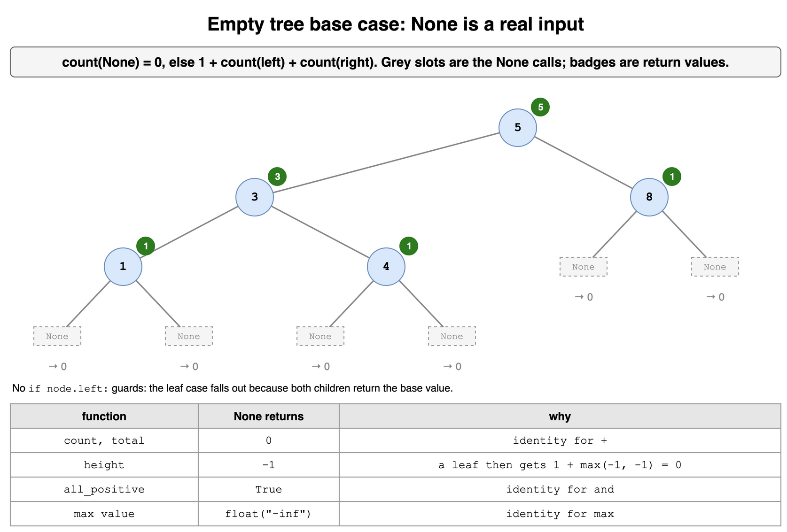

*Source: [`diagrams/trees.drawio`](/content/07_Data_Structures_and_Algorithms/05_Trees/diagrams/trees.drawio), page 12.*

## Top-down vs. bottom-up recursion

Tree recursion comes in two flavours. **Top-down** passes information from parent to child as arguments: the current depth, the path so far, the allowed value range. Each node decides something using what its ancestors told it. **Bottom-up** returns information from children to parent: subtree height, subtree size, "is this subtree valid". Each node combines what its children report.

Many interview answers become simple once you pick the right direction. Ask: does a node need to know about its *ancestors* (top-down) or about its *descendants* (bottom-up)? Some problems need both -- an argument going down and a return value coming up.

```python
class TreeNode:
    def __init__(self, val, left=None, right=None):
        self.val = val
        self.left = left
        self.right = right


def leaf_depths(node, depth=0, out=None):
    """Top-down: depth flows from parent to child as an argument."""
    if out is None:
        out = []
    if node is None:
        return out
    if node.left is None and node.right is None:
        out.append((node.val, depth))
    leaf_depths(node.left, depth + 1, out)
    leaf_depths(node.right, depth + 1, out)
    return out


def subtree_sizes(node, out):
    """Bottom-up: each call returns its subtree size to the parent."""
    if node is None:
        return 0
    size = 1 + subtree_sizes(node.left, out) + subtree_sizes(node.right, out)
    out[node.val] = size
    return size


root = TreeNode(5, TreeNode(3, TreeNode(1), TreeNode(4)), TreeNode(8))
print(leaf_depths(root))  # [(1, 2), (4, 2), (8, 1)]
sizes = {}
subtree_sizes(root, sizes)
print(sizes)  # {1: 1, 4: 1, 3: 3, 8: 1, 5: 5}
```

Bottom-up is also how you avoid repeated work: if a parent needs both the height and some other fact about each child, return both in one tuple instead of calling a separate `height()` from every node (which turns O(N) into O(N^2) on skewed trees).

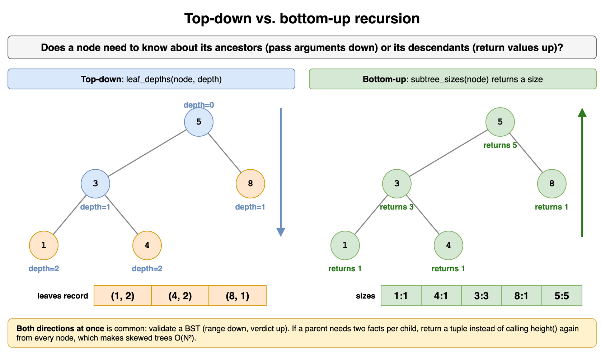

*Source: [`diagrams/trees.drawio`](/content/07_Data_Structures_and_Algorithms/05_Trees/diagrams/trees.drawio), page 13.*

## BST range property

A common misreading of the BST invariant is "each node is greater than its left child and smaller than its right child". That local check is not enough. The real rule is global: *every* value in the left subtree is smaller than the node, and *every* value in the right subtree is larger. A node deep in the tree is constrained by all of its ancestors, not just its parent.

The clean way to think about it: each node lives inside an open interval `(low, high)` inherited from its ancestors. Going left tightens the upper bound to the current value; going right tightens the lower bound. This is the same top-down pattern as above, and it is exactly the set of slots where an insert could land.

```python
class TreeNode:
    def __init__(self, val, left=None, right=None):
        self.val = val
        self.left = left
        self.right = right


def allowed_ranges(node, low=float("-inf"), high=float("inf"), out=None):
    """Record the interval each node must fall inside."""
    if out is None:
        out = {}
    if node is None:
        return out
    out[node.val] = (low, high)
    allowed_ranges(node.left, low, node.val, out)
    allowed_ranges(node.right, node.val, high, out)
    return out


#       10
#      /  \
#     5    15
#         /  \
#        6    20      <- 6 < 15 (parent check passes) but 6 < 10 (ancestor rule broken)
root = TreeNode(10, TreeNode(5), TreeNode(15, TreeNode(6), TreeNode(20)))
ranges = allowed_ranges(root)
print(ranges[6])  # (10, 15)
print(all(lo < v < hi for v, (lo, hi) in ranges.items()))  # False
```

Node 6 is smaller than its parent 15, so a parent-only check passes, but it sits in 10's right subtree and must be greater than 10. Thinking in ranges catches this; it also explains why a BST's in-order traversal must be strictly increasing.

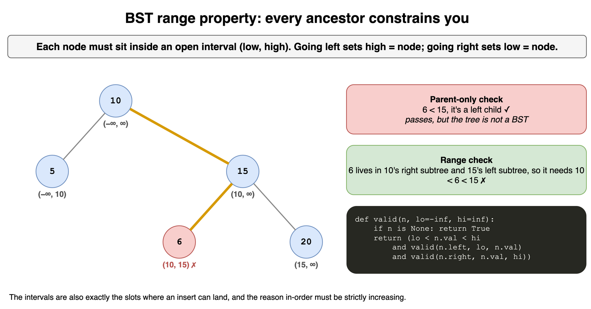

*Source: [`diagrams/trees.drawio`](/content/07_Data_Structures_and_Algorithms/05_Trees/diagrams/trees.drawio), page 14.*

## Floor, ceiling, and next key

A hash table can only tell you whether a key exists. A BST can also answer *ordered* questions: the largest key at most `x` (floor), the smallest key at least `x` (ceiling), and the next key strictly after `x`. These power sorted-map APIs such as Java's `TreeMap.floorKey` / `higherKey` and range lookups in database indexes.

All three are a single root-to-leaf walk. While descending, remember the best candidate seen so far: when looking for a ceiling, every time you go left from a node, that node is a candidate (it is larger than `x`, and everything further left is smaller than it).

```python
class TreeNode:
    def __init__(self, val, left=None, right=None):
        self.val = val
        self.left = left
        self.right = right


def floor_key(root, x):
    best = None
    node = root
    while node:
        if node.val == x:
            return x
        if node.val < x:
            best = node.val       # candidate; try to find a larger one on the right
            node = node.right
        else:
            node = node.left
    return best


def higher_key(root, x):
    """Smallest key strictly greater than x."""
    best = None
    node = root
    while node:
        if node.val > x:
            best = node.val       # candidate; try to find a smaller one on the left
            node = node.left
        else:
            node = node.right
    return best


#         8
#       /   \
#      3     10
#     / \      \
#    1   6      14
root = TreeNode(8, TreeNode(3, TreeNode(1), TreeNode(6)), TreeNode(10, None, TreeNode(14)))
print(floor_key(root, 7), floor_key(root, 0))    # 6 None
print(higher_key(root, 6), higher_key(root, 14))  # 8 None
```

Each query is O(h): O(log N) on a balanced tree. Python has no built-in balanced BST, so in practice you get the same queries on a sorted list with `bisect` (O(log N) lookup, O(N) insert) or from a library such as `sortedcontainers`.

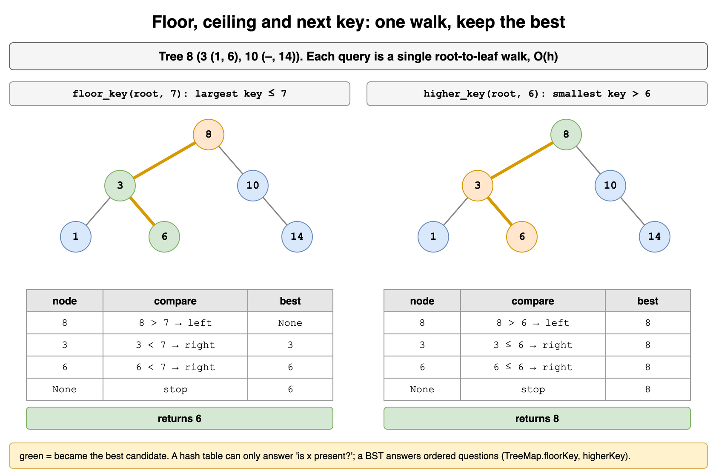

*Source: [`diagrams/trees.drawio`](/content/07_Data_Structures_and_Algorithms/05_Trees/diagrams/trees.drawio), page 15.*

## Tree rotations

AVL and Red-Black trees keep height O(log N) using one primitive: the **rotation**. A rotation re-hangs a parent and child so the child moves up one level and the parent moves down, while keeping in-order (sorted) order exactly the same. It only rewires three pointers, so it is O(1).

A right rotation at node `y` with left child `x`: `x` becomes the new subtree root, `y` becomes `x`'s right child, and `x`'s old right subtree becomes `y`'s new left subtree. A left rotation is the mirror image. A sorted-order insert that creates a left-leaning chain is fixed by one right rotation at the top.

```python
class TreeNode:
    def __init__(self, val, left=None, right=None):
        self.val = val
        self.left = left
        self.right = right


def rotate_right(y):
    x = y.left
    y.left = x.right    # x's right subtree moves under y
    x.right = y
    return x            # new subtree root


def rotate_left(x):
    y = x.right
    x.right = y.left
    y.left = x
    return y


def inorder(n):
    return inorder(n.left) + [n.val] + inorder(n.right) if n else []


def height(n):
    return 1 + max(height(n.left), height(n.right)) if n else -1


# Chain from inserting 30, 20, 10:   30 -> 20 -> 10 (all left children)
chain = TreeNode(30, TreeNode(20, TreeNode(10)))
print(inorder(chain), height(chain))  # [10, 20, 30] 2
fixed = rotate_right(chain)
print(fixed.val, inorder(fixed), height(fixed))  # 20 [10, 20, 30] 1
print(inorder(rotate_left(fixed)))  # [10, 20, 30]
```

You will rarely implement a full AVL or Red-Black tree in an interview, but you should be able to draw a rotation, explain that it preserves the BST order, and explain that the balancing rules decide *when* to rotate.

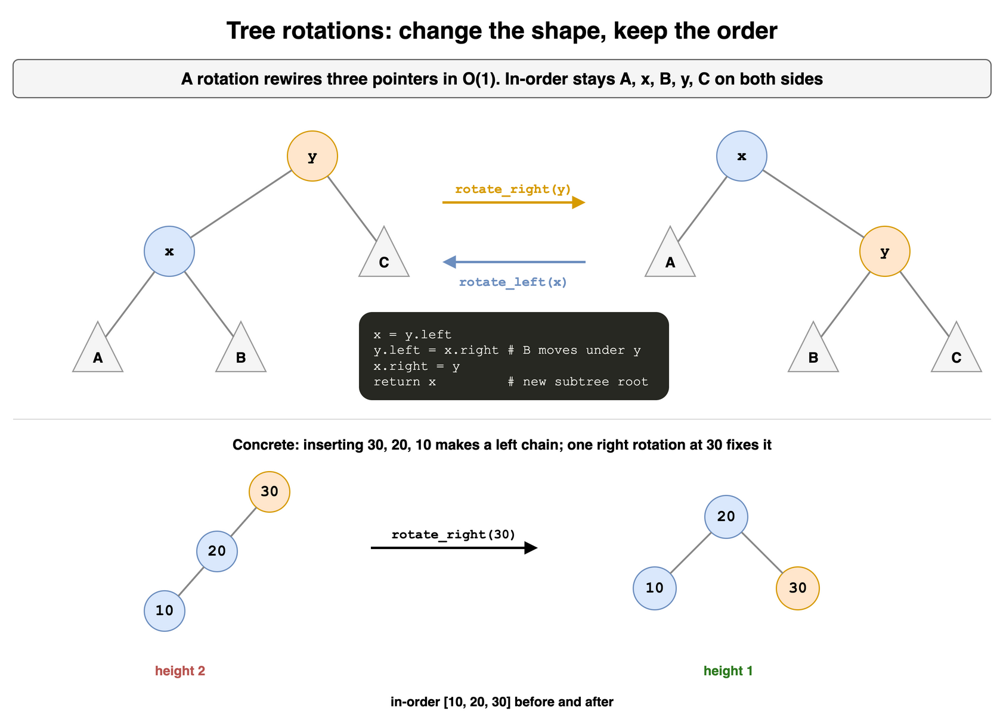

*Source: [`diagrams/trees.drawio`](/content/07_Data_Structures_and_Algorithms/05_Trees/diagrams/trees.drawio), page 16.*

## Recursive vs. iterative DFS

Recursive traversals are short because the language's call stack remembers where you were. You can always replace that with an explicit stack. The iterative version matters when trees are deep: CPython's default recursion limit is about 1000 frames, so a skewed tree with 5000 nodes crashes a recursive traversal with `RecursionError`, while the iterative one is fine.

Pre-order is the easiest to convert: pop a node, visit it, push its right child and then its left child (so the left is popped first). In-order uses a "go left as far as possible, then pop and go right" loop.

```python
class TreeNode:
    def __init__(self, val, left=None, right=None):
        self.val = val
        self.left = left
        self.right = right


def preorder_iter(root):
    out, stack = [], [root] if root else []
    while stack:
        node = stack.pop()
        out.append(node.val)
        if node.right:
            stack.append(node.right)   # pushed first, popped last
        if node.left:
            stack.append(node.left)
    return out


def inorder_iter(root):
    out, stack, node = [], [], root
    while stack or node:
        while node:                    # slide down the left spine
            stack.append(node)
            node = node.left
        node = stack.pop()
        out.append(node.val)
        node = node.right
    return out


root = TreeNode(5, TreeNode(3, TreeNode(1), TreeNode(4)), TreeNode(8))
print(preorder_iter(root))  # [5, 3, 1, 4, 8]
print(inorder_iter(root))   # [1, 3, 4, 5, 8]

# A 5000-node right-leaning chain: recursion would hit the default limit
deep = None
for v in range(5000, 0, -1):
    deep = TreeNode(v, None, deep)
print(len(inorder_iter(deep)))  # 5000
```

Both versions are O(N) time and O(h) extra space. The trade-off is clarity versus robustness: start with recursion in an interview, then mention the explicit-stack version when depth could be large.

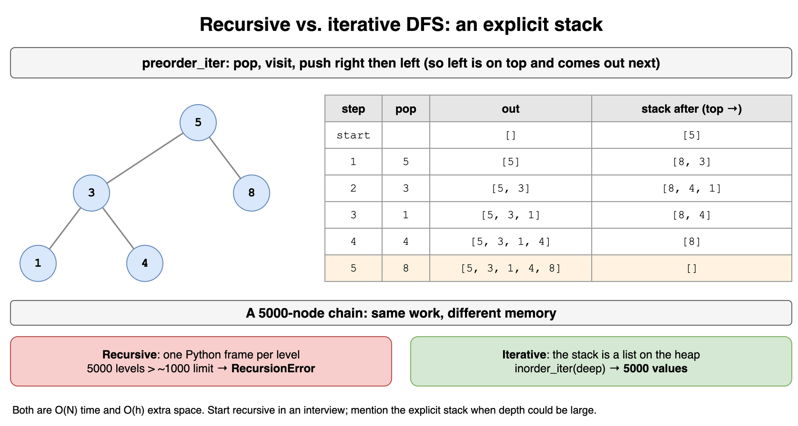

*Source: [`diagrams/trees.drawio`](/content/07_Data_Structures_and_Algorithms/05_Trees/diagrams/trees.drawio), page 17.*

## Tree serialization

To save a tree to a file or send it over the network you must flatten it into a sequence and later rebuild exactly the same shape. A plain pre-order list of values is not enough: the trees `1 -> left 2` and `1 -> right 2` both produce `[1, 2]`. The fix is to record the empty children too. A pre-order walk that writes a marker (here `#`) for every `None` produces a sequence that maps to exactly one tree.

Rebuilding reads the tokens in the same order: a value creates a node and then recursively builds its left and right children; a marker returns `None`.

```python
class TreeNode:
    def __init__(self, val, left=None, right=None):
        self.val = val
        self.left = left
        self.right = right


def serialize(node):
    if node is None:
        return "#"
    return f"{node.val},{serialize(node.left)},{serialize(node.right)}"


def deserialize(data):
    tokens = iter(data.split(","))

    def build():
        tok = next(tokens)
        if tok == "#":
            return None
        node = TreeNode(int(tok))
        node.left = build()
        node.right = build()
        return node

    return build()


left_only = TreeNode(1, TreeNode(2))
right_only = TreeNode(1, None, TreeNode(2))
print(serialize(left_only))   # 1,2,#,#,#
print(serialize(right_only))  # 1,#,2,#,#

root = TreeNode(5, TreeNode(3, TreeNode(1), TreeNode(4)), TreeNode(8))
s = serialize(root)
print(serialize(deserialize(s)) == s)  # True
```

A tree with N nodes has N + 1 null slots, so the output has 2N + 1 tokens: O(N) time and space both ways. Level-order with markers (the format many online judges display) works too; pick pre-order when you want the simplest recursive code.

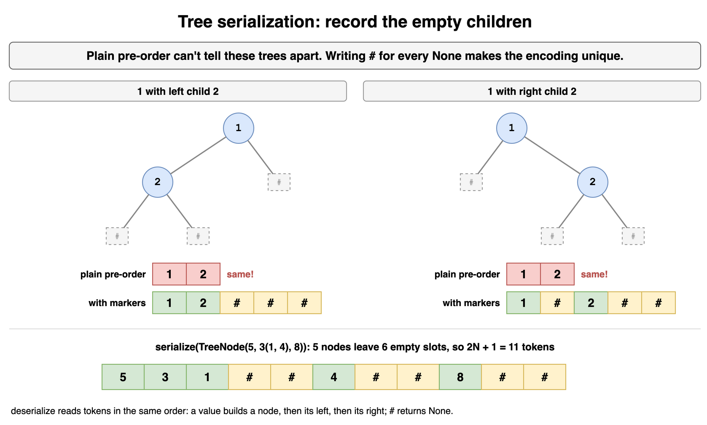

*Source: [`diagrams/trees.drawio`](/content/07_Data_Structures_and_Algorithms/05_Trees/diagrams/trees.drawio), page 18.*

## N-ary trees

Not every tree is binary. File systems, organisation charts, the HTML DOM, and parsed JSON are **N-ary** trees: each node can have any number of children. Represent them with a `children` list. Every traversal idea carries over: pre-order visits the node then each child, post-order visits every child then the node, and level-order uses the same queue. Only in-order has no natural meaning, because there is no single "middle" to visit between two children.

Height becomes `1 + max(child heights)` and size becomes `1 + sum(child sizes)`. Post-order is the natural fit for aggregates such as total directory size.

```python
from collections import deque


class Node:
    def __init__(self, name, size=0, children=None):
        self.name = name
        self.size = size
        self.children = children or []


def total_size(node):
    """Post-order: children first, then add our own size."""
    return node.size + sum(total_size(c) for c in node.children)


def height(node):
    return 1 + max((height(c) for c in node.children), default=-1)


def level_names(root):
    out, queue = [], deque([root])
    while queue:
        node = queue.popleft()
        out.append(node.name)
        queue.extend(node.children)
    return out


fs = Node("/", 0, [
    Node("docs", 0, [Node("a.txt", 4), Node("b.txt", 6)]),
    Node("img", 0, [Node("c.png", 30)]),
    Node("readme", 1),
])
print(total_size(fs))   # 41
print(height(fs))       # 2
print(level_names(fs))  # ['/', 'docs', 'img', 'readme', 'a.txt', 'b.txt', 'c.png']
```

Any N-ary tree can also be stored as a binary tree using the "first child, next sibling" encoding (left pointer = first child, right pointer = next sibling), which is how some older file systems and compilers store them. You mostly need to recognise it, not implement it.

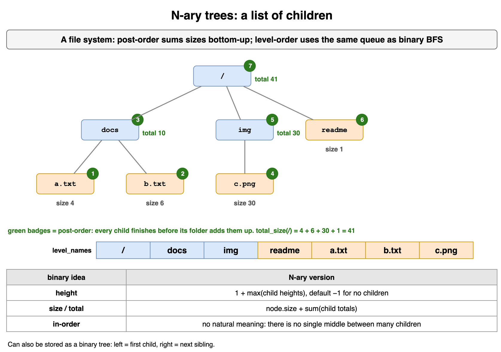

*Source: [`diagrams/trees.drawio`](/content/07_Data_Structures_and_Algorithms/05_Trees/diagrams/trees.drawio), page 19.*
