## Binary heap

A binary heap is a complete binary tree -- every level is fully filled except possibly the last, which is filled from left to right -- combined with a heap property that constrains every parent-child relationship. The shape property guarantees the tree stays balanced without rotations or rebalancing logic, and the heap property ensures the root always holds the extreme value (minimum or maximum).

This combination makes heaps ideal for priority queues. Insertion and extraction both run in O(log N) because the tree height is always floor(log2 N), and you never need to touch more than one path from root to leaf. Unlike a BST, a heap does not maintain a total ordering of elements -- siblings have no defined relationship -- but it guarantees constant-time access to the extremum.

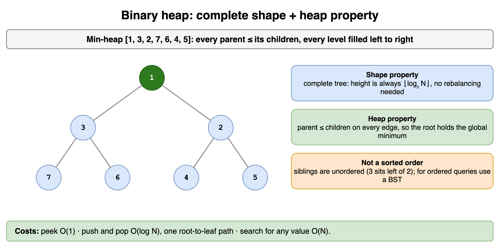

*Source: [`diagrams/heaps-and-tries.drawio`](/content/07_Data_Structures_and_Algorithms/06_Heaps_and_Tries/diagrams/heaps-and-tries.drawio), page 1.*

This min-heap satisfies two invariants: every level is filled left-to-right (shape property), and every parent is less than or equal to both its children (heap property). The root always holds the global minimum.

## Min-heap vs. max-heap

A min-heap enforces parent <= children, so the smallest element is always at the root. A max-heap enforces parent >= children, so the largest element is at the root. The choice depends on what you need fast access to: the minimum or the maximum.

Python's `heapq` module implements a min-heap. If you need a max-heap, the standard trick is to negate values on insert and negate again on extraction. This is not a hack -- it is the idiomatic Python approach because the standard library chose not to duplicate the entire API for max-heaps.

```python
import heapq

# Min-heap: smallest value comes out first
min_heap = [5, 3, 8, 1, 2]
heapq.heapify(min_heap)
print(heapq.heappop(min_heap))  # 1

# Max-heap via negation: largest value comes out first
max_heap = [-v for v in [5, 3, 8, 1, 2]]
heapq.heapify(max_heap)
print(-heapq.heappop(max_heap))  # 8
```

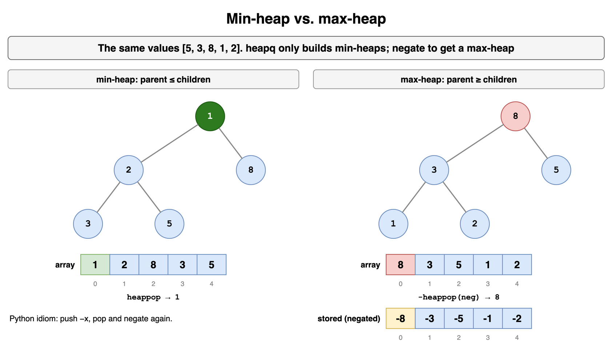

*Source: [`diagrams/heaps-and-tries.drawio`](/content/07_Data_Structures_and_Algorithms/06_Heaps_and_Tries/diagrams/heaps-and-tries.drawio), page 2.*

## Array representation

A binary heap is almost always stored as a flat array rather than a tree of linked nodes. The complete-tree shape property guarantees that the mapping from tree positions to array indices is dense with no gaps.

For a node at index `i`: its left child is at `2i + 1`, its right child is at `2i + 2`, and its parent is at `(i - 1) // 2`. This eliminates pointer overhead entirely and gives excellent cache locality because parent-child traversals are simple arithmetic on adjacent memory.

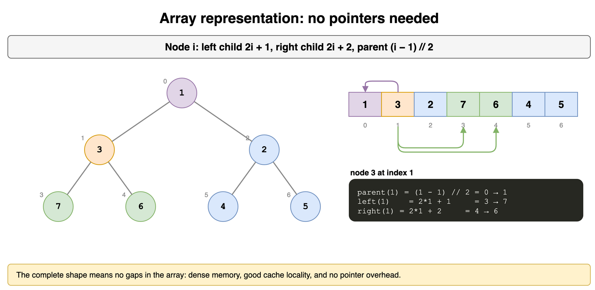

*Source: [`diagrams/heaps-and-tries.drawio`](/content/07_Data_Structures_and_Algorithms/06_Heaps_and_Tries/diagrams/heaps-and-tries.drawio), page 3.*

```python
def parent(i: int) -> int:
    return (i - 1) // 2

def left_child(i: int) -> int:
    return 2 * i + 1

def right_child(i: int) -> int:
    return 2 * i + 2

# Example: node at index 1 (value 3)
heap = [1, 3, 2, 7, 6, 4, 5]
i = 1
print(f"Node: {heap[i]}")                        # 3
print(f"Parent: {heap[parent(i)]}")               # 1
print(f"Left child: {heap[left_child(i)]}")       # 7
print(f"Right child: {heap[right_child(i)]}")     # 6
```

## Heap insert (sift up)

Inserting into a heap has two steps. First, place the new element at the next available position at the bottom level (maintaining the shape property). Second, compare it with its parent and swap upward repeatedly until the heap property is restored or it reaches the root. This upward movement is called bubble up or sift up.

The cost is O(log N) because the element can travel at most from the bottom of the tree to the root, and the tree height is log2 N. In practice, most insertions require far fewer swaps because the new element is unlikely to be the new global extremum.

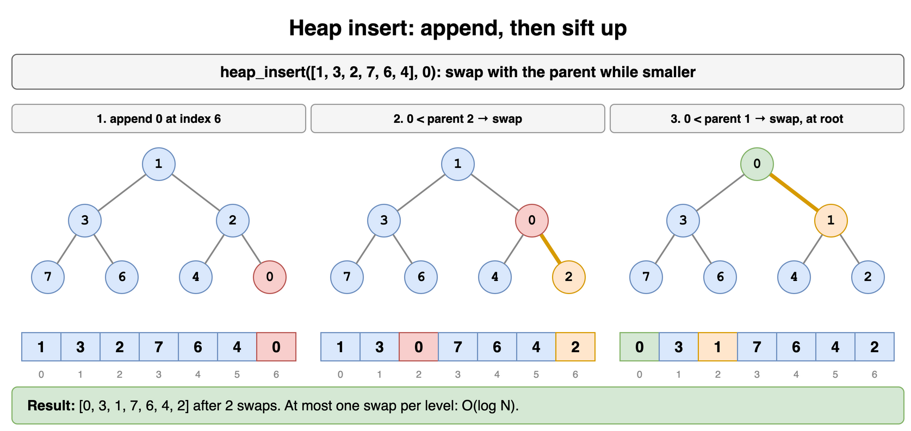

*Source: [`diagrams/heaps-and-tries.drawio`](/content/07_Data_Structures_and_Algorithms/06_Heaps_and_Tries/diagrams/heaps-and-tries.drawio), page 4.*

```python
def heap_insert(heap: list[int], value: int) -> None:
    """Insert value and restore the min-heap property via sift up."""
    heap.append(value)
    i = len(heap) - 1
    while i > 0:
        parent = (i - 1) // 2
        if heap[i] < heap[parent]:
            heap[i], heap[parent] = heap[parent], heap[i]
            i = parent
        else:
            break

h = [1, 3, 2, 7, 6, 4]
heap_insert(h, 0)
print(h)  # [0, 3, 1, 7, 6, 4, 2]
```

## Extract min (sift down)

Extraction removes the root (the min or max element), replaces it with the last element in the array, and then sifts that element downward by swapping it with the smaller (in a min-heap) of its two children until the heap property is restored.

This is O(log N) for the same reason insertion is: the displaced element travels at most one root-to-leaf path. The key detail is choosing the correct child to swap with. In a min-heap, always swap with the smaller child; otherwise the heap property would be violated for the other child.

```python
def extract_min(heap: list[int]) -> int:
    """Remove and return the minimum element, then restore heap property."""
    if len(heap) == 1:
        return heap.pop()

    root = heap[0]
    heap[0] = heap.pop()  # move last element to root
    i = 0
    n = len(heap)

    while True:
        left = 2 * i + 1
        right = 2 * i + 2
        smallest = i

        if left < n and heap[left] < heap[smallest]:
            smallest = left
        if right < n and heap[right] < heap[smallest]:
            smallest = right
        if smallest == i:
            break

        heap[i], heap[smallest] = heap[smallest], heap[i]
        i = smallest

    return root

h = [1, 3, 2, 7, 6, 4, 5]
print(extract_min(h))  # 1
print(h)               # [2, 3, 4, 7, 6, 5]
```

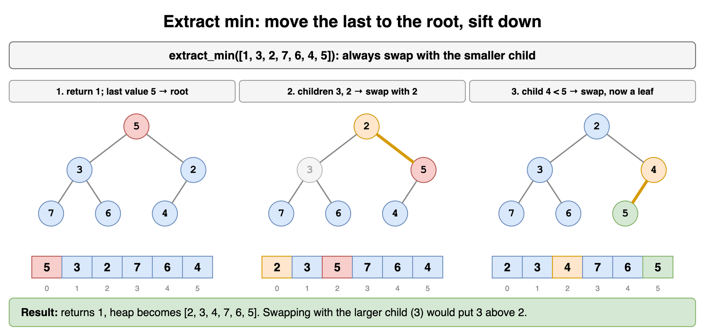

*Source: [`diagrams/heaps-and-tries.drawio`](/content/07_Data_Structures_and_Algorithms/06_Heaps_and_Tries/diagrams/heaps-and-tries.drawio), page 5.*

## Bottom-up heapify

The naive approach to building a heap -- inserting N elements one at a time -- costs O(N log N). But bottom-up heapify achieves O(N) by starting from the last non-leaf node and sifting each node downward. This works because the leaf nodes (roughly half the array) are already trivially valid heaps, and each sift-down operation at height h costs O(h).

The O(N) bound comes from summing the sift-down costs across all levels. Most nodes are near the bottom where h is small, and only one node (the root) has h = log N. The geometric sum works out to O(N). This is one of the few algorithms that is genuinely faster than it looks at first glance.

```python
import heapq

# Bottom-up heapify: O(N)
data = [9, 5, 6, 2, 3, 8, 1, 7, 4]
heapq.heapify(data)
print(data)  # [1, 2, 6, 4, 3, 8, 9, 7, 5]

# Manual bottom-up heapify to see the mechanics
def build_min_heap(arr: list[int]) -> None:
    """Convert arr into a min-heap in place. O(N)."""
    n = len(arr)
    # Start from last non-leaf node, sift each down
    for i in range(n // 2 - 1, -1, -1):
        _sift_down(arr, i, n)

def _sift_down(arr: list[int], i: int, n: int) -> None:
    while True:
        left = 2 * i + 1
        right = 2 * i + 2
        smallest = i
        if left < n and arr[left] < arr[smallest]:
            smallest = left
        if right < n and arr[right] < arr[smallest]:
            smallest = right
        if smallest == i:
            break
        arr[i], arr[smallest] = arr[smallest], arr[i]
        i = smallest

data2 = [9, 5, 6, 2, 3, 8, 1, 7, 4]
build_min_heap(data2)
print(data2)  # [1, 2, 6, 4, 3, 8, 9, 7, 5]
```

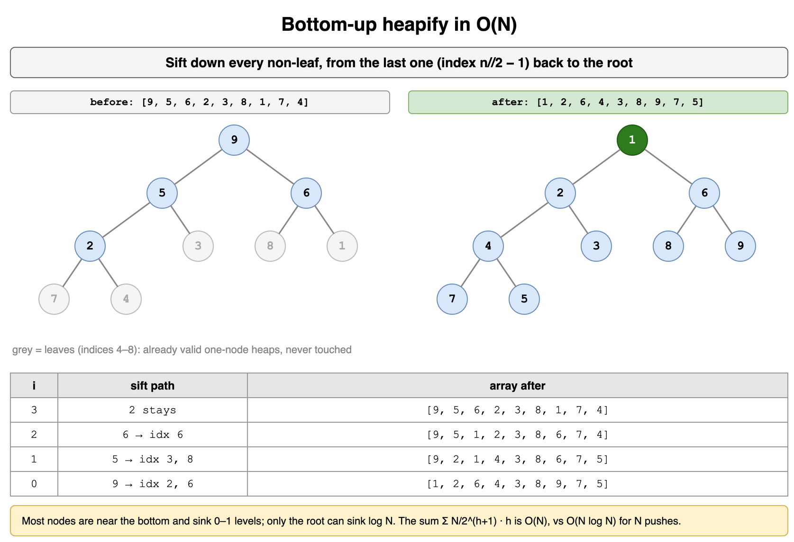

*Source: [`diagrams/heaps-and-tries.drawio`](/content/07_Data_Structures_and_Algorithms/06_Heaps_and_Tries/diagrams/heaps-and-tries.drawio), page 6.*

## Priority queue ADT

A priority queue is an interface, not a data structure: `push(item, priority)`, `pop()` the highest-priority item, `peek()` at it without removing, and `len()`. A binary heap is the usual implementation because it balances both sides of the trade-off.

| Implementation | push | pop | peek | Build from N |
|---|---|---|---|---|
| Unsorted list | O(1) | O(N) | O(N) | O(1) |
| Sorted list | O(N) | O(1) | O(1) | O(N log N) |
| Balanced BST | O(log N) | O(log N) | O(log N) or O(1) cached | O(N log N) |
| Binary heap | O(log N) | O(log N) | O(1) | O(N) |

Peek is O(1) because the extremum always sits at index 0. Two practical details matter in interviews. First, ties: push `(priority, sequence, item)` so equal priorities come out in insertion order and Python never has to compare the items themselves. Second, "priority" can be anything comparable -- a deadline, a distance, a negative score.

```python
import heapq
from itertools import count

class PriorityQueue:
    def __init__(self):
        self._heap: list[tuple[int, int, str]] = []
        self._seq = count()

    def push(self, item: str, priority: int) -> None:
        heapq.heappush(self._heap, (priority, next(self._seq), item))

    def peek(self) -> str:
        return self._heap[0][2]          # O(1): root of the heap

    def pop(self) -> str:
        return heapq.heappop(self._heap)[2]

    def __len__(self) -> int:
        return len(self._heap)

pq = PriorityQueue()
pq.push("email", 2)
pq.push("page oncall", 1)
pq.push("lunch", 2)
print(pq.peek())   # page oncall
print(pq.pop(), pq.pop(), pq.pop())  # page oncall email lunch
```

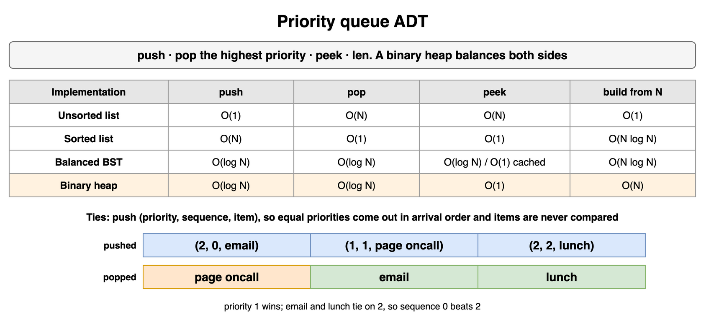

*Source: [`diagrams/heaps-and-tries.drawio`](/content/07_Data_Structures_and_Algorithms/06_Heaps_and_Tries/diagrams/heaps-and-tries.drawio), page 7.*

## Priority queue with heapq

Python's `heapq` module provides a min-heap implementation that operates directly on a regular list. There is no separate Heap class -- the list itself is the heap, and the module functions maintain the invariant. This design is lightweight but requires discipline: if you modify the list directly without going through `heapq`, the heap property may break.

The core operations are `heappush`, `heappop`, `heapify`, `heappushpop` (push then pop, more efficient than doing both separately), and `heapreplace` (pop then push). The convenience functions `nsmallest` and `nlargest` are useful when you need the top K elements from a collection without sorting the whole thing.

```python
import heapq

# Basic priority queue usage
tasks = []
heapq.heappush(tasks, (3, "low priority"))
heapq.heappush(tasks, (1, "urgent"))
heapq.heappush(tasks, (2, "normal"))

while tasks:
    priority, name = heapq.heappop(tasks)
    print(f"  [{priority}] {name}")
# [1] urgent
# [2] normal
# [3] low priority

# nsmallest / nlargest -- efficient for small K relative to N
scores = [82, 95, 67, 91, 74, 88, 56, 99]
print(heapq.nlargest(3, scores))   # [99, 95, 91]
print(heapq.nsmallest(3, scores))  # [56, 67, 74]

# Merging sorted iterables
a = [1, 4, 7]
b = [2, 5, 8]
c = [3, 6, 9]
print(list(heapq.merge(a, b, c)))  # [1, 2, 3, 4, 5, 6, 7, 8, 9]
```

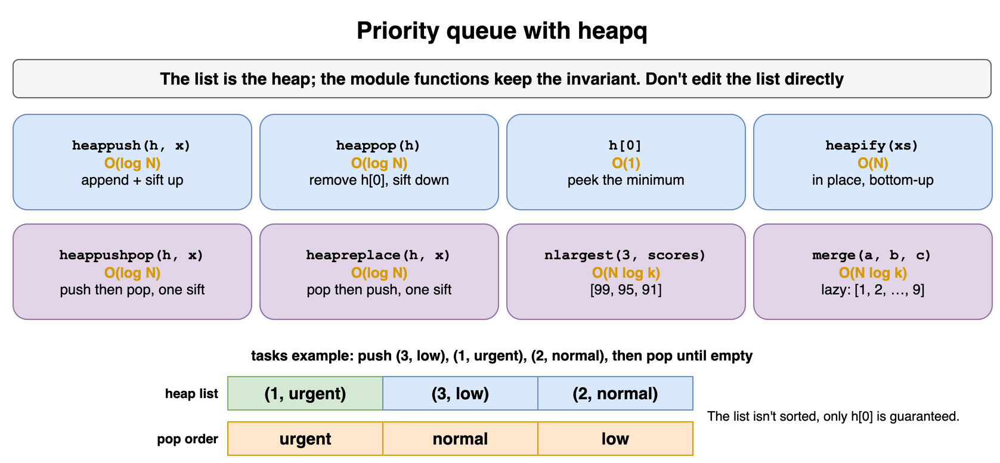

*Source: [`diagrams/heaps-and-tries.drawio`](/content/07_Data_Structures_and_Algorithms/06_Heaps_and_Tries/diagrams/heaps-and-tries.drawio), page 8.*

## Top-K with a bounded heap

To keep the K largest values from a long stream, hold a **min-heap of size K**. Its root is the smallest of your current top K -- the bar a new value must beat. If a new value is larger than the root, replace the root; otherwise ignore it. Every value costs at most O(log K), so the whole pass is O(N log K) time and O(K) space, and it works when N is too large to fit in memory.

The direction feels backwards at first: K *largest* uses a *min*-heap, and K *smallest* uses a max-heap (negate values in Python). The heap holds the winners and evicts the weakest winner.

| Approach | Time | Extra space | Streaming? |
|---|---|---|---|
| Sort everything | O(N log N) | O(N) | No |
| Heapify all, pop K | O(N + K log N) | O(N) | No |
| Size-K heap | O(N log K) | O(K) | Yes |
| Quickselect | O(N) average | O(N) | No |

```python
import heapq

def top_k(stream, k: int) -> list[int]:
    heap: list[int] = []
    for x in stream:
        if len(heap) < k:
            heapq.heappush(heap, x)
        elif x > heap[0]:
            heapq.heapreplace(heap, x)   # pop root, push x, one sift
    return sorted(heap, reverse=True)

print(top_k([5, 1, 9, 3, 7, 6, 8, 2], 3))  # [9, 8, 7]
```

`heapq.nlargest(k, iterable)` implements the same idea; write it by hand when the interviewer wants the mechanics or when the comparison is custom.

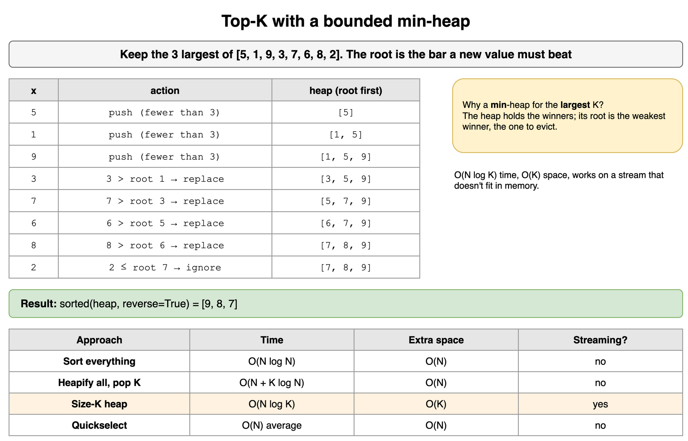

*Source: [`diagrams/heaps-and-tries.drawio`](/content/07_Data_Structures_and_Algorithms/06_Heaps_and_Tries/diagrams/heaps-and-tries.drawio), page 9.*

## Two heaps (running median)

Some problems need the value at a *split point* -- for example the middle of everything seen so far. Keep the lower half in a **max-heap** and the upper half in a **min-heap**. The two roots sit right next to the split, so the middle is always at one or both roots.

Two invariants keep it working: every value in the low heap is <= every value in the high heap, and the sizes differ by at most one. Each new value goes to one side, then at most one root moves across to rebalance. Adding is O(log N); reading the middle is O(1).

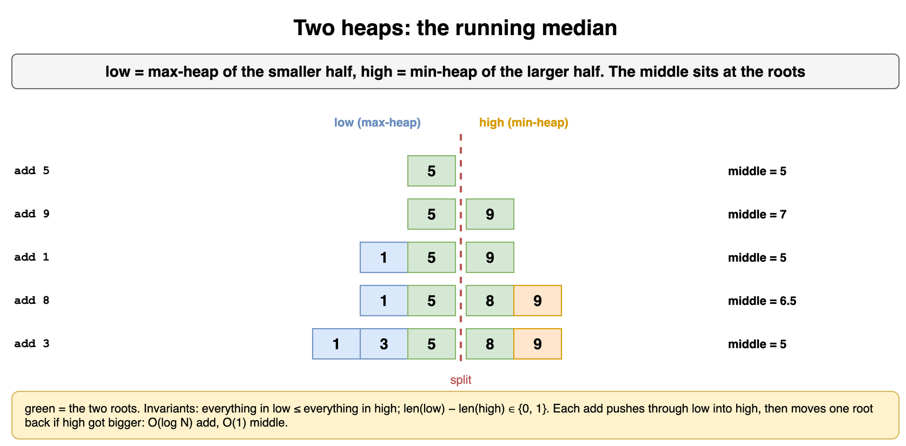

*Source: [`diagrams/heaps-and-tries.drawio`](/content/07_Data_Structures_and_Algorithms/06_Heaps_and_Tries/diagrams/heaps-and-tries.drawio), page 10.*

```python
import heapq

class MiddleTracker:
    def __init__(self):
        self.low: list[int] = []   # max-heap via negation
        self.high: list[int] = []  # min-heap

    def add(self, x: int) -> None:
        heapq.heappush(self.low, -x)
        heapq.heappush(self.high, -heapq.heappop(self.low))  # largest low -> high
        if len(self.high) > len(self.low):
            heapq.heappush(self.low, -heapq.heappop(self.high))

    def middle(self) -> float:
        if len(self.low) > len(self.high):
            return -self.low[0]
        return (-self.low[0] + self.high[0]) / 2

t = MiddleTracker()
for x in [5, 9, 1, 8, 3]:
    t.add(x)
print(t.middle())  # 5
```

The "push through the other heap" step guarantees the ordering invariant without any if/else on which side the value belongs to. The same layout works for any percentile: size the heaps in the ratio you need.

## Decrease-key and lazy deletion

A heap answers "what is the minimum?" fast but "where is item X?" slowly: finding an arbitrary entry is O(N) because siblings are unordered. That hurts when a priority changes (Dijkstra, schedulers) or a task is cancelled. Python's `heapq` has no decrease-key.

Two standard fixes:

- **Position map:** keep `pos[item] = index`, update it on every swap, then sift the changed entry up or down. True O(log N) decrease-key, but every swap must also update the map.
- **Lazy deletion:** do not touch the old entry. Push a new entry with the new priority and mark the old one stale (or remember the current best priority per item). When a stale entry reaches the root, discard it. Simple and the usual choice in Python; the heap can hold up to one entry per push, so cost stays O(log P) for P pushes.

```python
import heapq

heap: list[tuple[int, str]] = []
best: dict[str, int] = {}

def set_priority(task: str, p: int) -> None:
    best[task] = p
    heapq.heappush(heap, (p, task))

def cancel(task: str) -> None:
    best.pop(task, None)

def pop_task() -> str | None:
    while heap:
        p, task = heapq.heappop(heap)
        if best.get(task) == p:      # skip stale or cancelled entries
            del best[task]
            return task
    return None

set_priority("backup", 5)
set_priority("deploy", 3)
set_priority("backup", 1)   # decrease-key: old (5, backup) becomes stale
cancel("deploy")
print(pop_task())  # backup
print(pop_task())  # None
```

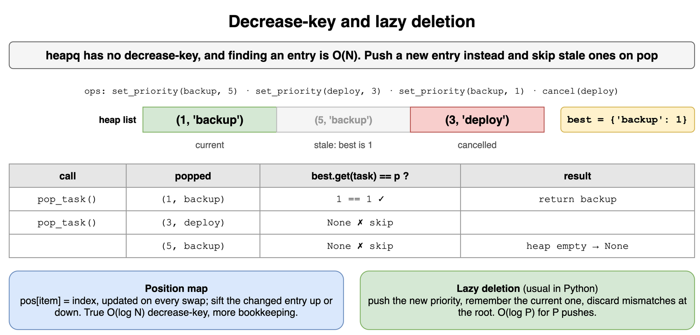

*Source: [`diagrams/heaps-and-tries.drawio`](/content/07_Data_Structures_and_Algorithms/06_Heaps_and_Tries/diagrams/heaps-and-tries.drawio), page 11.*

## Heap sort

Heap sort reuses the two heap operations to sort an array in place. Build a **max-heap** over the whole array in O(N). Then repeat: swap the root (the largest remaining value) with the last element of the heap region, shrink the region by one, and sift the new root down. The sorted suffix grows from the right.

It runs in O(N log N) in the worst case with O(1) extra space, which is a guarantee neither quicksort (O(N^2) worst case) nor merge sort (O(N) extra space) gives. It is not stable, and in practice it is slower than quicksort or Timsort because sift-down jumps around memory. Its real-world role is as a safety net, for example the fallback inside introsort.

```python
def heap_sort(a: list[int]) -> None:
    def sift_down(i: int, n: int) -> None:
        while True:
            big, l, r = i, 2 * i + 1, 2 * i + 2
            if l < n and a[l] > a[big]:
                big = l
            if r < n and a[r] > a[big]:
                big = r
            if big == i:
                return
            a[i], a[big] = a[big], a[i]
            i = big

    n = len(a)
    for i in range(n // 2 - 1, -1, -1):  # build max-heap, O(N)
        sift_down(i, n)
    for end in range(n - 1, 0, -1):      # move max to the end, shrink
        a[0], a[end] = a[end], a[0]
        sift_down(0, end)

nums = [4, 10, 3, 5, 1, 8]
heap_sort(nums)
print(nums)  # [1, 3, 4, 5, 8, 10]
```

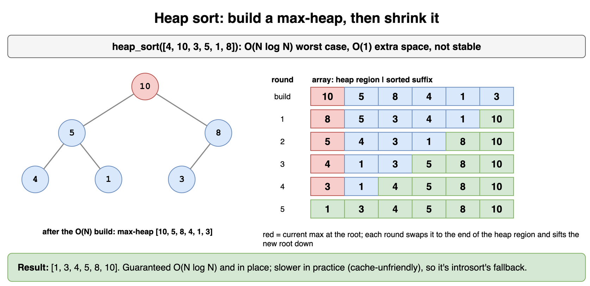

*Source: [`diagrams/heaps-and-tries.drawio`](/content/07_Data_Structures_and_Algorithms/06_Heaps_and_Tries/diagrams/heaps-and-tries.drawio), page 12.*

## When not to use a heap

A heap is the right tool when you repeatedly need the current extremum while items keep arriving. Outside that shape, something simpler or richer usually wins.

| Need | Better choice | Why |
|---|---|---|
| The minimum once | `min(xs)` | O(N), no setup |
| Everything in order | `sorted(xs)` | Same O(N log N), simpler, faster constants |
| Search, delete any item, range queries, ordered iteration | Balanced BST / sorted container | Heap has O(N) search and no order between siblings |
| Both min and max repeatedly | BST, or two heaps with lazy deletion | One heap only exposes one end |
| Priorities from a small integer range | Bucket array (list of queues) | O(1) push and near-O(1) pop |
| K close to N | Sort | O(N log K) is no better than O(N log N) |

```python
from collections import deque

# Bucket queue: priorities 0..3, O(1) push, scan few buckets to pop
buckets = [deque() for _ in range(4)]
for task, p in [("logs", 3), ("alert", 0), ("email", 2), ("page", 0)]:
    buckets[p].append(task)

order = [t for b in buckets for t in b]
print(order)  # ['alert', 'page', 'email', 'logs']
```

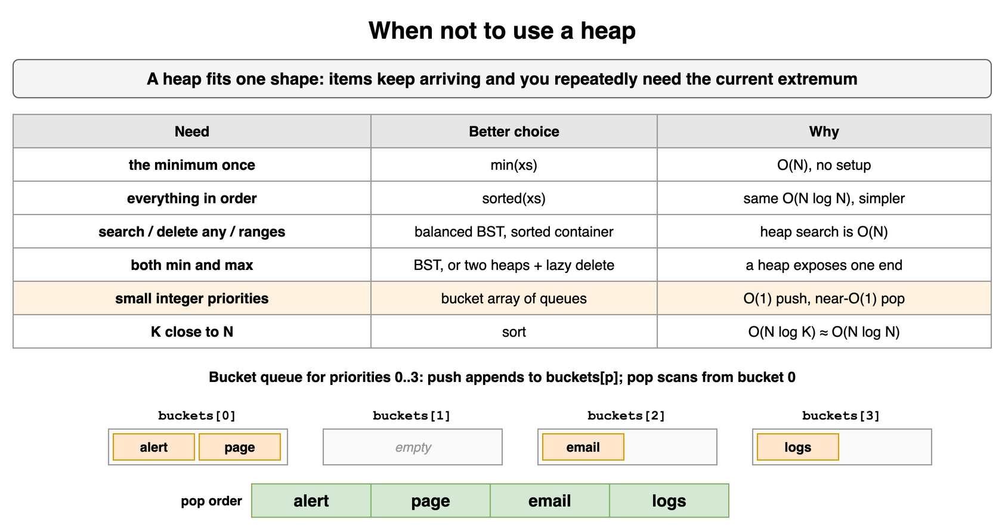

*Source: [`diagrams/heaps-and-tries.drawio`](/content/07_Data_Structures_and_Algorithms/06_Heaps_and_Tries/diagrams/heaps-and-tries.drawio), page 13.*

## Trie (prefix tree)

A trie is an N-ary tree where each edge represents a character and each path from the root to a marked terminal node spells out a stored word. Unlike a hash table, a trie shares prefixes: the words "cat", "car", "card", and "care" all share the path c-a, which means the trie stores common prefixes exactly once.

This shared-prefix property makes tries the natural choice for autocomplete, spell checking, IP routing tables, and any problem where you need to find all strings with a given prefix. The trade-off is memory: each node may have up to 26 (or more) child pointers, and sparse tries can waste significant space compared to a flat hash table (see the children card below).

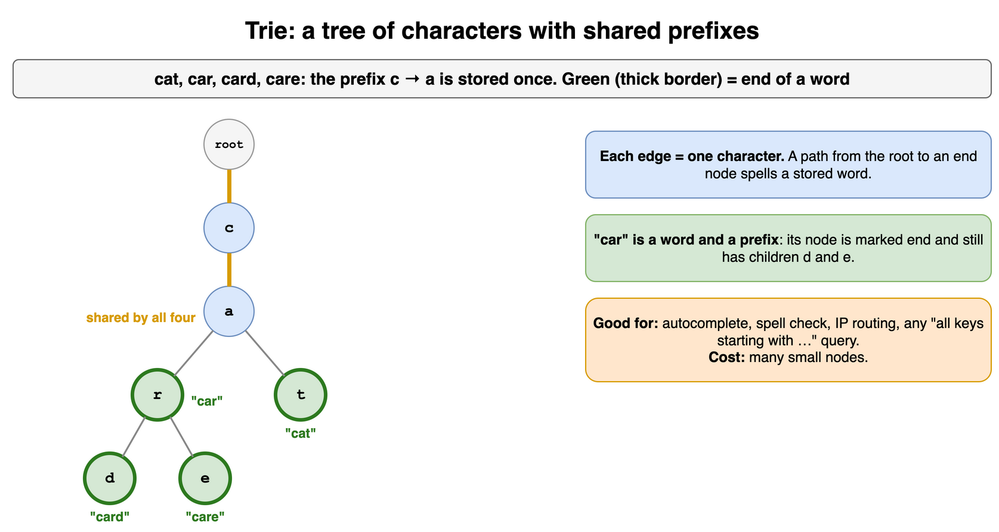

*Source: [`diagrams/heaps-and-tries.drawio`](/content/07_Data_Structures_and_Algorithms/06_Heaps_and_Tries/diagrams/heaps-and-tries.drawio), page 14.*

Green nodes with a thick border are terminal nodes indicating a complete word. The path from the root to each one spells: "cat", "car", "card", "care". Notice how "car" is both a complete word and a prefix for "card" and "care".

```python
class TrieNode:
    __slots__ = ("children", "is_end")

    def __init__(self):
        self.children: dict[str, "TrieNode"] = {}
        self.is_end: bool = False

class Trie:
    def __init__(self):
        self.root = TrieNode()

    def insert(self, word: str) -> None:
        node = self.root
        for ch in word:
            if ch not in node.children:
                node.children[ch] = TrieNode()
            node = node.children[ch]
        node.is_end = True

trie = Trie()
for w in ["cat", "car", "card", "care"]:
    trie.insert(w)
```

## Trie insert and search

Insert and search both walk one edge per character, so they cost O(K) for a key of length K -- independent of how many words are stored. Whether the trie holds 100 words or 100,000, looking up "card" follows exactly 4 edges.

The **end-of-word marker** is what makes exact search correct. Paths are shared, so "car" is both a stored word and the start of "card". Reaching the node for "ca" proves only that some word starts with "ca". Exact search must check `is_end` at the last node; prefix search must not. Variants replace the boolean with a count (to support duplicates) or a stored value (turning the trie into a string-keyed map).

```python
class TrieNode:
    __slots__ = ("children", "is_end")

    def __init__(self):
        self.children: dict[str, "TrieNode"] = {}
        self.is_end: bool = False

class Trie:
    def __init__(self):
        self.root = TrieNode()

    def insert(self, word: str) -> None:
        node = self.root
        for ch in word:
            node = node.children.setdefault(ch, TrieNode())
        node.is_end = True

    def _find_node(self, prefix: str) -> TrieNode | None:
        node = self.root
        for ch in prefix:
            node = node.children.get(ch)
            if node is None:
                return None
        return node

    def search(self, word: str) -> bool:
        node = self._find_node(word)
        return node is not None and node.is_end

    def starts_with(self, prefix: str) -> bool:
        return self._find_node(prefix) is not None

trie = Trie()
for word in ["cat", "car", "card", "care", "do", "dog"]:
    trie.insert(word)

print(trie.search("car"))       # True
print(trie.search("ca"))        # False
print(trie.starts_with("ca"))   # True
print(trie.search("cards"))     # False
```

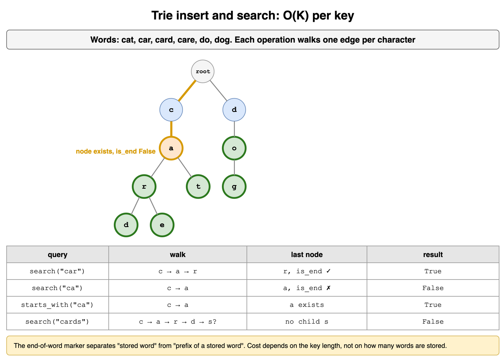

*Source: [`diagrams/heaps-and-tries.drawio`](/content/07_Data_Structures_and_Algorithms/06_Heaps_and_Tries/diagrams/heaps-and-tries.drawio), page 15.*

## Prefix collection (autocomplete)

Autocomplete is two phases: walk down to the prefix node in O(P), then depth-first search its subtree, recording a word every time you pass an `is_end` node. Visiting children in sorted order returns the words in lexicographic order for free. The cost is O(P + size of the subtree), not O(total words), and you can stop early once you have enough suggestions.

When the prefix arrives one keystroke at a time, do not re-walk from the root each time. Keep a **node cursor**: the node for the text typed so far. Each new character moves the cursor one edge (O(1)), and a `None` cursor means no stored word continues, so the caller can stop searching. Passing the current node into a recursive helper is the same idea -- it lets related prefix checks share work.

```python
class TrieNode:
    def __init__(self):
        self.children: dict[str, "TrieNode"] = {}
        self.is_end = False

def build(words: list[str]) -> TrieNode:
    root = TrieNode()
    for w in words:
        node = root
        for ch in w:
            node = node.children.setdefault(ch, TrieNode())
        node.is_end = True
    return root

def collect(node: TrieNode, prefix: str, limit: int) -> list[str]:
    out: list[str] = []
    def dfs(n: TrieNode, path: str) -> None:
        if len(out) == limit:
            return
        if n.is_end:
            out.append(path)
        for ch in sorted(n.children):
            dfs(n.children[ch], path + ch)
    dfs(node, prefix)
    return out

root = build(["tea", "team", "tear", "ten", "toast"])
cursor, typed = root, ""
for ch in "tea":                        # one keystroke at a time
    cursor = cursor.children.get(ch) if cursor else None
    typed += ch
    print(typed, collect(cursor, typed, 2) if cursor else [])
# t ['tea', 'team']
# te ['tea', 'team']
# tea ['tea', 'team']
```

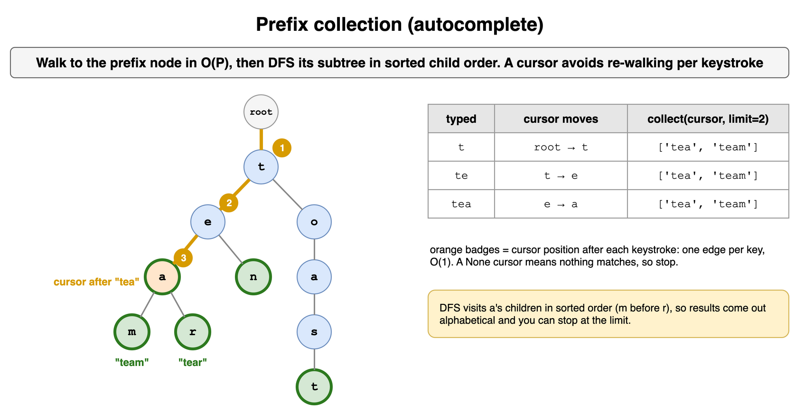

*Source: [`diagrams/heaps-and-tries.drawio`](/content/07_Data_Structures_and_Algorithms/06_Heaps_and_Tries/diagrams/heaps-and-tries.drawio), page 16.*

## Dict vs. array children

Each node needs a map from character to child. The two common choices trade speed and simplicity against memory and alphabet flexibility.

| | Fixed array (e.g. 26 slots) | `dict` |
|---|---|---|
| Child lookup | Index arithmetic, `ord(ch) - ord("a")` | Hash lookup |
| Memory per node | Always 26 slots, even with one child | Only existing edges (plus dict overhead) |
| Alphabet | Must be known and small | Anything hashable, including Unicode |
| Sorted iteration | Slot order is alphabetical | Needs `sorted()` |

A trie built from words with C total characters has at most C + 1 nodes, so worst-case space is O(C x alphabet) for arrays and O(C) for dicts. Many nodes in a sparse trie have a single child; a **radix tree** (compressed trie) merges those chains into one edge labelled with a substring, cutting node count sharply.

```python
class ArrayTrieNode:
    __slots__ = ("children", "is_end")

    def __init__(self):
        self.children: list["ArrayTrieNode | None"] = [None] * 26
        self.is_end = False

def insert(root: ArrayTrieNode, word: str) -> None:
    node = root
    for ch in word:
        i = ord(ch) - ord("a")
        if node.children[i] is None:
            node.children[i] = ArrayTrieNode()
        node = node.children[i]
    node.is_end = True

root = ArrayTrieNode()
insert(root, "ox")
print(sum(c is not None for c in root.children))  # 1
print(len(root.children))                         # 26
```

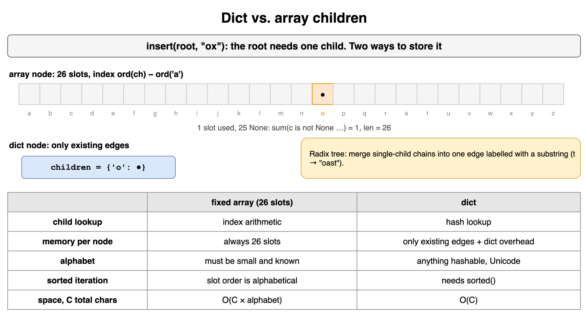

*Source: [`diagrams/heaps-and-tries.drawio`](/content/07_Data_Structures_and_Algorithms/06_Heaps_and_Tries/diagrams/heaps-and-tries.drawio), page 17.*

## Trie deletion

Deleting a word has two parts. First, clear `is_end` on its last node -- that alone makes `search` return False. Second, prune nodes that no longer lead anywhere: walking back up, remove a child if it has no children of its own and is not the end of another word. Stop pruning at the first node that is still needed, because a shorter word or a sibling branch shares the path above it.

A recursive helper that returns "you may delete me" keeps the bottom-up logic clean. If deletes are rare, unmarking only (lazy deletion) is acceptable; the dead branch just costs memory.

```python
class TrieNode:
    def __init__(self):
        self.children: dict[str, "TrieNode"] = {}
        self.is_end = False

def insert(root: TrieNode, word: str) -> None:
    node = root
    for ch in word:
        node = node.children.setdefault(ch, TrieNode())
    node.is_end = True

def delete(node: TrieNode, word: str, i: int = 0) -> bool:
    """Remove word below node; return True if node itself can be removed."""
    if i == len(word):
        node.is_end = False
    else:
        child = node.children.get(word[i])
        if child is None:
            return False                  # word not present
        if delete(child, word, i + 1):
            del node.children[word[i]]
    return not node.is_end and not node.children

def count_nodes(n: TrieNode) -> int:
    return 1 + sum(count_nodes(c) for c in n.children.values())

root = TrieNode()
for w in ["car", "card", "cat"]:
    insert(root, w)
print(count_nodes(root))  # 6
delete(root, "card")
print(count_nodes(root))  # 5
delete(root, "car")
print(count_nodes(root))  # 4
```

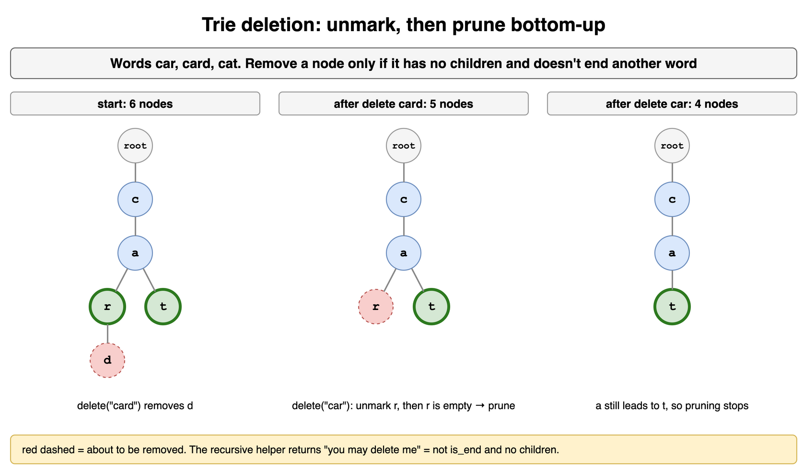

*Source: [`diagrams/heaps-and-tries.drawio`](/content/07_Data_Structures_and_Algorithms/06_Heaps_and_Tries/diagrams/heaps-and-tries.drawio), page 18.*

## Trie vs. hash table

Hash tables provide O(1) average-case exact-match lookup and are the right default for "is this word in the set?" queries. Tries provide O(K) lookup where K is the word length, which is technically slower for exact match because hash functions also process the full key but with lower constant overhead.

Where tries win decisively is prefix-based operations. Finding all words that start with "auto" in a hash table requires scanning every key. In a trie, you walk 4 edges to the "auto" node and then collect its subtree. This makes tries the foundation of autocomplete systems, T9 predictive text, DNS resolution, and IP routing (CIDR prefix matching). Tries also avoid hash collisions entirely and provide sorted iteration for free.

| Operation | Hash Table | Trie |
|-----------|-----------|------|
| Exact lookup | O(1) avg | O(K) |
| Prefix search | O(N) scan | O(K + matches) |
| Sorted iteration | O(N log N) sort | DFS in child order, O(total chars) |
| Space overhead | Low (flat) | High (per-node pointers) |
| Collision risk | Yes | None |

```python
# Hash set: fast exact match, useless for prefix queries
word_set = {"cat", "car", "card", "care", "cart"}
print("car" in word_set)  # True -- O(1)

# Finding all words with prefix "car" requires a full scan
prefix = "car"
matches = sorted(w for w in word_set if w.startswith(prefix))  # O(N) scan
print(matches)  # ['car', 'card', 'care', 'cart']

# Trie: same prefix query is O(K + matches), not O(N)
# With 1 million words in the set, the hash scan touches all 1M.
# The trie walks 3 edges to "car" and only visits matching subtree.
```

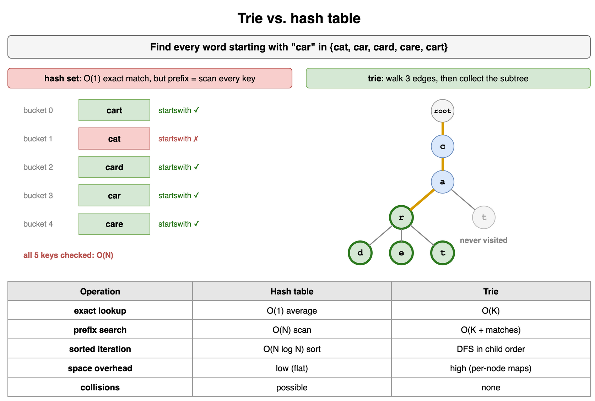

*Source: [`diagrams/heaps-and-tries.drawio`](/content/07_Data_Structures_and_Algorithms/06_Heaps_and_Tries/diagrams/heaps-and-tries.drawio), page 19.*
