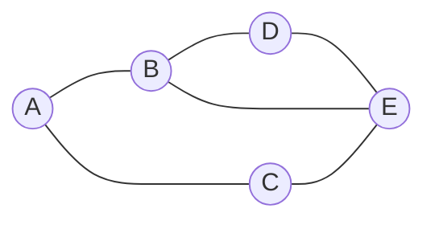
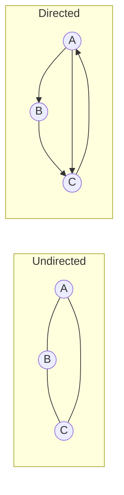
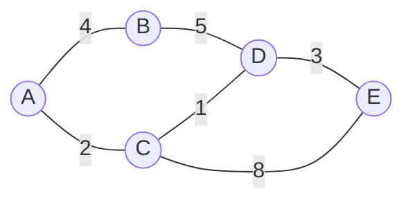
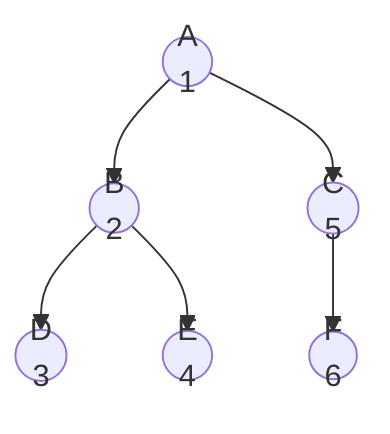
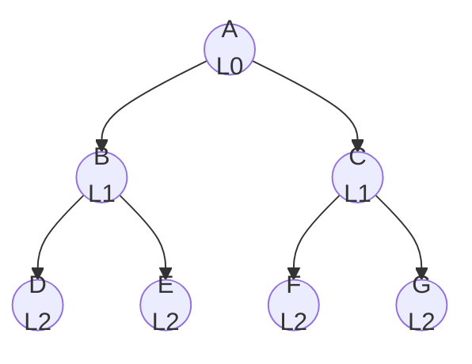
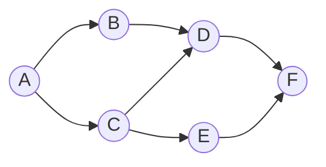

## Graph basics

A graph is a set of vertices V joined by a set of edges E. Nothing forces a hierarchy: there is no root, edges may form cycles, and the vertices can fall into several pieces that never touch. That freedom is why graphs model road maps, social networks, package dependencies, and state machines, where trees and lists are too rigid.

The degree of a vertex is the number of edges touching it. In an undirected graph the degrees always sum to 2E, because every edge is counted once at each end. A tree is the special case of a connected, acyclic, undirected graph with exactly V - 1 edges; linked lists and arrays are even narrower special cases. Complexity for graph algorithms is quoted in both V and E, because a graph can be sparse (E close to V) or dense (E close to V^2).



## Directed vs. undirected

In an undirected graph an edge between A and B can be walked either way. In a directed graph (digraph) the edge A -> B is one-way: it says nothing about B -> A. "Follows" on a social site, web links, and prerequisites are directed; friendships and two-way roads are undirected.

The choice changes the algorithms. Directed graphs track in-degree and out-degree separately, reachability is no longer symmetric, and cycle detection needs a different test. When you store an undirected graph in an adjacency list, add each edge in both directions; forgetting the reverse entry is a classic bug.



## Weighted vs. unweighted

In a weighted graph every edge carries a number: distance, time, cost, or capacity. In an unweighted graph every edge counts as one step. Weights decide which shortest-path tool applies: BFS counts hops, so it is only correct when every edge costs the same; once costs differ you need Dijkstra (non-negative weights) or Bellman-Ford (negative weights allowed).



Weights live next to the endpoints: an adjacency list stores `(neighbor, weight)` pairs, and an adjacency matrix stores the weight in the cell instead of a 1.

## Adjacency list

An adjacency list maps each vertex to the collection of its neighbors. It is the default in interviews and in practice because most real graphs are sparse. Space is O(V + E), and looping over a vertex's neighbors costs O(degree), which is exactly what BFS and DFS need.

Checking whether one specific edge exists costs O(degree) with a list; store neighbors in a set when you need O(1) edge checks. Also make sure vertices with no outgoing edges still appear as keys, or a traversal will hit a `KeyError` (a `defaultdict(list)` hides this, but also silently creates keys when you read).

```python
from collections import defaultdict


def build_adj(edges: list[tuple[str, str]], directed: bool) -> dict[str, list[str]]:
    adj: dict[str, list[str]] = defaultdict(list)
    for u, v in edges:
        adj[u].append(v)
        if directed:
            adj[v]  # touch so sinks still appear as keys
        else:
            adj[v].append(u)
    return dict(adj)


edges = [("A", "B"), ("A", "C"), ("B", "D"), ("C", "D"), ("D", "E")]
print(build_adj(edges, directed=True))
# {'A': ['B', 'C'], 'B': ['D'], 'C': ['D'], 'D': ['E'], 'E': []}
print(build_adj(edges, directed=False)["D"])  # ['B', 'C', 'E']

weighted: dict[str, list[tuple[str, int]]] = defaultdict(list)
weighted["A"].append(("B", 4))
weighted["A"].append(("C", 2))
print(weighted["A"])  # [('B', 4), ('C', 2)]
```

## Adjacency matrix

An adjacency matrix is a V x V grid where cell `[i][j]` holds 1 (or the edge weight) when there is an edge from vertex i to vertex j, and 0 otherwise. Edge lookup is O(1), but space is always O(V^2) and listing one vertex's neighbors costs O(V) even if it has two of them.

Reach for a matrix when the graph is dense, when V is small (a few hundred), or when the algorithm is naturally matrix-shaped, such as Floyd-Warshall all-pairs shortest paths. Vertices must first be mapped to integer indices.

```python
names = ["A", "B", "C", "D"]
idx = {v: i for i, v in enumerate(names)}
matrix = [[0] * len(names) for _ in names]
for u, v in [("A", "B"), ("A", "C"), ("B", "D"), ("C", "D")]:
    matrix[idx[u]][idx[v]] = 1

print(matrix[idx["A"]][idx["C"]])  # 1
print(matrix[idx["C"]][idx["A"]])  # 0
print([names[j] for j, bit in enumerate(matrix[idx["A"]]) if bit])  # ['B', 'C']
```

| | Adjacency list | Adjacency matrix |
|---|---|---|
| Space | O(V + E) | O(V^2) |
| Edge check | O(degree), O(1) with sets | O(1) |
| All neighbors of v | O(degree) | O(V) |
| Best for | Sparse graphs, traversals | Dense or small graphs, all-pairs |

## Edge lists and implicit graphs

Interview inputs rarely arrive as a ready adjacency list. Often you get an edge list (pairs like `[[0, 1], [1, 2]]`) and must build the list yourself in O(V + E). Just as often the graph is implicit: you never store it, you generate neighbors on demand.

A grid is the most common implicit graph: each cell is a vertex and its up, down, left, and right cells are neighbors. Puzzles are another: each state (a lock combination, a board position, a word) is a vertex, and one legal move is an edge. Spotting "states plus moves" is the step that turns a word problem into BFS.

```python
def grid_neighbors(r: int, c: int, rows: int, cols: int):
    for dr, dc in ((1, 0), (-1, 0), (0, 1), (0, -1)):
        nr, nc = r + dr, c + dc
        if 0 <= nr < rows and 0 <= nc < cols:
            yield nr, nc


def lock_neighbors(code: str):
    """Turn one wheel of a 4-digit lock up or down by one."""
    for i, ch in enumerate(code):
        d = int(ch)
        for nd in ((d + 1) % 10, (d - 1) % 10):
            yield code[:i] + str(nd) + code[i + 1 :]


print(list(grid_neighbors(0, 0, 3, 3)))  # [(1, 0), (0, 1)]
print(sorted(lock_neighbors("0000"))[:3])  # ['0001', '0009', '0010']
```

## Visited set

Graphs can contain cycles, so every traversal needs a record of vertices it has already reached. Without it, DFS recurses forever and BFS refills its queue forever. The visited set is also what makes BFS and DFS O(V + E): each vertex is processed once and each edge is examined once (twice for undirected).

In BFS, mark a vertex when you enqueue it, not when you dequeue it; otherwise the same vertex can sit in the queue many times. Some algorithms need more than two states: directed cycle detection uses three colors (unseen, on the current path, finished), and Dijkstra uses "finalized" rather than "seen". For implicit graphs, put the start in the visited set before the loop begins.

```python
from collections import deque


def reachable(adj: dict[int, list[int]], start: int) -> set[int]:
    seen = {start}
    queue = deque([start])
    while queue:
        u = queue.popleft()
        for v in adj[u]:
            if v not in seen:
                seen.add(v)  # mark on enqueue
                queue.append(v)
    return seen


cycle = {0: [1], 1: [2], 2: [0, 3], 3: []}
print(sorted(reachable(cycle, 0)))  # [0, 1, 2, 3]
```

## Depth-first search (DFS)

DFS follows one neighbor as far as it can, then backtracks to try the next. It uses the call stack (recursion) or an explicit stack, and runs in O(V + E) time with O(V) space for the visited set and the stack. DFS is the engine behind cycle detection, topological sort, connected components, and "is there any path" questions.

Python's default recursion limit is about 1000 frames, so a long chain (or a large grid) can crash recursive DFS. The iterative version pushes neighbors in reverse so it visits them in the same order as the recursive one.



The numbers show visit order: A goes deep through B, D, and E before backtracking to C and F.

```python
def dfs_recursive(graph: dict[str, list[str]], start: str) -> list[str]:
    visited: set[str] = set()
    order: list[str] = []

    def explore(v: str) -> None:
        visited.add(v)
        order.append(v)
        for nb in graph[v]:
            if nb not in visited:
                explore(nb)

    explore(start)
    return order


def dfs_iterative(graph: dict[str, list[str]], start: str) -> list[str]:
    visited: set[str] = set()
    order: list[str] = []
    stack = [start]
    while stack:
        v = stack.pop()
        if v in visited:
            continue
        visited.add(v)
        order.append(v)
        for nb in reversed(graph[v]):
            if nb not in visited:
                stack.append(nb)
    return order


graph = {"A": ["B", "C"], "B": ["D", "E"], "C": ["F"], "D": [], "E": [], "F": []}
print(dfs_recursive(graph, "A"))  # ['A', 'B', 'D', 'E', 'C', 'F']
print(dfs_iterative(graph, "A"))  # ['A', 'B', 'D', 'E', 'C', 'F']
```

## Breadth-first search (BFS)

BFS visits every vertex at distance 1 from the start, then every vertex at distance 2, and so on. It uses a FIFO queue, runs in O(V + E) time, and needs O(V) space for the queue and visited set. The queue can hold an entire layer at once, so on wide graphs BFS uses more memory than DFS.

The ring-by-ring order is the whole point: the first time BFS reaches a vertex, it has used the fewest possible edges. Use `collections.deque`; `list.pop(0)` is O(N) and turns BFS quadratic.



```python
from collections import deque


def bfs_layers(graph: dict[str, list[str]], start: str) -> list[list[str]]:
    seen = {start}
    layer = [start]
    layers: list[list[str]] = []
    while layer:
        layers.append(layer)
        nxt: list[str] = []
        for u in layer:
            for v in graph[u]:
                if v not in seen:
                    seen.add(v)
                    nxt.append(v)
        layer = nxt
    return layers


graph = {"A": ["B", "C"], "B": ["D", "E"], "C": ["F", "G"],
         "D": [], "E": [], "F": [], "G": []}
print(bfs_layers(graph, "A"))  # [['A'], ['B', 'C'], ['D', 'E', 'F', 'G']]
```

## BFS shortest path

Because BFS reaches each vertex by a fewest-edges route first, it solves shortest path in any unweighted graph. Record two maps as you go: `dist[v]` (hops from the start) and `parent[v]` (the vertex that discovered v). Store one parent pointer per vertex rather than a full path per queue entry; copying paths costs O(V) per enqueue.

To rebuild the route, walk `parent` back from the target to the start and reverse. If the target never entered `parent`, it is unreachable.

```python
from collections import deque


def shortest_path(graph: dict[str, list[str]], start: str, goal: str) -> list[str] | None:
    parent: dict[str, str | None] = {start: None}
    queue = deque([start])
    while queue:
        u = queue.popleft()
        if u == goal:
            break
        for v in graph[u]:
            if v not in parent:
                parent[v] = u
                queue.append(v)
    if goal not in parent:
        return None
    path: list[str] = []
    node: str | None = goal
    while node is not None:
        path.append(node)
        node = parent[node]
    return path[::-1]


graph = {"A": ["B", "C"], "B": ["D"], "C": ["D", "E"], "D": ["F"], "E": ["F"], "F": []}
print(shortest_path(graph, "A", "F"))  # ['A', 'B', 'D', 'F']
print(shortest_path(graph, "E", "A"))  # None
```

## Multi-source BFS

When the question is "how far is every cell from the nearest X", do not run one BFS per X. Put every source in the queue at distance 0 and run a single BFS. The rings now grow from all sources at once, so each vertex is first reached by its closest source. Total cost stays O(V + E) instead of O(S * (V + E)).

The same trick handles "spreading" problems (fire, rot, infection) where everything starts at once and you want the time until the last cell is reached.

```python
from collections import deque


def distance_to_nearest(grid: list[str], source: str = "S") -> list[list[int]]:
    rows, cols = len(grid), len(grid[0])
    dist = [[-1] * cols for _ in range(rows)]
    queue = deque()
    for r in range(rows):
        for c in range(cols):
            if grid[r][c] == source:
                dist[r][c] = 0
                queue.append((r, c))
    while queue:
        r, c = queue.popleft()
        for nr, nc in ((r + 1, c), (r - 1, c), (r, c + 1), (r, c - 1)):
            if 0 <= nr < rows and 0 <= nc < cols and dist[nr][nc] == -1 and grid[nr][nc] != "#":
                dist[nr][nc] = dist[r][c] + 1
                queue.append((nr, nc))
    return dist


for row in distance_to_nearest(["S..", ".#.", "..S"]):
    print(row)
# [0, 1, 2]
# [1, -1, 1]
# [2, 1, 0]
```

## Bidirectional search

Bidirectional search runs one BFS from the start and one from the goal and stops when the two frontiers touch. If each vertex has about k neighbors and the answer is d edges away, one-sided BFS explores on the order of k^d vertices, while two half-depth searches explore about 2 * k^(d/2). For k = 10 and d = 6 that is a million vertices versus two thousand.

It needs a known goal and the ability to walk edges backwards (free for undirected graphs; directed graphs need a reverse adjacency list). Expand one full layer at a time, usually from the smaller frontier, and when the layer touches the other side take the meeting vertex with the smallest combined depth.

```python
def bidirectional_path(graph: dict[str, list[str]], start: str, goal: str) -> list[str] | None:
    """Undirected graph: BFS from both ends, one full layer at a time."""
    if start == goal:
        return [start]
    par = [{start: None}, {goal: None}]
    depth = [{start: 0}, {goal: 0}]
    frontier = [[start], [goal]]
    while frontier[0] and frontier[1]:
        side = 0 if len(frontier[0]) <= len(frontier[1]) else 1
        other = 1 - side
        nxt, best = [], None
        for u in frontier[side]:
            for v in graph[u]:
                if v in par[side]:
                    continue
                par[side][v], depth[side][v] = u, depth[side][u] + 1
                nxt.append(v)
                if v in par[other]:
                    total = depth[side][v] + depth[other][v]
                    if best is None or total < best[0]:
                        best = (total, v)
        if best:
            meet = best[1]
            left, node = [], meet
            while node is not None:
                left.append(node)
                node = par[0][node]
            right, node = [], par[1][meet]
            while node is not None:
                right.append(node)
                node = par[1][node]
            return left[::-1] + right
        frontier[side] = nxt
    return None


ring = {str(i): [str((i - 1) % 8), str((i + 1) % 8)] for i in range(8)}
print(bidirectional_path(ring, "0", "3"))  # ['0', '1', '2', '3']
```

## Connected components

An undirected graph is connected when every vertex can reach every other. Otherwise it splits into connected components: maximal groups of mutually reachable vertices. Count them by looping over all vertices and starting a BFS or DFS from each one not yet visited; each new start is a new component. The whole sweep is O(V + E), because the shared visited set means nothing is explored twice.

Directed graphs have a stronger notion: a strongly connected component (SCC) is a maximal group where every vertex can reach every other along edge directions. Tarjan's and Kosaraju's algorithms find all SCCs in O(V + E); in interviews it is usually enough to know the definition and that a linear-time algorithm exists.

```python
def count_components(n: int, edges: list[tuple[int, int]]) -> int:
    adj: list[list[int]] = [[] for _ in range(n)]
    for u, v in edges:
        adj[u].append(v)
        adj[v].append(u)
    seen = [False] * n
    count = 0
    for s in range(n):
        if seen[s]:
            continue
        count += 1
        seen[s] = True
        stack = [s]
        while stack:
            u = stack.pop()
            for v in adj[u]:
                if not seen[v]:
                    seen[v] = True
                    stack.append(v)
    return count


print(count_components(6, [(0, 1), (1, 2), (3, 4)]))  # 3
```

## Cycle detection

For an undirected graph, run DFS and remember the parent you arrived from. Reaching an already-visited neighbor that is not your parent means a cycle. Without the parent check, every edge looks like a cycle because you can always step straight back. (Union-find, below, is the other common undirected test.)

For a directed graph, a visited set is not enough: two paths can merge into the same vertex without any cycle. Use three colors: white (unseen), gray (on the current DFS path), black (finished). An edge into a gray vertex is a back edge and proves a cycle. Kahn's topological sort gives a second test: if it cannot output every vertex, the leftovers sit on or behind a cycle.

```python
def has_cycle_directed(graph: dict[str, list[str]]) -> bool:
    WHITE, GRAY, BLACK = 0, 1, 2
    color = {v: WHITE for v in graph}

    def dfs(v: str) -> bool:
        color[v] = GRAY
        for nb in graph[v]:
            if color[nb] == GRAY:
                return True
            if color[nb] == WHITE and dfs(nb):
                return True
        color[v] = BLACK
        return False

    return any(color[v] == WHITE and dfs(v) for v in graph)


def has_cycle_undirected(adj: dict[int, list[int]]) -> bool:
    seen: set[int] = set()
    for s in adj:
        if s in seen:
            continue
        seen.add(s)
        stack = [(s, -1)]
        while stack:
            u, parent = stack.pop()
            for v in adj[u]:
                if v == parent:
                    continue
                if v in seen:
                    return True
                seen.add(v)
                stack.append((v, u))
    return False


print(has_cycle_directed({"A": ["B", "C"], "B": ["D"], "C": ["D"], "D": []}))  # False
print(has_cycle_directed({"A": ["B"], "B": ["C"], "C": ["A"]}))  # True
print(has_cycle_undirected({0: [1], 1: [0, 2], 2: [1]}))  # False
print(has_cycle_undirected({0: [1, 2], 1: [0, 2], 2: [0, 1]}))  # True
```

## Bipartite check

A graph is bipartite when its vertices can be split into two groups so that every edge crosses between the groups. Equivalently, it can be 2-colored, and equivalently it has no odd-length cycle. Scheduling "these two cannot be on the same team" constraints is a bipartite question.

Color the start 0 and BFS outward, giving each newly found neighbor the opposite color. If an edge ever joins two vertices of the same color, the graph is not bipartite. Restart from every uncolored vertex so disconnected pieces are checked too. Cost is O(V + E).

```python
from collections import deque


def two_color(adj: dict[int, list[int]]) -> dict[int, int] | None:
    color: dict[int, int] = {}
    for s in adj:
        if s in color:
            continue
        color[s] = 0
        queue = deque([s])
        while queue:
            u = queue.popleft()
            for v in adj[u]:
                if v not in color:
                    color[v] = 1 - color[u]
                    queue.append(v)
                elif color[v] == color[u]:
                    return None
    return color


square = {0: [1, 3], 1: [0, 2], 2: [1, 3], 3: [2, 0]}
triangle = {0: [1, 2], 1: [0, 2], 2: [0, 1]}
print(two_color(square))  # {0: 0, 1: 1, 3: 1, 2: 0}
print(two_color(triangle))  # None
```

## Topological sort

A topological order lists the vertices of a directed acyclic graph (DAG) so that every edge points from earlier to later. Build steps, course prerequisites, and spreadsheet recalculation all need one. A graph with a cycle has no topological order, and a DAG usually has many.

Kahn's algorithm repeatedly removes a vertex with in-degree 0 and lowers its neighbors' in-degrees; if fewer than V vertices come out, there is a cycle. The DFS version appends each vertex after all its descendants finish and reverses that post-order. Both are O(V + E). Swap Kahn's queue for a min-heap when you need the lexicographically smallest order.



```python
from collections import deque


def topo_kahn(graph: dict[str, list[str]]) -> list[str] | None:
    indeg = {v: 0 for v in graph}
    for u in graph:
        for v in graph[u]:
            indeg[v] += 1
    queue = deque(v for v in graph if indeg[v] == 0)
    order: list[str] = []
    while queue:
        u = queue.popleft()
        order.append(u)
        for v in graph[u]:
            indeg[v] -= 1
            if indeg[v] == 0:
                queue.append(v)
    return order if len(order) == len(graph) else None


def topo_dfs(graph: dict[str, list[str]]) -> list[str]:
    seen: set[str] = set()
    post: list[str] = []

    def dfs(u: str) -> None:
        seen.add(u)
        for v in graph[u]:
            if v not in seen:
                dfs(v)
        post.append(u)

    for u in graph:
        if u not in seen:
            dfs(u)
    return post[::-1]


dag = {"A": ["B", "C"], "B": ["D"], "C": ["D", "E"], "D": ["F"], "E": ["F"], "F": []}
print(topo_kahn(dag))  # ['A', 'B', 'C', 'D', 'E', 'F']
print(topo_dfs(dag))   # ['A', 'C', 'E', 'B', 'D', 'F']
print(topo_kahn({"X": ["Y"], "Y": ["X"]}))  # None
```

## Dijkstra's algorithm

Dijkstra finds the cheapest path from one source to every vertex when all edge weights are non-negative. It keeps a min-heap of `(distance, vertex)` and always settles the closest unsettled vertex next, then relaxes its outgoing edges: if going through u makes v cheaper, update `dist[v]`, record `prev[v] = u`, and push the new pair.

Python's `heapq` has no decrease-key, so the same vertex can be pushed several times; skip any popped entry whose distance is larger than the best known one. With a binary heap the cost is O((V + E) log V). A negative edge breaks the greedy rule that a settled vertex can never get cheaper.

```python
import heapq


def dijkstra(graph: dict[str, list[tuple[str, int]]], start: str):
    dist = {start: 0}
    prev: dict[str, str | None] = {start: None}
    heap = [(0, start)]
    while heap:
        d, u = heapq.heappop(heap)
        if d > dist[u]:
            continue  # stale entry
        for v, w in graph[u]:
            nd = d + w
            if nd < dist.get(v, float("inf")):
                dist[v], prev[v] = nd, u
                heapq.heappush(heap, (nd, v))
    return dist, prev


def path_to(prev: dict[str, str | None], target: str) -> list[str]:
    path: list[str] = []
    node: str | None = target
    while node is not None:
        path.append(node)
        node = prev[node]
    return path[::-1]


graph = {
    "A": [("B", 4), ("C", 2)],
    "B": [("D", 3), ("E", 1)],
    "C": [("B", 1), ("D", 5)],
    "D": [("E", 2)],
    "E": [],
}
dist, prev = dijkstra(graph, "A")
print(dict(sorted(dist.items())))  # {'A': 0, 'B': 3, 'C': 2, 'D': 6, 'E': 4}
print(path_to(prev, "E"))  # ['A', 'C', 'B', 'E']
```

## Choosing a shortest-path algorithm

Pick the tool from the edge weights, not from habit. Running Dijkstra on an unweighted graph works but wastes a log factor; running BFS on a weighted graph gives wrong answers.

| Graph | Tool | Time |
|---|---|---|
| Unweighted (all edges cost the same) | BFS | O(V + E) |
| Weights only 0 or 1 | 0-1 BFS with a deque | O(V + E) |
| Non-negative weights | Dijkstra with a heap | O((V + E) log V) |
| Negative weights, or must detect a negative cycle | Bellman-Ford | O(V * E) |
| DAG, any weights | Relax edges in topological order | O(V + E) |
| All pairs, small V | Floyd-Warshall | O(V^3) |

0-1 BFS is a cheap middle ground: a 0-cost edge pushes its target onto the front of the deque, a 1-cost edge onto the back, so the deque stays sorted by distance without a heap.

```python
from collections import deque


def zero_one_bfs(graph: dict[str, list[tuple[str, int]]], start: str) -> dict[str, int]:
    dist = {start: 0}
    dq = deque([start])
    while dq:
        u = dq.popleft()
        for v, w in graph[u]:
            nd = dist[u] + w
            if nd < dist.get(v, float("inf")):
                dist[v] = nd
                if w == 0:
                    dq.appendleft(v)
                else:
                    dq.append(v)
    return dist


g = {"A": [("B", 1), ("C", 0)], "B": [("D", 0)], "C": [("D", 1)], "D": []}
print(dict(sorted(zero_one_bfs(g, "A").items())))  # {'A': 0, 'B': 1, 'C': 0, 'D': 1}
```

## Union-find

Union-find (disjoint set union) tracks which vertices are already connected as undirected edges arrive one at a time. Each set has a representative root; `find` walks up parent pointers to it, and `union` hangs one root under the other. With path compression and union by size, both operations run in near-constant amortized time (inverse Ackermann).

Use it when edges stream in and you only ask "same group?" questions: counting components online, spotting the first edge that closes a cycle, or building a minimum spanning tree with Kruskal's algorithm. It cannot remove edges and it does not give paths; use BFS or DFS for those.

```python
class DSU:
    def __init__(self, n: int):
        self.parent = list(range(n))
        self.size = [1] * n
        self.groups = n

    def find(self, x: int) -> int:
        while self.parent[x] != x:
            self.parent[x] = self.parent[self.parent[x]]  # path halving
            x = self.parent[x]
        return x

    def union(self, a: int, b: int) -> bool:
        ra, rb = self.find(a), self.find(b)
        if ra == rb:
            return False  # already connected
        if self.size[ra] < self.size[rb]:
            ra, rb = rb, ra
        self.parent[rb] = ra
        self.size[ra] += self.size[rb]
        self.groups -= 1
        return True


d = DSU(5)
print(d.union(0, 1), d.union(1, 2), d.union(0, 2))  # True True False
print(d.groups)  # 3
```
