# Graphs — Drills

Original mini-drills for graph representation, traversal, and shortest-path skills. Each card is one exercise: read the prompt and snippet, commit to an answer, then check it. Each Answer has a short Python solution that runs on its own. No copyrighted book text.

## Pick the representation

A directed graph has 100,000 vertices and 300,000 edges. Roughly how many slots does an adjacency matrix need, compared with an adjacency list? Which one do you pick?

**Answer:** The matrix needs V^2 = 10 billion cells no matter how few edges exist, which is tens of gigabytes even at one byte per cell. The list needs about V + E = 400,000 entries. The graph is sparse (E is far below V^2), so use the adjacency list; a matrix only pays off when E approaches V^2 or V is small.

```python
def slots(v: int, e: int) -> tuple[int, int]:
    return v * v, v + e

matrix, adj_list = slots(100_000, 300_000)
print(matrix)    # 10000000000
print(adj_list)  # 400000
print(matrix // adj_list)  # 25000
```

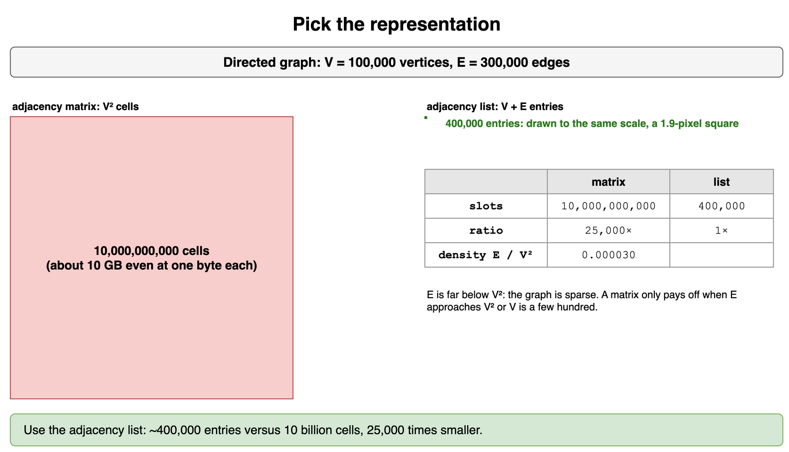

*Source: [`diagrams/graphs-drills.drawio`](/content/07_Data_Structures_and_Algorithms/07_Graphs/diagrams/graphs-drills.drawio), page 1.*

## Trace BFS order

Undirected edges: 1-2, 1-3, 2-4, 3-4, 4-5, 3-6. Neighbors are visited in increasing order. Write the BFS visit order from vertex 1 and the distance of each vertex.

**Answer:** Order 1, 2, 3, 4, 6, 5. Layer 0 is {1}; layer 1 is {2, 3}; layer 2 is {4, 6} (4 is found from 2 first, 6 from 3); layer 3 is {5}. Vertex 4 is reachable from both 2 and 3, but it is marked when first enqueued, so it appears once.

```python
from collections import deque

def bfs(edges: list[tuple[int, int]], start: int):
    adj: dict[int, list[int]] = {}
    for u, v in edges:
        adj.setdefault(u, []).append(v)
        adj.setdefault(v, []).append(u)
    dist = {start: 0}
    order, queue = [], deque([start])
    while queue:
        u = queue.popleft()
        order.append(u)
        for v in sorted(adj[u]):
            if v not in dist:
                dist[v] = dist[u] + 1
                queue.append(v)
    return order, dist

order, dist = bfs([(1, 2), (1, 3), (2, 4), (3, 4), (4, 5), (3, 6)], 1)
print(order)  # [1, 2, 3, 4, 6, 5]
print(dist)   # {1: 0, 2: 1, 3: 1, 4: 2, 6: 2, 5: 3}
```

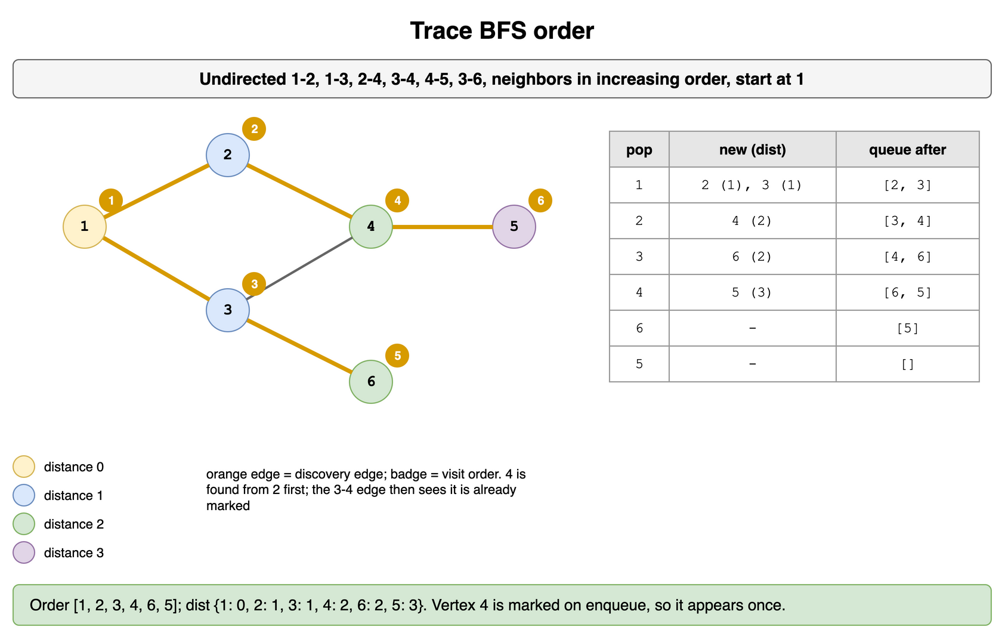

*Source: [`diagrams/graphs-drills.drawio`](/content/07_Data_Structures_and_Algorithms/07_Graphs/diagrams/graphs-drills.drawio), page 2.*

## Trace DFS order

Same graph as the BFS card (edges 1-2, 1-3, 2-4, 3-4, 4-5, 3-6, neighbors in increasing order). Write the recursive DFS visit order from vertex 1. Why does it differ from BFS?

**Answer:** Order 1, 2, 4, 3, 6, 5. From 1, DFS dives into 2, then 4, then 3 (4's smallest unvisited neighbor), then 6. Only after 6 is exhausted does it back up to 4 and reach 5. BFS finishes all of distance 1 before touching 4; DFS commits to one branch and reaches 3 through 4 instead of directly from 1.

```python
def dfs(edges: list[tuple[int, int]], start: int) -> list[int]:
    adj: dict[int, list[int]] = {}
    for u, v in edges:
        adj.setdefault(u, []).append(v)
        adj.setdefault(v, []).append(u)
    seen: set[int] = set()
    order: list[int] = []

    def go(u: int) -> None:
        seen.add(u)
        order.append(u)
        for v in sorted(adj[u]):
            if v not in seen:
                go(v)

    go(start)
    return order

print(dfs([(1, 2), (1, 3), (2, 4), (3, 4), (4, 5), (3, 6)], 1))  # [1, 2, 4, 3, 6, 5]
```

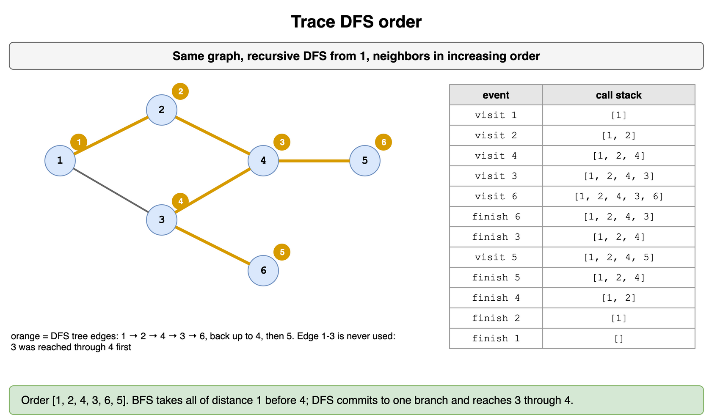

*Source: [`diagrams/graphs-drills.drawio`](/content/07_Data_Structures_and_Algorithms/07_Graphs/diagrams/graphs-drills.drawio), page 3.*

## Bug hunt: mark on dequeue

This BFS gives the right visit order, but on dense graphs it is slow and memory-hungry. What goes wrong, and how much extra work does it do on a complete graph of 6 vertices?

```python
from collections import deque

def bfs(adj, start):
    seen, queue, pushes = set(), deque([start]), 1
    while queue:
        u = queue.popleft()
        if u in seen:
            continue
        seen.add(u)
        for v in adj[u]:
            if v not in seen:
                queue.append(v); pushes += 1
    return pushes
```

**Answer:** It marks a vertex only when it leaves the queue, so a vertex can be enqueued once by every neighbor that sees it before it is processed. On the complete graph K6 that is 16 pushes instead of 6; on dense graphs the queue grows toward O(E) entries. Mark when you enqueue and each vertex enters the queue exactly once.

```python
from collections import deque

def count_pushes(adj: dict[int, list[int]], start: int, mark_on_enqueue: bool) -> int:
    seen = {start} if mark_on_enqueue else set()
    queue, pushes = deque([start]), 1
    while queue:
        u = queue.popleft()
        if not mark_on_enqueue:
            if u in seen:
                continue
            seen.add(u)
        for v in adj[u]:
            if v not in seen:
                if mark_on_enqueue:
                    seen.add(v)
                queue.append(v)
                pushes += 1
    return pushes

k6 = {i: [j for j in range(6) if j != i] for i in range(6)}
print(count_pushes(k6, 0, mark_on_enqueue=False))  # 16
print(count_pushes(k6, 0, mark_on_enqueue=True))   # 6
```

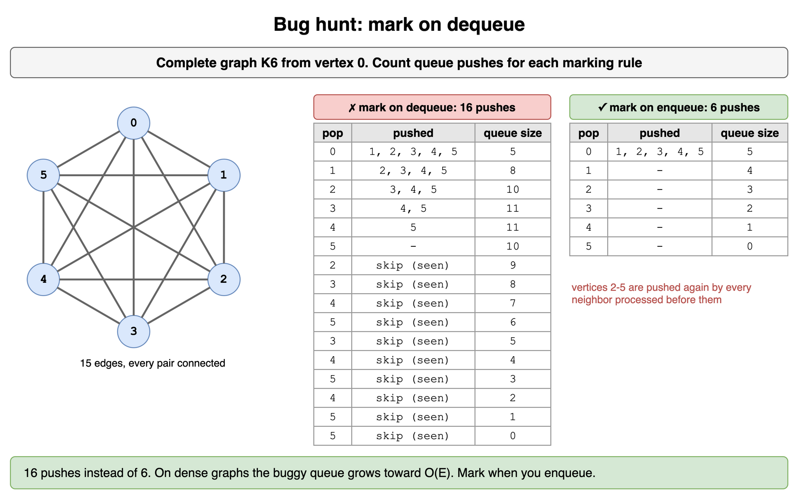

*Source: [`diagrams/graphs-drills.drawio`](/content/07_Data_Structures_and_Algorithms/07_Graphs/diagrams/graphs-drills.drawio), page 4.*

## Count rooms on a grid

A floor plan uses `#` for walls and `.` for floor. Two floor cells are in the same room if you can walk between them moving up, down, left, or right. How many rooms does this plan have?

```text
#########
#..#....#
#..#.##.#
####.#..#
#...##..#
#########
```

**Answer:** 3 rooms: the 2x2 block in the top-left, the large right-hand region, and the three-cell corridor at the bottom-left. Treat each floor cell as a vertex with up to four neighbors (an implicit graph), then count connected components: start a flood fill from each unvisited floor cell and add one per start. Cost is O(rows * cols).

```python
def count_rooms(plan: list[str]) -> int:
    rows, cols = len(plan), len(plan[0])
    seen: set[tuple[int, int]] = set()
    rooms = 0
    for r in range(rows):
        for c in range(cols):
            if plan[r][c] != "." or (r, c) in seen:
                continue
            rooms += 1
            seen.add((r, c))
            stack = [(r, c)]
            while stack:
                y, x = stack.pop()
                for ny, nx in ((y + 1, x), (y - 1, x), (y, x + 1), (y, x - 1)):
                    if plan[ny][nx] == "." and (ny, nx) not in seen:
                        seen.add((ny, nx))
                        stack.append((ny, nx))
    return rooms

plan = ["#########", "#..#....#", "#..#.##.#", "####.#..#", "#...##..#", "#########"]
print(count_rooms(plan))  # 3
```

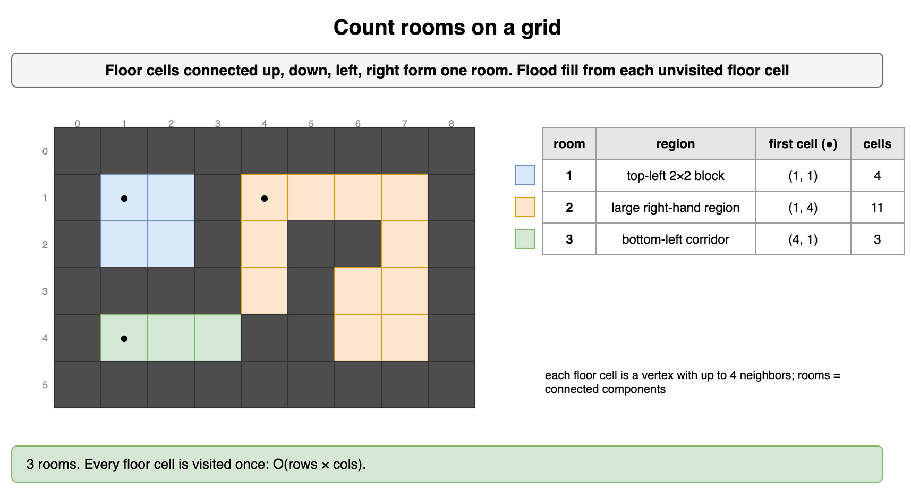

*Source: [`diagrams/graphs-drills.drawio`](/content/07_Data_Structures_and_Algorithms/07_Graphs/diagrams/graphs-drills.drawio), page 5.*

## Knight hops

On an empty 8x8 board, what is the fewest number of knight moves from one corner, (0, 0), to the opposite corner, (7, 7)? Which algorithm gives the answer and why?

**Answer:** 6 moves. Every square is a vertex and every legal knight move is an unweighted edge, so BFS from (0, 0) reaches each square first by its fewest-moves route. The graph is implicit: generate the up-to-8 moves on demand instead of storing 64 adjacency lists.

```python
from collections import deque

def knight_hops(n: int, start: tuple[int, int], goal: tuple[int, int]) -> int:
    jumps = [(1, 2), (2, 1), (-1, 2), (-2, 1), (1, -2), (2, -1), (-1, -2), (-2, -1)]
    dist = {start: 0}
    queue = deque([start])
    while queue:
        r, c = queue.popleft()
        if (r, c) == goal:
            return dist[(r, c)]
        for dr, dc in jumps:
            nxt = (r + dr, c + dc)
            if 0 <= nxt[0] < n and 0 <= nxt[1] < n and nxt not in dist:
                dist[nxt] = dist[(r, c)] + 1
                queue.append(nxt)
    return -1

print(knight_hops(8, (0, 0), (7, 7)))  # 6
print(knight_hops(8, (0, 0), (1, 2)))  # 1
```

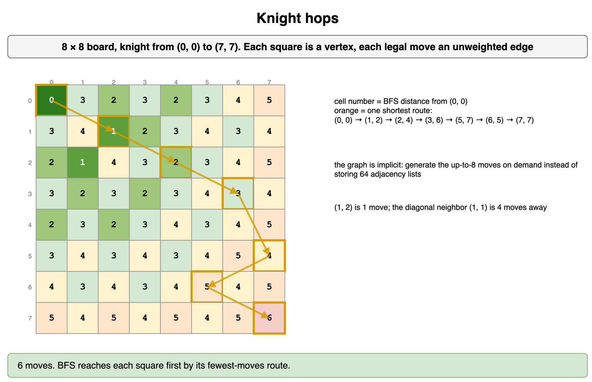

*Source: [`diagrams/graphs-drills.drawio`](/content/07_Data_Structures_and_Algorithms/07_Graphs/diagrams/graphs-drills.drawio), page 6.*

## Nearest charger

A warehouse grid marks chargers `C`, shelves `#`, and open floor `.`. A robot on any open cell drives to its nearest charger, moving one cell up, down, left, or right per step. What is the longest such drive anywhere on the floor, and how do you compute it in one pass?

```text
C....
.##..
....C
```

**Answer:** 3 steps: the cell at row 0, column 3 and the cell at row 2, column 1 are each three steps from their closest charger. Run one multi-source BFS: enqueue every charger at distance 0, then expand. Each cell is first reached by its closest charger, so the largest distance assigned is the answer. One BFS per charger would cost a factor of the charger count more.

```python
from collections import deque

def longest_drive(grid: list[str]) -> int:
    rows, cols = len(grid), len(grid[0])
    dist = {(r, c): 0 for r in range(rows) for c in range(cols) if grid[r][c] == "C"}
    queue = deque(dist)
    while queue:
        r, c = queue.popleft()
        for nr, nc in ((r + 1, c), (r - 1, c), (r, c + 1), (r, c - 1)):
            if 0 <= nr < rows and 0 <= nc < cols and grid[nr][nc] == "." and (nr, nc) not in dist:
                dist[(nr, nc)] = dist[(r, c)] + 1
                queue.append((nr, nc))
    return max(dist.values())

print(longest_drive(["C....", ".##..", "....C"]))  # 3
```

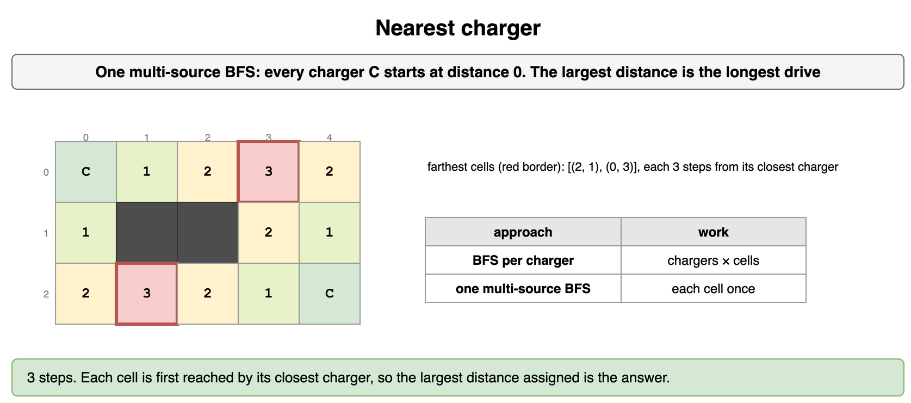

*Source: [`diagrams/graphs-drills.drawio`](/content/07_Data_Structures_and_Algorithms/07_Graphs/diagrams/graphs-drills.drawio), page 7.*

## Rebuild the path

A BFS from `S` produced this parent map. Write the route from `S` to `T`, and say what the map tells you about vertex `Z`.

```python
parent = {"S": None, "A": "S", "B": "S", "C": "A", "D": "B", "T": "C"}
```

**Answer:** Walk the pointers backwards from `T`: T, C, A, S, then reverse to S -> A -> C -> T (3 edges, the BFS shortest length). `Z` is not a key, so BFS never reached it: there is no path. Storing one parent per vertex costs O(V) total, far less than storing a full path in every queue entry.

```python
def rebuild(parent: dict[str, str | None], target: str) -> list[str] | None:
    if target not in parent:
        return None
    path: list[str] = []
    node: str | None = target
    while node is not None:
        path.append(node)
        node = parent[node]
    return path[::-1]

parent = {"S": None, "A": "S", "B": "S", "C": "A", "D": "B", "T": "C"}
print(rebuild(parent, "T"))  # ['S', 'A', 'C', 'T']
print(rebuild(parent, "Z"))  # None
```

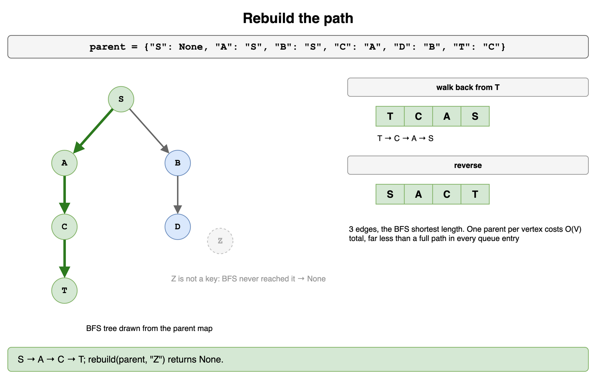

*Source: [`diagrams/graphs-drills.drawio`](/content/07_Data_Structures_and_Algorithms/07_Graphs/diagrams/graphs-drills.drawio), page 8.*

## Bidirectional budget

Every vertex has 10 neighbors and the goal is 6 edges away. Estimate how many vertices a one-sided BFS discovers versus a bidirectional search whose frontiers each go 3 levels deep.

**Answer:** One-sided BFS discovers about 10 + 100 + ... + 10^6, roughly 1.1 million vertices. Two searches of depth 3 discover about 2 * (10 + 100 + 1000) = 2,220. The saving comes from k^(d/2) being the square root of k^d; it vanishes if you cannot walk edges backward from the goal or the goal is unknown.

```python
def discovered(k: int, depth: int) -> int:
    return sum(k ** i for i in range(1, depth + 1))

one_sided = discovered(10, 6)
two_sided = 2 * discovered(10, 3)
print(one_sided)  # 1111110
print(two_sided)  # 2220
```

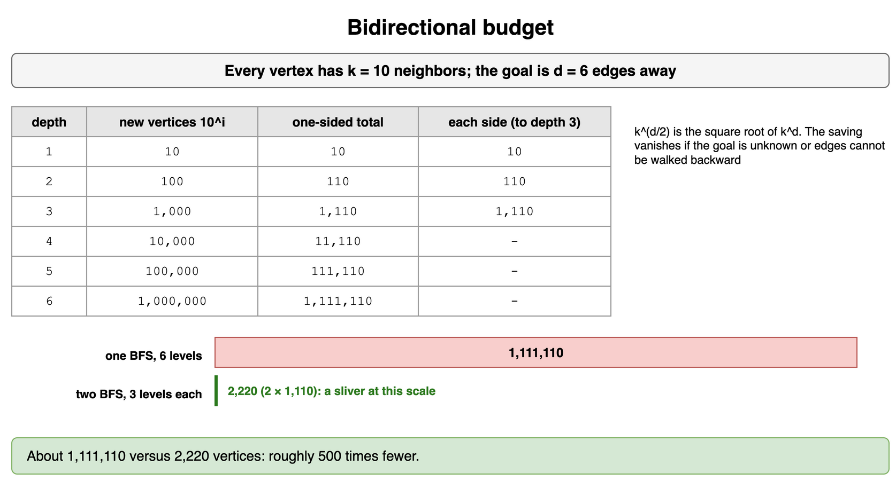

*Source: [`diagrams/graphs-drills.drawio`](/content/07_Data_Structures_and_Algorithms/07_Graphs/diagrams/graphs-drills.drawio), page 9.*

## Find the back edge

Directed edges: a->b, b->c, c->d, d->b, a->e, e->d. DFS starts at `a` and visits neighbors in the listed order. Which edge proves there is a cycle? Does e->d also prove one?

**Answer:** d->b is the back edge: when DFS stands on d, the path a, b, c, d is still open, so b is gray. e->d is not a cycle: remove d->b and DFS finishes d (black) before it ever visits e, so e->d only merges into explored territory and the second call below finds nothing. That is why a plain visited set gives false alarms in directed graphs and three colors are needed.

```python
def first_back_edge(graph: dict[str, list[str]]) -> tuple[str, str] | None:
    color = {v: 0 for v in graph}  # 0 white, 1 gray, 2 black

    def dfs(u: str):
        color[u] = 1
        for v in graph[u]:
            if color[v] == 1:
                return (u, v)
            if color[v] == 0:
                found = dfs(v)
                if found:
                    return found
        color[u] = 2
        return None

    for v in graph:
        if color[v] == 0:
            found = dfs(v)
            if found:
                return found
    return None

g = {"a": ["b", "e"], "b": ["c"], "c": ["d"], "d": ["b"], "e": ["d"]}
print(first_back_edge(g))  # ('d', 'b')
print(first_back_edge({"a": ["b", "e"], "b": ["c"], "c": ["d"], "d": [], "e": ["d"]}))  # None
```

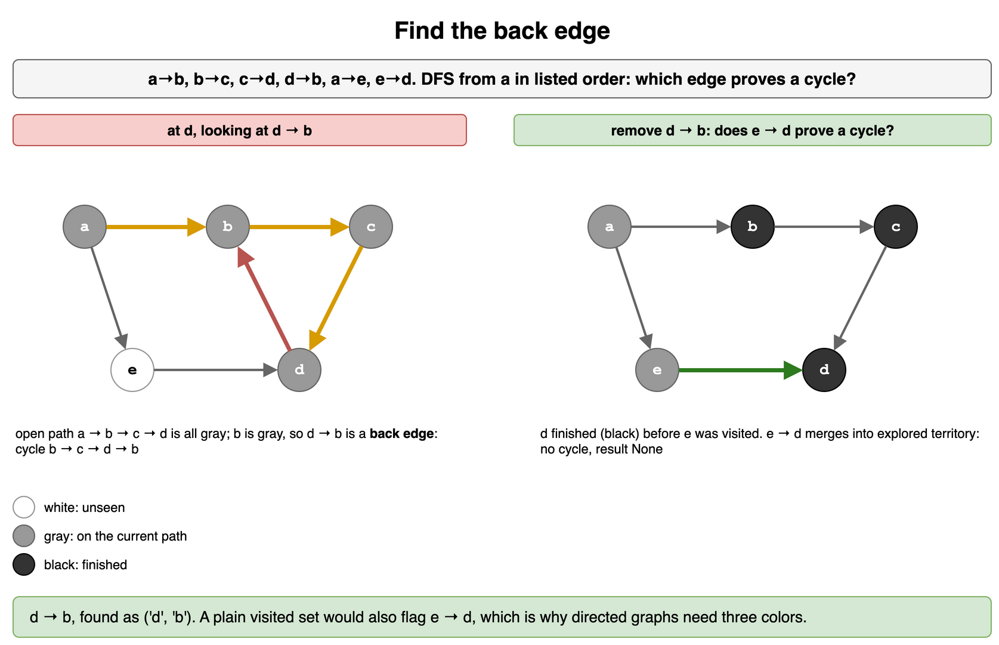

*Source: [`diagrams/graphs-drills.drawio`](/content/07_Data_Structures_and_Algorithms/07_Graphs/diagrams/graphs-drills.drawio), page 10.*

## Bug hunt: undirected false cycle

This check reports a cycle on the simple path 0 - 1 - 2. Why, and what is the fix?

```python
def has_cycle(adj, start):
    seen, stack = {start}, [start]
    while stack:
        u = stack.pop()
        for v in adj[u]:
            if v in seen:
                return True
            seen.add(v); stack.append(v)
    return False
```

**Answer:** Each undirected edge is stored both ways, so after stepping 0 -> 1 the list for 1 contains 0 again, which is already seen. Track the parent you arrived from and ignore that one edge; any other already-seen neighbor really closes a cycle. (Graphs with parallel edges need the edge id instead of the parent vertex.)

```python
def has_cycle(adj: dict[int, list[int]], start: int) -> bool:
    seen, stack = {start}, [(start, -1)]
    while stack:
        u, parent = stack.pop()
        for v in adj[u]:
            if v == parent:
                continue
            if v in seen:
                return True
            seen.add(v)
            stack.append((v, u))
    return False

path = {0: [1], 1: [0, 2], 2: [1]}
loop = {0: [1, 2], 1: [0, 2], 2: [1, 0]}
print(has_cycle(path, 0))  # False
print(has_cycle(loop, 0))  # True
```

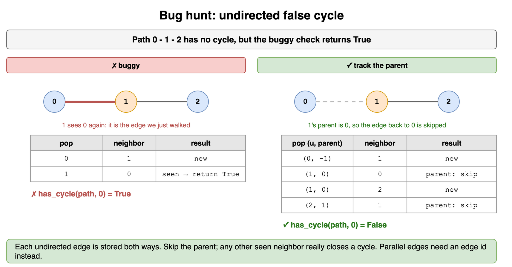

*Source: [`diagrams/graphs-drills.drawio`](/content/07_Data_Structures_and_Algorithms/07_Graphs/diagrams/graphs-drills.drawio), page 11.*

## Smallest topological order

Tasks 0-5 with "must come before" edges: 5->2, 5->0, 4->0, 4->1, 2->3, 3->1. Of all valid orders, which one is lexicographically smallest, and what single change to Kahn's algorithm produces it?

**Answer:** 4, 5, 0, 2, 3, 1. Replace Kahn's FIFO queue with a min-heap of ready (in-degree 0) tasks, so you always take the smallest ready label. At the start only 4 and 5 are ready; after 4, task 0 still waits for 5, so 5 comes next, then 0, 2, 3, 1. Cost becomes O(V log V + E).

```python
import heapq

def smallest_order(n: int, edges: list[tuple[int, int]]) -> list[int] | None:
    adj: list[list[int]] = [[] for _ in range(n)]
    indeg = [0] * n
    for u, v in edges:
        adj[u].append(v)
        indeg[v] += 1
    ready = [v for v in range(n) if indeg[v] == 0]
    heapq.heapify(ready)
    order: list[int] = []
    while ready:
        u = heapq.heappop(ready)
        order.append(u)
        for v in adj[u]:
            indeg[v] -= 1
            if indeg[v] == 0:
                heapq.heappush(ready, v)
    return order if len(order) == n else None

print(smallest_order(6, [(5, 2), (5, 0), (4, 0), (4, 1), (2, 3), (3, 1)]))  # [4, 5, 0, 2, 3, 1]
```

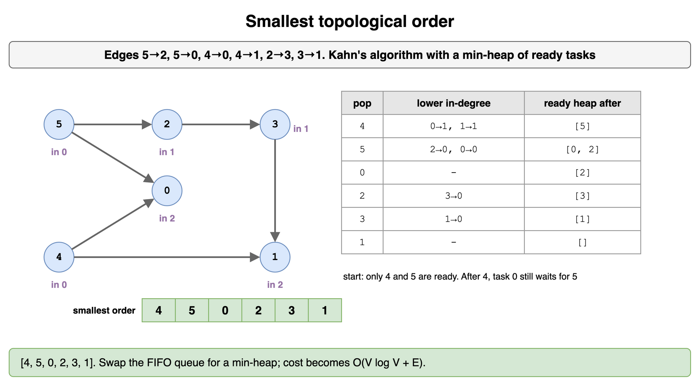

*Source: [`diagrams/graphs-drills.drawio`](/content/07_Data_Structures_and_Algorithms/07_Graphs/diagrams/graphs-drills.drawio), page 12.*

## Two-team split

Six players, rivalries 0-1, 1-2, 2-3, 3-0, 4-5. Rivals must be on different teams. Is a split possible? What if you add rivalry 0-2?

**Answer:** Yes: BFS 2-coloring gives {0, 2, 4} versus {1, 3, 5}; every rivalry crosses teams. Adding 0-2 creates the odd cycle 0-1-2-0, which no two-way split can satisfy, so the check fails. Restart the coloring from every uncolored player so the separate 4-5 pair is checked too.

```python
from collections import deque

def split_teams(n: int, rivals: list[tuple[int, int]]):
    adj: list[list[int]] = [[] for _ in range(n)]
    for a, b in rivals:
        adj[a].append(b)
        adj[b].append(a)
    team = [-1] * n
    for s in range(n):
        if team[s] != -1:
            continue
        team[s] = 0
        queue = deque([s])
        while queue:
            u = queue.popleft()
            for v in adj[u]:
                if team[v] == -1:
                    team[v] = 1 - team[u]
                    queue.append(v)
                elif team[v] == team[u]:
                    return None
    return [p for p in range(n) if team[p] == 0], [p for p in range(n) if team[p] == 1]

base = [(0, 1), (1, 2), (2, 3), (3, 0), (4, 5)]
print(split_teams(6, base))             # ([0, 2, 4], [1, 3, 5])
print(split_teams(6, base + [(0, 2)]))  # None
```

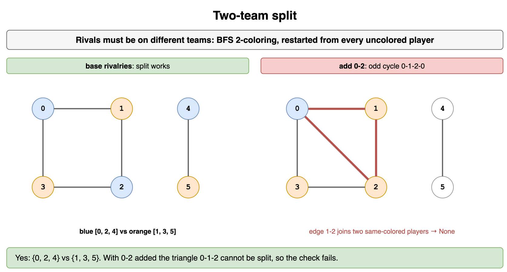

*Source: [`diagrams/graphs-drills.drawio`](/content/07_Data_Structures_and_Algorithms/07_Graphs/diagrams/graphs-drills.drawio), page 13.*

## Hops vs. weight

Directed weighted edges: A->D costs 10, A->B costs 1, B->C costs 1, C->D costs 1. A teammate runs BFS to find the "shortest" route from A to D. What route do they get, and what is actually cheapest?

**Answer:** BFS returns A -> D because it is one hop, but it costs 10. The cheapest route is A -> B -> C -> D at cost 3. BFS minimizes edge count, not total weight. With unequal non-negative weights use Dijkstra, which settles vertices in order of total cost.

```python
import heapq
from collections import deque

graph = {"A": [("D", 10), ("B", 1)], "B": [("C", 1)], "C": [("D", 1)], "D": []}

def fewest_hops(start: str, goal: str) -> list[str]:
    parent = {start: None}
    queue = deque([start])
    while queue:
        u = queue.popleft()
        for v, _ in graph[u]:
            if v not in parent:
                parent[v] = u
                queue.append(v)
    path, node = [], goal
    while node is not None:
        path.append(node)
        node = parent[node]
    return path[::-1]

def cheapest(start: str, goal: str) -> int:
    dist, heap = {start: 0}, [(0, start)]
    while heap:
        d, u = heapq.heappop(heap)
        if d > dist[u]:
            continue
        for v, w in graph[u]:
            if d + w < dist.get(v, float("inf")):
                dist[v] = d + w
                heapq.heappush(heap, (d + w, v))
    return dist[goal]

print(fewest_hops("A", "D"))  # ['A', 'D']
print(cheapest("A", "D"))     # 3
```

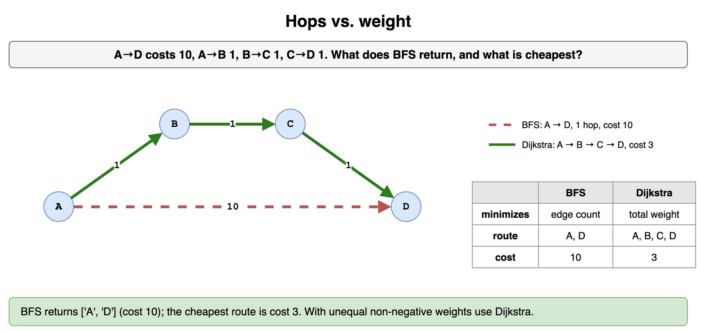

*Source: [`diagrams/graphs-drills.drawio`](/content/07_Data_Structures_and_Algorithms/07_Graphs/diagrams/graphs-drills.drawio), page 14.*

## Negative edge trap

Edges: A->B 1, A->C 3, C->B -3, B->D 1. A Dijkstra variant that never revisits a settled vertex reports dist(D) = 2. What is the true distance, and which algorithm gets it right?

**Answer:** The true distance is 1, via A -> C -> B -> D (3 - 3 + 1). Dijkstra settles B at cost 1 before it ever looks at C, then cannot lower B when the -3 edge appears. Bellman-Ford relaxes every edge V - 1 times, so the cheaper value propagates; one extra round that still improves something means a negative cycle.

```python
def bellman_ford(vertices: list[str], edges: list[tuple[str, str, int]], src: str):
    dist = {v: float("inf") for v in vertices}
    dist[src] = 0
    for _ in range(len(vertices) - 1):
        for u, v, w in edges:
            if dist[u] + w < dist[v]:
                dist[v] = dist[u] + w
    if any(dist[u] + w < dist[v] for u, v, w in edges):
        return None  # negative cycle reachable
    return dist

edges = [("A", "B", 1), ("A", "C", 3), ("C", "B", -3), ("B", "D", 1)]
print(bellman_ford(["A", "B", "C", "D"], edges, "A"))  # {'A': 0, 'B': 0, 'C': 3, 'D': 1}
```

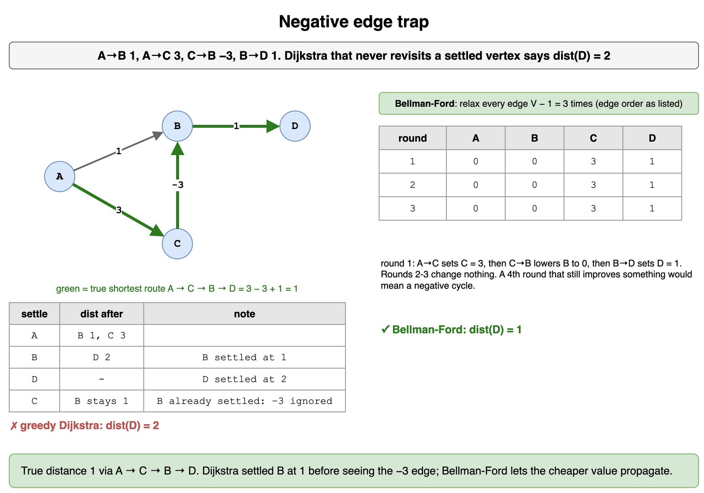

*Source: [`diagrams/graphs-drills.drawio`](/content/07_Data_Structures_and_Algorithms/07_Graphs/diagrams/graphs-drills.drawio), page 15.*

## Redundant link

Network links arrive in this order: 1-2, 2-3, 4-5, 3-1, 5-6, 6-4, 3-4. Which links are redundant (their two ends were already connected when they arrived), and how many separate networks are left at the end?

**Answer:** 3-1 and 6-4 are redundant: each closes a loop inside a group that was already connected. 3-4 is not redundant because it joins the {1, 2, 3} and {4, 5, 6} groups, leaving one network. Union-find answers each "already connected?" question in near-constant amortized time: a union that finds both ends under the same root is the redundant link.

```python
def redundant_links(links: list[tuple[int, int]]):
    parent: dict[int, int] = {}

    def find(x: int) -> int:
        parent.setdefault(x, x)
        while parent[x] != x:
            parent[x] = parent[parent[x]]
            x = parent[x]
        return x

    extra = []
    for a, b in links:
        ra, rb = find(a), find(b)
        if ra == rb:
            extra.append((a, b))
        else:
            parent[ra] = rb
    groups = len({find(x) for x in parent})
    return extra, groups

print(redundant_links([(1, 2), (2, 3), (4, 5), (3, 1), (5, 6), (6, 4), (3, 4)]))  # ([(3, 1), (6, 4)], 1)
```

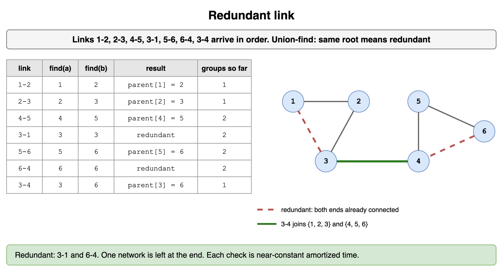

*Source: [`diagrams/graphs-drills.drawio`](/content/07_Data_Structures_and_Algorithms/07_Graphs/diagrams/graphs-drills.drawio), page 16.*
