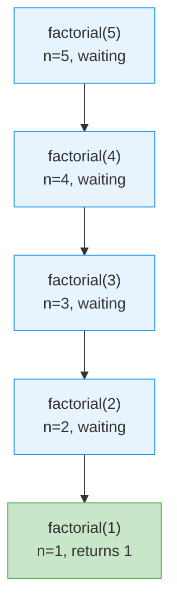
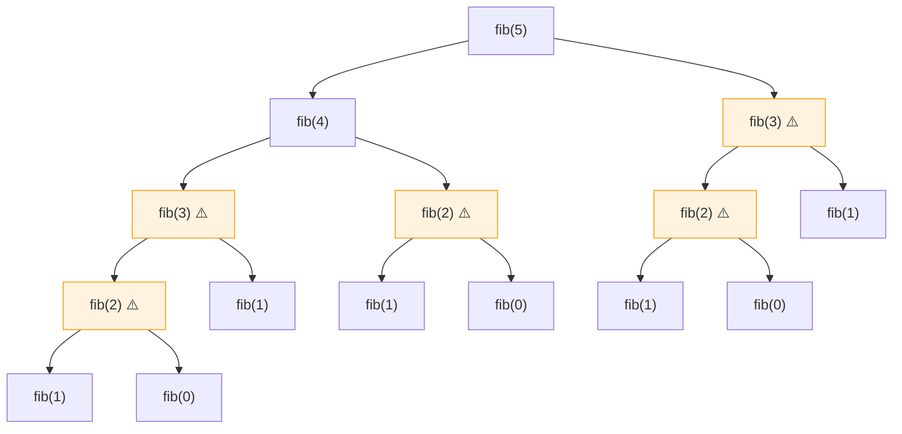
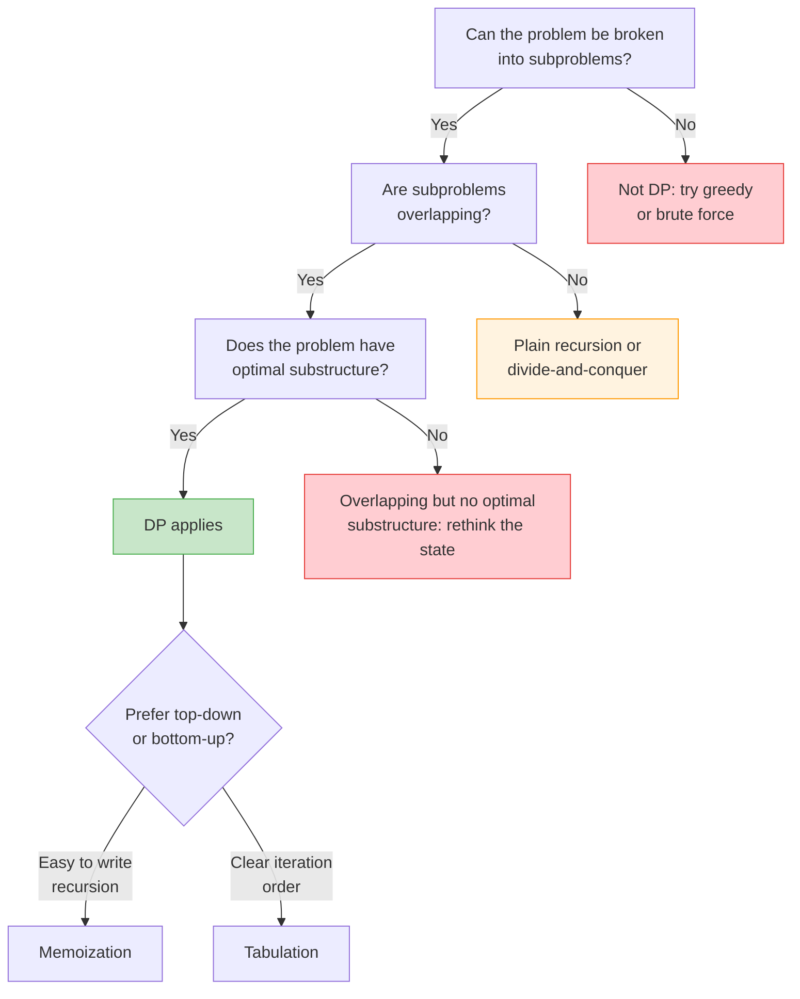
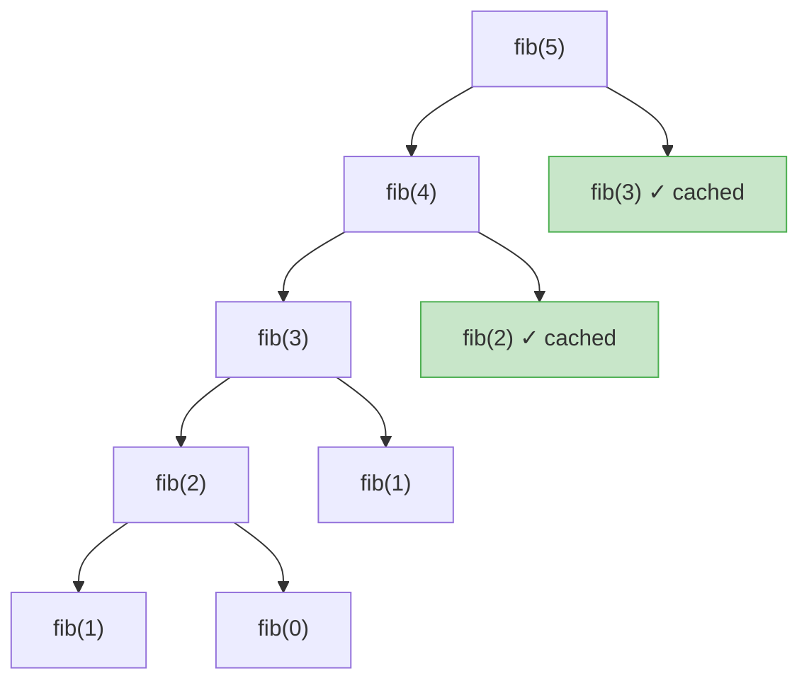
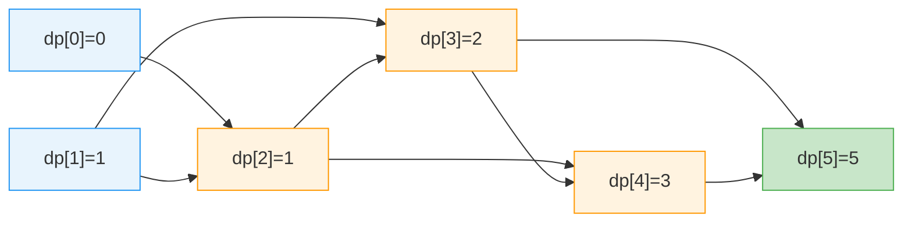

## Recursive decomposition

Recursion solves a problem by breaking it into smaller instances of the same problem. Each call handles one piece and delegates the rest until it reaches a base case that returns directly. The function is both the manager and the worker.

The factorial function is the textbook example because the recursive structure maps directly to the mathematical definition: `n! = n * (n-1)!`.

```python
def factorial(n: int) -> int:
    if n <= 1:          # base case
        return 1
    return n * factorial(n - 1)   # recursive step

print(factorial(5))  # 120
```

Every recursive function has two parts: (1) the base case that stops recursion, and (2) the recursive step that shrinks the problem and calls itself. If you can say "solve a smaller version of me, then combine," recursion is a natural fit. The hard part is trusting the recursive call: assume it returns the right answer for the smaller input, and only reason about how one level combines it.

## Base case

The base case is the termination condition: the input small enough that the function can return a result without recursing further. Without it, recursion never stops.

If you forget the base case, or write one the input can never reach, every call adds a frame to the stack until the interpreter hits its limit and raises `RecursionError` (Python) or overflows the stack (C/C++). This is the single most common recursion bug.

```python
# Missing base case: calling this crashes with RecursionError
def bad_countdown(n: int) -> None:
    print(n)
    bad_countdown(n - 1)  # never stops

# Fixed version
def countdown(n: int) -> list[int]:
    if n < 0:
        return []
    return [n] + countdown(n - 1)

print(countdown(3))  # [3, 2, 1, 0]
```

Rule of thumb: write the base case first, check it is reachable for every valid input (including odd sizes, empty inputs, and negative steps), then write the recursive step. A guard like `n <= 0` is safer than `n == 0` when the step can jump past zero.

## Call stack and stack space

Each recursive call pushes a new frame onto the call stack. That frame holds the function's local variables, the return address, and the arguments. Frames accumulate until the base case is reached, then they unwind as each call returns.

So recursion costs O(depth) space even if the algorithm has no auxiliary data structure: a linear chain of N calls uses O(N) stack. Python's default recursion limit is 1000 frames (`sys.getrecursionlimit()`), and Python does not eliminate tail calls, so even a tail-recursive function still grows the stack.



Each box is one stack frame. All five exist at the same time at the deepest point. The green frame is the base case where unwinding begins; from there each frame computes its result and pops off.

Space is set by the maximum depth, not the total number of calls. A function that makes millions of calls but never nests deeper than log N uses only O(log N) stack.

## Recursive vs. iterative

Any recursive algorithm can be written iteratively, either as a plain loop (when each call makes at most one recursive call at the end) or with an explicit stack (when it branches or does work after the call returns). Recursion is often shorter and mirrors the definition; iteration avoids the stack limit and per-call overhead.

```python
def total_recursive(xs: list[int], i: int = 0) -> int:
    if i == len(xs):
        return 0
    return xs[i] + total_recursive(xs, i + 1)

def total_iterative(xs: list[int]) -> int:
    total = 0
    for x in xs:
        total += x
    return total

xs = list(range(5000))
print(total_iterative(xs))  # 12497500
try:
    total_recursive(xs)
except RecursionError:
    print("RecursionError")  # RecursionError
```

How to choose in an interview:

| Prefer recursion when | Prefer iteration when |
|---|---|
| The structure is recursive (trees, nested data, divide and conquer) | Depth can grow with N (long lists, deep chains) |
| Depth is small or logarithmic | You need O(1) extra space |
| A memoized recurrence is the clearest first draft | The fill order of a DP table is obvious |

A good habit: write the recursive version to get the logic right, state its stack depth, and offer the iterative version (loop or explicit stack) if depth could exceed a few thousand.

## Top-down approach

Top-down thinking starts with the full problem of size N and asks how to split it into subproblems: "if I already had the answers to these smaller pieces, how would I combine them?" You define the answer in terms of answers to smaller inputs, and let recursion handle those.

This is the most natural way to derive a recurrence. Fibonacci is the classic example: `fib(n) = fib(n-1) + fib(n-2)`. You ask for the big answer and let the recursion find the small ones.

```python
def fib_naive(n: int) -> int:
    if n <= 1:
        return n
    return fib_naive(n - 1) + fib_naive(n - 2)

print(fib_naive(10))  # 55
```

The downside of naive top-down recursion is redundant work: without caching, the same subproblem is solved many times. Memoization fixes exactly that.

## Bottom-up approach

Bottom-up thinking starts from the simplest case and grows: solve it for one element, then use that to solve two, then three, and so on, each answer built from the previous ones. It is a way of discovering the recurrence ("how does the answer for n extend the answer for n-1?") and can be written recursively or with a loop.

For example, count the binary strings of length n with no two adjacent 1s. Knowing how many valid strings of length k end in 0 and how many end in 1 is enough to get length k + 1: a 0 can follow anything, a 1 can only follow a 0.

```python
def no_adjacent_ones(n: int) -> int:
    end0, end1 = 1, 1                      # answer for length 1: "0" and "1"
    for _ in range(2, n + 1):              # extend length k to k + 1
        end0, end1 = end0 + end1, end0
    return end0 + end1

print([no_adjacent_ones(n) for n in range(1, 7)])  # [2, 3, 5, 8, 13, 21]
```

In dynamic programming, the loop form of this idea is called tabulation: fill answers for small inputs first so every later answer can read them. It has no stack overflow risk, lower per-step overhead than function calls, and a cache-friendly memory access pattern.

## Half-and-half approach

Some problems split naturally in half rather than peeling off one element at a time. Binary search discards half the range each step. Merge sort splits the array, sorts each half, and merges. Halving gives O(log N) recursion depth instead of O(N), so even huge inputs stay within stack limits.

```python
def merge_sort(arr: list[int]) -> list[int]:
    if len(arr) <= 1:
        return arr
    mid = len(arr) // 2
    left = merge_sort(arr[:mid])
    right = merge_sort(arr[mid:])
    return merge(left, right)

def merge(left: list[int], right: list[int]) -> list[int]:
    result = []
    i = j = 0
    while i < len(left) and j < len(right):
        if left[i] <= right[j]:
            result.append(left[i]); i += 1
        else:
            result.append(right[j]); j += 1
    result.extend(left[i:])
    result.extend(right[j:])
    return result

print(merge_sort([5, 2, 9, 1, 5, 6]))  # [1, 2, 5, 5, 6, 9]
```

Half-and-half also covers "solve each half and combine across the middle," such as finding the best pair that straddles the split. When each half is independent, there are no overlapping subproblems and no DP is needed.

## Recursion tree

To estimate recursive running time, draw the recursion tree: one node per call, children for the calls it makes. Total time is the sum of work over all nodes. A useful first estimate is **branches^depth** nodes: a function that makes 2 calls and recurses N levels deep has up to about 2^N nodes.

```python
def count_calls(n: int) -> int:
    """How many calls fib_naive(n) makes in total."""
    if n <= 1:
        return 1
    return 1 + count_calls(n - 1) + count_calls(n - 2)

print(count_calls(10))  # 177
print(count_calls(20))  # 21891
```

Two other shapes worth knowing: halving with two calls and O(N) merge work (merge sort) gives log N levels of N work each, O(N log N); halving with one call and O(1) work (binary search) gives O(log N). The Algorithmic Complexity topic covers the general rules; here the point is to sketch the tree before optimizing.

## Overlapping subproblems

Overlapping subproblems are the signal that a problem is a candidate for dynamic programming. If the naive recursive solution computes the same subproblem more than once, work is being wasted.

Fibonacci is the clearest illustration. Computing `fib(5)` naively calls `fib(3)` twice, `fib(2)` three times, and `fib(1)` five times. Total calls grow exponentially (O(2^N) as an upper bound; about 1.6^N exactly) because the tree re-explores the same territory.



The orange nodes are duplicates: the same subproblem computed multiple times. The tree has 15 nodes but only 6 distinct inputs (`fib(0)` through `fib(5)`). Eliminating that duplication is the entire point of DP: cost becomes (number of distinct states) x (work per state).

## Optimal substructure

A problem has optimal substructure when an optimal answer to the whole can be assembled from optimal answers to its subproblems. Shortest paths have it: if the best route from A to C passes through B, its A-to-B part must itself be a best A-to-B route, otherwise you could swap in a better one.

Optimal substructure is what lets a recurrence take `min` or `max` over choices and trust each sub-answer. It fails when subproblems interact. Longest simple path is the classic counterexample: the longest A-to-B path and longest B-to-C path may reuse vertices, so gluing them does not give a valid longest A-to-C path.

```python
from functools import cache

def min_cost_to_end(cost: list[int]) -> int:
    """Start before index 0, step 1 or 2 cells at a time, pay cost of each cell landed on, finish past the end."""
    n = len(cost)

    @cache
    def best(i: int) -> int:          # cheapest way to finish starting from cell i
        if i >= n:
            return 0
        return cost[i] + min(best(i + 1), best(i + 2))

    return min(best(0), best(1))

print(min_cost_to_end([10, 15, 20]))  # 15
print(min_cost_to_end([1, 100, 1, 1, 1, 100, 1, 1, 100, 1]))  # 6
```

`best(i)` is optimal because it only combines optimal answers for `i + 1` and `i + 2`. For counting problems ("how many ways"), the analogous requirement is that subproblems split the possibilities into disjoint groups so their counts add.

## Is this a DP problem?

Not every recursive problem benefits from DP. Two properties must both be present: overlapping subproblems (the same inputs are computed more than once) and optimal substructure (the answer for the whole is built from answers for subproblems).



Wording clues: minimum, maximum, number of ways, longest, shortest, or "is it possible", where the brute force explores overlapping choices. If the problem asks you to list every solution, the output itself can be exponential and backtracking is usually the tool instead.

## State definition

The state is the smallest set of parameters that fully determines a subproblem's answer. It becomes the memo key in top-down code and the table indices in bottom-up code. Getting it right is most of the work in a DP problem.

Checklist: (1) what changes between calls (index, remaining budget, count left)? (2) does the answer depend on anything else, such as a flag or the last choice? Add it. (3) is anything in the key that does not affect the answer, such as the path so far? Remove it, or caching never hits. Number of states x work per state gives the running time.

```python
from functools import cache

def dice_ways(dice: int, target: int) -> int:
    """Ways to roll `dice` six-sided dice so the faces sum to `target`."""
    @cache
    def ways(left: int, remaining: int) -> int:   # state = (dice left, sum still needed)
        if left == 0:
            return 1 if remaining == 0 else 0
        return sum(ways(left - 1, remaining - face) for face in range(1, 7) if face <= remaining)

    return ways(dice, target)

print(dice_ways(2, 7))   # 6
print(dice_ways(3, 10))  # 27
```

Here the state is two-dimensional, (dice left, sum remaining), so there are at most `dice x target` states and each does 6 units of work: O(6 x dice x target) time.

## Memoization

Memoization wraps a recursive function with a cache keyed by the state. Before computing a subproblem, check the cache; if the result is there, return it. Otherwise compute it, store it, and return it. You keep the top-down recursive shape but each state is solved once.

For Fibonacci, memoization drops time from exponential to O(N) because each of the N states is computed exactly once. Space is O(N) for the cache plus O(N) for the call stack.

```python
def fib_memo(n: int, cache: dict[int, int] | None = None) -> int:
    if cache is None:          # fresh cache per top-level call; never use a mutable default
        cache = {}
    if n in cache:
        return cache[n]
    if n <= 1:
        return n
    cache[n] = fib_memo(n - 1, cache) + fib_memo(n - 2, cache)
    return cache[n]

print(fib_memo(50))  # 12586269025
```

In Python, `functools.cache` (or `lru_cache(maxsize=None)`) does the same thing for hashable arguments. Define the cached helper inside the outer function so its key only contains the varying state and the cache does not leak between unrelated inputs.



The green nodes are cache hits: the function returns immediately without recursing. Entire subtrees from the naive version are pruned away. Memoization also only visits states actually reachable from the start, which wins when the state space is huge but sparse.

## Tabulation

Tabulation solves the same subproblems iteratively, filling a table from the base cases forward. There is no recursion, no call stack overhead, and no risk of stack overflow. The price is that you must choose a fill order in which every cell's dependencies are already filled.

The table index is the state, and each cell is computed from earlier cells. The final answer is in the cell for the original input.

```python
def fib_tabulation(n: int) -> int:
    if n <= 1:
        return n
    dp = [0] * (n + 1)
    dp[1] = 1
    for i in range(2, n + 1):
        dp[i] = dp[i - 1] + dp[i - 2]
    return dp[n]

print(fib_tabulation(10))  # 55
```



Blue cells are base cases, orange cells are computed from earlier cells, and the green cell is the answer. The arrows are the dependency graph; any topological order of it is a valid fill order.

| | Memoization | Tabulation |
|---|---|---|
| Shape | Recursive, top-down | Loop, bottom-up |
| States computed | Only reachable ones | All cells in the table |
| Stack risk | Yes (depth of recursion) | No |
| Space optimization | Hard | Easy (keep only rows you read) |

## Space optimization

When the recurrence only looks back a fixed number of steps, you do not need the whole table. Each Fibonacci value depends on the two before it, so the O(N) table becomes two variables: O(1) space.

The transformation is mechanical: find how many earlier values (or rows) the recurrence reads, keep only those, and rotate them forward each iteration.

```python
def fib_optimized(n: int) -> int:
    if n <= 1:
        return n
    prev2, prev1 = 0, 1
    for _ in range(2, n + 1):
        prev2, prev1 = prev1, prev2 + prev1
    return prev1

print(fib_optimized(10))  # 55
print(fib_optimized(90))  # 2880067194370816120
```

The same idea applies to 2D tables: if row `i` only reads row `i - 1`, keep one or two rows and cut space from O(M x N) to O(N). The trade-off is that you lose the full table, so reconstructing which choices produced the answer needs either the table or a separate choice record.

## Fibonacci case study

Fibonacci is the canonical DP teaching example because it shows every optimization stage on a problem simple enough to hold in your head.

| Approach | Time | Space | Stack risk |
|---|---|---|---|
| Naive recursion | O(2^N) | O(N) stack | Yes |
| Memoization | O(N) | O(N) cache + stack | Yes |
| Tabulation | O(N) | O(N) table | No |
| Space-optimized | O(N) | O(1) | No |

```python
def fib_naive(n):
    if n <= 1: return n
    return fib_naive(n-1) + fib_naive(n-2)

def fib_memo(n, cache=None):
    if cache is None: cache = {}
    if n in cache: return cache[n]
    if n <= 1: return n
    cache[n] = fib_memo(n-1, cache) + fib_memo(n-2, cache)
    return cache[n]

def fib_tab(n):
    if n <= 1: return n
    dp = [0] * (n+1)
    dp[1] = 1
    for i in range(2, n+1):
        dp[i] = dp[i-1] + dp[i-2]
    return dp[n]

def fib_opt(n):
    if n <= 1: return n
    a, b = 0, 1
    for _ in range(2, n+1):
        a, b = b, a + b
    return b

for fn in [fib_naive, fib_memo, fib_tab, fib_opt]:
    assert fn(10) == 55
print([fib_opt(n) for n in range(10)])  # [0, 1, 1, 2, 3, 5, 8, 13, 21, 34]
```

The progression (naive, memoized, tabulated, space-optimized) is a repeatable playbook: get the recurrence right with plain recursion, add a cache, convert to a loop if stack depth matters, then drop table rows you no longer read.

## Common DP patterns

Most DP problems reuse a handful of state shapes. Recognizing the shape tells you the table dimensions and fill order.

| Pattern | State | Typical recurrence |
|---|---|---|
| 1D linear (counting ways, best up to i) | `dp[i]` = answer for the first i items | combine `dp[i-1]`, `dp[i-2]`, ... |
| Grid | `dp[r][c]` = answer for reaching cell (r, c) | from the cell above and the cell left |
| Knapsack-style choice | `dp[i][budget]` | take item i or skip it |
| Two sequences | `dp[i][j]` = answer for prefixes `a[:i]`, `b[:j]` | match, or skip one side |
| Interval | `dp[i][j]` = answer for slice `i..j` | split at some k between i and j |

A 1D example is counting ways to climb n steps taking 1 or 2 at a time: `ways(n) = ways(n-1) + ways(n-2)`, which is Fibonacci in disguise. A grid example counts monotone paths from the top-left to the bottom-right corner moving only right or down:

```python
def grid_paths(rows: int, cols: int) -> int:
    dp = [1] * cols                 # first row: one way to reach each cell
    for _ in range(1, rows):
        for c in range(1, cols):
            dp[c] += dp[c - 1]      # above (old dp[c]) + left (new dp[c-1])
    return dp[-1]

print(grid_paths(3, 3))  # 6
print(grid_paths(3, 7))  # 28
```

This version already uses the one-row space optimization: `dp[c]` still holds the row above until it is overwritten.

## Knapsack-style choices

Many optimization problems are "for each item, take it or not, under a budget." The key distinction is whether an item can be reused.

- **Unbounded** (reuse allowed), for example the fewest coins to make an amount with unlimited coins of each denomination: loop amounts upward and let every coin extend smaller amounts.
- **0/1** (each item at most once), for example whether some subset of numbers hits a target sum: with a 1D table, loop the budget **downward** so each item reads values from before it was considered.

```python
def fewest_coins(coins: list[int], amount: int) -> int:
    """Minimum coins (unlimited supply) summing to amount, or -1 if impossible."""
    INF = float("inf")
    dp = [0] + [INF] * amount
    for a in range(1, amount + 1):
        for coin in coins:
            if coin <= a and dp[a - coin] + 1 < dp[a]:
                dp[a] = dp[a - coin] + 1
    return dp[amount] if dp[amount] != INF else -1

def subset_sum(nums: list[int], target: int) -> bool:
    """Can a subset (each number used at most once) sum to target?"""
    reachable = [True] + [False] * target
    for x in nums:
        for t in range(target, x - 1, -1):    # downward: x is used at most once
            reachable[t] = reachable[t] or reachable[t - x]
    return reachable[target]

print(fewest_coins([1, 5, 10, 25], 37))  # 4 (25+10+1+1)
print(fewest_coins([1, 3, 4], 6))        # 2 (3+3; greedy 4+1+1 uses 3)
print(fewest_coins([2], 3))              # -1
print(subset_sum([3, 34, 4, 12, 5, 2], 9))  # True (4+5)
print(subset_sum([3], 6))                # False
```

If the subset-sum loop ran upward, `reachable[6]` would read `reachable[3]` already set by the same 3 and wrongly return True: that is the unbounded version. Greedy (always take the largest coin) works for some coin systems but not in general, which is why `[1, 3, 4]` needs DP.

## Reconstructing the solution

The DP value tells you how good the best answer is; interviews often also want the answer itself. Keep the full table (or a parallel table of choices), then walk back from the final state, at each step re-deciding which transition produced the stored value.

The longest common subsequence (LCS) of two strings is the classic two-sequence example. `dp[i][j]` is the LCS length of suffixes `a[i:]` and `b[j:]`: if the characters match, take 1 + the diagonal; otherwise take the better of skipping one character on either side.

```python
def lcs(a: str, b: str) -> tuple[int, str]:
    m, n = len(a), len(b)
    dp = [[0] * (n + 1) for _ in range(m + 1)]
    for i in range(m - 1, -1, -1):
        for j in range(n - 1, -1, -1):
            if a[i] == b[j]:
                dp[i][j] = 1 + dp[i + 1][j + 1]
            else:
                dp[i][j] = max(dp[i + 1][j], dp[i][j + 1])

    # Walk forward from (0, 0), following the choice that produced each value.
    i = j = 0
    out = []
    while i < m and j < n:
        if a[i] == b[j]:
            out.append(a[i]); i += 1; j += 1
        elif dp[i + 1][j] >= dp[i][j + 1]:
            i += 1
        else:
            j += 1
    return dp[0][0], "".join(out)

print(lcs("PYTHONIC", "PHOTONIC"))  # (6, 'PHONIC')
print(lcs("abc", "xyz"))            # (0, '')
```

Reconstruction needs the table cells it walks through, so a one-row space-optimized version can report the length but not the subsequence. Several optimal answers may exist; tie-breaking (`>=` here) decides which one you return.

## Backtracking vs. DP

Backtracking explores choices one at a time, undoing each choice after trying it, and prunes branches that cannot succeed. It is the right tool when you must **list** every valid solution or when states rarely repeat. DP is the right tool when you need an **aggregate** (count, min, max, yes/no) and states overlap.

The same choice structure often supports both: list the solutions with backtracking, or count them with a memoized version of the same recursion.

```python
from functools import cache

def list_combos(nums: list[int], target: int) -> list[list[int]]:
    """All subsets (as index-ordered lists) that sum to target."""
    found, chosen = [], []
    def go(i: int, remaining: int) -> None:
        if remaining == 0:
            found.append(chosen.copy()); return
        if i == len(nums) or remaining < 0:
            return                                   # prune
        chosen.append(nums[i]); go(i + 1, remaining - nums[i]); chosen.pop()   # take
        go(i + 1, remaining)                                                   # skip
    go(0, target)
    return found

def count_combos(nums: list[int], target: int) -> int:
    @cache
    def ways(i: int, remaining: int) -> int:
        if remaining == 0:
            return 1
        if i == len(nums) or remaining < 0:
            return 0
        return ways(i + 1, remaining - nums[i]) + ways(i + 1, remaining)
    return ways(0, target)

print(list_combos([2, 3, 5, 7, 8], 10))   # [[2, 3, 5], [2, 8], [3, 7]]
print(count_combos([2, 3, 5, 7, 8], 10))  # 3
```

Listing costs at least the size of the output, which can be exponential no matter what. Counting with memoization costs O(len(nums) x target) because the state `(i, remaining)` captures everything the future depends on, while the backtracking `chosen` list does not belong in a memo key.
