# Recursion and Dynamic Programming — Drills

Original mini-drills for recursion, memoization, tabulation, and DP state design. Each card is one exercise: read the prompt and snippet, commit to an answer, then check it. Each Answer has a short Python solution that runs on its own. No copyrighted book text.

## Count the frames

Two functions both shrink `n` to 1. One calls itself on `n - 1`, the other on `n // 2`. For `n = 1,000,000`, what is the deepest the call stack gets in each, and which one hits Python's default recursion limit?

**Answer:** The linear version nests one frame per decrement, about 1,000,000 frames, far past the default limit of 1000, so it raises `RecursionError`. The halving version nests about log2(1,000,000) ≈ 20 frames. Stack space is set by maximum depth, so halving keeps you safe even for huge inputs.

```python
def depth_linear(n: int) -> int:
    return 1 if n <= 1 else 1 + depth_linear(n - 1)

def depth_halving(n: int) -> int:
    return 1 if n <= 1 else 1 + depth_halving(n // 2)

print(depth_halving(1_000_000))  # 20
try:
    depth_linear(1_000_000)
except RecursionError:
    print("RecursionError")  # RecursionError
```

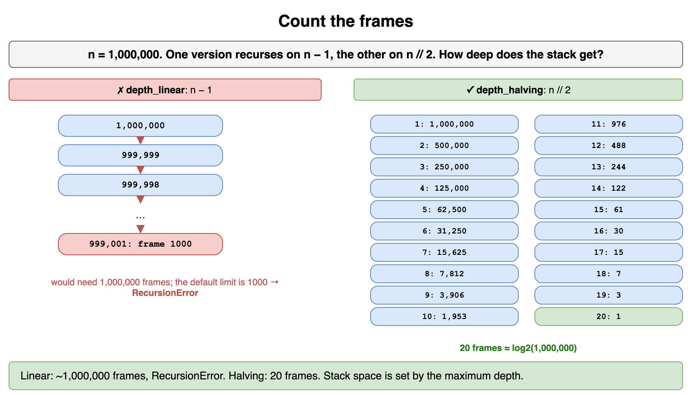

*Source: [`diagrams/recursion-and-dp-drills.drawio`](/content/07_Data_Structures_and_Algorithms/08_Recursion_and_Dynamic_Programming/diagrams/recursion-and-dp-drills.drawio), page 1.*

## Bug hunt: unreachable base case

This function should return the sum of every other number from `n` down to 1 (for example `n = 6` gives 6 + 4 + 2). It works for 6 but crashes for 7. Why, and what is the smallest fix?

```python
def every_other_sum(n: int) -> int:
    if n == 0:
        return 0
    return n + every_other_sum(n - 2)
```

**Answer:** Odd inputs step 7, 5, 3, 1, -1, -3, ... and skip right past 0, so the base case is never reached and the stack overflows. Guard the whole region the step can land in: `if n <= 0`. Whenever the step size is larger than 1, an equality base case is suspect.

```python
def every_other_sum(n: int) -> int:
    if n <= 0:
        return 0
    return n + every_other_sum(n - 2)

print(every_other_sum(6))  # 12
print(every_other_sum(7))  # 16
print(every_other_sum(0))  # 0
```

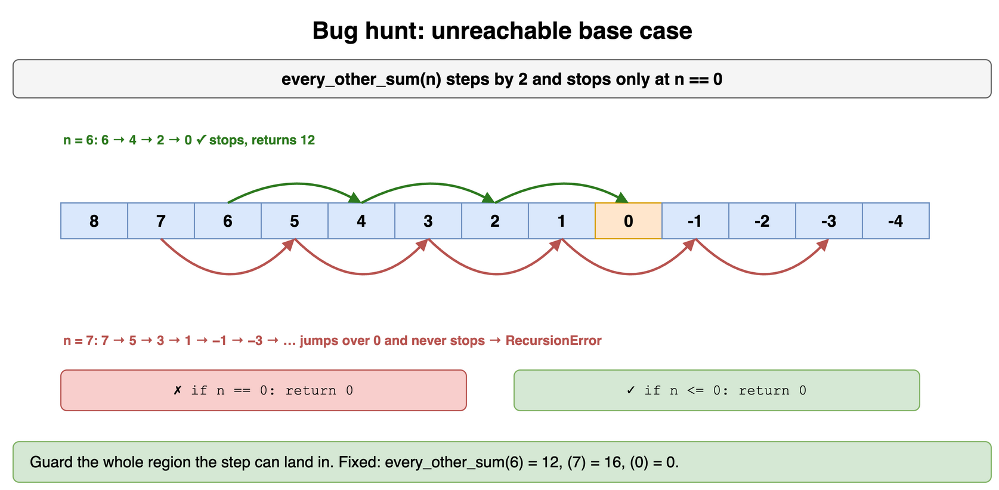

*Source: [`diagrams/recursion-and-dp-drills.drawio`](/content/07_Data_Structures_and_Algorithms/08_Recursion_and_Dynamic_Programming/diagrams/recursion-and-dp-drills.drawio), page 2.*

## Recursion to explicit stack

Sum all integers in an arbitrarily nested list such as `[1, [2, [3, [4]]], 5]`. Write it recursively, then without recursion so a nesting depth of 10,000 does not crash.

**Answer:** Recursively: for each element, add it if it is an int, otherwise add the recursive sum of the sublist. Iteratively: keep your own stack of lists still to process; pop one, add its ints, push its sublists. The explicit stack lives on the heap, so depth is limited only by memory.

```python
def nested_sum_rec(xs: list) -> int:
    return sum(nested_sum_rec(x) if isinstance(x, list) else x for x in xs)

def nested_sum_iter(xs: list) -> int:
    total, stack = 0, [xs]
    while stack:
        for x in stack.pop():
            if isinstance(x, list):
                stack.append(x)
            else:
                total += x
    return total

sample = [1, [2, [3, [4]]], 5]
print(nested_sum_rec(sample), nested_sum_iter(sample))  # 15 15

deep: list = [7]
for _ in range(10_000):
    deep = [deep]
print(nested_sum_iter(deep))  # 7
```

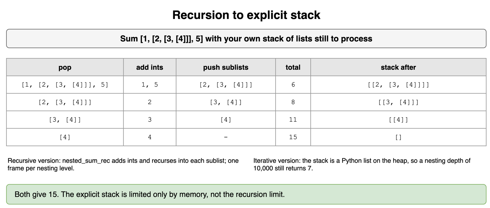

*Source: [`diagrams/recursion-and-dp-drills.drawio`](/content/07_Data_Structures_and_Algorithms/08_Recursion_and_Dynamic_Programming/diagrams/recursion-and-dp-drills.drawio), page 3.*

## Same call twice

How many calls does `g(20)` make? Then rewrite it so the answer is the same but the work is linear.

```python
def g(n: int) -> int:
    if n == 0:
        return 1
    return g(n - 1) + g(n - 1)
```

**Answer:** Each call makes two identical calls one level down, so the recursion tree is a full binary tree of depth 20 with 2^21 - 1 = 2,097,151 calls, and `g(n) = 2^n`. The two calls are the same subproblem, so compute it once and double it: one call per level, O(n). Spotting repeated identical calls on the same line is the simplest form of overlapping subproblems.

```python
calls = 0

def g(n: int) -> int:
    global calls
    calls += 1
    if n == 0:
        return 1
    return g(n - 1) + g(n - 1)

def g_fast(n: int) -> int:
    if n == 0:
        return 1
    half = g_fast(n - 1)
    return half + half

print(g(20), calls)  # 1048576 2097151
print(g_fast(20))    # 1048576
```

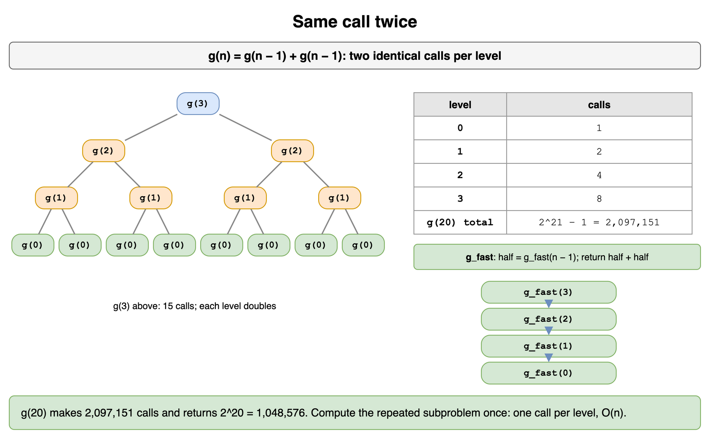

*Source: [`diagrams/recursion-and-dp-drills.drawio`](/content/07_Data_Structures_and_Algorithms/08_Recursion_and_Dynamic_Programming/diagrams/recursion-and-dp-drills.drawio), page 4.*

## Pick the memo key

This memoized function picks values from a list, never two adjacent ones, to maximize the total. It is correct but just as slow as plain recursion. Which part of the key is the problem?

```python
from functools import cache

@cache
def best(i: int, picked: tuple) -> int:
    values = (4, 1, 2, 9, 3, 1, 8)
    if i >= len(values):
        return 0
    skip = best(i + 1, picked)
    take = values[i] + best(i + 2, picked + (i,))
    return max(skip, take)
```

**Answer:** `picked` records the path so far, but the future answer from index `i` does not depend on it: it only depends on `i`. Including it makes almost every key unique, so the cache never hits. Drop it; the state is just `i`. Return the picks separately if you need them.

```python
from functools import cache

VALUES = (4, 1, 2, 9, 3, 1, 8)

@cache
def best(i: int) -> int:
    if i >= len(VALUES):
        return 0
    return max(best(i + 1), VALUES[i] + best(i + 2))

print(best(0))  # 21
print(best.cache_info().currsize)  # 9
```

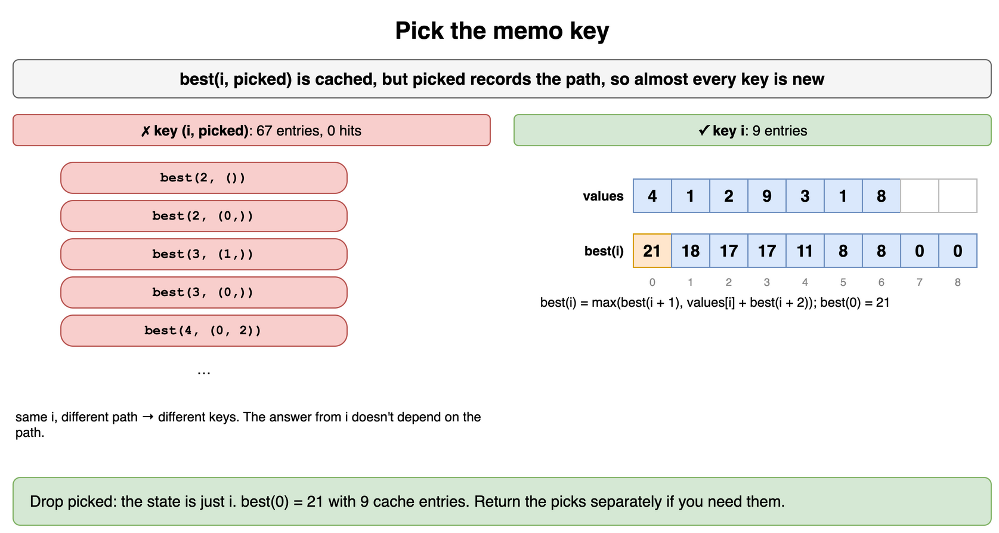

*Source: [`diagrams/recursion-and-dp-drills.drawio`](/content/07_Data_Structures_and_Algorithms/08_Recursion_and_Dynamic_Programming/diagrams/recursion-and-dp-drills.drawio), page 5.*

## Bug hunt: stale cache

`fewest(amount, coins)` returns the fewest coins that sum to `amount`. `fewest(6, (1, 3, 4))` correctly returns 2, but calling `fewest(7, (2, 4))` afterwards returns 2 instead of infinity (impossible). Find the bug.

```python
memo = {}

def fewest(amount: int, coins: tuple) -> int:
    if amount == 0:
        return 0
    if amount in memo:
        return memo[amount]
    best = float("inf")
    for c in coins:
        if c <= amount:
            best = min(best, 1 + fewest(amount - c, coins))
    memo[amount] = best
    return best
```

**Answer:** The cache is keyed only by `amount`, but the answer also depends on `coins`, and the cache is global so it survives between calls. After `fewest(6, (1, 3, 4))` fills the memo for amounts 1 to 6, `fewest(7, (2, 4))` tries 7 - 4 = 3, finds the stale `memo[3] = 1` (one 3-coin from the old set), and returns 2, although 7 cannot be made from 2s and 4s at all. Either put every input that affects the answer in the key, or create a fresh cache per top-level call by nesting the helper.

```python
from functools import cache

def fewest(amount: int, coins: tuple[int, ...]) -> float:
    @cache
    def go(a: int) -> float:
        if a == 0:
            return 0
        return min((1 + go(a - c) for c in coins if c <= a), default=float("inf"))
    return go(amount)

print(fewest(6, (1, 3, 4)))  # 2
print(fewest(7, (1, 5)))     # 3
print(fewest(7, (2, 4)))     # inf
```

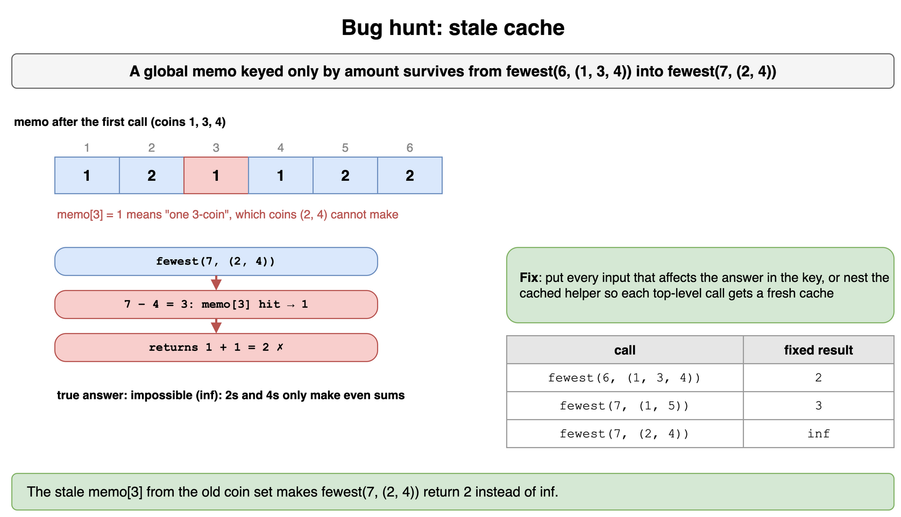

*Source: [`diagrams/recursion-and-dp-drills.drawio`](/content/07_Data_Structures_and_Algorithms/08_Recursion_and_Dynamic_Programming/diagrams/recursion-and-dp-drills.drawio), page 6.*

## Write the recurrence

Houses on a street hold `[2, 7, 9, 3, 1]` coins. You may collect from any houses as long as you never take two neighbors. Define the state, write the recurrence, and fill the table by hand.

**Answer:** Let `dp[i]` be the best total using only the first `i` houses. For house `i - 1` you either skip it (`dp[i - 1]`) or take it and skip its neighbor (`dp[i - 2] + value`). Base cases: `dp[0] = 0`, `dp[1] = value[0]`. The table is 0, 2, 7, 11, 11, 12, so the answer is 12 (2 + 9 + 1).

```python
def best_collection(values: list[int]) -> list[int]:
    dp = [0] * (len(values) + 1)
    if values:
        dp[1] = values[0]
    for i in range(2, len(values) + 1):
        dp[i] = max(dp[i - 1], dp[i - 2] + values[i - 1])
    return dp

print(best_collection([2, 7, 9, 3, 1]))  # [0, 2, 7, 11, 11, 12]
```

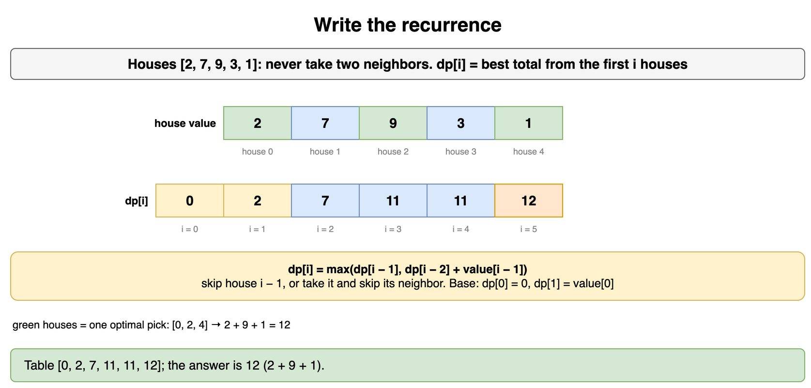

*Source: [`diagrams/recursion-and-dp-drills.drawio`](/content/07_Data_Structures_and_Algorithms/08_Recursion_and_Dynamic_Programming/diagrams/recursion-and-dp-drills.drawio), page 7.*

## Fill the grid table

Each cell of this grid has a cost. Starting at the top-left and moving only right or down, what is the cheapest total cost to reach the bottom-right (counting both endpoints)? Fill the table row by row.

```
1 3 1
1 5 1
4 2 1
```

**Answer:** `dp[r][c] = cost[r][c] + min(dp[r-1][c], dp[r][c-1])`, with the first row and column only reachable from one side. Row by row the table is `[1, 4, 5]`, `[2, 7, 6]`, `[6, 8, 7]`, so the cheapest cost is 7 (path 1, 3, 1, 1, 1). Filling in row-major order works because each cell only reads cells above or to the left.

```python
def min_path_table(cost: list[list[int]]) -> list[list[int]]:
    rows, cols = len(cost), len(cost[0])
    dp = [[0] * cols for _ in range(rows)]
    for r in range(rows):
        for c in range(cols):
            if r == 0 and c == 0:
                dp[r][c] = cost[r][c]
            elif r == 0:
                dp[r][c] = cost[r][c] + dp[r][c - 1]
            elif c == 0:
                dp[r][c] = cost[r][c] + dp[r - 1][c]
            else:
                dp[r][c] = cost[r][c] + min(dp[r - 1][c], dp[r][c - 1])
    return dp

for row in min_path_table([[1, 3, 1], [1, 5, 1], [4, 2, 1]]):
    print(row)
# [1, 4, 5]
# [2, 7, 6]
# [6, 8, 7]
```

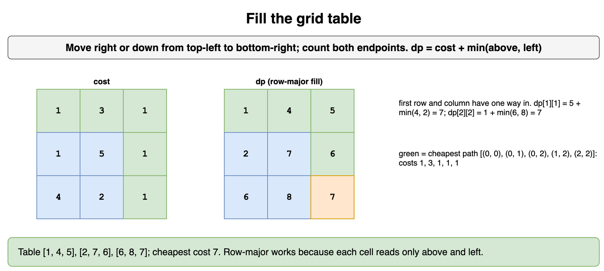

*Source: [`diagrams/recursion-and-dp-drills.drawio`](/content/07_Data_Structures_and_Algorithms/08_Recursion_and_Dynamic_Programming/diagrams/recursion-and-dp-drills.drawio), page 8.*

## One row is enough

Rewrite the previous grid solution to use O(cols) extra space instead of O(rows x cols). What do you give up?

**Answer:** Each row only reads the row above and the current row to its left. Keep one array: before you overwrite `dp[c]` it still holds the value from the row above, and `dp[c - 1]` already holds this row's value to the left. You give up the full table, so you can no longer walk back to recover the path unless you also store choices.

```python
def min_path_cost(cost: list[list[int]]) -> int:
    cols = len(cost[0])
    dp = [float("inf")] * cols
    dp[0] = 0
    for row in cost:
        dp[0] += row[0]
        for c in range(1, cols):
            dp[c] = row[c] + min(dp[c], dp[c - 1])   # dp[c] = above, dp[c-1] = left
    return dp[-1]

print(min_path_cost([[1, 3, 1], [1, 5, 1], [4, 2, 1]]))  # 7
print(min_path_cost([[5]]))                              # 5
```

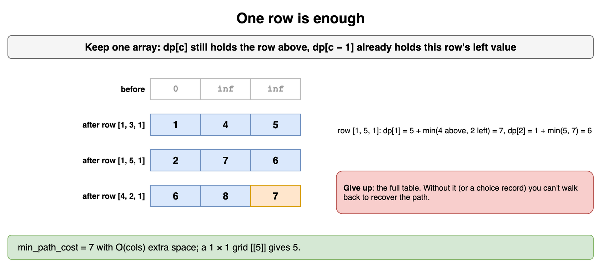

*Source: [`diagrams/recursion-and-dp-drills.drawio`](/content/07_Data_Structures_and_Algorithms/08_Recursion_and_Dynamic_Programming/diagrams/recursion-and-dp-drills.drawio), page 9.*

## Loop direction in 0/1 choice

This 1D table checks whether some subset of `nums` (each number used at most once) sums to `target`. It says `True` for `nums = [5]`, `target = 10`. Why, and what one-line change fixes it?

```python
def can_make(nums: list[int], target: int) -> bool:
    ok = [True] + [False] * target
    for x in nums:
        for t in range(x, target + 1):
            ok[t] = ok[t] or ok[t - x]
    return ok[target]
```

**Answer:** Looping `t` upward means `ok[10]` reads `ok[5]`, which was already set to True by the same 5 in this pass, so 5 is used twice: that is the unbounded version. Loop `t` downward from `target` to `x` so every read sees the table from before `x` was considered.

```python
def can_make(nums: list[int], target: int, reuse: bool = False) -> bool:
    ok = [True] + [False] * target
    for x in nums:
        order = range(x, target + 1) if reuse else range(target, x - 1, -1)
        for t in order:
            ok[t] = ok[t] or ok[t - x]
    return ok[target]

print(can_make([5], 10))              # False
print(can_make([5], 10, reuse=True))  # True
print(can_make([1, 5, 11, 5], 11))    # True
```

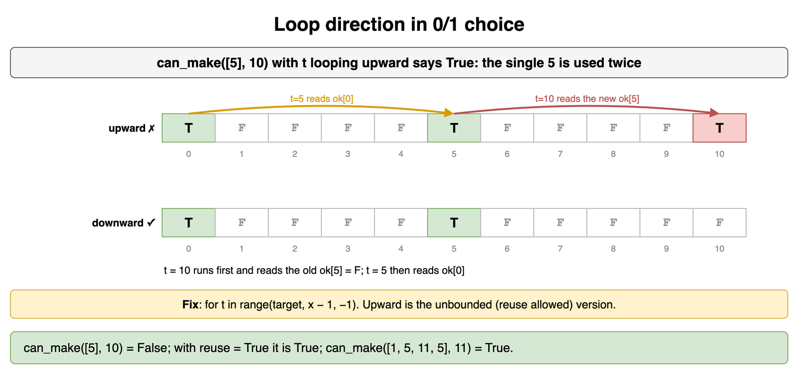

*Source: [`diagrams/recursion-and-dp-drills.drawio`](/content/07_Data_Structures_and_Algorithms/08_Recursion_and_Dynamic_Programming/diagrams/recursion-and-dp-drills.drawio), page 10.*

## Greedy trap

Coins come in denominations 1, 3, and 4, unlimited supply. A greedy strategy always takes the largest coin that fits. How many coins does greedy use for 6, and what is the true minimum? Give the DP table for amounts 0 to 6.

**Answer:** Greedy takes 4, then 1, then 1: three coins. The minimum is two (3 + 3). The DP table `dp[a] = 1 + min(dp[a - c])` for amounts 0 to 6 is 0, 1, 2, 1, 1, 2, 2. Greedy only works for special coin systems; DP is safe for any.

```python
def greedy_coins(coins: list[int], amount: int) -> int:
    used = 0
    for c in sorted(coins, reverse=True):
        used += amount // c
        amount %= c
    return used if amount == 0 else -1

def dp_coins(coins: list[int], amount: int) -> list[int]:
    dp = [0] + [10**9] * amount
    for a in range(1, amount + 1):
        dp[a] = min((dp[a - c] + 1 for c in coins if c <= a), default=10**9)
    return dp

print(greedy_coins([1, 3, 4], 6))  # 3
print(dp_coins([1, 3, 4], 6))      # [0, 1, 2, 1, 1, 2, 2]
```

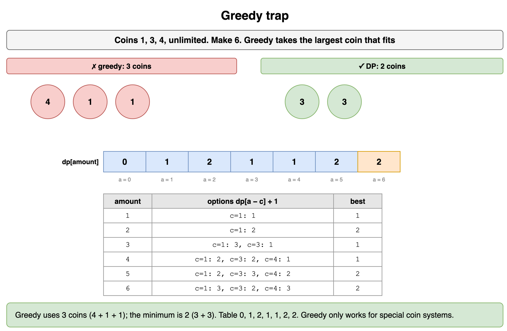

*Source: [`diagrams/recursion-and-dp-drills.drawio`](/content/07_Data_Structures_and_Algorithms/08_Recursion_and_Dynamic_Programming/diagrams/recursion-and-dp-drills.drawio), page 11.*

## Rebuild the choices

Extend the fewest-coins table so it also returns which coins were used. Show the result for coins 1, 3, 4 and amount 10.

**Answer:** Alongside `dp[a]`, store `last[a]`, the coin that achieved the minimum. To rebuild, start at the target and repeatedly subtract `last[a]` until you reach 0. For 10 the minimum is 3 coins; with coins tried in order 1, 3, 4 and strict `<`, the walk gives 3, 3, 4.

```python
def coins_used(coins: list[int], amount: int) -> list[int]:
    INF = float("inf")
    dp = [0] + [INF] * amount
    last = [0] * (amount + 1)
    for a in range(1, amount + 1):
        for c in coins:
            if c <= a and dp[a - c] + 1 < dp[a]:
                dp[a], last[a] = dp[a - c] + 1, c
    if dp[amount] == INF:
        return []
    picks, a = [], amount
    while a > 0:
        picks.append(last[a])
        a -= last[a]
    return sorted(picks)

print(coins_used([1, 3, 4], 10))  # [3, 3, 4]
print(coins_used([1, 3, 4], 6))   # [3, 3]
```

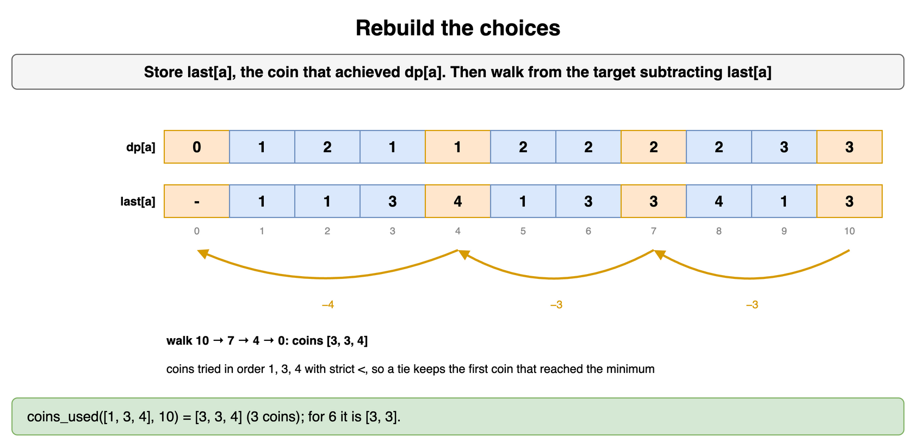

*Source: [`diagrams/recursion-and-dp-drills.drawio`](/content/07_Data_Structures_and_Algorithms/08_Recursion_and_Dynamic_Programming/diagrams/recursion-and-dp-drills.drawio), page 12.*

## Edit distance trace

How many single-character inserts, deletes, or replacements turn `"flaw"` into `"lawn"`? Define the state and recurrence, then compute it.

**Answer:** `dp[i][j]` is the cost to turn the first `i` characters of `a` into the first `j` of `b`. If `a[i-1] == b[j-1]`, copy the diagonal; otherwise take 1 + the min of delete (`dp[i-1][j]`), insert (`dp[i][j-1]`), and replace (`dp[i-1][j-1]`). Base cases: `dp[i][0] = i`, `dp[0][j] = j`. The answer is 2: delete `f`, insert `n`.

```python
def edit_distance(a: str, b: str) -> int:
    m, n = len(a), len(b)
    dp = [[0] * (n + 1) for _ in range(m + 1)]
    for i in range(m + 1):
        dp[i][0] = i
    for j in range(n + 1):
        dp[0][j] = j
    for i in range(1, m + 1):
        for j in range(1, n + 1):
            if a[i - 1] == b[j - 1]:
                dp[i][j] = dp[i - 1][j - 1]
            else:
                dp[i][j] = 1 + min(dp[i - 1][j], dp[i][j - 1], dp[i - 1][j - 1])
    return dp[m][n]

print(edit_distance("flaw", "lawn"))       # 2
print(edit_distance("kitten", "sitting"))  # 3
print(edit_distance("", "abc"))            # 3
```

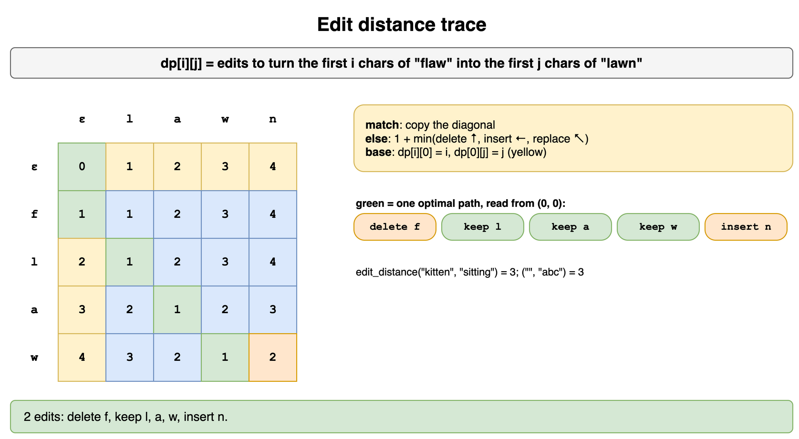

*Source: [`diagrams/recursion-and-dp-drills.drawio`](/content/07_Data_Structures_and_Algorithms/08_Recursion_and_Dynamic_Programming/diagrams/recursion-and-dp-drills.drawio), page 13.*

## Ends at i

Find the length of the longest strictly increasing subsequence of `[3, 10, 2, 1, 20, 4, 6, 7]`. Why does "best answer among the first i elements" make a poor state here, and what state works?

**Answer:** Knowing only the best length among the first `i` elements does not tell you whether element `i` can extend it, because you do not know the last value used. Use `dp[i]` = length of the longest increasing subsequence that **ends at** index `i`: `dp[i] = 1 + max(dp[j])` over `j < i` with `nums[j] < nums[i]`. The answer is `max(dp)` = 4 (for example 2, 4, 6, 7). This is O(N^2).

```python
def lis_table(nums: list[int]) -> list[int]:
    dp = [1] * len(nums)
    for i in range(len(nums)):
        for j in range(i):
            if nums[j] < nums[i]:
                dp[i] = max(dp[i], dp[j] + 1)
    return dp

dp = lis_table([3, 10, 2, 1, 20, 4, 6, 7])
print(dp)       # [1, 2, 1, 1, 3, 2, 3, 4]
print(max(dp))  # 4
```

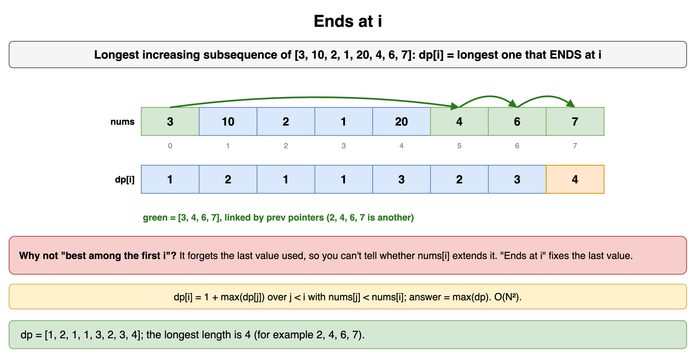

*Source: [`diagrams/recursion-and-dp-drills.drawio`](/content/07_Data_Structures_and_Algorithms/08_Recursion_and_Dynamic_Programming/diagrams/recursion-and-dp-drills.drawio), page 14.*

## Count or list

A digit string decodes to letters with 1 = A through 26 = Z, so `"1226"` could be read as 1-2-2-6, 12-2-6, 1-22-6, 1-2-26, or 12-26. You are asked two things: how many decodings a 60-digit string has, and every decoding of a 6-digit string. Which technique fits each?

**Answer:** Counting is DP: the state is the position `i`, and `ways(i) = ways(i + 1)` (one digit, if not `0`) `+ ways(i + 2)` (two digits, if 10 to 26). That is O(N) even when the count is astronomically large. Listing must produce every decoding, so the output can be exponential; use backtracking with the same choices and accept the output-size cost.

```python
from functools import cache

def count_decodings(s: str) -> int:
    @cache
    def ways(i: int) -> int:
        if i == len(s):
            return 1
        if s[i] == "0":
            return 0
        total = ways(i + 1)
        if i + 1 < len(s) and 10 <= int(s[i:i + 2]) <= 26:
            total += ways(i + 2)
        return total
    return ways(0)

def list_decodings(s: str) -> list[str]:
    out: list[str] = []
    def go(i: int, acc: str) -> None:
        if i == len(s):
            out.append(acc); return
        if s[i] == "0":
            return
        go(i + 1, acc + chr(64 + int(s[i])))
        if i + 1 < len(s) and 10 <= int(s[i:i + 2]) <= 26:
            go(i + 2, acc + chr(64 + int(s[i:i + 2])))
    go(0, "")
    return out

print(count_decodings("1226"))  # 5
print(list_decodings("1226"))   # ['ABBF', 'ABZ', 'AVF', 'LBF', 'LZ']
print(count_decodings("11" * 30))  # 2504730781961
```

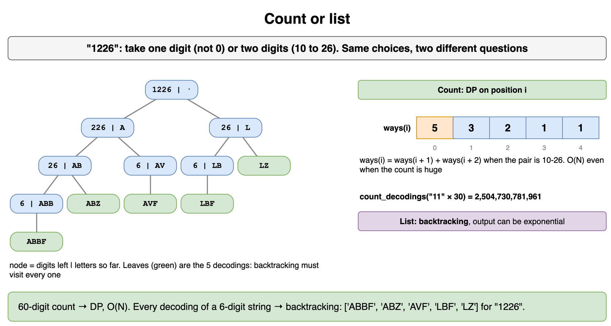

*Source: [`diagrams/recursion-and-dp-drills.drawio`](/content/07_Data_Structures_and_Algorithms/08_Recursion_and_Dynamic_Programming/diagrams/recursion-and-dp-drills.drawio), page 15.*

## Sparse states

`value(n) = max(n, value(n // 2) + value(n // 3) + value(n // 4))` with `value(0) = 0`. Compute `value(1_000_000_000)`. Why is memoization the right choice here, and how many states does it touch?

**Answer:** A bottom-up table would need a billion cells. But from `n`, only numbers of the form `n // (2^a 3^b)` are reachable, so memoization visits only 242 states for this input. When the state space is huge but the reachable part is tiny, top-down memoization beats tabulation.

```python
from functools import cache

@cache
def value(n: int) -> int:
    if n == 0:
        return 0
    return max(n, value(n // 2) + value(n // 3) + value(n // 4))

print(value(12))                   # 13
print(value(1_000_000_000))        # 4243218150
print(value.cache_info().currsize < 1000)  # True
```

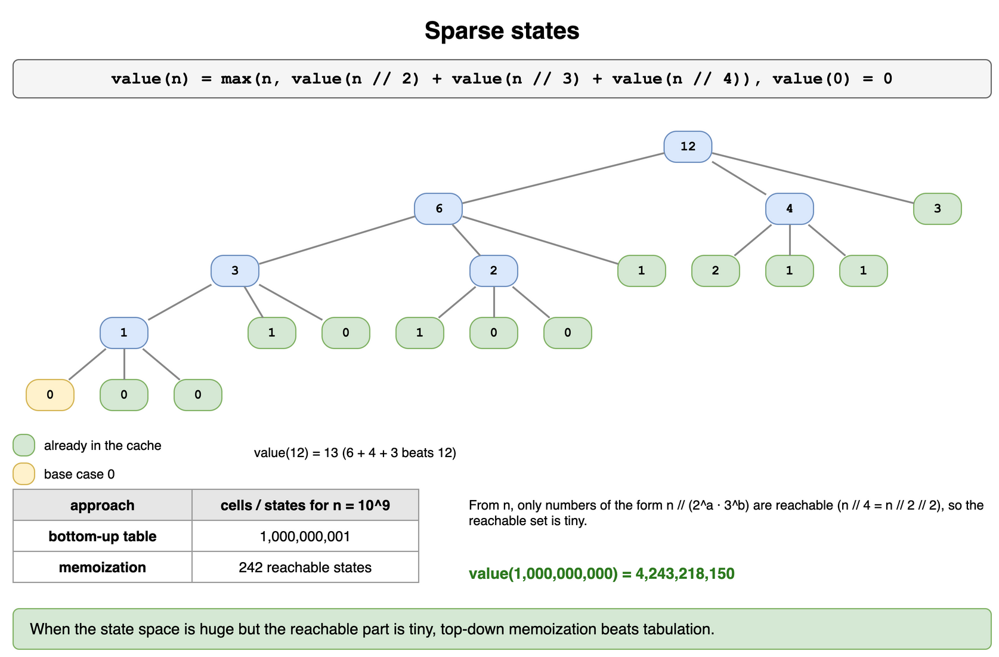

*Source: [`diagrams/recursion-and-dp-drills.drawio`](/content/07_Data_Structures_and_Algorithms/08_Recursion_and_Dynamic_Programming/diagrams/recursion-and-dp-drills.drawio), page 16.*
