## Bubble sort

Bubble sort walks through the array repeatedly, comparing adjacent elements and swapping them if they are out of order. After each full pass, the largest unsorted element has "bubbled" to its correct position at the end, so the next pass can stop one element earlier. The algorithm terminates when a pass completes with no swaps, meaning the array is sorted.

Time is O(N^2) worst and average, O(N) best (already sorted with the early-exit optimization). Space is O(1). Bubble sort is easy to understand but impractical for anything beyond tiny inputs because even on average it does roughly N^2/2 comparisons and swaps. Its only real value is pedagogical.

```python
def bubble_sort(arr: list[int]) -> None:
    """Sort arr in-place using bubble sort with early-exit optimization."""
    n = len(arr)
    for i in range(n):
        swapped = False
        for j in range(n - 1 - i):
            if arr[j] > arr[j + 1]:
                arr[j], arr[j + 1] = arr[j + 1], arr[j]
                swapped = True
        if not swapped:
            break  # already sorted, no need to continue

data = [5, 3, 8, 1, 2]
bubble_sort(data)
print(data)  # [1, 2, 3, 5, 8]
```

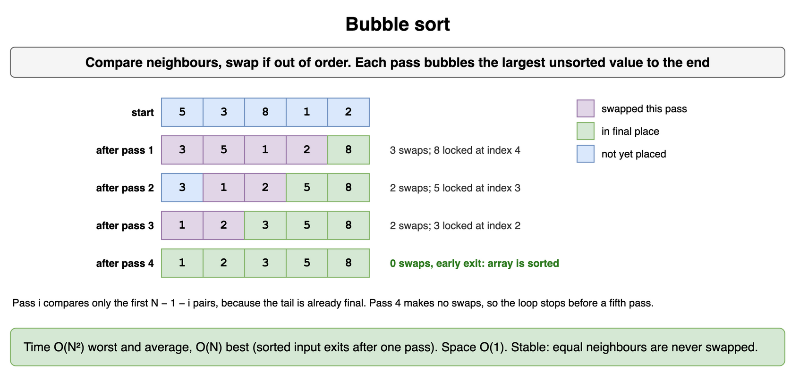

*Source: [`diagrams/sorting-and-searching.drawio`](/content/07_Data_Structures_and_Algorithms/09_Sorting_and_Searching/diagrams/sorting-and-searching.drawio), page 1.*

## Selection sort

Selection sort divides the array into a sorted prefix and an unsorted suffix. On each pass, it scans the unsorted portion to find the minimum element, then swaps it into the next position of the sorted prefix. This continues until every element has been placed.

Time is always O(N^2) because the scan through the unsorted portion happens regardless of input order. Space is O(1). The number of swaps is at most O(N), which makes selection sort useful when writes are expensive (like writing to flash memory), but in general its quadratic comparison count makes it uncompetitive.

```python
def selection_sort(arr: list[int]) -> None:
    """Sort arr in-place using selection sort."""
    n = len(arr)
    for i in range(n):
        min_idx = i
        for j in range(i + 1, n):
            if arr[j] < arr[min_idx]:
                min_idx = j
        arr[i], arr[min_idx] = arr[min_idx], arr[i]

data = [29, 10, 14, 37, 13]
selection_sort(data)
print(data)  # [10, 13, 14, 29, 37]
```

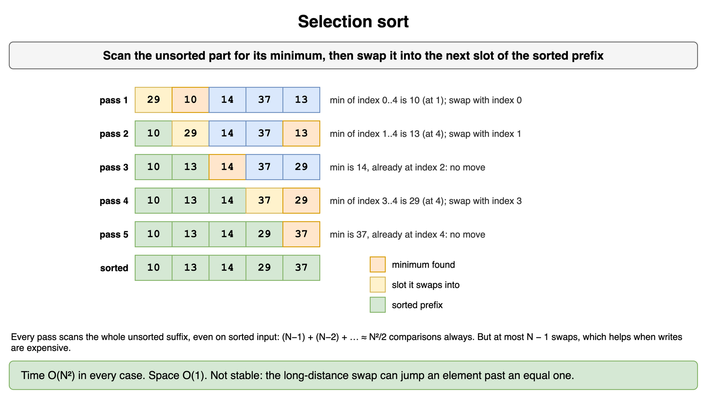

*Source: [`diagrams/sorting-and-searching.drawio`](/content/07_Data_Structures_and_Algorithms/09_Sorting_and_Searching/diagrams/sorting-and-searching.drawio), page 2.*

## Insertion sort

Insertion sort builds the sorted array one element at a time. For each new element, it shifts larger elements in the sorted prefix one position to the right until it finds the correct insertion point. This is the same motion you use when sorting a hand of playing cards.

Time is O(N^2) worst case (reverse-sorted input), but O(N) best case when the array is already sorted or nearly sorted, because each element triggers at most a few shifts. Space is O(1). This best-case behavior makes insertion sort the algorithm of choice for small arrays and as the base case in hybrid sorts like Timsort (Python's built-in sort).

```python
def insertion_sort(arr: list[int]) -> None:
    """Sort arr in-place using insertion sort."""
    for i in range(1, len(arr)):
        key = arr[i]
        j = i - 1
        while j >= 0 and arr[j] > key:
            arr[j + 1] = arr[j]  # shift right
            j -= 1
        arr[j + 1] = key

data = [5, 2, 4, 6, 1, 3]
insertion_sort(data)
print(data)  # [1, 2, 3, 4, 5, 6]
```

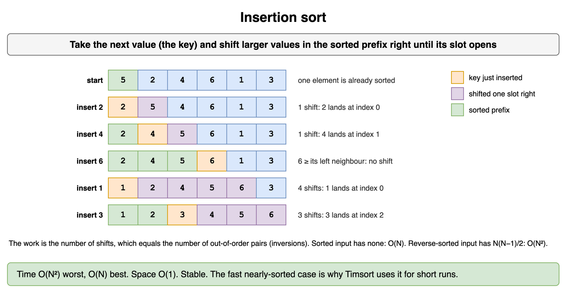

*Source: [`diagrams/sorting-and-searching.drawio`](/content/07_Data_Structures_and_Algorithms/09_Sorting_and_Searching/diagrams/sorting-and-searching.drawio), page 3.*

## Merge sort

Merge sort splits the array in half, recursively sorts each half, then merges the two sorted halves back together. The merge step walks two pointers through the sorted halves, always picking the smaller element, producing a fully sorted result in O(N) time per level. With O(log N) levels of recursion, total time is O(N log N) in all cases. The tradeoff is O(N) auxiliary space for the temporary arrays during merging.

Merge sort is the go-to when you need guaranteed O(N log N) performance and stability. It is also the natural choice for sorting linked lists (where the space overhead disappears) and for external sorting of data that does not fit in memory. Its memory cost depends on the container: O(N) extra for arrays, but only the O(log N) recursion stack when merging linked-list nodes by relinking them.

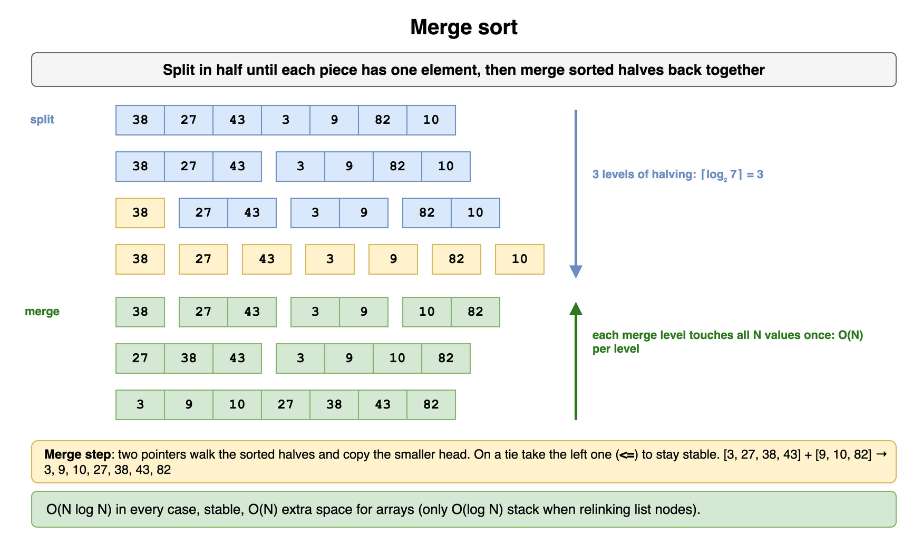

*Source: [`diagrams/sorting-and-searching.drawio`](/content/07_Data_Structures_and_Algorithms/09_Sorting_and_Searching/diagrams/sorting-and-searching.drawio), page 4.*

```python
def merge_sort(arr: list[int]) -> list[int]:
    """Return a new sorted list using merge sort."""
    if len(arr) <= 1:
        return arr

    mid = len(arr) // 2
    left = merge_sort(arr[:mid])
    right = merge_sort(arr[mid:])
    return _merge(left, right)


def _merge(left: list[int], right: list[int]) -> list[int]:
    """Merge two sorted lists into one sorted list."""
    result: list[int] = []
    i = j = 0
    while i < len(left) and j < len(right):
        if left[i] <= right[j]:   # <= preserves stability
            result.append(left[i])
            i += 1
        else:
            result.append(right[j])
            j += 1
    result.extend(left[i:])
    result.extend(right[j:])
    return result


print(merge_sort([38, 27, 43, 3, 9, 82, 10]))  # [3, 9, 10, 27, 38, 43, 82]
```

## Quick sort

Quick sort picks a pivot element, partitions the array so that all elements less than the pivot come before it and all greater elements come after, then recursively sorts the two partitions. Average time is O(N log N) because each partition roughly halves the problem. Worst case is O(N^2) when the pivot is always the smallest or largest element (e.g., already-sorted input with naive first-element pivot). Randomizing the pivot choice makes the worst case astronomically unlikely in practice.

Space is O(log N) for the recursion stack on average, but a run of bad pivots can nest N deep; recursing into the smaller partition first and looping on the larger one caps the stack at O(log N) even then. Quick sort is typically faster than merge sort in practice due to better cache locality and lower constant factors, which is why it is the basis of many standard library sort implementations.

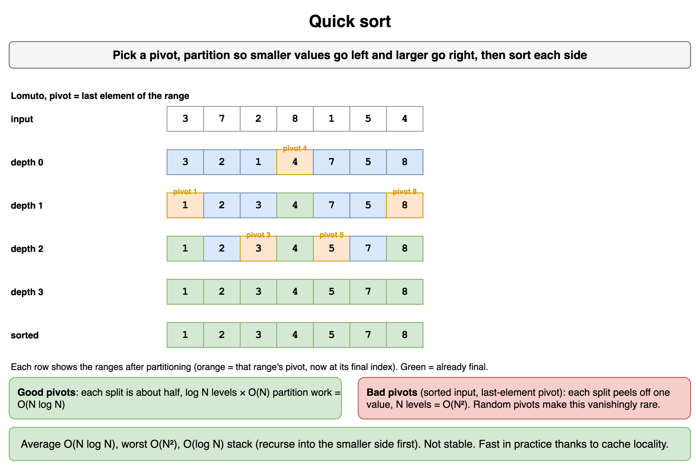

*Source: [`diagrams/sorting-and-searching.drawio`](/content/07_Data_Structures_and_Algorithms/09_Sorting_and_Searching/diagrams/sorting-and-searching.drawio), page 5.*

```python
import random


def quicksort(arr: list[int]) -> list[int]:
    """Return a new sorted list using quicksort."""
    if len(arr) <= 1:
        return arr

    pivot = arr[random.randint(0, len(arr) - 1)]
    less = [x for x in arr if x < pivot]
    equal = [x for x in arr if x == pivot]
    greater = [x for x in arr if x > pivot]
    return quicksort(less) + equal + quicksort(greater)


def quicksort_inplace(arr: list[int], lo: int = 0, hi: int | None = None) -> None:
    """Sort arr in-place using Lomuto partition scheme."""
    if hi is None:
        hi = len(arr) - 1
    if lo >= hi:
        return

    pivot_idx = _partition(arr, lo, hi)
    quicksort_inplace(arr, lo, pivot_idx - 1)
    quicksort_inplace(arr, pivot_idx + 1, hi)


def _partition(arr: list[int], lo: int, hi: int) -> int:
    """Lomuto partition: pivot is arr[hi], returns final pivot index."""
    pivot = arr[hi]
    i = lo  # boundary of elements < pivot
    for j in range(lo, hi):
        if arr[j] < pivot:
            arr[i], arr[j] = arr[j], arr[i]
            i += 1
    arr[i], arr[hi] = arr[hi], arr[i]
    return i


data = [3, 7, 2, 8, 1, 5, 4]
quicksort_inplace(data)
print(data)  # [1, 2, 3, 4, 5, 7, 8]
```

## Partition schemes

Partitioning rearranges a range around a pivot so smaller values sit on one side and larger values on the other. It is the engine of quick sort and quickselect, and three schemes cover almost every interview need.

- **Lomuto** keeps one boundary index and swaps each smaller element behind it. Simple to write, but it does more swaps and degrades to O(N^2) when many keys equal the pivot.
- **Hoare** walks two pointers inward and swaps pairs that are on the wrong side. Fewer swaps, but the pivot does not necessarily end at its final index, so the recursion uses `[lo, p]` and `[p + 1, hi]`.
- **Three-way (Dutch national flag)** splits into `< pivot`, `== pivot`, and `> pivot` in one pass. Runs of equal keys are finished in one step, which keeps quick sort fast on inputs with heavy duplication.

```python
def partition3(arr: list[int], pivot: int) -> tuple[int, int]:
    """Rearrange arr in place into <pivot, ==pivot, >pivot; return the == range."""
    lt, i, gt = 0, 0, len(arr) - 1
    while i <= gt:
        if arr[i] < pivot:
            arr[lt], arr[i] = arr[i], arr[lt]
            lt += 1
            i += 1
        elif arr[i] > pivot:
            arr[i], arr[gt] = arr[gt], arr[i]
            gt -= 1          # do not advance i: the swapped-in value is unchecked
        else:
            i += 1
    return lt, gt


data = [4, 9, 4, 1, 7, 4, 2]
print(partition3(data, 4), data)  # (2, 4) [2, 1, 4, 4, 4, 7, 9]
```

The invariant is what to remember: `arr[:lt]` is smaller, `arr[lt:i]` equals the pivot, `arr[i:gt+1]` is unexamined, and `arr[gt+1:]` is larger.

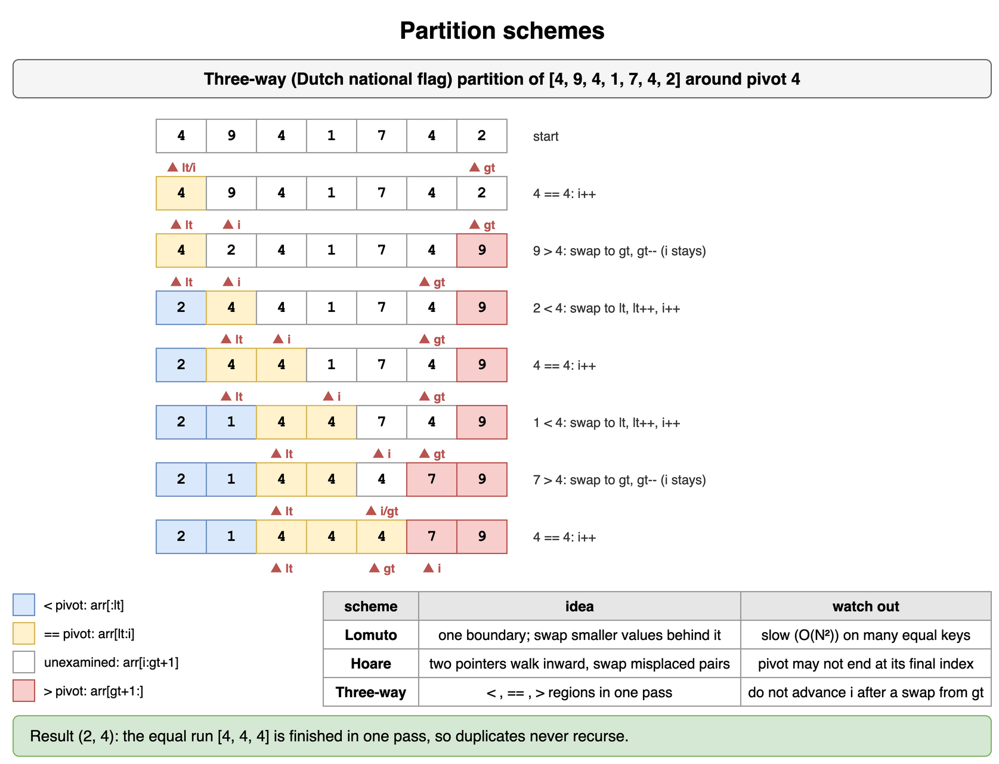

*Source: [`diagrams/sorting-and-searching.drawio`](/content/07_Data_Structures_and_Algorithms/09_Sorting_and_Searching/diagrams/sorting-and-searching.drawio), page 6.*

## Heap sort

Heap sort turns the array into a max-heap in O(N) time (sift down from the last parent to the root), then repeatedly swaps the root (the maximum) to the end of the unsorted region and sifts the new root down. Each of the N extractions costs O(log N), so time is O(N log N) in every case with O(1) extra space.

It is the in-place sort with a guaranteed worst case, which is why introsort falls back to it when quick sort recursion gets too deep. In practice it is slower than quick sort (poor cache locality, the heap jumps around the array) and it is not stable.

```python
def heap_sort(arr: list[int]) -> None:
    """Sort arr in place: build a max-heap, then move the max to the end N times."""
    def sift_down(root: int, end: int) -> None:
        while (child := 2 * root + 1) < end:
            if child + 1 < end and arr[child + 1] > arr[child]:
                child += 1                    # pick the larger child
            if arr[root] >= arr[child]:
                return
            arr[root], arr[child] = arr[child], arr[root]
            root = child

    n = len(arr)
    for start in range(n // 2 - 1, -1, -1):  # heapify bottom-up: O(N)
        sift_down(start, n)
    for end in range(n - 1, 0, -1):
        arr[0], arr[end] = arr[end], arr[0]  # max goes to its final slot
        sift_down(0, end)


data = [6, 2, 9, 1, 5, 3]
heap_sort(data)
print(data)  # [1, 2, 3, 5, 6, 9]
```

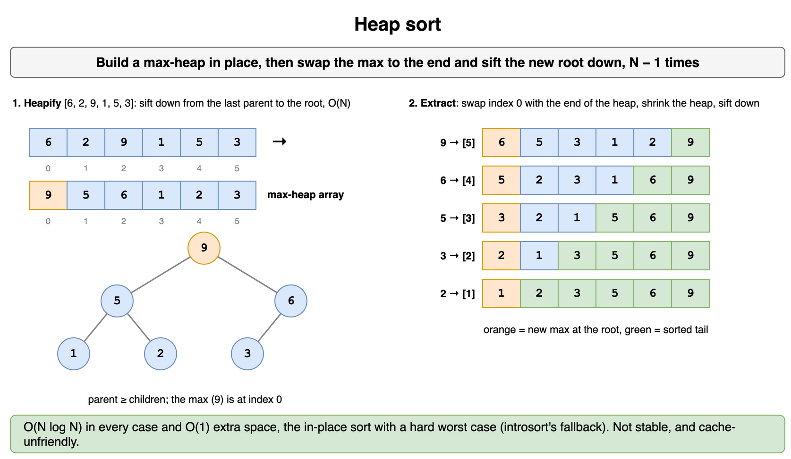

*Source: [`diagrams/sorting-and-searching.drawio`](/content/07_Data_Structures_and_Algorithms/09_Sorting_and_Searching/diagrams/sorting-and-searching.drawio), page 7.*

## Counting sort

When keys are small integers in a known range `0..K`, you can skip comparisons: count how often each key occurs, turn the counts into starting positions with a prefix sum, then place each record at its position. Time and space are O(N + K).

It wins when K is O(N) (exam scores 0–100, ages, single digits) and loses badly when K is huge relative to N (sorting ten 64-bit IDs). Placing records by walking the input left to right and bumping each key's next slot keeps it stable, which is exactly what radix sort needs from its per-digit pass.

```python
def counting_sort(records: list[tuple[int, str]], max_key: int) -> list[tuple[int, str]]:
    """Stable sort of (key, payload) pairs with 0 <= key <= max_key."""
    count = [0] * (max_key + 1)
    for key, _ in records:
        count[key] += 1
    start, total = [0] * (max_key + 1), 0
    for k in range(max_key + 1):       # prefix sum: first slot for each key
        start[k], total = total, total + count[k]
    out: list[tuple[int, str]] = [None] * len(records)  # type: ignore[list-item]
    for rec in records:                # left to right keeps equal keys in order
        out[start[rec[0]]] = rec
        start[rec[0]] += 1
    return out


print(counting_sort([(3, "c"), (1, "a"), (3, "d"), (0, "z")], 3))  # [(0, 'z'), (1, 'a'), (3, 'c'), (3, 'd')]
```

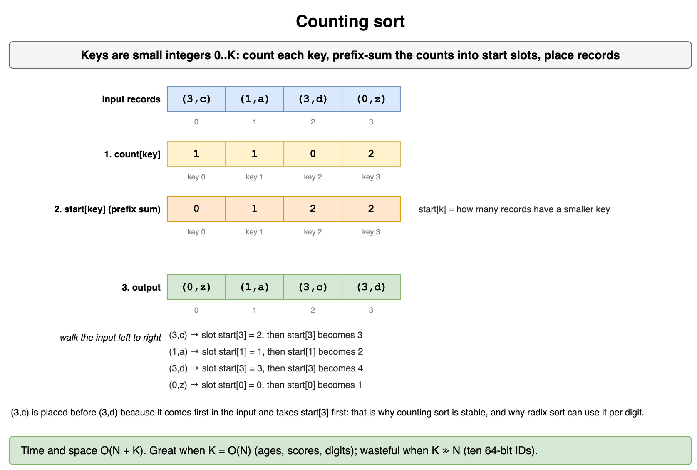

*Source: [`diagrams/sorting-and-searching.drawio`](/content/07_Data_Structures_and_Algorithms/09_Sorting_and_Searching/diagrams/sorting-and-searching.drawio), page 8.*

## Radix sort

Radix sort avoids comparisons entirely. It sorts integers digit by digit, starting from the least significant digit (LSD) to the most significant. At each digit position, it uses a stable sub-sort (usually counting sort, see the card above) to group elements by that digit. After processing all k digits, the array is sorted. Time is O(kN) where k is the number of digits and N is the number of elements.

Radix sort is useful when you have a large number of integers with a bounded number of digits. If k is constant or much smaller than log N, radix sort beats comparison-based sorts. It is commonly used for sorting fixed-length strings, IP addresses, and database record IDs. The tradeoff is O(N + b) auxiliary space where b is the base (radix).

```python
def radix_sort(arr: list[int]) -> list[int]:
    """Sort non-negative integers using LSD radix sort (base 10)."""
    if not arr:
        return arr

    max_val = max(arr)
    exp = 1  # current digit position (1s, 10s, 100s, ...)

    while max_val // exp > 0:
        arr = _counting_sort_by_digit(arr, exp)
        exp *= 10

    return arr


def _counting_sort_by_digit(arr: list[int], exp: int) -> list[int]:
    """Stable sort by the digit at position exp."""
    n = len(arr)
    output = [0] * n
    count = [0] * 10  # digits 0-9

    for num in arr:
        digit = (num // exp) % 10
        count[digit] += 1

    # Convert count to cumulative positions
    for i in range(1, 10):
        count[i] += count[i - 1]

    # Build output in reverse to maintain stability
    for i in range(n - 1, -1, -1):
        digit = (arr[i] // exp) % 10
        count[digit] -= 1
        output[count[digit]] = arr[i]

    return output


print(radix_sort([170, 45, 75, 90, 802, 24, 2, 66]))  # [2, 24, 45, 66, 75, 90, 170, 802]
```

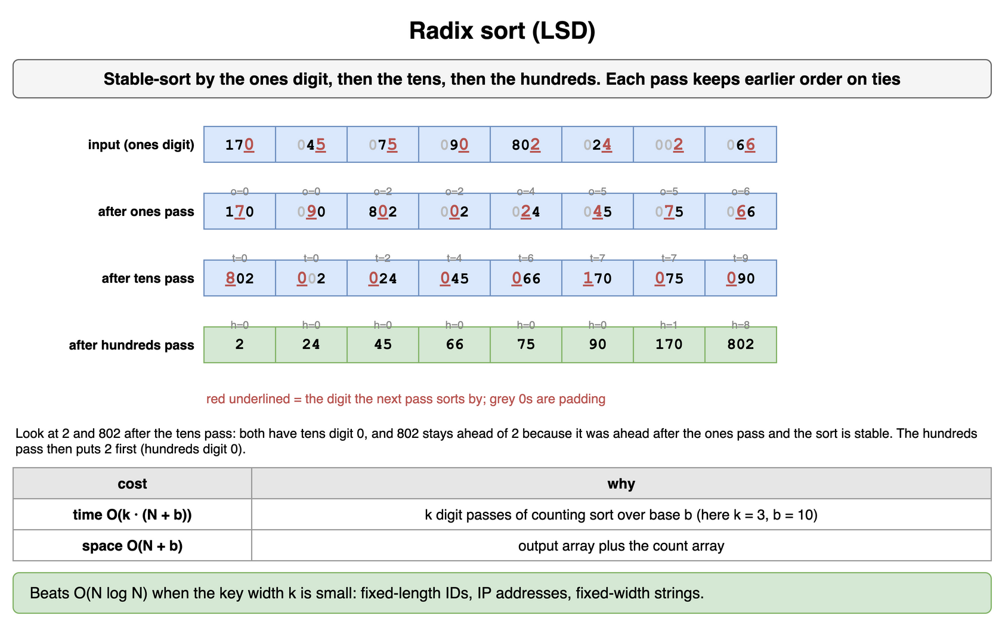

*Source: [`diagrams/sorting-and-searching.drawio`](/content/07_Data_Structures_and_Algorithms/09_Sorting_and_Searching/diagrams/sorting-and-searching.drawio), page 9.*

## Bucket sort

Bucket sort scatters values into B buckets by range (for floats in `[0, 1)`, bucket `int(x * B)`), sorts each bucket with a simple sort, and concatenates the buckets in order. If the input is roughly uniform, each bucket holds O(1) items on average and the whole thing runs in O(N + B) expected time.

The guarantee depends on the distribution, not the algorithm: if every value lands in one bucket, you are back to the cost of the inner sort. Bucketing by range is also the idea behind sharding a huge dataset so each machine sorts its own range and the outputs simply concatenate.

```python
def bucket_sort(values: list[float], buckets: int = 4) -> list[float]:
    """Sort floats in [0, 1) by scattering into range buckets."""
    groups: list[list[float]] = [[] for _ in range(buckets)]
    for v in values:
        groups[int(v * buckets)].append(v)
    result: list[float] = []
    for g in groups:
        result.extend(sorted(g))  # each bucket is small if input is uniform
    return result


print(bucket_sort([0.42, 0.07, 0.91, 0.33, 0.58, 0.12]))  # [0.07, 0.12, 0.33, 0.42, 0.58, 0.91]
```

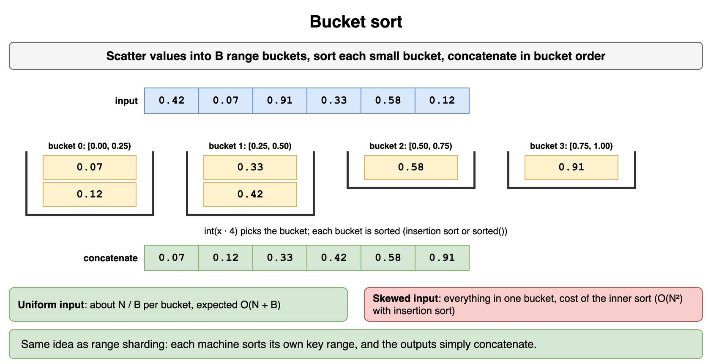

*Source: [`diagrams/sorting-and-searching.drawio`](/content/07_Data_Structures_and_Algorithms/09_Sorting_and_Searching/diagrams/sorting-and-searching.drawio), page 10.*

## Comparison sort lower bound

No comparison-based sorting algorithm can do better than O(N log N) in the worst case. This is a fundamental theoretical result, not a limitation of any particular algorithm. The proof uses the decision tree model: any comparison-based sort can be modeled as a binary tree where each internal node is a comparison and each leaf is a permutation of the input. Since there are N! possible permutations, the tree needs at least N! leaves. A binary tree with N! leaves has height at least log2(N!) = O(N log N) by Stirling's approximation.

This is why merge sort and heap sort are optimal comparison-based sorts. It also explains why non-comparison sorts like radix sort and counting sort can beat the bound: they exploit structure in the keys (like digit positions or bounded range) rather than relying solely on pairwise comparisons.

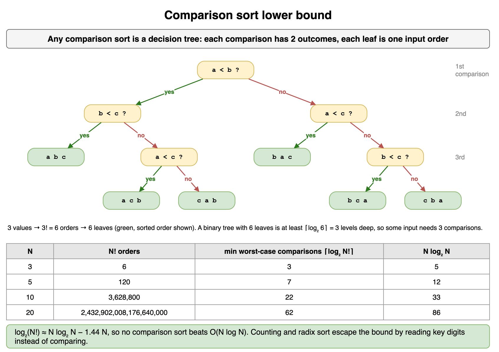

*Source: [`diagrams/sorting-and-searching.drawio`](/content/07_Data_Structures_and_Algorithms/09_Sorting_and_Searching/diagrams/sorting-and-searching.drawio), page 11.*

## Stability

A sorting algorithm is stable if it preserves the relative order of elements that compare as equal. For example, if you sort a list of students by grade and two students both have a B, a stable sort keeps them in their original order relative to each other. An unstable sort might swap them.

Stability matters when you sort by multiple keys in sequence. If you first sort by name, then stable-sort by grade, students with the same grade remain alphabetically ordered. Merge sort and insertion sort are stable. Quick sort, heap sort, and selection sort are not stable in their standard implementations; counting sort and LSD radix sort are stable by construction. Python's built-in `sorted()` and `list.sort()` use Timsort, which is stable, so multi-key sorting with `key=` functions works correctly.

```python
from operator import itemgetter

students = [
    ("Alice", "B"),
    ("Dave", "A"),
    ("Carol", "B"),
    ("Bob", "A"),
]

# Sort by name first, then stable-sort by grade
by_name = sorted(students, key=itemgetter(0))
by_grade = sorted(by_name, key=itemgetter(1))

# Within each grade, alphabetical order survives because sorted() is stable
print(by_grade)  # [('Bob', 'A'), ('Dave', 'A'), ('Alice', 'B'), ('Carol', 'B')]
```

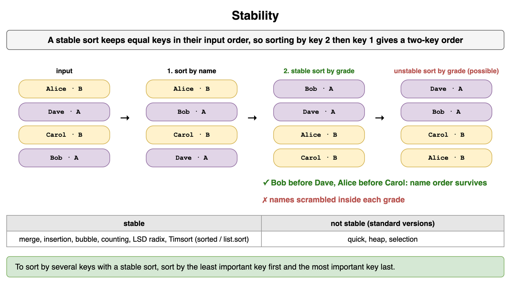

*Source: [`diagrams/sorting-and-searching.drawio`](/content/07_Data_Structures_and_Algorithms/09_Sorting_and_Searching/diagrams/sorting-and-searching.drawio), page 12.*

## Custom sort keys

Python sorts by comparing whole values, so most "sort by X then Y" tasks reduce to choosing a key. A key function maps each item to something whose natural order is the order you want; tuples compare element by element, which gives multi-key ordering for free. Negate a numeric field to flip just that field. For a field you cannot negate (like a string you want descending), either sort twice relying on stability (secondary key first, then primary) or fall back to `functools.cmp_to_key` with a three-way compare.

The key is computed once per element (N calls), while a comparator runs O(N log N) times, so prefer keys when you can express the order that way.

```python
from functools import cmp_to_key

items = [("pear", 3), ("fig", 5), ("apple", 3), ("kiwi", 5)]

# count descending, then name ascending
print(sorted(items, key=lambda t: (-t[1], t[0])))  # [('fig', 5), ('kiwi', 5), ('apple', 3), ('pear', 3)]

# shorter first; equal lengths in reverse alphabetical order
def by_len_then_reverse(a: str, b: str) -> int:
    if len(a) != len(b):
        return len(a) - len(b)
    return (a < b) - (a > b)

print(sorted(["bb", "a", "cc", "c"], key=cmp_to_key(by_len_then_reverse)))  # ['c', 'a', 'cc', 'bb']
```

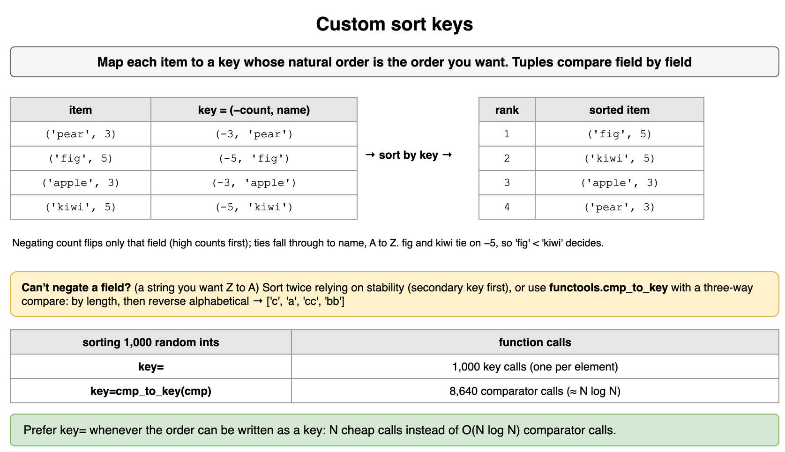

*Source: [`diagrams/sorting-and-searching.drawio`](/content/07_Data_Structures_and_Algorithms/09_Sorting_and_Searching/diagrams/sorting-and-searching.drawio), page 13.*

## Quickselect

To find the k-th smallest element you do not need the whole array sorted. Quickselect partitions around a random pivot like quick sort, then recurses into only the side that contains index k. The expected work is N + N/2 + N/4 + ... = O(N); the worst case is O(N^2) with consistently bad pivots, which random pivots make vanishingly rare.

Compare the options for "top k" questions: sorting costs O(N log N); a size-k heap (`heapq.nsmallest`) costs O(N log k) and works on a stream; quickselect costs O(N) expected but needs the data in memory and reorders it.

```python
import random


def quickselect(arr: list[int], k: int) -> int:
    """Return the k-th smallest value (0-based) of arr in expected O(N)."""
    lo, hi = 0, len(arr) - 1
    arr = arr[:]  # work on a copy
    while True:
        if lo == hi:
            return arr[lo]
        p = random.randint(lo, hi)
        arr[p], arr[hi] = arr[hi], arr[p]
        store = lo
        for i in range(lo, hi):              # Lomuto partition of [lo, hi]
            if arr[i] < arr[hi]:
                arr[i], arr[store] = arr[store], arr[i]
                store += 1
        arr[store], arr[hi] = arr[hi], arr[store]
        if k == store:
            return arr[store]
        if k < store:
            hi = store - 1
        else:
            lo = store + 1


scores = [71, 15, 88, 42, 63, 9, 50]
print(quickselect(scores, 0), quickselect(scores, 3), quickselect(scores, 6))  # 9 50 88
```

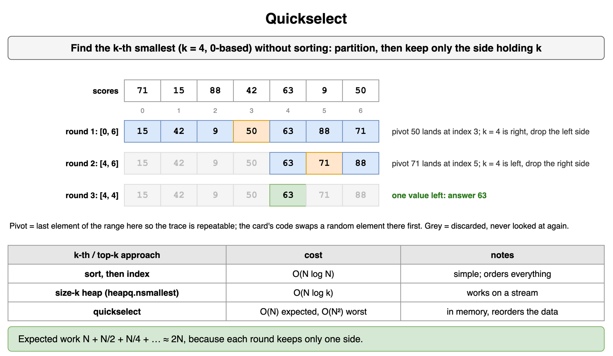

*Source: [`diagrams/sorting-and-searching.drawio`](/content/07_Data_Structures_and_Algorithms/09_Sorting_and_Searching/diagrams/sorting-and-searching.drawio), page 14.*

## Binary search

Binary search finds a target value in a sorted array by repeatedly halving the search range. Compare the target with the middle element: if equal, you are done; if less, search the left half; if greater, search the right half. Each step eliminates half the remaining elements, giving O(log N) time and O(1) space.

The iterative implementation is preferred in interviews because it avoids recursion overhead and stack depth concerns. The classic bug is getting the boundary conditions wrong. Use `lo = 0`, `hi = len(arr) - 1`, and the loop condition `lo <= hi`. Update `lo = mid + 1` or `hi = mid - 1` (never just `mid`) to avoid infinite loops.

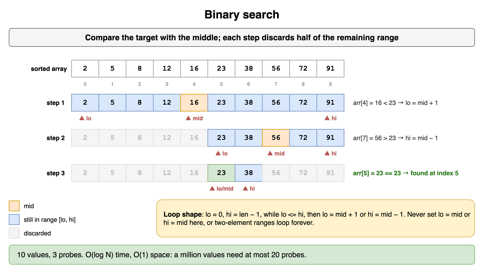

*Source: [`diagrams/sorting-and-searching.drawio`](/content/07_Data_Structures_and_Algorithms/09_Sorting_and_Searching/diagrams/sorting-and-searching.drawio), page 15.*

```python
def binary_search(arr: list[int], target: int) -> int:
    """Return index of target in sorted arr, or -1 if not found."""
    lo, hi = 0, len(arr) - 1
    while lo <= hi:
        mid = lo + (hi - lo) // 2  # avoids overflow in other languages
        if arr[mid] == target:
            return mid
        elif arr[mid] < target:
            lo = mid + 1
        else:
            hi = mid - 1
    return -1


data = [2, 5, 8, 12, 16, 23, 38, 56, 72, 91]
print(binary_search(data, 23))   # 5
print(binary_search(data, 20))   # -1
```

## Lower and upper bound

Plain binary search returns *some* index holding the target. Many questions need a boundary instead: the first index whose value is `>= target` (lower bound, also the insertion point that keeps the array sorted) or the first index whose value is `> target` (upper bound). With both, the count of `target` is `upper - lower`, the last occurrence is `upper - 1`, and "not found" is `lower == upper`.

Write it with a half-open range `[lo, hi)` and never return early on equality: shrink toward the boundary instead. Python's `bisect.bisect_left` and `bisect.bisect_right` are exactly lower and upper bound, and `bisect.insort` inserts while keeping order.

```python
import bisect


def lower_bound(arr: list[int], target: int) -> int:
    """First index i with arr[i] >= target (len(arr) if none)."""
    lo, hi = 0, len(arr)
    while lo < hi:
        mid = (lo + hi) // 2
        if arr[mid] < target:
            lo = mid + 1
        else:
            hi = mid
    return lo


data = [1, 2, 2, 2, 3, 4, 5]
first = lower_bound(data, 2)
last = bisect.bisect_right(data, 2) - 1
print(first, last)  # 1 3
print(lower_bound(data, 6), bisect.bisect_left(data, 2))  # 7 1
```

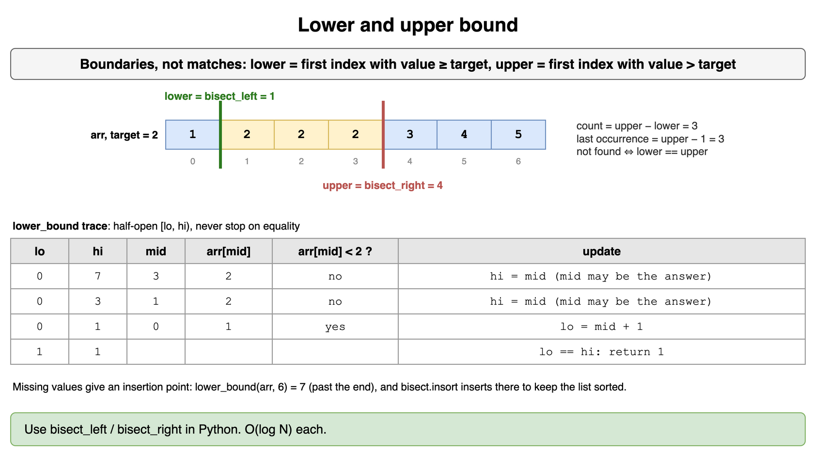

*Source: [`diagrams/sorting-and-searching.drawio`](/content/07_Data_Structures_and_Algorithms/09_Sorting_and_Searching/diagrams/sorting-and-searching.drawio), page 16.*

## Rotated sorted array

A sorted array rotated at an unknown point (for example `[4, 5, 6, 7, 0, 1, 2]`) is no longer globally sorted, but binary search still works because at least one half around `mid` is always in order. Check which half is sorted by comparing its endpoints, test whether the target lies inside that sorted half's range, and discard the other half accordingly. Time stays O(log N).

Duplicates break the "which half is sorted" test: when `arr[lo] == arr[mid] == arr[hi]` you cannot tell, so you shrink both ends by one, and the worst case becomes O(N).

```python
def search_rotated(arr: list[int], target: int) -> int:
    """Search for target in a rotated sorted array of distinct values. Return index or -1."""
    lo, hi = 0, len(arr) - 1
    while lo <= hi:
        mid = lo + (hi - lo) // 2
        if arr[mid] == target:
            return mid
        if arr[lo] <= arr[mid]:              # left half is sorted
            if arr[lo] <= target < arr[mid]:
                hi = mid - 1
            else:
                lo = mid + 1
        else:                                # right half is sorted
            if arr[mid] < target <= arr[hi]:
                lo = mid + 1
            else:
                hi = mid - 1
    return -1


rotated = [4, 5, 6, 7, 0, 1, 2]
print(search_rotated(rotated, 0))  # 4
print(search_rotated(rotated, 3))  # -1
```

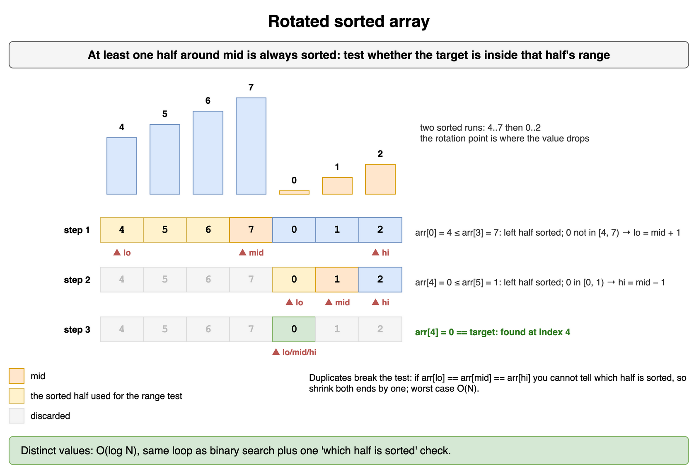

*Source: [`diagrams/sorting-and-searching.drawio`](/content/07_Data_Structures_and_Algorithms/09_Sorting_and_Searching/diagrams/sorting-and-searching.drawio), page 17.*

## Binary search on the answer

Binary search does not need an array. It needs a **monotone predicate**: a yes/no question about a candidate value that is false up to some threshold and true from then on (or the reverse). If you can check one candidate quickly, you can find the threshold in O(log R) checks, where R is the size of the candidate range.

The recipe: pick the range `[lo, hi]` that surely contains the answer, write `ok(x)`, and find the first `x` where `ok(x)` is true using the half-open lower-bound loop. Typical uses: the smallest capacity, speed, or time limit that makes a plan feasible; integer roots; the first failing version in a build history.

```python
def first_true(lo: int, hi: int, ok) -> int:
    """Smallest x in [lo, hi) with ok(x) true, assuming ok is monotone; hi if none."""
    while lo < hi:
        mid = (lo + hi) // 2
        if ok(mid):
            hi = mid          # mid might be the answer; keep it
        else:
            lo = mid + 1      # mid is too small; discard it
    return lo


# smallest batch size so 1000 jobs finish in at most 7 batches
print(first_true(1, 1001, lambda size: -(-1000 // size) <= 7))  # 143
```

The loop shape (half-open `[lo, hi)`, `lo < hi`, `hi = mid`, `lo = mid + 1`) always terminates and is the same one used for lower bound.

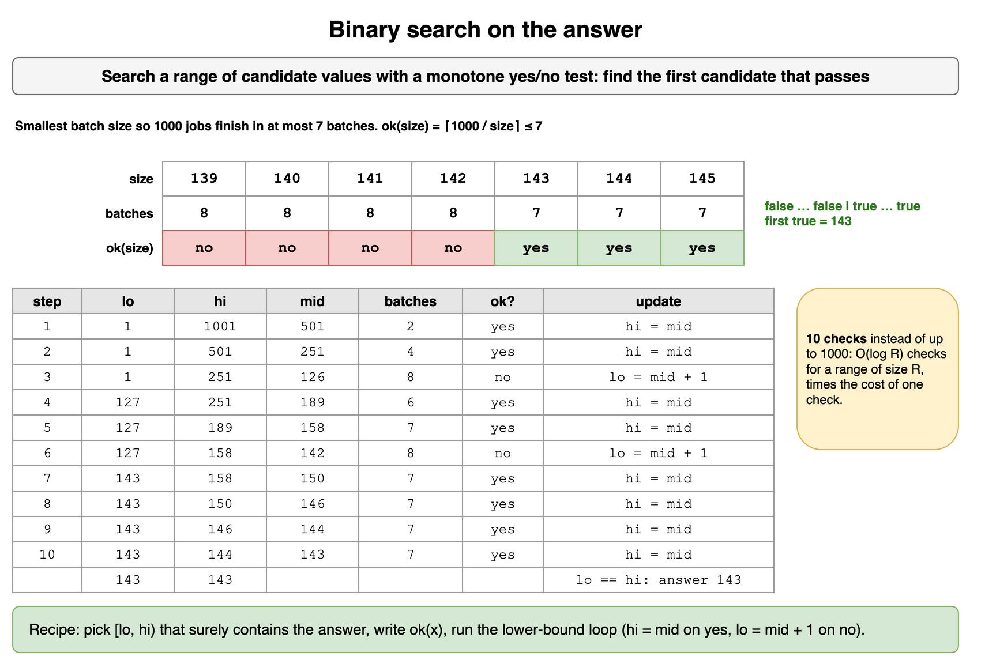

*Source: [`diagrams/sorting-and-searching.drawio`](/content/07_Data_Structures_and_Algorithms/09_Sorting_and_Searching/diagrams/sorting-and-searching.drawio), page 18.*

## Merging sorted sequences

Merging two sorted lists with two pointers costs O(A + B): compare the heads, emit the smaller, advance that pointer, then append whatever remains. The same idea scales to K sorted streams with a min-heap holding one head per stream, which costs O(N log K) for N total items. Python ships both: `heapq.merge` (lazy K-way merge) and `sorted` on a concatenation (Timsort detects the existing runs and merges them quickly).

K-way merging is also how data larger than memory gets sorted: sort chunks that fit in RAM, write each as a sorted run, then stream a K-way merge of the runs. Each element is read and written a constant number of times per pass, so disk I/O, not comparisons, dominates.

```python
import heapq


def merge_two(a: list[int], b: list[int]) -> list[int]:
    i = j = 0
    out: list[int] = []
    while i < len(a) and j < len(b):
        if a[i] <= b[j]:
            out.append(a[i])
            i += 1
        else:
            out.append(b[j])
            j += 1
    return out + a[i:] + b[j:]


print(merge_two([1, 4, 9], [2, 3, 10, 11]))  # [1, 2, 3, 4, 9, 10, 11]
print(list(heapq.merge([5, 20], [1, 30], [8, 9])))  # [1, 5, 8, 9, 20, 30]
```

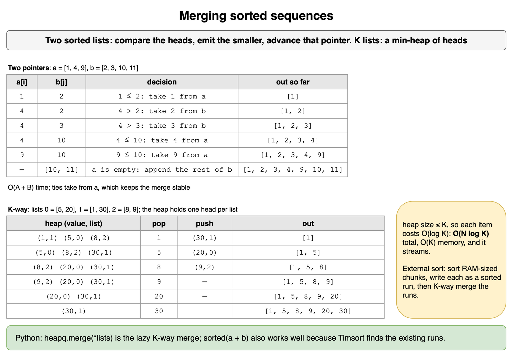

*Source: [`diagrams/sorting-and-searching.drawio`](/content/07_Data_Structures_and_Algorithms/09_Sorting_and_Searching/diagrams/sorting-and-searching.drawio), page 19.*

## Sorting algorithm comparison

Choosing the right sort depends on input size, whether the data is nearly sorted, memory constraints, whether stability is required, and whether keys are small integers. The table summarizes the algorithms on this page.

| Algorithm      | Best        | Average     | Worst       | Space    | Stable |
|----------------|-------------|-------------|-------------|----------|--------|
| Bubble sort    | O(N)        | O(N^2)      | O(N^2)      | O(1)     | Yes    |
| Selection sort | O(N^2)      | O(N^2)      | O(N^2)      | O(1)     | No     |
| Insertion sort | O(N)        | O(N^2)      | O(N^2)      | O(1)     | Yes    |
| Merge sort     | O(N log N)  | O(N log N)  | O(N log N)  | O(N)     | Yes    |
| Quick sort     | O(N log N)  | O(N log N)  | O(N^2)      | O(log N) | No     |
| Heap sort      | O(N log N)  | O(N log N)  | O(N log N)  | O(1)     | No     |
| Counting sort  | O(N + K)    | O(N + K)    | O(N + K)    | O(N + K) | Yes    |
| Radix sort     | O(kN)       | O(kN)       | O(kN)       | O(N + b) | Yes    |
| Bucket sort    | O(N + B)    | O(N + B)    | O(N^2)      | O(N + B) | Yes*   |
| Timsort        | O(N)        | O(N log N)  | O(N log N)  | O(N)     | Yes    |

\* Stable when each bucket is sorted with a stable sort.

In practice: insertion sort for tiny or nearly sorted arrays; merge sort (or Timsort) when stability and a guaranteed O(N log N) matter; quick sort with random pivots and three-way partitioning for general in-memory sorting; heap sort when you need O(1) extra space and a hard worst case; counting or radix sort for large volumes of small or fixed-width integer keys. In Python, default to `sorted()` / `list.sort()` with a `key=` and only hand-roll a sort when the question is about the algorithm itself.

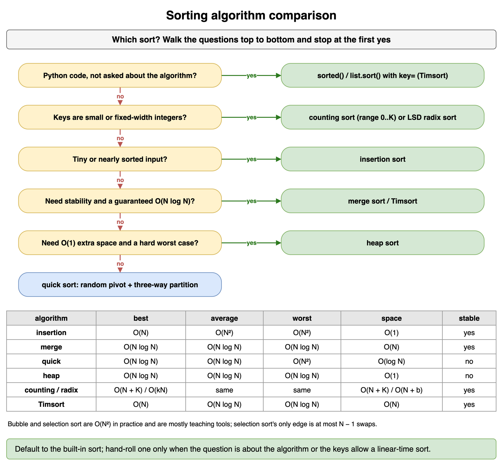

*Source: [`diagrams/sorting-and-searching.drawio`](/content/07_Data_Structures_and_Algorithms/09_Sorting_and_Searching/diagrams/sorting-and-searching.drawio), page 20.*
