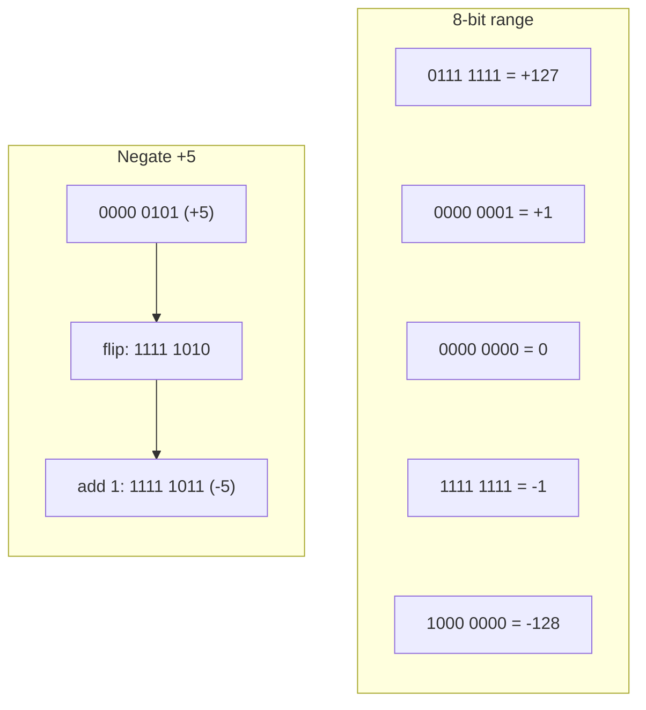
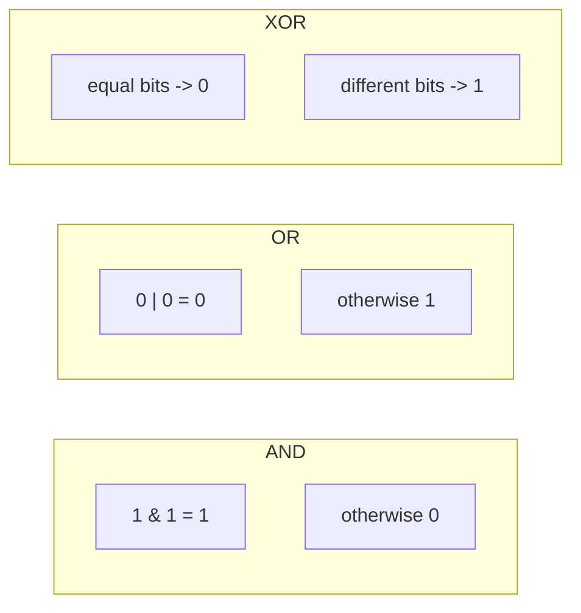
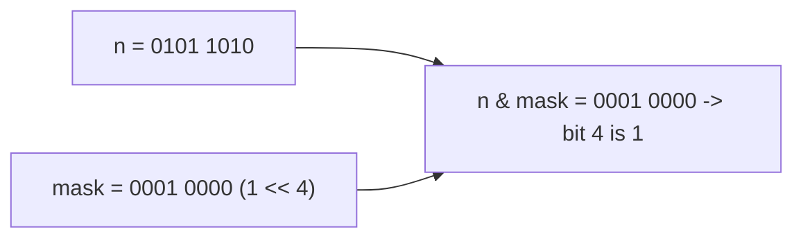

## Binary representation

An integer is stored as a row of bits, and bit `i` (counting from 0 on the right) is worth `2^i`. The rightmost bit is the least significant bit (LSB); the leftmost bit of a fixed-width value is the most significant bit (MSB). To read a binary number, add the powers of two where the bit is 1. To write one, divide by 2 repeatedly and read the remainders from last to first.

Hardware works with fixed widths (8, 16, 32, 64 bits). Python integers have no fixed width, so when a problem says "32-bit", you simulate the width with a mask such as `0xFFFFFFFF`. Hex is a shorthand for binary: each hex digit is exactly four bits.

```python
n = 42
print(bin(n))                    # 0b101010
print(f"{n:08b}")                # 00101010
print(int("101010", 2))          # 42
print(hex(0b1011_0110))          # 0xb6
print(n.bit_length())            # 6

# 42 = 32 + 8 + 2: the positions where the bit is 1
print([i for i in range(n.bit_length()) if n >> i & 1])  # [1, 3, 5]
```

## Binary arithmetic by hand

Binary addition works like decimal addition with a smaller table: `0+0=0`, `0+1=1`, `1+1=10` (write 0, carry 1), and `1+1+1=11` (write 1, carry 1). Work right to left and track the carry column by column. Subtraction is easiest as "add the two's complement" (flip the bits of the subtrahend and add 1).

Multiplying by 2 appends a 0 on the right, which is the same as a left shift. Practicing a few sums by hand builds the intuition you need for tricks like `n - 1` (which flips the lowest 1 and every 0 below it).

```python
a, b = 0b0110, 0b0111            # 6 + 7
#   carry  1 1 0
#          0 1 1 0
#        + 0 1 1 1
#        ---------
#          1 1 0 1  = 13
print(f"{a + b:04b}")            # 1101

# Subtract by adding the 4-bit two's complement of b
neg_b = (~b + 1) & 0xF
print(f"{(0b1101 + neg_b) & 0xF:04b}")  # 0110

# n - 1 flips the lowest 1 and every 0 below it
print(f"{0b1011000:07b} -> {0b1011000 - 1:07b}")  # 1011000 -> 1010111
```

## Two's complement

Two's complement is how hardware stores signed integers. In an N-bit value the MSB carries a weight of `-2^(N-1)` instead of `+2^(N-1)`, so an 8-bit signed byte ranges from -128 to +127. To negate, flip every bit and add 1. There is one zero, and the same adder circuit handles signed and unsigned addition.

A handy view: the N-bit pattern of a negative number `-k` equals the unsigned value `2^N - k`. Python integers behave like an infinite two's complement, so `-1` is "all ones forever"; mask with `(1 << N) - 1` to see the N-bit pattern.



```python
BITS = 8
MASK = (1 << BITS) - 1

def to_pattern(n: int) -> int:
    """Signed int -> unsigned N-bit pattern."""
    return n & MASK

def to_signed(p: int) -> int:
    """Unsigned N-bit pattern -> signed int."""
    return p - (1 << BITS) if p >> (BITS - 1) & 1 else p

print(f"{to_pattern(-5):08b}")       # 11111011
print(to_signed(0b11111011))         # -5
print(to_signed(0b10000000))         # -128
print(f"{(~5 + 1) & MASK:08b}")      # 11111011
```

## Bitwise AND, OR, XOR, NOT

The four bitwise operators act on every bit position independently. **AND** (`&`) is 1 only where both bits are 1, so it keeps or tests bits. **OR** (`|`) is 1 where either bit is 1, so it turns bits on. **XOR** (`^`) is 1 where the bits differ, so it flips bits and cancels pairs. **NOT** (`~`) flips every bit; in Python `~x == -x - 1` because integers are unbounded.

Remember the roles: AND with a mask to read or clear, OR to set, XOR to toggle. Almost every trick in this topic is one of these three moves with a cleverly built mask.



```python
a, b = 0b1100, 0b1010
print(f"{a & b:04b}")    # 1000
print(f"{a | b:04b}")    # 1110
print(f"{a ^ b:04b}")    # 0110
print(~a)                # -13
print(f"{~a & 0xF:04b}") # 0011
```

## Left and right shift

`x << k` moves every bit k places left and fills with zeros, which multiplies by `2^k`. `x >> k` moves bits right and drops the low k bits, which divides by `2^k` rounding toward negative infinity. `1 << i` is the standard way to build a mask with only bit `i` set.

In fixed-width languages a left shift can push bits off the top (overflow), and shifting by the full width or more is undefined in C. Python never loses bits on a left shift, so mask the result when you need N-bit behavior.

```python
print(5 << 2)            # 20
print(20 >> 2)           # 5
print(7 >> 1)            # 3
print(-7 >> 1)           # -4
print(f"{1 << 5:08b}")   # 00100000

# 8-bit left shift: the top bit falls off
print(f"{(0b1100_0001 << 1) & 0xFF:08b}")  # 10000010
```

## Arithmetic vs logical right shift

An **arithmetic** right shift copies the sign bit into the vacated high bits, so negative numbers stay negative and the result is floor division by `2^k`. A **logical** right shift fills the high bits with 0, treating the value as unsigned. Java and JavaScript spell them `>>` and `>>>`; in C the result for signed negatives is implementation-defined, so cast to unsigned when you want logical behavior.

Python's `>>` is always arithmetic. To get a logical shift for an N-bit value, mask to N bits first so the number is non-negative, then shift. Repeated arithmetic shifts of a negative number converge to -1; repeated logical shifts converge to 0.

```python
def logical_shift_right(x: int, k: int, bits: int = 8) -> int:
    return (x & ((1 << bits) - 1)) >> k

x = -16                                       # 1111 0000 in 8 bits
print(f"{(x >> 2) & 0xFF:08b}")               # 11111100
print(x >> 2)                                 # -4
print(f"{logical_shift_right(x, 2):08b}")     # 00111100
print(logical_shift_right(x, 2))              # 60
print(-1 >> 10, logical_shift_right(-1, 10))  # -1 0
```

## Get bit

To read bit `i`, either shift the number right by `i` and look at the last bit, or AND it with a mask that has only bit `i` set and check for nonzero. The two forms are equivalent; the shift form returns 0 or 1 directly, which is handy for counting and building strings.

A common mistake is comparing `n & (1 << i)` to 1. That expression equals `1 << i` when the bit is set, so it only equals 1 when `i` is 0.



```python
def get_bit(n: int, i: int) -> int:
    return (n >> i) & 1

def has_bit(n: int, i: int) -> bool:
    return n & (1 << i) != 0

n = 0b0101_1010
print(get_bit(n, 4), get_bit(n, 2))  # 1 0
print(has_bit(n, 6))                 # True
```

## Set bit

To turn bit `i` on, OR with `1 << i`. Every other bit is unchanged because OR with 0 leaves a bit as it was, and the target bit becomes 1 whether it was 0 or already 1. Setting is idempotent: doing it twice is the same as doing it once.

```python
def set_bit(n: int, i: int) -> int:
    return n | (1 << i)

n = 0b0101_1010
print(f"{set_bit(n, 0):08b}")              # 01011011
print(f"{set_bit(set_bit(n, 0), 0):08b}")  # 01011011
```

## Clear bit

To turn bit `i` off, AND with a mask that is all ones except bit `i`: `~(1 << i)`. AND with 1 keeps a bit; AND with 0 forces it to 0. Like setting, clearing is idempotent.

Do not clear with XOR. `n ^ (1 << i)` flips the bit, so it turns a 0 into a 1 when the bit was already clear.

```python
def clear_bit(n: int, i: int) -> int:
    return n & ~(1 << i)

n = 0b0101_1010
print(f"{clear_bit(n, 4):08b}")  # 01001010
print(f"{clear_bit(n, 0):08b}")  # 01011010
```

## Toggle bit

To flip bit `i`, XOR with `1 << i`. XOR with 1 inverts a bit and XOR with 0 leaves it alone. Toggling twice restores the original value, which makes XOR the right tool for on/off switches and undoable changes.

```python
def toggle_bit(n: int, i: int) -> int:
    return n ^ (1 << i)

n = 0b0000_1111
print(f"{toggle_bit(n, 0):08b}")                 # 00001110
print(f"{toggle_bit(n, 7):08b}")                 # 10001111
print(f"{toggle_bit(toggle_bit(n, 3), 3):08b}")  # 00001111
```

## Update bit

To write a given value `v` (0 or 1) into bit `i`, first clear the bit, then OR in `v` shifted into place. Clearing first matters: OR alone can turn a 0 into a 1 but never a 1 into a 0. This one helper replaces an `if v: set else: clear` branch.

```python
def update_bit(n: int, i: int, v: int) -> int:
    return (n & ~(1 << i)) | (v << i)

n = 0b1010
print(f"{update_bit(n, 1, 0):04b}")  # 1000
print(f"{update_bit(n, 0, 1):04b}")  # 1011
print(f"{update_bit(n, 3, 1):04b}")  # 1010
```

## Clear bits MSB through i

To keep only the low `i` bits (bits `i-1` down to 0) and zero everything from bit `i` upward, AND with `(1 << i) - 1`. That mask is `i` ones in a row. For non-negative `n` this equals `n % 2^i`, so it is a fast modulo by a power of two.

Note the off-by-one: whether bit `i` itself survives depends on the convention. With mask `(1 << i) - 1`, bit `i` is cleared; use `(1 << (i + 1)) - 1` to keep it.

```python
def keep_low_bits(n: int, i: int) -> int:
    """Clear bit i and everything above it."""
    return n & ((1 << i) - 1)

n = 0b1101_0110
print(f"{keep_low_bits(n, 4):08b}")  # 00000110
print(keep_low_bits(1000, 6), 1000 % 64)  # 40 40
```

## Clear bits i through 0

To zero bit `i` and every bit below it, AND with `-1 << (i + 1)`, which is ones everywhere except the low `i + 1` positions. Clearing the low bits rounds a non-negative number down to a multiple of `2^(i+1)`, which is how memory allocators align addresses.

```python
def clear_low_bits(n: int, i: int) -> int:
    """Clear bits i through 0."""
    return n & (-1 << (i + 1))

n = 0b1101_0110
print(f"{clear_low_bits(n, 3):08b}")  # 11010000
print(clear_low_bits(77, 2))          # 72
```

## Bit-range update

To write a value into a field of bits `lo..hi` (inclusive), build a mask that covers the field, clear the field with `& ~mask`, then OR in the new value shifted to `lo`. Mask the new value too, so an oversized value cannot spill into neighboring bits. This is how packed formats such as RGB colors, network headers, and hardware registers are edited.

```python
def write_field(n: int, lo: int, hi: int, value: int) -> int:
    width = hi - lo + 1
    mask = ((1 << width) - 1) << lo
    return (n & ~mask) | ((value << lo) & mask)

def read_field(n: int, lo: int, hi: int) -> int:
    return (n >> lo) & ((1 << (hi - lo + 1)) - 1)

reg = 0b1111_1111
reg = write_field(reg, 2, 4, 0b010)
print(f"{reg:08b}")              # 11101011
print(read_field(reg, 2, 4))     # 2
```

## Isolate lowest set bit

`n & -n` keeps only the lowest 1 bit of `n`. In two's complement, `-n` is `~n + 1`: flipping turns the trailing zeros into ones, and adding 1 carries through them until it lands on the position of the lowest 1. That position is the only one where `n` and `-n` both have a 1.

The isolated bit's position is its `bit_length() - 1`, which counts trailing zeros. Fenwick (binary indexed) trees step through indices with `i & -i`.

```python
n = 0b0101_1000
low = n & -n
print(f"{low:08b}")              # 00001000
print(low.bit_length() - 1)      # 3

# Fenwick-style walk: add the lowest set bit each step
i, path = 5, []
while i <= 16:
    path.append(i)
    i += i & -i
print(path)                      # [5, 6, 8, 16]
```

## Turn off lowest set bit

`n & (n - 1)` clears the lowest 1 bit. Subtracting 1 flips that bit to 0 and turns every 0 below it into 1, while higher bits stay the same; ANDing with the original wipes out the changed region. Repeating it removes one set bit per step, which is the core of Kernighan's popcount and of iterating over the set bits of a mask.

The related form `n | (n + 1)` turns on the lowest 0 bit.

```python
n = 0b0101_1000
print(f"{n & (n - 1):08b}")      # 01010000
print(f"{n | (n + 1):08b}")      # 01011001

# Visit each set bit from low to high
m, seen = 0b1010_0110, []
while m:
    seen.append((m & -m).bit_length() - 1)
    m &= m - 1
print(seen)                      # [1, 2, 5, 7]
```

## Power-of-two tests

A positive power of two has exactly one bit set, so clearing its lowest set bit leaves 0: `n > 0 and n & (n - 1) == 0`. The `n > 0` guard matters because 0 also passes the second check. Related helpers come from `bit_length()`: the next power of two at or above `n` is `1 << (n - 1).bit_length()` for `n >= 1`, and `n & (2^k - 1)` is `n % 2^k`.

A power of four is a power of two whose single bit sits at an even position, which you can test with the mask `0x55555555`.

```python
def is_pow2(n: int) -> bool:
    return n > 0 and n & (n - 1) == 0

def next_pow2(n: int) -> int:
    return 1 << (n - 1).bit_length()

def is_pow4(n: int) -> bool:
    return is_pow2(n) and n & 0x55555555 != 0

print([x for x in range(20) if is_pow2(x)])  # [1, 2, 4, 8, 16]
print(next_pow2(17), next_pow2(16))           # 32 16
print(is_pow4(16), is_pow4(8))                # True False
```

## Counting set bits

The number of 1 bits is the **popcount** (or Hamming weight). Kernighan's method loops `n &= n - 1` and counts iterations, so it runs once per set bit rather than once per bit position. Python 3.10+ has `int.bit_count()`, and CPUs have a single POPCNT instruction.

For many queries, a table helps: the popcount of `i` equals the popcount of `i >> 1` plus the low bit of `i`, so you can fill counts for `0..N` in O(N).

```python
def popcount(n: int) -> int:
    count = 0
    while n:
        n &= n - 1
        count += 1
    return count

print(popcount(0b1011_0100))      # 4
print((0b1011_0100).bit_count())  # 4

counts = [0] * 9
for i in range(1, 9):
    counts[i] = counts[i >> 1] + (i & 1)
print(counts)                     # [0, 1, 1, 2, 1, 2, 2, 3, 1]
```

## Parity

Parity is 1 when a number has an odd count of 1 bits and 0 when the count is even. It is used in error-detecting codes and RAID. XOR of all bits gives the parity, and you can fold a word in half repeatedly (`x ^= x >> 16`, then 8, 4, 2, 1) so the low bit ends up holding the answer in O(log width) steps.

```python
def parity_loop(n: int) -> int:
    p = 0
    while n:
        p ^= 1
        n &= n - 1
    return p

def parity_fold32(x: int) -> int:
    for shift in (16, 8, 4, 2, 1):
        x ^= x >> shift
    return x & 1

print(parity_loop(0b1011), parity_fold32(0b1011))  # 1 1
print(parity_fold32(0xFFFF_FFFF))                  # 0
```

## XOR properties

XOR satisfies `x ^ 0 = x`, `x ^ x = 0`, and is commutative and associative, so a long chain of XORs can be reordered freely and any value that appears an even number of times cancels out. That gives O(1)-space answers to "every value appears twice except one" and "one number in `0..n` is missing".

XOR also swaps two variables without a temporary, but only when they are different storage locations: XOR-swapping a variable with itself zeros it. In Python, tuple assignment `a, b = b, a` is clearer and just as fast.

```python
from functools import reduce
from operator import xor

print(reduce(xor, [4, 1, 2, 1, 2]))           # 4

nums = [0, 1, 3, 4]                            # 0..4 with one missing
print(reduce(xor, range(len(nums) + 1)) ^ reduce(xor, nums))  # 2

a, b = 10, 25
a ^= b; b ^= a; a ^= b
print(a, b)                                    # 25 10

arr = [7]
arr[0] ^= arr[0]; arr[0] ^= arr[0]; arr[0] ^= arr[0]
print(arr)                                     # [0]
```

## Sign bit and branchless abs

In a 32-bit value the sign lives in bit 31. An arithmetic shift `x >> 31` turns that into a mask that is all ones (-1) for negatives and 0 otherwise. With that mask you can compute absolute value as `(x ^ mask) - mask` and pick min or max without an `if`, which avoids branch mispredictions in hot loops. `x ^ y < 0` tells you whether two integers have opposite signs.

Watch the edge: the absolute value of the most negative 32-bit integer does not fit in 32 bits, so it wraps back to itself.

```python
def to_i32(x: int) -> int:
    x &= 0xFFFF_FFFF
    return x - (1 << 32) if x >> 31 else x

def abs_i32(x: int) -> int:
    mask = x >> 31                 # 0 or -1
    return to_i32((x ^ mask) - mask)

def min_i32(x: int, y: int) -> int:
    diff = x - y
    return y + (diff & (diff >> 31))

print(abs_i32(-7), abs_i32(7))     # 7 7
print(abs_i32(-2**31))             # -2147483648
print(min_i32(3, -5), min_i32(-2, 9))  # -5 -2
print((3 ^ -4) < 0, (3 ^ 4) < 0)   # True False
```

## Flags and bitmask subsets

A bitmask stores a small set in one integer: bit `i` set means item `i` is present. Union is `|`, intersection is `&`, difference is `a & ~b`, and size is the popcount. Named flags (Unix permissions, feature toggles, chess bitboards) use the same idea, and Python's `enum.Flag` gives them readable names.

Counting from `0` to `2^n - 1` visits every subset of `n` items once, the basis of bitmask DP. To visit only the subsets of a given mask, step with `sub = (sub - 1) & mask`.

```python
from enum import Flag, auto

class Perm(Flag):
    READ = auto()
    WRITE = auto()
    EXEC = auto()

p = Perm.READ | Perm.EXEC
print(Perm.WRITE in p, Perm.EXEC in p)   # False True

items = ["a", "b", "c"]
subsets = [[items[i] for i in range(3) if m >> i & 1] for m in range(1 << 3)]
print(subsets[5], len(subsets))          # ['a', 'c'] 8

mask, sub, subs = 0b1010, 0b1010, []
while sub:
    subs.append(f"{sub:04b}")
    sub = (sub - 1) & mask
print(subs)                              # ['1010', '1000', '0010']
```
