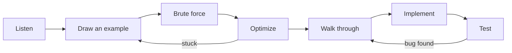
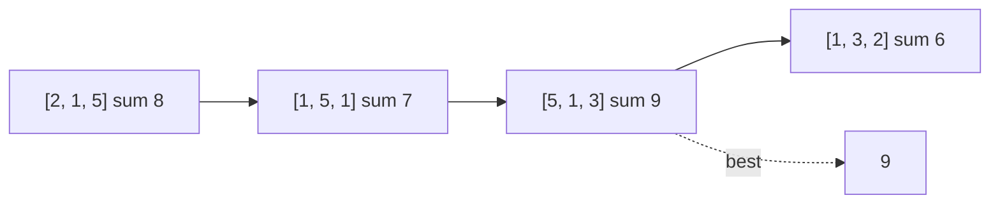
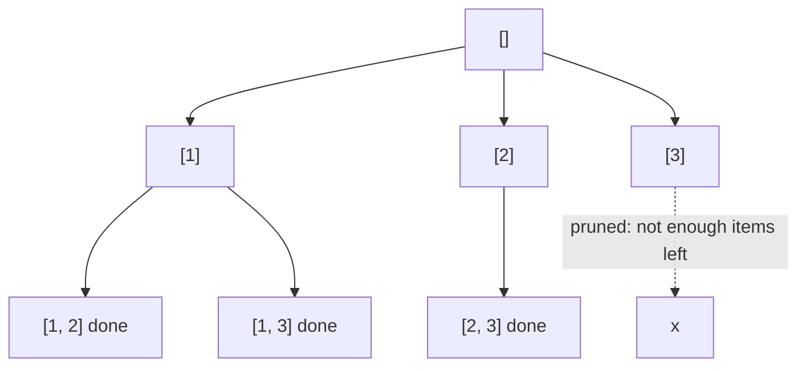
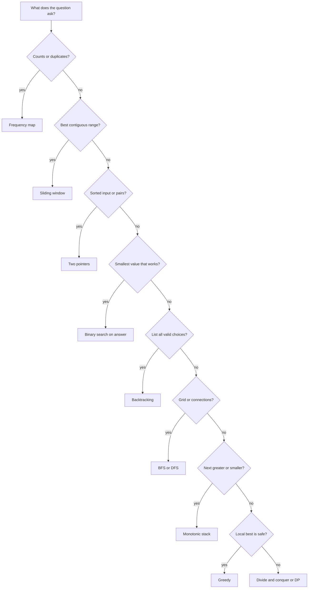

## Problem-solving flow

A reliable interview answer follows the same loop every time: listen, draw an example, state a brute force, optimize, walk through the plan, implement, and test. Each step feeds the next. A good example shows you the brute force, the brute force shows you what to optimize, and the walkthrough catches design mistakes before you write code that is hard to change.

Expect the problem to feel hard; that is the point, and it is not a sign you are failing. Think out loud so the interviewer can follow your reasoning and offer hints, and use every hint they give.

The loop is not strictly linear. If optimizing stalls, go back to the example and try a bigger or stranger one. If testing finds a bug, return to the walkthrough rather than patching lines at random.



## Listen carefully

Every detail in a problem statement is usually there for a reason. Words like "sorted", "distinct", "values between 1 and N", "read-only", or "called many times" each point at a technique. Write the details down next to your example so you do not forget them halfway through.

If your best solution never uses one of the stated details, ask yourself whether that detail unlocks a faster approach. "Sorted" hints at binary search or two pointers. "Called many times" hints at precomputing once.

```python
from bisect import bisect_right

# Details heard: times is sorted, and count_at_most() is called many times.
times = [3, 8, 8, 15, 21, 30]

def count_at_most(limit: int) -> int:
    return bisect_right(times, limit)   # O(log N) only because the input is sorted

print(count_at_most(8))    # 3
print(count_at_most(20))   # 4
```

## Draw an example

Draw an example that is specific, large enough to show the pattern, and not a special case. `[1, 2, 3]` is sorted, short, and has no duplicates, so almost any wrong algorithm works on it. Something like `[7, 2, 9, 4, 6]` is far more useful.

Real numbers on a whiteboard also make the brute force obvious and expose edge cases such as ties or negative values.

```python
def second_largest_wrong(nums: list[int]) -> int:
    return nums[-2]                      # only correct if nums is already sorted

def second_largest(nums: list[int]) -> int:
    first = second = float("-inf")
    for x in nums:
        if x > first:
            first, second = x, first
        elif first > x > second:
            second = x
    return second

print(second_largest_wrong([1, 2, 3]))        # 2
print(second_largest_wrong([7, 2, 9, 4, 6]))  # 4
print(second_largest([7, 2, 9, 4, 6]))        # 7
```

## State a brute force

Say the simplest correct solution out loud, with its time and space cost, even if it is slow. It proves you understand the problem, gives you something to fall back on, and becomes the baseline you optimize from. Do not code it unless the interviewer asks; just make sure it is correct and that you know its complexity.

Below, checking every starting index for the longest run of distinct characters costs O(N * K), where K is the alphabet size. The Sliding window card shows how to make it O(N).

```python
def longest_distinct_brute(s: str) -> int:
    best = 0
    for i in range(len(s)):
        seen: set[str] = set()
        for j in range(i, len(s)):
            if s[j] in seen:
                break
            seen.add(s[j])
            best = max(best, j - i + 1)
    return best

print(longest_distinct_brute("abcabcbb"))  # 3
```

## Walk through, then implement

Before coding, walk through your optimized idea on the example and make sure you can explain every step. Then write code that mirrors the walkthrough. Use helper functions for steps that have a clear name, choose readable variable names, and start in the top-left of the board so you have room.

Modular code is easier to read, test, and fix. If you run out of time, a named helper you have not finished is still easy for the interviewer to follow.

```python
def overlaps(a: tuple[int, int], b: tuple[int, int]) -> bool:
    return a[0] <= b[1] and b[0] <= a[1]

def merge_intervals(intervals: list[tuple[int, int]]) -> list[tuple[int, int]]:
    merged: list[tuple[int, int]] = []
    for cur in sorted(intervals):
        if merged and overlaps(merged[-1], cur):
            merged[-1] = (merged[-1][0], max(merged[-1][1], cur[1]))
        else:
            merged.append(cur)
    return merged

print(merge_intervals([(5, 8), (1, 3), (2, 4), (9, 9)]))  # [(1, 4), (5, 8), (9, 9)]
```

## Test your code

Test in layers. First read the code line by line as if reviewing someone else's. Then look at hot spots: loop bounds, off-by-one indexes, integer division, base cases in recursion, and empty inputs. Next run a small example by hand, not the big one you drew earlier. Finally try edge cases: empty, one element, all equal, negative values, and the largest allowed input.

When you find a bug, find out why it happened before changing code. A quick patch often fixes one case and breaks another.

```python
def max_gap(nums: list[int]) -> int:
    """Largest difference between neighbours after sorting; 0 for fewer than 2 items."""
    s = sorted(nums)
    return max((b - a for a, b in zip(s, s[1:])), default=0)

assert max_gap([]) == 0                 # empty
assert max_gap([5]) == 0                # one element
assert max_gap([4, 4, 4]) == 0          # all equal
assert max_gap([9, -3, 1]) == 8         # negatives, unsorted
print("all tests passed")               # all tests passed
```

## BUD bottlenecks

BUD stands for Bottlenecks, Unnecessary work, and Duplicated work, three places to look when optimizing. A bottleneck is the step that dominates the runtime. Speeding up any other step does not help.

Two common shapes: a one-time step such as sorting that costs more than everything after it, or a repeated step such as a linear search inside a loop. For a repeated step, ask whether one up-front step (sorting, a hash map, a prefix array) makes each repetition cheap.

```python
from bisect import bisect_right

nums = [9, 2, 7, 4, 4, 1]
queries = [4, 8, 0]

# Brute force: a linear scan per query, O(Q * N). The scan is the bottleneck.
print([sum(1 for v in nums if v <= q) for q in queries])  # [4, 5, 0]

# Sort once in O(N log N); each query is now O(log N).
s = sorted(nums)
print([bisect_right(s, q) for q in queries])             # [4, 5, 0]
```

## Unnecessary work

Unnecessary work is computation whose result you never needed. Typical cases: looping over a value that is already forced by the others, continuing a search after the answer is known, or checking candidates that a constraint already rules out.

Look at each loop and ask whether its variable can be computed directly instead of searched for.

```python
def triples_brute(n: int) -> int:
    """Count (a, b, c) of non-negative ints with a + b + c == n. O(N^3)."""
    return sum(1 for a in range(n + 1) for b in range(n + 1) for c in range(n + 1)
               if a + b + c == n)

def triples(n: int) -> int:
    """c = n - a - b is forced, so skip the third loop. O(N^2)."""
    return sum(1 for a in range(n + 1) for b in range(n + 1 - a))

print(triples_brute(5), triples(5))  # 21 21
```

## Duplicated work

Duplicated work is computing the same thing more than once. Recomputing a range sum, re-sorting the same data, or recursing into the same subproblem are all signs. The fix is to compute it once and store it: a prefix array, a hash map, or memoization.

```python
from itertools import accumulate

nums = [3, -1, 4, 1, -5, 9]
prefix = [0, *accumulate(nums)]          # prefix[i] = sum(nums[:i]), built once in O(N)

def range_sum(i: int, j: int) -> int:
    """Sum of nums[i:j] in O(1) instead of O(j - i)."""
    return prefix[j] - prefix[i]

print(range_sum(1, 4), sum(nums[1:4]))  # 4 4
print(range_sum(0, 6))                  # 11
```

## DIY (do it yourself)

When you are stuck, solve a concrete instance by hand, without thinking about algorithms. People solve many problems efficiently by instinct. Then ask what you actually did and turn that into code.

For example, to find how many meeting rooms a schedule needs, most people scan the day in time order and count how many meetings are running at once. That instinct is a sweep over sorted start and end events.

```python
def rooms_needed(meetings: list[tuple[int, int]]) -> int:
    # (time, +1) for a start, (time, -1) for an end; ends sort before starts at equal times
    events = sorted([(s, 1) for s, _ in meetings] + [(e, -1) for _, e in meetings])
    running = best = 0
    for _, delta in events:
        running += delta
        best = max(best, running)
    return best

print(rooms_needed([(9, 10), (9, 12), (11, 13), (10, 11)]))  # 2
```

## Simplify and generalize

Drop or relax one constraint, solve the easier version, then add the constraint back. The simpler solution often becomes a building block or reveals the core idea.

To check that every row and every column of a grid holds distinct values, first solve "are the values in one list distinct?" Then apply that helper to each row and each column.

```python
def all_distinct(values) -> bool:
    values = list(values)
    return len(set(values)) == len(values)

def lines_distinct(grid: list[list[int]]) -> bool:
    return all(map(all_distinct, grid)) and all(map(all_distinct, zip(*grid)))

print(lines_distinct([[1, 2, 3], [2, 3, 1], [3, 1, 2]]))  # True
print(lines_distinct([[1, 2], [1, 3]]))                   # False
```

## Base case and build

Solve the smallest input (n = 0 or n = 1), then the next one, and look for a way to build each answer from the previous one. This leads naturally to recursion or bottom-up dynamic programming.

A Gray code lists all n-bit strings so that neighbours differ in exactly one bit. The n-bit list is the (n-1)-bit list with `0` in front, followed by the same list reversed with `1` in front.

```python
def gray_code(n: int) -> list[str]:
    if n == 0:
        return [""]                       # base case
    prev = gray_code(n - 1)               # build from the smaller answer
    return ["0" + c for c in prev] + ["1" + c for c in reversed(prev)]

print(gray_code(1))  # ['0', '1']
print(gray_code(2))  # ['00', '01', '11', '10']
```

## Data structure brainstorm

Go through the data structures you know and ask what each one would do for this problem: array, hash map, set, linked list, stack, queue or deque, heap, binary search tree, trie, graph. Most will clearly fail, and that is fine. The goal is to find the one whose strengths match the operations the problem needs.

Example: report the maximum of the last W readings after each new reading. A hash map does not keep order. A heap finds the max but removing expired readings is awkward. A deque that keeps indexes of decreasing values gives O(1) amortized per reading.

```python
from collections import deque

def rolling_max(readings: list[int], w: int) -> list[int]:
    dq: deque[int] = deque()              # indexes; their values decrease front to back
    out: list[int] = []
    for i, x in enumerate(readings):
        while dq and readings[dq[-1]] <= x:
            dq.pop()
        dq.append(i)
        if dq[0] <= i - w:
            dq.popleft()                  # front index left the window
        if i >= w - 1:
            out.append(readings[dq[0]])
    return out

print(rolling_max([4, 2, 12, 3, 1, 7, 5], 3))  # [12, 12, 12, 7, 7]
```

## Best conceivable runtime

The best conceivable runtime (BCR) is a lower bound on any solution: the time you could not beat no matter how clever you are. Usually it comes from the input size. If you must look at every one of N values, the BCR is O(N). It is not a promise that such an algorithm exists.

BCR helps in two ways. If your solution is far above it, keep optimizing. If you already match it, stop optimizing time and focus on space or clarity. Any work that costs O(BCR) or less is "free", since it cannot make the total worse.

```python
def covers_ids_sorted(nums: list[int]) -> bool:
    """Does nums hold each ID 0..N-1 exactly once? Sorting costs O(N log N)."""
    return sorted(nums) == list(range(len(nums)))

def covers_ids(nums: list[int]) -> bool:
    """O(N) with a seen array, which matches the BCR: every value must be read."""
    seen = [False] * len(nums)
    for x in nums:
        if not 0 <= x < len(nums) or seen[x]:
            return False
        seen[x] = True
    return True

print(covers_ids_sorted([2, 0, 3, 1]))  # True
print(covers_ids([2, 0, 3, 1]))         # True
print(covers_ids([2, 0, 2, 1]))         # False
```

## Frequency map

A frequency map counts how often each value appears. It turns "compare by content" and "how many times" questions into one O(N) pass plus lookups. Use `collections.Counter` or a dict for general keys, or a fixed array of 26 counters when the keys are lowercase letters.

Triggers: duplicates, "appears at least k times", majority, same items regardless of order, or counts inside a window.

```python
from collections import Counter

def frequent(items: list[str], k: int) -> list[str]:
    counts = Counter(items)
    return sorted(x for x, c in counts.items() if c >= k)

def letter_counts(s: str) -> list[int]:
    counts = [0] * 26
    for ch in s:
        counts[ord(ch) - ord("a")] += 1
    return counts

print(frequent(["ok", "err", "ok", "warn", "ok", "err"], 2))  # ['err', 'ok']
print(letter_counts("banana")[:3])                           # [3, 1, 0]
```

## Two pointers

Two indexes move through the data under a rule. With pointers at opposite ends of a sorted array, each comparison rules out a whole group of pairs, so a pair search drops from O(N^2) to O(N). With a read pointer and a write pointer moving in the same direction, you can filter or compact an array in place with O(1) extra space.

Triggers: sorted input, pairs that meet a condition, in-place partitioning, or comparing from both ends.

```python
def count_pairs_below(nums: list[int], target: int) -> int:
    nums = sorted(nums)
    left, right, count = 0, len(nums) - 1, 0
    while left < right:
        if nums[left] + nums[right] < target:
            count += right - left     # left pairs with every index in (left, right]
            left += 1
        else:
            right -= 1
    return count

def compact_nonzero(nums: list[int]) -> list[int]:
    write = 0
    for read in range(len(nums)):
        if nums[read] != 0:
            nums[write] = nums[read]
            write += 1
    nums[write:] = [0] * (len(nums) - write)
    return nums

print(count_pairs_below([1, 5, 3, 2, 8], 7))  # 4
print(compact_nonzero([0, 4, 0, 0, 7, 2]))    # [4, 7, 2, 0, 0, 0]
```

## Sliding window

A sliding window keeps a running answer over a contiguous range instead of recomputing every range from scratch. A **fixed** window covers exactly k elements: when it moves one step, add the element that enters and remove the one that leaves, turning O(N * k) into O(N).



```python
def max_window_sum(nums: list[int], k: int) -> int:
    window = sum(nums[:k])
    best = window
    for i in range(k, len(nums)):
        window += nums[i] - nums[i - k]   # add entering, remove leaving
        best = max(best, window)
    return best

print(max_window_sum([2, 1, 5, 1, 3, 2], 3))  # 9
```

A **variable** window grows its right edge one step at a time and shrinks its left edge only when a rule is broken. Both edges only move forward, so the total work is O(N). Use it for "longest" or "shortest" contiguous ranges that satisfy a condition, such as all-distinct characters or a sum of at least a target (with non-negative values).

```python
def longest_distinct(s: str) -> int:
    last: dict[str, int] = {}
    left = best = 0
    for right, ch in enumerate(s):
        if last.get(ch, -1) >= left:
            left = last[ch] + 1           # jump past the earlier copy
        last[ch] = right
        best = max(best, right - left + 1)
    return best

print(longest_distinct("abcabcbb"))  # 3
print(longest_distinct("aaaa"))      # 1
```

## Divide and conquer

Split the input into independent parts, solve each part recursively, and combine the results. The cost depends on how many parts you make and how expensive the combine step is: two halves plus a linear merge gives O(N log N). If the parts overlap and repeat, use dynamic programming instead.

Counting inversions (pairs `i < j` with `a[i] > a[j]`) shows why the combine step matters: while merging two sorted halves, each time a right value goes first, every remaining left value forms an inversion with it.

```python
def sort_and_count(nums: list[int]) -> tuple[list[int], int]:
    if len(nums) <= 1:
        return nums, 0
    mid = len(nums) // 2
    left, a = sort_and_count(nums[:mid])
    right, b = sort_and_count(nums[mid:])
    merged, i, j, cross = [], 0, 0, 0
    while i < len(left) and j < len(right):
        if left[i] <= right[j]:
            merged.append(left[i]); i += 1
        else:
            merged.append(right[j]); j += 1
            cross += len(left) - i        # all remaining left values are larger
    merged += left[i:] + right[j:]
    return merged, a + b + cross

print(sort_and_count([3, 1, 4, 1, 5, 2]))  # ([1, 1, 2, 3, 4, 5], 6)
```

## Greedy choice

A greedy algorithm makes the best local choice at each step and never goes back. It is correct only when a local best choice can always be extended to a global best; you should be able to argue why. When that argument fails, greedy gives wrong answers, and dynamic programming is usually the fix.

Picking the meeting that ends earliest maximizes how many non-overlapping meetings fit. Paying an amount with the largest coin first works for some coin sets but not all.

```python
def max_meetings(intervals: list[tuple[int, int]]) -> list[tuple[int, int]]:
    chosen: list[tuple[int, int]] = []
    for start, end in sorted(intervals, key=lambda x: x[1]):   # earliest end first
        if not chosen or start >= chosen[-1][1]:
            chosen.append((start, end))
    return chosen

def greedy_coins(amount: int, coins: list[int]) -> int:
    used = 0
    for c in sorted(coins, reverse=True):
        used += amount // c
        amount %= c
    return used

print(max_meetings([(1, 4), (3, 5), (0, 6), (5, 7), (8, 9), (5, 9)]))  # [(1, 4), (5, 7), (8, 9)]
print(greedy_coins(6, [1, 3, 4]))  # 3
```

The second call returns 3 (4 + 1 + 1), but 3 + 3 uses only 2 coins, so greedy is wrong for that coin set.

## Backtracking

Backtracking builds a solution one choice at a time. At each step it makes a choice, recurses, and then undoes the choice before trying the next one. Pruning stops a branch as soon as it cannot lead to a valid answer, which is what keeps exhaustive search practical.

Every backtracking solution has the same skeleton: a base case that records a complete answer, a loop over the choices still allowed, and a choose / explore / unchoose body.



```python
def combinations(items: list[int], k: int) -> list[list[int]]:
    out: list[list[int]] = []
    path: list[int] = []

    def backtrack(start: int) -> None:
        if len(path) == k:
            out.append(path[:])                    # record a complete answer
            return
        for i in range(start, len(items)):
            if len(items) - i < k - len(path):     # prune: too few items left
                break
            path.append(items[i])                  # choose
            backtrack(i + 1)                       # explore
            path.pop()                             # unchoose

    backtrack(0)
    return out

print(combinations([1, 2, 3], 2))  # [[1, 2], [1, 3], [2, 3]]
```

## Grid BFS and DFS

Treat each cell of a grid as a node and its up, down, left, and right neighbours as edges, and grid problems become graph problems. BFS visits cells in order of distance, so it finds the fewest steps between two cells. DFS goes deep first and suits flood fill, connectivity, and exhaustive path search. Mark cells visited when you add them so nothing is processed twice.

```python
from collections import deque

def fewest_steps(grid: list[str], start: tuple[int, int], goal: tuple[int, int]) -> int:
    rows, cols = len(grid), len(grid[0])
    dist = {start: 0}
    queue = deque([start])
    while queue:
        r, c = queue.popleft()
        if (r, c) == goal:
            return dist[(r, c)]
        for nr, nc in ((r + 1, c), (r - 1, c), (r, c + 1), (r, c - 1)):
            if 0 <= nr < rows and 0 <= nc < cols and grid[nr][nc] == "." and (nr, nc) not in dist:
                dist[(nr, nc)] = dist[(r, c)] + 1
                queue.append((nr, nc))
    return -1

maze = ["..#.",
        ".##.",
        "...."]
print(fewest_steps(maze, (0, 0), (0, 3)))  # 7
```

## Binary search on answer

Binary search works on any yes/no condition that flips once: false for every value below some threshold and true for every value above it. If you can check a candidate answer quickly, search the range of possible answers for the threshold. The cost is O(log R) checks, where R is the size of the answer range.

Example: the minimum download rate (MB per hour, each file downloaded alone) that finishes all files within H hours. Higher rates never take longer, so feasibility is monotonic.

```python
def min_rate(files: list[int], hours: int) -> int:
    def fits(rate: int) -> bool:
        return sum(-(-size // rate) for size in files) <= hours   # ceiling division

    lo, hi = 1, max(files)
    while lo < hi:
        mid = (lo + hi) // 2
        if fits(mid):
            hi = mid          # mid works; try slower
        else:
            lo = mid + 1      # mid too slow
    return lo

print(min_rate([4, 9, 12], 6))   # 5
print(min_rate([4, 9, 12], 3))   # 12
```

## Monotonic stack

A monotonic stack keeps its values in increasing or decreasing order. When a new value would break the order, pop until the order holds again; each popped value has just found its answer. Every element is pushed and popped at most once, so the whole pass is O(N).

Triggers: next or previous greater or smaller element, spans, and histogram-style area questions.

```python
def next_greater(nums: list[int]) -> list[int]:
    result = [-1] * len(nums)
    stack: list[int] = []            # indexes whose values decrease bottom to top
    for i, x in enumerate(nums):
        while stack and nums[stack[-1]] < x:
            result[stack.pop()] = x  # x is the next greater for the popped index
        stack.append(i)
    return result

print(next_greater([2, 1, 2, 4, 3]))  # [4, 2, 4, -1, -1]
print(next_greater([4, 3, 2, 1]))     # [-1, -1, -1, -1]
```

## Bit vector

When the keys are small non-negative integers, one bit per key replaces a set of booleans. Python integers grow as needed, so a single `int` works as a bit vector of any length: `|` sets a bit, `&` tests it, and AND or OR of two vectors gives set intersection or union in one step.

```python
def to_bits(ids: list[int]) -> int:
    v = 0
    for i in ids:
        v |= 1 << i
    return v

def first_repeat(ids: list[int]) -> int:
    seen = 0
    for i in ids:
        if seen >> i & 1:
            return i
        seen |= 1 << i
    return -1

both = to_bits([1, 5, 9, 12]) & to_bits([5, 7, 12])
print([i for i in range(both.bit_length()) if both >> i & 1])  # [5, 12]
print(first_repeat([4, 0, 6, 0, 4]))                            # 0
```

## Choosing a pattern

Read the shape of the input and the question, then pick a starting pattern. The flowchart below is a heuristic, not a rule; if the first pattern does not fit, go back to BUD and the data structure brainstorm.


