# Problem-Solving Patterns — Drills

Original mini-drills for the problem-solving process (listen, example, brute force, BUD, DIY, base case, data structure brainstorm, BCR, test) and for recognizing and coding the common patterns. Each card is one exercise: read the prompt, commit to an answer, then check it. Each Answer has a short Python solution that runs on its own. No copyrighted book text.

## Spot the useful detail

A function receives a list of order prices that is *sorted ascending* and will be called about 100,000 times with different budgets. For each budget it must return how many orders cost at most that budget. Your first idea is a linear scan per call. Which two details did that idea ignore, and what do they suggest?

**Answer:** "Sorted" means the orders within budget are a prefix, so binary search finds its end in O(log N) instead of O(N). "Called 100,000 times" means a one-time setup cost is worth paying if it makes each call cheaper; here the list is already sorted, so the setup is free. Total work drops from O(Q * N) to O(Q log N).

```python
from bisect import bisect_right

prices = [2, 5, 5, 9, 14, 20]

def within_budget(budget: int) -> int:
    return bisect_right(prices, budget)

print([within_budget(b) for b in (1, 5, 13, 50)])  # [0, 3, 4, 6]
```

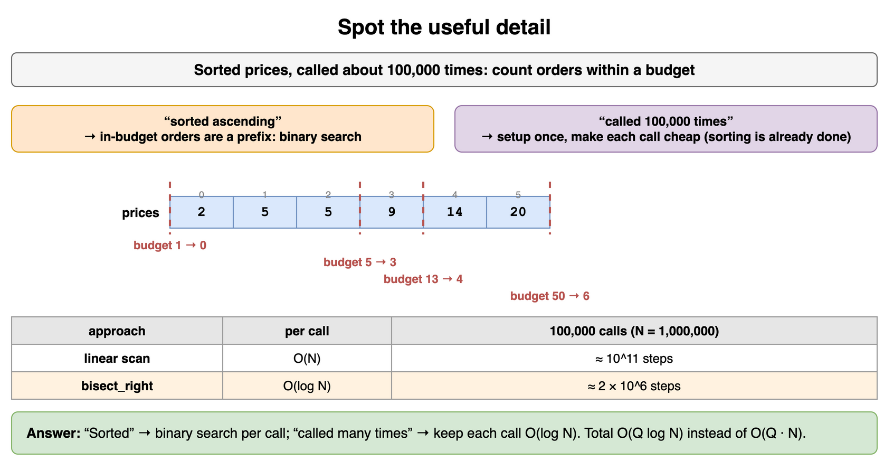

*Source: [`diagrams/problem-solving-patterns-drills.drawio`](/content/07_Data_Structures_and_Algorithms/11_Problem_Solving_Patterns/diagrams/problem-solving-patterns-drills.drawio), page 1.*

## Pick a better example

You need the length of the longest run of equal adjacent values. Which example should you draw: `[5, 5, 5]`, `[1, 2, 3, 4]`, or `[4, 4, 1, 7, 7, 7, 2, 2]`? Why are the other two weak?

**Answer:** Use the third. The first is one run, so it cannot tell "longest run" from "length of list". The second has only runs of length 1. The third has several runs of different lengths, the longest one sits in the middle rather than at an end, and a run also ends the list, which is where a missed final update usually hides.

```python
def longest_run(nums: list[int]) -> int:
    best = cur = 1 if nums else 0
    for a, b in zip(nums, nums[1:]):
        cur = cur + 1 if a == b else 1
        best = max(best, cur)
    return best

print(longest_run([4, 4, 1, 7, 7, 7, 2, 2]))  # 3
print(longest_run([]))                         # 0
```

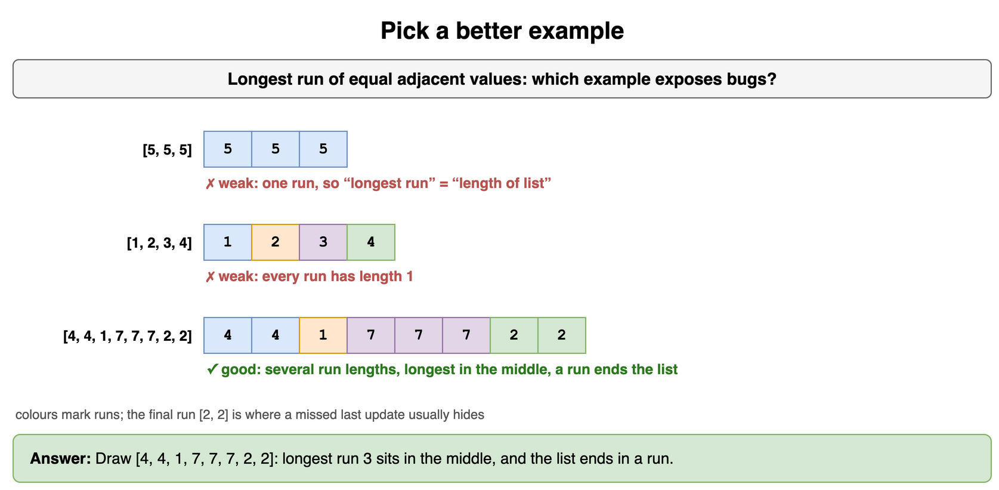

*Source: [`diagrams/problem-solving-patterns-drills.drawio`](/content/07_Data_Structures_and_Algorithms/11_Problem_Solving_Patterns/diagrams/problem-solving-patterns-drills.drawio), page 2.*

## What comes next

Two moments in an interview. (a) You have explained a correct O(N^2) brute force and its cost, and the interviewer nods. (b) You have just finished writing your optimized code. What is the next step in each case?

**Answer:** (a) Optimize: do not start coding the brute force. Look for BUD, compare against the best conceivable runtime, and try DIY or a data structure brainstorm. (b) Test before announcing you are done: read the code line by line, check hot spots such as loop bounds and empty input, then trace a small case and the edge cases by hand. Running quick assertions like the ones below is the code version of that habit.

```python
def dedupe_sorted(nums: list[int]) -> list[int]:
    return [x for i, x in enumerate(nums) if i == 0 or x != nums[i - 1]]

assert dedupe_sorted([]) == []
assert dedupe_sorted([7]) == [7]
assert dedupe_sorted([1, 1, 2, 3, 3, 3]) == [1, 2, 3]
print("checked")  # checked
```

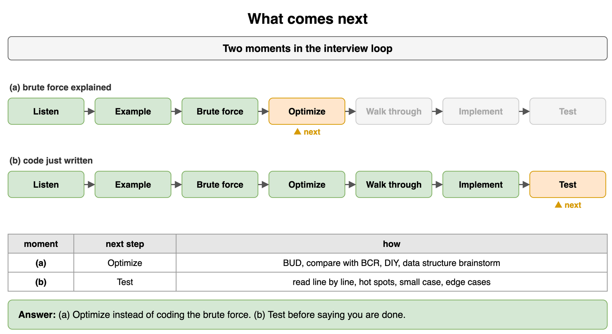

*Source: [`diagrams/problem-solving-patterns-drills.drawio`](/content/07_Data_Structures_and_Algorithms/11_Problem_Solving_Patterns/diagrams/problem-solving-patterns-drills.drawio), page 3.*

## Find the bottleneck

This function reports, for each user ID in `requests`, whether that user is banned. `banned` has B entries and `requests` has R entries. What is the bottleneck, and how do you remove it?

```python
def check(banned: list[int], requests: list[int]) -> list[bool]:
    return [r in banned for r in requests]
```

**Answer:** `r in banned` is a linear scan of a list, repeated R times, for O(R * B) total. That repeated scan is the bottleneck. Build a set once in O(B), and each membership test becomes O(1) on average, for O(B + R) total.

```python
def check(banned: list[int], requests: list[int]) -> list[bool]:
    banned_set = set(banned)                 # one-time O(B)
    return [r in banned_set for r in requests]

print(check([7, 3, 9], [3, 4, 9, 1]))  # [True, False, True, False]
```

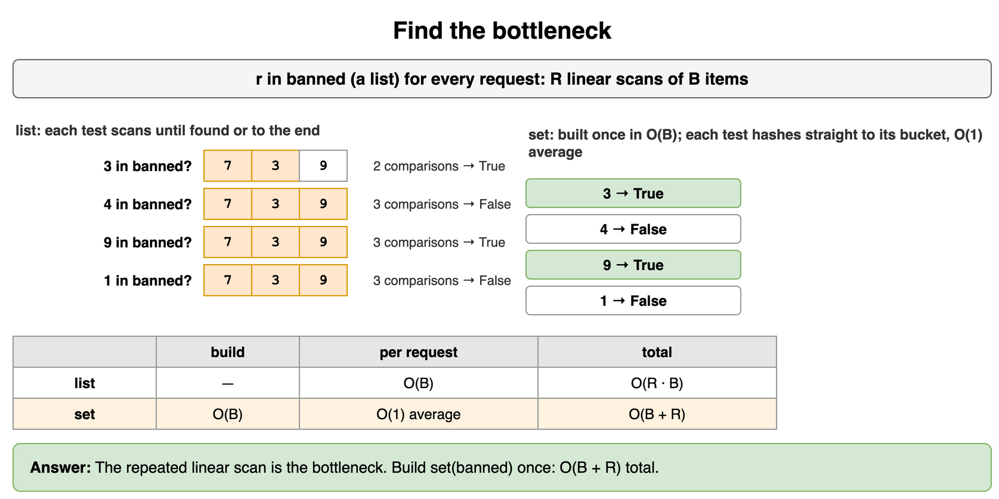

*Source: [`diagrams/problem-solving-patterns-drills.drawio`](/content/07_Data_Structures_and_Algorithms/11_Problem_Solving_Patterns/diagrams/problem-solving-patterns-drills.drawio), page 4.*

## Drop the extra loop

Count the ways to split a bill of `n` euros into whole-euro amounts for three named friends, where `x` pays at least 1, `y` pays at least 1, and `z` pays at least 1. A teammate wrote three nested loops over `x`, `y`, and `z`. What work is unnecessary?

**Answer:** Once `x` and `y` are chosen, `z = n - x - y` is forced, so the third loop only searches for a value you can compute. Loop over `x` and `y` and keep the pair if the forced `z` is at least 1. That cuts O(N^3) to O(N^2). (A formula gives O(1), but the BUD lesson is spotting the forced variable.)

```python
def splits(n: int) -> int:
    count = 0
    for x in range(1, n):
        for y in range(1, n - x):
            count += 1               # z = n - x - y >= 1 is forced
    return count

print(splits(5))   # 6
print(splits(3))   # 1
```

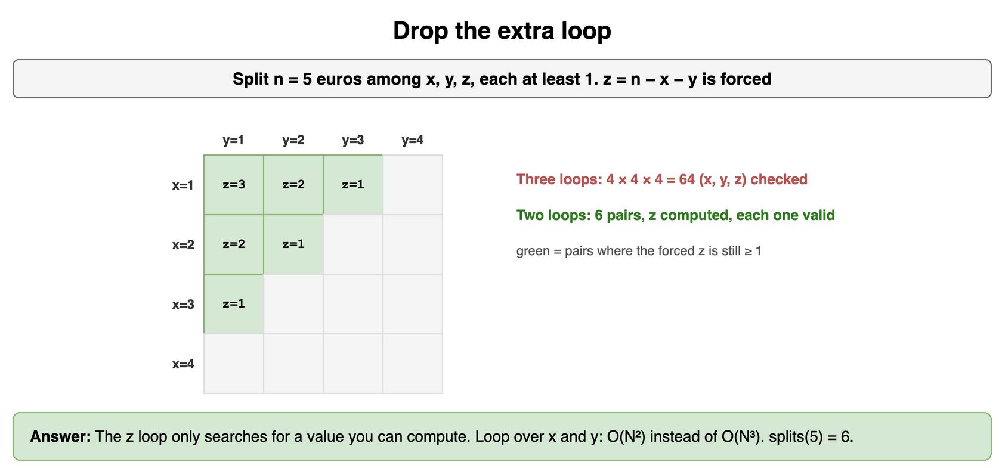

*Source: [`diagrams/problem-solving-patterns-drills.drawio`](/content/07_Data_Structures_and_Algorithms/11_Problem_Solving_Patterns/diagrams/problem-solving-patterns-drills.drawio), page 5.*

## Stop recomputing sums

A dashboard computes the total sales over many date ranges `(i, j)` with `sum(sales[i:j])` each time. With N days and Q ranges this is O(Q * N). Where is the duplicated work, and what fixes it?

**Answer:** Overlapping ranges add up the same days again and again. Build a prefix array once, where `prefix[i]` is the total of the first `i` days. Then any range total is `prefix[j] - prefix[i]`, which is O(1), for O(N + Q) overall.

```python
from itertools import accumulate

sales = [12, 0, 7, 3, 9, 4]
prefix = [0, *accumulate(sales)]

def total(i: int, j: int) -> int:
    return prefix[j] - prefix[i]

print([total(i, j) for i, j in [(0, 3), (2, 6), (1, 2)]])  # [19, 23, 0]
```

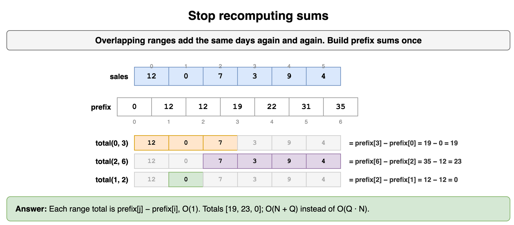

*Source: [`diagrams/problem-solving-patterns-drills.drawio`](/content/07_Data_Structures_and_Algorithms/11_Problem_Solving_Patterns/diagrams/problem-solving-patterns-drills.drawio), page 6.*

## Know when you are done

You must return the largest row total in an N x N grid of integers. Your solution sums each row and keeps the best, in O(N^2). A colleague suggests you keep optimizing. Should you?

**Answer:** No. Every cell can change the answer, so any correct algorithm must read all N^2 cells. The best conceivable runtime is O(N^2), and you already match it. Spend remaining effort on clarity, space, or edge cases such as an empty grid instead.

```python
def best_row(grid: list[list[int]]) -> int | None:
    return max((sum(row) for row in grid), default=None)

print(best_row([[1, -2, 3], [4, 0, -1], [-5, 9, 2]]))  # 6
print(best_row([]))                                   # None
```

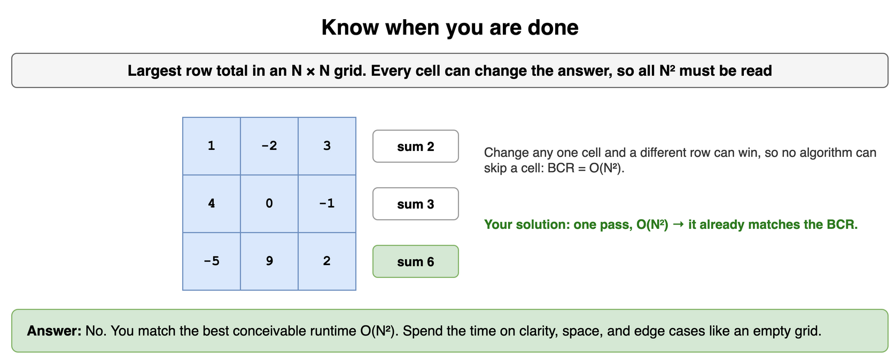

*Source: [`diagrams/problem-solving-patterns-drills.drawio`](/content/07_Data_Structures_and_Algorithms/11_Problem_Solving_Patterns/diagrams/problem-solving-patterns-drills.drawio), page 7.*

## Build from the smaller case

How many binary strings of length `n` have no two adjacent `1`s? Work out n = 1 and n = 2 by hand, then find a rule that builds each answer from smaller ones.

**Answer:** n = 1 gives `0`, `1` (2 strings). n = 2 gives `00`, `01`, `10` (3 strings). For longer strings, look at the last character. If it is `0`, anything valid of length n - 1 can precede it. If it is `1`, the character before must be `0`, so anything valid of length n - 2 precedes `01`. So `f(n) = f(n - 1) + f(n - 2)`, built bottom-up in O(N).

```python
def no_adjacent_ones(n: int) -> int:
    a, b = 1, 2            # f(0) = 1 (empty string), f(1) = 2
    for _ in range(n - 1):
        a, b = b, a + b
    return b if n >= 1 else a

print([no_adjacent_ones(n) for n in range(6)])  # [1, 2, 3, 5, 8, 13]
```

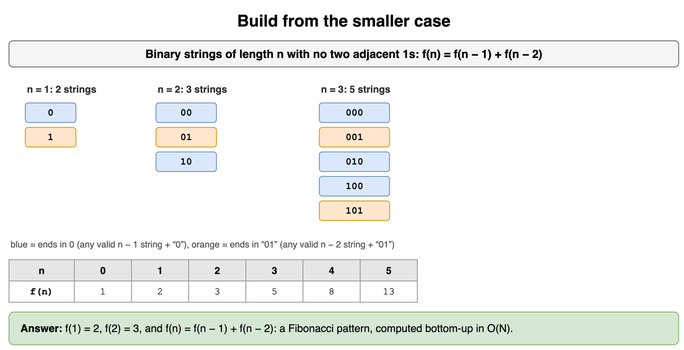

*Source: [`diagrams/problem-solving-patterns-drills.drawio`](/content/07_Data_Structures_and_Algorithms/11_Problem_Solving_Patterns/diagrams/problem-solving-patterns-drills.drawio), page 8.*

## Brainstorm a structure

A game streams scores one at a time. After each score you must report the k-th highest score seen so far. Go through a sorted list, a hash map, and a heap. Which one fits, and at what cost per score?

**Answer:** A hash map keeps no order, so it does not help. A sorted list gives the answer instantly but each insertion shifts elements, O(N). A min-heap that holds only the k largest scores fits: its top is the k-th highest. Each new score costs O(log k): push it, and pop the smallest if the heap grows past k.

```python
import heapq

def kth_highest_stream(scores: list[int], k: int) -> list[int | None]:
    heap: list[int] = []
    out: list[int | None] = []
    for s in scores:
        heapq.heappush(heap, s)
        if len(heap) > k:
            heapq.heappop(heap)
        out.append(heap[0] if len(heap) == k else None)
    return out

print(kth_highest_stream([40, 10, 55, 30, 70], 2))  # [None, 10, 40, 40, 55]
```

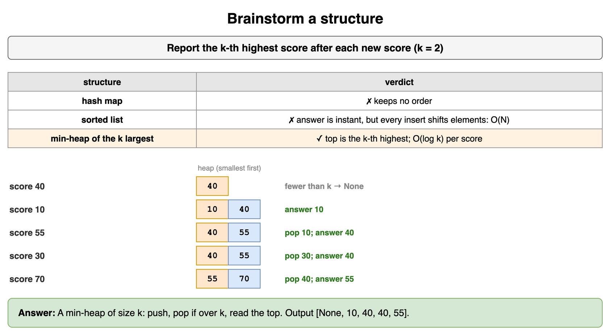

*Source: [`diagrams/problem-solving-patterns-drills.drawio`](/content/07_Data_Structures_and_Algorithms/11_Problem_Solving_Patterns/diagrams/problem-solving-patterns-drills.drawio), page 9.*

## Name the pattern

Match each task to a pattern. (a) Longest stretch of days whose total rainfall stays at most R. (b) Smallest oven temperature that bakes every tray within T minutes, where hotter is always faster. (c) Every way to seat 4 guests at 4 chairs so two rivals are not adjacent. (d) For each day, the next day with a higher price.

**Answer:** (a) Variable sliding window, because rainfall is non-negative and the range is contiguous. (b) Binary search on the answer, because feasibility flips once as temperature rises. (c) Backtracking with pruning on the rival rule. (d) Monotonic stack. The code below solves (a).

```python
def longest_dry_stretch(rain: list[int], limit: int) -> int:
    left = total = best = 0
    for right, r in enumerate(rain):
        total += r
        while total > limit:
            total -= rain[left]
            left += 1
        best = max(best, right - left + 1)
    return best

print(longest_dry_stretch([2, 0, 5, 1, 1, 0, 1, 4], 3))  # 4
```

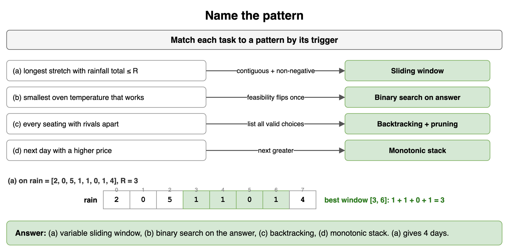

*Source: [`diagrams/problem-solving-patterns-drills.drawio`](/content/07_Data_Structures_and_Algorithms/11_Problem_Solving_Patterns/diagrams/problem-solving-patterns-drills.drawio), page 10.*

## Squares in sorted order

Given a sorted list that may contain negatives, return the squares of its values in sorted order in O(N), without calling `sort`.

**Answer:** The largest square comes from one of the two ends, because the values with the biggest absolute size sit there. Put one pointer at each end, compare the absolute values, write the larger square into the back of the output, and move that pointer inward.

```python
def sorted_squares(nums: list[int]) -> list[int]:
    out = [0] * len(nums)
    left, right = 0, len(nums) - 1
    for pos in range(len(nums) - 1, -1, -1):
        if abs(nums[left]) > abs(nums[right]):
            out[pos] = nums[left] ** 2
            left += 1
        else:
            out[pos] = nums[right] ** 2
            right -= 1
    return out

print(sorted_squares([-6, -2, 0, 3, 5]))  # [0, 4, 9, 25, 36]
```

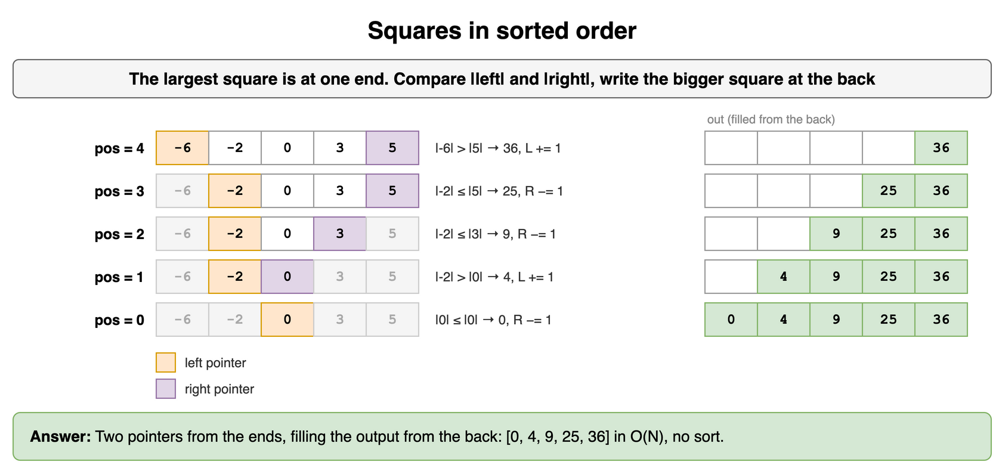

*Source: [`diagrams/problem-solving-patterns-drills.drawio`](/content/07_Data_Structures_and_Algorithms/11_Problem_Solving_Patterns/diagrams/problem-solving-patterns-drills.drawio), page 11.*

## Shortest window to a target

Given positive integers and a target, return the length of the shortest contiguous run whose sum is at least the target, or 0 if none exists.

**Answer:** Grow the right edge and add each value. While the sum reaches the target, record the length and shrink from the left, since a shorter window might still qualify. Values are positive, so shrinking always lowers the sum and growing always raises it; that one-way behavior is why moving both edges forward never skips the answer. Each index enters and leaves once, so the work is O(N).

```python
def shortest_at_least(nums: list[int], target: int) -> int:
    left = total = 0
    best = len(nums) + 1
    for right, x in enumerate(nums):
        total += x
        while total >= target:
            best = min(best, right - left + 1)
            total -= nums[left]
            left += 1
    return best if best <= len(nums) else 0

print(shortest_at_least([3, 1, 4, 1, 5, 9], 14))  # 2
print(shortest_at_least([1, 1, 1], 10))           # 0
```

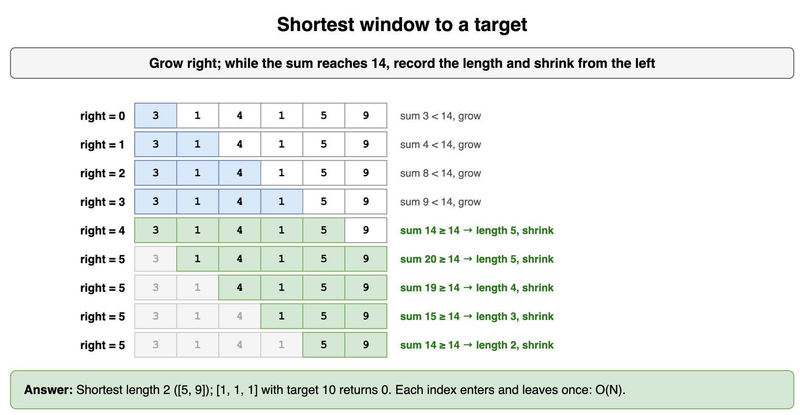

*Source: [`diagrams/problem-solving-patterns-drills.drawio`](/content/07_Data_Structures_and_Algorithms/11_Problem_Solving_Patterns/diagrams/problem-solving-patterns-drills.drawio), page 12.*

## Errors per user

Each log line is a `(user, level)` pair. Return the users with at least `k` `"ERROR"` lines, most errors first, breaking ties by name.

**Answer:** One pass with a frequency map counts errors per user in O(N). Filter the counts by `k`, then sort the survivors by count descending and name ascending. Sorting only the users who passed the filter keeps that step small.

```python
from collections import Counter

def noisy_users(logs: list[tuple[str, str]], k: int) -> list[str]:
    errors = Counter(user for user, level in logs if level == "ERROR")
    keep = [u for u, c in errors.items() if c >= k]
    return sorted(keep, key=lambda u: (-errors[u], u))

logs = [("ana", "ERROR"), ("bo", "INFO"), ("bo", "ERROR"), ("ana", "ERROR"),
        ("cy", "ERROR"), ("bo", "ERROR"), ("cy", "ERROR")]
print(noisy_users(logs, 2))  # ['ana', 'bo', 'cy']
```

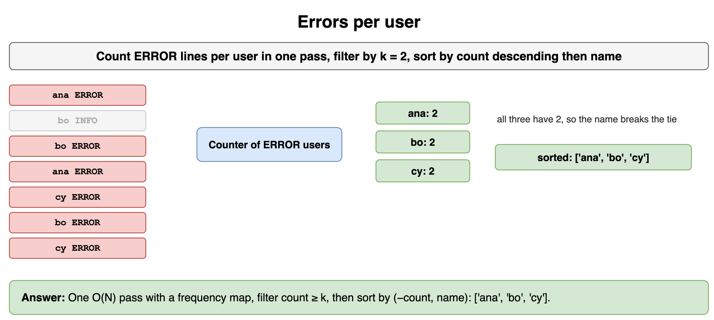

*Source: [`diagrams/problem-solving-patterns-drills.drawio`](/content/07_Data_Structures_and_Algorithms/11_Problem_Solving_Patterns/diagrams/problem-solving-patterns-drills.drawio), page 13.*

## Nearest shorter bar

For each bar in a histogram, return the index of the nearest bar to its *left* that is strictly shorter, or -1 if there is none.

**Answer:** Scan left to right with a stack of indexes whose heights increase from bottom to top. For each bar, pop every index whose height is greater than or equal to it, since those bars can never be the nearest shorter bar for anything further right. Whatever remains on top is the answer. Each index is pushed and popped once, so the pass is O(N).

```python
def nearest_shorter_left(heights: list[int]) -> list[int]:
    result, stack = [], []
    for i, h in enumerate(heights):
        while stack and heights[stack[-1]] >= h:
            stack.pop()
        result.append(stack[-1] if stack else -1)
        stack.append(i)
    return result

print(nearest_shorter_left([3, 1, 4, 4, 2, 5]))  # [-1, -1, 1, 1, 1, 4]
```

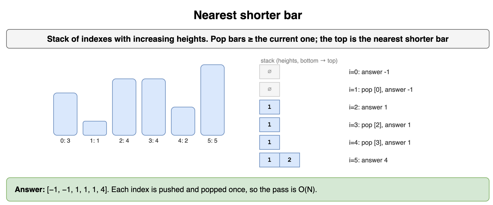

*Source: [`diagrams/problem-solving-patterns-drills.drawio`](/content/07_Data_Structures_and_Algorithms/11_Problem_Solving_Patterns/diagrams/problem-solving-patterns-drills.drawio), page 14.*

## Smallest daily capacity

Parcels must go out in the given order, filling one van per day up to the van's capacity. What is the smallest capacity that ships everything within `d` days?

**Answer:** If a capacity works, any larger capacity also works, so feasibility flips once and you can binary search on the answer. The capacity is at least the heaviest parcel and at most the total weight. To check a candidate, fill days greedily and count how many you need, in O(N). Total cost is O(N log W), where W is the total weight.

```python
def smallest_capacity(weights: list[int], d: int) -> int:
    def days_needed(cap: int) -> int:
        days, load = 1, 0
        for w in weights:
            if load + w > cap:
                days, load = days + 1, 0
            load += w
        return days

    lo, hi = max(weights), sum(weights)
    while lo < hi:
        mid = (lo + hi) // 2
        if days_needed(mid) <= d:
            hi = mid
        else:
            lo = mid + 1
    return lo

print(smallest_capacity([4, 8, 2, 7, 3, 6], 3))  # 12
```

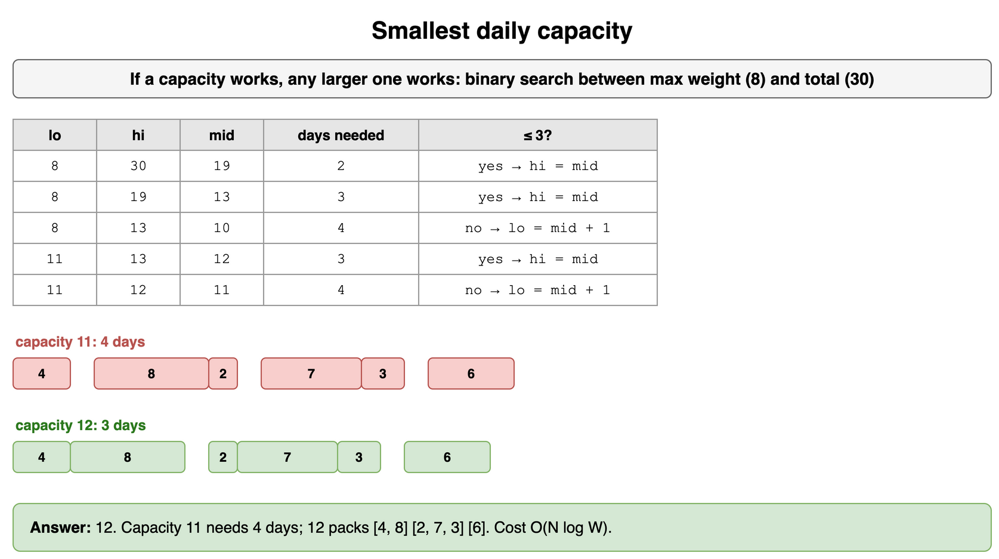

*Source: [`diagrams/problem-solving-patterns-drills.drawio`](/content/07_Data_Structures_and_Algorithms/11_Problem_Solving_Patterns/diagrams/problem-solving-patterns-drills.drawio), page 15.*

## Combinations skeleton

From a list of distinct positive integers, list every combination (each number used at most once) that sums exactly to a target. Write it with the choose / explore / unchoose skeleton and one pruning rule.

**Answer:** Sort the numbers first. At each level, loop over the numbers not yet considered, add one to the path, recurse with a smaller remaining target, then remove it. Because the list is sorted, once a number is larger than the remaining target every later number is too, so you can break out of the loop. That single rule prunes most of the tree.

```python
def combos_to_target(nums: list[int], target: int) -> list[list[int]]:
    nums = sorted(nums)
    out: list[list[int]] = []
    path: list[int] = []

    def backtrack(start: int, remaining: int) -> None:
        if remaining == 0:
            out.append(path[:])
            return
        for i in range(start, len(nums)):
            if nums[i] > remaining:
                break                      # prune: the rest are larger still
            path.append(nums[i])           # choose
            backtrack(i + 1, remaining - nums[i])  # explore
            path.pop()                     # unchoose

    backtrack(0, target)
    return out

print(combos_to_target([6, 2, 5, 3, 1], 8))  # [[1, 2, 5], [2, 6], [3, 5]]
```

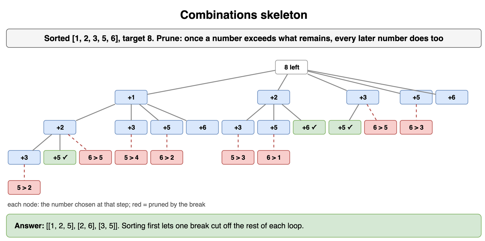

*Source: [`diagrams/problem-solving-patterns-drills.drawio`](/content/07_Data_Structures_and_Algorithms/11_Problem_Solving_Patterns/diagrams/problem-solving-patterns-drills.drawio), page 16.*
