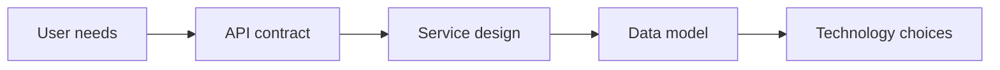

## The Four-Step Framework

A 45-minute system design interview is a conversation you steer. Move through the four steps in order, and say out loud when you change steps so the interviewer can redirect you.

1. **Understand & establish scope** (3–5 min) — restate the product, ask what is in and out, and agree the scale and the guarantees before any boxes.
2. **Propose high-level design & get buy-in** (10–15 min) — sketch the main components, the data flow, and the API shape, then pause until that picture is agreed.
3. **Design deep dive** (15–20 min) — spend the bulk of the time on the one or two parts that are actually hard.
4. **Wrap up** (3–5 min) — name bottlenecks, failures, what you would measure, and one extension.

Drawing boxes before step 1 is the usual miss. The interviewer is grading whether you can bound a problem, then go deep on the part that matters.

## Time Allocation

The minute boxes only help if they protect the deep dive. Three pacing failures show up constantly. A long requirements chat (past ~5 minutes) feels productive and steals the hard design. A high-level pass that draws every box leaves step 3 with nothing new to say. A wrap-up that turns into extra features never mentions failure or metrics.

Keep a visible clock. When scope passes about 5 minutes, write down the assumptions you still have and move. When the high-level sketch has buy-in, stop adding boxes. Inside the last 5 minutes, finish with failure modes even if one more feature is tempting. Say the cut: "Search waits, so we can finish the write path and the failure story."

```text
When the clock slips:
  Shorten the high-level tour and keep the deep dive.
  Drop a second deep dive before you drop wrap-up.
  Leave scope locked unless the interviewer reopens it.
```

## Functional vs. Non-Functional Requirements

Functional requirements describe *what* the system does — the features and user-visible behavior. Non-functional requirements describe *how well* it does it — latency, throughput, availability, durability, security, cost.

Both must be explicitly gathered before designing anything. A chat system with 100 users and a chat system with 100 million users share functional requirements but have completely different architectures.

```text
Functional:
  - Users can send messages to other users
  - Users can create group chats
  - Messages are persisted and retrievable

Non-functional:
  - Message delivery latency < 200ms
  - 99.99% availability
  - Support 50M daily active users
  - Messages stored for 5 years
```

## Scope Management During the Interview

Understand & establish scope includes a cut list. You cannot design every component in 45 minutes. Explicitly calling out what you're deferring — and why — shows maturity.

Good scope signals:

- "Let's assume authentication is handled by an existing service — I'll focus on the core messaging flow."
- "I'll design the write path first since that's the harder scaling problem, then we can discuss reads."
- "We could add encryption at rest later — for now I'll focus on the delivery guarantees."

Interviewers want depth on one or two hard problems, not a shallow tour of every box.

## Back-of-the-Envelope Estimation

Capacity math decides whether the design is one box or a fleet. Aim for an order-of-magnitude answer you can defend: round hard, keep the unit on every number, and say each assumption. There are about 10^5 seconds in a day (86,400). Dividing a daily total by 10^5 underestimates true QPS by about 15%, which is fine for a first pass. For human-driven products, peak is usually about 2–5× the average; pick a factor and name it. Batch and launch traffic can be spikier, so say when you leave that band.

**Power-of-two anchors.** 2^10 = 1,024 ≈ 10^3, so every 10 bits is about three decimal digits. By 2^30 the shortcut is roughly 7% under the true power of two; interviews still treat these as the memory and disk milestones.

```text
2^10  ≈ 10^3    ~1 KB     a small profile or a short text row
2^20  ≈ 10^6    ~1 MB     a short audio clip, or a million 1-byte fields
2^30  ≈ 10^9    ~1 GB     RAM-sized: a cache, a process heap
2^40  ≈ 10^12   ~1 TB     disk-sized: one database volume
2^50  ≈ 10^15   ~1 PB     fleet-sized: object storage, a warehouse
```

One server often holds tens to a few hundred GB of RAM and one or more TB of SSD. A million 1 KB records is about 1 GB (a memory question). A billion of them is about 1 TB (a disk or shard question).

**Latency ladder.** These are interview orders of magnitude, not a benchmark from a specific year. Use them to see which hop dominates a request budget.

```text
L1 cache hit             ~1 ns
L2 cache hit             ~5 ns
RAM read                 ~100 ns
SSD random read          ~100 μs
Same-datacenter RTT      ~0.5 ms
HDD seek                 ~10 ms
Cross-country RTT        ~40 ms
Cross-continent RTT      ~150 ms
```

An HDD seek is on the order of 100× a conservative SSD random read, and that SSD read is on the order of 1,000× a RAM read. A synchronous cross-continent call spends ~150 ms before your code runs.

**Availability, downtime per year.** A year is 365 × 24 h = 8,760 h. Each extra nine removes about 90% of the remaining downtime budget.

```text
99%      (2 nines)   ~3.65 days
99.9%    (3 nines)   ~8.76 hours
99.99%   (4 nines)   ~52.6 minutes
99.999%  (5 nines)   ~5.26 minutes
```

Monthly figures, plus how series and parallel components combine, are in [Availability and the Nines](../03_High_Availability_and_Reliability/).

**Estimation habits.**

- Round to one significant digit and keep the unit attached.
- Split reads, writes, and bytes. Reads usually set QPS; writes set how fast storage grows.
- Users are not requests. Write "actions per user per day" before you divide.
- Recompute at 10×. If the boxes stay the same, stop. If they change, name the threshold ("one primary until about 2 TB, then shard").
- Check the result against the power-of-two milestones before you name a database.

## QPS and Storage Estimate

One worked pass from users to QPS to bytes, with the assumptions on the page. The product is a tool-lending co-op: members borrow things from a neighborhood inventory. It is a small CRUD system with a daily rhythm, which makes the arithmetic easy to check.

Assumptions: 5 million daily active members, 2 loan records written per member per day, 12 record reads per member per day, 400 bytes per stored record, 3 years of retention, peak at 4× (inside the 2–5× band), and 10^5 seconds/day.

```text
Writes: 5e6 × 2 / 1e5 = 100 QPS average → 400 QPS peak
Reads:  5e6 × 12 / 1e5 = 600 QPS average → 2,400 QPS peak
Raw storage/year: 5e6 × 2 × 365 × 400 B = 1.46 TB
Three years raw = 4.38 TB
Budget ~2× for indexes ≈ 8.8 TB before extra replicas
```

A few hundred peak writes and a few thousand peak reads fit a single primary, a replica, and a cache. About 8.8 TB of indexed data is a database volume with headroom to spare. It is well above one laptop disk, and it is well below a thousand-node fleet. Say that sentence, then draw. When the interviewer doubles DAU, multiply; the method stays put. A runnable form of this estimate is in the notes.

## Working Backwards from Requirements

Start from what the user needs, derive the API contract, then work inward to services and storage. This is the opposite of picking a database first and fitting the problem to it.



Amazon's "working backwards" method is a useful analogy: write the press release (what does the customer see?) before writing the code. In an interview, define the API endpoints before drawing the architecture diagram, then get buy-in on that chain before the deep dive. If the interviewer disagrees with the API, fix it while the drawing is still small.

## Defining the API Contract

After scoping requirements, sketch the key API endpoints. This forces you to think about the user-facing interface before internal implementation and gives the interviewer something concrete to react to.

```text
POST /messages
  Body: { "to": "user_id", "text": "hello" }
  Response: 201 { "message_id": "abc123", "timestamp": "..." }

GET /messages?chat_id=xyz&before=timestamp&limit=50
  Response: 200 { "messages": [...], "has_more": true }

GET /chats
  Response: 200 { "chats": [{ "id": "xyz", "last_message": "..." }] }
```

The contract reveals hidden requirements: pagination strategy, sort order, what metadata to return, whether the API is RESTful or event-driven. These details matter more than box diagrams early in the interview. Pause here for agreement; that pause is the buy-in in step 2.

## Trade-Off Articulation

Interviewers value explicit reasoning about competing constraints more than picking the "right" answer. Every design decision is a trade-off; naming it earns more credit than hiding it.

```text
Common trade-offs to call out:

  Consistency vs. Availability     (CAP)
  Latency vs. Throughput           (batch vs. stream)
  Cost vs. Durability              (replication factor)
  Read latency vs. Write latency   (fan-out on write vs. read)
  Simplicity vs. Scalability       (monolith vs. microservices)
  Accuracy vs. Freshness           (cache TTL, eventual consistency)
```

A strong answer sounds like: "We could use fan-out on write for the news feed, which gives fast reads but makes writes expensive for users with millions of followers. For those celebrity accounts, we'd switch to fan-out on read."

## Choosing the Deep-Dive Focus

Design deep dive means one hard area, explored until the interviewer believes it works. Choose it from the requirements and the estimate, say the choice, and name what you are leaving on the high-level sketch.

- **Data model**, when the product is the schema (permissions, bookings, a feed) and a wrong key makes every query wrong.
- **Hot path**, when one key, one region, or one write fan-out dominates QPS or storage growth.
- **Consistency and replication**, when a stale or lost write is the product failure (inventory, payments, a ledger).
- **The algorithm**, when ranking, matching, or id generation is the behavior users notice.

A direct test: if this part stays naive, does the design miss the requirement you just agreed? Follow that part. If the interviewer has asked twice about the same box, follow them. Announce the cut: "Steady reads are fine. The on-sale show id is the hotspot, so I will deep-dive the waiting room and leave profile edits on the ordinary path."

Two areas with real detail beat a sentence on eight boxes. Trade-offs belong inside the area you picked, attached to a specific decision.

## The Wrap-Up Checklist

The last few minutes of the interview are where many candidates go silent. Reserve the last 3–5 minutes for this list even when the deep dive is still interesting. Use it to find gaps yourself and to show you can operate the system after launch.

```text
Wrap-up checklist:
  □ Single points of failure — what happens if this component goes down?
  □ Bottlenecks — where does the system break first under 10× load?
  □ Monitoring — what metrics would you alert on?
  □ Security — authentication, authorization, data encryption?
  □ Cost — is anything unnecessarily expensive at scale?
  □ Extensions — how would you add feature X without redesigning?
```

Proactively identifying a weakness in your own design is stronger than having the interviewer find it.
