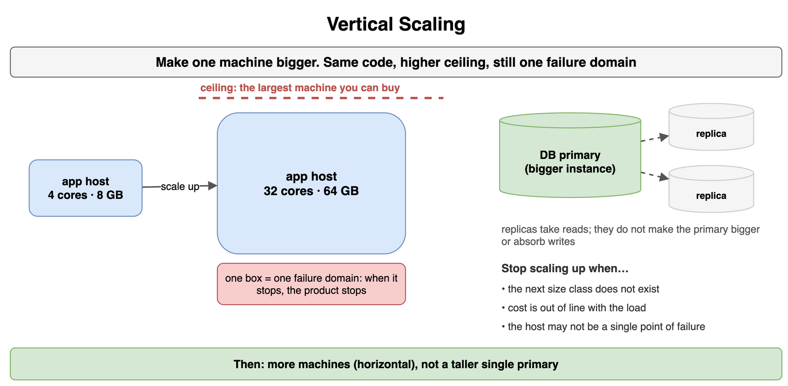
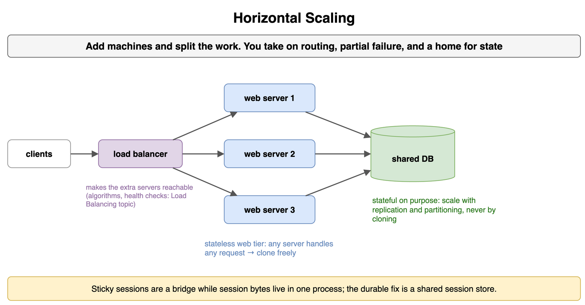
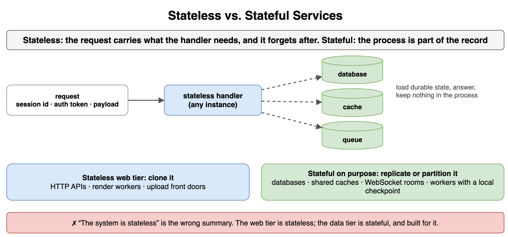
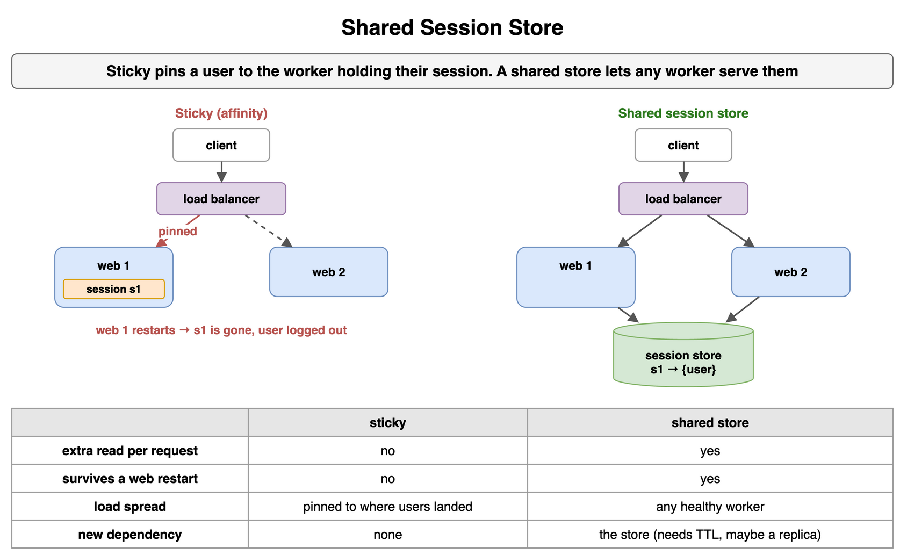
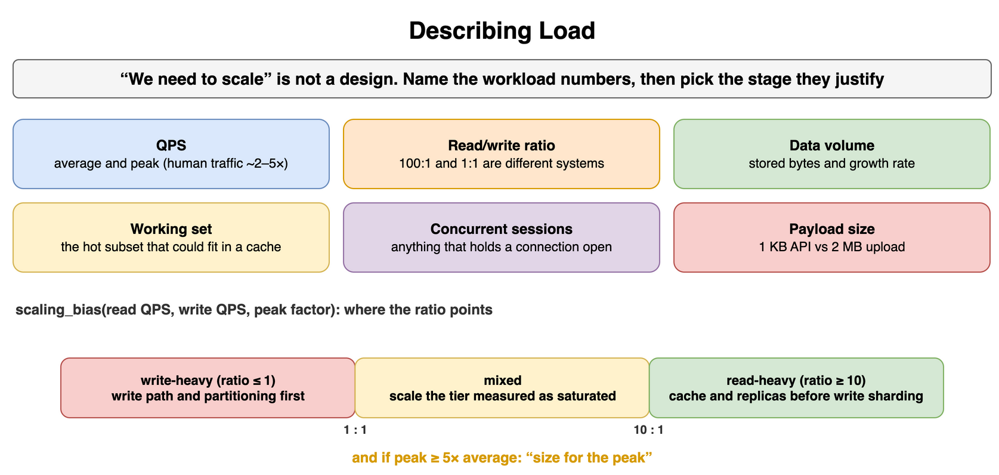
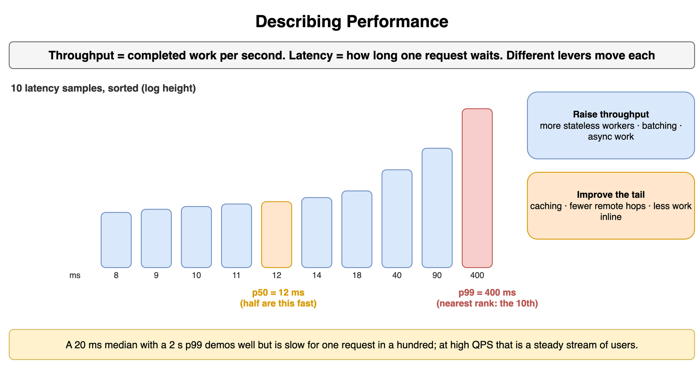
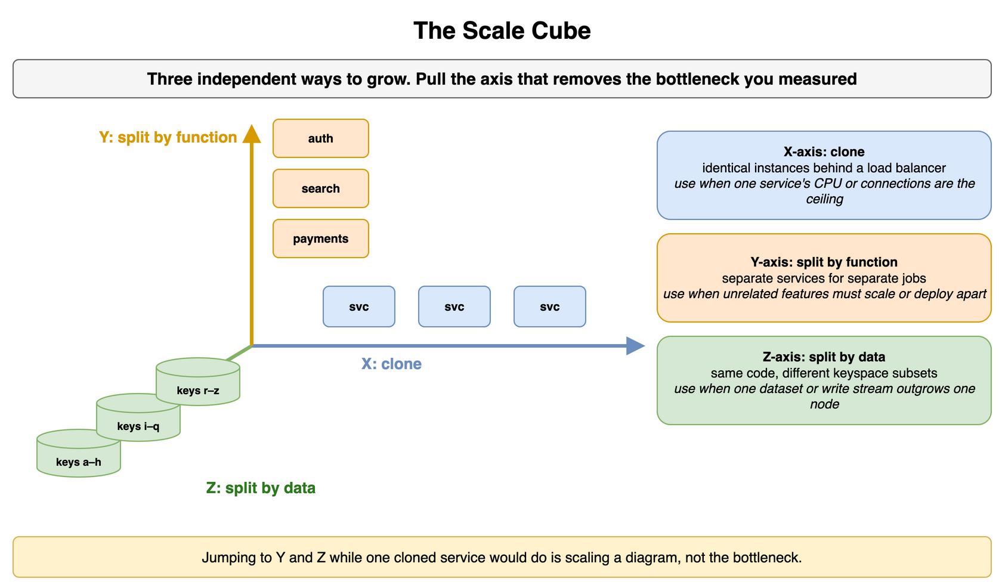
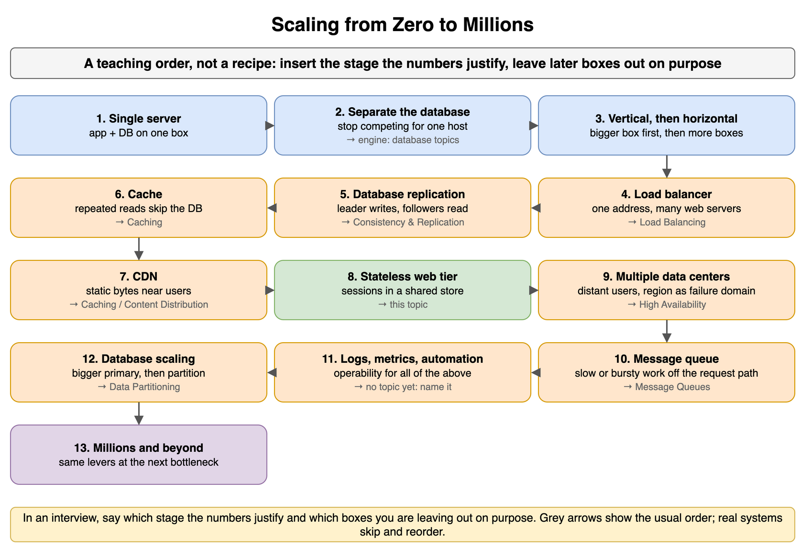

## Vertical Scaling

Adding CPU, memory, or disk to a single machine. The code stays the same, which is why this is the usual first move for an early product. The ceiling is the largest machine you can buy, and that machine is still one failure domain: when it stops, the product stops.

The same lever applies to a database primary. A larger instance raises one writer's CPU, buffer pool, and disk throughput. Read replicas do not make that primary bigger, and they do not absorb writes. Stop scaling up when the next size class does not exist, the cost is out of line with the load, or the host is not allowed to be a single point of failure.

```text
App host:   4 cores, 8 GB  →  32 cores, 64 GB. Same process, higher QPS, still one box.
DB primary: bigger instance until CPU, IOPS, or the size catalog runs out.
Then:       more machines (horizontal), not a taller single primary.
```



*Source: [`diagrams/scalability-fundamentals.drawio`](/content/09_System_Design_Interview/02_Scalability_Fundamentals/diagrams/scalability-fundamentals.drawio), page 1.*

## Horizontal Scaling

Adding machines so work that can be split is split. Throughput can grow with the pool. What you take on is routing, partial failure, and a place for any state that used to live in one process.



*Source: [`diagrams/scalability-fundamentals.drawio`](/content/09_System_Design_Interview/02_Scalability_Fundamentals/diagrams/scalability-fundamentals.drawio), page 2.*

A load balancer is what makes the extra web servers reachable. Algorithms, health checks, and TLS placement are the Load Balancing topic. The web tier scales evenly once any server can handle any request. Sticky sessions are a bridge while session bytes still sit in one process. The durable fix is a shared session store. Databases stay stateful on purpose: scale them with replication and partitioning, not by cloning them as if they were web servers.

## Stateless vs. Stateful Services

A stateless web service keeps no per-user record in the process. The request carries what the handler needs (a session id, an auth token, the payload). The handler loads durable state from a database, a cache, or a queue, then forgets it. Any healthy instance can take the next request, which is what makes a load balancer useful.

A stateful service is one where the process itself is part of the record. In-memory sessions, a WebSocket fanout table, a stream processor's local state, and the database are stateful. Cloning them without a plan drops or splits that state.

```text
Stateless web tier (clone it):
  HTTP APIs, render workers, upload front doors

Stateful on purpose (replicate or partition it):
  Databases, shared caches, WebSocket rooms,
  workers that own a local checkpoint
```

"The system is stateless" is the wrong summary. The web tier is stateless. The data tier is stateful, and it is built for that.



*Source: [`diagrams/scalability-fundamentals.drawio`](/content/09_System_Design_Interview/02_Scalability_Fundamentals/diagrams/scalability-fundamentals.drawio), page 3.*

## Shared Session Store

Sticky sessions (session affinity) send a user back to the web server that holds their session in local memory. That avoids an extra store and keeps a first version simple. It also pins load to whichever servers users happened to hit, and a restart or a rebalance drops those logins. How the balancer implements the pin (cookie, client IP, header) is a Load Balancing detail.

A shared session store puts the session document where every web server can read it, usually a key-value store keyed by session id. The balancer may then choose any healthy server. The cost is one extra read, a TTL so abandoned sessions expire, a small payload, and a dependency: if logins must survive a store restart, that store needs its own replica.

```text
Sticky:  session in one worker, balancer pins the client, failover loses the login
Shared:  session in an external store, any worker, extra read, store is now on the critical path
```



*Source: [`diagrams/scalability-fundamentals.drawio`](/content/09_System_Design_Interview/02_Scalability_Fundamentals/diagrams/scalability-fundamentals.drawio), page 4.*

```python
def session_for(store: dict[str, dict], session_id: str) -> dict | None:
    """Same lookup on every web worker. The dict stands in for a shared store."""
    return store.get(session_id)
```

## Describing Load

The numbers that make a scaling choice specific. "We need to scale" is not a design. Name the workload, then pick the stage that removes the bottleneck those numbers imply. The arithmetic shortcuts (about 10^5 seconds in a day, powers of two, the latency ladder) live with back-of-the-envelope estimation. This card is what you do with the result.

```text
QPS                  — average and peak; human traffic often peaks at about 2–5×
Read/write ratio     — 100:1 and 1:1 are different systems
Data volume          — stored bytes and how fast they grow
Working set          — the hot subset that could fit in a cache
Concurrent sessions  — matters for anything that holds a connection open
Payload size         — a 1 KB API and a 2 MB upload do not share a bottleneck
```

```python
def scaling_bias(read_qps: float, write_qps: float, peak_factor: float) -> str:
    ratio = read_qps / write_qps if write_qps else float("inf")
    if ratio >= 10:
        shape = "read-heavy: cache and replicas before write sharding"
    elif ratio <= 1:
        shape = "write-heavy: write path and partitioning first"
    else:
        shape = "mixed: scale the tier you measured as saturated"
    if peak_factor >= 5:
        return shape + "; size for the peak"
    return shape
```



*Source: [`diagrams/scalability-fundamentals.drawio`](/content/09_System_Design_Interview/02_Scalability_Fundamentals/diagrams/scalability-fundamentals.drawio), page 5.*

## Describing Performance

How the system behaves under that load. Throughput is completed work per second. Latency is how long one request waits. Adding servers is a throughput tool when the work parallelizes. Latency moves when you remove a slow hop: a cache hit, a closer copy of the bytes, less work on the request path.

```text
Throughput — requests/second the tier completes
Latency    — send to response
  p50      — half of requests are at least this fast
  p95      — the slow tail most users still feel
  p99      — the worst common case; this is the usual page

Raise throughput with more stateless workers, batching, or async work.
Raise the tail with caching, fewer remote hops, and less work inline.
```

A service with a 20 ms median and a 2 s p99 feels fine in a demo and bad for one request in a hundred. At a high QPS that tail is a steady stream of users. Nearest-rank is enough in an interview to show the tail; it is not a lab estimator.

```python
import math


def nearest_rank(samples_ms: list[float], percentile: float) -> float:
    ordered = sorted(samples_ms)
    rank = max(1, math.ceil(percentile / 100 * len(ordered)))
    return ordered[rank - 1]


samples = [8, 9, 10, 11, 12, 14, 18, 40, 90, 400]
print(nearest_rank(samples, 50), nearest_rank(samples, 99))  # 12 400
```



*Source: [`diagrams/scalability-fundamentals.drawio`](/content/09_System_Design_Interview/02_Scalability_Fundamentals/diagrams/scalability-fundamentals.drawio), page 6.*

## The Scale Cube

Three independent ways to grow a system. Name the axis that matches the bottleneck you measured. Most production systems use more than one; an interview answer still starts with the axis that removes the current limit.

```text
X-axis: clone
  Identical instances behind a load balancer.
  Use when one service's CPU or connection count is the ceiling.

Y-axis: split by function
  Separate services for separate jobs (auth, search, payments).
  Use when unrelated features are forced to scale and deploy together.

Z-axis: split by data
  Same code, different subsets of the keyspace.
  Use when one dataset or one write stream no longer fits one node.
```

X is the horizontal web tier. Y is service decomposition. Z is partitioning. A design that jumps to Y and Z while one cloned service would do is scaling a diagram, not the bottleneck.



*Source: [`diagrams/scalability-fundamentals.drawio`](/content/09_System_Design_Interview/02_Scalability_Fundamentals/diagrams/scalability-fundamentals.drawio), page 7.*

## Scaling from Zero to Millions

A teaching sequence from one box to a large fleet, in the order these building blocks are usually introduced. Real systems skip or reorder stages to match the bottleneck in front of them. Insert the stage the numbers justify, and leave the later boxes out until a measured limit needs them.

```text
 1. Single server
    App and database share one machine. Enough while both fit and a restart is acceptable.

 2. Separate the database
    Give the database its own host so queries stop competing with request handling.
    Still one writer. Which engine is a data-model choice, covered in the database topics.

 3. Vertical, then horizontal
    Add CPU, memory, or disk on the saturated machine first.
    When that stops working, the next move is more machines. Stage 4 is how they receive traffic.

 4. Load balancer
    One client address spreads requests across web servers.
    Algorithms, health checks, and affinity mechanics live in Load Balancing.

 5. Database replication
    One leader takes writes; followers serve reads.
    Lag, failover, and consistency models live in the database and consistency topics.

 6. Cache
    A cache tier absorbs repeated reads so the database sees the misses.
    Patterns, TTL, and invalidation live in Caching.

 7. CDN
    Cacheable static bytes move closer to users. This stage is a mention, not the CDN card.
    Foundational CDN and media pipelines both live in Content Distribution.

 8. Stateless web tier
    Any web server can serve any user. Session bytes move to a shared session store.
    Sticky sessions are the bridge, not the end state.

 9. Multiple data centers
    Trigger: distant users, or a whole region as one failure domain.
    Geo routing and active-active sites belong in High Availability. Name the trigger here.

10. Message queue
    Slow or bursty work leaves the request path. The web tier publishes; workers consume.
    Delivery guarantees and backpressure live in Message Queues.

11. Logging, metrics, automation
    The earlier stages are operable only with logs, metrics, and repeatable deploys.
    The design lives in Observability. Name the signals here; do not design the stack in this topic.

12. Database scaling
    A larger primary raises the write ceiling until hardware or cost stops you.
    Past that, partition the data. Shard keys and rebalancing live in Data Partitioning.

13. Millions and beyond
    The same levers, aimed at the next measured bottleneck: more web capacity, a wider
    cache, more replicas, another region, or another shard. Match the stage to the ask.
```

In an interview, say which stage the numbers justify and which boxes you are leaving out on purpose.



*Source: [`diagrams/scalability-fundamentals.drawio`](/content/09_System_Design_Interview/02_Scalability_Fundamentals/diagrams/scalability-fundamentals.drawio), page 8.*
