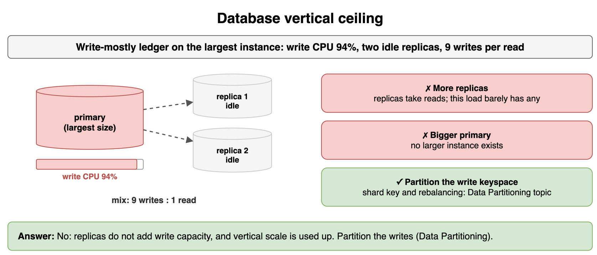
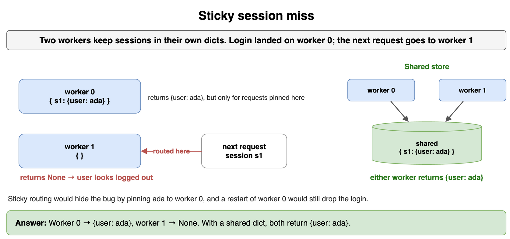
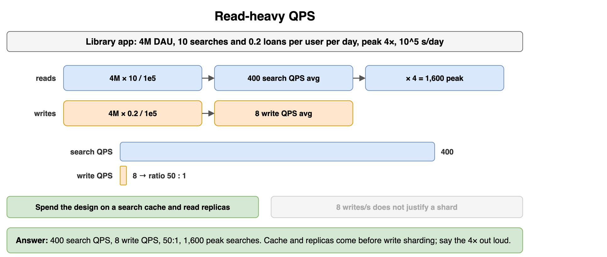
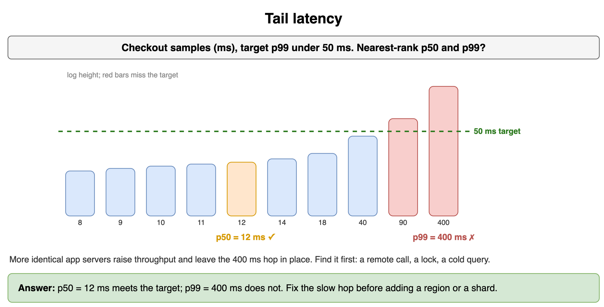
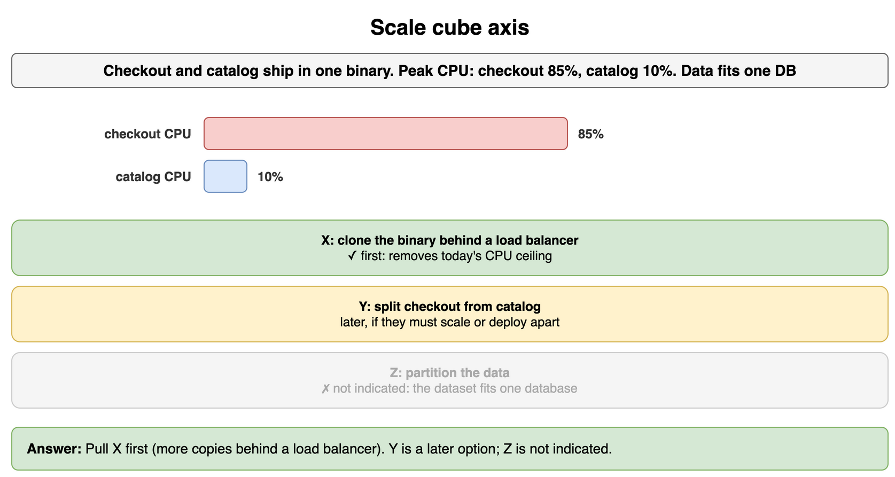
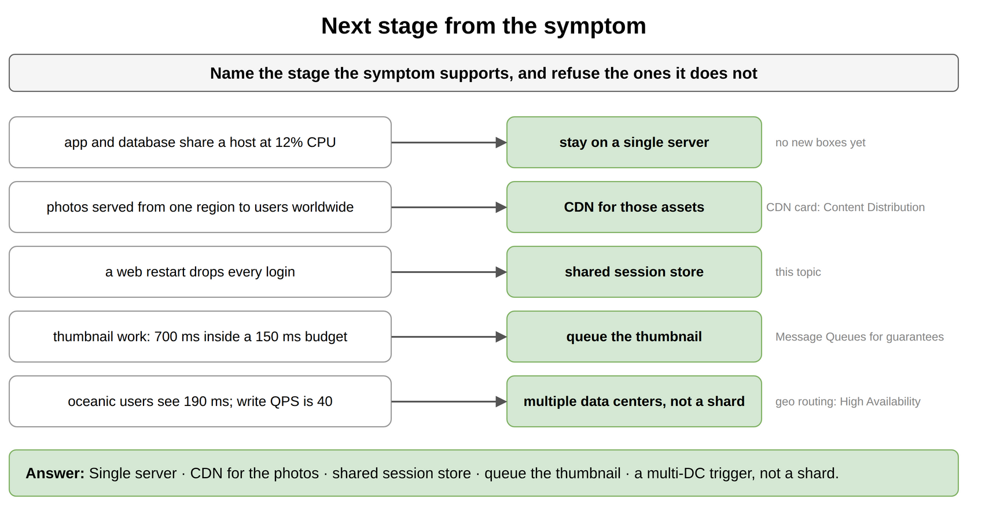
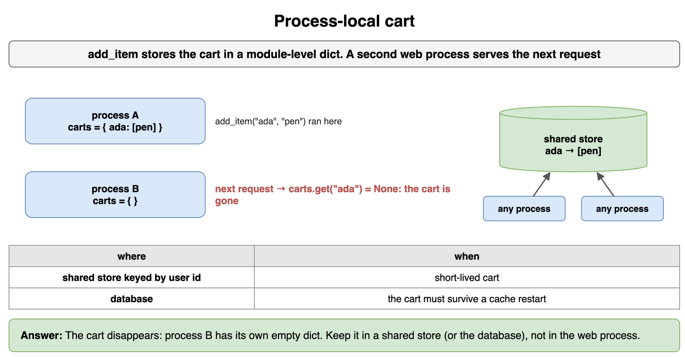
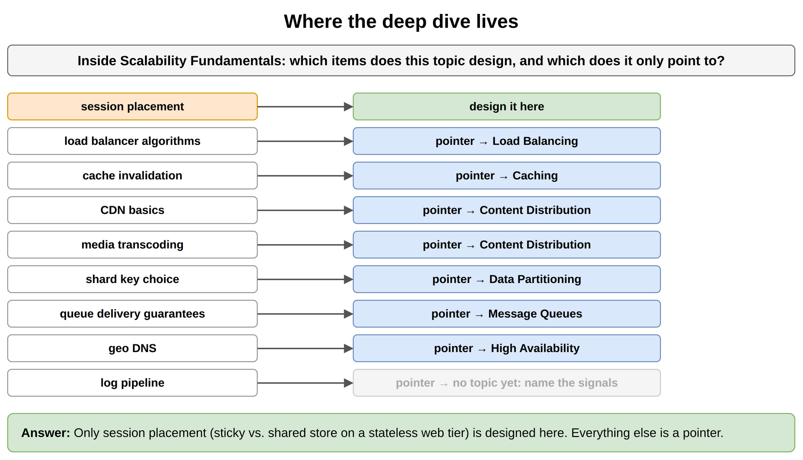

# Scalability Fundamentals — Drills

Original practice for choosing a scaling move. Each card is one exercise: commit to an answer, then check it. The numbers are invented for study. Deep dives that belong to another topic stay named, not redesigned here.

## Database vertical ceiling

A write-mostly ledger runs on the largest database instance offered. Write CPU sits at 94%. Two read replicas are almost idle. The mix is about 9 writes for every 1 read. Do more replicas raise write capacity? What move is left?

```python
WRITE_CPU = 94
AT_LARGEST_INSTANCE = True
WRITES = 9
READS = 1
```

**Answer:** Replicas take reads, and this workload barely has any. Vertical scale is also finished: there is no larger instance. The next move is to partition the write keyspace. Shard-key choice and rebalancing belong to Data Partitioning, not to another replica.

```python
WRITE_CPU = 94
AT_LARGEST_INSTANCE = True
WRITES = 9
READS = 1

replicas_raise_write_capacity = False
need_partition = AT_LARGEST_INSTANCE and WRITE_CPU >= 80 and WRITES > READS
print(replicas_raise_write_capacity, need_partition)  # False True
```



*Source: [`diagrams/scalability-fundamentals-drills.drawio`](/content/09_System_Design_Interview/02_Scalability_Fundamentals/diagrams/scalability-fundamentals-drills.drawio), page 1.*

## Sticky session miss

Two web workers keep sessions in their own dicts. Login landed on worker 0. The next request is routed to worker 1. What does each worker return, and what changes if both read a shared dict?

```python
workers = [{"s1": {"user": "ada"}}, {}]
shared = {"s1": {"user": "ada"}}
```

**Answer:** Worker 0 still has the session. Worker 1 returns nothing, so the user looks logged out. A shared store returns the same session no matter which worker is chosen. Sticky routing would have hidden the bug by pinning the user to worker 0, and a restart of that worker would still drop the login.

```python
workers = [{"s1": {"user": "ada"}}, {}]
shared = {"s1": {"user": "ada"}}


def sticky_lookup(worker_index: int, session_id: str) -> dict | None:
    return workers[worker_index].get(session_id)


print(sticky_lookup(0, "s1"), sticky_lookup(1, "s1"), shared.get("s1"))
# {'user': 'ada'} None {'user': 'ada'}
```



*Source: [`diagrams/scalability-fundamentals-drills.drawio`](/content/09_System_Design_Interview/02_Scalability_Fundamentals/diagrams/scalability-fundamentals-drills.drawio), page 2.*

## Read-heavy QPS

A library app has 4 million daily active users. Each user runs 10 searches and checks out 0.2 loans a day. Peak is 4×. Using 10^5 seconds/day, what are average search QPS, average write QPS, the read/write ratio, and peak search QPS? Which investment comes before write sharding?

```python
DAU = 4_000_000
SEARCHES = 10
LOANS = 0.2
PEAK = 4
SECONDS = 100_000
```

**Answer:** 400 average search QPS, 8 average write QPS, a 50:1 ratio, and 1,600 peak search QPS. Spend the design on a search cache and read replicas. Eight write QPS does not justify a shard. Say the 4× peak out loud; it is an assumption, and it is what the web pool and the cache must absorb.

```python
DAU = 4_000_000
SEARCHES = 10
LOANS = 0.2
PEAK = 4
SECONDS = 100_000

read_avg = DAU * SEARCHES / SECONDS
write_avg = DAU * LOANS / SECONDS
print(read_avg, write_avg, read_avg / write_avg, read_avg * PEAK)
# 400.0 8.0 50.0 1600.0
```



*Source: [`diagrams/scalability-fundamentals-drills.drawio`](/content/09_System_Design_Interview/02_Scalability_Fundamentals/diagrams/scalability-fundamentals-drills.drawio), page 3.*

## Tail latency

Checkout samples, in milliseconds, are below. A product target says p99 under 50 ms. Using nearest-rank, what are p50 and p99, and does the target hold?

```python
import math

samples_ms = [8, 9, 10, 11, 12, 14, 18, 40, 90, 400]
TARGET_MS = 50
```

**Answer:** Nearest-rank p50 is 12 ms and p99 is 400 ms. The median meets the target. The tail does not. Adding identical app servers raises throughput and leaves this 400 ms hop in place. Find that hop (a remote call, a lock, a cold query) before adding a region or a shard.

```python
import math

samples_ms = [8, 9, 10, 11, 12, 14, 18, 40, 90, 400]
TARGET_MS = 50


def nearest_rank(samples: list[float], percentile: float) -> float:
    ordered = sorted(samples)
    rank = max(1, math.ceil(percentile / 100 * len(ordered)))
    return ordered[rank - 1]


p50 = nearest_rank(samples_ms, 50)
p99 = nearest_rank(samples_ms, 99)
print(p50, p99, p99 <= TARGET_MS)  # 12 400 False
```



*Source: [`diagrams/scalability-fundamentals-drills.drawio`](/content/09_System_Design_Interview/02_Scalability_Fundamentals/diagrams/scalability-fundamentals-drills.drawio), page 4.*

## Scale cube axis

Checkout and catalog ship in one binary. At peak, checkout CPU is 85% and catalog CPU is 10%. The whole dataset fits one database with room to spare. Which axis do you pull first, and which axis is not indicated?

```python
cpu = {"checkout": 85, "catalog": 10}
dataset_fits_one_db = True
```

**Answer:** X-axis: run more copies of the current binary behind a load balancer. That removes today's CPU ceiling. Y-axis (split checkout from catalog) is a later split if the two parts must scale or deploy apart. Z-axis is not indicated while the dataset fits one database.

```python
cpu = {"checkout": 85, "catalog": 10}
dataset_fits_one_db = True

hot = max(cpu, key=cpu.get)
axis = "X" if cpu[hot] >= 70 else "none"
if not dataset_fits_one_db:
    axis = "Z"
print(hot, axis)  # checkout X
```



*Source: [`diagrams/scalability-fundamentals-drills.drawio`](/content/09_System_Design_Interview/02_Scalability_Fundamentals/diagrams/scalability-fundamentals-drills.drawio), page 5.*

## Next stage from the symptom

For each symptom, name the stage you add. Refuse stages the symptom does not support.

```python
symptoms = [
    "app and database share a host at 12% CPU",
    "photos are served from one region to users worldwide",
    "a web restart drops every login",
    "thumbnail work takes 700 ms inside a 150 ms budget",
    "oceanic users see 190 ms; write QPS is 40",
]
```

**Answer:** Stay on one server while CPU is that low. Worldwide shared photos are a CDN mention for those bytes; the CDN card lives in Content Distribution. Logins that die with the process move to a shared session store. The thumbnail leaves the request path via a queue. Oceanic latency at 40 write QPS is a multi-data-center trigger, not a shard. Geo routing itself belongs to High Availability.

```python
def stage_for(symptom: str) -> str:
    if "12% CPU" in symptom:
        return "single server"
    if "photos" in symptom:
        return "CDN for those assets"
    if "login" in symptom:
        return "shared session store"
    if "700 ms" in symptom:
        return "queue the thumbnail"
    if "190 ms" in symptom:
        return "multi-DC pointer, not a shard"
    return "measure again"


symptoms = [
    "app and database share a host at 12% CPU",
    "photos are served from one region to users worldwide",
    "a web restart drops every login",
    "thumbnail work takes 700 ms inside a 150 ms budget",
    "oceanic users see 190 ms; write QPS is 40",
]
print([stage_for(item) for item in symptoms])
# ['single server', 'CDN for those assets', 'shared session store', 'queue the thumbnail', 'multi-DC pointer, not a shard']
```



*Source: [`diagrams/scalability-fundamentals-drills.drawio`](/content/09_System_Design_Interview/02_Scalability_Fundamentals/diagrams/scalability-fundamentals-drills.drawio), page 6.*

## Process-local cart

`add_item` stores the cart in a module-level dict. What happens after a second web process serves the next request, and where should the cart live if any process must be able to serve the user?

```python
carts: dict[str, list[str]] = {}


def add_item(user_id: str, sku: str) -> None:
    carts.setdefault(user_id, []).append(sku)
```

**Answer:** The second process has its own empty dict, so the cart disappears. That is stateful web-tier behavior. Put the cart in a shared store keyed by user id if it is short-lived, or in the database if it must survive the cache. The web process should finish the request without being the only copy of the cart.

```python
carts: dict[str, list[str]] = {}
shared: dict[str, list[str]] = {}


def add_item(user_id: str, sku: str) -> None:
    carts.setdefault(user_id, []).append(sku)


def add_shared(store: dict[str, list[str]], user_id: str, sku: str) -> list[str]:
    store.setdefault(user_id, []).append(sku)
    return store[user_id]


add_item("ada", "pen")
other_process_carts: dict[str, list[str]] = {}
print(carts.get("ada"), other_process_carts.get("ada"))
print(add_shared(shared, "ada", "pen"))
# ['pen'] None
# ['pen']
```



*Source: [`diagrams/scalability-fundamentals-drills.drawio`](/content/09_System_Design_Interview/02_Scalability_Fundamentals/diagrams/scalability-fundamentals-drills.drawio), page 7.*

## Where the deep dive lives

You are still in Scalability Fundamentals. For each item, say whether this topic owns the design or only the pointer.

```python
items = [
    "session placement",
    "load balancer algorithms",
    "cache invalidation",
    "CDN basics",
    "media transcoding",
    "shard key choice",
    "queue delivery guarantees",
    "geo DNS",
    "log pipeline",
]
```

**Answer:** This topic owns session placement: sticky pin versus a shared store, on a stateless web tier. Everything else is a pointer. Load balancer algorithms are Load Balancing. Cache invalidation is Caching. Foundational CDN behavior and media transcoding are Content Distribution. Shard keys are Data Partitioning. Delivery guarantees are Message Queues. Geo DNS is the Multi-DC and Geo Routing card in High Availability. The log pipeline is Observability: name the signals here and design them there.

```python
OWNER = {
    "session placement": "this topic",
    "load balancer algorithms": "Load Balancing",
    "cache invalidation": "Caching",
    "CDN basics": "Content Distribution",
    "media transcoding": "Content Distribution",
    "shard key choice": "Data Partitioning",
    "queue delivery guarantees": "Message Queues",
    "geo DNS": "High Availability",
    "log pipeline": "Observability",
}

for item in OWNER:
    print(f"{item}: {OWNER[item]}")
# session placement: this topic
# load balancer algorithms: Load Balancing
# cache invalidation: Caching
# CDN basics: Content Distribution
# media transcoding: Content Distribution
# shard key choice: Data Partitioning
# queue delivery guarantees: Message Queues
# geo DNS: High Availability
# log pipeline: Observability
```



*Source: [`diagrams/scalability-fundamentals-drills.drawio`](/content/09_System_Design_Interview/02_Scalability_Fundamentals/diagrams/scalability-fundamentals-drills.drawio), page 8.*
