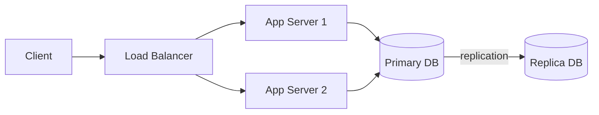
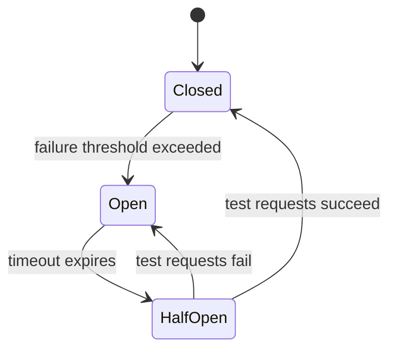

## Availability and the Nines

Availability is the fraction of time a system is operational, expressed as "nines." Each additional nine represents a 10× reduction in allowed downtime.

```text
Availability    Downtime/year    Downtime/month
99%     (2 9s)  3.65 days        7.3 hours
99.9%   (3 9s)  8.77 hours       43.8 minutes
99.99%  (4 9s)  52.6 minutes     4.38 minutes
99.999% (5 9s)  5.26 minutes     26.3 seconds
```

Composite availability for components in series is the product: two services at 99.9% in series give 99.9% × 99.9% = 99.8%. Adding components in parallel (redundancy) improves availability: 1 - (1 - 0.999)² = 99.9999%.

In an interview, always clarify the availability requirement — it determines how much redundancy and failover complexity the design needs.

## MTBF and MTTR

Mean Time Between Failures (MTBF) measures how often a component fails. Mean Time To Repair (MTTR) measures how quickly it's restored. Together they define availability:

```text
Availability = MTBF / (MTBF + MTTR)
```

Reducing MTTR is almost always more practical than increasing MTBF. You can't prevent all hardware failures, but you can detect them in seconds (health checks), fail over automatically (hot standby), and recover state quickly (replication).

```text
Strategy              Reduces
─────────────────────────────────
Better hardware       MTBF
Redundant components  MTBF (system-level)
Automated failover    MTTR
Fast deploys/rollback MTTR
Health check alerts   MTTR
Chaos engineering     Both (finds weak spots)
```

## Redundancy and Replication

Running multiple copies of a component so that failure of one does not bring down the system. This is the foundational technique for all high-availability designs.



Redundancy applies at every layer inside one site: multiple app servers, database replicas, and redundant network paths. The cost scales roughly with the number of copies — 3× replicas means roughly 3× the infrastructure cost — so the availability target decides how many to run. A second data center is a separate site decision, covered in Multi-DC and Geo Routing.

## Failover Strategies

How a system switches to a backup component when the primary fails. The choice of strategy is a trade-off between recovery speed, cost, and data loss risk.

```text
Cold standby:
  Backup is off. Spin it up on failure.
  Recovery: minutes to hours.
  Cost: low (no idle resources).
  Risk: slow recovery, possible data loss.

Warm standby:
  Backup is running but not serving traffic.
  Receives replicated data.
  Recovery: seconds to minutes.
  Cost: moderate (idle but running).

Hot standby:
  Backup is running AND serving traffic.
  Identical state to primary.
  Recovery: near-instant (already active).
  Cost: high (full duplicate infrastructure).
```

For most interview designs, warm standby with automated failover is the sweet spot inside one site. Hot standby is already running and already serving, which is why recovery is near-instant and the bill is a full extra copy. Which site is serving, and what a whole site going dark does, is Multi-DC and Geo Routing.

## Active-Active vs. Active-Passive

Two deployment models for redundant components, each with different trade-offs.

```text
Active-Passive:
  One instance serves traffic (active).
  One instance waits (passive/standby).
  + Simpler — no split-brain risk, no conflict resolution.
  - Wasted capacity on the standby.
  - Failover takes nonzero time.

Active-Active:
  All instances serve traffic simultaneously.
  + Better resource utilization.
  + No failover delay — traffic is already distributed.
  - Must handle concurrent writes and conflict resolution.
  - More complex operational model.
```

Active-passive is the default for databases (leader-follower). Active-active is the default for stateless application servers. The same choice across data centers — one region serving, or every region serving — is Multi-DC and Geo Routing. Reconciling two writers stays in Consistency and Replication.

## Multi-DC and Geo Routing

A second data center is another failure domain in another place. Add one for a reason you can point at: users far enough away that the round trip dominates, a whole site that must be allowed to go dark, or rows that have to remain inside a jurisdiction. Shared public bytes can move to a CDN instead; that design lives in Content Distribution. The zero-to-millions list only names this stage. The site design is this card.

```text
Why a second site:
  Latency     users far from the only site
  Disaster    the whole site can go dark
  Residency   some rows must stay in a country

Who receives the user:
  Geo DNS      the name resolves to a site near the resolver
               a cached answer keeps the old site until the TTL ends
  Traffic mgr  health-checks sites and stops offering a dead one
               new lookups move; cached lookups wait out the TTL

How the sites share work:
  Active-passive   one site serves; the other is the spare
                   failover is a cutover, and writes have one home
  Active-active    each site serves the users near it
                   losing a site drops that site's share of traffic
                   writes on both sites bring conflicts and lag

What a write costs across sites:
  Sync    the commit waits for the other site
          local time plus the cross-site round trip
  Async   the commit returns after the local disk
          promoting the other site can lose the lag window

When the other site cannot be reached:
  Fail closed   refuse the call: charge, reserve, transfer
  Degraded      answer from the local copy: catalog, recommendations
```

Cold, warm, and hot spares, and active-active versus active-passive inside one site, are the cards above. Per-request balancing inside the chosen site stays in Load Balancing. Across sites, name which site takes the write, whether that write waits for the other site, and which calls return an error instead of a stale answer. Quorum and conflict rules stay in Consistency and Replication. One build, shipped to every site, is Observability.

```python
LOCAL_COMMIT_MS = 5
CROSS_SITE_RTT_MS = 80


def commit_ms(wait_for_other_site: bool) -> int:
    if wait_for_other_site:
        return LOCAL_COMMIT_MS + CROSS_SITE_RTT_MS
    return LOCAL_COMMIT_MS
```

Waiting for the other site turns a 5 ms local commit into 85 ms. Skipping the wait keeps the 5 ms commit, and a failover can lose the writes still inside the lag window.

## SLA, SLO, and SLI

Three related but distinct concepts that translate reliability into measurable commitments.

```text
SLI (Service Level Indicator):
  The measured metric.
  Example: "Request latency p99 over 5 minutes."

SLO (Service Level Objective):
  The internal target for the SLI.
  Example: "p99 latency < 200ms for 99.9% of 5-minute windows."

SLA (Service Level Agreement):
  The contractual commitment to customers, with consequences.
  Example: "If availability drops below 99.95% in a month,
  customer receives a 10% service credit."
```

SLOs drive architecture decisions. A 99.9% target with users in one region can be a warm spare in that region. A 99.99% target, or a requirement to survive that region going dark, is Multi-DC and Geo Routing: two sites, and an explicit choice about whether a write waits for the other site.

In interviews, tie the design back to the SLO: "Given 99.99% and a region-level failure, we need two sites, automated traffic shift, and a written rule for which calls fail closed during the shift."

## Graceful Degradation

Designing a system to continue operating at reduced capability rather than failing completely when a component is overloaded or unavailable.

```text
Examples:
  Netflix: if the recommendation engine is down, show trending
           content instead of personalized picks.

  Twitter: if the real-time search index lags, show slightly
           stale results rather than an error page.

  E-commerce: if the review service is down, show the product
              page without reviews rather than a 500 error.
```

Graceful degradation requires identifying which features are critical (must work) vs. nice-to-have (can be skipped), and coding fallback paths for non-critical dependencies. Circuit breakers are the standard implementation pattern.

## Circuit Breaker Pattern

A resilience pattern that prevents a failing service from taking down its callers. It works like an electrical circuit breaker: when failures cross a threshold, the circuit "opens" and short-circuits requests instead of waiting for timeouts.

```text
States:
  CLOSED  → requests flow normally; failures are counted.
  OPEN    → requests are immediately rejected (or return fallback).
            After a timeout, transition to half-open.
  HALF-OPEN → a limited number of requests are allowed through
              to test recovery. Success → CLOSED. Failure → OPEN.
```



Without a circuit breaker, a slow downstream service causes cascading timeouts that exhaust thread pools and take down the entire call chain.
