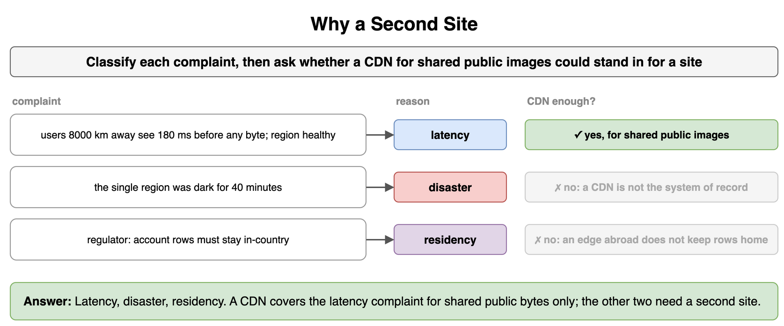
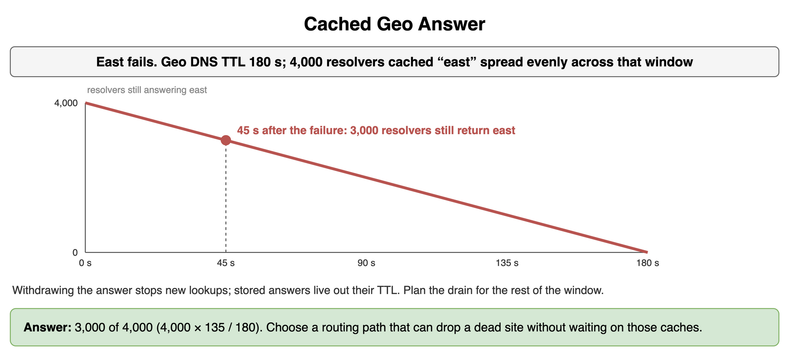
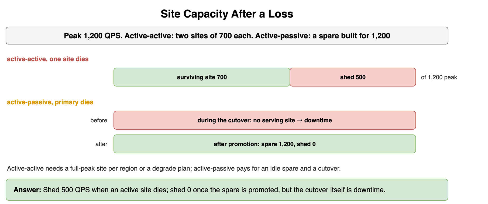
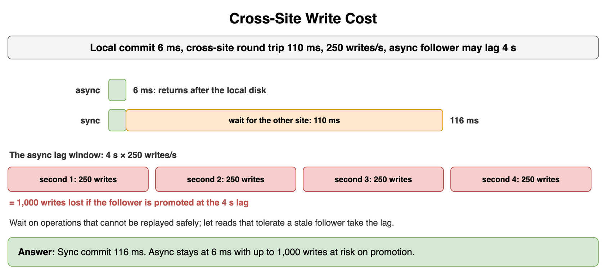
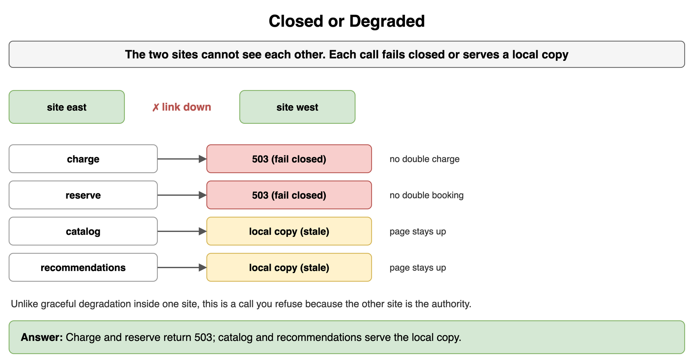
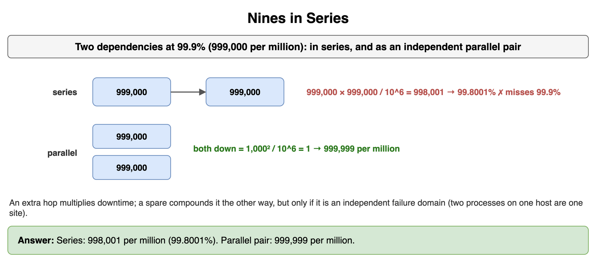
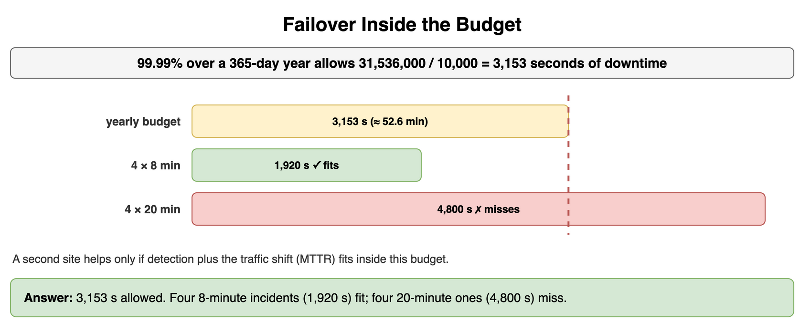
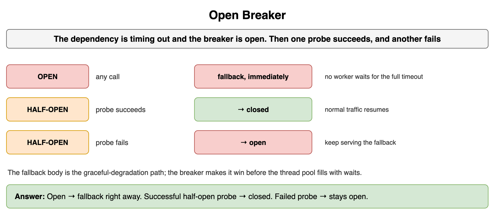

# High Availability and Reliability — Drills

Original practice for site-level failure and the availability targets that justify it. Each card is one exercise: commit to an answer, then check it. The numbers are invented for study. Quorum design, CDN cache rules, and the log pipeline stay in their own topics.

## Why a Second Site

Three complaints arrived. Classify each as latency, disaster, or residency. If the only slow bytes are shared public images, can a CDN stand in for a second site on the latency complaint? On the residency complaint?

```python
COMPLAINTS = [
    "users 8000 km away see 180 ms before any byte, region is healthy",
    "the single region was dark for 40 minutes",
    "the regulator requires account rows to stay in-country",
]
```

**Answer:** The far users are latency, the dark region is disaster, and the in-country rows are residency. A CDN can carry shared public images for the latency complaint. It cannot be the system of record after the region goes dark, and an edge in another country does not keep account rows in-country. Those two need a site.

```python
COMPLAINTS = [
    "users 8000 km away see 180 ms before any byte, region is healthy",
    "the single region was dark for 40 minutes",
    "the regulator requires account rows to stay in-country",
]


def reason(complaint: str) -> str:
    if "km" in complaint:
        return "latency"
    if "dark" in complaint:
        return "disaster"
    return "residency"


def cdn_is_enough(kind: str, shared_public_only: bool) -> bool:
    return kind == "latency" and shared_public_only


kinds = [reason(complaint) for complaint in COMPLAINTS]
print(kinds, cdn_is_enough("latency", True), cdn_is_enough("residency", True))
# ['latency', 'disaster', 'residency'] True False
```



*Source: [`diagrams/high-availability-drills.drawio`](/content/09_System_Design_Interview/03_High_Availability_and_Reliability/diagrams/high-availability-drills.drawio), page 1.*

## Cached Geo Answer

Geo DNS for the east site uses a 180 second TTL. 4,000 resolvers cached that answer uniformly across the window. East fails. 45 seconds later, how many resolvers still return east?

```python
TTL_S = 180
CACHED = 4_000
ELAPSED_S = 45
```

**Answer:** 3,000 resolvers still hand out east. Withdrawing the DNS answer stops new lookups. It leaves a record a resolver already stored in place until that record's TTL ends. Plan the drain for the rest of the window, or pick a routing path that can drop a dead site without waiting on those caches. Per-request balancing inside a live site is a different layer.

```python
TTL_S = 180
CACHED = 4_000
ELAPSED_S = 45

still_east = CACHED * (TTL_S - ELAPSED_S) // TTL_S
print(still_east)  # 3000
```



*Source: [`diagrams/high-availability-drills.drawio`](/content/09_System_Design_Interview/03_High_Availability_and_Reliability/diagrams/high-availability-drills.drawio), page 2.*

## Site Capacity After a Loss

Peak traffic is 1,200 QPS. In the active-active plan each site is built for 700 QPS and both are serving. In the active-passive plan the spare is built for the full 1,200 QPS. How much QPS do you shed when one active site dies, and how much once the spare has been promoted?

```python
PEAK = 1_200
EACH = 700
SPARE = 1_200
```

**Answer:** The active-active pair sheds 500 QPS, because the surviving site was built for 700. The full-size spare sheds 0 once promotion finishes. Until that cutover completes, the live site is the only capacity, so the failover delay is downtime even though the spare is large enough. Active-active spends the hardware on both regions and needs either a full-peak site or a degrade plan. Active-passive spends it on an idle spare and a cutover.

```python
PEAK = 1_200
EACH = 700
SPARE = 1_200

shed_when_one_active_dies = PEAK - EACH
shed_when_passive_is_promoted = max(0, PEAK - SPARE)
print(shed_when_one_active_dies, shed_when_passive_is_promoted)  # 500 0
```



*Source: [`diagrams/high-availability-drills.drawio`](/content/09_System_Design_Interview/03_High_Availability_and_Reliability/diagrams/high-availability-drills.drawio), page 3.*

## Cross-Site Write Cost

A local commit is 6 ms. The round trip to the other site is 110 ms. The service takes 250 writes/s, and the async follower is allowed to lag 4 seconds. What is the synchronous commit time, and how many writes are in the lag window?

```python
LOCAL_MS = 6
RTT_MS = 110
WRITES_PER_S = 250
LAG_S = 4
```

**Answer:** A synchronous commit takes 116 ms. An asynchronous commit stays at 6 ms and can lose 1,000 writes if you promote the follower at the 4 second lag. Put the wait on operations that cannot be replayed safely, and leave the lag on reads that tolerate a stale follower. The quorum that implements the wait belongs to Consistency and Replication.

```python
LOCAL_MS = 6
RTT_MS = 110
WRITES_PER_S = 250
LAG_S = 4

sync_ms = LOCAL_MS + RTT_MS
at_risk = WRITES_PER_S * LAG_S
print(sync_ms, at_risk)  # 116 1000
```



*Source: [`diagrams/high-availability-drills.drawio`](/content/09_System_Design_Interview/03_High_Availability_and_Reliability/diagrams/high-availability-drills.drawio), page 4.*

## Closed or Degraded

The two sites cannot see each other. For each operation, does the call fail closed or serve a local copy?

```python
POLICY = {
    "charge": "closed",
    "reserve": "closed",
    "catalog": "degraded",
    "recs": "degraded",
}
```

**Answer:** Charge and reserve return 503. Catalog and recommendations serve the local copy. A fail-closed call avoids a double charge or a double booking while the sites are split. A degraded call keeps the page up on data the local site already has. Graceful degradation inside one site is the feature you drop. This is the call you refuse because the other site is the authority.

```python
POLICY = {
    "charge": "closed",
    "reserve": "closed",
    "catalog": "degraded",
    "recs": "degraded",
}


def during_split(op: str) -> str:
    if POLICY[op] == "closed":
        return "503"
    return "local-stale"


print(during_split("charge"), during_split("reserve"), during_split("catalog"), during_split("recs"))
# 503 503 local-stale local-stale
```



*Source: [`diagrams/high-availability-drills.drawio`](/content/09_System_Design_Interview/03_High_Availability_and_Reliability/diagrams/high-availability-drills.drawio), page 5.*

## Nines in Series

Each of two dependencies is 99.9% available, measured in millionths (999,000 per 1,000,000). What is the series availability, and what is the availability of an independent parallel pair that fails only when both are down?

```python
ONE = 999_000
```

**Answer:** In series the product is 998,001 per million, 99.8001%, which misses a 99.9% target. In parallel, both-down is 1 per million, so availability is 999,999 per million. An extra hop multiplies downtime. A spare compounds it the other way. The spare has to be an independent failure domain; two processes on one host are a single site.

```python
ONE = 999_000

series = ONE * ONE // 1_000_000
both_down = (1_000_000 - ONE) ** 2 // 1_000_000
parallel = 1_000_000 - both_down
print(series, parallel)  # 998001 999999
```



*Source: [`diagrams/high-availability-drills.drawio`](/content/09_System_Design_Interview/03_High_Availability_and_Reliability/diagrams/high-availability-drills.drawio), page 6.*

## Failover Inside the Budget

Use a 365-day year. A 99.99% target allows how many seconds of downtime? Four incidents at 8 minutes each, and four at 20 minutes each: which schedule fits?

```python
YEAR_S = 365 * 24 * 3600
```

**Answer:** Integer division gives 3,153 seconds, just under the 52.6 minutes on the nines card. Four incidents of 8 minutes use 1,920 seconds and fit. Four of 20 minutes use 4,800 seconds and miss. A second site improves the budget only after detection plus the traffic shift sits inside it. That interval is MTTR.

```python
YEAR_S = 365 * 24 * 3600
ALLOWED_S = YEAR_S // 10_000


def failover_s(minutes: int, incidents: int) -> int:
    return minutes * 60 * incidents


print(ALLOWED_S, failover_s(8, 4), failover_s(20, 4))
# 3153 1920 4800
```



*Source: [`diagrams/high-availability-drills.drawio`](/content/09_System_Design_Interview/03_High_Availability_and_Reliability/diagrams/high-availability-drills.drawio), page 7.*

## Open Breaker

The downstream dependency is timing out. The breaker is open. One later probe succeeds, and another probe fails. What does the caller get in each case?

```python
STATES = ("open", "half-open", "half-open")
PROBES = (False, True, False)
```

**Answer:** An open breaker returns the fallback immediately, so the caller does not occupy a worker for the full timeout. A successful half-open probe closes the breaker. A failed probe leaves it open. The fallback body is the graceful-degradation path. The breaker is what makes that path win before the thread pool fills with waits.

```python
def response(state: str, probe_ok: bool) -> str:
    if state == "open":
        return "fallback"
    if state == "half-open" and probe_ok:
        return "closed"
    if state == "half-open":
        return "open"
    return "pass"


print(response("open", False), response("half-open", True), response("half-open", False))
# fallback closed open
```



*Source: [`diagrams/high-availability-drills.drawio`](/content/09_System_Design_Interview/03_High_Availability_and_Reliability/diagrams/high-availability-drills.drawio), page 8.*
