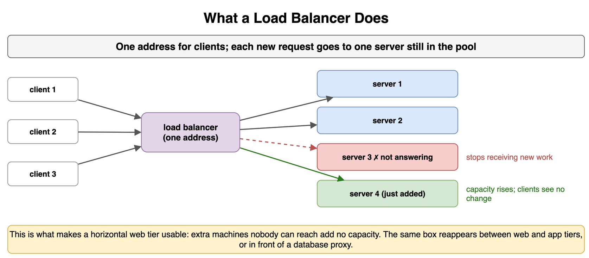
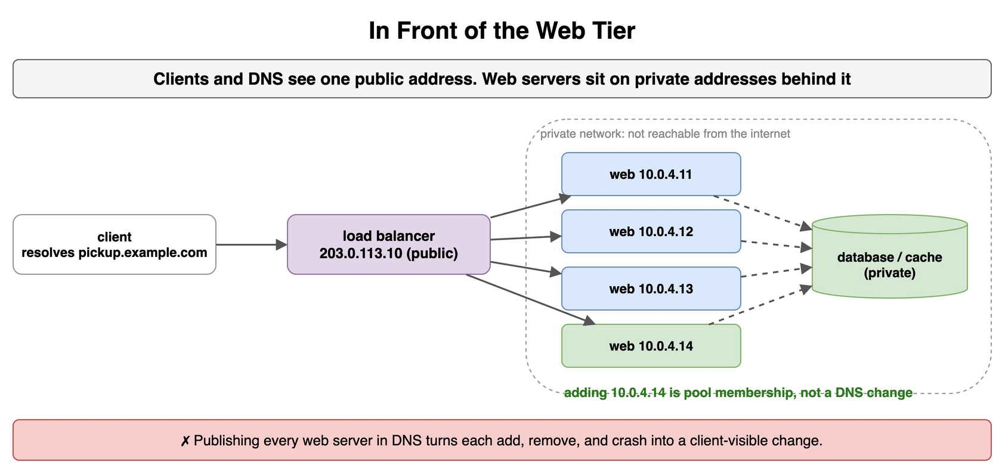
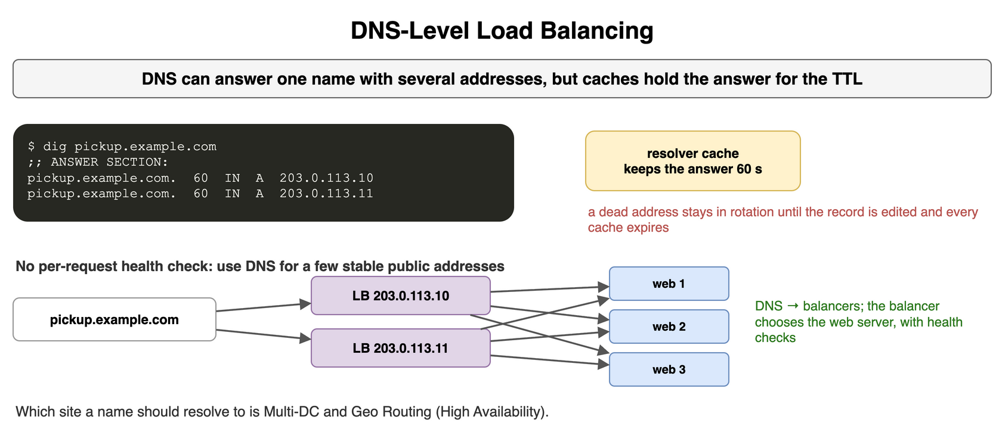
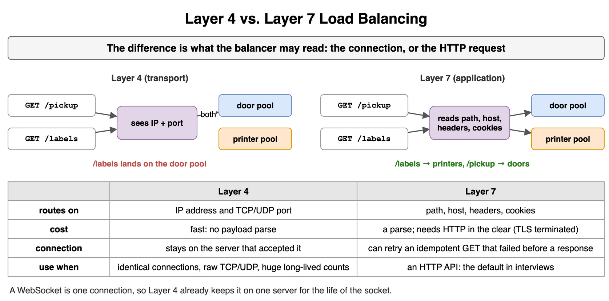
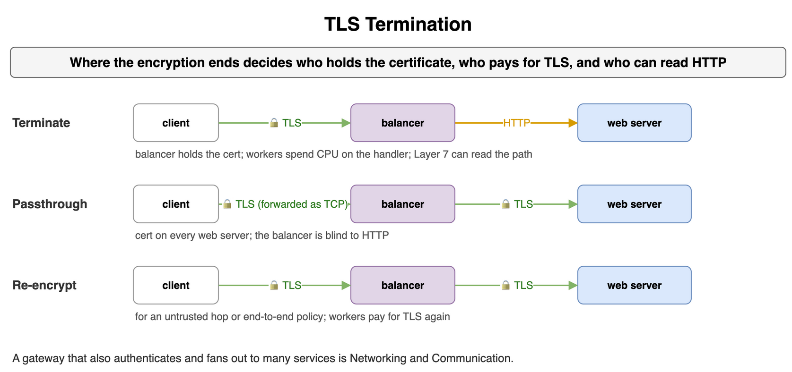
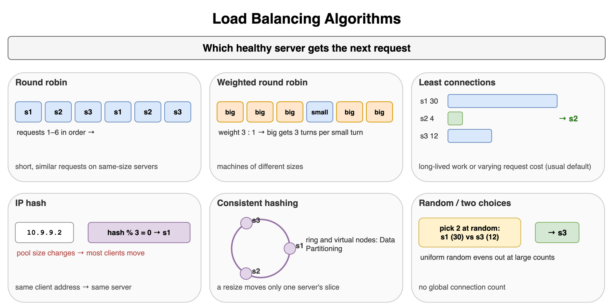
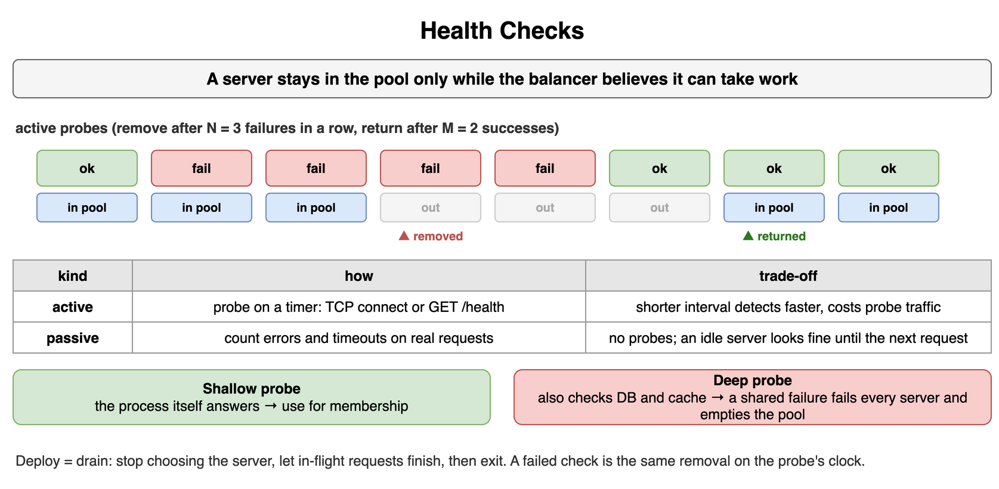
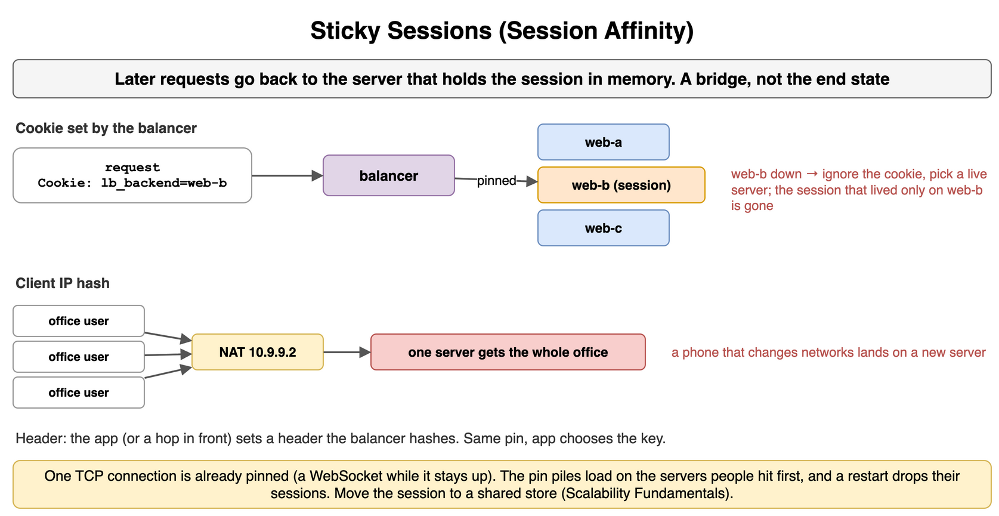
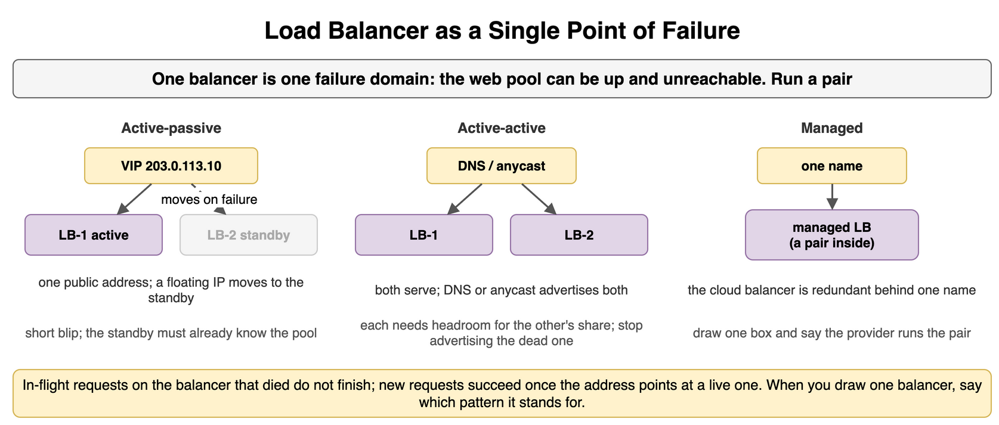

## What a Load Balancer Does

A load balancer accepts work for a pool and hands each new request to one server that is still in that pool. Adding a server raises capacity. A server that stops answering stops receiving new work. Clients keep a single address while the pool changes underneath it.

That is the step that makes a horizontal web tier usable. Extra machines nobody can reach do not add capacity. The same box shows up again between a web tier and an application tier, or in front of a database proxy. The cards here are the balancer in front of the web tier: where it sits, how it chooses a server, and how you keep that box from being the outage.



*Source: [`diagrams/load-balancing.drawio`](/content/09_System_Design_Interview/04_Load_Balancing/diagrams/load-balancing.drawio), page 1.*

## In Front of the Web Tier

Clients and DNS use the load balancer's public address. The web servers use private addresses and accept traffic from the balancer, not from the internet. Adding `10.0.4.14` to the pool does not change the name the client resolves.

```text
Client
  → 203.0.113.10     public address of the load balancer
    → 10.0.4.11      private address of one web server
      → database or cache, also private
```

Publishing every web server in DNS makes each add, remove, and crash a client-visible change. The balancer turns those into pool membership. A later hop (web to app, or app to a database proxy) can use a private balancer the same way. Clients still need the public one in front of the web tier.



*Source: [`diagrams/load-balancing.drawio`](/content/09_System_Design_Interview/04_Load_Balancing/diagrams/load-balancing.drawio), page 2.*

## DNS-Level Load Balancing

DNS can spread clients by answering the same name with more than one address. Resolvers and clients cache that answer for the TTL, so a change waits out the caches that already stored it.

```text
$ dig pickup.example.com
;; ANSWER SECTION:
pickup.example.com.  60  IN  A  203.0.113.10
pickup.example.com.  60  IN  A  203.0.113.11
```

That is a coarse tool. It has no per-request health check: a dead address stays in rotation until someone edits the record and every cache expires. Use it to publish a few stable public addresses, usually the load balancers. Let the balancer choose the web server. Which site a name should resolve to is [Multi-DC and Geo Routing](../03_High_Availability_and_Reliability/).



*Source: [`diagrams/load-balancing.drawio`](/content/09_System_Design_Interview/04_Load_Balancing/diagrams/load-balancing.drawio), page 3.*

## Layer 4 vs. Layer 7 Load Balancing

The two layers differ in what the balancer is allowed to read.

```text
Layer 4 (transport):
  Routes on IP address and TCP or UDP port.
  Does not read the payload.
  One connection stays on the server that accepted it.
  Fast, and enough when every connection is the same kind of work.
  Cannot choose a pool from a URL path, a host header, or a cookie.

Layer 7 (application):
  Routes on the HTTP request: path, host, headers, cookies.
  /pickup can go to the door pool and /labels to the printer pool.
  Costs a parse, and needs the HTTP bytes in the clear on the balancer.
  Can retry an idempotent GET that failed before a response was sent.
```

An HTTP API in an interview is Layer 7 unless the problem is raw TCP, UDP, or a huge number of long-lived connections where the path does not matter. A WebSocket is one connection, so Layer 4 already keeps it on one server for the life of that socket.



*Source: [`diagrams/load-balancing.drawio`](/content/09_System_Design_Interview/04_Load_Balancing/diagrams/load-balancing.drawio), page 4.*

## TLS Termination

Clients speak TLS to the load balancer. The balancer holds the certificate, decrypts, and forwards HTTP to a private web server. The web tier spends its CPU on the handler. Rotating the certificate is a change on the balancer.

```text
Terminate:     client --TLS--> balancer --HTTP--> web server
Passthrough:   client --TLS--> web server, balancer forwards TCP
Re-encrypt:    client --TLS--> balancer --TLS--> web server
```

Termination is what lets a Layer 7 balancer read the path and the cookie. Passthrough leaves the certificate on every web server and leaves the balancer blind to HTTP. Re-encrypt when the hop to the web server is not a network you trust, or when policy says the payload stays encrypted end to end. The worker then pays for TLS again, so the CPU win is gone. A gateway that also authenticates and fans out to many services is [Networking and Communication](../10_Networking_and_Communication/).



*Source: [`diagrams/load-balancing.drawio`](/content/09_System_Design_Interview/04_Load_Balancing/diagrams/load-balancing.drawio), page 5.*

## Load Balancing Algorithms

The algorithm is which healthy server gets the next request.

```text
Round robin
  Next server in order. Even when servers match and requests cost about the same.

Weighted round robin
  A larger weight gets more turns. Use it when the machines are different sizes.

Least connections
  The server with the fewest open connections.
  Fits long-lived work, where arrivals and current load are different numbers.

IP hash
  Hash the client address onto the pool. The same address keeps landing on the same server.
  hash modulo pool size moves most clients when the pool size changes.

Consistent hashing
  A ring: adding or removing a server moves the slice of keys that server owns.

Random
  A uniform pick. At large request counts the servers even out.
  The less loaded of two random servers is steadier when you do not keep a global connection count.
```

Least connections is the usual default when request cost varies or connections stay open. Round robin is the default when a request is short and every server is the same size. The ring and virtual nodes are [Data Partitioning and Consistent Hashing](../08_Data_Partitioning_and_Consistent_Hashing/).



*Source: [`diagrams/load-balancing.drawio`](/content/09_System_Design_Interview/04_Load_Balancing/diagrams/load-balancing.drawio), page 6.*

## Health Checks

A server stays in the pool only while the balancer still believes it can take work.

```text
Active
  The balancer probes on a timer: a TCP connect, or GET /health.
  N failures in a row remove the server. M successes in a row return it.
  A shorter interval detects faster and costs probe traffic.

Passive
  The balancer counts errors and timeouts on real requests.
  No extra probes. A server with no traffic looks fine until the next request.

Shallow probe
  The process itself answers. Use this for membership.

Deep probe
  The process also checks the database and the cache.
  A shared dependency that fails will fail every web server together and empty the pool.
```

```json
GET /health
200
{"status": "up"}
```

A deploy is a drain. The balancer stops choosing that server, in-flight requests finish, then the process exits. A failed health check is the same removal, on the probe's clock, for a server you did not plan to stop.



*Source: [`diagrams/load-balancing.drawio`](/content/09_System_Design_Interview/04_Load_Balancing/diagrams/load-balancing.drawio), page 7.*

## Sticky Sessions (Session Affinity)

Sticky sessions send later requests from the same client to the server that holds that client's session in memory. The pin is how the balancer recognizes the client. The place the session document should eventually live is the [Shared Session Store](../02_Scalability_Fundamentals/).

```text
Cookie set by the balancer
  The first response sets lb_backend=web-b.
  The next request carries the cookie. The balancer chooses web-b.
  Works for many clients behind one address.
  web-b is down: ignore the cookie and choose a live server.
  The bytes that existed only on web-b are gone.

Client IP hash
  No cookie. The source address selects the server.
  Every client behind one NAT address shares a server.
  A client whose address changes (a phone moving networks) lands on a new server.

Header
  The app, or a hop in front, sets a header the balancer has agreed to hash.
  Same pin as a cookie. The app chooses the key.
```

One TCP connection is already pinned for its lifetime. That covers a WebSocket while the socket stays up. A new connection from the same person is a new choice unless a cookie, a header, or an IP hash says otherwise.

The pin piles load onto the servers people happened to hit first. A restart or a scale-in drops the sessions those servers held. Treat the pin as a bridge while the session still sits in one process.



*Source: [`diagrams/load-balancing.drawio`](/content/09_System_Design_Interview/04_Load_Balancing/diagrams/load-balancing.drawio), page 8.*

## Load Balancer as a Single Point of Failure

One load balancer is one failure domain in front of a healthy web pool. The pool can be up and unreachable. Production runs a pair, or uses a managed balancer that is already a pair.



*Source: [`diagrams/load-balancing.drawio`](/content/09_System_Design_Interview/04_Load_Balancing/diagrams/load-balancing.drawio), page 9.*

```text
Active-passive
  One public address. A floating IP moves to the standby when the primary stops.
  Failover is a short blip. The standby must already know the pool.

Active-active
  Both balancers serve. DNS or anycast advertises both.
  Each one needs headroom for the share it will absorb.
  Something has to stop advertising the one that died.

Managed
  The cloud balancer is redundant behind one name.
  Draw one box. Say that the provider runs the pair.
```

In-flight requests on the balancer that died do not finish. New requests succeed once the address points at a live balancer. A second data center is a separate decision, on [High Availability and Reliability](../03_High_Availability_and_Reliability/). When you draw a single balancer, say which of the three patterns above it stands for.
