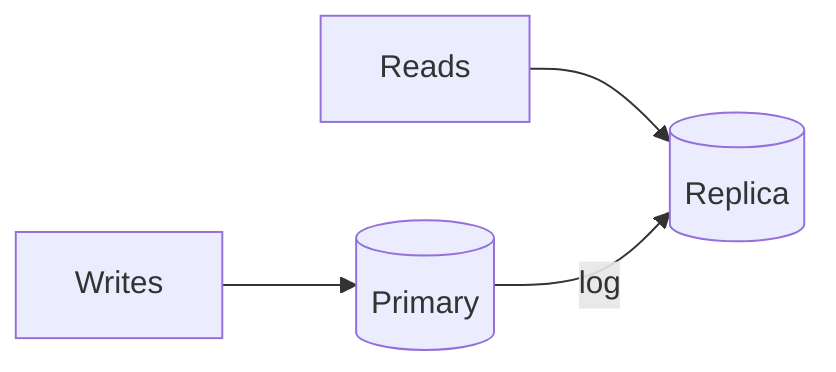

## Relational Database

Web servers can be replaced because they do not hold the durable rows. The database is a separate tier that does. A relational database stores those rows in tables with a declared schema. A foreign key rejects a reservation whose member does not exist. SQL is how you join, filter, and aggregate. PostgreSQL and MySQL are the usual engines here.

Start here when rows share a shape, queries join them, and a write must leave constraints intact. One primary accepts those writes. The cards below are how that primary grows: a bigger machine, replicas for reads, then shards. Other access paths are [Databases NoSQL and Specialized](../07_Databases_NoSQL_and_Specialized/).

## Choosing Relational or NoSQL

Choose from the access path. Use a relational primary when rows share a schema, the query joins or aggregates, and a write must keep foreign keys, uniqueness, and balances intact. Replicas then take reads.

Use another store when the shape varies per key, the read is always one whole document, or the write rate cannot stay on one primary and you can drop cross-row transactions. Those stores are [Databases NoSQL and Specialized](../07_Databases_NoSQL_and_Specialized/). A cache of a hot row is [Caching](../05_Caching/), not a second database. Sharding a relational primary is still relational, and it gives up the cheap join across shards. A key-value store does not remove that trade. It starts from a path that was already one key.

## ACID Properties

ACID describes a transaction on the node that runs it. It is not a promise about replicas. The C here is not the C in CAP.

Atomicity means the statements commit together or not at all. A transfer cannot leave only the debit. The write-ahead log undoes a transaction that did not commit. Consistency means commit leaves declared constraints intact: foreign keys, unique keys, checks. "Every replica has the latest row" is [Consistency and Replication](../09_Consistency_and_Replication/).

Isolation is a level. Read committed, the PostgreSQL default, hides other transactions' uncommitted rows. A later statement in the same transaction can see a row that committed in between, including a new row (a phantom). A balance read in application code, added to, and written back can lose the other deposit. `UPDATE ... SET balance = balance + 10` keeps that addition inside one locked statement.

Repeatable read in the SQL standard still allows phantoms. PostgreSQL's repeatable read is snapshot isolation: one snapshot for the transaction, and a conflicting update can fail so the application retries. InnoDB's repeatable read blocks the usual phantom on locking reads with next-key locks. Neither engine is the weaker ANSI level. Serializable matches some serial order and may abort one side. The application retries the abort.

Durability means commit returns after this node's log is on durable storage. A crash of this process can replay it. A commit that never reached another node can still disappear if this node is discarded. Failover and Promotion is that case.

## Normalization and Denormalization

Normalization stores each fact once. A reservation holds `member_id`, not a copy of the email. Changing the email is one row, and a foreign key rejects a reservation whose member is gone. Third normal form is the usual stop: every non-key column depends on the key, not on another non-key column.

Denormalization copies a fact so a read does not join. The reservation stores the email as it was at booking. The write must update every copy. A missed copy stays wrong, and nothing expires it. A cache is disposable. A denormalized column is durable. Start normalized. Copy a fact when a measured join is the latency, or when the joined rows would sit on different shards.

## Indexing

An index is a second structure, usually a B-tree, ordered by one or more columns. A lookup or a range on those columns is a tree walk. A table write also updates every index that includes a changed column.

A composite index on `(member_id, created_at)` is ordered by `member_id`, and by `created_at` only inside one member. It serves `member_id = 42`, including a `created_at` range or `ORDER BY created_at`. It does not serve `created_at` alone. A range on the leading column walks that range and then filters later columns. It does not treat those later columns as a contiguous equality. Put equality columns first and the range or sort column last.

```sql
CREATE INDEX reservations_member_created
    ON reservations (member_id, created_at DESC);
```

Some planners skip a missing leading column or combine two indexes. That is a plan you might get, not one to count on when the leading column has many values. A covering index holds every column the query returns, so the engine can skip the row fetch. `SELECT *` almost never covers, and wider indexes cost more on writes. A hash index answers equality only, not a range or an `ORDER BY`. Index selective columns in `WHERE`, `JOIN`, and `ORDER BY`. Each extra index adds log, cache pressure, and work on insert, update, and delete.

## Vertical Database Scaling

A larger machine gives the primary more RAM, more cores, or faster disks. The usual win is the buffer pool. If the hot indexes and rows fit in RAM, a read is memory. If they do not, the same query waits on disk. Confirm the miss rate on the new size. Do not assume it falls in proportion to the extra RAM.

More cores run more queries at once until they wait on the same lock, the same hot row, or the log flush. Extra cores do not raise the write rate when one of those waits is the ceiling. There is a largest machine, and moving to it often drops connections across a restart or a cutover.

Resize while the data and the measured write rate fit one primary. A read replica adds read capacity and does not make writes faster. A replica with the same small RAM misses the same working set. Sharding is how writes and storage pass one primary, and it breaks statements that used to be local. The stateless form of this choice is [Scalability Fundamentals](../02_Scalability_Fundamentals/).

## Database Replication

One primary accepts writes. Each replica receives that log and applies it in order. Clients send writes to the primary and may send reads to a replica. Until a replica applies a commit, it is behind. That gap is replication lag.

Asynchronous replication acknowledges after the primary's own durable commit. The replica applies later. If that primary is then discarded, commits the replica never received are gone, including commits the client was already told had succeeded.

Synchronous replication to a chosen replica acknowledges only after that replica has the commit. Surviving a crash of the replica requires a flush to its disk, not a copy sitting in memory. The write waits for the network and the replica. If the replica stops answering, writes stall, unless the primary falls back to asynchronous, which opens the loss again. A commit waited on replica A can still be missing if you promote replica B.

Two nodes that both accept writes can commit different values for the same row. How those conflicts resolve, and leaderless quorums, are [Consistency and Replication](../09_Consistency_and_Replication/). One primary avoids the conflict by accepting the write in one place.



## Read Replicas

A read replica is a replica you send reads to. More replicas raise read capacity. They do not raise the primary's write rate, and each one can be behind.

A member who changes a phone number and then reads a replica can see the old number. The commit is on the primary. The replica has not applied it. Three ways to handle the next read:

```text
Primary: the member sees the commit. That read load returns to the primary
for the window. Other members can still see the old row.

One replica, after it has applied the commit: the member sees it once the
lag closes. A later read on a different replica can move backward.

Stale is acceptable: a catalog count. Not a balance they just changed.
```

Seeing your own write and never moving backward are different requirements. Doing both means the primary, or a log position tracked per member. The names are in [Consistency and Replication](../09_Consistency_and_Replication/). Waiting until the replica has applied the commit removes the lag for that read and adds the wait to the write. Waiting only for a flush makes the commit durable there and still serves the older row until apply finishes.

## Failover and Promotion

Promotion makes a replica the primary so writes can continue. It is not immediate. With asynchronous replication it can drop commits the old primary already acknowledged.

A missed heartbeat cannot tell a dead primary from a pause, a full disk, or a network cut. The replica with the most log applied can still lack the latest acknowledged commit. Promote that replica and point the others at its log. Fence the old primary first. Split brain means two nodes accept writes. Moving DNS or a virtual address does not fence anyone: the old node must be unable to commit, by a lease, a storage token, or powering it off. If it returns with commits the new primary lacks, discard those commits. Replaying them forks the log.

Clients move via the proxy, the virtual address, or DNS. DNS can return the old address until the TTL expires, and pools keep old sockets until they reconnect. In-flight transactions abort. A retry can repeat a write the new primary already has, or repeat one that was lost. An idempotency key makes the retry safe.

You lose the acknowledged commits that were not on the replica you promoted. Waiting for one replica to receive the log does not close that gap if you promote a different replica, or if receipt was not a flush. Waiting for the candidate you actually promote to flush, before you acknowledge, keeps those commits. The write pays that round trip. A silent candidate stalls commits or falls back to asynchronous. Site failover is [High Availability and Reliability](../03_High_Availability_and_Reliability/).

## Database Sharding

Sharding puts different rows on different primaries. Each shard has its own log, its own replicas, and its own machine ceiling. Writes scale because two members on two shards do not share a lock or a log. Storage scales because the rows are not all on one disk.

The shard key picks the primary. `hash(member_id) % N` keeps one member's rows together and spreads members a range would clump. A range on `created_at` keeps one date band local and puts today's inserts on the latest shard. A query without the shard key asks every shard.

```text
hash(member_id) % 4     one member stays on one shard
range of created_at     today's inserts share the latest shard
```

Changing `N` under modulo hashing moves almost every row. Consistent hashing, fixed buckets, and how a client finds the shard are [Data Partitioning and Consistent Hashing](../08_Data_Partitioning_and_Consistent_Hashing/).

## Sharding Challenges

Even row counts still leave a hot shard when one member is most of the writes. Splitting that member helps only when the read can merge the pieces. One counter row does not. A time-range key puts current writes on the latest shard while older shards look idle.

`hash % N` copies most rows when you add a shard. Fixed buckets move one bucket. Consistent hashing moves about `1/N` of the keys. The ring and the cutover are [Data Partitioning and Consistent Hashing](../08_Data_Partitioning_and_Consistent_Hashing/). During the copy a row can be on the source, the destination, or both. Two writers without one owner fork it.

A reservation on shard A and a member row on shard B are not one join. Read both and merge, or store the member fields on the reservation. A transaction across shards is not one commit. Two-phase commit adds a coordinator that can fail after one shard has prepared. Prefer a key that already holds every row the transaction must change. A secondary index that is not the shard key is local, so a lookup fans out, or it is another partitioned index you have to maintain.
