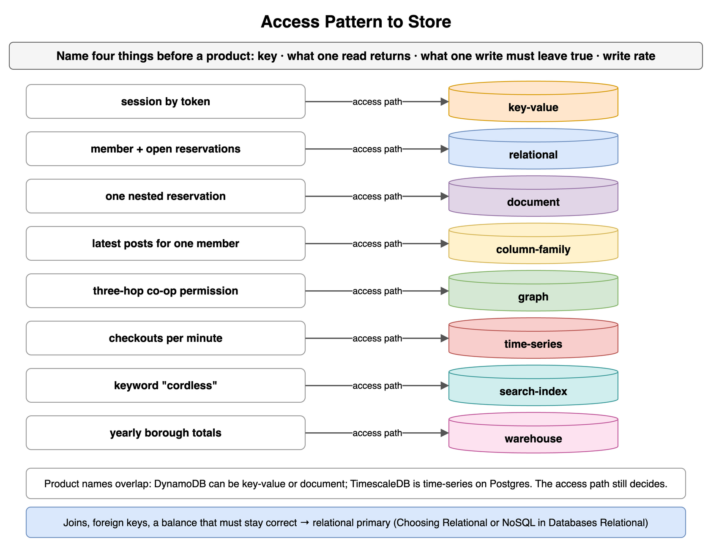
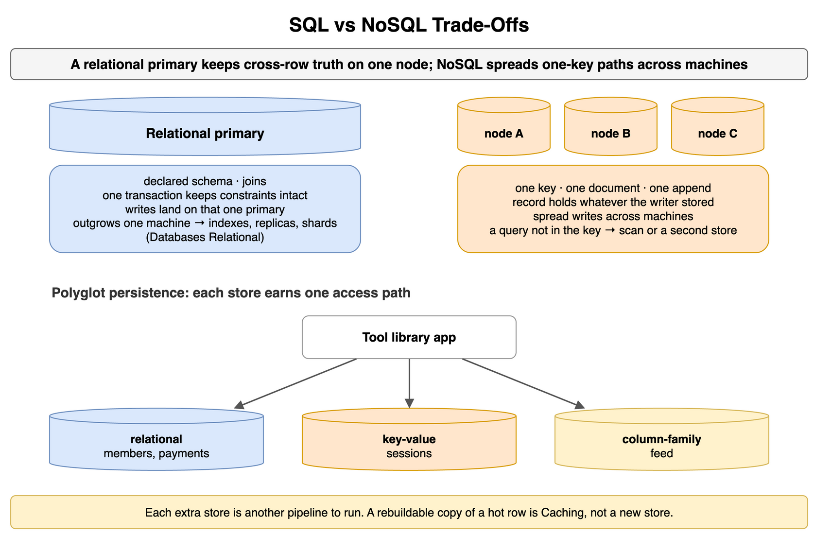
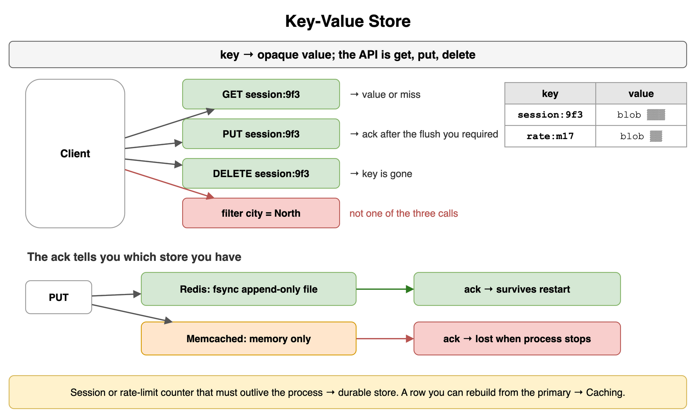
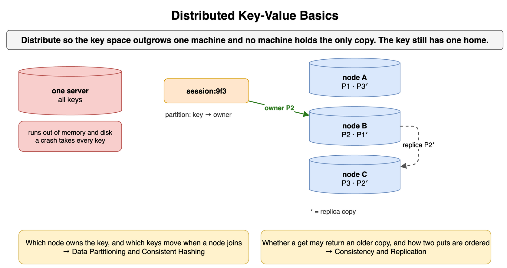
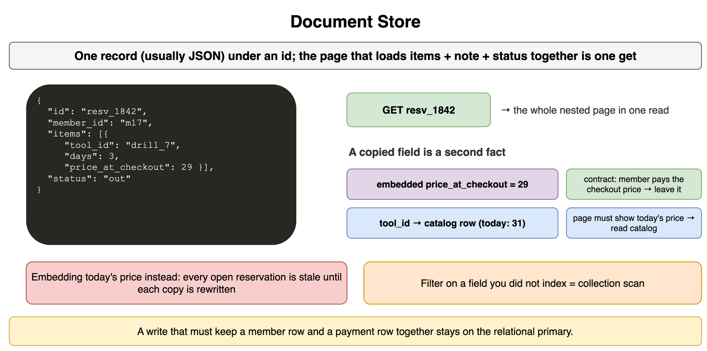
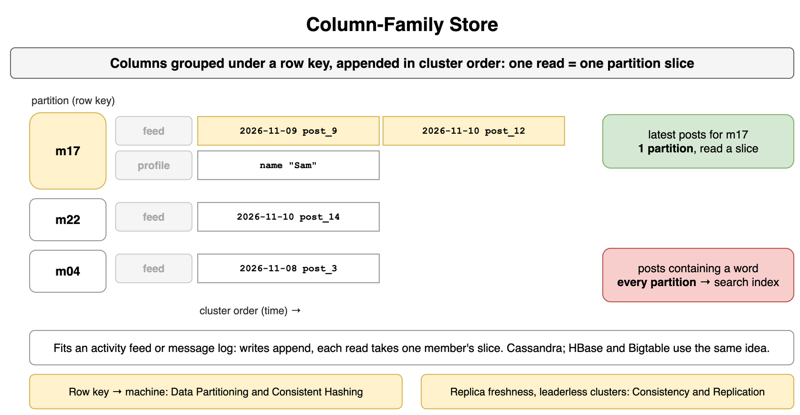
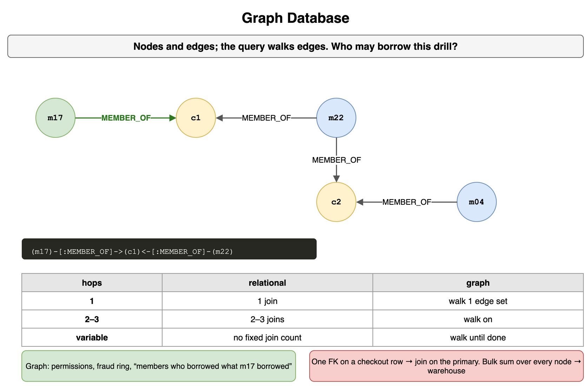
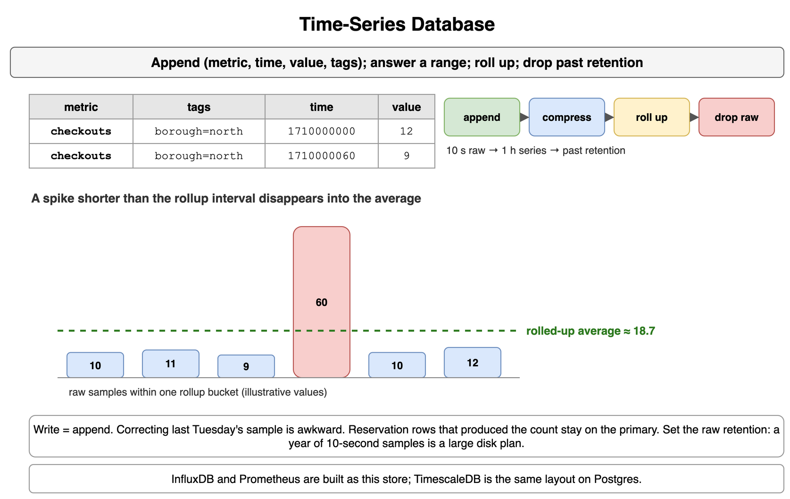
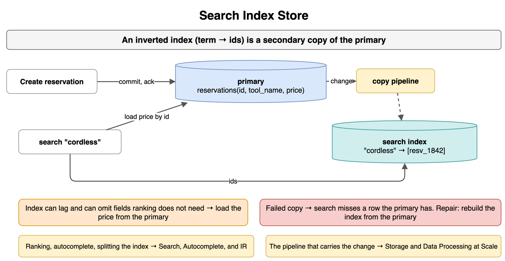
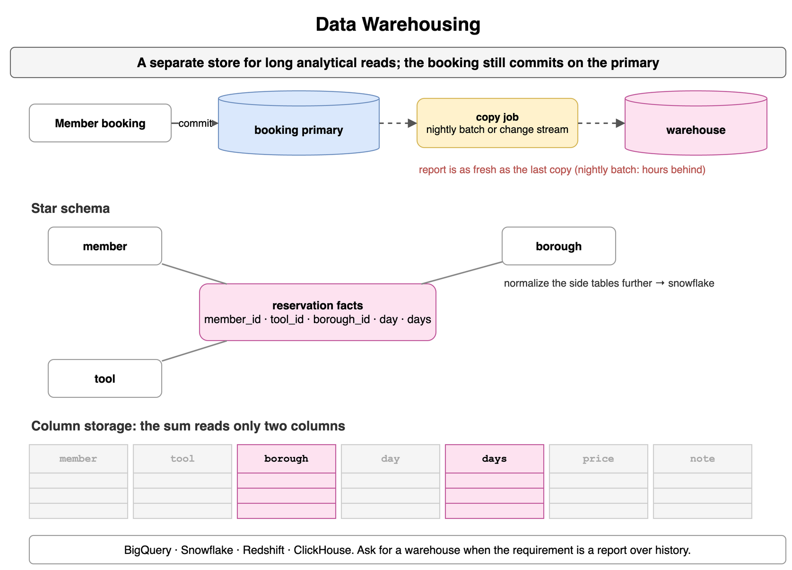

## Access Pattern to Store

Name four things before you name a product: the key, what one read returns, what one write must leave true, and the write rate. A page that loads one member's reservations by `member_id` is a different store from a search box, a three-hop permission walk, or a yearly sum of every reservation.

```text
session by token                 key-value
member + open reservations       relational
one nested reservation           document
latest posts for one member      column family
three-hop co-op permission       graph
checkouts per minute             time-series
keyword "cordless"               search index
yearly borough totals            warehouse
```

Product names overlap. DynamoDB often plays the key-value store or the document store, and TimescaleDB is a time-series layout on Postgres. The access path still decides. Joins, foreign keys, and a balance that must stay correct belong on a relational primary. That choice is Choosing Relational or NoSQL in [Databases Relational](../06_Databases_Relational/).



*Source: [`diagrams/databases-nosql.drawio`](/content/09_System_Design_Interview/07_Databases_NoSQL_and_Specialized/diagrams/databases-nosql.drawio), page 1.*

## SQL vs NoSQL Trade-Offs

A relational primary keeps a declared schema, joins, and a transaction that leaves constraints intact on the node that ran it. Use it when rows share a shape and one write touches more than one of them. Those writes land on that primary until the data or the rate outgrows one machine. Indexing, replicas, and sharding that primary are [Databases Relational](../06_Databases_Relational/).

A NoSQL store takes a path that is already one key, one document, or one append, and it can spread those writes across machines. The record holds whatever the writer stored. A query you did not build into the key becomes a scan, or a second store. Keeping the relational primary for members and payments, a key-value store for sessions, and a column family for the feed is polyglot persistence: each store earns one access path, and each extra store is another pipeline to run. A rebuildable copy of a hot row is [Caching](../05_Caching/).



*Source: [`diagrams/databases-nosql.drawio`](/content/09_System_Design_Interview/07_Databases_NoSQL_and_Specialized/diagrams/databases-nosql.drawio), page 2.*

## Key-Value Store

A key-value store maps a key to an opaque value. The API is get, put, and delete. In that API the value is a blob: the caller gets the whole value, or a miss. A city filter or a join is not one of the three calls. On one server the whole key space lives in that process. The same three calls are what a distributed store still offers.

A put that must survive a restart returns only after the flush or the replica you required. Redis can fsync its append-only file before that ack, and the same process can evict keys when memory is full. Memcached keeps values in memory and loses them when the process stops. A session or a rate-limit counter that must outlive the process belongs in the durable store. A reservation row you can rebuild from the primary belongs in [Caching](../05_Caching/). The method names can match. The ack is what tells you which store you have.

```text
GET    session:9f3   → value or miss
PUT    session:9f3   → ack after the flush you required
DELETE session:9f3   → key is gone
```



*Source: [`diagrams/databases-nosql.drawio`](/content/09_System_Design_Interview/07_Databases_NoSQL_and_Specialized/diagrams/databases-nosql.drawio), page 3.*

## Distributed Key-Value Basics

One machine runs out of memory and disk, and a crash of that machine takes every key with it. You distribute so the key space is larger than one machine and so a lost machine is not the only copy. The key still has one home.

Partitioning assigns the key to a machine. Replication keeps another copy of that partition. Finding the owner, and which keys move when a machine joins, is [Data Partitioning and Consistent Hashing](../08_Data_Partitioning_and_Consistent_Hashing/). Whether a get may return an older copy, and how two puts of the same key are ordered, is [Consistency and Replication](../09_Consistency_and_Replication/).



*Source: [`diagrams/databases-nosql.drawio`](/content/09_System_Design_Interview/07_Databases_NoSQL_and_Specialized/diagrams/databases-nosql.drawio), page 4.*

## Document Store

A document store keeps one record, usually JSON, under an id. Fields can differ from one document to the next, and the document can nest the list the page needs. The reservation page that always loads items, a delivery note, and status together is one get.

A copied field is a second fact. Embed the price when the contract is "the member pays the price at checkout," and leave that copy alone when the catalog changes. A page that must show today's price should store `tool_id` and read the catalog row. Embedding today's price instead leaves every open reservation stale until each copy is rewritten. A filter on a field you did not index is a collection scan. A write that must keep a member row and a payment row together stays on the relational primary.

```json
{
  "id": "resv_1842",
  "member_id": "m17",
  "items": [{ "tool_id": "drill_7", "days": 3, "price_at_checkout": 29 }],
  "status": "out"
}
```



*Source: [`diagrams/databases-nosql.drawio`](/content/09_System_Design_Interview/07_Databases_NoSQL_and_Specialized/diagrams/databases-nosql.drawio), page 5.*

## Column-Family Store

A column-family store groups columns under a row key and appends them in cluster order. The layout matches one read: the latest posts for this member, in time order, from one partition. The row can be wide. Cassandra is the usual engine for that feed, and HBase and Bigtable use the same idea. A query that is not the row key plus that order reads every partition.

Use it for an activity feed or a message log, where writes append and each read takes a slice of one member. A report that filters on a word inside the post is a different access path. Replica freshness for that partition, including a leaderless cluster, is [Consistency and Replication](../09_Consistency_and_Replication/). How the row key maps to a machine is [Data Partitioning and Consistent Hashing](../08_Data_Partitioning_and_Consistent_Hashing/).

```text
row m17
  feed:    2026-11-09 post_9 | 2026-11-10 post_12
  profile: name "Sam"
```



*Source: [`diagrams/databases-nosql.drawio`](/content/09_System_Design_Interview/07_Databases_NoSQL_and_Specialized/diagrams/databases-nosql.drawio), page 6.*

## Graph Database

A graph store keeps entities as nodes and relationships as edges, and a query walks the edges. "Who may borrow this drill" can be the member, the co-ops they belong to, and the members of those co-ops. Two or three hops is the product. Each extra hop is another join, and a variable depth has no fixed join count.

Use it when the relationship is the query: permissions, a fraud ring, recommendations that walk "members who borrowed what this member borrowed." One foreign key on a checkout row is a join on the relational primary. A bulk sum over every node is the warehouse.

```text
(m17)-[:MEMBER_OF]->(c1)<-[:MEMBER_OF]-(m22)
```



*Source: [`diagrams/databases-nosql.drawio`](/content/09_System_Design_Interview/07_Databases_NoSQL_and_Specialized/diagrams/databases-nosql.drawio), page 7.*

## Time-Series Database

A time-series store appends points of metric, time, value, and tags, and it answers a range. "Checkouts per minute in this borough" is a scan along one series. The engine compresses similar neighbors, rolls a 10-second series up to an hour, and drops raw points past a retention window. InfluxDB and Prometheus are built as that store. TimescaleDB is the same layout on Postgres, which matters when the rest of the rows already live there.

The write is an append. Correcting last Tuesday's sample is the awkward case. The reservation rows that produced the count stay on the primary. The series is the measurement you query by time. An hourly average is a coarser series, and it leaves out a spike that lasted less than an hour. Set the raw retention. A year of 10-second samples is a large disk plan.

```text
checkouts borough=north 1710000000 12
checkouts borough=north 1710000060  9
```



*Source: [`diagrams/databases-nosql.drawio`](/content/09_System_Design_Interview/07_Databases_NoSQL_and_Specialized/diagrams/databases-nosql.drawio), page 8.*

## Search Index Store

A search index answers which records contain these words. The usual structure is an inverted index from a term to ids. It is a secondary copy. The reservation is created on the primary, and a pipeline copies the fields you search. The reader can find "cordless" and still load the price from the primary, because the index can lag and can omit a field the ranking does not need.

Acknowledge the reservation when the primary commits. A failed copy means search misses a row the primary has, and the repair is to rebuild the index from the primary. Ranking, autocomplete, and how the index is split are [Search, Autocomplete, and Information Retrieval](../18_Search_Autocomplete_and_Information_Retrieval/). The pipeline that carries the change is [Storage and Data Processing at Scale](../13_Storage_and_Data_Processing_at_Scale/).

```text
primary:  reservations(id, tool_name, price)
index:    "cordless" → [resv_1842]
```



*Source: [`diagrams/databases-nosql.drawio`](/content/09_System_Design_Interview/07_Databases_NoSQL_and_Specialized/diagrams/databases-nosql.drawio), page 9.*

## Data Warehousing

A warehouse is a separate store for long analytical reads. The primary serves the member who is booking a tool. A sum of a year of reservations by borough would compete with that booking. Column storage reads the borough and the day count without the rest of the row. A star schema puts those reservation facts in one table and member, tool, and borough in smaller tables beside it. Normalizing those side tables further is a snowflake schema. BigQuery, Snowflake, Redshift, and ClickHouse are the usual engines.

The booking still commits on the primary. The warehouse holds a copy, and the report is as fresh as that copy. A nightly batch is hours behind. The job that moves the rows, batch or change stream, is [Storage and Data Processing at Scale](../13_Storage_and_Data_Processing_at_Scale/). Ask for a warehouse when the requirement is a report over history.



*Source: [`diagrams/databases-nosql.drawio`](/content/09_System_Design_Interview/07_Databases_NoSQL_and_Specialized/diagrams/databases-nosql.drawio), page 10.*
