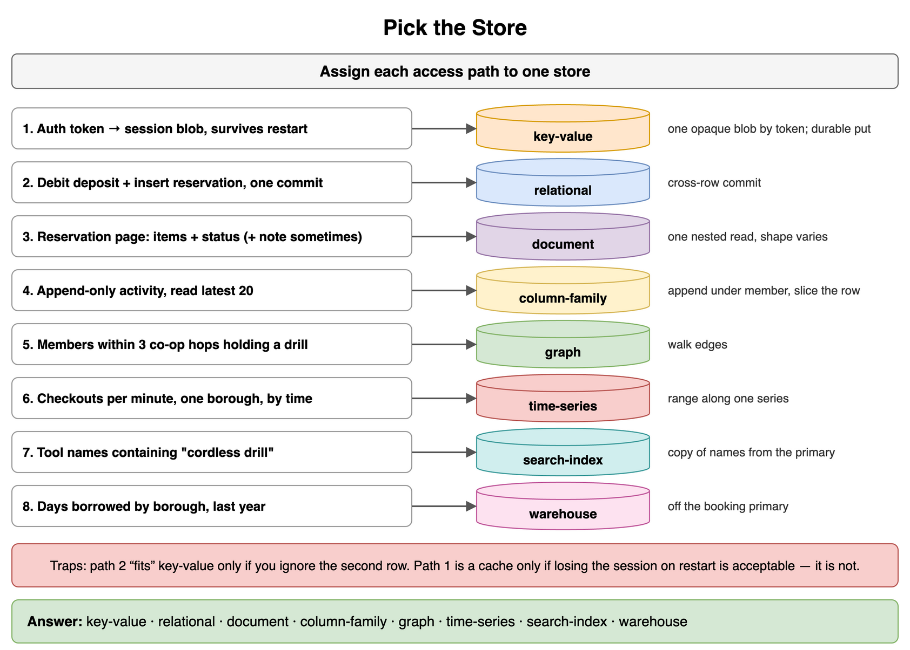
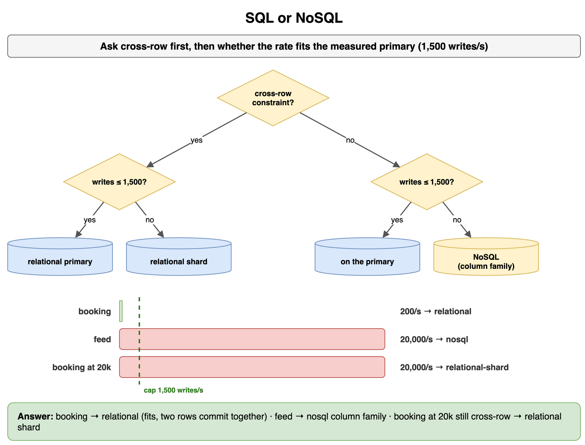
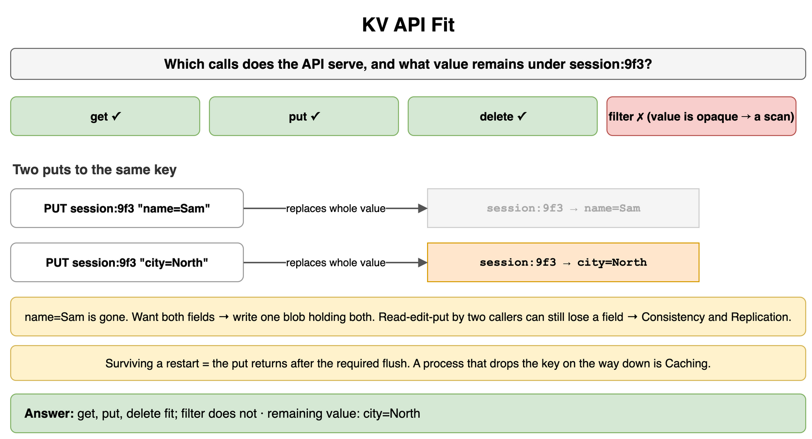
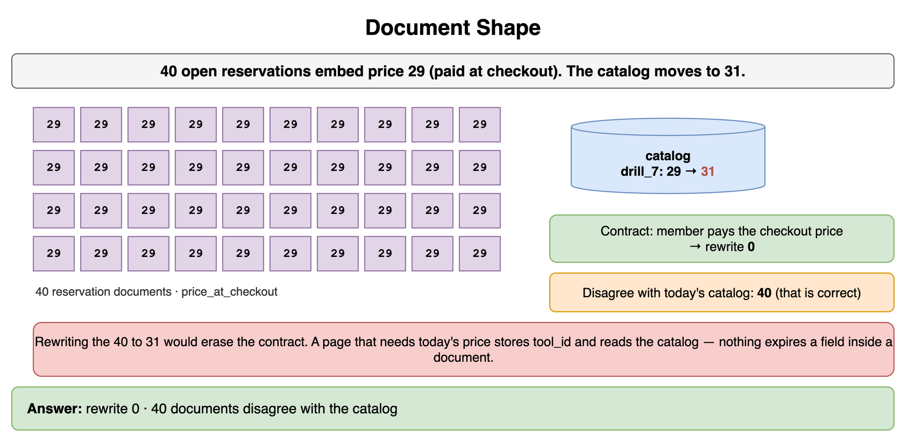
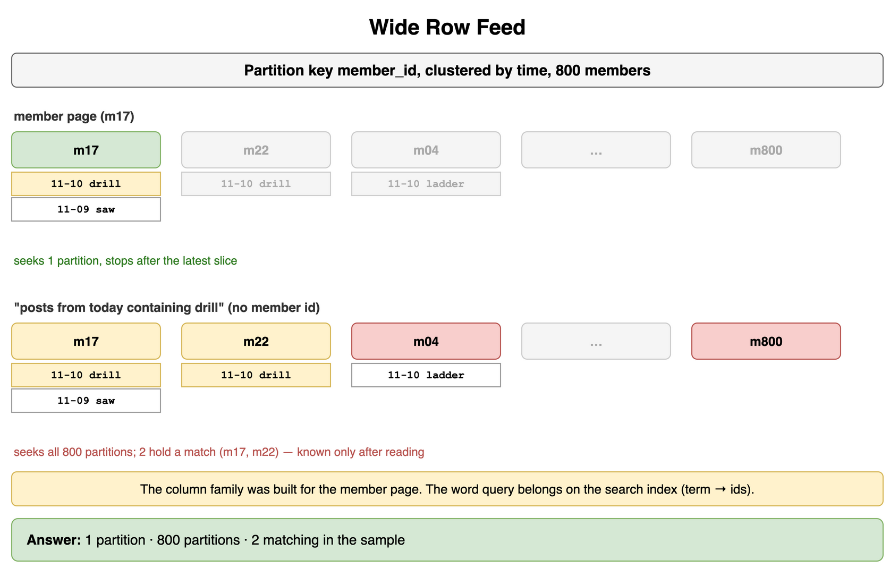
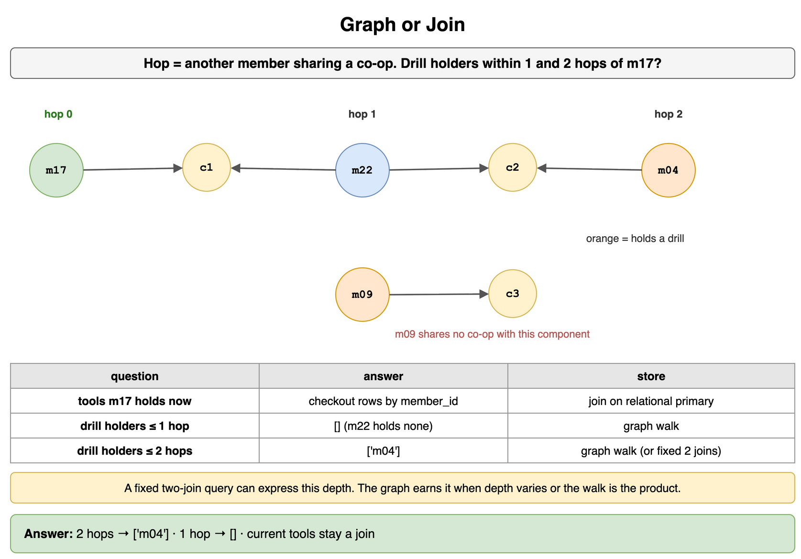
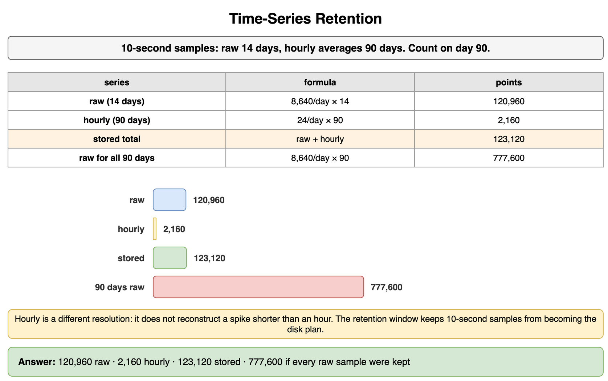
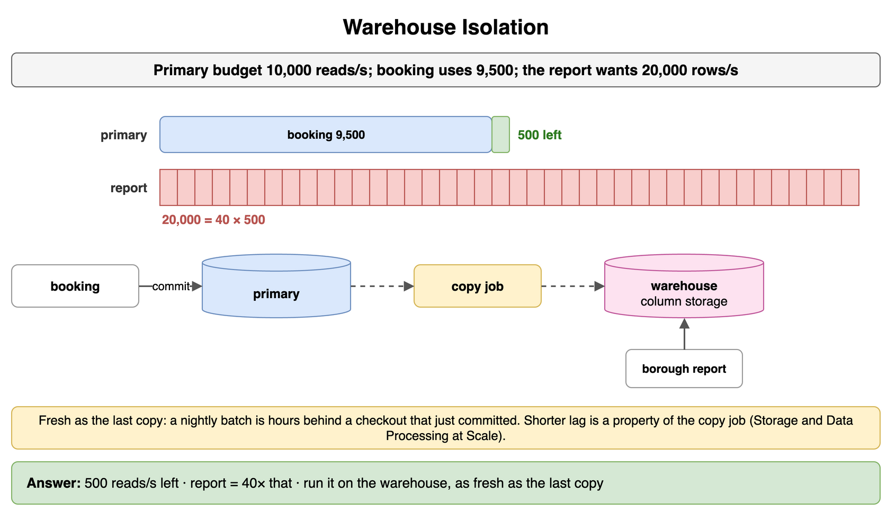

# Databases — NoSQL and Specialized — Drills

Original practice for picking a store from the access path. Each card is one exercise: commit to an answer, then check it. The numbers are invented for a neighborhood tool library. Joins on the primary stay in Databases Relational. The ring, quorums, cache-aside, and the copy pipeline stay in their own topics.

## Pick the Store

Assign each path to one store: key-value, relational, document, column-family, graph, time-series, search-index, or warehouse.

```text
1. Auth token to a session blob that must survive a process restart.
2. Debit the deposit and insert the reservation in one commit.
3. Reservation page reads items and status together. Some rows have a delivery note.
4. Append-only activity for one member. The page reads the latest 20.
5. Members within three co-op hops who currently hold a drill.
6. Checkouts per minute for one borough, queried by time range.
7. Tools whose name contains the words "cordless drill".
8. Days borrowed by borough for last year, kept off the booking primary.
```

**Answer:** 1 is a durable key-value put: one opaque blob by token. 2 is relational, because one commit touches the deposit and the reservation. 3 is a document: one nested read, and the shape is not the same on every row. 4 is a column family: append under the member, then a slice of that row. 5 is a graph walk. 6 is a time-series range. 7 is a search index, a copy of names that live on the primary. 8 is the warehouse. Path 2 would also "fit" a key-value store if you ignored the second row. The cross-row commit is the reason it stays relational. Path 1 is a cache only when losing the session on restart is acceptable, which this path is not.

```python
PATHS = [
    "session",
    "booking",
    "reservation-doc",
    "feed",
    "three-hops",
    "per-minute",
    "keyword",
    "borough-year",
]
CHOICE = {
    "session": "key-value",
    "booking": "relational",
    "reservation-doc": "document",
    "feed": "column-family",
    "three-hops": "graph",
    "per-minute": "time-series",
    "keyword": "search-index",
    "borough-year": "warehouse",
}

print(" ".join(CHOICE[name] for name in PATHS))
# key-value relational document column-family graph time-series search-index warehouse
```



*Source: [`diagrams/databases-nosql-drills.drawio`](/content/09_System_Design_Interview/07_Databases_NoSQL_and_Specialized/diagrams/databases-nosql-drills.drawio), page 1.*

## SQL or NoSQL

Two writes. The booking updates a deposit and inserts a reservation, at 200 writes per second. The primary has been measured at 1,500 writes per second. The feed appends 20,000 posts per second, one member's row, with no cross-member constraint. Where does each go? What would change if the booking itself were 20,000 writes per second and still touched both rows?

```python
CASES = [
    {"name": "booking", "writes": 200, "cap": 1500, "cross_row": True},
    {"name": "feed", "writes": 20000, "cap": 1500, "cross_row": False},
]
```

**Answer:** The booking stays on the relational primary. 200 fits the measured 1,500, and the deposit and the reservation commit together. The feed does not fit one primary, and it has no cross-row constraint, so it belongs on a store built for that append, a column family. A booking at 20,000 writes per second that still touches both rows is a relational shard, which is Databases Relational. Passing the primary's write rate does not by itself make the booking a NoSQL store.

```python
CASES = [
    {"name": "booking", "writes": 200, "cap": 1500, "cross_row": True},
    {"name": "feed", "writes": 20000, "cap": 1500, "cross_row": False},
]


def choose(case: dict) -> str:
    fits = case["writes"] <= case["cap"]
    if case["cross_row"]:
        return "relational" if fits else "relational-shard"
    if fits:
        return "on-primary"
    return "nosql"


print(choose(CASES[0]), choose(CASES[1]), choose({"writes": 20000, "cap": 1500, "cross_row": True}))
# relational nosql relational-shard
```



*Source: [`diagrams/databases-nosql-drills.drawio`](/content/09_System_Design_Interview/07_Databases_NoSQL_and_Specialized/diagrams/databases-nosql-drills.drawio), page 2.*

## KV API Fit

The client sends get, put, and delete for `session:9f3`, then asks for every value whose city is North. Two puts store `name=Sam` and then `city=North` under that same key. Which calls does this API serve, and what value remains? The session must still be there after a restart.

```python
OPS = ["get", "put", "delete", "filter"]
BLOBS = ["name=Sam", "city=North"]
```

**Answer:** Get, put, and delete fit. The city filter does not: the value is opaque, so a predicate is a scan the API does not offer. The second put replaces the whole value, and `name=Sam` is gone. A client that wants both fields has to write one blob that contains both. Two callers who each read, edit a field, and put can still lose a field, because the later put replaces whatever is there. Ordering those versions is Consistency and Replication. Surviving a restart means the put returns after the flush you required. A process that drops the key on the way down is Caching, whatever the method names look like.

```python
OPS = ["get", "put", "delete", "filter"]
BLOBS = ["name=Sam", "city=North"]


def api_fit(op: str) -> bool:
    return op in {"get", "put", "delete"}


def last_put(blobs: list[str]) -> str:
    value = ""
    for blob in blobs:
        value = blob
    return value


print([api_fit(op) for op in OPS], last_put(BLOBS))
# [True, True, True, False] city=North
```



*Source: [`diagrams/databases-nosql-drills.drawio`](/content/09_System_Design_Interview/07_Databases_NoSQL_and_Specialized/diagrams/databases-nosql-drills.drawio), page 3.*

## Document Shape

Forty open reservations embed the tool price of 29. Checkout already happened. The contract is that the member pays the price at checkout. The catalog price then changes to 31. How many reservation documents do you rewrite so the contract stays true? How many of those documents disagree with today's catalog price?

```python
OPEN = 40
```

**Answer:** Rewrite none for the contract. The embedded 29 is the price the member agreed to, and the catalog change does not edit that fact. All 40 disagree with today's catalog price. A page that must show today's price should store `tool_id` and read the catalog row. A page that must show the checkout price should keep the copy and leave it. Rewriting the 40 to 31 would erase the contract. Missing one of those rewrites, if you did need today's price in every document, would leave a permanent stale copy, because nothing expires a field inside a document.

```python
OPEN = 40


def contract_rewrites() -> int:
    return 0


def disagree_with_catalog(open_reservations: int) -> int:
    return open_reservations


print(contract_rewrites(), disagree_with_catalog(OPEN))
# 0 40
```



*Source: [`diagrams/databases-nosql-drills.drawio`](/content/09_System_Design_Interview/07_Databases_NoSQL_and_Specialized/diagrams/databases-nosql-drills.drawio), page 4.*

## Wide Row Feed

The feed partition key is `member_id`, clustered by time. The library has 800 members. The sample below is the only posts you can see. How many partitions does m17's latest page seek? How many partitions does "posts from today containing drill" seek when the caller does not already know the member? How many partitions in the sample actually contain that post?

```python
POSTS = [
    ("m17", "2026-11-10", "drill"),
    ("m17", "2026-11-09", "saw"),
    ("m22", "2026-11-10", "drill"),
    ("m04", "2026-11-10", "ladder"),
]
MEMBERS = 800
```

**Answer:** The member page seeks 1 partition and can stop after the latest slice. The keyword query has no member id, so it seeks all 800 partitions. Two partitions in the sample happen to hold a matching post. You only know those two after reading. The column family was built for the member page. The word query belongs on the search index, which stores the term and returns ids.

```python
POSTS = [
    ("m17", "2026-11-10", "drill"),
    ("m17", "2026-11-09", "saw"),
    ("m22", "2026-11-10", "drill"),
    ("m04", "2026-11-10", "ladder"),
]
MEMBERS = 800


def member_page_partitions() -> int:
    return 1


def keyword_seek_partitions(members: int) -> int:
    return members


def sample_matches() -> int:
    found = {member for member, day, word in POSTS if day == "2026-11-10" and word == "drill"}
    return len(found)


print(member_page_partitions(), keyword_seek_partitions(MEMBERS), sample_matches())
# 1 800 2
```



*Source: [`diagrams/databases-nosql-drills.drawio`](/content/09_System_Design_Interview/07_Databases_NoSQL_and_Specialized/diagrams/databases-nosql-drills.drawio), page 5.*

## Graph or Join

"Tools member m17 currently holds" is a checkout row with `member_id`. The other question walks co-op membership. A hop is another member who shares a co-op. Who holds a drill within 2 hops of m17, and who holds one within 1 hop?

```python
COOPS = {
    "m17": {"c1"},
    "m22": {"c1", "c2"},
    "m04": {"c2"},
    "m09": {"c3"},
}
HOLDS_DRILL = {"m04", "m09"}
```

**Answer:** Current tools for m17 stay a join on the relational primary. One foreign key does not need a graph engine. Within 2 hops the drill holder is m04: m17 shares c1 with m22, and m22 shares c2 with m04. Within 1 hop nobody in the set holds a drill. m09 holds one and shares no co-op with this component. A fixed two-join query can express this particular depth. The graph earns the question when the depth varies or the walk is the product.

```python
COOPS = {
    "m17": {"c1"},
    "m22": {"c1", "c2"},
    "m04": {"c2"},
    "m09": {"c3"},
}
HOLDS_DRILL = {"m04", "m09"}


def members_within(start: str, hops: int) -> set[str]:
    seen = {start}
    layer = {start}
    for _ in range(hops):
        nxt: set[str] = set()
        for member in layer:
            for other in COOPS:
                if other not in seen and COOPS[member] & COOPS[other]:
                    nxt.add(other)
        seen |= nxt
        layer = nxt
    return seen - {start}


def drill_holders(start: str, hops: int) -> list[str]:
    return sorted(members_within(start, hops) & HOLDS_DRILL)


print(drill_holders("m17", 2), drill_holders("m17", 1))
# ['m04'] []
```



*Source: [`diagrams/databases-nosql-drills.drawio`](/content/09_System_Design_Interview/07_Databases_NoSQL_and_Specialized/diagrams/databases-nosql-drills.drawio), page 6.*

## Time-Series Retention

One series stores a sample every 10 seconds. Keep the raw samples for 14 days. Keep hourly averages for 90 days. On day 90, how many raw points are still stored, how many hourly points, and how many points would you hold if you kept every 10-second sample for the whole 90 days?

```python
SAMPLES_PER_DAY = 6 * 60 * 24
RAW_DAYS = 14
HOURLY_DAYS = 90
```

**Answer:** 120,960 raw points, 2,160 hourly points, 123,120 stored in total. Keeping every 10-second sample for 90 days would be 777,600 points. The hourly series is a different resolution. It does not reconstruct a spike that lasted less than an hour. The reservation rows that were counted stay on the primary. This store keeps the measurement, and the retention window is what stops a year of 10-second samples from becoming the disk plan.

```python
SAMPLES_PER_DAY = 6 * 60 * 24
RAW_DAYS = 14
HOURLY_DAYS = 90

raw = SAMPLES_PER_DAY * RAW_DAYS
hourly = 24 * HOURLY_DAYS
kept = raw + hourly
unbounded = SAMPLES_PER_DAY * HOURLY_DAYS
print(raw, hourly, kept, unbounded)
# 120960 2160 123120 777600
```



*Source: [`diagrams/databases-nosql-drills.drawio`](/content/09_System_Design_Interview/07_Databases_NoSQL_and_Specialized/diagrams/databases-nosql-drills.drawio), page 7.*

## Warehouse Isolation

The booking primary is budgeted at 10,000 reads per second. The booking path already uses 9,500. A borough report would read 20,000 rows per second if you ran it there. How much budget is left, and how many times that remainder is the report? Where does the report run, and how fresh is it?

```python
BUDGET = 10_000
BOOKING = 9_500
REPORT_PER_SEC = 20_000
```

**Answer:** 500 reads per second remain. The report is 40 times that remainder, on the same machine as the booking. Run the scan on the warehouse. The booking commit stays on the primary. The report is as fresh as the last copy: a nightly batch is hours behind a checkout that just committed, and a shorter lag is a property of the copy job. That job is Storage and Data Processing at Scale. Column storage is why the warehouse can read borough and days without the rest of the reservation row.

```python
BUDGET = 10_000
BOOKING = 9_500
REPORT_PER_SEC = 20_000

remaining = BUDGET - BOOKING
print(remaining, REPORT_PER_SEC // remaining)
# 500 40
```



*Source: [`diagrams/databases-nosql-drills.drawio`](/content/09_System_Design_Interview/07_Databases_NoSQL_and_Specialized/diagrams/databases-nosql-drills.drawio), page 8.*
