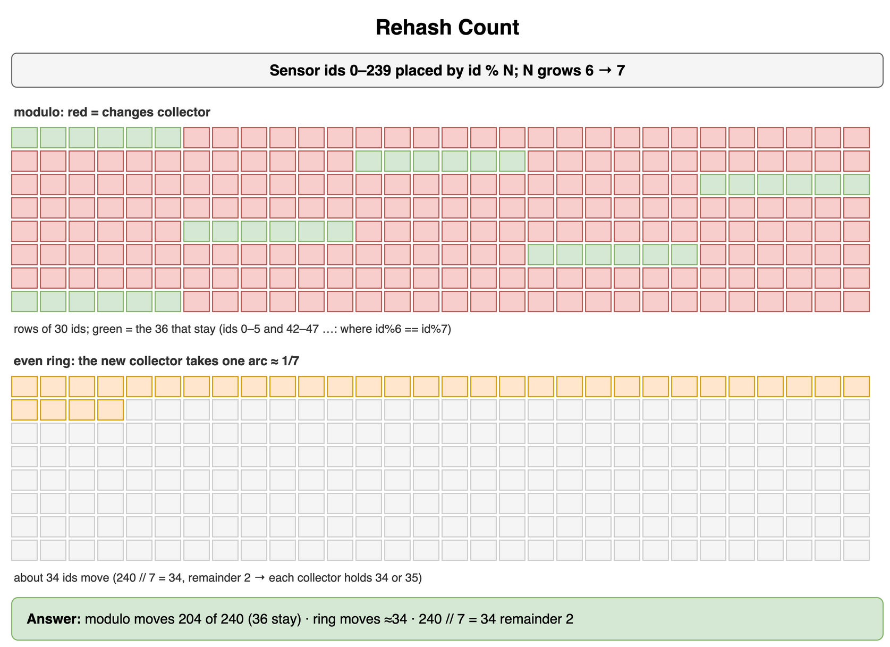
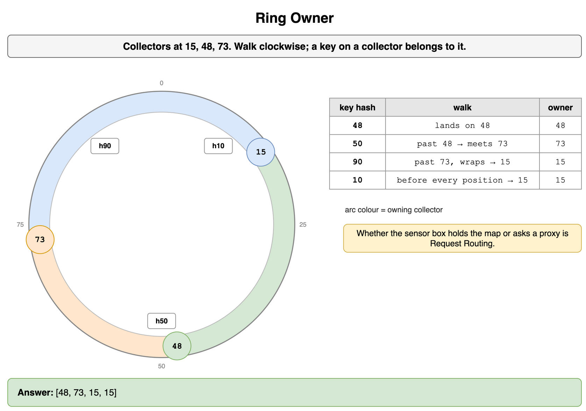
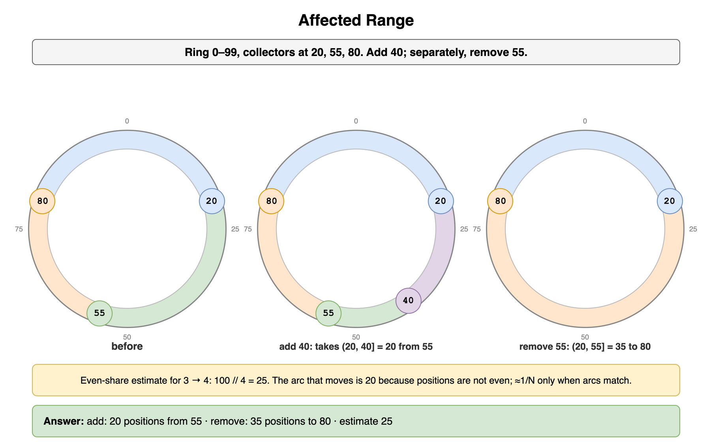
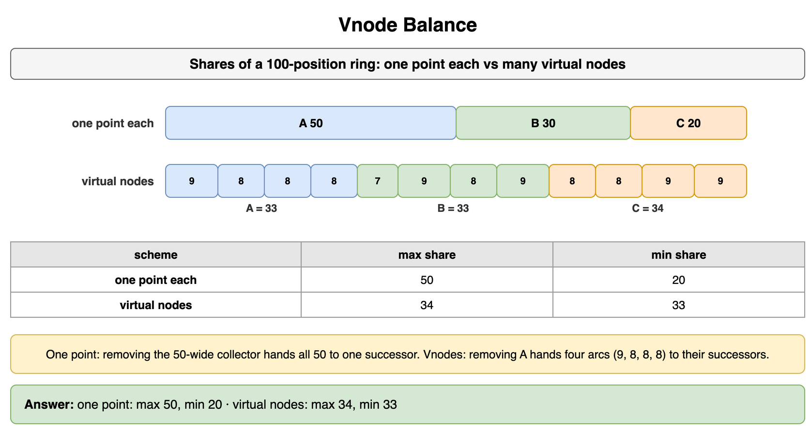
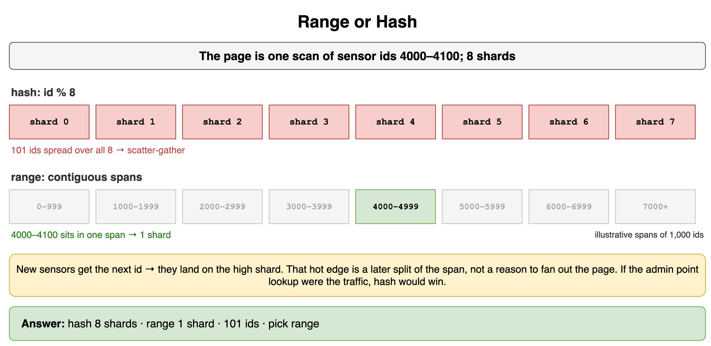
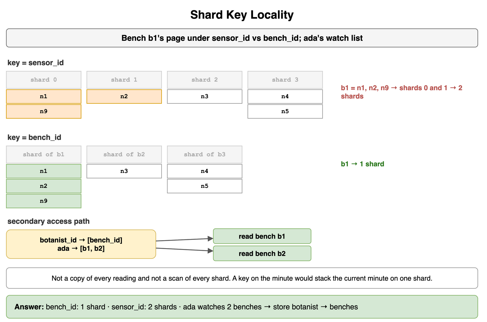
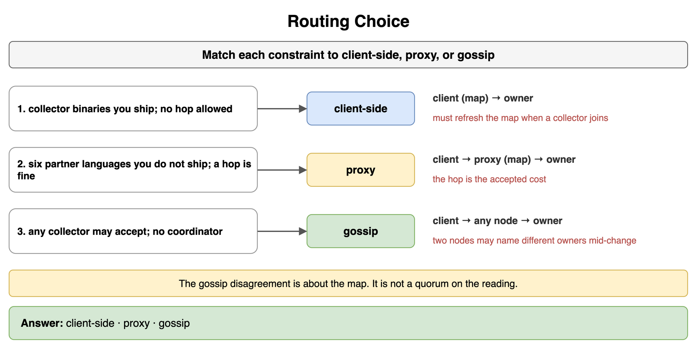
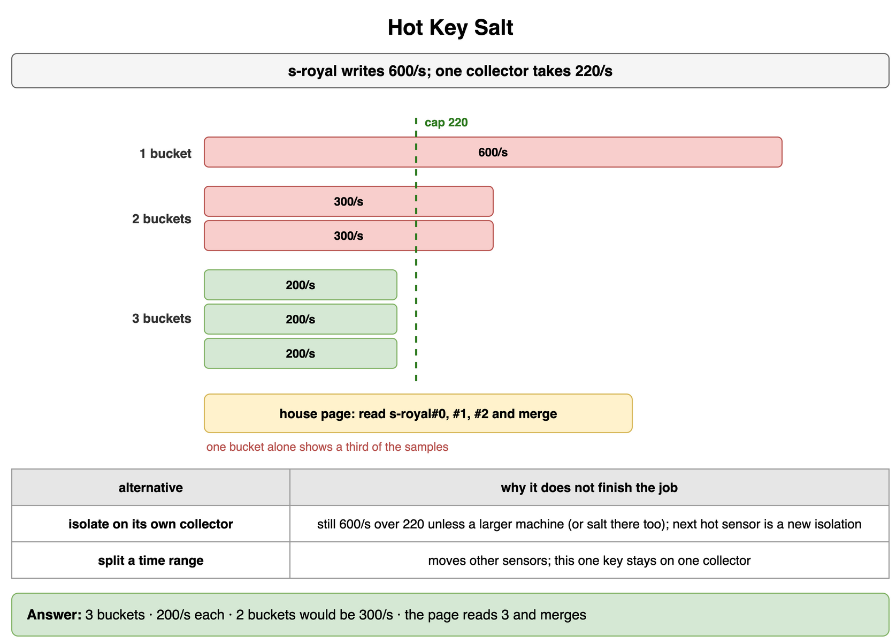

# Data Partitioning and Consistent Hashing — Drills

Original practice for placing keys on machines. Each card is one exercise: commit to an answer, then check it. The numbers are invented for a botanical garden's greenhouse archive. Relational hot shards and cross-shard commits stay in Databases Relational. Cache hot keys stay in Caching. Quorums and replica repair stay in Consistency and Replication.

## Rehash Count

Sensor ids `0` through `239` are placed with `id % N`. The archive grows from 6 collectors to 7. How many ids change collector under modulo hashing? On an even ring, the new collector takes about one share of the 7. How large is that share, and how many ids are left over after `240 // 7`?

```python
KEYS = 240
N = 6
```

**Answer:** Modulo hashing moves 204 of the 240 ids. The other 36 stay. The address included N, so most ids change collector when N changes. The new ring member takes one share of seven. `240 // 7` is 34, and the remainder is 2, so an even layout holds 34 or 35 ids on a collector. About 34 keys move, not 204. The ids that move are the new node's arc. That arc is 34 or 35 when the positions are even, and some other width when they are not.

```python
KEYS = 240
N = 6

modulo = sum((key % N) != (key % (N + 1)) for key in range(KEYS))
share, remainder = divmod(KEYS, N + 1)
print(modulo, share, remainder)
# 204 34 2
```



*Source: [`diagrams/data-partitioning-drills.drawio`](/content/09_System_Design_Interview/08_Data_Partitioning_and_Consistent_Hashing/diagrams/data-partitioning-drills.drawio), page 1.*

## Ring Owner

Collectors sit at 15, 48, and 73 on a ring. A key that lands on a collector belongs to it. Otherwise walk clockwise, wrapping after the last position. Which collector owns key hashes 48, 50, 90, and 10?

```python
NODES = [15, 48, 73]
KEYS = [48, 50, 90, 10]
```

**Answer:** 48, 73, 15, and 15. Hash 48 lands on the collector at 48, so that collector owns it. Hash 50 is past 48 and meets 73. Hash 90 is past 73, so the walk wraps and meets 15. Hash 10 is before every later position and also meets 15. This walk is the owner. Whether the sensor box already holds the map, or asks a proxy, is Request Routing.

```python
NODES = [15, 48, 73]
KEYS = [48, 50, 90, 10]


def owner(key_hash: int, nodes: list[int]) -> int:
    ordered = sorted(nodes)
    for pos in ordered:
        if key_hash <= pos:
            return pos
    return ordered[0]


print([owner(key, NODES) for key in KEYS])
# [48, 73, 15, 15]
```



*Source: [`diagrams/data-partitioning-drills.drawio`](/content/09_System_Design_Interview/08_Data_Partitioning_and_Consistent_Hashing/diagrams/data-partitioning-drills.drawio), page 2.*

## Affected Range

Positions are 0 through 99. Collectors sit at 20, 55, and 80. A collector owns the positions after its predecessor, through its own position. You add a collector at 40. How many positions move, and which existing collector loses them? Separately, remove 55 from the original three. How many positions move, and which collector receives them? The even-share estimate for going from 3 collectors to 4 is `100 // 4`. What is that estimate?

```python
RING = 100
NODES = [20, 55, 80]
NEW = 40
```

**Answer:** The new collector takes 20 positions, (20, 40], from 55. The other arcs stay. Removing 55 gives its 35 positions, (20, 55], to its successor at 80. The even-share estimate for the add is 25, and the arc that actually moves is 20, because these positions are not even. Without virtual nodes the fraction is about `1/N` only when the arcs match. N is 4 after this add. The keys that move are the arc, not a second copy of the whole ring.

```python
RING = 100
NODES = [20, 55, 80]
NEW = 40


def predecessor(pos: int, nodes: list[int]) -> int:
    ordered = sorted(nodes)
    smaller = [node for node in ordered if node < pos]
    return smaller[-1] if smaller else ordered[-1]


def successor(pos: int, nodes: list[int]) -> int:
    ordered = sorted(nodes)
    larger = [node for node in ordered if node > pos]
    return larger[0] if larger else ordered[0]


def span(start: int, end: int) -> int:
    return (end - start) % RING


removed = 55
print(
    span(predecessor(NEW, NODES), NEW),
    successor(NEW, NODES),
    span(predecessor(removed, NODES), removed),
    successor(removed, NODES),
    RING // (len(NODES) + 1),
)
# 20 55 35 80 25
```



*Source: [`diagrams/data-partitioning-drills.drawio`](/content/09_System_Design_Interview/08_Data_Partitioning_and_Consistent_Hashing/diagrams/data-partitioning-drills.drawio), page 3.*

## Vnode Balance

Three collectors, one point each, own 50, 30, and 20 of a 100-position ring. The same three machines with many virtual nodes own the arcs below. What is the max share and the min share in each scheme?

```python
ONE_POINT = [50, 30, 20]
VNODES = {
    "A": [9, 8, 8, 8],
    "B": [7, 9, 8, 9],
    "C": [8, 8, 9, 9],
}
```

**Answer:** One point each: max 50, min 20. Many virtual nodes: max 34, min 33. The shares sum to 100 in both schemes. Inserting beside the 20-wide arc lightens only that neighbor, and the collector that owns 50 keeps 50. Removing that 50-wide collector hands all 50 positions to one successor. Collector A is a different scheme: its arcs are 9, 8, 8, and 8, and the widest arc in any list is 9. Removing A hands those four arcs to their successors. One membership change no longer lands as a single 50-wide transfer.

```python
ONE_POINT = [50, 30, 20]
VNODES = {
    "A": [9, 8, 8, 8],
    "B": [7, 9, 8, 9],
    "C": [8, 8, 9, 9],
}

shares = [sum(arcs) for arcs in VNODES.values()]
print(max(ONE_POINT), min(ONE_POINT), max(shares), min(shares))
# 50 20 34 33
```



*Source: [`diagrams/data-partitioning-drills.drawio`](/content/09_System_Design_Interview/08_Data_Partitioning_and_Consistent_Hashing/diagrams/data-partitioning-drills.drawio), page 4.*

## Range or Hash

The page a gardener opens is one scan of sensor ids 4000 through 4100. An admin tool, used rarely, looks up one sensor id. New sensors receive the next id. How many shards does this scan touch if the shard is `id % 8`, and how many if each shard owns a contiguous span? Which scheme do you pick, and where do new sensors land under that scheme?

```python
IDS = range(4000, 4101)
N = 8
```

**Answer:** Hash touches 8 shards. A contiguous span touches 1. There are 101 ids in the scan. Pick the range. The page you open stays on one shard. Under hash that page is a scatter-gather across all 8. New sensors land on the high shard, together with every other new sensor. That hot edge is a later split of the span. It is not a reason to fan the bench page out. If the admin point lookup were the traffic, hash would be the pick, and this scan would pay the fan-out.

```python
IDS = range(4000, 4101)
N = 8

print(len({sensor_id % N for sensor_id in IDS}), 1, len(list(IDS)))
# 8 1 101
```



*Source: [`diagrams/data-partitioning-drills.drawio`](/content/09_System_Design_Interview/08_Data_Partitioning_and_Consistent_Hashing/diagrams/data-partitioning-drills.drawio), page 5.*

## Shard Key Locality

Readings are stored by the bench that holds the sensors. The page people open is one bench. A botanist watches a few benches. In this sample, `sensor_id` already has a shard. `bench_id` puts the whole bench on one shard. How many shards does bench b1's page touch under each key? How many benches does ada watch, and what do you store so her page does not scan every sensor?

```python
SENSOR_SHARD = {"n1": 0, "n2": 1, "n9": 0, "n3": 2, "n4": 3, "n5": 3}
BENCHES = {"b1": ["n1", "n2", "n9"], "b2": ["n3"], "b3": ["n4", "n5"]}
WATCHES = {"ada": ["b1", "b2"], "bo": ["b3"]}
```

**Answer:** Use `bench_id`. Bench b1 touches 1 shard under that key and 2 shards under `sensor_id`, because n1 and n9 share shard 0 and n2 is on shard 1. Ada watches 2 benches. Store `botanist_id → [bench_id]` and read those benches. That lookup is the secondary access path. It is not a second copy of every reading, and it is not a scan of every shard. A key on the minute would stack the current minute onto one shard while the bench page, which is the product, scatters.

```python
SENSOR_SHARD = {"n1": 0, "n2": 1, "n9": 0, "n3": 2, "n4": 3, "n5": 3}
BENCHES = {"b1": ["n1", "n2", "n9"], "b2": ["n3"], "b3": ["n4", "n5"]}
WATCHES = {"ada": ["b1", "b2"], "bo": ["b3"]}


def bench_page(bench: str, key: str) -> int:
    if key == "bench_id":
        return 1
    return len({SENSOR_SHARD[sensor] for sensor in BENCHES[bench]})


print(bench_page("b1", "bench_id"), bench_page("b1", "sensor_id"), len(WATCHES["ada"]))
# 1 2 2
```



*Source: [`diagrams/data-partitioning-drills.drawio`](/content/09_System_Design_Interview/08_Data_Partitioning_and_Consistent_Hashing/diagrams/data-partitioning-drills.drawio), page 6.*

## Routing Choice

Match each constraint to client-side, proxy, or gossip.

```text
1. one-language-no-hop — collector binaries you ship. A hop is not acceptable.
2. many-languages — six partner languages you do not ship. A hop is acceptable.
3. no-coordinator — any collector may accept a reading. Nobody runs a coordinator.
```

```python
CASES = ["one-language-no-hop", "many-languages", "no-coordinator"]
```

**Answer:** Client-side, proxy, then gossip. The binary you ship can hold the partition map and send to the owner, so the first case pays no hop. It has to refresh that map when a collector joins, or it writes to the old owner. Six languages you do not ship will not all refresh the same map. A proxy holds the map, and the hop is the cost you accepted. Gossip needs no coordinator: any collector forwards using the map it has heard. While membership is changing, two collectors can name different owners. That disagreement is about the map. It is not a quorum on the reading.

```python
CASES = ["one-language-no-hop", "many-languages", "no-coordinator"]
CHOICE = {
    "one-language-no-hop": "client-side",
    "many-languages": "proxy",
    "no-coordinator": "gossip",
}

print(" ".join(CHOICE[name] for name in CASES))
# client-side proxy gossip
```



*Source: [`diagrams/data-partitioning-drills.drawio`](/content/09_System_Design_Interview/08_Data_Partitioning_and_Consistent_Hashing/diagrams/data-partitioning-drills.drawio), page 7.*

## Hot Key Salt

Sensor `s-royal` in the royal palm house is one key at 600 writes per second. A collector can take 220 writes per second. Other sensors are fine. What is the smallest salt width that fits the cap, how many writes does each bucket take if the salt spreads evenly, and how many writes would two buckets take? What does the house page do on read? Why does isolating this key, or splitting a time range, not finish the job by itself?

```python
RATE = 600
CAP = 220
```

**Answer:** Salt into 3 buckets. Each takes 200 writes per second, which fits under 220. Two buckets would take 300, which does not. The house page used to read one key. It now reads three and merges. A client that reads one bucket sees a third of the samples. A dedicated collector for `s-royal` still receives 600, over the cap, unless that collector is a larger machine or you salt there too. The next hot sensor is a new isolation. Cutting a time range moves other sensors and leaves this one key on one collector. The merge is the price of the salt. A hot key that is a cache copy, rather than the durable sensor row, is Caching.

```python
RATE = 600
CAP = 220


def smallest_k(rate: int, cap: int) -> int:
    k = 1
    while rate > cap * k:
        k += 1
    return k


k = smallest_k(RATE, CAP)
print(k, RATE // k, RATE // (k - 1))
# 3 200 300
```



*Source: [`diagrams/data-partitioning-drills.drawio`](/content/09_System_Design_Interview/08_Data_Partitioning_and_Consistent_Hashing/diagrams/data-partitioning-drills.drawio), page 8.*
