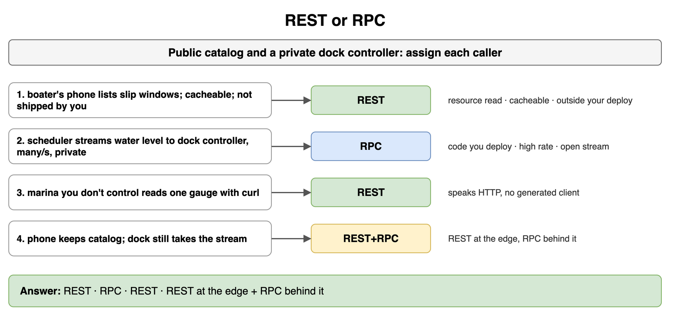
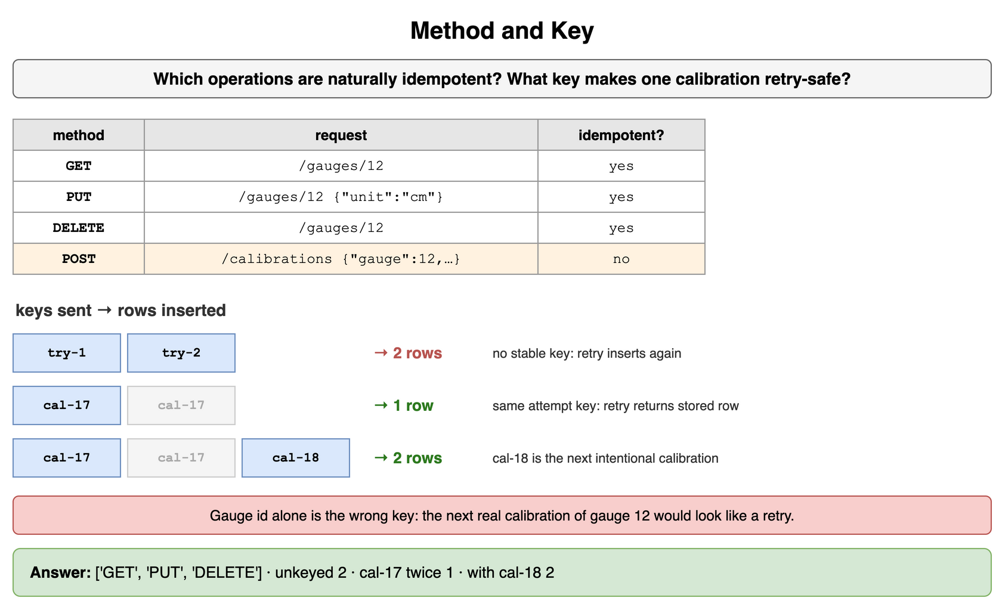
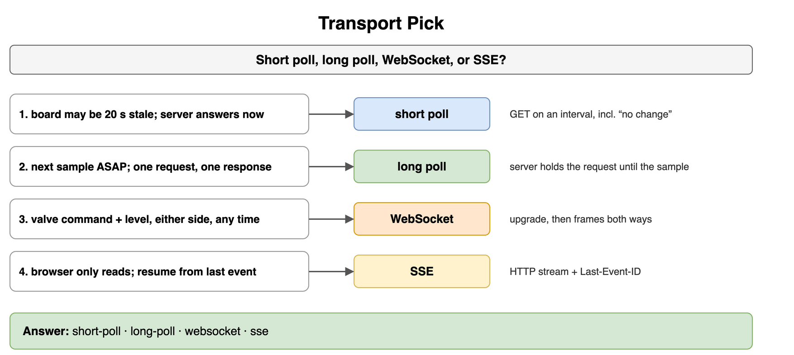
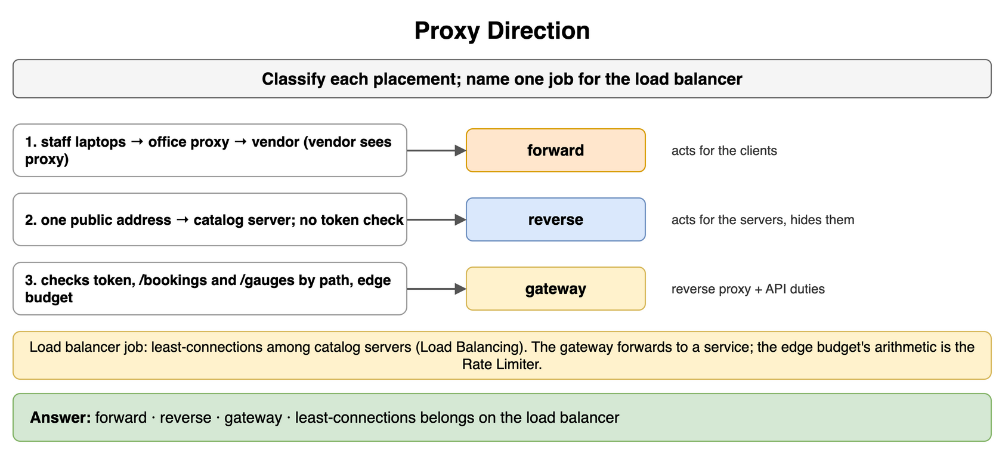
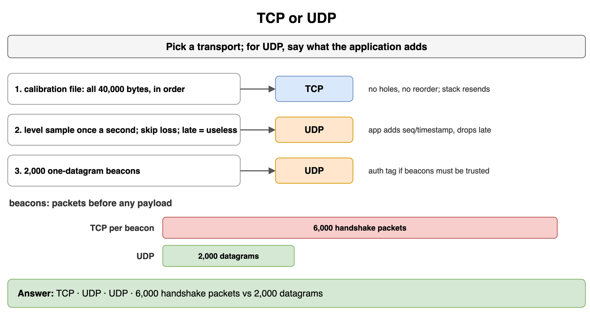
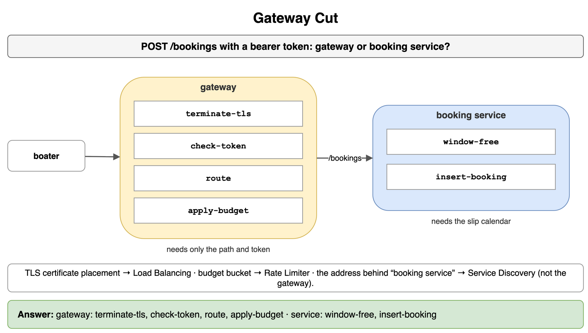
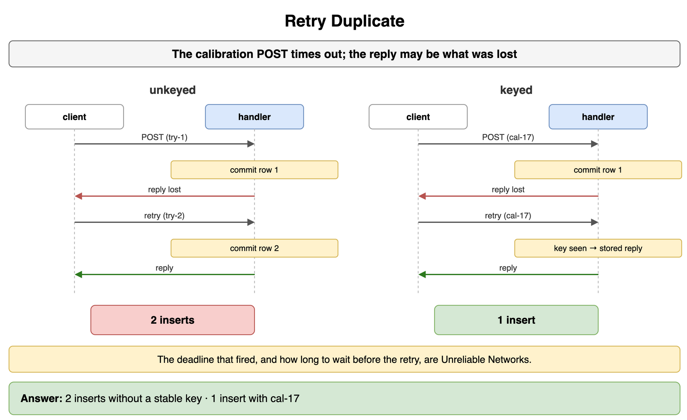
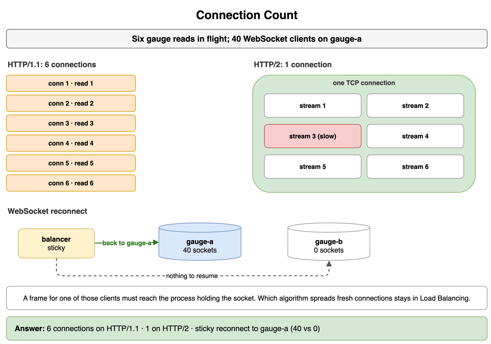

# Networking and Communication — Drills

Original practice for an API shape, a front door, and a transport. Each card is one exercise: commit to an answer, then check it. The numbers are invented for a harbor tide-gauge desk. Pool algorithms and TLS mechanics stay in Load Balancing. The token bucket stays in Rate Limiting and Throttling. Service discovery stays in Microservices and System Decomposition. Protobuf and schema changes stay in Encoding Serialization and Schema Evolution. Timeouts and backoff stay in Distributed System Failure Modes. Presence, vendor push, and a product's delivery choice stay in Real-Time and Notification Systems. Queues stay in Message Queues and Async Processing.

## REST or RPC

The harbor co-op has a public catalog and a private dock controller. Assign each caller.

```text
1. public-catalog — a boater's phone lists open slip windows. The response may be cached. You do not ship the phone.
2. gauge-stream — the scheduler you deploy streams water level to the dock controller, many samples a second, on the private network.
3. partner-curl — a marina you do not control reads one gauge with curl.
4. both — the phone keeps the public catalog, and the dock controller still takes the stream.
```

```python
CASES = ["public-catalog", "gauge-stream", "partner-curl", "both"]
```

**Answer:** REST, RPC, REST, then REST at the edge with RPC behind it. The phone and the marina are callers you do not ship, the work is a read of a resource, and a cache can hold the catalog. The dock stream is code you deploy, the rate is high, and the call stays open, so the scheduler uses RPC. The fourth case is the usual split, not a compromise inside one call: the catalog stays REST and the stream stays RPC.

```python
CASES = ["public-catalog", "gauge-stream", "partner-curl", "both"]
CHOICE = {
    "public-catalog": "REST",
    "gauge-stream": "RPC",
    "partner-curl": "REST",
    "both": "REST+RPC",
}

print(" ".join(CHOICE[name] for name in CASES))
# REST RPC REST REST+RPC
```



*Source: [`diagrams/networking-drills.drawio`](/content/09_System_Design_Interview/10_Networking_and_Communication/diagrams/networking-drills.drawio), page 1.*

## Method and Key

Which of these operations are naturally idempotent? For the one that is not, name a key that makes one calibration attempt safe to retry, and say why the gauge id alone is the wrong key.

```text
GET    /gauges/12
PUT    /gauges/12     { "unit": "cm" }
DELETE /gauges/12
POST   /calibrations  { "gauge": 12, "offset": 3 }
```

```python
OPS = ["GET", "PUT", "DELETE", "POST"]
ATTEMPTS = ["cal-17", "cal-17", "cal-18"]
```

**Answer:** GET, PUT, and DELETE. GET reads. PUT with this same body replaces gauge 12 with that unit again. DELETE leaves gauge 12 absent. POST creates a calibration on every accepted call, so it is not naturally idempotent. The key is a token the client mints for one attempt, `cal-17`, stored with the calibration result. A retry sends `cal-17` and gets the stored row. The gauge id alone is the wrong key: the next intentional calibration of gauge 12 would be treated as a retry. `cal-18` is that next attempt, and it inserts a second row. Two tries with no stable key, modeled below as `try-1` and `try-2`, insert twice.

```python
OPS = ["GET", "PUT", "DELETE", "POST"]
NATURAL = {"GET": True, "PUT": True, "DELETE": True, "POST": False}
ATTEMPTS = ["cal-17", "cal-17", "cal-18"]


def apply(keys: list[str]) -> int:
    seen: set[str] = set()
    count = 0
    for key in keys:
        if key in seen:
            continue
        seen.add(key)
        count += 1
    return count


idempotent = [name for name in OPS if NATURAL[name]]
print(idempotent, apply(["try-1", "try-2"]), apply(ATTEMPTS[:2]), apply(ATTEMPTS))
# ['GET', 'PUT', 'DELETE'] 2 1 2
```



*Source: [`diagrams/networking-drills.drawio`](/content/09_System_Design_Interview/10_Networking_and_Communication/diagrams/networking-drills.drawio), page 2.*

## Transport Pick

Pick the mechanism from the constraint. The choices are short poll, long poll, WebSocket, and SSE.

```text
1. interval-ok — the board may be 20 seconds stale. Each check is an HTTP GET. The server answers immediately.
2. hold-until — the board wants the next sample as soon as it exists. The client sends no stream. The path stays one HTTP request and one response.
3. both-ways — the dock sends a valve command and receives level on the same connection, either side at any time.
4. server-push — the browser only reads a stream of samples over HTTP. On reconnect it can name the last event it applied.
```

```python
CASES = ["interval-ok", "hold-until", "both-ways", "server-push"]
```

**Answer:** Short poll, long poll, WebSocket, then SSE. The first check can wait out an interval, and an immediate GET is a short poll, including the requests that report no change. The second still has to be one HTTP request and response, so the server holds that request until the sample exists. The valve command and the level reading share a connection and either side writes, which is a WebSocket after the upgrade. The browser stream is server to client only, stays HTTP, and the last event id is how SSE resumes. Who is on the dock, and a push to a closed phone, are Real-Time and Notification Systems.

```python
CASES = ["interval-ok", "hold-until", "both-ways", "server-push"]
CHOICE = {
    "interval-ok": "short-poll",
    "hold-until": "long-poll",
    "both-ways": "websocket",
    "server-push": "sse",
}

print(" ".join(CHOICE[name] for name in CASES))
# short-poll long-poll websocket sse
```



*Source: [`diagrams/networking-drills.drawio`](/content/09_System_Design_Interview/10_Networking_and_Communication/diagrams/networking-drills.drawio), page 3.*

## Proxy Direction

Classify each placement. Then name one job in this desk that belongs on the load balancer, not on the API gateway.

```text
1. laptop-exit — staff laptops reach the vendor firmware site through one office proxy. The vendor sees the proxy's address.
2. public-front — boaters use one public address. It forwards to a catalog server and hides that server. It does not check a booking token.
3. member-edge — one host checks the bearer token, sends /bookings to the booking service and /gauges to the gauge service, and refuses a caller who is over the edge budget.
```

```python
CASES = ["laptop-exit", "public-front", "member-edge"]
```

**Answer:** Forward proxy, reverse proxy, then API gateway. The office proxy acts for the laptops and is the address the vendor sees. The public address acts for the catalog servers and does not add an API check, so it is a reverse proxy. The member host routes by path, checks the token, and applies a budget, which is the gateway. Least-connections among catalog servers is the load balancer's pick, in Load Balancing. The gateway forwards to a service. It does not own that pick. The arithmetic inside the edge budget is the Rate Limiter, and the gateway only applies it.

```python
CASES = ["laptop-exit", "public-front", "member-edge"]
CHOICE = {
    "laptop-exit": "forward",
    "public-front": "reverse",
    "member-edge": "gateway",
}

print(" ".join(CHOICE[name] for name in CASES))
# forward reverse gateway
```



*Source: [`diagrams/networking-drills.drawio`](/content/09_System_Design_Interview/10_Networking_and_Communication/diagrams/networking-drills.drawio), page 4.*

## TCP or UDP

Assign a transport. For a UDP choice, say what the application adds. The beacons are the handshake question: each beacon is one datagram, and a TCP handshake is 3 packets.

```text
1. calibration-file — all 40_000 bytes arrive in order. A lost piece is resent by the stack.
2. level-sample — one sample a second. A lost sample is skipped. A late sample is useless once a newer one is in.
3. beacons — 2_000 one-datagram beacons. A handshake per beacon costs more than the beacon.
```

```python
BEACONS = 2000
HANDSHAKE = 3
```

**Answer:** TCP, UDP, then UDP. The file cannot tolerate a hole or a reorder, so TCP's stream is the fit. The level sample can skip a loss, and a newer sample replaces an older one, so UDP is the fit. The application adds a sequence number, or a timestamp, and drops a sample that arrives behind a newer one. It does not get a resend from the stack, and it does not need one. The beacons are the same datagram choice: 2,000 UDP datagrams, against 6,000 handshake packets before any TCP payload if each beacon opened its own connection. An auth tag is the application's when a beacon must be trusted. The timeout that declares a packet lost is Unreliable Networks.

```python
BEACONS = 2000
HANDSHAKE = 3
CHOICE = ["TCP", "UDP", "UDP"]

print(" ".join(CHOICE), BEACONS * HANDSHAKE, BEACONS)
# TCP UDP UDP 6000 2000
```



*Source: [`diagrams/networking-drills.drawio`](/content/09_System_Design_Interview/10_Networking_and_Communication/diagrams/networking-drills.drawio), page 5.*

## Gateway Cut

A boater sends `POST /bookings` with a bearer token and a body naming one slip window. Place each step on the gateway or on the booking service.

```text
terminate-tls     decrypt so the path can be read
check-token       reject a missing or invalid token
route             /bookings goes to the booking service
apply-budget      refuse the caller who is over the edge limit
window-free       decide whether that slip window is still open
insert-booking    write the booking row
```

```python
STEPS = [
    "terminate-tls",
    "check-token",
    "route",
    "apply-budget",
    "window-free",
    "insert-booking",
]
```

**Answer:** The gateway takes `terminate-tls`, `check-token`, `route`, and `apply-budget`. The booking service takes `window-free` and `insert-booking`. The gateway can see the path and the token without knowing the slip calendar. The open window and the row need that calendar, so they stay on the service. Certificate placement for the TLS step is TLS Termination in Load Balancing. The budget's bucket is the Rate Limiter. The address behind the name "booking service" is Service Discovery. The gateway's route is the client's entry. It is not that registry.

```python
STEPS = [
    "terminate-tls",
    "check-token",
    "route",
    "apply-budget",
    "window-free",
    "insert-booking",
]
GATEWAY = {"terminate-tls", "check-token", "route", "apply-budget"}

on_gateway = [step for step in STEPS if step in GATEWAY]
on_service = [step for step in STEPS if step not in GATEWAY]
print(on_gateway, on_service)
# ['terminate-tls', 'check-token', 'route', 'apply-budget'] ['window-free', 'insert-booking']
```



*Source: [`diagrams/networking-drills.drawio`](/content/09_System_Design_Interview/10_Networking_and_Communication/diagrams/networking-drills.drawio), page 6.*

## Retry Duplicate

The calibration write times out. The handler may already have committed, and the response may be what was lost. Count the inserts when the client retries with a fresh identity each time, and when both tries carry `cal-17`.

```python
UNKEYED = ["try-1", "try-2"]
KEYED = ["cal-17", "cal-17"]
```

**Answer:** Two inserts without a stable key, and one insert with `cal-17`. Each unkeyed POST is a new attempt, so a retry that arrives after a lost response creates a second calibration. The keyed retry finds the stored result and does not insert again. The deadline that fired, and how long to wait before the retry, are Unreliable Networks. This count is the idempotency key on one HTTP write.

```python
UNKEYED = ["try-1", "try-2"]
KEYED = ["cal-17", "cal-17"]


def inserts(keys: list[str]) -> int:
    seen: set[str] = set()
    count = 0
    for key in keys:
        if key in seen:
            continue
        seen.add(key)
        count += 1
    return count


print(inserts(UNKEYED), inserts(KEYED))
# 2 1
```



*Source: [`diagrams/networking-drills.drawio`](/content/09_System_Design_Interview/10_Networking_and_Communication/diagrams/networking-drills.drawio), page 7.*

## Connection Count

Six gauge reads are in flight together. How many connections does HTTP/1.1 need for those six responses, and how many does HTTP/2 need? Separately, gauge-a holds 40 live WebSocket clients and gauge-b holds none. Why does a reconnect of one of those clients want stickiness?

```python
IN_FLIGHT = 6
SOCKETS = {"gauge-a": 40, "gauge-b": 0}
```

**Answer:** Six connections on HTTP/1.1, and one on HTTP/2. Keep-alive lets a later request reuse a connection, and that connection still returns one response at a time, so six responses in flight are six connections. HTTP/2 puts the six streams on one connection, and a slow read does not hold the other five. The 40 sockets exist only on gauge-a. A frame for one of those clients has to reach the process that holds the socket. A reconnect is a new connection. Sticky Sessions sends it back to gauge-a. gauge-b has none of those sockets to resume. Which pool algorithm would otherwise spread new connections is Load Balancing, and this card does not grade that pick.

```python
IN_FLIGHT = 6
SOCKETS = {"gauge-a": 40, "gauge-b": 0}


def connections(in_flight: int, multiplex: bool) -> int:
    return 1 if multiplex else in_flight


print(connections(IN_FLIGHT, False), connections(IN_FLIGHT, True), SOCKETS["gauge-a"], SOCKETS["gauge-b"])
# 6 1 40 0
```



*Source: [`diagrams/networking-drills.drawio`](/content/09_System_Design_Interview/10_Networking_and_Communication/diagrams/networking-drills.drawio), page 8.*
