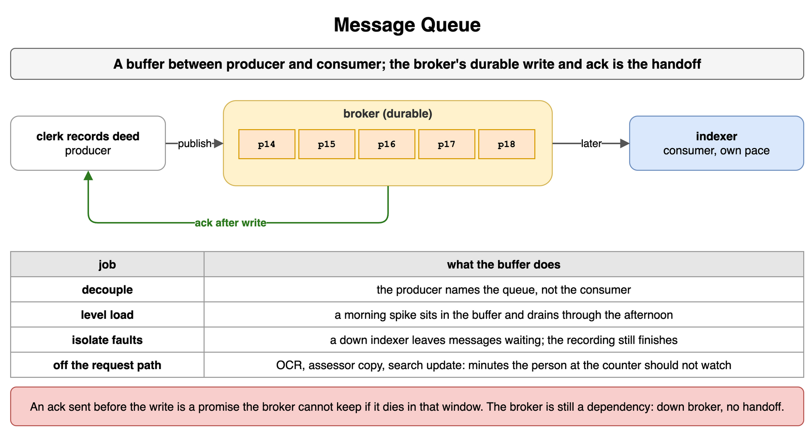
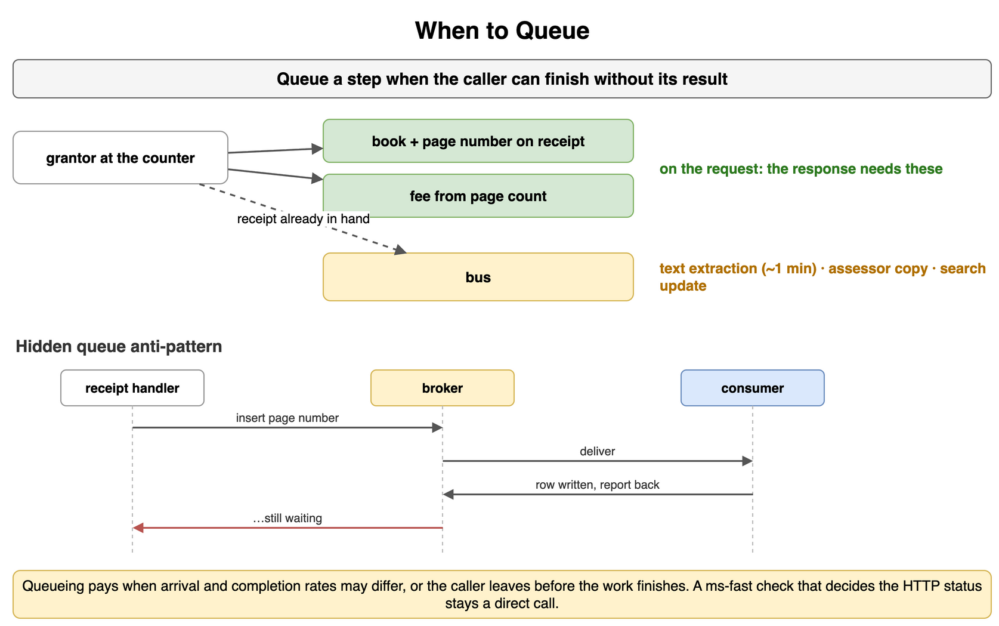
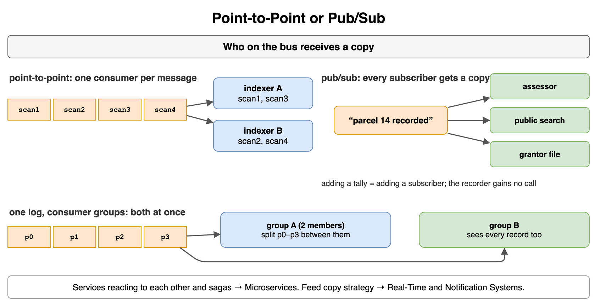
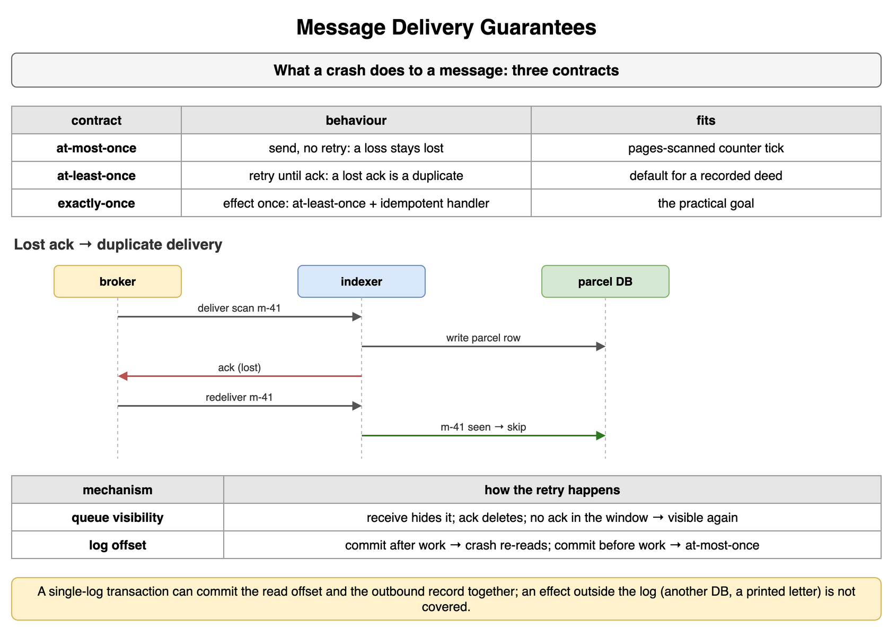
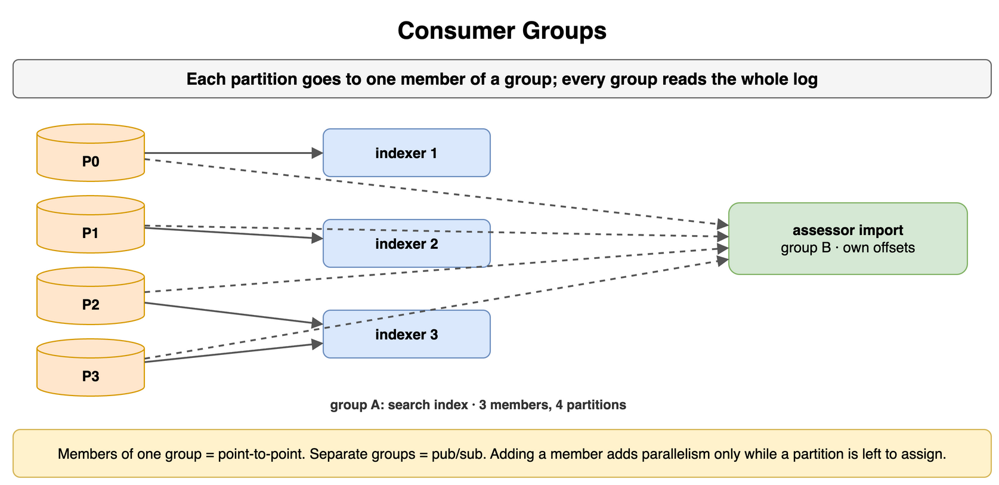
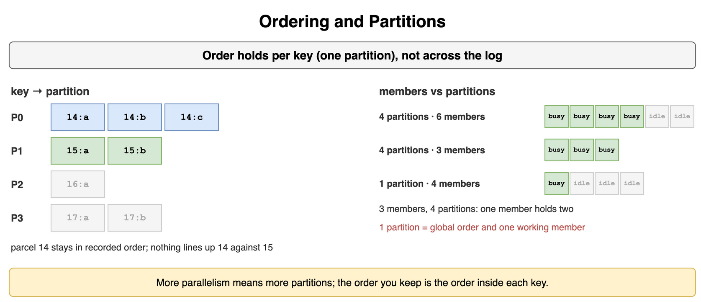
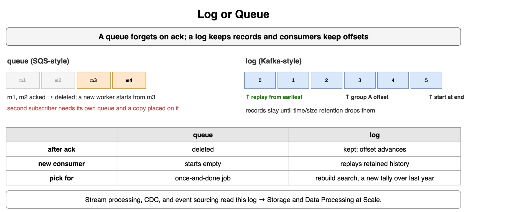
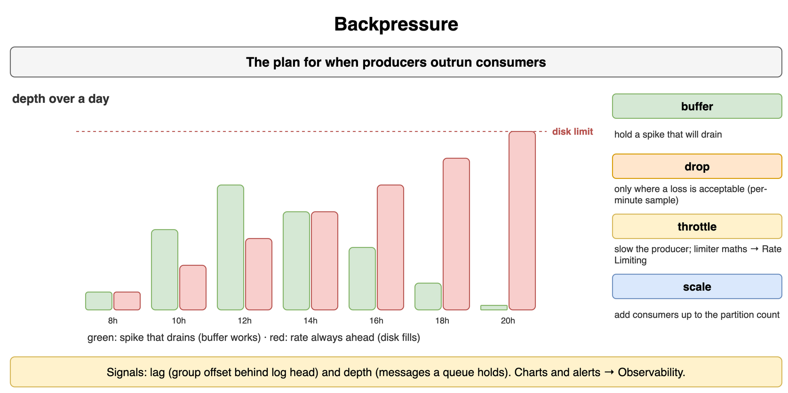
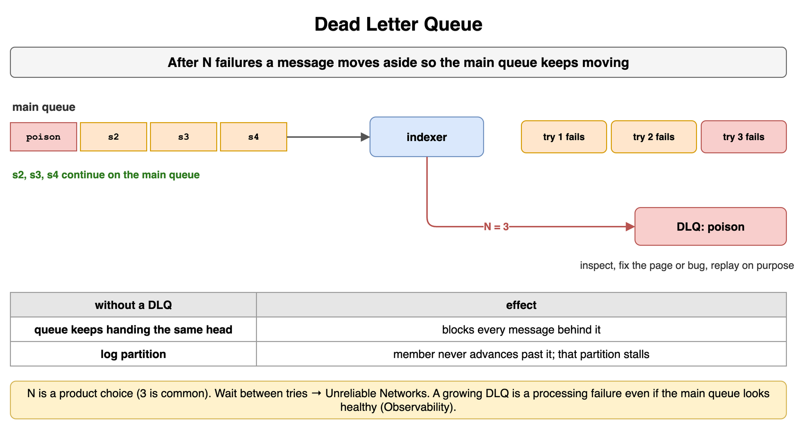
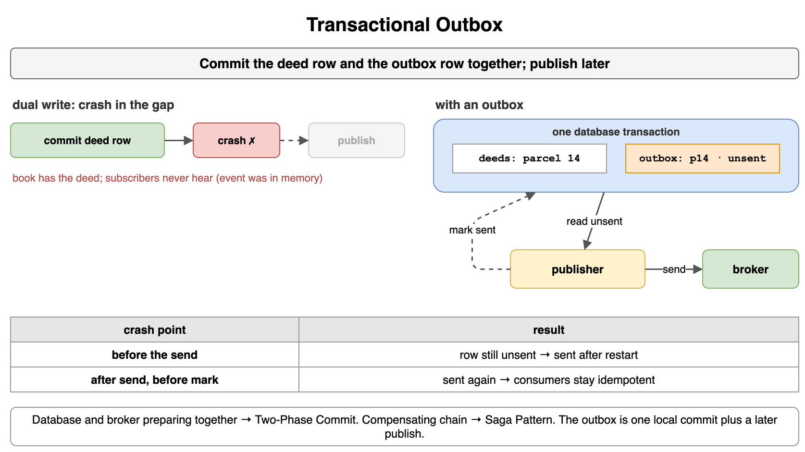

## Message Queue

A message queue is a buffer between a producer and a consumer. The producer hands the broker a message and continues. The consumer takes that message later, at its own pace. The county clerk who records a deed writes the page, then puts "parcel 14 was recorded" on the broker. The indexer that builds the parcel search reads that message when it has a free worker. The clerk's request does not call the indexer, and it does not wait for the search page to update.

The buffer is doing four jobs. It decouples the two sides, so each can be deployed and scaled on its own. It levels load: a morning of filings can arrive in one hour, and the indexers drain that backlog through the afternoon. It isolates faults: an indexer that is down stops taking work, and the scans wait until it returns, so the clerk still finishes the recording. It moves slow work off the request path. Optical character recognition on a scanned page, a copy for the assessor, and the public search update are minutes of work the person at the counter should not watch.

The broker's acknowledgement is the handoff. It writes the message to durable storage, then acks the producer. After that ack, a producer crash does not drop the message, and a consumer that is down does not drop it either. An ack sent before the write is a promise the process cannot keep if the broker dies in that window. The broker itself is still a dependency. A broker that is down means the clerk cannot hand the message off. Choosing a delete-on-ack queue or an append-only log is Log or Queue.

```text
decouple     the producer names the queue, not the consumer
level load   a spike sits in the buffer and drains later
isolate      a down consumer leaves messages waiting
persist      the broker writes, then acks the producer
```



*Source: [`diagrams/message-queues.drawio`](/content/09_System_Design_Interview/11_Message_Queues_and_Async_Processing/diagrams/message-queues.drawio), page 1.*

## When to Queue

Queue a step when the caller can finish without its result. Keep a step on the request when the response would be a guess without it.

The grantor at the counter needs the book and page number on the receipt, and the fee has to be calculated from the page count before they pay. Those two steps are the request. Hiding the page-number insert behind the broker does not remove the wait: the receipt handler still blocks until a consumer writes the row and something reports back. A consumer outage then fails a recording that was a single database write. The scan's text extraction can take a minute, and the receipt is already in the grantor's hand, so that job goes on the bus.

The same test covers a short call. A check that takes a few milliseconds and whose answer decides the HTTP status stays a direct call. The queue pays for itself when the arrival rate and the completion rate are allowed to differ, or when the caller leaves before the work finishes.

```text
on the request    the response needs this result
on the bus        the caller can leave, and the worker catches up later
a hidden queue    the request still waits, and now it also waits on the broker
```



*Source: [`diagrams/message-queues.drawio`](/content/09_System_Design_Interview/11_Message_Queues_and_Async_Processing/diagrams/message-queues.drawio), page 2.*

## Point-to-Point or Pub/Sub

Point-to-point hands each message to one consumer. Two indexers sharing a queue split the scans. Indexer A takes scan 1, indexer B takes scan 2, and scan 1 is not indexed twice. The message leaves the queue when that one worker is done. This is the shape for a job that must happen once: one scan, one transcription, one parcel update.

Pub/sub hands each message to every subscriber. Recording parcel 14 is interesting to the assessor, to the public search, and to the grantor's file copy. Each of those subscribers gets its own copy and acts on its own. Adding the ownership tally means adding a subscriber. The clerk's recorder does not gain a new call.

A log can do both, and the mechanism is the consumer group on the next cards. Inside one group, members split the partitions, which is point-to-point. Every group still reads the log, which is pub/sub. Services that react to one another's events, and a saga across those services, are Event-Driven Architecture and the Saga Pattern in [Microservices and System Decomposition](../12_Microservices_and_System_Decomposition/). A product feed's copy strategy is Fan-Out Strategies in [Real-Time and Notification Systems](../21_Real_Time_and_Notification_Systems/). This card only decides who on the bus receives a copy.

```text
point-to-point    one consumer does the job
pub/sub           every subscriber gets a copy
one log, groups  split inside a group, every group still sees the log
```



*Source: [`diagrams/message-queues.drawio`](/content/09_System_Design_Interview/11_Message_Queues_and_Async_Processing/diagrams/message-queues.drawio), page 3.*

## Message Delivery Guarantees

Delivery guarantees say what a crash does to a message, and they are three contracts.

At-most-once sends and does not retry. A lost message stays lost. A counter of pages scanned this hour can skip a tick, because the next tick replaces it. A recorded deed cannot.

At-least-once retries until the broker has seen an acknowledgement. The message can be processed twice. The usual cause is a lost ack: the indexer wrote the parcel row, the ack never reached the broker, and the broker delivered the same scan again. Two mechanisms produce that retry. On a queue, a receive hides the message for a visibility window. The consumer acks, and the message is deleted. No ack before the window ends, and the message is visible again. On a log, the group stores an offset. Committing the offset after the work means a crash before the commit reads the same record again. Committing the offset before the work is at-most-once, because a crash then skips the record.

Exactly-once means the effect happens one time. A pipeline that stays on one log can commit the read offset and the outbound record in a single transaction, so those two writes land together. The effect that leaves the log, a row in another database or a letter that was printed, is outside that transaction. The practical default is at-least-once delivery plus a consumer that treats a repeated message id as the work it already did.

The HTTP header a client sends so a retried POST stays one write is Idempotency in [Networking and Communication](../10_Networking_and_Communication/). A consumer uses that idea with the message id. Whether a person's phone shows a notification once is Delivery Guarantees for Notifications in [Real-Time and Notification Systems](../21_Real_Time_and_Notification_Systems/).

```text
at-most-once     no retry; a loss stays a loss
at-least-once    retry until ack; a lost ack is a duplicate
exactly-once     at-least-once, plus a handler that ignores the duplicate
visibility       hide, then delete on ack, or show again
offset           commit after the work, or the record is read again
```



*Source: [`diagrams/message-queues.drawio`](/content/09_System_Design_Interview/11_Message_Queues_and_Async_Processing/diagrams/message-queues.drawio), page 4.*

## Consumer Groups

A consumer group is a set of consumers that share one subscription. The broker assigns each partition to one member of the group, so each record is handled by one member. That is how a log scales consumption. Four partitions and three indexers means the index runs three ways at once, and the group as a whole still covers every record. An indexer in a second group is a different subscriber: it sees the same records, with its own assignment and its own offsets.

Members of one group are the point-to-point case. Separate groups are the pub/sub case. The assessor's import and the public search are two groups on the recorded-deed log. Each deed is imported once and indexed once, and both systems see every deed. Adding a member adds parallelism only while there is a partition left to assign. How far that goes, and what order a member can assume, is Ordering and Partitions.

```text
group A, 3 members, 4 partitions    one member handles each record
group B, its own members            the same records, a separate offset
two groups                          both see the log
```



*Source: [`diagrams/message-queues.drawio`](/content/09_System_Design_Interview/11_Message_Queues_and_Async_Processing/diagrams/message-queues.drawio), page 5.*

## Ordering and Partitions

A partition is one ordered sequence. The producer picks a key, the key picks the partition, and every later event with that key appends to the same sequence. Scans for parcel 14 stay in the order the clerk recorded them, and one member of the group reads that partition. Scans for parcel 15 can land on another partition. Nothing lines the two partitions up, so a consumer must not assume that parcel 15's scan sits before or after parcel 14's. Order is per key. It is not a global order of the log.

A global order is one partition for the whole log. Then there is a single sequence, and the group has one working member, because a member with no partition sits idle. Extra members past the partition count do not add throughput. Four partitions and six indexers leave two indexers idle. Three indexers and four partitions keep all three busy, and one of them holds two partitions. More parallelism means more partitions, and the order you keep is the order inside each key.

```text
same key          one partition, one member, in append order
different keys    different partitions can carry them, with no shared order
one partition     a global order, and one working member in the group
members > parts   the extras sit idle
```



*Source: [`diagrams/message-queues.drawio`](/content/09_System_Design_Interview/11_Message_Queues_and_Async_Processing/diagrams/message-queues.drawio), page 6.*

## Log or Queue

A queue forgets a message once a consumer acks it. The scan exists so one indexer can transcribe it. After the ack, a new worker has nothing to read. This fits a job that should happen once and then disappear. An SQS-style queue is this shape. A second independent subscriber needs its own queue, and a copy has to be placed on each one.

A log appends. Consumers track an offset, and the record stays until a time or size retention drops it. A group that starts today can replay from the earliest offset still retained, or start at the end and read only what arrives next. A Kafka-style topic is this shape. Consumer groups are what let that one log act as point-to-point inside a group and pub/sub across groups. Replay is the reason to pick the log: rebuild the public search, or let a new tally read last year's recordings.

Reading that log to compute a running result, tailing a database log into another store, and keeping state as the events themselves are Stream Processing, Change Data Capture, and Event Sourcing in [Storage and Data Processing at Scale](../13_Storage_and_Data_Processing_at_Scale/). This card is the broker choice those pipelines read from.

```text
queue    ack deletes; a new consumer starts from empty
log      the record stays; a consumer keeps an offset and can replay
pick     once-and-done work wants a queue; a later reader wants a log
```



*Source: [`diagrams/message-queues.drawio`](/content/09_System_Design_Interview/11_Message_Queues_and_Async_Processing/diagrams/message-queues.drawio), page 7.*

## Backpressure

Backpressure is the plan for when producers outrun consumers. With no plan the buffer grows without a bound, the broker runs out of disk, and the recording desk stops because it can no longer append.

Four moves cover it. Buffer the spike: Monday's filings sit on a durable log and the indexers catch up Monday night. That works when the afternoon is quieter than the morning. It fails when every hour arrives faster than the indexers finish, because the depth then climbs until the disk is full. Drop messages past a depth only when a loss is acceptable, the way a per-minute page-count sample can skip a tick. A recorded deed is not that sample. Slow the producer: the recording desk refuses new filings until the index catches up. The algorithm that decides when to refuse is the Rate Limiter in [Rate Limiting and Throttling](../17_Rate_Limiting_and_Throttling/). Scale the consumers: add indexers, up to one busy member per partition. Past that count, Ordering and Partitions says the extras sit idle, so scaling further means more partitions.

Lag is how far a group's offset sits behind the log head. Depth is how many messages a queue still holds. Both are numbers to alert on, and the chart, the page, and the collector are [Observability](../25_Observability/). Name the signal here. Place the alert there.

```text
buffer      hold a spike that will drain
drop        only where a lost message is acceptable
throttle    slow the producer; the limiter's math stays in Rate Limiting
scale       add consumers, up to the partition count
```



*Source: [`diagrams/message-queues.drawio`](/content/09_System_Design_Interview/11_Message_Queues_and_Async_Processing/diagrams/message-queues.drawio), page 8.*

## Dead Letter Queue

A dead letter queue (DLQ) is where a message goes after it has failed N times, so the main queue keeps moving. The indexer tries a scan, the page is unreadable, and the handler returns a failure. The broker retries. After the Nth failure the scan moves to the DLQ and the next scans continue. Someone inspects the DLQ, fixes the page or the bug, and replays the message on purpose. A poison message left on the main queue retries forever. On a queue that keeps handing the same head to the consumer, it blocks everything behind it. On a log, it stalls the partition it landed on, because that member never advances past it.

N is a product choice. Three tries is a common start. The wait between those tries is Unreliable Networks in [Distributed System Failure Modes](../15_Distributed_System_Failure_Modes/). A DLQ that grows is a processing failure even when the main queue looks healthy. Depth of that queue is a metric, charted with the lag signal in [Observability](../25_Observability/).

```text
tries 1 through N - 1    stay on the main queue and retry
try N                    move to the dead letter queue
later messages           keep moving on the main queue
```



*Source: [`diagrams/message-queues.drawio`](/content/09_System_Design_Interview/11_Message_Queues_and_Async_Processing/diagrams/message-queues.drawio), page 9.*

## Transactional Outbox

The recorder commits the deed row, then publishes "parcel 14 was recorded." Those are two systems. A crash in the gap leaves them different. Die after the commit and before the publish, and the book holds the deed while the assessor and the public search never hear it. Restarting the process does not republish, because the event lived in memory. Die after the publish and before the commit, and subscribers hear about a deed the book does not hold.

The outbox puts both writes in the database the clerk already commits to. The deed row and an outbox row, carrying the same payload the broker should see, insert in one transaction. A separate publisher reads outbox rows that are not yet marked sent, publishes them, and then marks them sent. A crash before the mark leaves the row unpublished, so the publisher sends it after the restart. A crash after the send and before the mark sends it again. That second send is at-least-once, so consumers stay idempotent, as in Message Delivery Guarantees.

Asking the database and the broker to prepare together is Two-Phase Commit in [Transactions and Concurrency Control](../16_Transactions_and_Concurrency_Control/). A chain of service steps with compensations is the Saga Pattern in [Microservices and System Decomposition](../12_Microservices_and_System_Decomposition/). The outbox is one local commit plus a later publish.

```text
one transaction     deed row and outbox row commit together
publisher           sends unpublished outbox rows, then marks them sent
crash before mark   the row is still there, and the send happens again
```



*Source: [`diagrams/message-queues.drawio`](/content/09_System_Design_Interview/11_Message_Queues_and_Async_Processing/diagrams/message-queues.drawio), page 10.*
