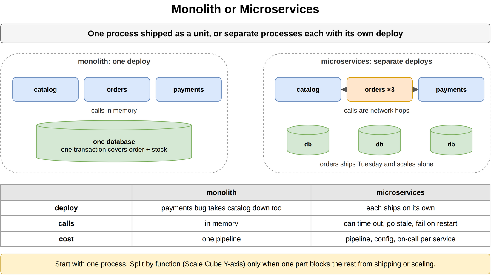
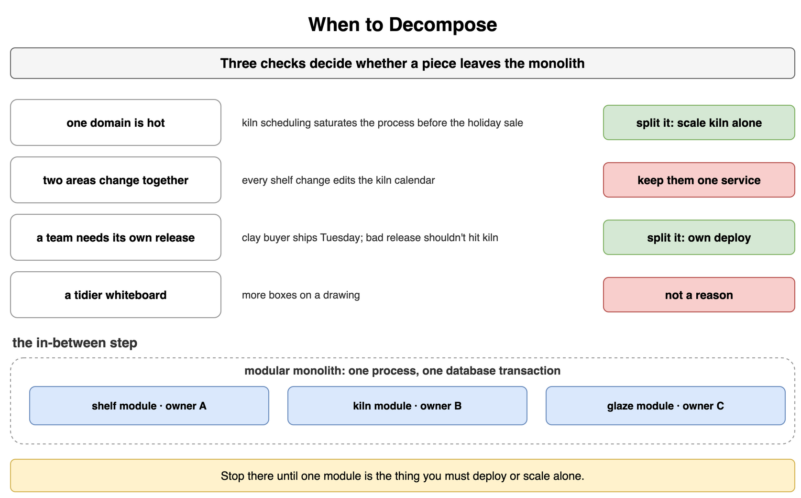
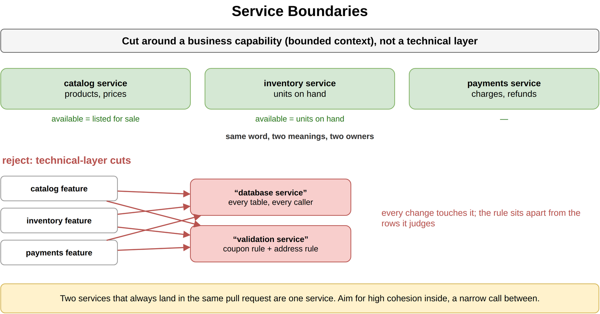
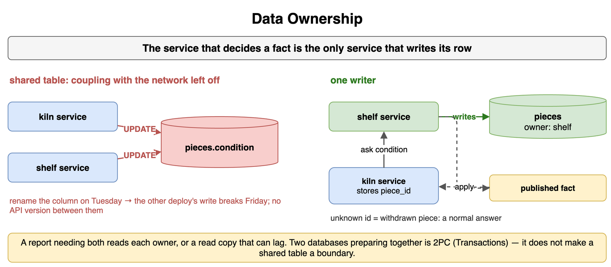
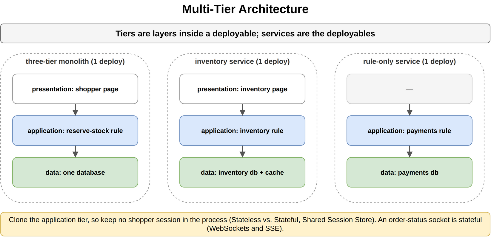
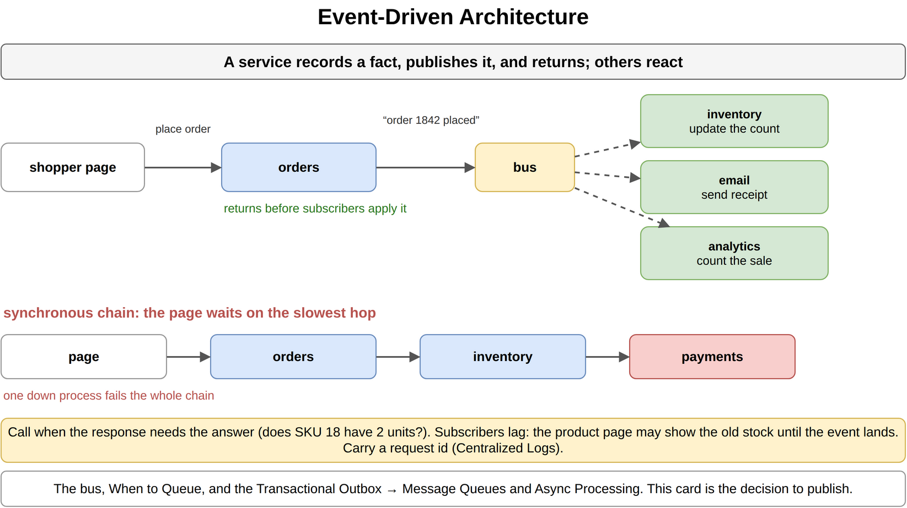
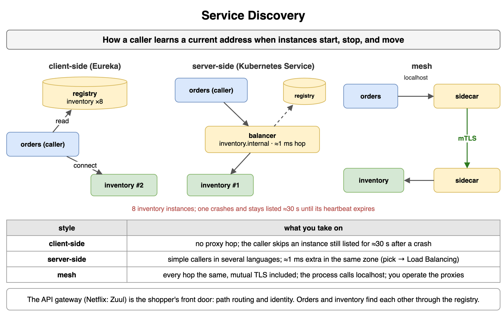
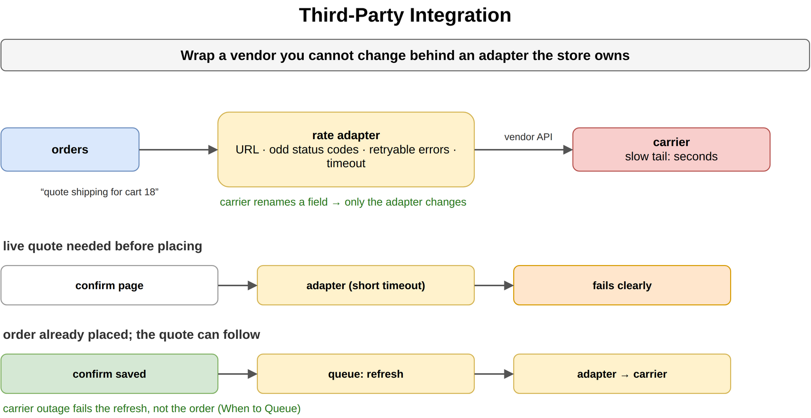
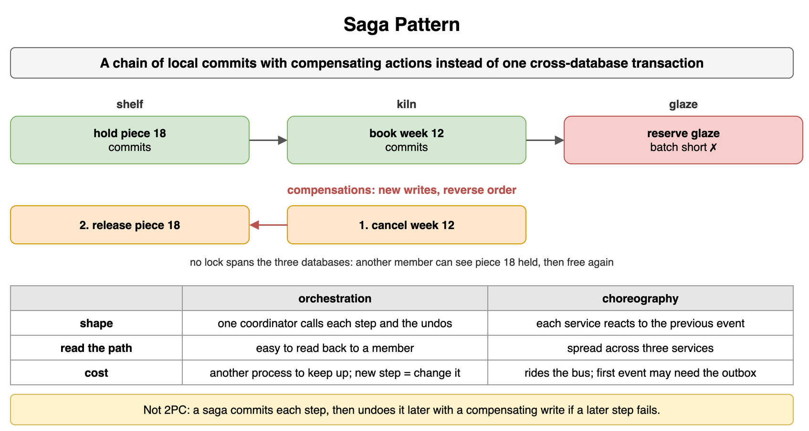

## Monolith or Microservices

A monolith is one process you build and ship as a unit. Microservices are separate processes. Each one deploys on its own, and the call that used to be a function is a network hop. An online store is catalog, cart, orders, payments, and inventory. In one process, cart calls inventory in memory, and one database transaction reserves 2 units of SKU 18 and inserts order 1842. Both commit, or neither does. You run one pipeline, and one person is on call.

The shared fate is the cost. A Friday release ships all five parts, and a bug in payments restarts the process that also serves the product page. The week before a holiday sale, catalog search uses about 70% of the CPU and checkout slows with it. A second copy of the whole process also copies the quiet payments code. That is horizontal scale of one deployable. Moving catalog into its own process is a different move: catalog runs 4 instances while payments stays at 1, and catalog ships on Tuesday while payments stays on last week's build. Amazon's retail site and Netflix's streaming product split for that reason.

The checkout-to-catalog call is now a hop. Give it a timeout, for example 100 ms, and expect a price a few seconds old, or a failure while catalog restarts. Each service also brings a pipeline, a config set, and an alert. Splitting by function is the Y-axis of The Scale Cube in [Scalability Fundamentals](../02_Scalability_Fundamentals/), next to cloning (X) and splitting a dataset (Z). In an interview, start with one deployable, name the part that blocks the rest, and leave the boxes in one process if you cannot name it.

```text
one process    in-memory calls, one transaction, one release, shared fate
services       ship and scale apart, each call a hop that can time out
the test       name the part that must ship or scale alone
```



*Source: [`diagrams/microservices.drawio`](/content/09_System_Design_Interview/12_Microservices_and_System_Decomposition/diagrams/microservices.drawio), page 1.*

## When to Decompose

Decomposition moves one part of the monolith into a process of its own. Splitting too early buys a network hop for code that still ships as one change. Splitting too late makes every feature scale and deploy with the hottest path. Three checks decide it.

A hot domain moves out. When catalog search saturates the process before the holiday sale, cloning everything copies the quiet admin screens too. Catalog search in its own service adds instances alone. That is the Y-axis split from The Scale Cube in [Scalability Fundamentals](../02_Scalability_Fundamentals/), applied to a measured hotspot. Two areas that always change together stay together. If every cart change edits the order code and every order change edits the cart, a network boundary adds two deploys and a version dance, and the teams still release together. A team that needs its own release gets a deploy boundary. The payments group ships fraud-rule fixes on Tuesday. Waiting for Friday's storefront train turns a two-line fix into a store-wide release, and a bad payments build takes the product page down.

A modular monolith sits between one pile of code and a hop. Catalog, orders, and payments are separate packages with separate owners, still one process, and still one transaction where they share a database. It gives you the boundary and the owners, and it postpones timeouts and partial failure. Stay there until one package's deploy or CPU is what blocks the rest. In an interview, name the check that fired and the piece that moves first. A tidier diagram is not a check.

```text
hot domain        move it out, scale it alone
change together   one service
own release       a deploy boundary
ownership pain    a modular monolith, still one process
```



*Source: [`diagrams/microservices.drawio`](/content/09_System_Design_Interview/12_Microservices_and_System_Decomposition/diagrams/microservices.drawio), page 2.*

## Service Boundaries

A service boundary wraps one business capability, a bounded context: one owner, and one meaning for the words that owner uses. Draw the line where the vocabulary changes. In catalog, "available" means SKU 18, a blue mug at $21, is listed for sale. Catalog owns products, titles, and list prices. In inventory, "available" means warehouse B has 14 units on hand. Inventory owns counts, reservations, and warehouses. The cart owns line items the shopper has not paid for, orders owns the committed purchase, and payments owns the charge, the capture, and the refund. An order stores `product_id` 18 and a quantity and asks catalog for the title, so a price change in catalog needs no orders schema change.

A cut along a technical layer fails. A "database service" that writes every table has to learn every feature, and every team edits it. A "validation service" has to learn the coupon rule and the address rule. That shared layer is the coupling the split was meant to remove. The rule belongs next to the rows it judges. Two proposed services that always land in the same pull request are one service until a change can ship on one side alone.

The cut that holds has high cohesion inside, so code that changes together lives together, and a narrow call between services: the caller passes an id and a request, not a query into another service's tables. Capability boundaries are stable because the capability outlives the framework. Smaller boundaries mean more hops, and larger ones redeploy unrelated rules.

```text
catalog         what a product is
inventory       how many units exist, same word, different owner
cart + orders   one service while every change ships both
database svc    reject, every team edits one layer
```



*Source: [`diagrams/microservices.drawio`](/content/09_System_Design_Interview/12_Microservices_and_System_Decomposition/diagrams/microservices.drawio), page 3.*

## Data Ownership

The service that decides a fact is the only service that writes the row. This rule is usually called database-per-service. Catalog decides the product, so catalog is the only writer of the product row, list price included. Inventory needs the price of SKU 18, so it stores `product_id` 18 and either calls catalog or applies a price-changed fact catalog already published. It never runs `UPDATE products SET price = ...`. An unknown id is a normal answer: the product was withdrawn, and the caller handles it like any missing product.

A shared table couples two deploys through one schema, with the network left off the diagram. Suppose inventory also writes `products.price`. Catalog renames `price` to `price_cents` on Tuesday and ships. Inventory, still on Friday's build, writes the old column. Both deploys look healthy, and the write fails or lands in a column nobody reads. A shared table has no version header to negotiate that change.

A question across two owners costs something. A report on orders by category reads each owner, or reads a copy built for that report, which can lag the owners by seconds. The owners stay the place a correction is written. Two-Phase Commit in [Transactions and Concurrency Control](../16_Transactions_and_Concurrency_Control/) can commit two databases together while holding locks, for a case where both sides must commit or both abort. It coordinates a commit. It does not turn a shared table into a service boundary. In an interview, walk through the Tuesday rename.

```text
one writer      the owner writes the row
everyone else   store the id, ask, or apply a published fact
shared table    one deploy's rename breaks the other's write
report          read each owner, or a copy that can lag
```



*Source: [`diagrams/microservices.drawio`](/content/09_System_Design_Interview/12_Microservices_and_System_Decomposition/diagrams/microservices.drawio), page 4.*

## Multi-Tier Architecture

Tiers are layers inside one deployable. Presentation is the page a shopper uses. Application is the rule, such as whether 2 units of SKU 18 can be reserved. Data is that deployable's database, plus a cache or a queue if it has one. Tiers answer who may call whom inside a program. Services answer what ships separately. People use "three-tier" and "microservices" as if they were the same diagram, and the result is three layers with one release train, or several services with no story for their insides.

The two combine freely. A monolith can have all three tiers and still be one deploy. Inventory as a service can have its own page, rule, and database, shipped apart from catalog. Payments can be only a rule and a database: other services call it, and it has no shopper-facing screen. Several services with no internal layering are still several network boundaries. When the prompt says "three-tier," describe presentation, application, and data inside one deployable and say it is still one deploy. When it says "split the store," name the services.

The application tier is the one you clone, so the shopper's session stays out of the process and any instance can take the next request. That rule is Stateless vs. Stateful Services in [Scalability Fundamentals](../02_Scalability_Fundamentals/), and a session moved to a store every instance can read is the Shared Session Store there. A process that holds a shopper's order-status socket open is stateful, because the connection lives in it. The connection is WebSockets and SSE in [Networking and Communication](../10_Networking_and_Communication/).

```text
tiers       inside one deployable: page, rule, data
services    what ships on its own
both        a three-tier monolith, or a service with three tiers
clone       the application tier, session kept out of the process
```



*Source: [`diagrams/microservices.drawio`](/content/09_System_Design_Interview/12_Microservices_and_System_Decomposition/diagrams/microservices.drawio), page 5.*

## Event-Driven Architecture

An event-driven service records a fact, publishes it, and returns. Other services react on their own. A synchronous call is the other shape: the caller waits, and the response is the answer. The choice is which facts the response depends on. Order 1842 is 2 units of SKU 18. The page asks inventory whether those units exist (40 ms) and asks catalog for the price (30 ms). Those stay on the request, because the shopper is looking at a yes or a no, and a guess would confirm an order the warehouse cannot fill.

A chain waits on its slowest hop, and one dead process fails the chain. Add payments at 180 ms as a third call and the page waits about 250 ms. If payments is down, checkout fails. So orders writes "order 1842 placed, SKU 18, quantity 2" and returns. The receipt email can take 1.2 seconds after the shopper has left. The product page's stock count catches up when inventory applies the fact. Monday's sales tally counts the order later. Subscribers do not agree at the same instant, and the order row can be committed while the product page still shows the old count. That lag is the price you accepted. A reserve that must succeed before the charge belongs on the Saga Pattern card. Here the event is a follower that can lag.

Carry a request id on the event so a log search can follow it across services. That search is Centralized Logs in [Observability](../25_Observability/). Writing the row and publishing the event are two steps that can diverge. The bus, the test for what leaves the request, and the fix are When to Queue and Transactional Outbox in [Message Queues and Async Processing](../11_Message_Queues_and_Async_Processing/).

```text
call     the response needs this answer: stock 40 ms, price 30 ms
event    work after the answer: receipt, stock count, Monday's tally
chain    sum of hops, and one down process fails it
```



*Source: [`diagrams/microservices.drawio`](/content/09_System_Design_Interview/12_Microservices_and_System_Decomposition/diagrams/microservices.drawio), page 6.*

## Service Discovery

Discovery is how a caller learns a current address. Inventory runs 8 instances today, 7 after a crash, and 9 after a scale-out, so orders cannot keep a fixed host in a config file. A registry hands out live addresses, and it can still list a crashed instance for about 30 seconds, until the missed heartbeat expires. Three styles read that list.

Client-side discovery has orders read the registry and pick an instance. There is no proxy hop, but every caller speaks the registry's protocol and skips a dead instance the registry still lists: the connect fails, and it tries the next address. It fits when you ship both sides and have no hop budget to spare. Netflix's Eureka worked this way. Server-side discovery gives orders one stable address, such as `inventory.internal`, and a load balancer or proxy reads the registry and forwards. Callers stay simple, which matters when they are written in several languages. The extra hop costs about 1 ms in the same zone. A Kubernetes Service is this shape, and which instance the balancer picks is Load Balancing Algorithms in [Load Balancing](../04_Load_Balancing/). A mesh puts a sidecar proxy beside each instance. The process calls localhost, and the sidecar finds the peer and can require a certificate on every hop. You also operate the proxy fleet.

Pick from the constraint you were given: hop budget, number of languages, or a certificate on every call. The shopper's browser does not use the registry. It stops at the API Gateway in [Networking and Communication](../10_Networking_and_Communication/), which checks the caller and routes by path. Netflix's Zuul was that door, separate from Eureka.

```text
client-side   caller reads the registry, no extra hop
server-side   one stable address, a balancer picks, about 1 ms
mesh          sidecar does lookup and certificates
gateway       the browser's front door, not peer discovery
```



*Source: [`diagrams/microservices.drawio`](/content/09_System_Design_Interview/12_Microservices_and_System_Decomposition/diagrams/microservices.drawio), page 7.*

## Third-Party Integration

A vendor is a process you do not deploy and cannot change. An adapter the store owns is the only code that speaks that vendor, and the rest of the store calls the adapter. A carrier's shipping-quote API has its own URL, its own field names, and status codes that mean something odd. If orders calls it directly, a renamed field is a change in orders, in checkout, and in every other caller. With an adapter, orders says "quote shipping for cart 18, to zip 94107." That sentence is the store's contract. The adapter alone knows the URL, which codes may be retried, and the timeout. A renamed field changes the adapter only. Interviewers sometimes call this an anti-corruption layer, because the vendor's model stops there.

The adapter also keeps the vendor's latency off a page that cannot afford it. The carrier's slow tail is 8 seconds, it was down this morning, and placing an order has a 300 ms budget. If the shopper needs a live quote before finishing, the page waits on the adapter with a timeout short enough to fail inside 300 ms and show a clear error. If the order is already placed and a refreshed quote can arrive later, the refresh goes on a queue, and the page shows the last stored quote. A carrier outage fails the refresh while the order stays placed. That split is When to Queue in [Message Queues and Async Processing](../11_Message_Queues_and_Async_Processing/).

The adapter is one more service to run, and it is the only place a vendor change hurts. Charging a card is a different boundary. The payment intent, signed webhook, and poll live in [Payment and Financial Systems](../23_Payment_and_Financial_Systems/).

```text
adapter        the only code with the vendor URL and codes
contract       "quote shipping for cart 18", owned by the store
needed now     wait, with a timeout inside the 300 ms page
can wait       queue the refresh, show the last stored quote
```



*Source: [`diagrams/microservices.drawio`](/content/09_System_Design_Interview/12_Microservices_and_System_Decomposition/diagrams/microservices.drawio), page 8.*

## Saga Pattern

A saga is a chain of local commits, one per service, each with a compensating action. Order 1842 needs an order row, a stock reservation, and a charge, and each lives in a database its own service writes. No transaction spans all three. Orders writes 1842 as pending, inventory reserves 2 units of SKU 18, and payments tries to charge $42. The charge is declined and no money moves. The two earlier commits are already durable, so the saga undoes them with new writes in reverse order: inventory releases the 2 units, then orders marks 1842 cancelled.

```python
def compensate(done: list[str]) -> list[str]:
    undo = {"open-order": "cancel-order", "reserve-stock": "release-stock"}
    return [undo[step] for step in reversed(done)]


print(compensate(["open-order", "reserve-stock"]))
# ['release-stock', 'cancel-order']
```

No lock spans the databases, so another shopper sees the available count fall by 2 and rise again. That window is the consistency you accepted by giving each service its own rows. A compensation must be safe to run twice: the message may be redelivered, and a second release finds no reservation and changes nothing. A step you cannot undo, such as an email already sent, belongs after the saga as an event.

Orchestration puts one coordinator on the chain. It calls each step and each compensation and records the last completed step, so a restart continues. The failure path is one readable piece of code, at the cost of a process to run. Choreography has no coordinator. Each service reacts to the previous event, and the failure story is spread across three services. It rides the bus in [Message Queues and Async Processing](../11_Message_Queues_and_Async_Processing/), and the first event may need the Transactional Outbox there. Two-Phase Commit in [Transactions and Concurrency Control](../16_Transactions_and_Concurrency_Control/) prepares and commits together while holding locks. A saga commits locally, then compensates.

```text
forward         open order, reserve 2 units, charge $42
declined        release the units, then cancel, in reverse order
orchestration   one coordinator, one readable failure path
choreography    each team reacts to events, the story is spread out
```



*Source: [`diagrams/microservices.drawio`](/content/09_System_Design_Interview/12_Microservices_and_System_Decomposition/diagrams/microservices.drawio), page 9.*
