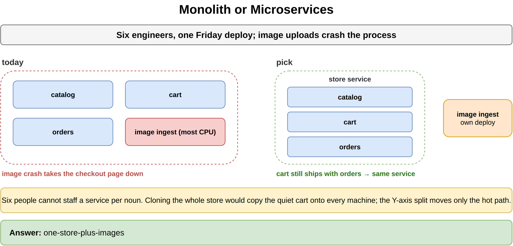
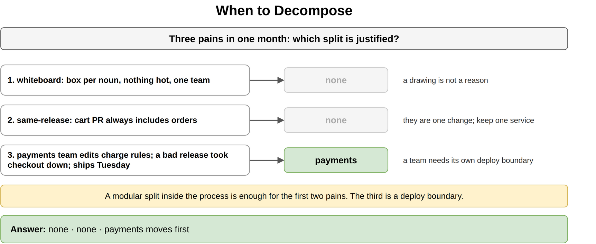
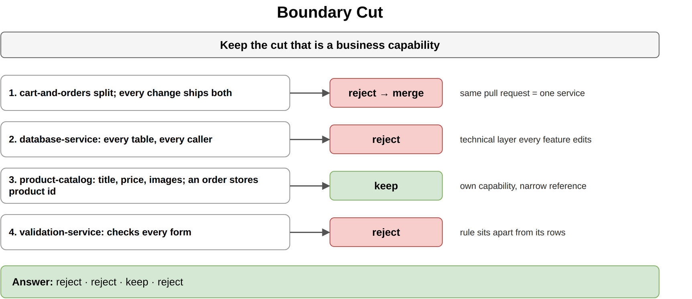
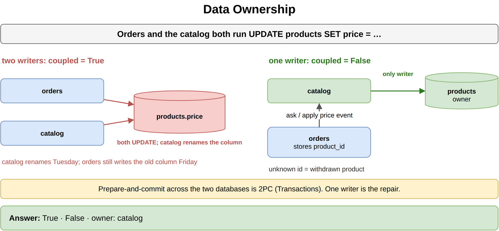
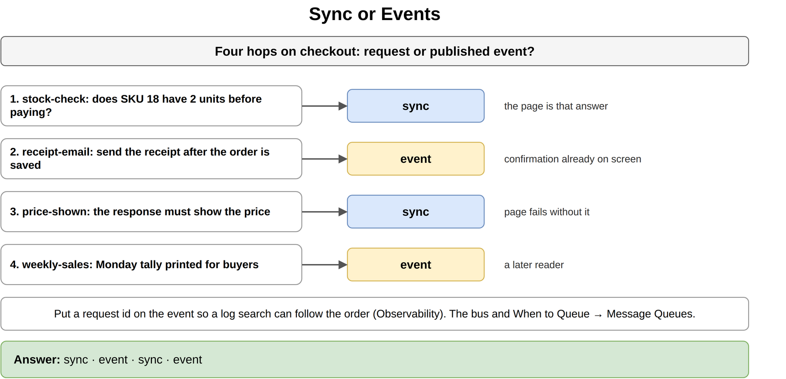
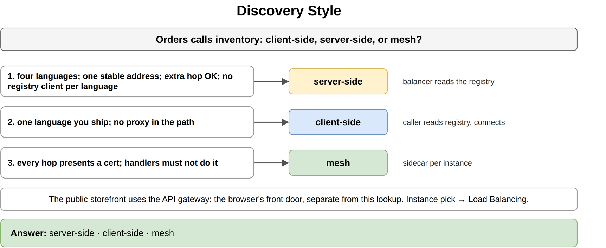
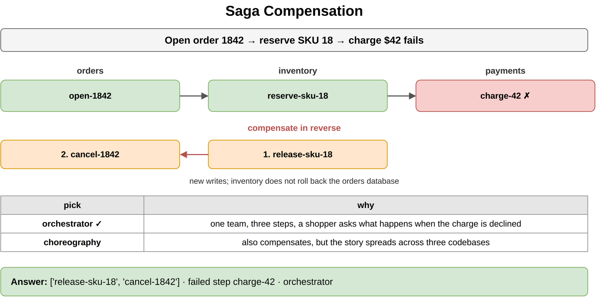
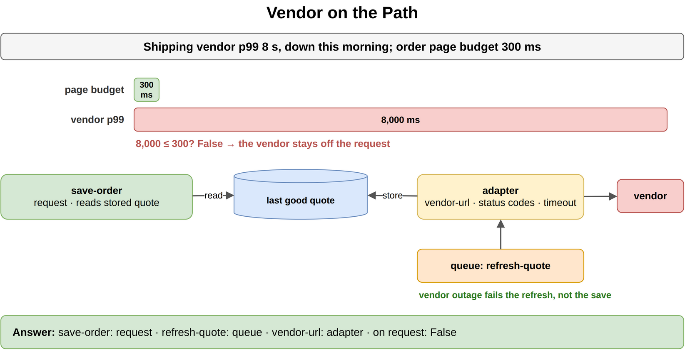

# Microservices and System Decomposition — Drills

Original practice for an online store: where one process should split, who writes a row, and what a failed later step undoes. Each card is one exercise. Commit to an answer, then check it. The numbers are invented for that store.

The scale cube and stateless services stay in [Scalability Fundamentals](../02_Scalability_Fundamentals/). Circuit breakers stay in [High Availability and Reliability](../03_High_Availability_and_Reliability/). Load-balancer algorithms stay in [Load Balancing](../04_Load_Balancing/). The API gateway and connection-level state stay in [Networking and Communication](../10_Networking_and_Communication/). The bus, When to Queue, and the transactional outbox stay in [Message Queues and Async Processing](../11_Message_Queues_and_Async_Processing/). Stream processing, change data capture, and event sourcing stay in [Storage and Data Processing at Scale](../13_Storage_and_Data_Processing_at_Scale/). Two-phase commit stays in [Transactions and Concurrency Control](../16_Transactions_and_Concurrency_Control/). Notification products stay in [Real-Time and Notification Systems](../21_Real_Time_and_Notification_Systems/). Payment products stay in [Payment and Financial Systems](../23_Payment_and_Financial_Systems/). Logs and request ids stay in [Observability](../25_Observability/).

## Monolith or Microservices

Six engineers ship the store once, on Friday. Catalog, cart, and orders live in one process. Holiday image uploads are most of the CPU and have crashed that process twice, which took the checkout page down with them. Cart changes and order changes still land together. Pick the starting shape.

```python
TEAM = 6
HOT = "images"
SHARED_CRASHES = True
```

**Answer:** One store service for catalog, cart, and orders, plus image ingest as its own deploy. Six people cannot staff a service per noun, and the cart still ships with the orders, so those stay one process. Image ingest is the hot path, and its crash is the outage the shopper feels. That is the one functional split worth a network hop. Cloning the whole store would copy the quiet cart onto every extra machine. The scale cube's Y-axis is this split, and the rest of that cube stays in Scalability Fundamentals.

```python
TEAM = 6
HOT = "images"
SHARED_CRASHES = True


def shape(team: int, hot: str, shared_crashes: bool) -> str:
    if team <= 8 and shared_crashes:
        return f"one-store-plus-{hot}"
    if team <= 8:
        return "one-store"
    return "per-noun"


print(shape(TEAM, HOT, SHARED_CRASHES))
# one-store-plus-images
```



*Source: [`diagrams/microservices-drills.drawio`](/content/09_System_Design_Interview/12_Microservices_and_System_Decomposition/diagrams/microservices-drills.drawio), page 1.*

## When to Decompose

The store is still one process and it works. Three pains show up in the same month. Which split is justified, and which piece moves first?

```text
1. whiteboard — a sketch with a box per noun. Nothing is hot. One team ships the whole path.
2. same-release — every cart change is in the same pull request as an order change.
3. payments-team — a payments group edits charge rules. Their bad release has taken down checkout. They need to ship on Tuesday, not on the Friday train.
```

```python
PAINS = ["whiteboard", "same-release", "payments-team"]
```

**Answer:** Only the payments team. Payments moves first, because another team needs a release train and their failures are already taking down checkout. The whiteboard is a drawing. The cart and the orders change together, so they stay one service. A modular split inside the process is enough for the first two pains. The third pain is a deploy boundary.

```python
PAINS = ["whiteboard", "same-release", "payments-team"]
FIRST = {"payments-team": "payments"}


def move(pain: str) -> str:
    return FIRST.get(pain, "none")


print(" ".join(move(pain) for pain in PAINS))
# none none payments
```



*Source: [`diagrams/microservices-drills.drawio`](/content/09_System_Design_Interview/12_Microservices_and_System_Decomposition/diagrams/microservices-drills.drawio), page 2.*

## Boundary Cut

Four proposed cuts. Keep the one that is a business capability. Reject the others.

```text
1. cart-and-orders — the cart in one service, orders in another. Every cart change still ships with an order change.
2. database-service — one service that reads and writes every table for every caller.
3. product-catalog — title, price, and images. An order stores a product id. A price change does not change the order schema.
4. validation-service — one service that checks every form, from coupon rules to address rules.
```

```python
CUTS = ["cart-and-orders", "database-service", "product-catalog", "validation-service"]
```

**Answer:** Keep the product catalog. A listed product is a different capability from an order, and the order only needs the product id. Merge the cart and the orders, because they still ship as one change. Reject the database service and the validation service. Both are technical layers. Every feature would have to edit them, and the rule would sit apart from the rows it judges.

```python
CUTS = ["cart-and-orders", "database-service", "product-catalog", "validation-service"]
KEEP = {"product-catalog"}

print(" ".join("keep" if name in KEEP else "reject" for name in CUTS))
# reject reject keep reject
```



*Source: [`diagrams/microservices-drills.drawio`](/content/09_System_Design_Interview/12_Microservices_and_System_Decomposition/diagrams/microservices-drills.drawio), page 3.*

## Data Ownership

The orders service and the product catalog both run `UPDATE products SET price = ...`. What breaks, and what does ownership look like instead?

```python
SHARED = ["orders", "catalog"]
```

**Answer:** Two deploys share one schema. The catalog renames `price` and ships on Tuesday. Orders still writes the old column on Friday, and there is no API version between them. The catalog is the only writer of `products`. An order stores `product_id` and does not write `price`. It asks the catalog, or it applies a price the catalog published. An unknown id means the product was withdrawn. A shared prepare-and-commit across the two databases is two-phase commit, and that protocol stays in Transactions and Concurrency Control. One writer is the repair.

```python
SHARED = ["orders", "catalog"]
OWNED = ["catalog"]


def coupled(writers: list[str]) -> bool:
    return len(writers) > 1


print(coupled(SHARED), coupled(OWNED), OWNED[0])
# True False catalog
```



*Source: [`diagrams/microservices-drills.drawio`](/content/09_System_Design_Interview/12_Microservices_and_System_Decomposition/diagrams/microservices-drills.drawio), page 4.*

## Sync or Events

Four hops follow a checkout. Which ones are a request that returns yes or no, and which ones are a published event?

```text
1. stock-check — the shopper asks whether SKU 18 has 2 units before paying. The page is that answer.
2. receipt-email — after the order is saved, the store emails the receipt. The shopper already has the confirmation on screen.
3. price-shown — the response must show the price, or the page is a failure.
4. weekly-sales — the Monday tally of units sold, printed for the buying team.
```

```python
STEPS = ["stock-check", "receipt-email", "price-shown", "weekly-sales"]
```

**Answer:** `stock-check` and `price-shown` stay calls. The page would be a guess without them. `receipt-email` and `weekly-sales` are events. The confirmation is already on screen, the receipt can catch up, and Monday is a later reader. How the event waits on a bus, and the test for leaving the request, are When to Queue in Message Queues and Async Processing. Which broker stores it is that topic's choice. Put a request id on the event so a log search can follow the order. The search stays in Observability.

```python
STEPS = ["stock-check", "receipt-email", "price-shown", "weekly-sales"]
SYNC = {"stock-check", "price-shown"}

print(" ".join("sync" if step in SYNC else "event" for step in STEPS))
# sync event sync event
```



*Source: [`diagrams/microservices-drills.drawio`](/content/09_System_Design_Interview/12_Microservices_and_System_Decomposition/diagrams/microservices-drills.drawio), page 5.*

## Discovery Style

The orders service calls inventory. Pick client-side, server-side, or mesh for each constraint.

```text
1. many-languages — four services, four languages. Callers know one stable address. An extra hop is acceptable. You will not ship a registry client in each language.
2. no-extra-hop — both sides are the one language you already ship. You will not put a proxy in the path.
3. uniform-mtls — every service-to-service hop must present a certificate, and the handlers must not contain that handshake.
```

```python
CASES = ["many-languages", "no-extra-hop", "uniform-mtls"]
```

**Answer:** Server-side, client-side, then mesh. Several languages and one stable address means a balancer reads the registry and the callers stay simple. The algorithm that picks an instance stays in Load Balancing. No extra hop, with code you ship, means the caller reads the registry and connects. Uniform certificates, with handlers that do not implement them, means a sidecar on each instance. The public storefront is the API gateway in Networking and Communication. That host is the browser's front door, not this lookup.

```python
CASES = ["many-languages", "no-extra-hop", "uniform-mtls"]
CHOICE = {
    "many-languages": "server-side",
    "no-extra-hop": "client-side",
    "uniform-mtls": "mesh",
}

print(" ".join(CHOICE[name] for name in CASES))
# server-side client-side mesh
```



*Source: [`diagrams/microservices-drills.drawio`](/content/09_System_Design_Interview/12_Microservices_and_System_Decomposition/diagrams/microservices-drills.drawio), page 6.*

## Saga Compensation

A checkout is three local commits. Orders opens order 1842 as pending. Inventory reserves 2 units of SKU 18. Payments then fails to charge $42, because the card is declined. What does each earlier step undo, and is an orchestrator or choreography the better fit?

```python
DONE = ["open-1842", "reserve-sku-18"]
FAILED = "charge-42"
```

**Answer:** Release the 2 units, then cancel order 1842. Those are new writes, in reverse order of the commits that succeeded. Inventory does not roll back the orders database. An orchestrator is the better fit. The store is one team, the chain is three steps, and a shopper asks what happens when the charge is declined. One coordinator can read that path back. Choreography would also compensate, with each service reacting to the last event, and the story would be spread across three codebases. The bus those events would ride, and the outbox the first event may need, stay in Message Queues and Async Processing. A prepare-and-commit across the three databases is two-phase commit, and that protocol stays in Transactions and Concurrency Control.

```python
DONE = ["open-1842", "reserve-sku-18"]
FAILED = "charge-42"
UNDO = {"open-1842": "cancel-1842", "reserve-sku-18": "release-sku-18"}


def compensate(done: list[str]) -> list[str]:
    return [UNDO[step] for step in reversed(done)]


print(compensate(DONE), FAILED)
# ['release-sku-18', 'cancel-1842'] charge-42
```



*Source: [`diagrams/microservices-drills.drawio`](/content/09_System_Design_Interview/12_Microservices_and_System_Decomposition/diagrams/microservices-drills.drawio), page 7.*

## Vendor on the Path

A shipping-quote vendor has a slow tail of 8 seconds, and it was down this morning. The page budget for placing an order is 300 ms. Placing the order has to succeed even when the quote is stale. The confirmation page may show the last quote the store stored. What sits in an adapter, what stays on the request, and when does a queue help?

```python
VENDOR_P99_MS = 8000
PAGE_BUDGET_MS = 300
STEPS = ["save-order", "refresh-quote", "vendor-url"]
```

**Answer:** The adapter is the only code that knows the vendor URL, the odd status codes, and the timeout. It stores the last good quote. The order save stays on the request and reads that stored quote. It does not call the vendor. Eight seconds does not fit a 300 ms page. Refreshing the quote goes on a queue, because the order is already saved and the shopper can leave. A vendor outage then fails the refresh, not the save. That split is When to Queue in Message Queues and Async Processing. The adapter is not a design for sending the quote to a phone, and it is not a payment flow.

```python
VENDOR_P99_MS = 8000
PAGE_BUDGET_MS = 300
STEPS = ["save-order", "refresh-quote", "vendor-url"]
PLACE = {"save-order": "request", "refresh-quote": "queue", "vendor-url": "adapter"}


def on_request(vendor_ms: int, budget_ms: int) -> bool:
    return vendor_ms <= budget_ms


print(" ".join(PLACE[step] for step in STEPS), on_request(VENDOR_P99_MS, PAGE_BUDGET_MS))
# request queue adapter False
```



*Source: [`diagrams/microservices-drills.drawio`](/content/09_System_Design_Interview/12_Microservices_and_System_Decomposition/diagrams/microservices-drills.drawio), page 8.*
