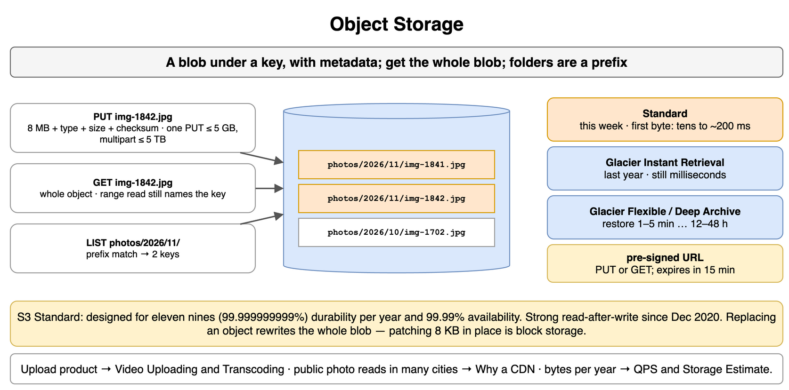
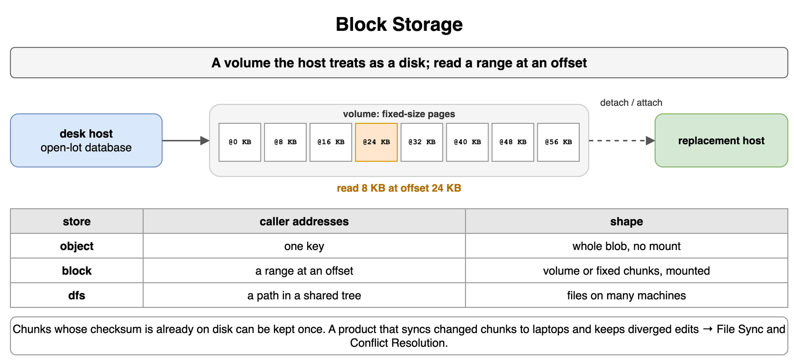
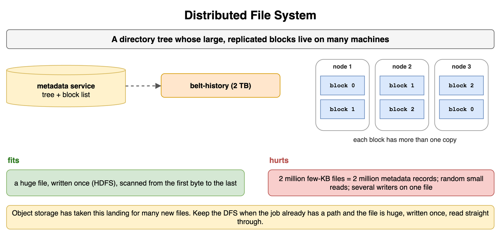
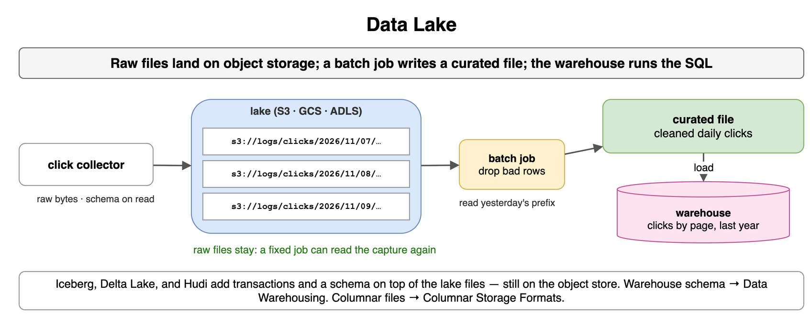
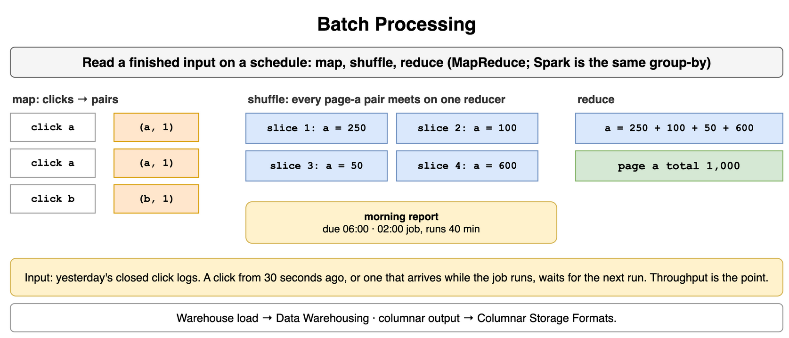
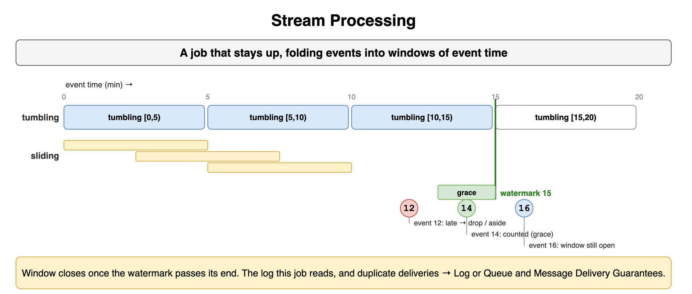
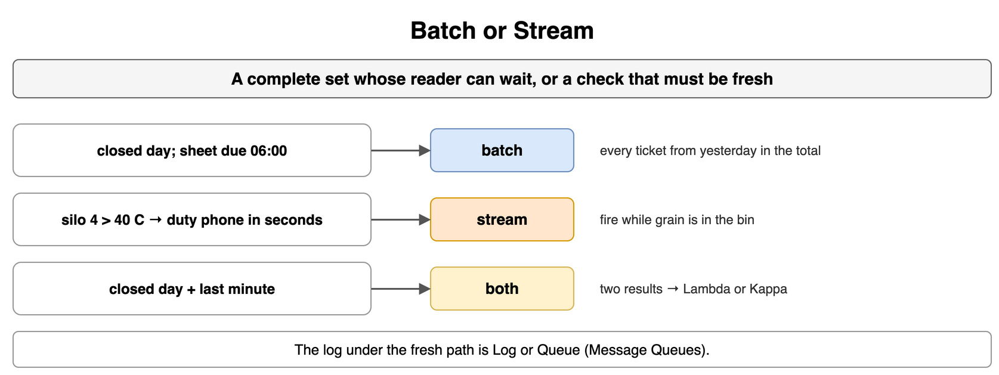
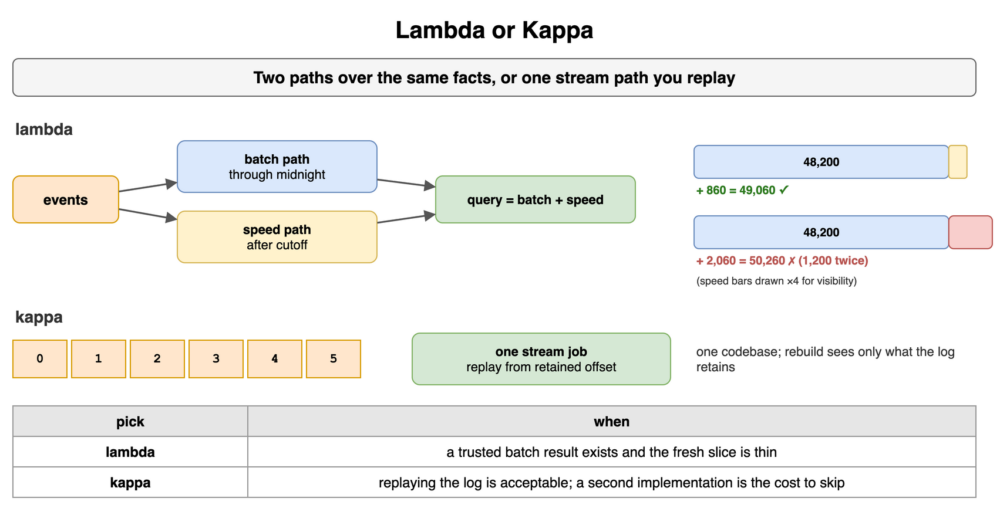
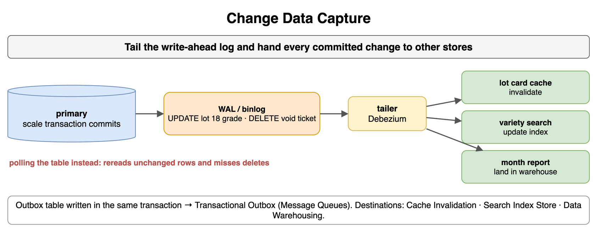
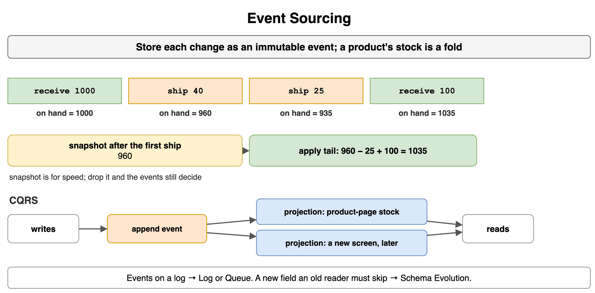

## Object Storage

An object store keeps a blob under a string key, with a little metadata beside it: content type, size, and a checksum. Amazon S3 is the system this card describes. An 8 MB product photo lives at `photos/2026/11/img-1842.jpg`. A PUT stores it in one request, since S3 accepts a single PUT up to 5 GB, and a larger object is uploaded in parts, up to 5 TB, under the same key. A GET names the key and returns the object, often with the first byte in tens to a couple of hundred milliseconds from the same region. A range read returns a slice and still names the key. A LIST under `photos/2026/11/` is a prefix match, so the folder is the prefix. Since December 2020, S3 gives strong read-after-write consistency, so a GET or LIST after a successful PUT sees the new object.

Databases and attached disks are a poor home for files written once and fetched whole. Photos, uploads, backups, and log objects fill a disk and have to survive the loss of any one disk. The store spreads blobs across machines with replication or erasure coding, and grows as you add objects, with no volume to size. S3 Standard is designed for eleven nines (99.999999999%) of durability over a year and, separately, 99.99% availability. A pre-signed URL, for example one that expires in 15 minutes, lets a browser PUT or GET without your credentials.

Storage classes trade retrieval speed for price. S3 Glacier Instant Retrieval still opens in milliseconds. Glacier Flexible Retrieval restores in 1–5 minutes on the expedited tier for objects under 250 MB, 3–5 hours on the standard tier, and 5–12 hours on the bulk tier. Deep Archive restores within 12 hours, or 48 hours on the bulk tier. Replacing an object rewrites the whole blob, and versioning keeps the old one. You cannot patch 8 KB in the middle. That interface is block storage. A browser upload product is Video Uploading and Transcoding, and a public photo read from many cities is Why a CDN, both in [Content Distribution and Media](../22_Content_Distribution_and_Media/). Sizing a year of objects is QPS and Storage Estimate in [Interview Framework and Process](../01_Interview_Framework_and_Process/).

```text
PUT / GET     whole blob by key, range reads still name the key
LIST          a prefix match, the folder is the prefix
durability    eleven nines by design, availability 99.99%
classes       hot opens in ms, archive restores in minutes or hours
```



*Source: [`diagrams/storage-processing.drawio`](/content/09_System_Design_Interview/13_Storage_and_Data_Processing_at_Scale/diagrams/storage-processing.drawio), page 1.*

## Block Storage

A block store presents a volume that a host treats as a disk. The host reads and writes a range of bytes at an offset. Amazon EBS, a SAN LUN, and an iSCSI target are this interface. A database rewrites one page inside a large file many times a second, and PostgreSQL's default page is 8 KB. The operating system or the database needs something it can mount and seek. An object store addresses a whole key, and a distributed file system addresses a shared path, so the page store under the database is a volume.

The service hands the host a volume of a chosen size, for example 500 GB. The host formats a filesystem, or the database writes pages directly. Page 0 is bytes 0–8191, page 1 starts at offset 8192, and page 100 is a read at offset 819,200. A volume can be detached from a failed host and attached to its replacement. Most cloud volumes attach to one host at a time. Multi-attach exists for specific volume types, and the filesystem then has to understand shared writers. Some chunk-based and backup stores keep a chunk once when its checksum is already stored. A plain attached volume stores every block you write, duplicates included.

You get low-latency random reads and writes, a provisioned size, and snapshots. You expand the volume when it fills and pay for what you allocated. Object storage grows by the byte and has no attach step, with a coarser interface. In an interview, say the operation out loud: "8 KB at an offset" versus "GET the whole key." Syncing a user's folder across laptops is File Sync and Conflict Resolution in [Content Distribution and Media](../22_Content_Distribution_and_Media/).

```text
object storage   one key returns the blob: photos, backups, lake files
block storage    a mounted volume, a range at an offset: database pages
distributed fs   a shared path, a huge file scanned straight through
```



*Source: [`diagrams/storage-processing.drawio`](/content/09_System_Design_Interview/13_Storage_and_Data_Processing_at_Scale/diagrams/storage-processing.drawio), page 2.*

## Distributed File System

A distributed file system is a directory tree whose bytes live on many machines, with a metadata service that records which machine holds each block. HDFS is the teaching system: a NameNode holds the namespace, and DataNodes hold the blocks. A single disk cannot hold a multi-terabyte click log, and a batch job wants to scan that file on several machines at once. The file system places the blocks, and the job reads them where they already sit.

A client creates `/logs/clicks/2026-11-09.log` through the NameNode. The file is cut into blocks, 128 MiB by default, so a 2 TiB file is 16,384 blocks (`2 × 1024 × 1024 / 128`). Each block is stored on 3 DataNodes by default, which is 49,152 replicas, and a lost disk is repaired by copying a surviving replica. The NameNode keeps the directory and the block list in memory. Hadoop's planning figure is about 150 bytes of heap per file, directory, or block. The intended life of a file is one writer that finishes it, then many readers that scan straight through. HDFS can append, but only as one sequential writer.

Small files are the classic mismatch. Two million files of about 4 KB hold only about 8 GB, yet they are about four million NameNode objects, roughly 600 MB of metadata, against a few megabytes for the 2 TiB file. The job also has to open millions of paths. A random 8 KB read is the same mismatch, because the block was sized for a long scan. Object storage has taken this landing zone for a lot of new data: there is no metadata service to run, and Spark can scan objects. Keep HDFS when a job already has the path and the file is huge, written once, and read straight through.

```text
block          128 MiB default, replication 3
2 TiB file     16,384 blocks, 49,152 replicas
NameNode       about 150 bytes of heap per file, directory, or block
tiny files     pressure the metadata long before they fill the disks
```



*Source: [`diagrams/storage-processing.drawio`](/content/09_System_Design_Interview/13_Storage_and_Data_Processing_at_Scale/diagrams/storage-processing.drawio), page 3.*

## Data Lake

A data lake is where raw files land, almost always on object storage such as S3, GCS, or ADLS. The click collector writes the bytes it captured under a prefix such as `s3://logs/clicks/2026/11/09/`. Those bytes have not been joined to a user or summed by page. Loading every feed into a warehouse table before it can land drops fields you later wish you had kept, and it blocks the file until someone designs a schema. The lake stores the capture cheaply so a new question can start from the original bytes.

The schema is whatever is inside the file, JSON, CSV, or Parquet, and a job applies it at read time. That is schema on read. A later batch job reads yesterday's prefix, drops bad rows, and writes a curated object: one file of cleaned daily clicks another job can trust. A load job can copy that file into warehouse tables for an analyst's SQL. The raw files stay, so when the curated job had a bug, a new job reads the capture again.

A lake with no owner and no curated output becomes a pile of files in three date formats that no query trusts. Say who may read the raw prefix and which job writes the curated file. The warehouse is the other bet, tables with a schema for the long analytical question: Data Warehousing in [Databases NoSQL and Specialized](../07_Databases_NoSQL_and_Specialized/). The columnar file a scan reads is Columnar Storage Formats in [Encoding Serialization and Schema Evolution](../14_Encoding_Serialization_and_Schema_Evolution/). Apache Iceberg, Delta Lake, and Apache Hudi add transactions and a schema on top of lake files. They narrow the gap and still sit on the object store.

```text
raw capture     the lake, bytes unchanged, written by the collector
curated file    derived from a raw prefix by a batch job
last year       the warehouse, or an explicit lakehouse table
```



*Source: [`diagrams/storage-processing.drawio`](/content/09_System_Design_Interview/13_Storage_and_Data_Processing_at_Scale/diagrams/storage-processing.drawio), page 4.*

## Batch Processing

A batch job reads a finished input, runs to completion, and writes an output. Yesterday's click logs are closed. The job starts on a schedule, runs for minutes or hours, and writes a rollup. A click that arrives during the run waits for the next run. Some answers only mean something once the set is complete: page views for a closed day, a curated lake file, a full rebuild of a statistic. Throughput is the point, and the morning report can wait until 06:00.

The teaching shape is MapReduce. Map has each worker read a slice and emit pairs, so clicks on pages `a`, `a`, and `b` become `(a, 1)`, `(a, 1)`, `(b, 1)`. Shuffle groups pairs by key, so every pair for page `a` meets on one reducer. Reduce sums them: slices that contributed 250, 100, 50, and 600 give 1,000. The output is a report file, a curated lake object, or a warehouse load. Spark runs the same group-by, keeping intermediate rows in memory and spilling to disk when a partition is large.

The job can sort, join, and aggregate the whole set, and the same input can run again to fix a bug. The result is late by the schedule plus the runtime: a 02:00 job that runs 40 minutes describes yesterday, and a click from 30 seconds ago is in the next run. In an interview, name the closed input and the deadline. The warehouse load is Data Warehousing in [Databases NoSQL and Specialized](../07_Databases_NoSQL_and_Specialized/), and the columnar file it writes is Columnar Storage Formats in [Encoding Serialization and Schema Evolution](../14_Encoding_Serialization_and_Schema_Evolution/).

```text
map       emit (page, 1)
shuffle   bring one page's pairs together
reduce    write the total, here 1,000
late      anything after the seal waits for the next run
```



*Source: [`diagrams/storage-processing.drawio`](/content/09_System_Design_Interview/13_Storage_and_Data_Processing_at_Scale/diagrams/storage-processing.drawio), page 5.*

## Stream Processing

A stream job stays up. It reads events as they arrive and updates a result while they are still fresh. Kafka is the usual log and Flink the usual processor. The morning batch cannot page anyone within seconds, and a fraud check, a live counter, or "checkout failures crossed 50 in a minute" needs a result that moves with the events. The input is never finished, so the job has to decide when a window is complete enough to emit.

Each event carries an event-time timestamp, when the click happened, which can differ from processing time, when the job received it. The job groups events into windows on event time. A tumbling five-minute window is `[0, 5)`, then `[5, 10)`, with no overlap. A sliding window overlaps the one before it, for example five minutes starting every minute. A session window closes after a gap with no events. The watermark is the event time the job treats as complete, usually trailing the newest timestamp by a small bound. In this topic's hand rule, a window ending at `end` stays open while `watermark < end`, and a grace interval still counts a late event whose time is at least `watermark - grace`. With the watermark at 15 and grace 2, minute 14 still counts in the closed window, minute 12 is dropped or written aside, and minute 16 is in the open window ending at 20. Flink's allowed lateness is the production version of grace. Closed windows go to a sink: a row, a cache key, or another topic.

You get freshness in seconds and take on late, out-of-order, and duplicate events. An at-least-once log counts an event twice unless the update is idempotent or the sink deduplicates. Flink's exactly-once needs a sink that participates, such as Kafka transactions. A large grace holds state, and a tiny one drops a slow producer's events. The log and duplicate delivery are Log or Queue and Message Delivery Guarantees in [Message Queues and Async Processing](../11_Message_Queues_and_Async_Processing/).

```text
event time    when it happened, processing time is when the job saw it
windows       tumbling, sliding, session
watermark 15  grace 2: minute 14 counts, 12 set aside, 16 still open
duplicates    idempotent update or a deduplicating sink
```



*Source: [`diagrams/storage-processing.drawio`](/content/09_System_Design_Interview/13_Storage_and_Data_Processing_at_Scale/diagrams/storage-processing.drawio), page 6.*

## Batch or Stream

Batch and stream are two schedules for an aggregate. A batch job fits a complete set whose reader can wait. A stream job fits a check that has to be fresh. One job asked to be both the reconciled daily total and the alert from 30 seconds ago misses one of them, so ask when the reader needs the answer and whether you can name a closed input.

The morning report is page views by page for yesterday, due at 06:00, including every click from the closed day. The input can be sealed, so one scheduled batch job is enough. Checkout failures crossed 50 in the last minute, and on-call should hear within seconds. The events are still arriving, so a stream job on Kafka and Flink fits. The office wants yesterday's closed total and the last minute's page views. Those are two results, and serving them together is Lambda or Kappa, the next card.

Batch is simpler to rerun and easier to make complete, and its answer is late. Stream is fresh, and it needs windows, a watermark, and a plan for duplicates. Asking for both means combining two results so the same event is counted once. The log under the fresh path is Log or Queue in [Message Queues and Async Processing](../11_Message_Queues_and_Async_Processing/).

```text
closed day, reader waits     batch
fire within seconds          stream
closed day plus last minute  two results, Lambda or Kappa
```



*Source: [`diagrams/storage-processing.drawio`](/content/09_System_Design_Interview/13_Storage_and_Data_Processing_at_Scale/diagrams/storage-processing.drawio), page 7.*

## Lambda or Kappa

Lambda and Kappa are two ways to serve a closed historical result and a fresh one together. A batch total is the number people reconcile, and it is blind after its cutoff. A stream total is fresh, and it is hard to rebuild unless the log still holds the history. Lambda runs both paths. A batch layer writes the reconciled view, a speed layer folds events after the cutoff, and a serving layer answers with batch plus speed. Yesterday's batch total is 48,200 page views through midnight, and the speed path has 860 since, so the answer is 49,060. A speed total of 2,060 that still includes 1,200 page views from before midnight gives 50,260, and those 1,200 are counted twice.

```python
def query(batch: int, speed_after_batch: int) -> int:
    return batch + speed_after_batch


print(query(48_200, 860), query(48_200, 860 + 1_200))
# 49060 50260
```

Lambda fits when a trusted nightly batch already exists and the fresh slice is thin. The cost is two copies of the logic that can disagree until the batch reruns, and a query that must not overlap them. Kappa drops the second implementation. Events sit in a log, and a corrected stream job replays from retained offsets to rebuild the totals, so there is one codebase. The rebuild only sees what the log still holds. Kafka's default retention is 7 days (`log.retention.hours=168`), and a compacted topic keeps only the latest record per key, so it cannot replay history compaction already dropped. Choose Kappa when you can say how long the log keeps events. Retention is Log or Queue in [Message Queues and Async Processing](../11_Message_Queues_and_Async_Processing/).

```text
Lambda    batch through the cutoff + speed after it = 49,060
overlap   speed rows the batch already counted = 50,260
Kappa     one stream job, replay the retained log to rebuild
```



*Source: [`diagrams/storage-processing.drawio`](/content/09_System_Design_Interview/13_Storage_and_Data_Processing_at_Scale/diagrams/storage-processing.drawio), page 8.*

## Change Data Capture

Change data capture hands each committed insert, update, and delete to another store. The usual source is the database's own recovery log: the Postgres write-ahead log or the MySQL binlog. The primary already wrote that log to recover, and a tailer, usually Debezium, reads it after the commit. A cache, a search index, and a warehouse all need the committed row, including the moment it disappears. A timer that polls `updated_at` rereads quiet rows and misses a hard delete once the row is gone.

Order 1842 moves from `hold` to `shipped`, and a voided order is deleted. Both changes are in the log. The connector usually starts with a consistent snapshot of the table, then follows the log in commit order. Each reader picks its destination. The product page drops a stale copy, which is Cache Invalidation in [Caching](../05_Caching/). Catalog search updates Search Index Store, and the monthly revenue report lands in Data Warehousing, both in [Databases NoSQL and Specialized](../07_Databases_NoSQL_and_Specialized/).

Log-based capture sees deletes and skips unchanged rows. It couples you to the log format, and the tailer has to keep up, because a log recycled before it is read loses the change. Readers update after the commit, on that lag. A message that must commit or roll back with the business write is a different tool: an outbox table in the same transaction, Transactional Outbox in [Message Queues and Async Processing](../11_Message_Queues_and_Async_Processing/). In an interview, say "tail the WAL or binlog" before "poll `updated_at`," and mention the delete.

```text
source        WAL or binlog, so a delete is an event
cache         drop the stale copy
search        update the document
warehouse     load the row, off the primary
same commit   Transactional Outbox, written by the application
```



*Source: [`diagrams/storage-processing.drawio`](/content/09_System_Design_Interview/13_Storage_and_Data_Processing_at_Scale/diagrams/storage-processing.drawio), page 9.*

## Event Sourcing

Event sourcing stores each change as an immutable event, and the current value is a fold of that sequence. The events are the source of truth. A table of the current value is a copy that can be rebuilt. A column that only stores "1,035 units on hand" drops the history that produced it, so a bad overwrite is hard to explain or undo. A product's stock events are receive 1000, ship 40, ship 25, and receive 100. A command appends an event and never updates a stock column in place. Folding from 0 gives 1000, 960, 935, and 1035 units on hand.

```python
def fold(events: list[tuple[str, int]], start: int = 0) -> int:
    level = start
    for kind, amount in events:
        level += amount if kind == "receive" else -amount
    return level


events = [("receive", 1000), ("ship", 40), ("ship", 25), ("receive", 100)]
snapshot = fold(events[:2])
print(fold(events), snapshot, fold(events[2:], snapshot))
# 1035 960 1035
```

A snapshot is the fold saved at an event number, for speed. A snapshot after the first ship holds 960, and applying the tail gives `960 - 25 + 100 = 1035`, without scanning the whole history. Throw the snapshot away and the events still decide the value. A projection is a fold shaped for one reader, such as the stock count on the product page. Writes append events and reads use the projection. That split is CQRS, command query responsibility segregation. You gain an audit trail and can rebuild a projection or answer "what was on hand after the second event?" You take on a longer write path, event shapes that must evolve, and awkward queries until a projection exists. It fits orders, inventory, and ledgers, and it is heavy for a profile row that is simply overwritten. The log is Log or Queue in [Message Queues and Async Processing](../11_Message_Queues_and_Async_Processing/). A new field an old reader must skip is Schema Evolution in [Encoding Serialization and Schema Evolution](../14_Encoding_Serialization_and_Schema_Evolution/).

```text
events       receive 1000, ship 40, ship 25, receive 100
fold         1035 on hand
snapshot     960 after the first ship, plus the tail = 1035
projection   the product page's read model, disposable
```



*Source: [`diagrams/storage-processing.drawio`](/content/09_System_Design_Interview/13_Storage_and_Data_Processing_at_Scale/diagrams/storage-processing.drawio), page 10.*
