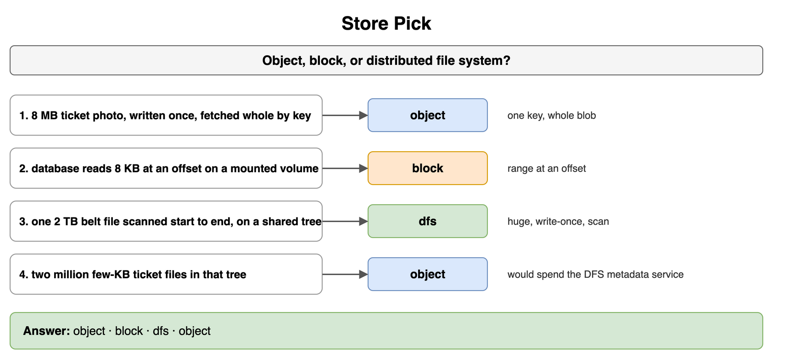
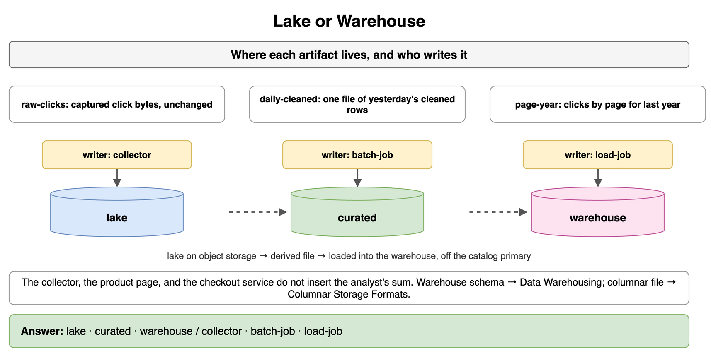
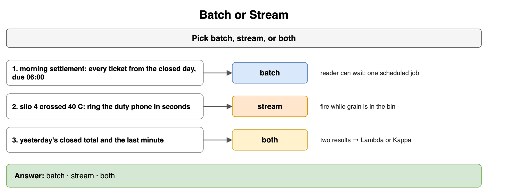
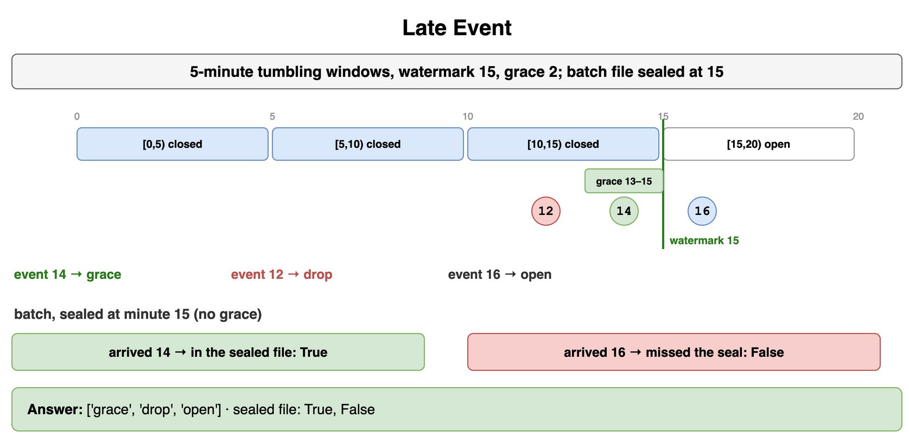
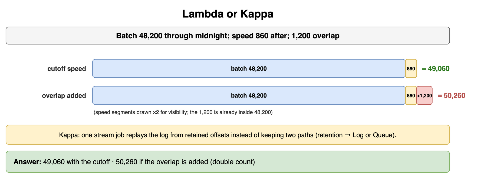
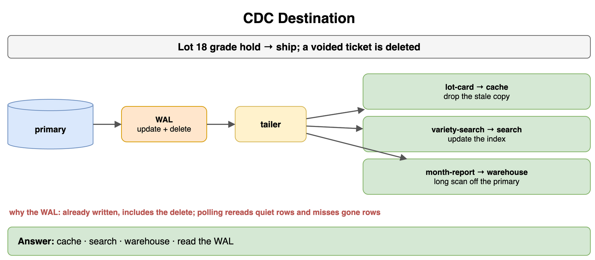
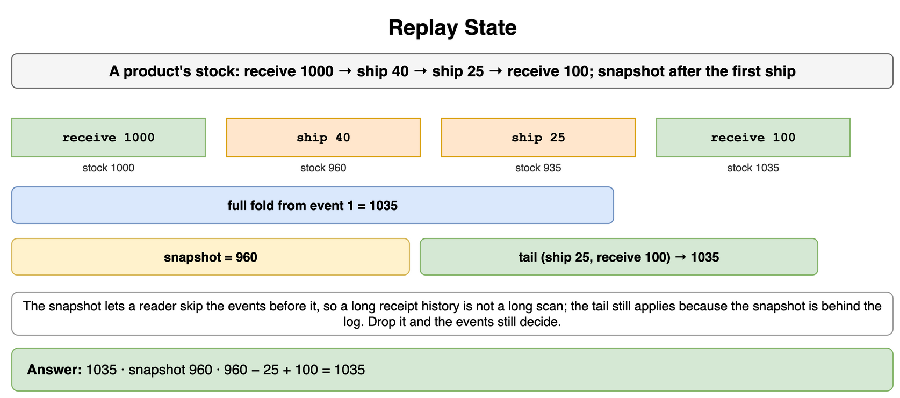
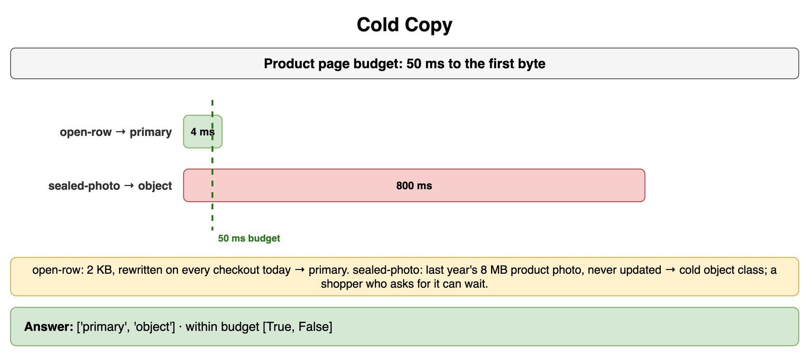

# Storage and Data Processing at Scale — Drills

Original practice for where bytes live and how a result is computed. Each card is one exercise: commit to an answer, then check it. The numbers are small examples from object storage, click logs, and a product inventory. Capacity math stays in Interview Framework and Process. Cache invalidation stays in Caching. The relational primary stays in Databases Relational. The warehouse and the search index stay in Databases NoSQL and Specialized. Partition placement stays in Data Partitioning and Consistent Hashing. The broker, Log or Queue, delivery, and the transactional outbox stay in Message Queues and Async Processing. Columnar files and event schema changes stay in Encoding Serialization and Schema Evolution. A trie stays in Search, Autocomplete, and Information Retrieval. The edge, a video upload, and file sync stay in Content Distribution and Media.

## Store Pick

Assign each landing to object storage, block storage, or a distributed file system.

```text
1. product-photo — an 8 MB product photo. Written once. A reader fetches the whole object by key.
2. db-volume — the catalog database reads an 8 KB page at an offset. The process mounts a volume on the database host.
3. click-history — one 2 TB file of click logs. The nightly job scans it from the first byte to the last. It already lives in a shared tree of huge files.
4. tiny-events — two million event files, a few KB each, as separate paths in that same tree.
```

```python
CASES = ["product-photo", "db-volume", "click-history", "tiny-events"]
```

**Answer:** Object, block, distributed file system, then object again. The photo is one key and the whole blob, written once. The database wants a mounted volume and a range at an offset, which is block storage. The click file is the distributed file system's case: huge, written once, and scanned straight through on a path the job already opens. The two million tiny event files would spend that file system's metadata service, so they land as objects under a prefix. A laptop sync of a user's folder, including two offline edits, stays in File Sync and Conflict Resolution.

```python
CASES = ["product-photo", "db-volume", "click-history", "tiny-events"]
CHOICE = {
    "product-photo": "object",
    "db-volume": "block",
    "click-history": "dfs",
    "tiny-events": "object",
}

print(" ".join(CHOICE[name] for name in CASES))
# object block dfs object
```



*Source: [`diagrams/storage-processing-drills.drawio`](/content/09_System_Design_Interview/13_Storage_and_Data_Processing_at_Scale/diagrams/storage-processing-drills.drawio), page 1.*

## Lake or Warehouse

Say where each artifact lives, and who writes it. The choices are the lake, a curated file derived from the lake, and the warehouse.

```text
1. raw-clicks — the collector stores the click bytes it captured, unchanged.
2. daily-cleaned — a job reads yesterday's clicks and writes one file of cleaned rows.
3. page-year — an analyst sums clicks by page for last year. The query must stay off the catalog primary.
```

```python
CASES = ["raw-clicks", "daily-cleaned", "page-year"]
```

**Answer:** Lake, curated file, warehouse. The collector writes the raw landing onto object storage, which is the lake. The cleaning job writes the curated file. That file is still a derived object, and the collector does not write it. The analyst's year-long sum is the warehouse, loaded from those files and kept off the primary. The collector, the product page, and the checkout service do not insert that sum. The warehouse's schema, including a star of facts and dimension tables, stays in Data Warehousing. A columnar layout of the cleaned file stays in Columnar Storage Formats.

```python
CASES = ["raw-clicks", "daily-cleaned", "page-year"]
HOME = {
    "raw-clicks": "lake",
    "daily-cleaned": "curated",
    "page-year": "warehouse",
}
WRITER = {
    "raw-clicks": "collector",
    "daily-cleaned": "batch-job",
    "page-year": "load-job",
}

print(" ".join(HOME[name] for name in CASES))
print(" ".join(WRITER[name] for name in CASES))
# lake curated warehouse
# collector batch-job load-job
```



*Source: [`diagrams/storage-processing-drills.drawio`](/content/09_System_Design_Interview/13_Storage_and_Data_Processing_at_Scale/diagrams/storage-processing-drills.drawio), page 2.*

## Batch or Stream

Pick batch, stream, or both for each need.

```text
1. morning-report — page views by page for yesterday. The report is due at 06:00. It has to include every click from the closed day.
2. failure-page — checkout failures crossed 50 in a minute. On-call should be paged within a few seconds.
3. day-and-minute — the office wants yesterday's closed total and the page views from the last minute.
```

```python
CASES = ["morning-report", "failure-page", "day-and-minute"]
```

**Answer:** Batch, stream, then both. The report reads a finished day and the reader can wait until morning, so one scheduled job is enough. The failure check has to fire while the checkouts are still failing, so it is a stream. The third need is two results, a closed total and a fresh minute, which is Lambda or Kappa. The log under the fresh path is Log or Queue.

```python
CASES = ["morning-report", "failure-page", "day-and-minute"]
CHOICE = {
    "morning-report": "batch",
    "failure-page": "stream",
    "day-and-minute": "both",
}

print(" ".join(CHOICE[name] for name in CASES))
# batch stream both
```



*Source: [`diagrams/storage-processing-drills.drawio`](/content/09_System_Design_Interview/13_Storage_and_Data_Processing_at_Scale/diagrams/storage-processing-drills.drawio), page 3.*

## Late Event

Windows are five minutes of event time, tumbling. The watermark is minute 15, so a window that ends at minute 15 is closed. Grace is 2 minutes: an event still counts when its event time is at least `watermark - grace`. Three click events are classified by the minute in their timestamp. Separately, the batch file for that span is sealed at minute 15. Say whether a click that arrived at minute 14 made that sealed file, and whether a click that arrived at minute 16 did.

```python
EVENTS = [14, 12, 16]
WATERMARK = 15
GRACE = 2
SEAL = 15
```

**Answer:** Grace, drop, open. Event minute 14 falls in the window that ends at 15, the watermark has closed that window, and 14 is still inside the 2-minute grace, so the stream counts it. Event minute 12 is in the same closed window and outside the grace, so the stream drops it or writes it aside. Event minute 16 is in the window that ends at 20, and the watermark has not passed that end, so the window is still open. The batch job waits for the sealed file. An arrival at minute 14 is in the file. An arrival at minute 16 missed the seal, so that click is absent from the closed batch and present only if a later run takes it. The batch has no grace after the seal. The stream closed on a watermark and kept one.

```python
EVENTS = [14, 12, 16]
WATERMARK = 15
GRACE = 2
SEAL = 15
WINDOW = 5


def stream_place(event_min: int, watermark: int, grace: int, window: int) -> str:
    end = (event_min // window) * window + window
    if watermark < end:
        return "open"
    if event_min >= watermark - grace:
        return "grace"
    return "drop"


def in_sealed_file(arrive_min: int, seal_min: int) -> bool:
    return arrive_min < seal_min


print([stream_place(event, WATERMARK, GRACE, WINDOW) for event in EVENTS])
print(in_sealed_file(14, SEAL), in_sealed_file(16, SEAL))
# ['grace', 'drop', 'open']
# True False
```



*Source: [`diagrams/storage-processing-drills.drawio`](/content/09_System_Design_Interview/13_Storage_and_Data_Processing_at_Scale/diagrams/storage-processing-drills.drawio), page 4.*

## Lambda or Kappa

Yesterday's batch total is 48,200 page views and covers every event through midnight. The speed path has 860 page views from after midnight. A second speed total, 2,060, still includes 1,200 page views from late yesterday that the batch already counted. What does a lambda query return when the speed path starts at the cutoff, and what does it return if those 1,200 are added too? When would you replay one log instead of keeping both paths?

```python
BATCH = 48_200
AFTER_CUTOFF = 860
ALREADY_IN_BATCH = 1_200
```

**Answer:** 49,060, and 50,260 if the overlap is added. The lambda query is the batch total plus the speed total from after the cutoff. The 1,200 is already inside 48,200, so adding the longer speed total counts those page views twice. Kappa skips the second path. One stream job rebuilds by replaying the log from the offsets it still retains, which is Log or Queue, including how long the log keeps a record. The replay is a processing choice. Which broker product holds the log stays in that topic.

```python
BATCH = 48_200
AFTER_CUTOFF = 860
ALREADY_IN_BATCH = 1_200


def query(batch: int, speed_after_batch: int) -> int:
    return batch + speed_after_batch


print(query(BATCH, AFTER_CUTOFF), query(BATCH, AFTER_CUTOFF + ALREADY_IN_BATCH))
# 49060 50260
```



*Source: [`diagrams/storage-processing-drills.drawio`](/content/09_System_Design_Interview/13_Storage_and_Data_Processing_at_Scale/diagrams/storage-processing-drills.drawio), page 5.*

## CDC Destination

Order 1842's status changes from hold to shipped on the primary, and a voided order is deleted. Three readers have to hear about changes. Say where each change goes, and why the capture reads the write-ahead log.

```text
1. product-card — the product page keeps a cached copy of the product.
2. catalog-search — find products by name.
3. month-report — revenue by category for the month, off the primary.
```

```python
READERS = ["product-card", "catalog-search", "month-report"]
```

**Answer:** Cache, search index, warehouse. The product card is a stale copy, so the change drops it: Cache Invalidation. Catalog search is a copy of names that live on the primary: Search Index Store. The monthly report is a long scan that must stay off the checkout transaction: Data Warehousing. Read the write-ahead log or binlog. The primary already wrote it, the tail includes the voided order's delete, and a poll of the live table both rereads quiet rows and can miss a row that is already gone. An outbox table in the same commit is Transactional Outbox.

```python
READERS = ["product-card", "catalog-search", "month-report"]
DEST = {
    "product-card": "cache",
    "catalog-search": "search",
    "month-report": "warehouse",
}

print(" ".join(DEST[name] for name in READERS), "wal")
# cache search warehouse wal
```



*Source: [`diagrams/storage-processing-drills.drawio`](/content/09_System_Design_Interview/13_Storage_and_Data_Processing_at_Scale/diagrams/storage-processing-drills.drawio), page 6.*

## Replay State

A product's stock events, in order, are receive 1000, ship 40, ship 25, receive 100. What is the stock after every event? A snapshot was saved after the first ship. What does that snapshot hold, and what is the stock if you apply only the tail on top of it? Say why the snapshot exists.

```python
EVENTS = [("receive", 1000), ("ship", 40), ("ship", 25), ("receive", 100)]
SNAPSHOT_THROUGH = 2
```

**Answer:** The full fold is 1035. The snapshot after the first ship holds 960. The tail is ship 25 and receive 100, and 960 minus 25 plus 100 is 1035 again. The snapshot exists so a reader can skip the events before that point. A long receipt history would make a fold from the first event a long scan, and the tail still has to be applied because the snapshot is behind the log. Throw the snapshot away and the events still decide the stock. This is the fold of the product. An ack that deletes or advances a consumer is Message Delivery Guarantees, and it is a different question.

```python
EVENTS = [("receive", 1000), ("ship", 40), ("ship", 25), ("receive", 100)]
SNAPSHOT_THROUGH = 2


def fold(events: list[tuple[str, int]], start: int = 0) -> int:
    level = start
    for kind, amount in events:
        if kind == "receive":
            level += amount
        else:
            level -= amount
    return level


snapshot = fold(EVENTS[:SNAPSHOT_THROUGH])
print(fold(EVENTS), snapshot, fold(EVENTS[SNAPSHOT_THROUGH:], snapshot))
# 1035 960 1035
```



*Source: [`diagrams/storage-processing-drills.drawio`](/content/09_System_Design_Interview/13_Storage_and_Data_Processing_at_Scale/diagrams/storage-processing-drills.drawio), page 7.*

## Cold Copy

Two byte ranges compete for the product page. The page's budget to the first byte is 50 ms. Put each range on the primary or in object storage, and say whether the page can open it inside the budget.

```text
1. open-row — 2 KB, rewritten on every checkout today. The primary returns the first byte in about 4 ms.
2. sealed-photo — last year's 8 MB product photo, never updated. The cold class takes about 800 ms to the first byte.
```

```python
BUDGET_MS = 50
ROWS = [
    {"name": "open-row", "first_byte_ms": 4, "still_written": True},
    {"name": "sealed-photo", "first_byte_ms": 800, "still_written": False},
]
```

**Answer:** The open row stays on the primary. It is still being written, and 4 ms fits the 50 ms budget, so the product page can read it on the request path. The sealed photo goes to object storage, in the cold class. It is immutable, large relative to the row, and 800 ms misses the page. A shopper who asks for last year's photo can wait for that first byte. Counting how many such files a year holds is QPS and Storage Estimate. The primary here is the relational store of live product rows, and this drill only places the bytes.

```python
BUDGET_MS = 50
ROWS = [
    {"name": "open-row", "first_byte_ms": 4, "still_written": True},
    {"name": "sealed-photo", "first_byte_ms": 800, "still_written": False},
]


def home(row: dict) -> str:
    if row["still_written"]:
        return "primary"
    return "object"


def within_budget(row: dict, budget_ms: int) -> bool:
    return row["first_byte_ms"] <= budget_ms


print([home(row) for row in ROWS], [within_budget(row, BUDGET_MS) for row in ROWS])
# ['primary', 'object'] [True, False]
```



*Source: [`diagrams/storage-processing-drills.drawio`](/content/09_System_Design_Interview/13_Storage_and_Data_Processing_at_Scale/diagrams/storage-processing-drills.drawio), page 8.*
