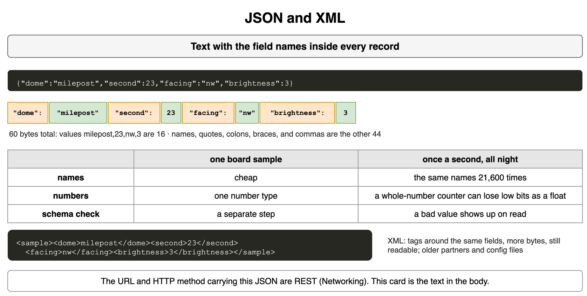
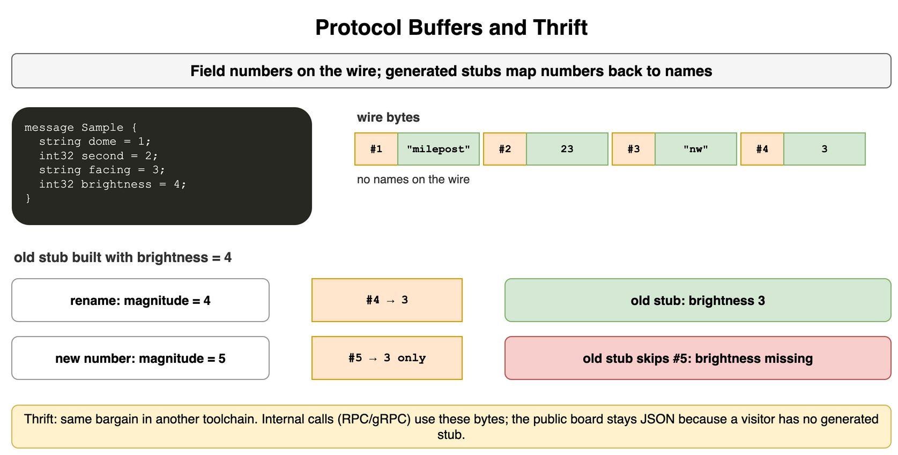
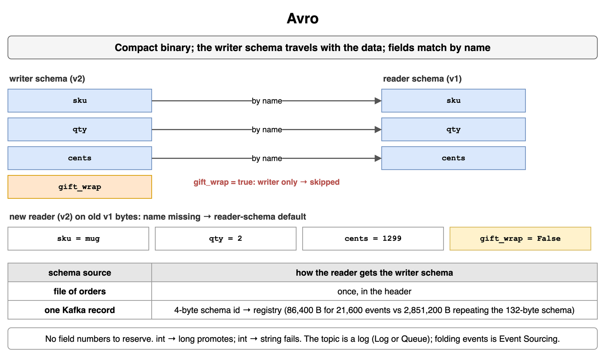
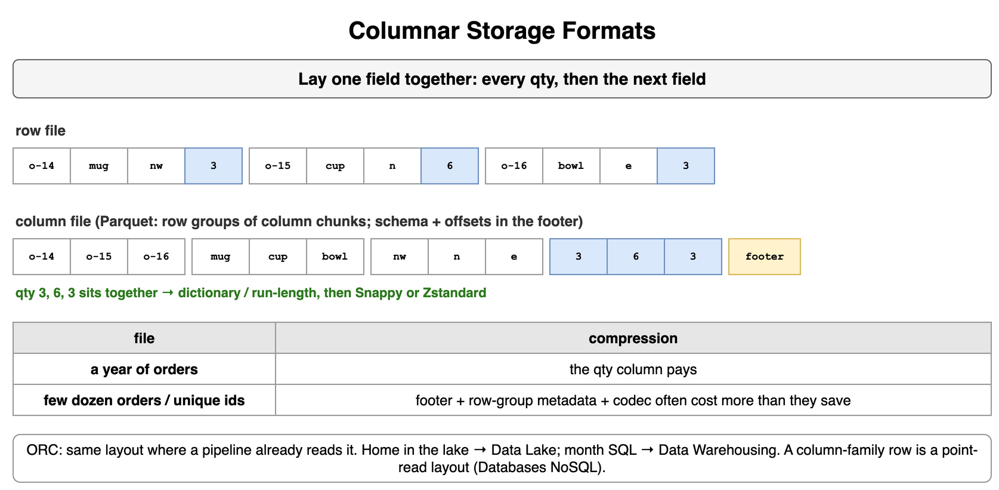
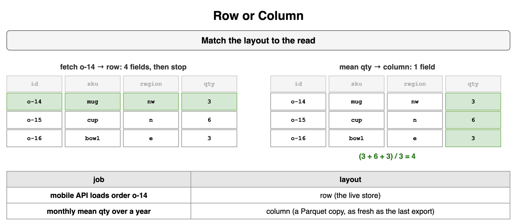
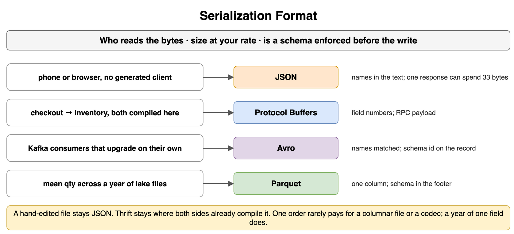
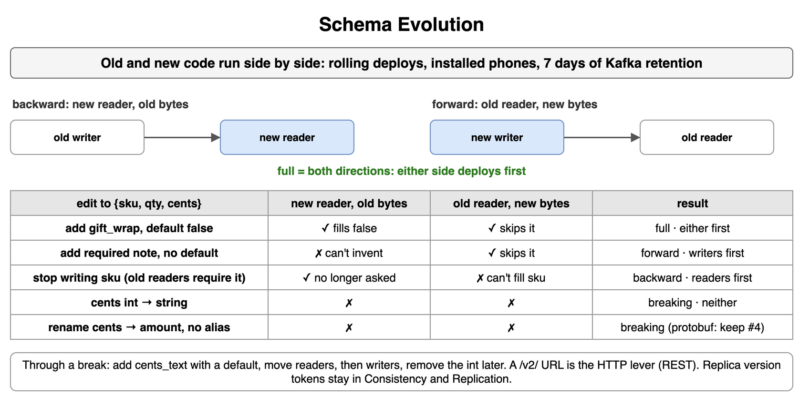
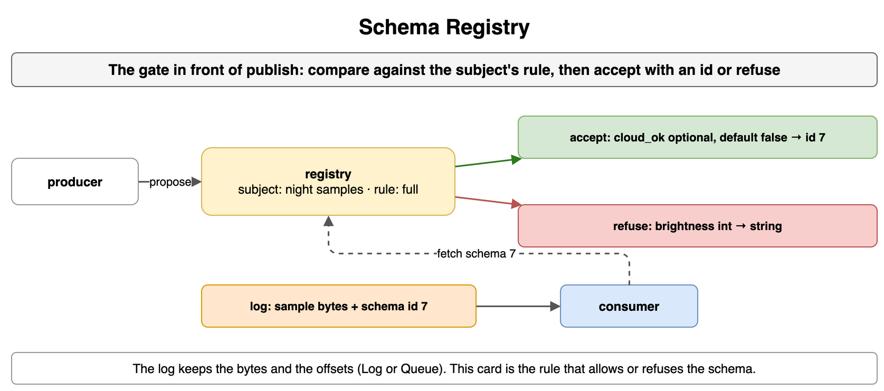

## JSON and XML

JSON and XML are text encodings. Each record carries its own field names, so a phone, a browser, or a person reading a log can see the shape without generated code. A public order API has many readers you do not compile, such as the mobile app, a browser, and a partner script, and text is the format they already parse. The encoding does not check that `qty` is a number. A validator such as JSON Schema or an OpenAPI check is a separate step, and until it runs a bad value is still legal text.

```json
{"sku":"mug","qty":2,"size":"m","cents":1299}
```

That compact order is 45 bytes. The values `mug,2,m,1299` are 12 of them, and the other 33 are names, braces, quotes, and colons. One response can afford 33 bytes. One order a second for six hours is 21,600 orders: 972,000 bytes of JSON, of which 712,800 are repeated structure. The same four fields in XML, `<order><sku>mug</sku>...<cents>1299</cents></order>`, are 74 bytes. XML remains in older partner APIs, SOAP-style feeds, and some config files. A new mobile API uses JSON. MessagePack and CBOR encode the names in binary, which shrinks the punctuation, but they still repeat the names.

JSON has one number syntax. A parser that stores every number as an IEEE-754 double, as JavaScript does, turns 9007199254740993 into 9007199254740992, while Python keeps it. Send large ids as strings, and keep money in integer cents, because 12.99 is a binary fraction a double cannot store exactly and 1299 is exact. JSON wins when a person or a third-party client reads the payload. It loses when the same names are written tens of thousands of times, which is where a schema-backed binary format drops them. The HTTP method and URL that carry the body are REST in [Networking and Communication](../10_Networking_and_Communication/).

```text
45-byte order     12 bytes of values, 33 of names and punctuation
6 hours at 1/s    712,800 bytes of repeated structure
large ids         strings, JavaScript rounds past 2^53
money             integer cents
XML               74 bytes, kept for partners that already speak it
```



*Source: [`diagrams/encoding.drawio`](/content/09_System_Design_Interview/14_Encoding_Serialization_and_Schema_Evolution/diagrams/encoding.drawio), page 1.*

## Protocol Buffers and Thrift

Protocol Buffers and Thrift are schema-backed binary encodings. The bytes carry a field number and a value, and generated code turns the number back into a name. Checkout calls inventory on every order, and both are code you compile, so they can share one definition instead of repeating the word `cents` on every call.

```text
message Order {
  string sku = 1;
  int32 qty = 2;
  string size = 3;
  int32 cents = 4;
}
```

On the wire, field 4 is a tag and the integer 1299. The number is the contract and the name is a local label. A rename to `amount = 4` still sends 1299 under 4, and an old binary stores it in `cents`. Moving it to `amount = 5` is a different field: the old binary skips 5, and `cents` is missing. When you remove a field, reserve its number, because a later author who reuses 4 makes every old reader treat the new value as `cents`. The tag is the field number plus a wire type. Numbers 1 through 15 fit in one byte and 16 through 2047 take two, so put the fields you send on every call in 1 through 15.

A reader skips a field number it does not know, which is how an old binary accepts a newer writer's record. In proto3, a missing field decodes as the zero value: 0, false, or empty. If 0 is a real `cents` amount, mark the field `optional` so the reader can tell "omitted" from "free order." Thrift is the same bargain in another toolchain: an IDL, field numbers, generated code. Its `required` fields are hard to add and hard to remove, so new definitions use optional ones. Protobuf fits an internal RPC where you ship both ends. A public client usually stays on JSON, since a browser has no stubs. The usual call is gRPC, covered as RPC in [Networking and Communication](../10_Networking_and_Communication/).

```text
same number    a rename still reaches the old reader
new number     the old reader skips it
retired        reserve the number
hot fields     1 through 15, a one-byte tag
```



*Source: [`diagrams/encoding.drawio`](/content/09_System_Design_Interview/14_Encoding_Serialization_and_Schema_Evolution/diagrams/encoding.drawio), page 2.*

## Avro

Avro is a compact binary encoding that stores the writer's schema with the data and matches fields by name. A Kafka order event outlives the process that wrote it. A consumer deployed next week reads events written today, and a consumer still on today's build reads events written next week. The bytes are values in schema order, with no names and no tags, so the reader cannot decode them without the schema the writer used.

```json
{"type":"record","name":"Order","fields":[{"name":"sku","type":"string"},{"name":"qty","type":"int"},{"name":"cents","type":"int"}]}
```

That schema is 132 bytes. Repeated on all 21,600 events in a six-hour run, it is 2,851,200 bytes. A file of many orders stores it once, in the header. A single Kafka record stores a schema id instead, four bytes each or 86,400 in total, and the consumer fetches the schema for that id from a registry.

Resolution uses two schemas. The writer schema is the names that were encoded, and the reader schema is the names this program expects. For each reader field, the reader looks for the same name, or an alias, in the writer schema and moves the value across. Avro can promote an int to a long, and an int read as a string fails. A name only the writer sent is skipped. A name only the reader asks for gets the reader schema's default, and if there is no default the read fails. Writer v2 adds `gift_wrap` set to true, and a v1 reader skips it. A v2 reader given a v1 record fills `gift_wrap` with false from its own schema. A rename without an alias fails both ways. Avro fits events and files whose readers and writers upgrade separately. The topic is Log or Queue in [Message Queues and Async Processing](../11_Message_Queues_and_Async_Processing/), and folding events is Event Sourcing in [Storage and Data Processing at Scale](../13_Storage_and_Data_Processing_at_Scale/).

```text
file           schema once in the header
Kafka record   a schema id, resolved by the registry
match          by name, extra writer fields skipped
missing        the reader schema's default, or the read fails
```



*Source: [`diagrams/encoding.drawio`](/content/09_System_Design_Interview/14_Encoding_Serialization_and_Schema_Evolution/diagrams/encoding.drawio), page 3.*

## Columnar Storage Formats

A columnar file stores one field for many rows together. A row file stores every field of one row, then the next row. The monthly question is the mean quantity, or the sum of `cents`. That job reads one field and ignores `sku` and `region`, and a row file still steps through them to reach each number. With three orders, a row file runs `o-14`, `mug`, `nw`, `3`, then the same four fields for `o-15` and `o-16`. A column file puts the ids together, then the regions, then the quantities `3`, `6`, `3`, so the job reads one column and skips the rest.

Parquet does this inside row groups, and each group holds one column chunk per field. The schema and the chunk offsets sit in the footer, so a reader seeks to the footer and opens the quantity chunk directly. ORC is the same layout, used where a pipeline already reads ORC. Similar values in one chunk are why compression pays. A run of small integers gives dictionary and run-length encoding something to work with, and Snappy or Zstandard then compresses a smaller input. A column of unique order ids compresses poorly. A file of a few dozen orders often spends more on the footer, row-group metadata, and codec than it saves, while a year of orders pays easily.

Parquet is a poor store for "load order o-14," because that read opens several column chunks and stitches one row back together. The live API keeps a row store, and a job copies settled orders into columnar files in the lake: Data Lake in [Storage and Data Processing at Scale](../13_Storage_and_Data_Processing_at_Scale/). The month's SQL runs in Data Warehousing in [Databases NoSQL and Specialized](../07_Databases_NoSQL_and_Specialized/). A column-family database is a different layout, one row key holding an entity's cells for a point read. That is Column-Family Store in the same topic.

```text
row file      one order's fields together
column file   one field across many orders
Parquet       row groups, schema and offsets in the footer
pays          long repetitive columns, not unique ids or tiny files
```



*Source: [`diagrams/encoding.drawio`](/content/09_System_Design_Interview/14_Encoding_Serialization_and_Schema_Evolution/diagrams/encoding.drawio), page 4.*

## Row or Column

Use a row layout when the read wants one whole record, and a column layout when it wants one field across many records. The same orders serve two jobs. The mobile API loads order `o-14` for a customer, and the monthly report asks for the mean quantity. One layout makes one of those jobs read bytes it throws away.

Fetching `o-14` from rows reads its four fields, id, sku, region, and quantity, and stops. Those fields are the whole order the phone renders. A columnar file would open four column chunks, pull one value from each, and stitch the row back, which costs extra seeks for one order. The mean reads quantity only. The values are 3, 6, and 3, so the mean is 4. A row file reads sku and region on the way to each quantity, and a columnar file reads only the quantity column. At three rows the waste is small. Across a year of orders, reading three unused fields on every row dominates the scan.

A system that serves both jobs keeps both layouts. The row store answers the phone, and a Parquet copy answers the mean. The copy lags, so the mean is only as fresh as the last export. Ask which fields a query touches before you name a store, and say how fresh the copy has to be. The file lives in Data Lake in [Storage and Data Processing at Scale](../13_Storage_and_Data_Processing_at_Scale/), and the SQL runs in Data Warehousing in [Databases NoSQL and Specialized](../07_Databases_NoSQL_and_Specialized/).

```text
fetch o-14     4 fields of one row, a row store
mean qty       1 column, (3 + 6 + 3) / 3 = 4, a columnar file
both           a row store plus a columnar copy that lags
```



*Source: [`diagrams/encoding.drawio`](/content/09_System_Design_Interview/14_Encoding_Serialization_and_Schema_Evolution/diagrams/encoding.drawio), page 5.*

## Serialization Format

The format follows three questions: who reads the bytes, how large the payload gets at your rate, and whether a schema is enforced before the write. One shop produces the same order four ways. The phone loads it, checkout calls inventory with it, Kafka carries it to billing and search, and a yearly job scans one field of it. Picking one format for all four makes three of them pay.

A person, a browser, or a partner you do not ship code to reads JSON, and one 45-byte response can afford its names. Two services you generate read Protocol Buffers: the internal call is an RPC, and at 21,600 orders the 712,800 bytes of repeated names are worth dropping. Kafka consumers that upgrade while old events are still in the log read Avro, with names matched, a schema id on the record, and defaults on the reader. A scan of one field across a year of lake files reads Parquet, with the schema in the footer. On enforcement, JSON can be checked by OpenAPI but the check is optional. Protobuf and Avro refuse to encode a field the schema lacks, and a registry applies that rule to a stream.

A file a person edits by hand stays JSON, because there is no stub to generate. Thrift stays where both sides already compile Thrift. You can send protobuf to a mobile app you own, but you then ship a generated client, and old app builds keep old field numbers. Avro on a synchronous checkout call works and is unusual, because that is the protobuf case. Parquet as a phone response makes the client stitch a row from columns. The HTTP status line and RPC framework stay in [Networking and Communication](../10_Networking_and_Communication/).

```text
phone or partner      JSON
internal RPC          Protocol Buffers
Kafka order event     Avro
year-long field scan  Parquet
hand-edited file      JSON, Thrift only where it is already the toolchain
```



*Source: [`diagrams/encoding.drawio`](/content/09_System_Design_Interview/14_Encoding_Serialization_and_Schema_Evolution/diagrams/encoding.drawio), page 6.*

## Schema Evolution

Schema evolution changes the fields of a message while programs on the previous version still read and write it. Old and new code run at the same time. Eight API servers replaced two at a time serve both versions during the rollout. The phone app installed last month keeps calling after the servers are done. Kafka's default seven-day retention means a new consumer reads events written under an older schema. Assume readers skip unknown fields, as protobuf and Avro do by rule and JSON does when the client ignores unknown keys.

Backward compatible means a new reader can read old bytes. Forward compatible means an old reader can read new bytes. Full means both, so either side can deploy first. Backward only means readers deploy first. Forward only means writers deploy first, and new readers wait until the old bytes are gone through retention or a rewrite. Breaking means neither side can go first. Add a new field, move readers, move writers, and remove the old field as its own change. On the order `{sku, qty, cents}`, adding `gift_wrap` with default false is full. Adding a required `note` with no default is forward only, because the new reader cannot invent the string. Dropping `sku` while old readers still require it is backward only. Changing `cents` from int to string is breaking. Avro promotes int to long but never int to string, so treat any unchecked type change as breaking.

A protobuf rename that keeps field number 4 is still `cents` on the wire. A name-matched rename without an alias breaks Avro and JSON. An Avro alias on the new reader restores only the backward direction. The safe rename is a new field written beside the old one until every reader has moved. For a type change, add `cents_text` with a default, keep the int, move readers, then writers, and remove the int later. A breaking HTTP change gets a `/v2/` path, REST in [Networking and Communication](../10_Networking_and_Communication/). A replica's version token is a different idea, in [Consistency and Replication](../09_Consistency_and_Replication/). Folding old events is Event Sourcing in [Storage and Data Processing at Scale](../13_Storage_and_Data_Processing_at_Scale/).

```text
backward   new reader, old bytes, readers deploy first
forward    old reader, new bytes, writers deploy first
full       both, either side first
add with default         full
add required, no default forward only
drop a required field    backward only
int to string            breaking
```



*Source: [`diagrams/encoding.drawio`](/content/09_System_Design_Interview/14_Encoding_Serialization_and_Schema_Evolution/diagrams/encoding.drawio), page 7.*

## Schema Registry

A schema registry stores schemas for a stream and rejects a new schema that breaks the compatibility rule on that subject. Producers and consumers deploy on different days, and the topic keeps old events. Without a gate, one producer can publish a string `cents` into a topic whose consumers decode an int, and those bytes stay for the retention window. The registry runs the Schema Evolution rules at publish time, so a bad schema gets no id and its bytes are never written.

The subject is the name the rule hangs on. For topic `orders`, the value subject is usually `orders-value`, and the key can have its own. The producer proposes a schema, and the registry checks it against the subject's rule: backward, forward, full, or none. Under full, an int-to-string `cents` is refused, and so is dropping `sku` while readers require it. Optional `gift_wrap` with default false passes and gets an id such as 7. Confluent's serializer prefixes the Avro bytes with one magic byte and the four-byte id. The consumer reads the id, fetches and caches schema 7, and resolves its reader schema against it. An accepted schema never rewrites events already in the log, which keep the id they were written with.

Confluent Schema Registry defaults to backward and non-transitive. It compares only with the latest schema, and consumers upgrade before producers. Set full when old consumers must keep reading during a producer rollout you cannot order. A transitive rule checks every registered version, which matters when a seven-day log holds more than one generation. None turns the gate off, for a topic you can wipe. The same gate exists for Protobuf and JSON Schema. Avro is the common pairing because its bytes need the writer schema. Retention and offsets are Log or Queue in [Message Queues and Async Processing](../11_Message_Queues_and_Async_Processing/).

```text
subject       orders-value
full rule     gift_wrap with default accepted, int to string refused
record        magic byte + 4-byte schema id + Avro bytes
default       backward, non-transitive, consumers first
transitive    check every version still inside retention
```



*Source: [`diagrams/encoding.drawio`](/content/09_System_Design_Interview/14_Encoding_Serialization_and_Schema_Evolution/diagrams/encoding.drawio), page 8.*
