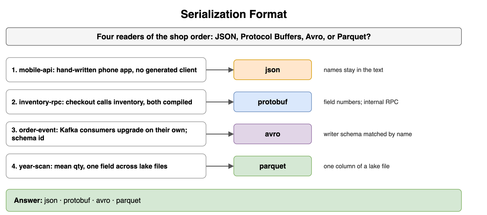
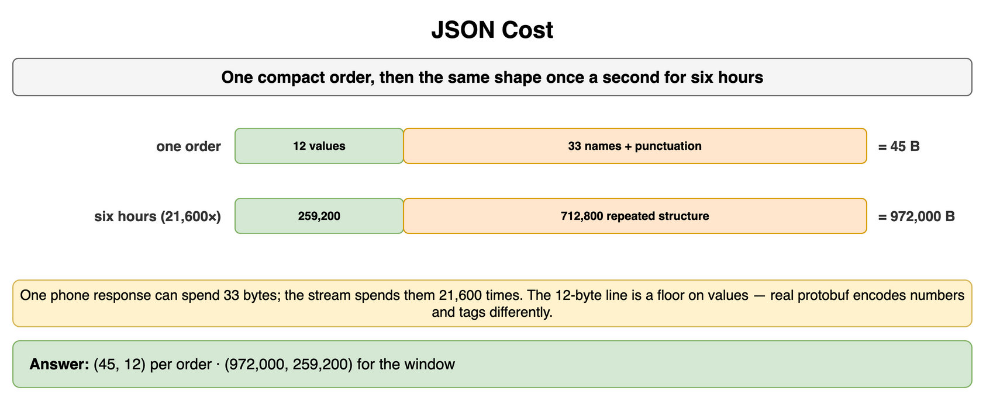
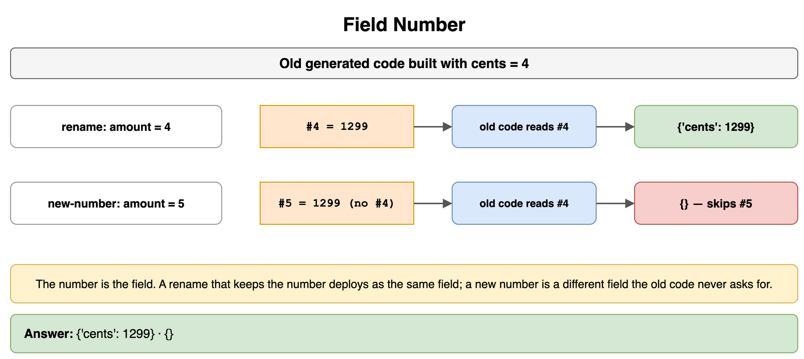
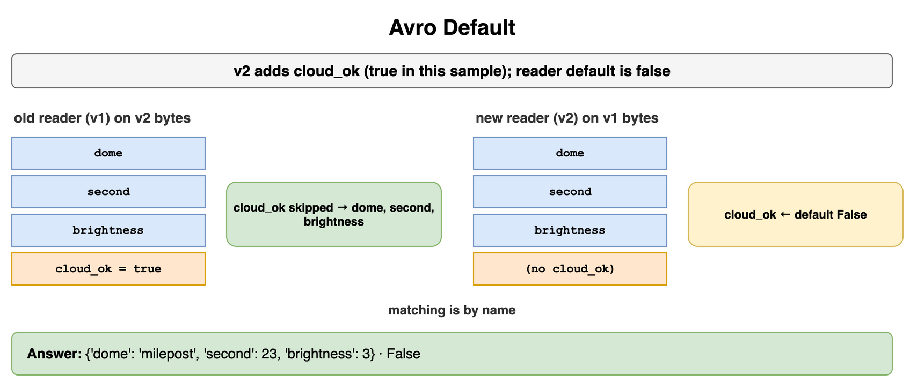
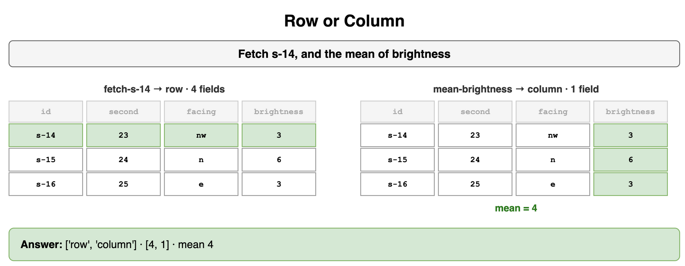
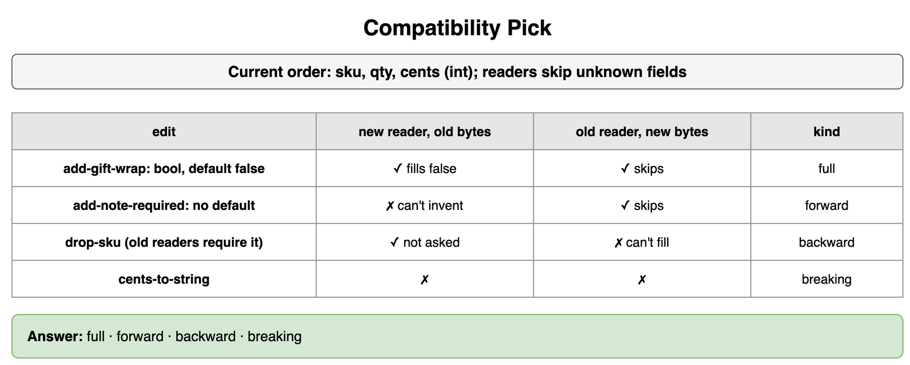
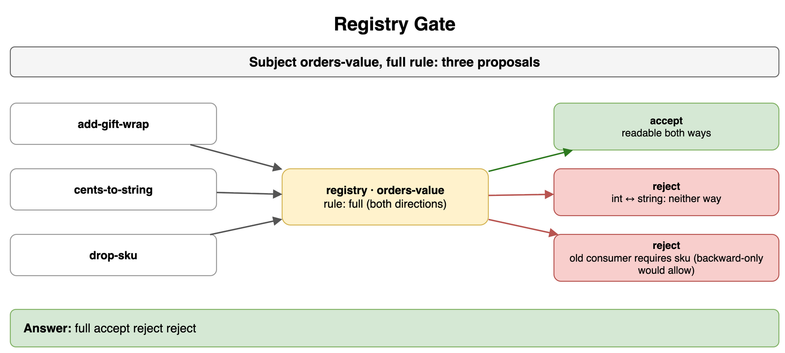
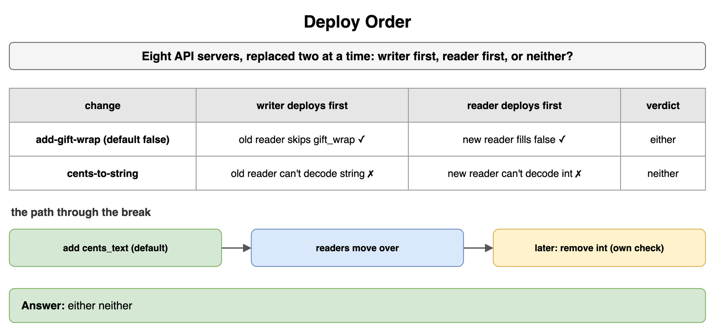

# Encoding, Serialization, and Schema Evolution — Drills

Original practice for which bytes go on the wire, which layout a read wants, and which schema change may ship. Each card is one exercise: commit to an answer, then check it. The numbers are for a shop order: a phone loads it as JSON, checkout calls inventory with generated code, Kafka carries the event, and a lake file holds a yearly copy. REST and RPC stay in Networking and Communication. The log and the broker stay in Message Queues and Async Processing. The lake, and event sourcing as a store, stay in Storage and Data Processing at Scale. The warehouse, and a column-family row, stay in Databases NoSQL and Specialized. A replica version token stays in Consistency and Replication.

## Serialization Format

Four readers need the order. Pick JSON, Protocol Buffers, Avro, or Parquet for each.

```text
1. mobile-api — the phone loads the latest order. The app is hand-written and will not use a generated client.
2. inventory-rpc — checkout calls inventory. Both are services you compile, and the call site is a generated function.
3. order-event — each order is appended to Kafka. Consumers upgrade on their own schedule, and the record carries a schema id.
4. year-scan — mean quantity for the year, one field across many files already in the lake.
```

```python
CALLERS = ["mobile-api", "inventory-rpc", "order-event", "year-scan"]
```

**Answer:** JSON, Protocol Buffers, Avro, then Parquet. The phone is a client you do not generate, so the names stay in the text. The inventory call is an internal RPC you compile, so the bytes are field numbers. The Kafka event will be read by a program whose schema differs from the writer's, matched by name, so the encoding is Avro. The year scan reads one column of a lake file, so the file is Parquet. The lake that holds the file stays in Storage and Data Processing at Scale. The warehouse that can answer the same mean stays in Databases NoSQL and Specialized.

```python
CALLERS = ["mobile-api", "inventory-rpc", "order-event", "year-scan"]
FORMAT = {
    "mobile-api": "json",
    "inventory-rpc": "protobuf",
    "order-event": "avro",
    "year-scan": "parquet",
}

print(" ".join(FORMAT[name] for name in CALLERS))
# json protobuf avro parquet
```



*Source: [`diagrams/encoding-drills.drawio`](/content/09_System_Design_Interview/14_Encoding_Serialization_and_Schema_Evolution/diagrams/encoding-drills.drawio), page 1.*

## JSON Cost

The phone sends one compact JSON order. The order stream writes the same shape once a second for six hours, 21,600 times. How many bytes of that window are the values, and how many are the names and the punctuation around them?

```python
import json

ORDER = {"sku": "mug", "qty": 2, "size": "m", "cents": 1299}
WINDOW = 6 * 60 * 60
```

**Answer:** The values are 12 bytes, `mug,2,m,1299`. The compact JSON is 45 bytes. The other 33 are the field names and the braces, quotes, and colons that attach them. One phone response can spend those 33 bytes. The six-hour stream spends them 21,600 times: 712,800 bytes of repeated structure beside 259,200 bytes of values. The JSON for the window is 972,000 bytes. That 12-byte line is a floor on the values, and a real Protocol Buffers payload is a different encoding of numbers and tags. The comparison still shows why the internal call drops the repeated names, and why the phone can keep them.

```python
import json

ORDER = {"sku": "mug", "qty": 2, "size": "m", "cents": 1299}
WINDOW = 6 * 60 * 60


def window_bytes(record: dict, count: int) -> tuple[int, int]:
    compact = len(json.dumps(record, separators=(",", ":")).encode())
    values = len(",".join(str(value) for value in record.values()).encode())
    return compact * count, values * count


print(window_bytes(ORDER, 1), window_bytes(ORDER, WINDOW))
# (45, 12) (972000, 259200)
```



*Source: [`diagrams/encoding-drills.drawio`](/content/09_System_Design_Interview/14_Encoding_Serialization_and_Schema_Evolution/diagrams/encoding-drills.drawio), page 2.*

## Field Number

The old generated code was built with `cents = 4`. Two writers deploy. What does the old code still see in each case?

```text
rename — the definition now says amount = 4. The wire still carries 1299 under number 4.
new-number — the definition says amount = 5, and the writer sends 1299 under number 5 only.
```

```python
OLD_READER = {4: "cents"}
RENAME = {4: 1299}
NEW_NUMBER = {5: 1299}
```

**Answer:** On the rename, the old code still sees cents 1299. The number stayed 4, so the new name is the same field. On the new number, the old code sees no cents. It was built to read 4, it skips 5, and the writer stopped sending 4. A rename that keeps the number can deploy as the same field. A new number is a different field, and the old code will not find the value there.

```python
OLD_READER = {4: "cents"}
RENAME = {4: 1299}
NEW_NUMBER = {5: 1299}


def project(reader: dict[int, str], wire: dict[int, int]) -> dict[str, int]:
    return {name: wire[number] for number, name in reader.items() if number in wire}


print(project(OLD_READER, RENAME), project(OLD_READER, NEW_NUMBER))
# {'cents': 1299} {}
```



*Source: [`diagrams/encoding-drills.drawio`](/content/09_System_Design_Interview/14_Encoding_Serialization_and_Schema_Evolution/diagrams/encoding-drills.drawio), page 3.*

## Avro Default

Writer v1 encodes sku, qty, and cents. Writer v2 adds `gift_wrap` and, on this order, sets it true. The reader default for `gift_wrap` is false. What does a v1 reader return for the v2 order, and what does a v2 reader put in `gift_wrap` for the v1 order?

```python
WRITER_V1 = {"sku": "mug", "qty": 2, "cents": 1299}
WRITER_V2 = {"sku": "mug", "qty": 2, "cents": 1299, "gift_wrap": True}
READER_V1 = ("sku", "qty", "cents")
READER_V2 = ("sku", "qty", "cents", "gift_wrap")
DEFAULTS = {"gift_wrap": False}
```

**Answer:** The v1 reader returns sku, qty, and cents. It has no `gift_wrap`, so the extra name is skipped. That is an old reader on new bytes, which is the forward direction. The v2 reader fills `gift_wrap` with false, because the v1 order has no such name and the reader schema supplies the default. That is a new reader on old bytes, which is the backward direction. The true on the v2 order is visible to a reader whose schema still asks for `gift_wrap`. Matching is by name. The log those orders may ride stays in Message Queues and Async Processing.

```python
WRITER_V1 = {"sku": "mug", "qty": 2, "cents": 1299}
WRITER_V2 = {"sku": "mug", "qty": 2, "cents": 1299, "gift_wrap": True}
READER_V1 = ("sku", "qty", "cents")
READER_V2 = ("sku", "qty", "cents", "gift_wrap")
DEFAULTS = {"gift_wrap": False}


def resolve(record: dict, fields: tuple[str, ...], defaults: dict) -> dict:
    found = {}
    for name in fields:
        if name in record:
            found[name] = record[name]
        else:
            found[name] = defaults[name]
    return found


old_reader = resolve(WRITER_V2, READER_V1, DEFAULTS)
new_reader = resolve(WRITER_V1, READER_V2, DEFAULTS)
print(old_reader, new_reader["gift_wrap"])
# {'sku': 'mug', 'qty': 2, 'cents': 1299} False
```



*Source: [`diagrams/encoding-drills.drawio`](/content/09_System_Design_Interview/14_Encoding_Serialization_and_Schema_Evolution/diagrams/encoding-drills.drawio), page 4.*

## Row or Column

Three orders are on disk. Two jobs run: fetch `o-14`, and the mean of qty. Which layout does each job want, and how many fields does it have to touch?

```python
ORDERS = [
    {"id": "o-14", "sku": "mug", "region": "nw", "qty": 3},
    {"id": "o-15", "sku": "cup", "region": "n", "qty": 6},
    {"id": "o-16", "sku": "bowl", "region": "e", "qty": 3},
]
JOBS = ["fetch-o-14", "mean-qty"]
```

**Answer:** Fetching `o-14` is a row read. The phone wants all four fields of that one order, so the read touches four fields and stops. The mean is a column read. It touches the qty column only, and the mean of 3, 6, and 3 is 4. Reading sku on the way to that mean is wasted work at a year's scale. The live API stays on rows. The yearly file stays on columns. Where that file sits in the lake stays in Storage and Data Processing at Scale.

```python
ORDERS = [
    {"id": "o-14", "sku": "mug", "region": "nw", "qty": 3},
    {"id": "o-15", "sku": "cup", "region": "n", "qty": 6},
    {"id": "o-16", "sku": "bowl", "region": "e", "qty": 3},
]
JOBS = ["fetch-o-14", "mean-qty"]
QTY = [order["qty"] for order in ORDERS]


def layout(job: str) -> str:
    if job == "fetch-o-14":
        return "row"
    return "column"


def fields_touched(job: str) -> int:
    if job == "fetch-o-14":
        return len(ORDERS[0])
    return 1


print([layout(job) for job in JOBS], [fields_touched(job) for job in JOBS])
print(sum(QTY) // len(QTY))
# ['row', 'column'] [4, 1]
# 4
```



*Source: [`diagrams/encoding-drills.drawio`](/content/09_System_Design_Interview/14_Encoding_Serialization_and_Schema_Evolution/diagrams/encoding-drills.drawio), page 5.*

## Compatibility Pick

The current order is sku, qty, and cents, an int. Readers skip fields they do not know. A missing field is filled only when the reader has a default. Classify each edit as backward, forward, full, or breaking.

```text
1. add-gift-wrap — add gift_wrap, a bool, default false.
2. add-note-required — add note, a string, required, with no default.
3. drop-sku — stop writing sku. Old readers still require sku and have no default. New readers no longer ask for it.
4. cents-to-string — cents becomes a string.
```

```python
EDITS = ["add-gift-wrap", "add-note-required", "drop-sku", "cents-to-string"]
```

**Answer:** Full, forward, backward, breaking. The optional add is full: a new reader fills false on old bytes, and an old reader skips `gift_wrap` on new bytes. The required note is forward only. An old reader skips it, and a new reader cannot invent the string from old bytes, so the add is not backward. Dropping sku is backward only. A new reader no longer asks for it, and an old reader cannot fill a required sku that the new bytes omit, so the removal is not forward. The type change breaks both directions. An int and a string are different values. A `/v2/` path on the API is REST, and that path leaves this int still an int for clients that stay on the old URL.

```python
EDITS = ["add-gift-wrap", "add-note-required", "drop-sku", "cents-to-string"]
KIND = {
    "add-gift-wrap": "full",
    "add-note-required": "forward",
    "drop-sku": "backward",
    "cents-to-string": "breaking",
}

print(" ".join(KIND[name] for name in EDITS))
# full forward backward breaking
```



*Source: [`diagrams/encoding-drills.drawio`](/content/09_System_Design_Interview/14_Encoding_Serialization_and_Schema_Evolution/diagrams/encoding-drills.drawio), page 6.*

## Registry Gate

The `orders-value` subject uses a full rule. Three proposals arrive. Which ones does the registry accept?

```text
1. add-gift-wrap — gift_wrap, a bool, default false.
2. cents-to-string — cents changes from an int to a string.
3. drop-sku — sku goes away. Existing readers still require it and have no default.
```

```python
RULE = "full"
PROPOSALS = ["add-gift-wrap", "cents-to-string", "drop-sku"]
```

**Answer:** Accept the optional add. Reject the type change and the removal. A full rule requires both directions. `gift_wrap` with a default is readable by a new consumer on old bytes, and an old consumer can skip it on new bytes. An int that becomes a string is readable in neither direction. Dropping sku leaves an old consumer, which still requires sku, unable to read the new bytes. A backward-only rule would allow that removal. A full rule refuses it. The registry is the gate. The log that would have stored the order stays in Message Queues and Async Processing.

```python
RULE = "full"
PROPOSALS = ["add-gift-wrap", "cents-to-string", "drop-sku"]


def gate(rule: str, proposal: str) -> str:
    if rule == "full" and proposal == "add-gift-wrap":
        return "accept"
    return "reject"


print(RULE, " ".join(gate(RULE, name) for name in PROPOSALS))
# full accept reject reject
```



*Source: [`diagrams/encoding-drills.drawio`](/content/09_System_Design_Interview/14_Encoding_Serialization_and_Schema_Evolution/diagrams/encoding-drills.drawio), page 7.*

## Deploy Order

Eight API servers are replaced two at a time, so old and new code run side by side. Two changes are ready. For each, say whether the writer, the reader, or either side can deploy first.

```text
1. add-gift-wrap — full compatibility. gift_wrap is a bool with default false, and readers skip unknown fields.
2. cents-to-string — cents changes from an int to a string.
```

```python
CHANGES = ["add-gift-wrap", "cents-to-string"]
```

**Answer:** Either side can deploy the add. Writer first: new orders carry `gift_wrap`, and the old reader skips it. Reader first: the new reader fills false on orders that omit `gift_wrap`. Neither side can deploy the type change first. Writer first sends a string the old reader cannot decode. Reader first expects a string and cannot decode the int still on the wire, including events still inside the topic's retention. The path through that break is a new field. Add `cents_text` with a default, leave the int in place until every reader has moved, and treat a later removal as its own compatibility check. An installed phone is the same constraint on the JSON response: the server rollout does not replace the app, so a breaking response needs a new URL rather than a silent type change.

```python
CHANGES = ["add-gift-wrap", "cents-to-string"]


def ship(change: str) -> str:
    if change == "add-gift-wrap":
        return "either"
    return "neither"


print(" ".join(ship(name) for name in CHANGES))
# either neither
```



*Source: [`diagrams/encoding-drills.drawio`](/content/09_System_Design_Interview/14_Encoding_Serialization_and_Schema_Evolution/diagrams/encoding-drills.drawio), page 8.*
