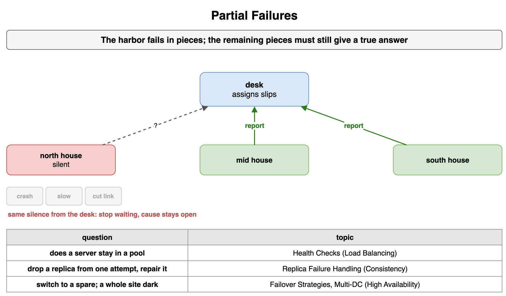
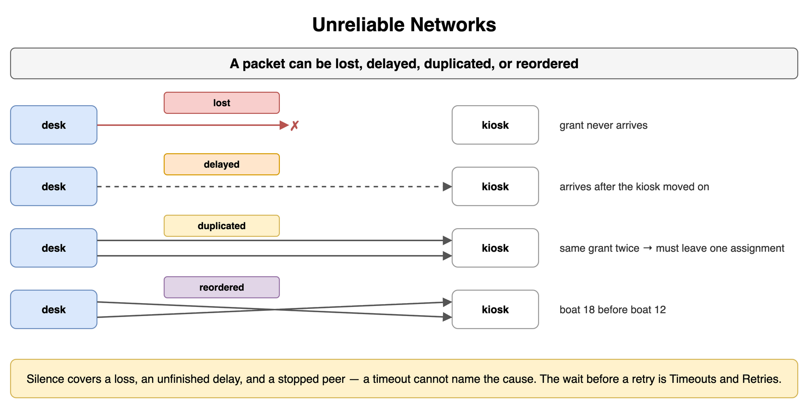
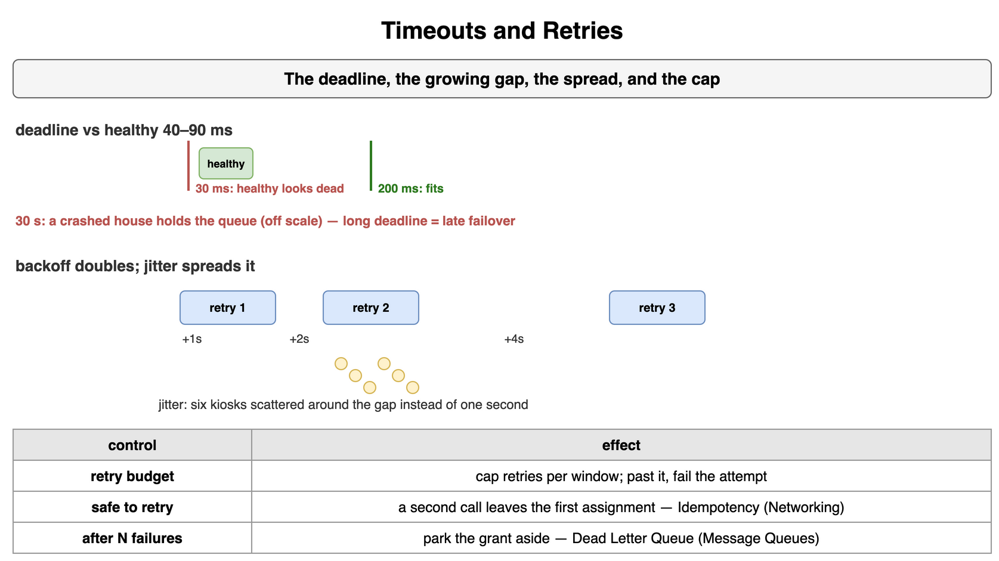
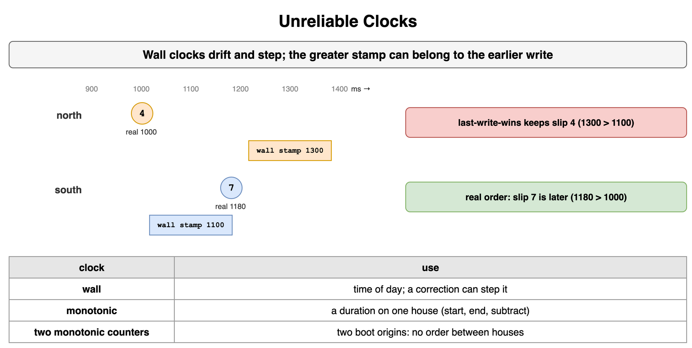
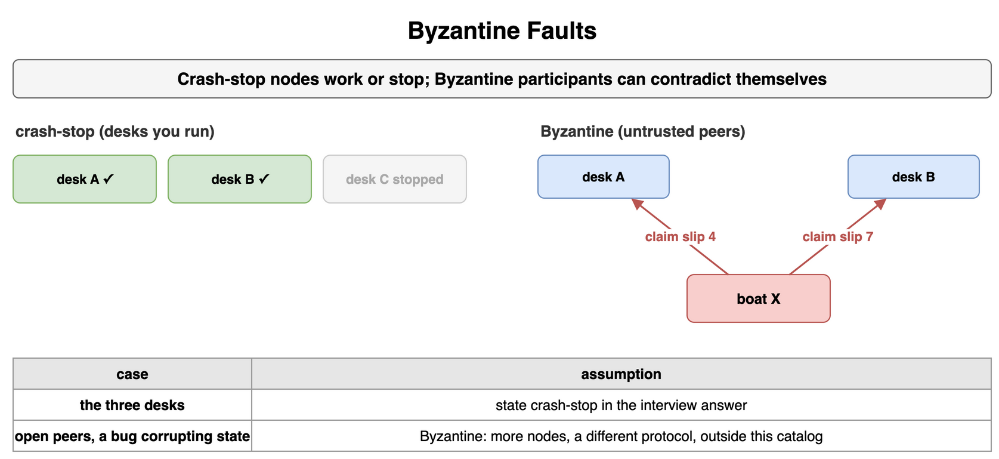
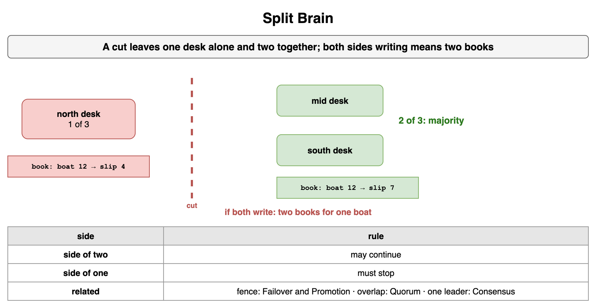
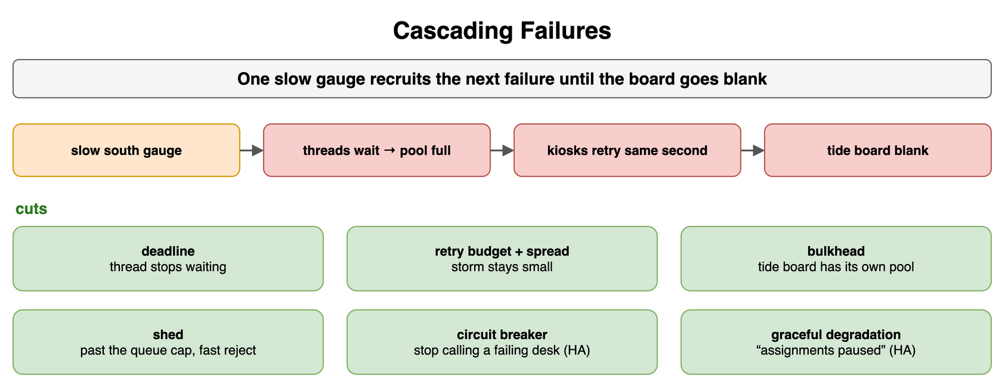

## Partial Failures

Cove Station's desk can still assign a slip while the north tide house sends nothing. The mid house and the south house keep reporting. The harbor fails in pieces. The pieces that remain are still a system, and they have to keep a true answer while one part is gone.

A missed deadline leaves the cause open. The north house may have crashed, the house may be slow, or the breakwater link may be cut. From the desk, those three are the same silence, so this attempt stops waiting and does not name a cause. Whether a server stays in a pool is Health Checks in [Load Balancing](../04_Load_Balancing/). The heartbeat or gossip round that drops a replica from one attempt, and the repair of a replica that was briefly gone or one that stays gone, is Replica Failure Handling in [Consistency and Replication](../09_Consistency_and_Replication/). Switching to a spare, and what a whole site going dark requires, is Failover Strategies and Multi-DC and Geo Routing in [High Availability and Reliability](../03_High_Availability_and_Reliability/).

```text
north house silent     crash, slow, or a cut
other houses           still report
this attempt           stop waiting; the cause stays open
pool membership        Health Checks
replica repair         Replica Failure Handling
spare, or a dark site  Failover Strategies, Multi-DC and Geo Routing
```



*Source: [`diagrams/failure-modes.drawio`](/content/09_System_Design_Interview/15_Distributed_System_Failure_Modes/diagrams/failure-modes.drawio), page 1.*

## Unreliable Networks

The path from a kiosk to the desk can lose a packet, hold it, deliver a copy twice, or deliver a packet ahead of one that was sent earlier. A slip grant that never arrives, a grant that arrives after the kiosk has moved on, a second copy of the same grant, and boat 18's grant arriving before boat 12's are ordinary outcomes on that path.

Lost replies and duplicate packets belong on this card. Silence covers a loss, a delay that has not ended, and a peer that has stopped, which is why a timeout still cannot name the cause. A duplicate and a reordering do arrive, so a second copy of a grant has to leave one assignment, and send order is a poor stand-in for arrival order. The wait before a retry is Timeouts and Retries: how long the deadline is, how the gap between tries grows, and how the kiosks stay off the same second.

```text
lost         the grant never arrives
delayed      the grant arrives after the kiosk has moved on
duplicated   the same grant arrives twice
reordered    boat 18 arrives before boat 12
the wait     Timeouts and Retries
```



*Source: [`diagrams/failure-modes.drawio`](/content/09_System_Design_Interview/15_Distributed_System_Failure_Modes/diagrams/failure-modes.drawio), page 2.*

## Timeouts and Retries

A deadline is the desk's decision to stop waiting. The healthy houses answer in 40 to 90 ms. A deadline of 30 ms treats those houses as dead, and the desk can move work off houses that were fine. A deadline of 30 seconds treats a crashed house as still in progress, and every slip queued behind that call waits with it. Failover starts when the deadline ends the call, so a long deadline is a late failover.

After the miss, a retry. The gap doubles, 1 second, then 2, then 4, so a short blip is tried again soon and a long outage is tried less often. Jitter puts a spread around that gap so six kiosks do not land on one second and become the load that keeps the desk down. A retry budget caps how many of the calls in a window may be retries. Past the cap, the kiosk fails the attempt and does not send again. Send that retry when a second call leaves the first assignment as it was. That property is Idempotency in [Networking and Communication](../10_Networking_and_Communication/), and the key itself stays on that card. After N failed tries, a queued grant parks aside and the main queue moves on. That park is the Dead Letter Queue in [Message Queues and Async Processing](../11_Message_Queues_and_Async_Processing/). N is chosen there. This card is the deadline, the growing gap, the spread, and the cap.

```text
30 ms           a healthy house, 40–90 ms, looks dead
30 s            a crashed house still holds the queue
1 s, 2 s, 4 s   the gap doubles
jitter          six kiosks miss the same second
budget          past the cap, fail the attempt
then            Idempotency for the retry; Dead Letter Queue after N
```



*Source: [`diagrams/failure-modes.drawio`](/content/09_System_Design_Interview/15_Distributed_System_Failure_Modes/diagrams/failure-modes.drawio), page 3.*

## Unreliable Clocks

Each tide house has a wall clock, the time of day it would show a person. The clocks drift, and a correction can step one forward or back. North stamped slip 4 at a wall time of 1300 ms. South stamped slip 7 at a wall time of 1100 ms. Last-write-wins keeps slip 4, the greater stamp. In real time north wrote at 1000 ms and south wrote at 1180 ms, so the later assignment is slip 7, and the greater stamp kept the earlier one. Why a wall-clock stamp is a weak input to that pick is Conflict Resolution in [Consistency and Replication](../09_Consistency_and_Replication/).

A monotonic clock on the north house is a counter that only moves forward on that house. It can time the gauge call: read it at the start, read it at the end, subtract. It cannot order north's slip against south's. Each counter started at its own boot. A smaller reading on south means south booted more recently, which says nothing about which slip was assigned first.

```text
wall clock       time of day; a correction can step it
slip 4 at 1300   the greater stamp, and the earlier real write
slip 7 at 1100   the later real write, and the smaller stamp
monotonic        a duration on one house
two houses       two boot counters, not an order between them
```



*Source: [`diagrams/failure-modes.drawio`](/content/09_System_Design_Interview/15_Distributed_System_Failure_Modes/diagrams/failure-modes.drawio), page 4.*

## Byzantine Faults

A crash-stop fault is a desk that follows the protocol until it stops answering. The three desks Cove Station runs fit that model. Most interview designs use the same assumption, and it belongs in the answer as a stated choice: the nodes you operate either work or they stop.

A Byzantine fault is a participant that can contradict itself. One desk receives one slip claim, another desk receives a different claim, or a peer reports a tide it did not measure. A bug that corrupts state sits in this model, and so does a peer the harbor does not operate. Tolerating liars takes more nodes and a different protocol. That protocol stays outside this catalog. Keep crash-stop for the desks you run. Drop it when the voters are untrusted peers.

```text
desk-trio     works, or stops
open peers    can present two different claims
interview     state the crash-stop assumption
liars         more nodes, a different protocol, outside this catalog
```



*Source: [`diagrams/failure-modes.drawio`](/content/09_System_Design_Interview/15_Distributed_System_Failure_Modes/diagrams/failure-modes.drawio), page 5.*

## Split Brain

A cut leaves the north desk alone and leaves the mid and south desks together. Split brain means both sides accept slip writes. Boat 12 is then on slip 4 in one book and slip 7 in the other, and each side will keep the book it has.

The side that still holds a majority may keep taking writes. The side of one must stop. With three desks, two is a majority and one is not. A relational primary that still accepts writes after another node has been promoted has to be fenced, which is Failover and Promotion in [Databases Relational](../06_Databases_Relational/). A replicated write that must see an overlapping set of copies cannot finish on a side that cannot gather that set, which is Quorum Reads and Writes in [Consistency and Replication](../09_Consistency_and_Replication/). How the desks agree on a single leader is Consensus Algorithms in [Transactions and Concurrency Control](../16_Transactions_and_Concurrency_Control/).

```text
one desk | two desks    a cut
both sides write        two books for one boat
side of two             may continue
side of one             must stop
fence                   Failover and Promotion
overlap                 Quorum Reads and Writes
one leader              Consensus Algorithms
```



*Source: [`diagrams/failure-modes.drawio`](/content/09_System_Design_Interview/15_Distributed_System_Failure_Modes/diagrams/failure-modes.drawio), page 6.*

## Cascading Failures

A soaked radio slows the south gauge. Slip threads wait on it, the pool fills, and a new boat gets no assignment. The six kiosks then retry on the same second. That retry storm is the next failure, recruited by the first, and it spends the capacity the desk had left. The tide board shares the pool, so it stops painting. One slow gauge has become an outage.

A deadline on the gauge call lets a thread stop waiting. A retry budget and a spread, from Timeouts and Retries, keep the storm small. A bulkhead gives the tide board its own pool, so a stuck assignment cannot empty the board. Past a queue cap, shed the extra boat with a fast rejection. Callers stop sending to a desk that is already failing: that stop is the Circuit Breaker Pattern in [High Availability and Reliability](../03_High_Availability_and_Reliability/). The board answers "assignments paused" in place of a blank page: that reduced answer is Graceful Degradation in the same topic.

```text
slow gauge → full pool → retry storm → blank board
deadline     the thread stops waiting
budget       the storm stays capped
bulkhead     the tide board has its own pool
shed         past the cap, reject the extra boat
breaker      stop calling the failing desk
degraded     "assignments paused"
```



*Source: [`diagrams/failure-modes.drawio`](/content/09_System_Design_Interview/15_Distributed_System_Failure_Modes/diagrams/failure-modes.drawio), page 7.*
