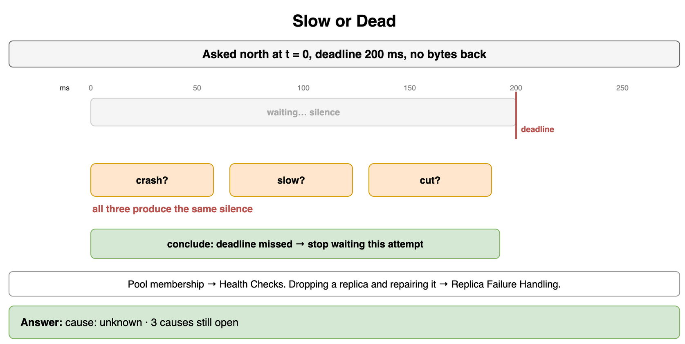
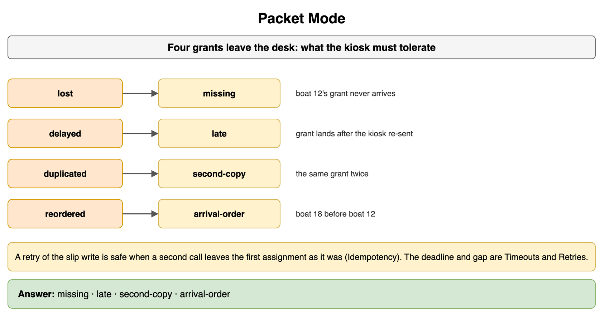
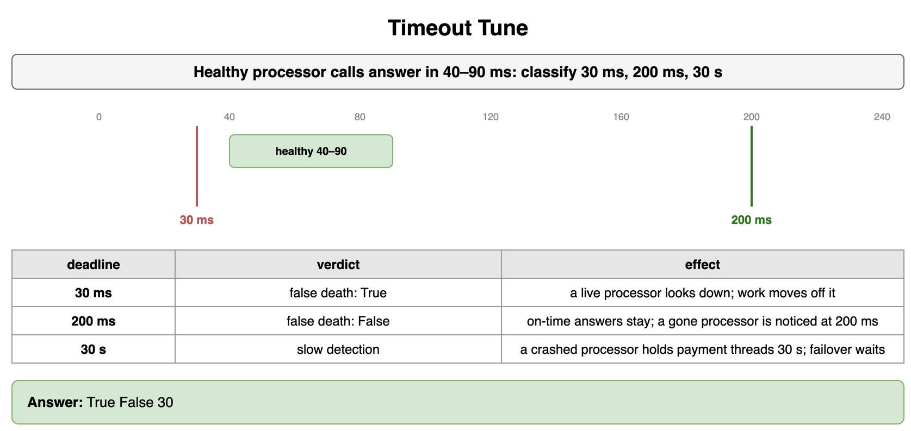
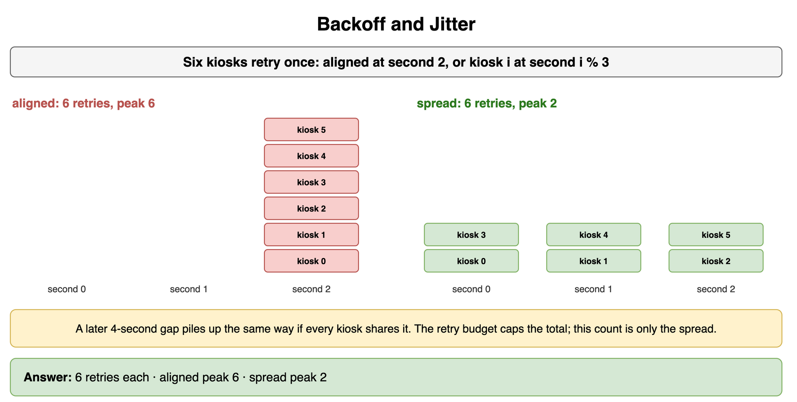
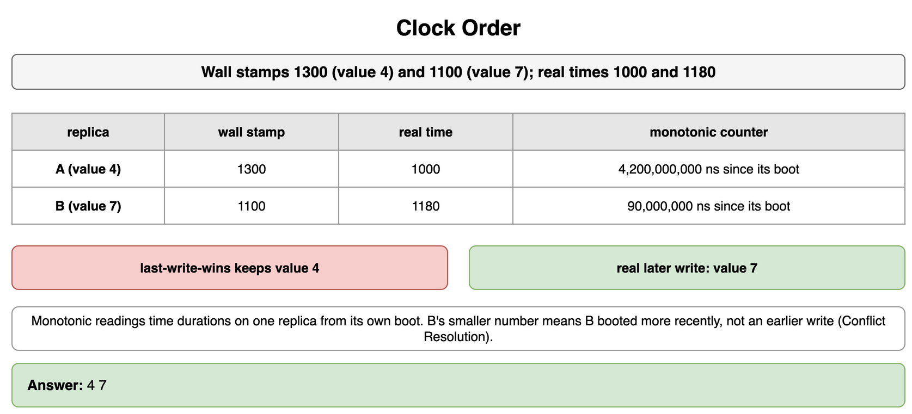
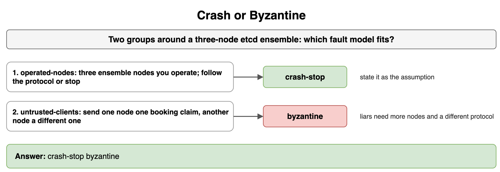
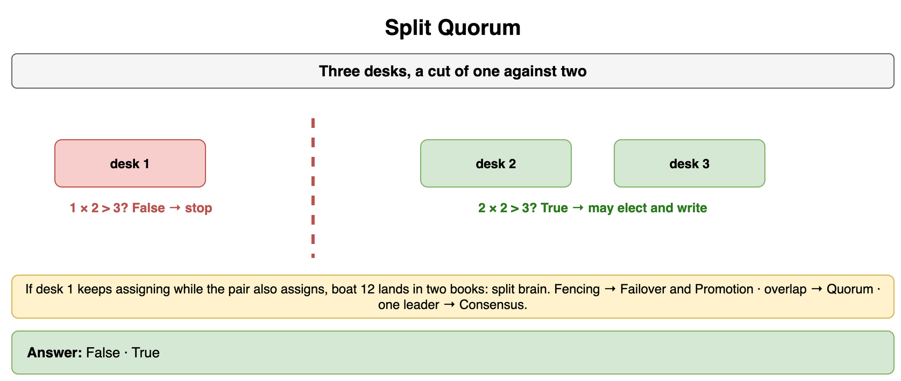
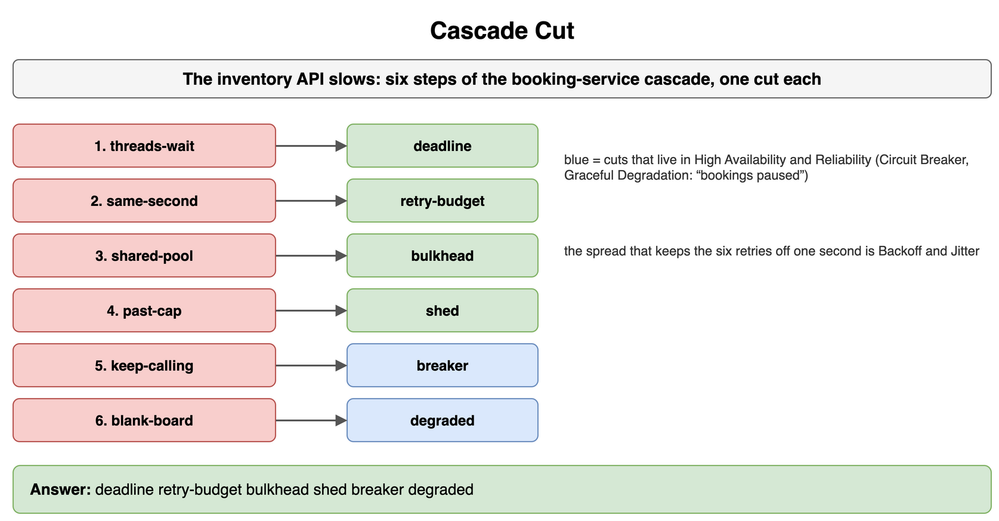

# Distributed System Failure Modes — Drills

Original practice for what a silence can mean, what a message can do, and which cut stops a cascade. Each card is one exercise: commit to an answer, then check it. The numbers are for a replicated database, a payment call to a card processor, and a booking service in front of an inventory API. Pool membership stays in Load Balancing. Replica repair stays in Consistency and Replication. Fencing a relational primary stays in Databases Relational. The idempotency key stays in Networking and Communication. Parking a message after N failures stays in Message Queues and Async Processing. Breaker behavior, a reduced answer, and a second site stay in High Availability and Reliability. Agreeing on one leader stays in Transactions and Concurrency Control.

## Slow or Dead

A client asked replica A for a row at t = 0. The deadline is 200 ms. No bytes came back. What can the client conclude, and what stays open?

```python
OBSERVED = "silence"
CAUSES = ("crash", "slow", "cut")
```

**Answer:** The client can conclude that the deadline was missed. It cannot conclude that replica A crashed. A slow replica and a cut link produce the same silence, so all three causes stay open. This attempt stops waiting on that replica and leaves the cause unnamed. Whether a server leaves a pool is Health Checks. The heartbeat that drops a replica from one attempt, and the repair after, is Replica Failure Handling.

```python
OBSERVED = "silence"
CAUSES = ("crash", "slow", "cut")


def named_cause(observed: str) -> str:
    if observed == "silence":
        return "unknown"
    return observed


print(named_cause(OBSERVED), len(CAUSES))
# unknown 3
```



*Source: [`diagrams/failure-modes-drills.drawio`](/content/09_System_Design_Interview/15_Distributed_System_Failure_Modes/diagrams/failure-modes-drills.drawio), page 1.*

## Packet Mode

Four confirmations leave the card processor for the payment service. Name what the service has to tolerate in each case, and what a retry of the charge requires.

```text
1. lost — payment 12's confirmation never arrives.
2. delayed — the confirmation arrives after the service has already sent the charge again.
3. duplicated — the same confirmation is delivered twice.
4. reordered — payment 18's confirmation arrives before payment 12's, and payment 12 was sent first.
```

```python
MODES = ["lost", "delayed", "duplicated", "reordered"]
```

**Answer:** A missing confirmation, a late confirmation, a second copy, and an arrival order that differs from send order. Silence leaves open whether the confirmation was lost, is still in flight, or met a processor that has stopped. A second copy has to leave one charge in place. Send order is a poor record of the order the service applies. A retry of the charge is safe when a second call leaves the first charge as it was, which is Idempotency. The key that makes that true stays on that card. The deadline and the gap before the retry are Timeouts and Retries.

```python
MODES = ["lost", "delayed", "duplicated", "reordered"]
TOLERATE = {
    "lost": "missing",
    "delayed": "late",
    "duplicated": "second-copy",
    "reordered": "arrival-order",
}

print(" ".join(TOLERATE[mode] for mode in MODES))
# missing late second-copy arrival-order
```



*Source: [`diagrams/failure-modes-drills.drawio`](/content/09_System_Design_Interview/15_Distributed_System_Failure_Modes/diagrams/failure-modes-drills.drawio), page 2.*

## Timeout Tune

Healthy processor calls answer in 40 to 90 ms. Classify a deadline of 30 ms, one of 200 ms, and one of 30 seconds.

```python
HEALTHY_MS = range(40, 91)
CANDIDATES_MS = (30, 200, 30_000)
```

**Answer:** 30 ms is a false death. Every healthy answer sits above it, so the service treats a live processor as down and can move work off it. 200 ms sits above the healthy range, so a processor that answers on time stays, and a processor that is gone is noticed at 200 ms. 30 seconds is slow detection. A crashed processor holds the payment threads for 30 seconds, and failover waits out that deadline. The length of the deadline is the whole of this choice. The growing gap after the miss is Backoff and Jitter.

```python
HEALTHY_MS = range(40, 91)
CANDIDATES_MS = (30, 200, 30_000)


def false_death(deadline_ms: int) -> bool:
    return deadline_ms < max(HEALTHY_MS)


print(false_death(30), false_death(200), CANDIDATES_MS[2] // 1000)
# True False 30
```



*Source: [`diagrams/failure-modes-drills.drawio`](/content/09_System_Design_Interview/15_Distributed_System_Failure_Modes/diagrams/failure-modes-drills.drawio), page 3.*

## Backoff and Jitter

Six payment clients retry once. Aligned, every client sends at second 2. With a spread, client `i` sends at second `i % 3`. How many retries are issued in each schedule, and what is the peak on one second?

```python
CALLERS = 6
```

**Answer:** Both schedules issue 6 retries. The aligned peak is 6, all of them on second 2, which is the dip turning into a storm. The spread peak is 2. The busiest second then receives 2 retries. A later gap of 4 seconds piles up the same way if every client still shares it. The cap that refuses retries past a budget, so the clients stop adding calls, is the retry budget on Timeouts and Retries. This count is only the spread.

```python
CALLERS = 6


def placed(jitter: bool) -> list[int]:
    return [caller % 3 if jitter else 2 for caller in range(CALLERS)]


def peak(slots: list[int]) -> int:
    return max(slots.count(second) for second in set(slots))


aligned = placed(False)
spread = placed(True)
print(len(aligned), peak(aligned), len(spread), peak(spread))
# 6 6 6 2
```



*Source: [`diagrams/failure-modes-drills.drawio`](/content/09_System_Design_Interview/15_Distributed_System_Failure_Modes/diagrams/failure-modes-drills.drawio), page 4.*

## Clock Order

Replica A stamped value 4 at a wall time of 1300 ms. Replica B stamped value 7 at a wall time of 1100 ms. In real time, A wrote at 1000 ms and B wrote at 1180 ms. A's monotonic counter reads 4,200,000,000. B's reads 90,000,000. Which value does last-write-wins keep, which value was later, and what do the monotonic readings add?

```python
REPLICA_A_WALL = (1300, 4)
REPLICA_B_WALL = (1100, 7)
REPLICA_A_REAL = (1000, 4)
REPLICA_B_REAL = (1180, 7)
REPLICA_A_MONO_NS = 4_200_000_000
REPLICA_B_MONO_NS = 90_000_000
```

**Answer:** Last-write-wins keeps value 4, because 1300 is the greater wall stamp. Value 7 is the later write: real time 1180 ms is after 1000 ms. The stamp that won belongs to the earlier write. The monotonic readings leave that order untouched. Each counter times durations on its own replica, from its own boot. B's smaller number means B booted more recently. Why a wall-clock stamp is a weak input to that pick is Conflict Resolution.

```python
REPLICA_A_WALL = (1300, 4)
REPLICA_B_WALL = (1100, 7)
REPLICA_A_REAL = (1000, 4)
REPLICA_B_REAL = (1180, 7)


def later_value(stamps: list[tuple[int, int]]) -> int:
    return max(stamps)[1]


print(later_value([REPLICA_A_WALL, REPLICA_B_WALL]), later_value([REPLICA_A_REAL, REPLICA_B_REAL]))
# 4 7
```



*Source: [`diagrams/failure-modes-drills.drawio`](/content/09_System_Design_Interview/15_Distributed_System_Failure_Modes/diagrams/failure-modes-drills.drawio), page 5.*

## Crash or Byzantine

Two groups interact with a three-node etcd ensemble. Which fault model fits each group?

```text
1. operated-nodes — three ensemble nodes you operate. A node follows the protocol, or it stops answering.
2. untrusted-clients — clients outside the ensemble submit booking claims. A client can send one claim to one node and a different claim to another.
```

```python
CASES = ["operated-nodes", "untrusted-clients"]
```

**Answer:** Crash-stop for the nodes you operate, and that is the assumption to state for machines you run. Byzantine for the untrusted clients: a participant that can present two claims is outside crash-stop. Most interview designs stay with the nodes you operate and say so. The protocol that tolerates liars, and the extra nodes it needs, stays outside this catalog.

```python
CASES = ["operated-nodes", "untrusted-clients"]
MODEL = {"operated-nodes": "crash-stop", "untrusted-clients": "byzantine"}

print(" ".join(MODEL[name] for name in CASES))
# crash-stop byzantine
```



*Source: [`diagrams/failure-modes-drills.drawio`](/content/09_System_Design_Interview/15_Distributed_System_Failure_Modes/diagrams/failure-modes-drills.drawio), page 6.*

## Split Quorum

Three ensemble nodes, and a cut of one against two. Which side may elect a leader and keep taking writes? What goes wrong if the single node keeps taking writes too?

```python
NODES = 3
SIDES = (1, 2)
```

**Answer:** The side of two may elect and may keep taking writes. The side of one must stop. Majority is counted against all three nodes, so the single node is a minority even though it can see only itself. A single node that keeps writing, while the pair also writes, stores booking 12 in two histories. That is split brain. Fencing a relational primary that still accepts writes is Failover and Promotion. The overlap a replicated write needs before it can finish is Quorum Reads and Writes. How the three nodes agree on one leader is Consensus Algorithms.

```python
NODES = 3
SIDES = (1, 2)


def may_take_writes(side: int, nodes: int = NODES) -> bool:
    return side * 2 > nodes


print(may_take_writes(SIDES[0]), may_take_writes(SIDES[1]))
# False True
```



*Source: [`diagrams/failure-modes-drills.drawio`](/content/09_System_Design_Interview/15_Distributed_System_Failure_Modes/diagrams/failure-modes-drills.drawio), page 7.*

## Cascade Cut

The inventory API slows, and the booking service comes apart in six steps. Name the cut for each step. Point at High Availability and Reliability where the cut is a breaker or a reduced answer.

```text
1. threads-wait — booking threads sit on the slow inventory call with no deadline.
2. same-second — six clients retry on the same second, with no cap.
3. shared-pool — the status page and the booking calls share one thread pool.
4. past-cap — the queue is past its cap and the service still accepts every booking.
5. keep-calling — callers keep sending to an inventory API that is already failing.
6. blank-board — the status page goes blank where "bookings paused" would do.
```

```python
STEPS = [
    "threads-wait",
    "same-second",
    "shared-pool",
    "past-cap",
    "keep-calling",
    "blank-board",
]
```

**Answer:** Deadline, retry budget, bulkhead, shed, breaker, degraded response. The deadline frees the thread. The retry budget caps the storm, and the spread that keeps those retries off one second is Backoff and Jitter. The bulkhead is the status page's own pool. Shedding rejects the extra booking once the queue is past its cap. Stopping the calls into a dependency that is already failing is the Circuit Breaker Pattern. Answering "bookings paused" is Graceful Degradation. Those two cuts stay in High Availability and Reliability.

```python
STEPS = [
    "threads-wait",
    "same-second",
    "shared-pool",
    "past-cap",
    "keep-calling",
    "blank-board",
]
CUT = {
    "threads-wait": "deadline",
    "same-second": "retry-budget",
    "shared-pool": "bulkhead",
    "past-cap": "shed",
    "keep-calling": "breaker",
    "blank-board": "degraded",
}

print(" ".join(CUT[step] for step in STEPS))
# deadline retry-budget bulkhead shed breaker degraded
```



*Source: [`diagrams/failure-modes-drills.drawio`](/content/09_System_Design_Interview/15_Distributed_System_Failure_Modes/diagrams/failure-modes-drills.drawio), page 8.*
