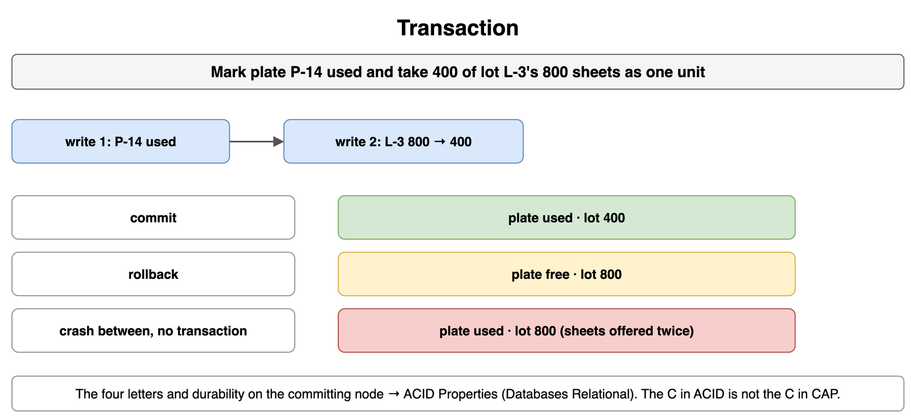
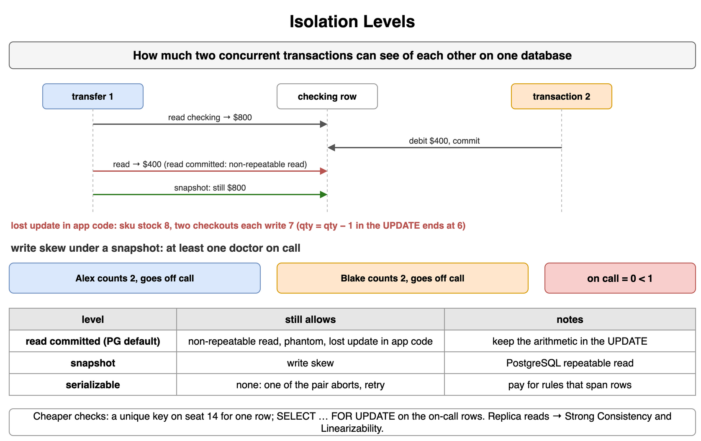
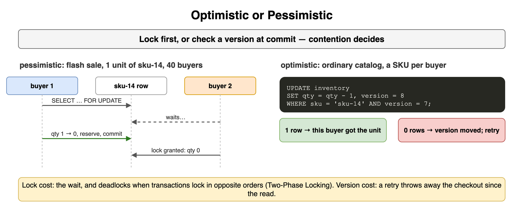
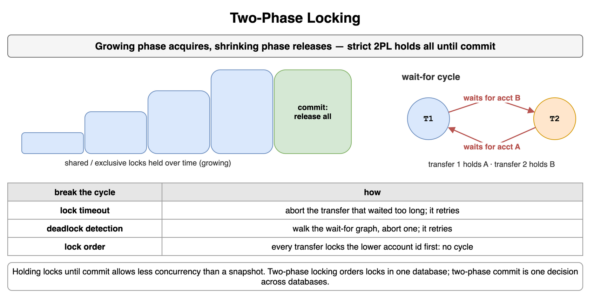
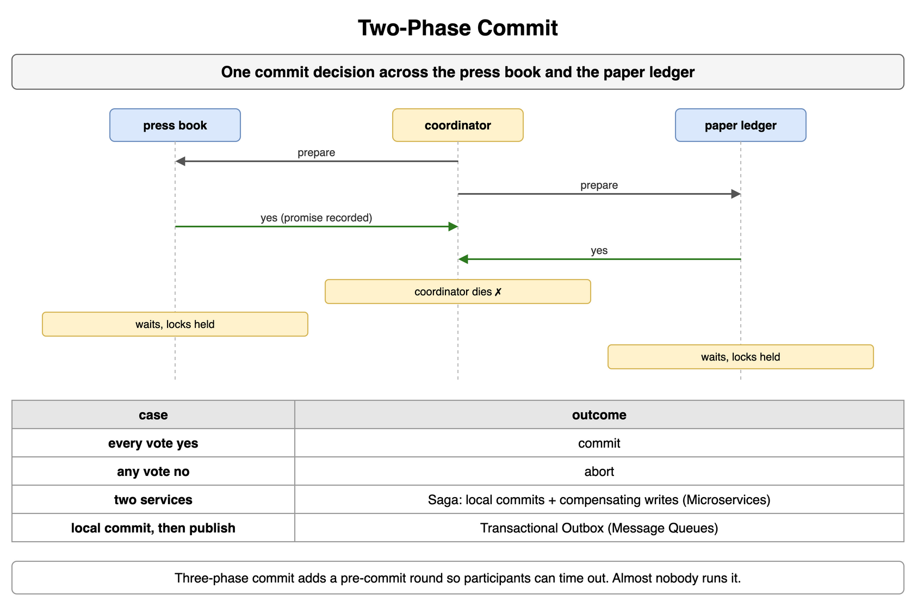
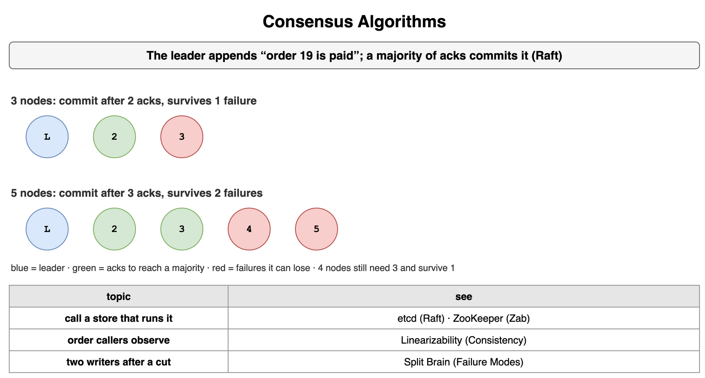
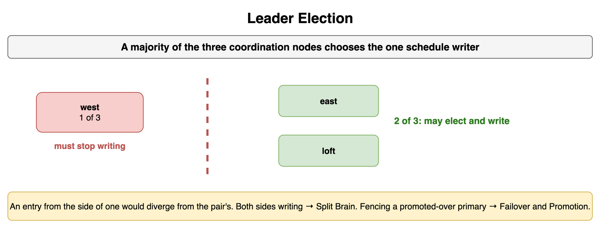
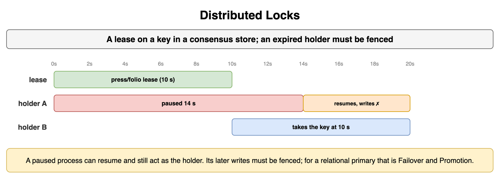

## Transaction

A transaction is a set of reads and writes that the database applies as one unit. Commit keeps every write in the set. Rollback removes every write in the set.

**Why it exists.** A transfer moves $400 from checking to savings. Checking starts at $800 and savings starts at $0, so the transfer is two writes: checking becomes $400, and savings becomes $400. Those two balances are one fact. A crash after the debit and before the credit, with nothing tying the writes together, leaves checking at $400 and savings at $0. The $400 is in neither account, and a later read will treat that as the truth.

**How it works.** Commit returns only after this node's log has a commit record for the transfer.

1. Begin the transaction and debit checking from $800 to $400.
2. Credit savings from $0 to $400.
3. Commit. Both new balances are the ones a later read sees, including after this process crashes and restarts. Commit returned only after this node's log had the record, so recovery can replay it.
4. Rollback instead of commit leaves checking at $800 and savings at $0. A crash before commit ends the same way: recovery undoes the debit that never committed.

**Trade-offs.** The promise is about this node's log. A commit that never reached another node can still disappear if this node is discarded. That case is Failover and Promotion in [Databases Relational](../06_Databases_Relational/). The four letters around the unit are ACID Properties in the same topic. The C in those letters means the constraints you declared still hold after commit, such as a check that checking stays at or above $0. The C in CAP is a different word, about replicas, and that distinction is on the ACID card.

**In an interview.** Walk the two balances for commit, rollback, and a crash between the writes. When both rows live in one database, the answer is a local transaction. When the debit and the credit are two services, the later cards apply: two-phase commit, or a saga.

**Recap.**

- Commit leaves checking at $400 and savings at $400.
- Rollback leaves checking at $800 and savings at $0.
- A crash between the two writes, with no transaction around them, leaves checking at $400 and savings at $0. The $400 is in neither account.
- A crash after the debit and before commit, inside the transaction, undoes the debit. Checking stays at $800 and savings stays at $0.
- Durability here is this node's log. The four letters, and the two meanings of C, are ACID Properties in Databases Relational.



*Source: [`diagrams/transactions.drawio`](/content/09_System_Design_Interview/16_Transactions_and_Concurrency_Control/diagrams/transactions.drawio), page 1.*

## Isolation Levels

Isolation is how much one transaction is allowed to see of another transaction's work on the same database. The levels differ by which anomalies they still allow.

**Why it exists.** Two transfers and two checkouts run at the same time. Without a rule, one of them can read a balance the other has not committed, read the same account twice and get two answers, or sell a unit the other checkout also sold. The level is the rule you pick for that risk.

**How it works.** The examples are one checking account, one inventory row, and two on-call doctors.

Read committed hides rows another transaction has not committed. It is PostgreSQL's default. Each statement sees what was committed before that statement started, so the next statement can see a commit that landed in between. A transfer reads checking at $800. Another transaction debits $400 and commits. The first transfer's next read returns $400. That change to the same row is a non-repeatable read. A count of on-call doctors can also grow because a new matching row committed between the two counts. That new row is a phantom.

Read committed also allows a lost update when the application does the arithmetic. The stock of one SKU is 8. Two checkouts each read 8, subtract 1 in memory, and write 7. Both commits succeed, two units were sold, and the stock is 7. `UPDATE inventory SET qty = qty - 1` keeps the subtraction on the row. The second update waits for the row lock, then subtracts from 7, and the stock ends at 6.

Snapshot isolation gives the transaction one snapshot, taken at its first statement, so the second read of checking stays $800. PostgreSQL's repeatable read is that snapshot. A second update of the same inventory row fails, and the application retries. Write skew still fits, because the two writes touch different rows. Alex and Blake are both on call, and the clinic rule is that at least one doctor stays on call. Alex's transaction counts 2 and sets Alex off call. Blake's transaction reads the same snapshot, counts 2, and sets Blake off call. Each update hits a different row, so the updates miss each other. Both commit, and the on-call count is 0. Either transaction, run alone, would have left 1 and the rule would have held.

Serializable requires the outcome to match some order in which one of those transactions finished before the other started. PostgreSQL's serializable isolation detects this pair and aborts one of them. The application retries the aborted transaction. The retry reads a count of 1 and, because the rule still requires one doctor on call, leaves that doctor on call. InnoDB's default level is repeatable read. How its locks treat a phantom is ACID Properties in [Databases Relational](../06_Databases_Relational/).

**Trade-offs.** Read committed allows the most overlap, and it is the right default when each statement stands alone and the arithmetic stays inside the `UPDATE`. A snapshot is the right level when one transaction reads the same rows twice and needs a stable picture. It still allows a rule that spans rows, as in the on-call count. Serializable closes that rule and aborts more often under contention. The application has to retry the whole transaction.

A unique key is the cheaper check when the rule is a single row. The second reservation for seat 14 fails on the unique key, at insert time. Locking the rows the decision reads is the other cheaper check for the doctors: `SELECT ... FOR UPDATE` on the on-call rows makes the second doctor wait, then see the updated count, at read committed. These are concurrent transactions on one database. A later read of a replica, and a real-time order across clients, are Strong Consistency and Linearizability in [Consistency and Replication](../09_Consistency_and_Replication/). A lost increment inside a limiter's own counter is [Rate Limiting and Throttling](../17_Rate_Limiting_and_Throttling/).

**In an interview.** Name the anomaly the requirement forbids, then the cheapest level that forbids it. Say that a unique key beats serializable when the rule is one row, and that this card is one database.

**Recap.**

| Level | What can still happen | What you pay |
| --- | --- | --- |
| Read committed | A later statement can see a new commit, including a new matching row. Read-then-write in application code can lose an update. | The usual default. Put the arithmetic in the `UPDATE`, or lock the row first. |
| Snapshot | Write skew. Two transactions can each keep a rule that the pair then breaks. PostgreSQL's repeatable read is this snapshot. | A stable read. A second write to the same row conflicts. A rule that spans rows can still break. |
| Serializable | One of the conflicting transactions aborts, and the application retries. | More aborts when many transactions touch the same rule. |



*Source: [`diagrams/transactions.drawio`](/content/09_System_Design_Interview/16_Transactions_and_Concurrency_Control/diagrams/transactions.drawio), page 2.*

## Optimistic or Pessimistic

Pessimistic control locks the row, then does the work. Optimistic control does the work, then checks a version at commit. Contention decides which one fits.

**Why it exists.** Two buyers can both try to reserve the last unit. One of them has to be refused, and the stock has to end at 0 with a single reservation. The choice is whether the loser waits up front or finds out at commit.

**How it works.** A flash sale has one unit of `sku-14` and 40 buyers. A conflict is the common case, so the buyer locks first.

1. `SELECT qty FROM inventory WHERE sku = 'sku-14' FOR UPDATE` locks the row.
2. The quantity is 1. The buyer decrements it and inserts the reservation.
3. Commit releases the lock. The next buyer takes the same lock, waits, and then sees 0.

The lock has to be on the reservation path. A plain read that does not take it still sees the last committed quantity.

Ordinary catalog traffic gives each buyer a different SKU, and a conflict is rare. The buyer reads version 7 and does the rest of the checkout. The write then claims the row only if that version is still current:

```sql
UPDATE inventory
SET qty = qty - 1, version = 8
WHERE sku = 'sku-14' AND version = 7;
```

One row updated means this buyer reserved the unit, and the version is now 8. Zero rows updated means another buyer committed first. This checkout retries from the read, or tells the buyer the unit is gone. The work done since the read is discarded.

**Trade-offs.** The lock fits the flash sale. A version check there would throw the checkout away for most of the 40 buyers, because the conflict is the usual outcome. The version check fits the ordinary catalog. Holding a lock across a slow checkout would make unrelated buyers wait. The cost of the lock is the wait, and a deadlock when two transactions lock rows in opposite orders. That cycle is Two-Phase Locking. The cost of the version check is the retry.

**In an interview.** Ask how often two transactions touch the same row. A common conflict means lock first. A rare conflict means check the version at commit, and say what 0 rows means: the version moved, so this attempt retries.

**Recap.**

| Situation | Strategy | What you observe |
| --- | --- | --- |
| One unit, 40 buyers | Lock the row, then do the work | The other buyers wait. Retrying them would waste the work. |
| A different SKU per buyer | Read version 7, write only if it is still 7 | 1 row updated means this buyer got the unit. 0 rows means retry. |



*Source: [`diagrams/transactions.drawio`](/content/09_System_Design_Interview/16_Transactions_and_Concurrency_Control/diagrams/transactions.drawio), page 3.*

## Two-Phase Locking

Two-phase locking is a lock protocol a database can use to make transactions serializable. In the growing phase a transaction acquires locks and releases none. In the shrinking phase it releases locks and acquires none.

**Why it exists.** Locks taken and released in any order do not by themselves produce a serial order. The growing phase and the shrinking phase are what produce that order. Releasing a write lock before commit lets another transaction read a value that might still roll back. Engines that use locking for serializable isolation avoid that read by holding the locks until commit or rollback. That form is strict two-phase locking.

**How it works.** A shared lock is enough to read a row, and many transactions can hold one. An exclusive lock is required to write a row, and it conflicts with both. The transaction releases those locks at commit or rollback, and it acquires none after the release starts.

A deadlock is a cycle in the wait-for graph. Transfer 1 locks account A and then waits for account B. Transfer 2 locks account B and then waits for account A. Each is waiting for a lock the other holds.

1. A lock timeout aborts the transaction that waited too long. It retries.
2. Deadlock detection walks the graph, finds the cycle, and aborts one of the two. The aborted transaction retries.
3. A fixed lock order keeps this cycle from forming. Every transfer locks the lower account id first. The second transfer waits on account A while the first still holds it.

**Trade-offs.** Holding locks until commit is why this path allows less concurrency than a snapshot. Readers and writers queue for the whole unit of work. Snapshot isolation lets them overlap, and write skew remains possible, as the Isolation Levels card shows. Two-phase locking is one way to reach serializable. It is a lock protocol inside one database. Two-phase commit, the next card, is one decision across databases.

**In an interview.** Call a deadlock a cycle in the wait-for graph. Name a timeout, aborting one side, and one lock order for every transaction. Then say which protocol you mean: two-phase locking orders locks in one database, and two-phase commit orders one commit across databases.

**Recap.**

- Growing phase: acquire locks, and release nothing.
- Shrinking phase: release at commit or rollback, and acquire nothing.
- Transfer 1 holds account A and waits for account B. Transfer 2 holds account B and waits for account A. That wait is a cycle.
- A timeout or a deadlock detector aborts one transaction, and it retries. Locking the lower account id first keeps this cycle from forming.



*Source: [`diagrams/transactions.drawio`](/content/09_System_Design_Interview/16_Transactions_and_Concurrency_Control/diagrams/transactions.drawio), page 4.*

## Two-Phase Commit

Two-phase commit, 2PC, is one commit decision for two or more databases. A coordinator asks each participant to prepare, then tells every participant to commit or every participant to abort.

**Why it exists.** An order row in the order database and a charge row in the payment database should agree. A local commit in only one of them leaves an order with no charge, or a charge with no order. The coordinator exists so those databases make one decision.

**How it works.** The order database and the payment database are the participants.

1. The coordinator sends prepare to both.
2. A participant that can commit records that promise in its own log, votes yes, and keeps the locks it took. A participant that cannot commit votes no.
3. When every vote is yes, the coordinator records commit and sends commit. Each participant commits and releases its locks.
4. When any vote is no, the coordinator sends abort. Each participant rolls back.

A coordinator that dies after both votes are yes, and before it sends the decision, leaves each participant waiting. The participant has promised to follow a decision it has not heard. The locks it took at prepare stay held until the coordinator returns and finishes. Guessing commit or abort can disagree with what the other participant was told, so the participant chooses neither.

**Trade-offs.** The wait is the cost. A dead coordinator blocks every participant that voted yes, and the locked rows stay unavailable. That is a poor fit for an order service and a payment service that have to keep answering. Across those services, each one commits locally, and a failed charge is repaired by a compensating write that cancels the order. The order can be visible as pending and then as cancelled, because nothing holds a lock across both databases while the charge is in flight. Those compensations are the Saga Pattern in [Microservices and System Decomposition](../12_Microservices_and_System_Decomposition/). A retry of the same charge uses an idempotency key, which is Idempotency in Payments in [Payment and Financial Systems](../23_Payment_and_Financial_Systems/).

The order row and an outbox row in one local commit, followed by a publish, are the Transactional Outbox in [Message Queues and Async Processing](../11_Message_Queues_and_Async_Processing/). That pair ties the saved order to the message. The payment database still makes its own commit.

Three-phase commit adds a pre-commit round so a participant that times out can try to finish. That timeout stays correct in a model where a missing coordinator has crashed. A partition can let the two sides finish with different decisions. Production systems almost never run it.

**In an interview.** For two databases you operate, and a commit that is allowed to wait, name two-phase commit and the dead coordinator. For an order service and a payment service, say each commits locally and a failed charge cancels the order. For save-then-publish inside one service, say the outbox.

**Recap.**

| Situation | What happens |
| --- | --- |
| Every participant votes yes | The coordinator sends commit, and the locks are released. |
| Any participant votes no | The coordinator sends abort. |
| The coordinator dies after the yes votes and before the decision | Each participant waits. The locks taken at prepare stay held. |
| The order service and the payment service must both stay available | Each commits locally. A failed charge cancels the order. That repair is the Saga Pattern. |
| The order and the "order placed" message must agree | One local commit writes the order and an outbox row. That is the Transactional Outbox. |



*Source: [`diagrams/transactions.drawio`](/content/09_System_Design_Interview/16_Transactions_and_Concurrency_Control/diagrams/transactions.drawio), page 5.*

## Consensus Algorithms

Consensus is how a group of nodes agrees on the next entry in a replicated log when some of them have stopped or cannot be reached. Raft is the algorithm to name for that log.

**Why it exists.** One node that records "order 19 is paid" loses that fact when it dies. Two nodes that both record it can record different facts. The log needs a single next entry that survives a minority of the nodes being down.

**How it works.** Raft picks one leader. The leader appends the entry and asks the others to store it.

1. The leader appends "order 19 is paid" locally and sends it to the followers.
2. A follower stores the entry and acknowledges it.
3. The entry is committed once a majority has stored it. The leader applies it and tells the followers they may apply it.
4. With 3 nodes the majority is 2, so the group still commits after 1 failure. With 5 nodes the majority is 3, and the group still commits after 2 failures.

```python
def majority(nodes: int) -> int:
    return nodes // 2 + 1


def failures_survived(nodes: int) -> int:
    return (nodes - 1) // 2


print(majority(3), failures_survived(3), majority(5), failures_survived(5))
# 2 1 3 2
```

Paxos agrees on a value too. Raft is the name to give for this log, because the leader, the term, and the majority acknowledgement are the pieces you can walk through. In the design, call a store that already runs a majority protocol. etcd runs Raft. ZooKeeper runs Zab.

**Trade-offs.** A majority write waits for the slower of those acknowledgements, and a cluster that cannot gather a majority refuses the entry. Adding a fourth node still needs 3 acknowledgements and still survives 1 failure. The next size that survives another failure is 5. The order a caller of etcd or ZooKeeper observes is Linearizability in [Consistency and Replication](../09_Consistency_and_Replication/). How many replicas a read set and a write set must share is Quorum Reads and Writes in that topic. The count on this card is the majority on one log entry. Two nodes that both accept writes after a cut are Split Brain in [Distributed System Failure Modes](../15_Distributed_System_Failure_Modes/). Choosing the one writer is Leader Election. A timed key in the same store is Distributed Locks.

**In an interview.** Say Raft, then the majority for the size they gave you: 2 of 3, or 3 of 5. Say the service calls etcd or ZooKeeper.

**Recap.**

- Raft is the name to give for a replicated log. Paxos is the name for agreeing on a value.
- Three nodes commit an entry after 2 have stored it, and still commit after 1 failure.
- Five nodes commit after 3 have stored it, and still commit after 2 failures.
- etcd runs Raft. ZooKeeper runs Zab. The caller-visible order is Linearizability.



*Source: [`diagrams/transactions.drawio`](/content/09_System_Design_Interview/16_Transactions_and_Concurrency_Control/diagrams/transactions.drawio), page 6.*

## Leader Election

Leader election picks the one node allowed to accept new entries in the log. The other nodes replicate what that leader commits.

**Why it exists.** Two leaders that both commit produce two logs. A client can be told that both writes succeeded, and the entries then disagree. A majority vote is what keeps a single leader in a term.

**How it works.** In Raft, a candidate increments the term and asks the others for votes. A node votes once in a term, and only for a candidate whose log is at least as new as its own. The candidate that gathers a majority becomes the leader.

Three nodes, A, B, and C, make the cut concrete. A network cut leaves A alone and leaves B and C together.

1. A holds 1 vote of 3. It cannot win the election. A commit needs a majority acknowledgement, so A cannot commit a new entry. A client that can reach only A does not receive a successful commit. An entry A appended and did not commit is dropped when A follows the pair's log at the higher term.
2. B and C hold 2 votes of 3. They may elect a leader and keep committing.
3. An entry committed on the side of one would diverge from an entry the pair commits. Both sides committing is the failure this rule prevents.

**Trade-offs.** The side of one can still be up and answering. The safe answer is to refuse the write, which is a short outage for clients who can reach only that node. Letting it commit avoids the outage and forks the log. Both sides committing is Split Brain in [Distributed System Failure Modes](../15_Distributed_System_Failure_Modes/). The majority that commits a log entry is Consensus Algorithms. When the writer is a relational primary that still accepts commits after another node has been promoted, fencing that primary is Failover and Promotion in [Databases Relational](../06_Databases_Relational/).

**In an interview.** Draw the cut and count each side. Only a strict majority may elect. With 3 nodes, the pair may lead and the single node must stop committing.

**Recap.**

- A leader needs a majority of votes in one term, and each node votes once in that term.
- One node of three cannot elect and cannot commit a new entry.
- The other two may elect and may keep committing.
- Both sides committing forks the log. That failure is Split Brain.



*Source: [`diagrams/transactions.drawio`](/content/09_System_Design_Interview/16_Transactions_and_Concurrency_Control/diagrams/transactions.drawio), page 7.*

## Distributed Locks

A distributed lock is a lease on a key in a consensus store. The holder may do the work while the lease is valid. When the lease expires, another worker may take the key.

**Why it exists.** Two workers should not both run the nightly billing job. A lock that lives in one process does not stop the other process. The store agrees on the key the way Consensus Algorithms agrees on a log entry. The lease is the part this card adds: the winner's right expires when it stops renewing.

**How it works.** The key is `locks/nightly-billing`, and the lease is 10 seconds. etcd or ZooKeeper is the store.

1. The holder takes the key and renews the 10-second lease while it runs the job.
2. Another worker that finds the key absent, or the lease expired, may take it.
3. The holder pauses for 14 seconds, for example in a long garbage-collection pause. It misses the renewal. At 10 seconds the lease ends, and a second worker takes the key and starts the job.
4. The first worker resumes at 14 seconds and still believes it holds the lock. If its later writes count, both workers have billed the same accounts.

The grant carries a monotonically increasing storage token, 1 for the first holder and 2 for the next. The system that stores the billing result rejects a write whose token is older than the highest token it has already accepted. The resumed worker's token 1 is rejected after token 2 has been stored. Checking the lease in the worker, just before the write, still loses if the process pauses after that check. The token check happens on the write itself.

**Trade-offs.** The lease is a deadline after which someone else may proceed. The paused process can still be running. A short lease detects a dead holder quickly and costs a renewal round trip. A long lease delays the takeover. Ten seconds is the lease in this example. Pick the length from how long the job may pause and how soon a dead holder should be replaced. When every worker already shares one database, a row lock or an advisory lock in that database is enough, and it ends with the transaction. The lease is for work that outlives one database transaction or does not share one. When the holder is a relational primary, fencing it so the old node cannot commit is Failover and Promotion in [Databases Relational](../06_Databases_Relational/).

**In an interview.** Call it a lease. Give the 10-second lease and the 14-second pause, and say the billing store rejects the older token on the write. Naming etcd or ZooKeeper is the start. The answer still includes the pause and the token.

**Recap.**

- The key `locks/nightly-billing` is held with a 10-second lease, renewed while the holder works.
- A pause of 14 seconds expires the lease. A new holder may take the key.
- The paused process can resume and still act as the holder.
- The storage token on the write rejects that expired holder. A relational primary is fenced the same way, on Failover and Promotion.



*Source: [`diagrams/transactions.drawio`](/content/09_System_Design_Interview/16_Transactions_and_Concurrency_Control/diagrams/transactions.drawio), page 8.*
