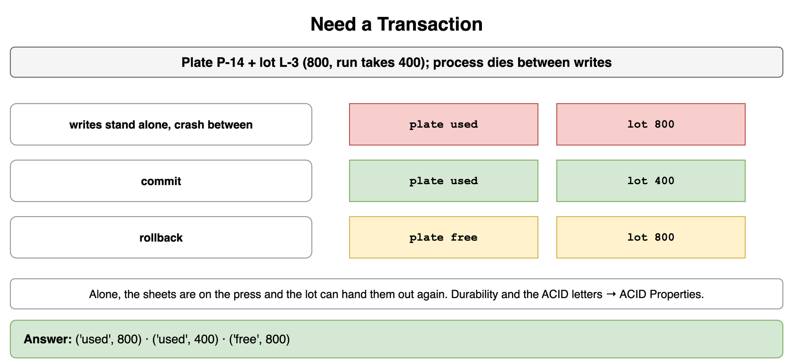
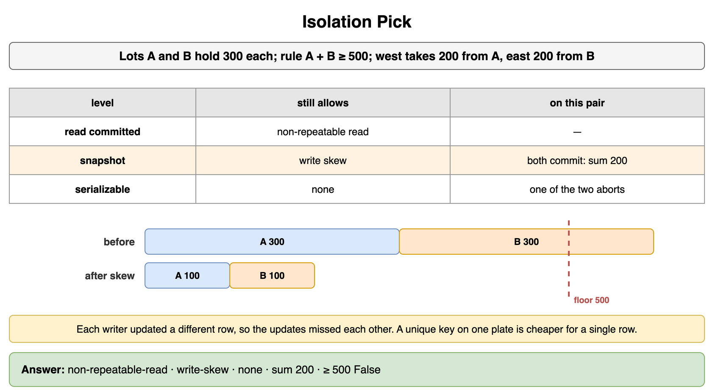
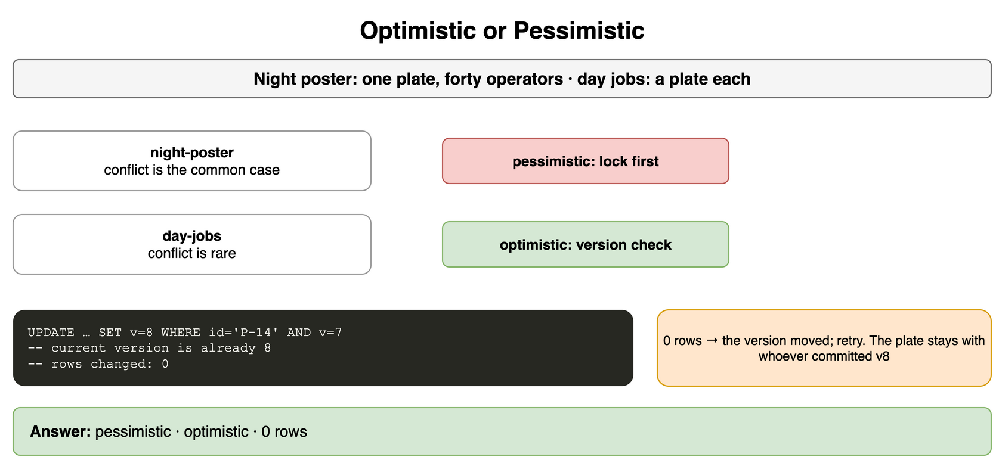
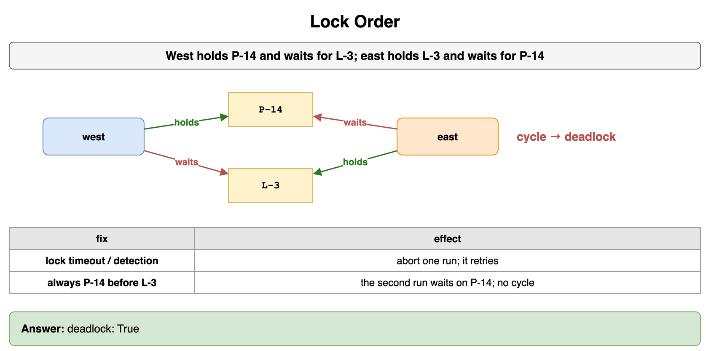
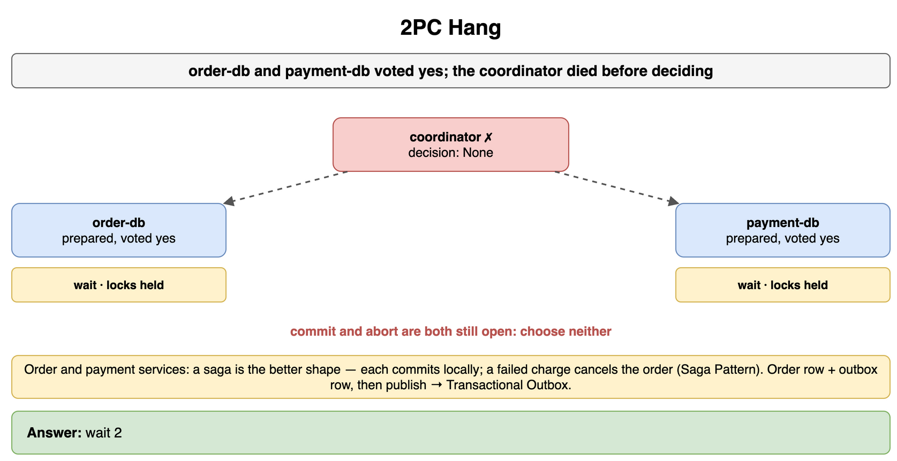
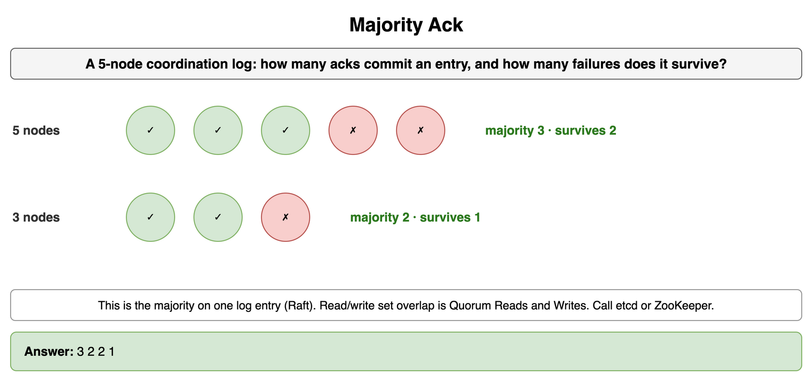
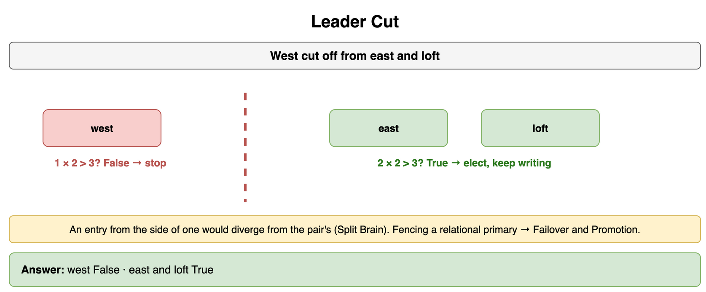
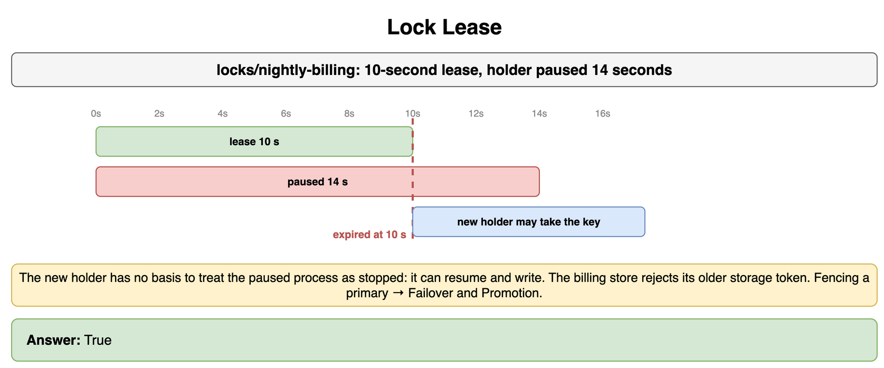

# Transactions and Concurrency Control — Drills

Original practice for a unit of work, the anomaly a level still allows, and which side of a cut may lead. Each card is one exercise: commit to an answer, then check it. The numbers are small on purpose. A transfer moves money between two accounts in one database. Two doctors share an on-call rule. Buyers reserve inventory. An order database and a payment database prepare together. A coordination cluster of a few nodes keeps one log. The four ACID letters, durability on the committing node, and fencing a relational primary stay in Databases Relational. Replica linearizability, strong consistency, and quorum overlap stay in Consistency and Replication. The transactional outbox stays in Message Queues and Async Processing. Saga compensations stay in Microservices and System Decomposition. Split brain as a failure mode stays in Distributed System Failure Modes. A race inside a limiter stays in Rate Limiting and Throttling.

## Need a Transaction

A transfer moves $400 from checking to savings. Checking starts at $800 and savings starts at $0. The debit lands. The process dies before the credit. What is left when those writes stand alone? What does commit leave, and what does rollback leave?

```python
START_CHECKING = 800
START_SAVINGS = 0
TRANSFER = 400
```

**Answer:** Alone, checking is $400 and savings is $0. The $400 left checking and never arrived, so it is in neither account. Commit leaves checking at $400 and savings at $400. Rollback leaves checking at $800 and savings at $0. A crash inside a transaction, before commit, ends as the rollback does: recovery undoes the debit. Durability of a commit that did land, and the four letters around it, stay on ACID Properties.

```python
START_CHECKING = 800
START_SAVINGS = 0
TRANSFER = 400


def crash_between() -> tuple[int, int]:
    return START_CHECKING - TRANSFER, START_SAVINGS


def after_commit() -> tuple[int, int]:
    return START_CHECKING - TRANSFER, START_SAVINGS + TRANSFER


def after_rollback() -> tuple[int, int]:
    return START_CHECKING, START_SAVINGS


print(crash_between(), after_commit(), after_rollback())
# (400, 0) (400, 400) (800, 0)
```



*Source: [`diagrams/transactions-drills.drawio`](/content/09_System_Design_Interview/16_Transactions_and_Concurrency_Control/diagrams/transactions-drills.drawio), page 1.*

## Isolation Pick

Name the anomaly each level still allows on one database. Two doctors are on call, and the rule is that at least one stays on call. Each reads a count of 2 and then goes off call. The two writes touch different rows. How many doctors are on call afterward, and when is serializable worth its cost?

```python
LEVELS = ["read-committed", "snapshot", "serializable"]
ON_CALL = 2
EACH_GOES_OFF = 1
MINIMUM = 1
```

**Answer:** Read committed still allows a non-repeatable read: a second read of the same row can show a commit that landed in between. It also allows a phantom and a lost update when the application reads a value and writes a new one. Snapshot isolation still allows this write skew. Afterward, 0 doctors are on call, under the minimum of 1. Each writer updated a different row, so the two updates missed each other. Serializable closes that non-repeatable read, the phantom, the lost update, and this write skew, and it aborts one of the two transactions. Pay for it on a rule that spans rows this way. A unique key on one seat is the cheaper check for a single row. This is one database. Linearizability and strong consistency of replicas stay in Consistency and Replication.

```python
LEVELS = ["read-committed", "snapshot", "serializable"]
ON_CALL = 2
EACH_GOES_OFF = 1
MINIMUM = 1
ALLOWS = {
    "read-committed": "non-repeatable-read",
    "snapshot": "write-skew",
    "serializable": "none",
}


def still_on_call(on_call: int, each: int) -> int:
    return on_call - each - each


left = still_on_call(ON_CALL, EACH_GOES_OFF)
print(" ".join(ALLOWS[name] for name in LEVELS), left, left >= MINIMUM)
# non-repeatable-read write-skew none 0 False
```



*Source: [`diagrams/transactions-drills.drawio`](/content/09_System_Design_Interview/16_Transactions_and_Concurrency_Control/diagrams/transactions-drills.drawio), page 2.*

## Optimistic or Pessimistic

A flash sale has one unit of a SKU and forty buyers. Ordinary catalog checkouts each reserve a different SKU. Which strategy fits each, and what does an update that read version 7 and now finds version 8 mean when it changes 0 rows?

```python
CASES = ["flash-sale", "ordinary-catalog"]
READ_VERSION = 7
VERSION_NOW = 8
```

**Answer:** Lock first on the flash sale. A conflict is the common case, and a retry would throw the checkout away most of the time. Check the version at commit on the ordinary catalog, where a conflict is rare. Zero rows means the version moved and this checkout retries. The unit stays with the buyer who committed version 8.

```python
CASES = ["flash-sale", "ordinary-catalog"]
STRATEGY = {"flash-sale": "pessimistic", "ordinary-catalog": "optimistic"}
READ_VERSION = 7
VERSION_NOW = 8


def version_rows(read_version: int, now: int) -> int:
    if now != read_version:
        return 0
    return 1


print(" ".join(STRATEGY[name] for name in CASES), version_rows(READ_VERSION, VERSION_NOW))
# pessimistic optimistic 0
```



*Source: [`diagrams/transactions-drills.drawio`](/content/09_System_Design_Interview/16_Transactions_and_Concurrency_Control/diagrams/transactions-drills.drawio), page 3.*

## Lock Order

Transfer 1 locks account A, then waits for account B. Transfer 2 locks account B, then waits for account A. Does this deadlock, and which rule breaks it?

```python
HOLDS = {"transfer-1": "account-A", "transfer-2": "account-B"}
WAITS = {"transfer-1": "account-B", "transfer-2": "account-A"}
```

**Answer:** Yes. Each transfer waits for the lock the other holds, which is a cycle in the wait-for graph. A lock timeout aborts the transfer that waited too long. Walking the cycle and aborting one of the two breaks it the same way. The aborted transfer retries. Locking the lower account id before the higher one, on every transfer, makes the second transfer wait on the first account, and this cycle does not form.

```python
HOLDS = {"transfer-1": "account-A", "transfer-2": "account-B"}
WAITS = {"transfer-1": "account-B", "transfer-2": "account-A"}


def deadlock(holds: dict[str, str], waits: dict[str, str]) -> bool:
    return holds["transfer-2"] == waits["transfer-1"] and holds["transfer-1"] == waits["transfer-2"]


print(deadlock(HOLDS, WAITS))
# True
```



*Source: [`diagrams/transactions-drills.drawio`](/content/09_System_Design_Interview/16_Transactions_and_Concurrency_Control/diagrams/transactions-drills.drawio), page 4.*

## 2PC Hang

The order database and the payment database have both voted yes and prepared. The coordinator dies before it sends commit or abort. What may a participant do? When is a saga the better shape?

```python
PREPARED = ("order-db", "payment-db")
DECISION = None
```

**Answer:** A participant that has voted yes waits. The locks it took at prepare stay held until the coordinator returns and finishes the decision. Commit and abort are both still open, so the participant chooses neither. A saga is the better shape when you are deciding how the order service and the payment service agree, rather than once this prepare has already happened. Each service commits locally, and a failed charge is repaired by a compensating write that cancels the order. Those compensations stay on the Saga Pattern card. The order row and an outbox row in one local commit, then a publish, are the Transactional Outbox.

```python
PREPARED = ("order-db", "payment-db")
DECISION = None


def participant_action(decision: str | None) -> str:
    if decision is None:
        return "wait"
    return decision


print(participant_action(DECISION), len(PREPARED))
# wait 2
```



*Source: [`diagrams/transactions-drills.drawio`](/content/09_System_Design_Interview/16_Transactions_and_Concurrency_Control/diagrams/transactions-drills.drawio), page 5.*

## Majority Ack

The coordination log has 5 nodes. How many must acknowledge an entry before it is committed, and how many failures does that majority survive?

```python
NODES = 5
```

**Answer:** 3 acknowledgements commit the entry. The group still commits after 2 failures, because 3 of 5 can still answer. With 3 nodes the same rule is 2 acknowledgements and 1 failure. How many replicas a read set and a write set must share is Quorum Reads and Writes. This number is the majority that must store one log entry. Raft is the name for the protocol. Call etcd or ZooKeeper.

```python
NODES = 5


def majority(nodes: int) -> int:
    return nodes // 2 + 1


def failures_survived(nodes: int) -> int:
    return (nodes - 1) // 2


print(majority(NODES), failures_survived(NODES), majority(3), failures_survived(3))
# 3 2 2 1
```



*Source: [`diagrams/transactions-drills.drawio`](/content/09_System_Design_Interview/16_Transactions_and_Concurrency_Control/diagrams/transactions-drills.drawio), page 6.*

## Leader Cut

Node A is cut off from nodes B and C. Three nodes, a cut of 1 against 2. Which side may elect a leader, and which side must stop committing new entries?

```python
NODES = 3
ISOLATED = 1
PAIR = 2
```

**Answer:** B and C may elect and may keep committing. A must stop committing. A cannot gather the majority a commit needs, so an entry committed on the side of one would diverge from an entry the pair commits. Both sides committing is Split Brain. The overlapping set a replicated read and write need is Quorum Reads and Writes. Fencing a relational primary that still accepts commits is Failover and Promotion. This exercise is which side may lead.

```python
NODES = 3
ISOLATED = 1
PAIR = 2


def may_elect(side: int, nodes: int = NODES) -> bool:
    return side * 2 > nodes


print(may_elect(ISOLATED), may_elect(PAIR))
# False True
```



*Source: [`diagrams/transactions-drills.drawio`](/content/09_System_Design_Interview/16_Transactions_and_Concurrency_Control/diagrams/transactions-drills.drawio), page 7.*

## Lock Lease

The holder of `locks/nightly-billing` has a 10-second lease and has paused for 14 seconds. What may a new holder assume?

```python
LEASE_S = 10
PAUSED_S = 14
```

**Answer:** The new holder may take `locks/nightly-billing`. The lease has expired, so the key is open. The new holder has no basis to treat the paused process as stopped. That process can resume and write as if it still held the job. The billing store rejects those writes when they carry an older storage token than the one the new holder already stored. Fencing a relational primary, so the old node cannot commit, is Failover and Promotion. The steps of that fence stay on that card.

```python
LEASE_S = 10
PAUSED_S = 14


def lease_expired(paused_s: int, lease_s: int) -> bool:
    return paused_s > lease_s


print(lease_expired(PAUSED_S, LEASE_S))
# True
```



*Source: [`diagrams/transactions-drills.drawio`](/content/09_System_Design_Interview/16_Transactions_and_Concurrency_Control/diagrams/transactions-drills.drawio), page 8.*
