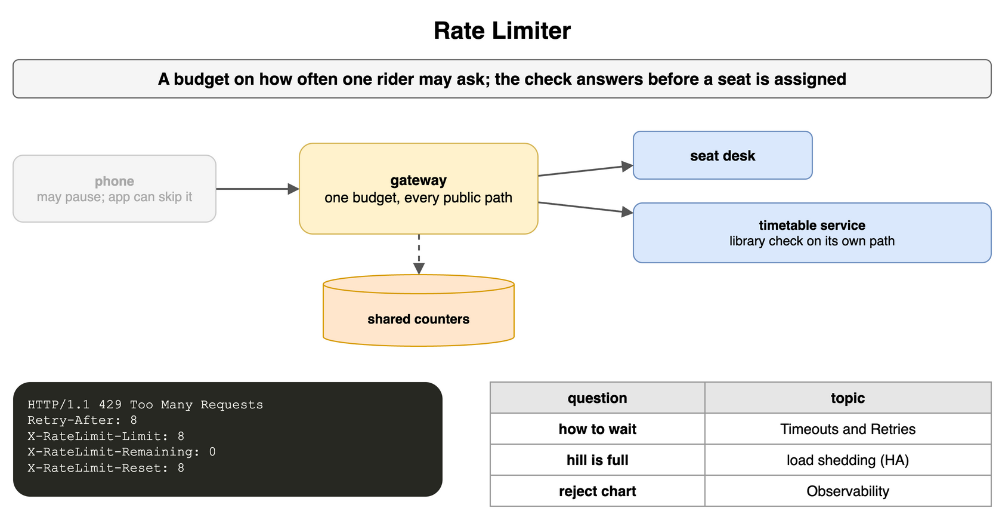
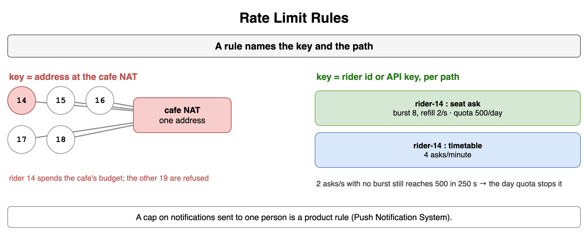
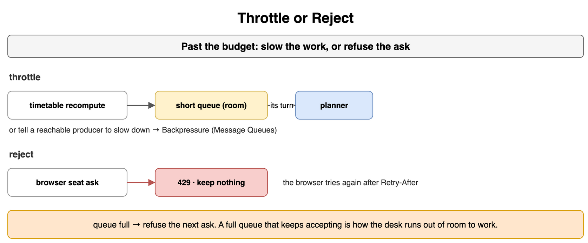
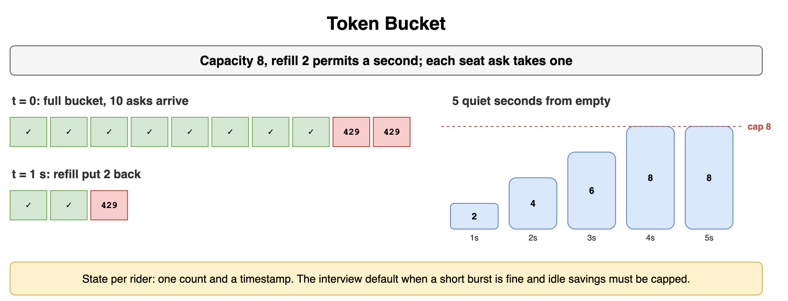
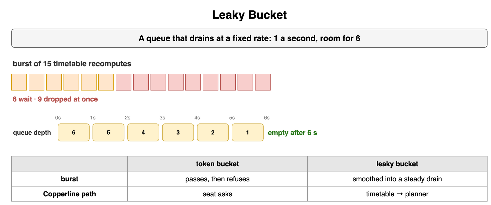
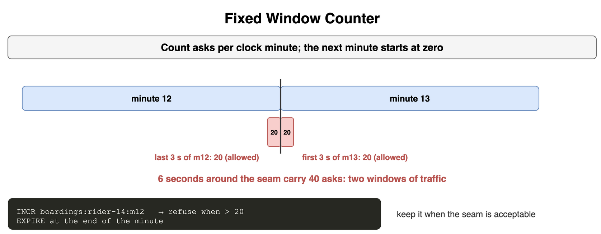
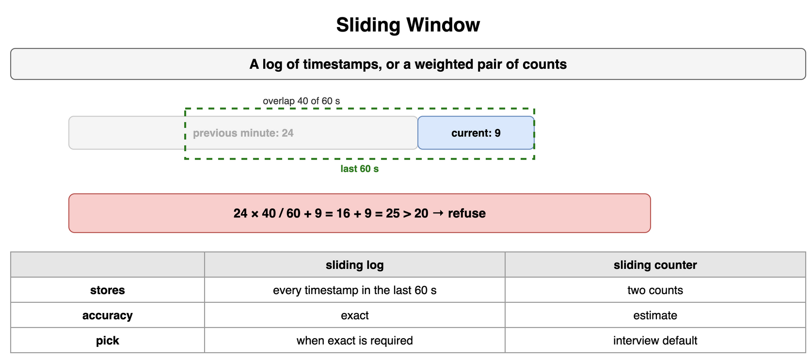
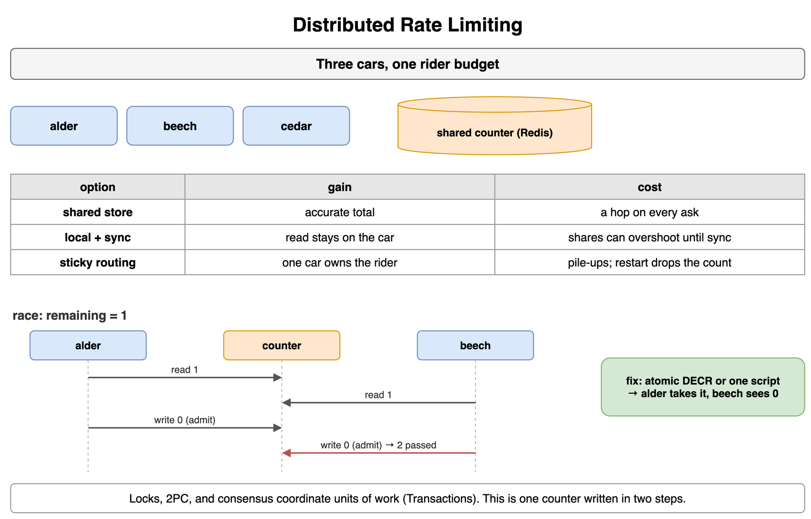

## Rate Limiter

Copperline Tram sells a seat by taking an ask at the desk. A rate limiter is the budget on how often one rider may ask. It keeps one phone from filling the next car, and it keeps a client that retries without a pause from holding the desk. The rules sit with the check, the counters sit in a store the cars can share, and the desk answers before it assigns a seat. A pause inside the rider's phone is cooperative, and the app can skip it. The usual place for one budget over every public path is the API Gateway in [Networking and Communication](../10_Networking_and_Communication/). That host applies the decision. The shape of the bucket stays here. The timetable service holds its own check, as a library in its request pipeline, when only that path is expensive and seat asks must keep a separate count.

A spent personal budget is HTTP 429 Too Many Requests. Retry-After names the wait in seconds. X-RateLimit-Limit, X-RateLimit-Remaining, and X-RateLimit-Reset report the budget on the answer, including the answers that pass. Waiting out that header, and keeping a fleet of retries off one second, is Timeouts and Retries in [Distributed System Failure Modes](../15_Distributed_System_Failure_Modes/). Refusing every rider because the hill itself is full is load shedding, with the Circuit Breaker Pattern and Graceful Degradation in [High Availability and Reliability](../03_High_Availability_and_Reliability/). The chart of those rejects stays in [Observability](../25_Observability/). How to scope the interview question stays on The Four-Step Framework in [Interview Framework and Process](../01_Interview_Framework_and_Process/).

```text
phone            may pause; the app can skip it
gateway          one budget for every public path; API Gateway
one service      a library on the expensive path
429              personal budget spent; Retry-After: 8
headers          X-RateLimit-Limit, Remaining, Reset
the wait         Timeouts and Retries
hill is full     load shedding, in High Availability
the chart        Observability
the question     The Four-Step Framework
```



*Source: [`diagrams/rate-limiting.drawio`](/content/09_System_Design_Interview/17_Rate_Limiting_and_Throttling/diagrams/rate-limiting.drawio), page 1.*

## Rate Limit Rules

The rule names the key and the path. An address is easy to read and a poor key at the lower-station cafe, where twenty riders share one NAT. One busy phone spends the cafe's budget, and the other nineteen are refused on that same address. A rider who changes networks starts over as a new caller. A rider id, or the API key the desk issued, counts the person who holds the credential. A path counts the work. A seat ask and a timetable recompute are different costs, and each path keeps its own count.

A short rate and a longer quota can both apply to the same rider. The seat-ask bucket allows a burst of 8 and refills 2 permits a second. A quota of 500 seat asks in a day stops the caller who never takes that burst and still sends with the refill: 2 a second reaches 500 in 250 seconds. The timetable path has its own key, capped at 4 asks a minute. A cap on how many notifications one person may be sent is a product rule on the Push Notification System card in [Real-Time and Notification Systems](../21_Real_Time_and_Notification_Systems/). The counters that enforce the rule are the cards that follow.

```text
cafe address     twenty riders, one NAT, one shared budget
rider id or key  the person who holds the credential
path             seat ask and timetable recompute, separate keys
burst and day    8, then 2 a second; 500 seat asks in a day
timetable        4 asks a minute, its own key
notifications    Push Notification System
```



*Source: [`diagrams/rate-limiting.drawio`](/content/09_System_Design_Interview/17_Rate_Limiting_and_Throttling/diagrams/rate-limiting.drawio), page 2.*

## Throttle or Reject

Past the budget, the desk either slows the work or refuses the ask. A throttle holds a short queue and lets the ask wait its turn, or it tells a producer the desk can reach to send more slowly. A reject answers 429 and keeps no copy of the ask. Slowing a producer is Backpressure in [Message Queues and Async Processing](../11_Message_Queues_and_Async_Processing/). The queue, its depth, and when to add consumers stay on that card.

Hold a timetable recompute when the rider can wait and the queue still has room. Reject a seat ask from a browser, which can try again after the header. Reject once the queue is full. A full queue that keeps taking asks is how the desk runs out of room to work.

```text
throttle      a short queue, or a slower producer
reject        429, and the desk keeps nothing
producer      Backpressure
queue full    refuse the next ask
```



*Source: [`diagrams/rate-limiting.drawio`](/content/09_System_Design_Interview/17_Rate_Limiting_and_Throttling/diagrams/rate-limiting.drawio), page 3.*

## Token Bucket

A token bucket is a count of permits and a refill. Each seat ask takes one permit. Copperline gives rider 14 a bucket that holds 8 permits and gains 2 permits a second, and the count never climbs past 8. A full bucket lets a burst of 8 through. One second later the refill has put 2 permits back, so 2 more asks pass. Five quiet seconds from an empty bucket would add 10, and the cap keeps the bucket at 8, so a quiet stretch stays a burst of 8.

The state is one count and the time it was last refilled. That is the usual interview default for an API that should tolerate a short burst, cap the idle savings, and remember one bucket per rider.

```text
capacity     8, the largest burst
refill       2 permits each second
full         a burst of 8 passes
one second   2 more pass
five quiet   from empty, 10 would arrive; the cap leaves 8
memory       one count and a timestamp per rider
```



*Source: [`diagrams/rate-limiting.drawio`](/content/09_System_Design_Interview/17_Rate_Limiting_and_Throttling/diagrams/rate-limiting.drawio), page 4.*

## Leaky Bucket

A leaky bucket is a queue that drains at a fixed rate. Timetable recomputes enter the queue, and the planner takes them out at 1 per second. The queue holds 6. A burst of 15 arrives: 6 wait, 9 are dropped at once, and the queue is empty 6 seconds later.

A token bucket lets the burst through and refuses once the permits are gone. A leaky bucket turns the burst into a steady departure and holds the excess only while the queue has room. Seat asks want the burst, so they stay on the token bucket. The timetable path wants a smooth arrival at the planner, so it uses this queue. The choice between waiting and refusing is Throttle or Reject.

```text
drain            1 request a second
queue            6
burst of 15      6 wait, 9 dropped
empty            6 seconds
seat asks        token bucket, the burst passes
timetable        this queue, a steady drain
```



*Source: [`diagrams/rate-limiting.drawio`](/content/09_System_Design_Interview/17_Rate_Limiting_and_Throttling/diagrams/rate-limiting.drawio), page 5.*

## Fixed Window Counter

A fixed window counts asks inside a clock minute, then starts the next minute at zero. The desk once allowed 20 seat asks in each minute. The key is the rider and the minute. An increment that passes 20 is refused, and the key expires when the minute is over.

The seam is the fault. Twenty asks land in the last three seconds of minute 12, and the window shows 20, which the rule allows. Twenty more land in the first three seconds of minute 13, and that window shows 20 as well. Across the edge the rider sent 40 asks in six seconds, two windows of traffic, while each window on its own stayed inside the rule. Keep a fixed window when that seam is acceptable. Leave it when those six seconds matter.

```text
window           one minute, the next starts at 0
limit            20
minute 12, late  20, allowed
minute 13, early 20, allowed
six seconds      40, two windows
key              boardings:rider-14:m12, then expire
```



*Source: [`diagrams/rate-limiting.drawio`](/content/09_System_Design_Interview/17_Rate_Limiting_and_Throttling/diagrams/rate-limiting.drawio), page 6.*

## Sliding Window

A log and a weighted pair of counts both repair that seam, and they stay on one card.

A sliding log stores the time of each ask and counts the times still inside the last 60 seconds. The count matches the asks that arrived. The seam is gone. The cost is one timestamp per ask per rider, and that list is the memory to avoid when the minute is busy.

A sliding counter keeps two numbers, the previous minute and the current minute, and weights the previous minute by the part that still falls inside the last 60 seconds. Twenty seconds into the new minute, the previous minute holds 24 and the current minute holds 9. The overlap is 40 seconds out of 60, so the estimate keeps 24 * 40 / 60 = 16 of those asks and adds the 9 already counted. The weighted count is 25. A limit of 20 refuses the ask. The figure is an estimate, and it stores two counts instead of every timestamp. Prefer it in an interview unless the problem asks for an exact count.

```text
log              each timestamp in the last 60 seconds
log cost         memory grows with the asks
counter          previous minute and current minute
at 20s of 60     24 * 40 / 60 + 9 = 25
limit 20         25 refuses the ask
```



*Source: [`diagrams/rate-limiting.drawio`](/content/09_System_Design_Interview/17_Rate_Limiting_and_Throttling/diagrams/rate-limiting.drawio), page 7.*

## Distributed Rate Limiting

Alder, beech, and cedar all take seat asks. A counter that lives on one car is wrong for a rider whose next ask lands on another car. A shared counter, often in Redis, is what every car updates. The total matches the asks. Every ask pays a hop, and the store sits on the path. A local counter plus a periodic sync gives each car a share of the budget. The read stays on the car. Until the next sync the shares can add up past the limit, which is the drift you accept when a local share is enough and the hop can wait. Sticky routing sends rider 14 to alder every time, so alder's counter is that rider's counter. The pin is Sticky Sessions (Session Affinity) in [Load Balancing](../04_Load_Balancing/). The riders who arrived first pile onto one car, and a restart of that car drops the count it held.

The race is two cars updating that shared count in separate steps. The remaining permits are 1. Alder reads 1 and admits its ask. Beech reads 1 before alder writes, and admits its ask. Each then writes 0, the value it computed from the 1 it read. Two asks passed on one permit. An atomic decrement, or one script that reads, decides, and writes before another car runs, lets alder take the permit and leaves beech looking at 0. A distributed lock, two-phase commit, and a consensus round stay in [Transactions and Concurrency Control](../16_Transactions_and_Concurrency_Control/). They coordinate a unit of work across records. This failure is one counter written in two steps. The timestamp list and its memory stay on Sliding Window.

```text
shared store     accurate, a hop on every ask
local plus sync  fast, the shares can overshoot
sticky           one rider, one car; Sticky Sessions
remaining 1      alder and beech both read 1 and both admit
fix              atomic decrement, or one script
locks and 2PC    Transactions and Concurrency Control
```



*Source: [`diagrams/rate-limiting.drawio`](/content/09_System_Design_Interview/17_Rate_Limiting_and_Throttling/diagrams/rate-limiting.drawio), page 8.*
