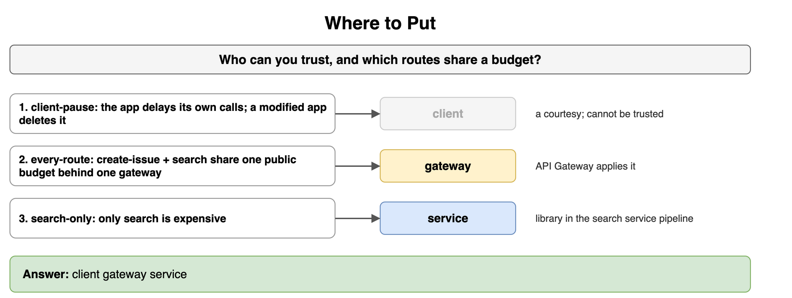
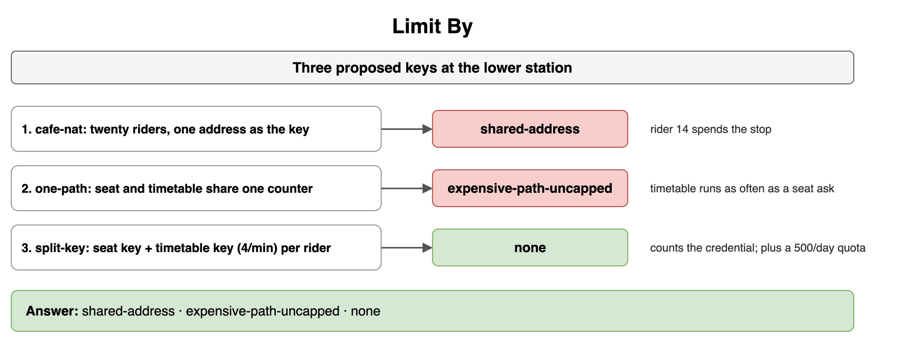
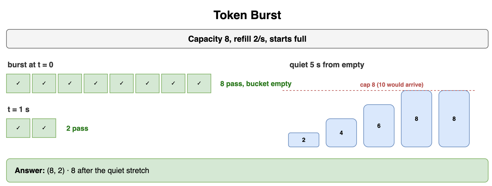
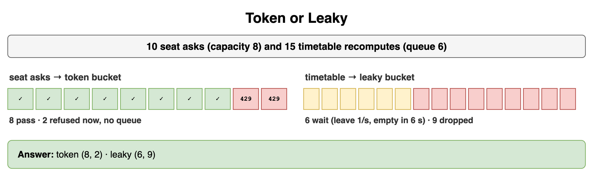
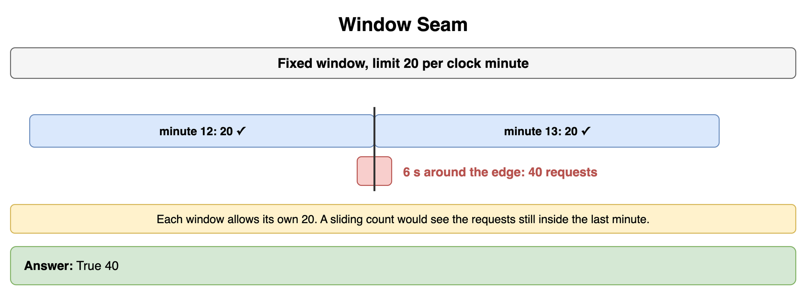
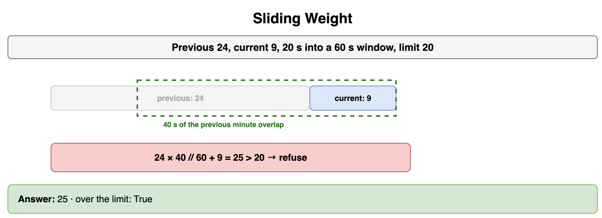
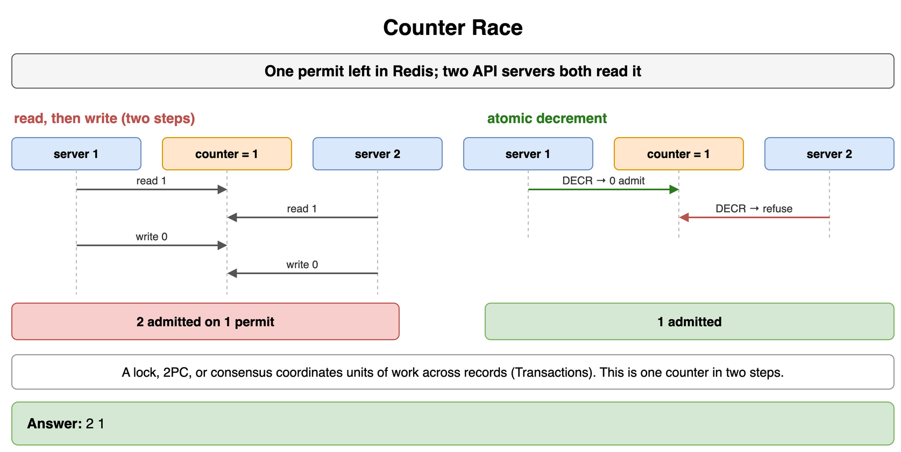
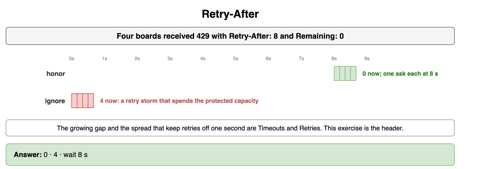

# Rate Limiting and Throttling — Drills

Original practice for where a budget sits, which key it counts, and which counter enforces it. Each card is one exercise: commit to an answer, then check it. The numbers are a teaching budget for a public REST API, in the spirit of GitHub's per-user limit and Stripe's per-account limit. They are smaller than those published budgets so the arithmetic stays visible. Each picture is in the same order as its prompt. Match a row by its position and by the answer under the code. The gateway that can host the check stays in Networking and Communication. Slowing a producer stays in Message Queues and Async Processing. Shedding because the whole service is full stays in High Availability and Reliability. Pinning a caller to one server stays in Load Balancing. How a client waits stays in Distributed System Failure Modes. A lock around the counter stays in Transactions and Concurrency Control.

## Where to Put

You are choosing a home for the check on a public API. Who can you trust, and which routes share a budget?

```text
1. client-pause — the app delays its own calls. A modified app can delete the delay.
2. every-route — creating an issue and running search share one public budget, and both sit behind one gateway.
3. search-only — only search is expensive, and creating an issue keeps its own budget.
```

```python
CASES = ["client-pause", "every-route", "search-only"]
```

**Answer:** The app is a client, and a pause there is a courtesy. The server cannot trust it. Stripe recommends a client-side token bucket for this courtesy, and a rebuilt client can skip it. Every public route sharing one budget belongs on the gateway, the API Gateway, which already sees those calls and applies the decision. The search-only budget belongs on the search service, as a library in its request pipeline, so creating an issue never spends it. The gateway's other jobs, the token check and the route, stay on the API Gateway card.

```python
CASES = ["client-pause", "every-route", "search-only"]
PLACE = {
    "client-pause": "client",
    "every-route": "gateway",
    "search-only": "service",
}

print(" ".join(PLACE[name] for name in CASES))
# client gateway service
```



*Source: [`diagrams/rate-limiting-drills.drawio`](/content/09_System_Design_Interview/17_Rate_Limiting_and_Throttling/diagrams/rate-limiting-drills.drawio), page 1.*

## Limit By

Three keys are proposed for an authenticated API that also accepts anonymous calls. What goes wrong with the weak ones?

```text
1. shared-nat — twenty people on cafe Wi-Fi share one public address. The counter key is that address.
2. one-counter — one user's issue writes and search calls share one counter, capped like the cheap write.
3. per-route — issue writes are one key for that user, and search calls are another, capped at 4 a minute.
```

```python
CASES = ["shared-nat", "one-counter", "per-route"]
```

**Answer:** The shared address treats twenty people as one caller. One of them spends the budget, and the rest are refused with them. A client that changes networks starts a fresh budget. GitHub's unauthenticated limit is this kind of key: 60 requests per hour for the IP address. One shared counter lets search run as often as a cheap write, so the expensive route has no cap of its own. The per-route key counts the person who holds the credential, and the search key stops at 4 a minute. A day quota of 500 writes can sit beside the short rate, so a script that never bursts still stops. A cap on notification sends stays on the Push Notification System card.

```python
CASES = ["shared-nat", "one-counter", "per-route"]
FAULT = {
    "shared-nat": "shared-address",
    "one-counter": "expensive-path-uncapped",
    "per-route": "none",
}

print(" ".join(FAULT[name] for name in CASES))
# shared-address expensive-path-uncapped none
```



*Source: [`diagrams/rate-limiting-drills.drawio`](/content/09_System_Design_Interview/17_Rate_Limiting_and_Throttling/diagrams/rate-limiting-drills.drawio), page 2.*

## Token Burst

A caller's bucket holds 8 permits and refills 2 permits a second. It starts full. How many requests pass in a burst that arrives together, and how many pass one second later? From empty, what does a quiet stretch of 5 seconds leave in the bucket?

```python
CAPACITY = 8
REFILL = 2
QUIET_S = 5
```

**Answer:** The burst takes 8, which empties the bucket. One second later the refill has put 2 permits back, so 2 requests pass. Five quiet seconds from empty would add 10, and the cap leaves 8. Idle time does not raise the burst. If 10 requests had arrived in that first instant, 8 would pass and 2 would be 429 immediately. A refused request does not take a permit.

```python
CAPACITY = 8
REFILL = 2
QUIET_S = 5


def burst_then_one_second(capacity: int, refill: int) -> tuple[int, int]:
    return capacity, min(capacity, refill)


def after_quiet_from_empty(capacity: int, refill: int, quiet_s: int) -> int:
    return min(capacity, refill * quiet_s)


print(
    burst_then_one_second(CAPACITY, REFILL),
    after_quiet_from_empty(CAPACITY, REFILL, QUIET_S),
)
# (8, 2) 8
```



*Source: [`diagrams/rate-limiting-drills.drawio`](/content/09_System_Design_Interview/17_Rate_Limiting_and_Throttling/diagrams/rate-limiting-drills.drawio), page 3.*

## Token or Leaky

Ten user-facing writes arrive together from a caller who expects a short burst to succeed. Fifteen report jobs arrive together, and the worker must start them at 1 per second. The report queue holds 6. Which algorithm fits each path, how many writes pass, how many are refused at once, and how many report jobs wait?

```python
WRITES_ARRIVED = 10
CAPACITY = 8
REPORTS_ARRIVED = 15
QUEUE = 6
```

**Answer:** A token bucket for the writes. Eight pass. The two past the capacity are 429 in the moment they arrive, and the bucket keeps no queue. A leaky bucket for the reports. Six wait in the short queue and leave at 1 per second, so the queue is empty 6 seconds later. Nine are dropped because the queue is already full. Slowing a producer you can reach, and the depth of a broker queue, stay on Backpressure. The write path refuses at once. The report path waits while the queue has room.

```python
WRITES_ARRIVED = 10
CAPACITY = 8
REPORTS_ARRIVED = 15
QUEUE = 6


def token(arrived: int, capacity: int) -> tuple[int, int]:
    passed = min(arrived, capacity)
    return passed, arrived - passed


def leaky(arrived: int, queue: int) -> tuple[int, int]:
    waiting = min(arrived, queue)
    return waiting, arrived - waiting


print(token(WRITES_ARRIVED, CAPACITY), leaky(REPORTS_ARRIVED, QUEUE))
# (8, 2) (6, 9)
```



*Source: [`diagrams/rate-limiting-drills.drawio`](/content/09_System_Design_Interview/17_Rate_Limiting_and_Throttling/diagrams/rate-limiting-drills.drawio), page 4.*

## Window Seam

A fixed window allows 20 requests in a clock minute. Twenty land in the last three seconds of minute 12. Twenty land in the first three seconds of minute 13. Does each window allow its own count, and how many requests crossed the edge?

```python
LIMIT = 20
LATE = 20
EARLY = 20
```

**Answer:** Each window shows 20, which the rule allows, so both sides look fine. The six seconds around the edge carried 40 requests, two windows of traffic. A fixed window admits that seam. The spike is up to twice the limit. A sliding count would see the requests that are still inside the last minute.

```python
LIMIT = 20
LATE = 20
EARLY = 20


def seam(late: int, early: int, limit: int) -> tuple[bool, int]:
    each_window_allows = late <= limit and early <= limit
    return each_window_allows, late + early


print(*seam(LATE, EARLY, LIMIT))
# True 40
```



*Source: [`diagrams/rate-limiting-drills.drawio`](/content/09_System_Design_Interview/17_Rate_Limiting_and_Throttling/diagrams/rate-limiting-drills.drawio), page 5.*

## Sliding Weight

Twenty seconds of a 60-second window have elapsed. The previous minute recorded 24 requests. This minute has recorded 9. The limit is 20. What is the weighted count, and is it over the limit?

```python
PREV = 24
CURR = 9
ELAPSED = 20
WINDOW = 60
LIMIT = 20
```

**Answer:** The previous minute still overlaps the last 60 seconds by 40 seconds. The estimate keeps `24 × 40 / 60 = 16` of those requests and adds the 9 already in this minute. The weighted count is 25, which is over 20, so the request is refused. The weight assumes the previous minute was spread evenly. A log of timestamps would be exact and would store every request. This estimate stores two counts. The division lands on a whole number here.

```python
PREV = 24
CURR = 9
ELAPSED = 20
WINDOW = 60
LIMIT = 20


def weighted(prev: int, curr: int, elapsed: int, window: int) -> int:
    return prev * (window - elapsed) // window + curr


count = weighted(PREV, CURR, ELAPSED, WINDOW)
print(count, count > LIMIT)
# 25 True
```



*Source: [`diagrams/rate-limiting-drills.drawio`](/content/09_System_Design_Interview/17_Rate_Limiting_and_Throttling/diagrams/rate-limiting-drills.drawio), page 6.*

## Counter Race

One permit remains on the shared counter in Redis. Two API servers each read 1 and admit, before either writes. Each would store 0. How many requests pass, and how many pass when the decrement is one atomic step? Why is a lock or a two-phase commit the wrong repair?

```python
REMAINING = 1
SERVERS = 2
```

**Answer:** Both servers admit, so 2 requests pass on 1 permit. An atomic decrement admits 1. The second server sees 0, or a negative result it must treat as a refusal. One script that reads, decides, and writes before another server runs does the same thing: the first server takes the permit and the second sees 0. A distributed lock, two-phase commit, and a consensus round stay in Transactions and Concurrency Control. They coordinate a unit of work across records. This failure is one counter updated in two steps.

```python
REMAINING = 1
SERVERS = 2


def raced(remaining: int, servers: int) -> int:
    return sum(1 for _ in range(servers) if remaining > 0)


def atomic(remaining: int, servers: int) -> int:
    admitted = 0
    left = remaining
    for _ in range(servers):
        if left > 0:
            left -= 1
            admitted += 1
    return admitted


print(raced(REMAINING, SERVERS), atomic(REMAINING, SERVERS))
# 2 1
```



*Source: [`diagrams/rate-limiting-drills.drawio`](/content/09_System_Design_Interview/17_Rate_Limiting_and_Throttling/diagrams/rate-limiting-drills.drawio), page 7.*

## Retry-After

Four API clients each received HTTP 429 with `Retry-After: 8` and `X-RateLimit-Remaining: 0`. How many of those four call again during this second if they honor the header, and how many call if they ignore it? What does the second choice do to the API?

```python
RETRY_AFTER_S = 8
CLIENTS = 4
```

**Answer:** A client that honors the header waits 8 seconds and then sends one request, so this second sees 0 of the four. A client that ignores the header calls again now, so this second sees 4. Those four immediate calls are a retry storm: they spend the capacity the refusal was meant to protect. GitHub tells callers to wait out `Retry-After` when it is present, and otherwise to wait until `x-ratelimit-reset` when the remaining count is 0. Stripe asks for exponential backoff with jitter, which spreads retries that would otherwise land on the same second. The growing gap and the spread stay on Timeouts and Retries. This exercise is the header.

```python
RETRY_AFTER_S = 8
CLIENTS = 4


def retries_this_second(clients: int, honors_header: bool) -> int:
    if honors_header:
        return 0
    return clients


print(retries_this_second(CLIENTS, True), retries_this_second(CLIENTS, False), RETRY_AFTER_S)
# 0 4 8
```



*Source: [`diagrams/rate-limiting-drills.drawio`](/content/09_System_Design_Interview/17_Rate_Limiting_and_Throttling/diagrams/rate-limiting-drills.drawio), page 8.*
