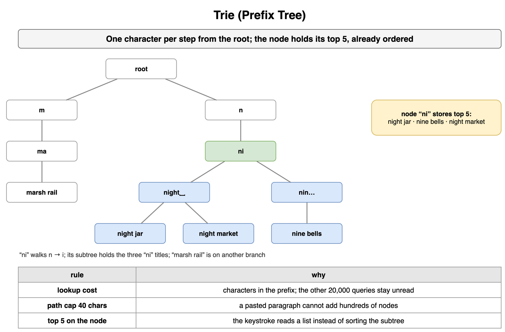
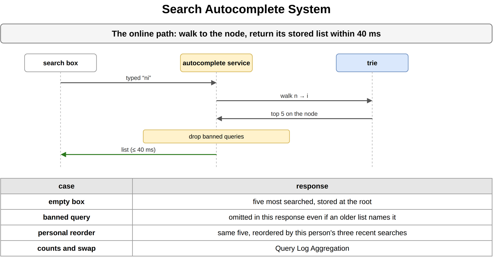
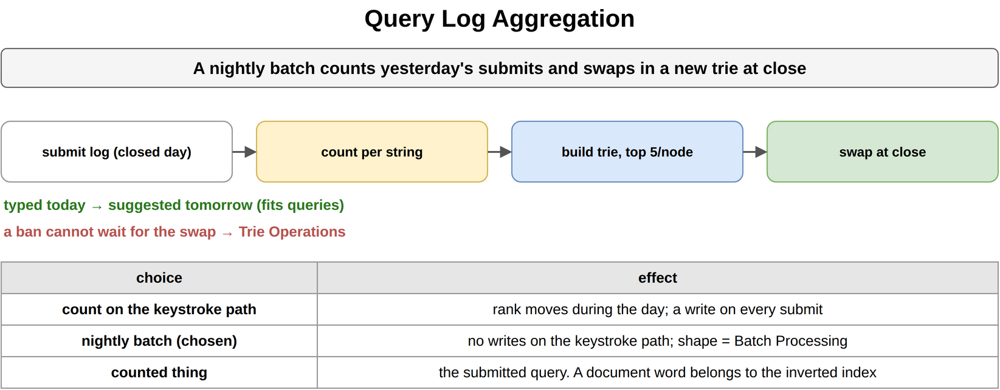
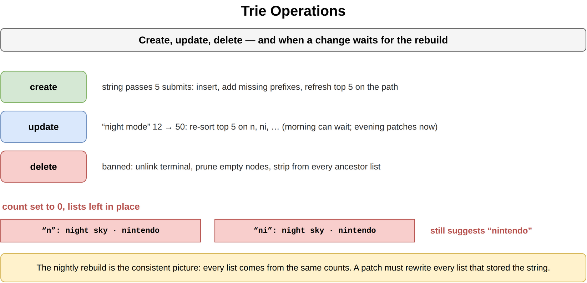
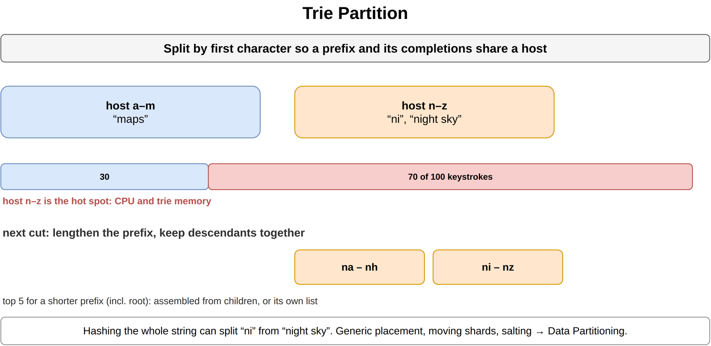
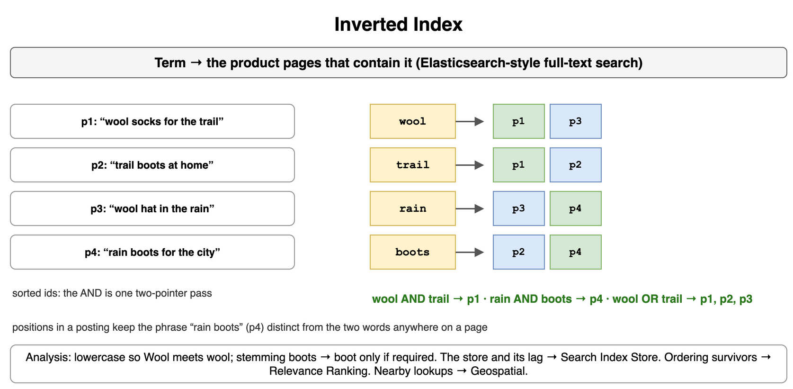
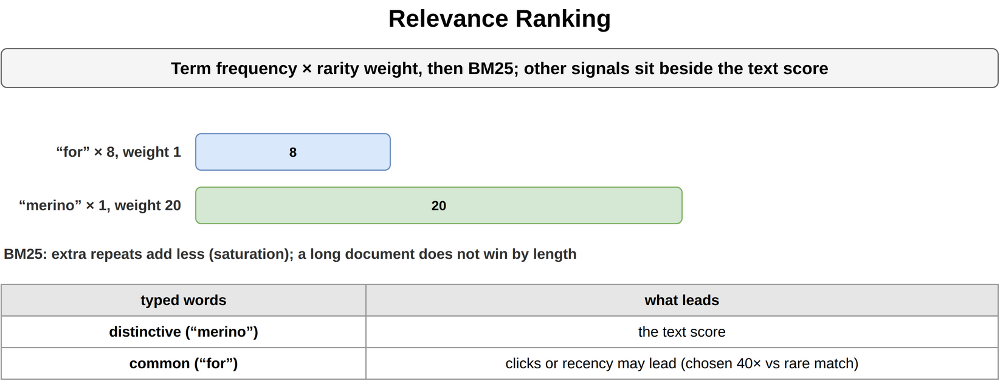
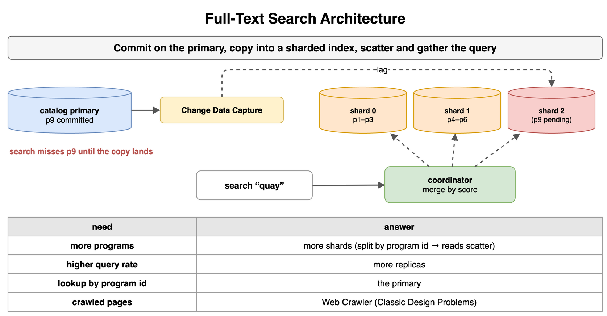

## Trie (Prefix Tree)

A trie stores previous search queries one character per step from the root. The node you land on is that prefix, and the lookup cost is the number of characters typed. A search box like Google's answers after every letter, and scanning 20,000 stored queries on each keystroke would reread the whole set. The trie touches only the path for the letters already typed.

Each edge is one character, including the space, and with a map from character to child each step is one lookup. Suppose the trie holds `night sky`, `night mode`, `nintendo`, and `maps`. The prefix `ni` walks `n`, then `i`, and under that node sit `night mode`, `night sky`, and `nintendo`. `maps` sits on the `m` branch and is never visited. Typing a space moves to `night `, so `nintendo` drops off. Each path stops at 40 characters, so a pasted paragraph cannot add a chain of hundreds of nodes. Elasticsearch's completion field caps input at 50 characters by default for the same reason. Each node also holds the top 5 completions for its prefix, already ordered. The keystroke reads that list instead of collecting and sorting every descendant on every letter.

A hash map from every full prefix to its top 5 is a single lookup, but it stores the prefix characters again at every length, while the trie shares them. A radix tree collapses single-child chains, which shrinks `nintendo` once the path has branched. Elasticsearch's completion suggester compacts the idea into an in-memory finite-state transducer built at index time. Any of these can hold the top 5. The expensive part is keeping that list fresh, which is Trie Operations. The request that returns the list is Search Autocomplete System, and a shared cache for one hot prefix is [Caching](../05_Caching/).

```text
one step per char   ni reads two nodes, 20,000 others stay unread
40-char cap         a pasted paragraph cannot grow a long chain
top 5 on the node   ordered ahead of the keystroke
space is a char     night  and ni are different nodes
```



*Source: [`diagrams/search.drawio`](/content/09_System_Design_Interview/18_Search_Autocomplete_and_Information_Retrieval/diagrams/search.drawio), page 1.*

## Search Autocomplete System

This is the online path from the search box to a short list of suggestions. The person is still typing, so the list has to be on screen before the next character, and it has to be safe to show. Building it from the raw query log on each request would miss that budget, so the service walks the trie to the node for the typed prefix and returns the list stored there.

The box sends `ni`, the service walks `n`, then `i`, and returns that node's top 5 inside this design's 40 ms budget. An empty box is a prefix of length zero, and the root holds the five most common queries. A banned query is dropped from the response even if an older list still names it. A small denylist on the way out hides it on every replica as soon as the denylist updates. For a signed-in person, the same five can be reordered from the three queries they submitted this week. That reorder only reshuffles what is already in the five, so a favorite that missed the global top 5 stays hidden.

The stored list meets 40 ms and can be a day stale, on the cadence in Query Log Aggregation. Filtering a ban on the way out is immediate, but it spends one of the five slots on a hidden query, and deleting it in Trie Operations frees the slot. A different candidate set per person is a larger design. An Amazon-style product box often mixes in the person's recent queries as a separate list beside the global trie. Keystroke rate and trie size are Describing Load in [Scalability Fundamentals](../02_Scalability_Fundamentals/). Scoping is The Four-Step Framework in [Interview Framework and Process](../01_Interview_Framework_and_Process/), and a hot-prefix cache is [Caching](../05_Caching/).

```text
ni            the stored top 5, inside 40 ms
empty box     the root's five most common queries
banned        dropped on the way out by a denylist
signed in     the same five, reordered from recent searches
```



*Source: [`diagrams/search.drawio`](/content/09_System_Design_Interview/18_Search_Autocomplete_and_Information_Retrieval/diagrams/search.drawio), page 2.*

## Query Log Aggregation

Query log aggregation counts submitted searches offline and builds the next trie from those counts, so a query typed today becomes a suggestion after the next build. The box is a read path with a 40 ms budget, and incrementing a counter on every submit would put writes on that path and move the ranking during the day. Most suggestions can trail the log by a day, and the log is the honest record of what people actually searched.

The service appends a log line when someone submits a query. Keystrokes are reads against the current trie, and the counted thing is the submitted string. A nightly job reads the closed day, counts each distinct string, and drops anything under 5 submits, which are usually one-off typos. It builds a new trie with an ordered top 5 on each node, and the service swaps it in with a pointer exchange. Requests already in flight keep the previous trie, so one request sees one trie. A ban cannot wait for this schedule, so it goes through Trie Operations.

The nightly build does zero count-writes on the keystroke path, and at noon the box still serves last night's trie. A live counter on submit moves the rank the same day at one write per submit. A query that must trend within minutes, such as a breaking name, gets a short-window counter beside the trie, shaped like Stream Processing. The nightly job itself is Batch Processing, both in [Storage and Data Processing at Scale](../13_Storage_and_Data_Processing_at_Scale/). Sampling the log keeps the head and can miss a query just over the cutoff. A word inside a document is a term in the inverted index, and this job never sees it unless someone submitted it.

```text
during the day   append submits, no count-writes on the box
nightly          count the closed log, keep >= 5 submits
build and swap   new trie, top 5 per node, pointer exchange
a ban            Trie Operations, not this schedule
```



*Source: [`diagrams/search.drawio`](/content/09_System_Design_Interview/18_Search_Autocomplete_and_Information_Retrieval/diagrams/search.drawio), page 3.*

## Trie Operations

Trie operations are the three writes against a trie that is already serving: create a query, update its count, and delete it. The nightly rebuild rewrites every list from one set of counts and lands on a schedule. A query that just crossed the cutoff, a count that jumped this afternoon, or a ban that has to vanish before the next search cannot wait until morning, so it is patched on the live trie.

Create runs when a string passes 5 submits. `nikon camera` is inserted, missing prefix nodes are added, and the top 5 on its path are refreshed. Update runs when a count changes. `night mode` going from 12 to 50 re-sorts the top 5 on `n`, `ni`, and every longer node on its path. If the morning box can show the jump, it waits for the rebuild. If the evening box must show it, those nodes are patched. Delete unlinks a banned or withdrawn string. It clears the terminal mark, prunes nodes that no longer lead anywhere, and removes the string from the top 5 of every ancestor. Setting the count to zero while the string still sits in an ancestor's list keeps suggesting it. The rebuild avoids that leftover because it rewrites every list.

A patch touches at most 40 nodes, and it has to reach every serving copy. Miss one, and that copy keeps suggesting the banned string until the response filter or the next rebuild catches it. Rewriting the top 5 on every ancestor is the write cost of the fast read. Keep the list only at the terminal, and the keystroke goes back to walking the subtree. The response filter in Search Autocomplete System hides a ban at once, and the delete frees the slot for a legitimate query.

```text
create        >= 5 submits, insert with its prefixes
update        re-sort the top 5 on each node of the path
delete        clear, prune, strip every ancestor list
zero count    lists left in place still suggest it
```



*Source: [`diagrams/search.drawio`](/content/09_System_Design_Interview/18_Search_Autocomplete_and_Information_Retrieval/diagrams/search.drawio), page 4.*

## Trie Partition

Trie partition places a prefix and the queries that continue it on the same host, so the keystroke walk stays on one machine. One host runs out of memory or CPU once the trie or the keystroke rate no longer fits. The split has to preserve the walk. With a prefix on one host and its completions on another, every letter becomes a remote call.

Host a–m holds prefixes starting with `a` through `m`, and host n–z holds `n` through `z`. `maps` is on a–m, and `ni` and `night sky` are both on n–z, so the walk stays local. Hashing the whole string could put `ni` and `night sky` on different hosts. Real logs are lumpy. In this example, 70 of every 100 keystrokes start with `n`, the way one viral query piles onto a letter, so host n–z is the hot spot. The next cut lengthens the prefix, `na` through `nh` on one host and `ni` through `nz` on another, and each prefix stays with its descendants. The top 5 for a prefix shorter than the cut, including the empty root, is either merged from the child hosts or stored as its own small list.

A first-letter split is easy to route because the router reads one character. A longer prefix spreads a hot letter and turns short prefixes into a scatter, and caching their lists removes that scatter at the cost of refreshing them when children change. Salting a hot prefix spreads its CPU but splits the walk, which is the thing this partition exists to avoid. Generic placement, rebalancing, and salting are Horizontal Partitioning (Sharding) and Hot Partition Mitigation in [Data Partitioning and Consistent Hashing](../08_Data_Partitioning_and_Consistent_Hashing/). The document index splits the opposite way, in Full-Text Search Architecture.

```text
a-m / n-z      maps on a-m, ni and night sky together on n-z
70 of 100      start with n, host n-z is hot
next cut       na-nh and ni-nz, descendants stay with the prefix
short prefix   merge child hosts, or store its own list
```



*Source: [`diagrams/search.drawio`](/content/09_System_Design_Interview/18_Search_Autocomplete_and_Information_Retrieval/diagrams/search.drawio), page 5.*

## Inverted Index

An inverted index maps a term to the documents that contain it, and it is the structure behind Elasticsearch-style full-text search. The trie answers "which queries start with these letters." Product search and web search ask which documents contain these words. Scanning every product description for `wool` and `trail` rereads the catalog, while the index has already listed the documents for each word.

Each document is analyzed into terms. Lowercasing comes first so `Wool` and `wool` meet. Stemming, which would fold `boots` into `boot`, is a choice you name. Take four product pages: p1 "wool socks for the trail", p2 "trail boots at home", p3 "wool hat in the rain", and p4 "rain boots for the city". The postings are `wool → p1, p3`, `trail → p1, p2`, `rain → p3, p4`, and `boots → p2, p4`, each sorted by id. `wool` AND `trail` walks the two sorted lists once with two pointers and keeps ids in both, which leaves p1. `rain` AND `boots` gives p4. `wool` OR `trail` unions them into p1, p2, and p3. A posting can also carry the term's count and its positions. Positions keep the phrase "rain boots" distinct from the two words appearing anywhere, so p4 matches the phrase.

The merge is linear in the two list lengths, so a common word with a huge posting list dominates the cost, and real engines skip ahead inside long lists. Positions make postings heavier and phrases precise. Without them, the query is a bag of words. The store that holds the map, and the lag behind the catalog primary, are Search Index Store in [Databases NoSQL and Specialized](../07_Databases_NoSQL_and_Specialized/). Ordering the survivors is Relevance Ranking. Nearby-place lookups stay in [Geospatial and Location-Based Services](../20_Geospatial_and_Location_Based_Services/).

```text
wool AND trail    p1, a one-pass merge of sorted lists
rain AND boots    p4
wool OR trail     p1, p2, p3
"rain boots"      needs positions, p4
```



*Source: [`diagrams/search.drawio`](/content/09_System_Design_Interview/18_Search_Autocomplete_and_Information_Retrieval/diagrams/search.drawio), page 6.*

## Relevance Ranking

Relevance ranking orders the document ids that survived the inverted-index intersection. The intersection is a set, and a results page is an order. Eight mentions of a common word and one mention of a rare word are not equally useful, and a page nobody opens can still contain the rare word. The text score is the start, and clicks, purchases, and recency sit beside it when the product needs them.

Term frequency is how often the word appears in this document. A rarity weight rises when few documents contain the word. As a sketch of inverse document frequency, give `for` weight 1 and `merino` weight 20. Eight occurrences of `for` score 8, and one occurrence of `merino` scores 20, so the rare word leads. BM25 is the formula to name next, and it is Elasticsearch and Lucene's default similarity. Extra repetitions add less once a word is present. With `k1` at its default 1.2 and length ignored, one occurrence contributes 1 and eight contribute about 1.9. The length knob `b` defaults to 0.75, which pulls a longer-than-average document down and lifts a shorter one, so a long page does not win just by having more words.

Behavior signals sit beside the text score. `phone case` was chosen 40 times this week and `merino socks` 3 times. A typed `merino` keeps the text score in front. Common words leave text scores small and close, so the item chosen 40 times can lead. The requirement says which signal leads. Shopping often blends in purchases, and documentation search often stays on text. Text-only ranking is stable and surfaces a perfect match nobody has clicked. Blending clicks buries new documents with no traffic, and a time decay lets them compete. Setting `b` to 0 fits a catalog of short titles of similar length. Reordering one person's suggestions is Search Autocomplete System, a different list.

```text
sketch     for x8 at weight 1 = 8, merino x1 at weight 20 = 20
BM25 k1    1.2, one occurrence 1, eight about 1.9
BM25 b     0.75, long documents pulled down
behavior   chosen 40 vs 3 can lead when text scores are close
```



*Source: [`diagrams/search.drawio`](/content/09_System_Design_Interview/18_Search_Autocomplete_and_Information_Retrieval/diagrams/search.drawio), page 7.*

## Full-Text Search Architecture

Full-text search architecture is the path from a committed document to a ranked hit. The catalog primary holds the document, and an Elasticsearch-style index holds a copy of its terms, split across shards, with a coordinator that merges scores. The index is a secondary copy that has to be large, current enough, and able to answer word queries without reading the primary. The primary still owns the row loaded by id, including the price and fields the index left out.

The primary commits p9, `nikon camera`, and a search for its words can still miss it. The commit has landed, and the gap is the copy. Change Data Capture in [Storage and Data Processing at Scale](../13_Storage_and_Data_Processing_at_Scale/) tails the primary's log and updates the index, and the store is Search Index Store in [Databases NoSQL and Specialized](../07_Databases_NoSQL_and_Specialized/). Once the copy reaches a shard, Elasticsearch still hides it until a refresh, about one second by default, which is a second, smaller gap. A query for `rain` goes to every shard that might hold a match, because the index is split by document id and one term's postings are spread out. The coordinator merges the scored ids. Each shard scores with its own document frequencies, so the same rare word can weigh differently on two shards. A pass that gathers global frequencies fixes that at the cost of a round trip.

More documents need more primary shards, and Elasticsearch fixes that count at index creation, so growing past it means reindexing. A higher query rate adds replicas, which add read capacity and no room for more documents. Acknowledging writes at the primary commit keeps the catalog available while the index lags. Waiting for the index ties every product write to search lag. Dual-writing from the application can lose the index update if the process dies after the commit. Crawled text is the Web Crawler in [Classic Design Problems](../24_Classic_Design_Problems/). The suggestion trie splits by prefix in Trie Partition, while this index spreads a term across shards on purpose.

```text
commit p9     the primary has the row
search misses the copy or the refresh has not landed
pipeline      Change Data Capture from the primary's log
query         scatter by document id, merge by score
growth        primary shards, set at creation, replicas for reads
load by id    the primary
```



*Source: [`diagrams/search.drawio`](/content/09_System_Design_Interview/18_Search_Autocomplete_and_Information_Retrieval/diagrams/search.drawio), page 8.*
