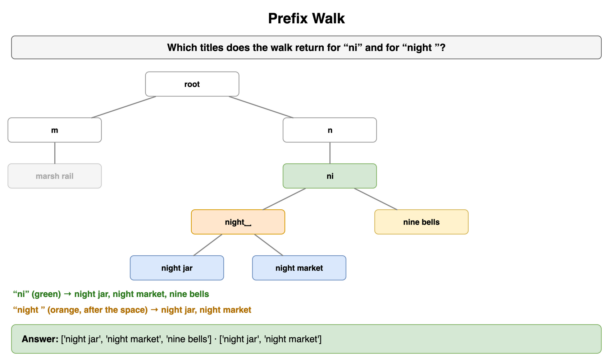
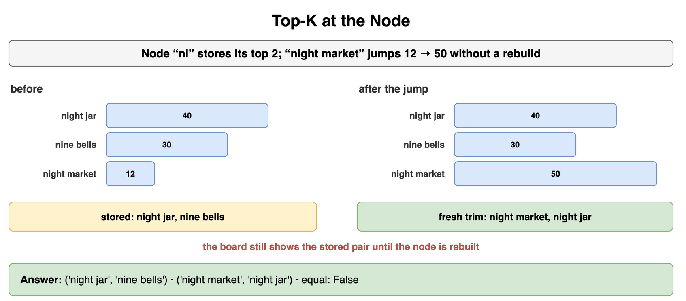
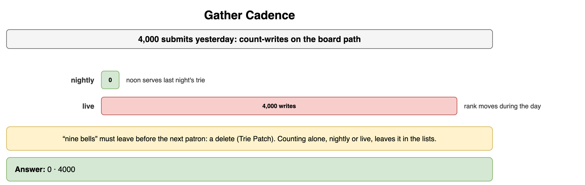
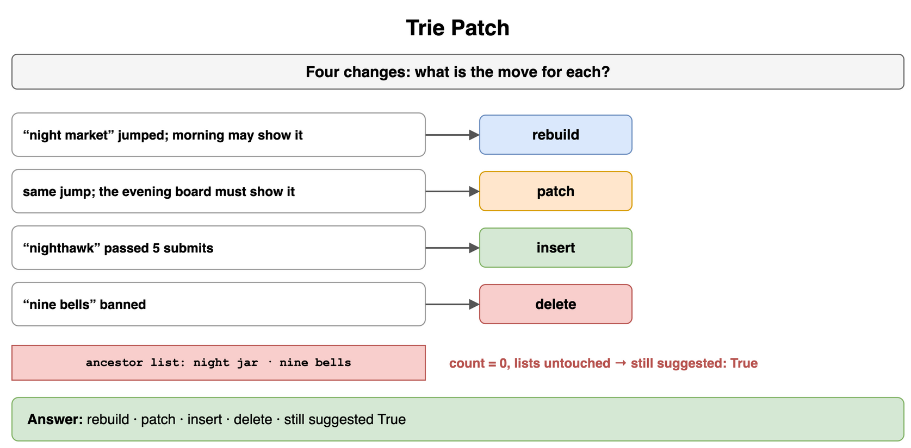
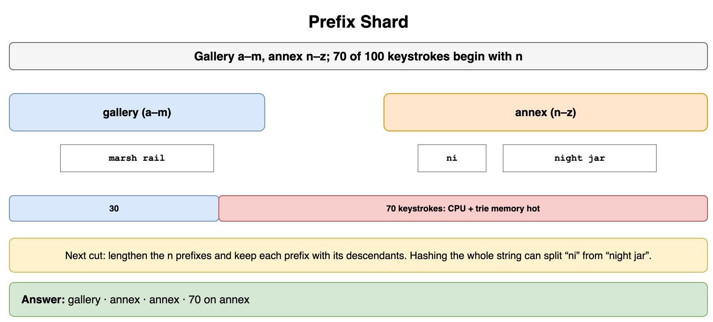
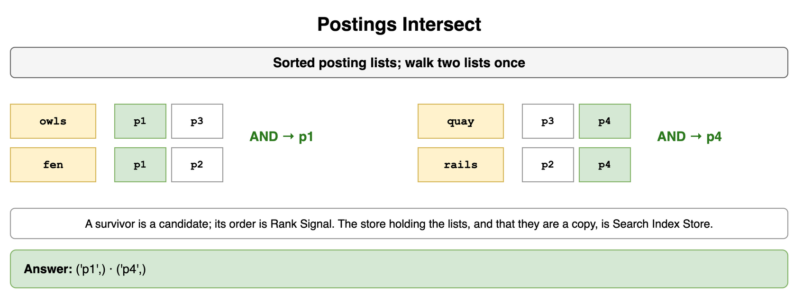
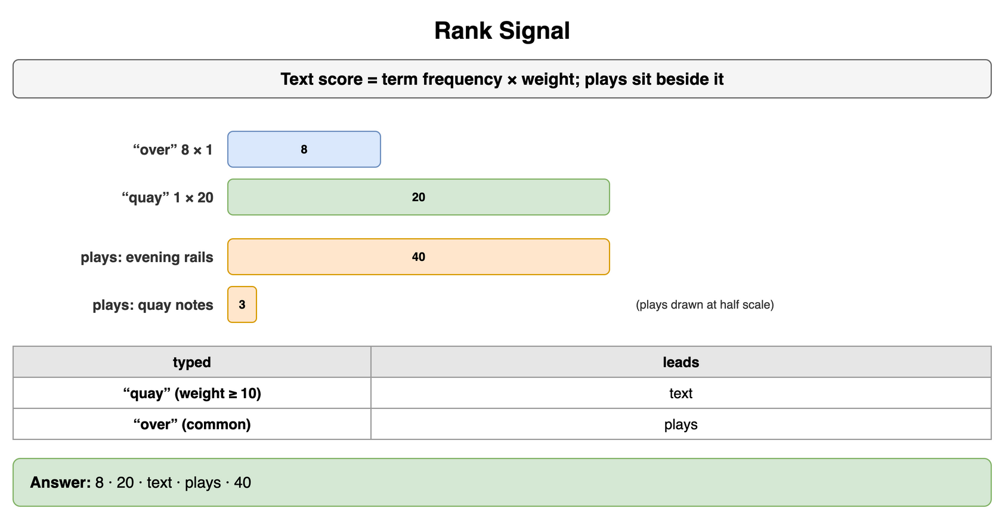
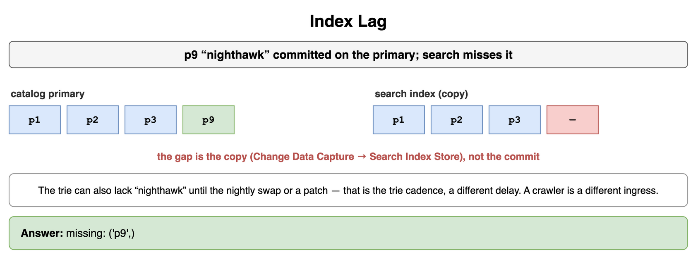

# Search Autocomplete and Information Retrieval — Drills

Original practice for a prefix walk, a list stored on the node, and a committed title missing from search. Each card is one exercise: commit to an answer, then check it. The numbers are invented for Redcedar Listening Room, a volunteer archive of spoken programs. Patrons type on the desk board. Gallery and annex hold the trie by first letter. The cache tier stays in Caching. The search store and its lagging copy stay in Databases NoSQL and Specialized. A hash ring and a salted key stay in Data Partitioning and Consistent Hashing. The batch job and the change pipeline stay in Storage and Data Processing at Scale. A web crawler stays in Classic Design Problems. A geohash stays in Geospatial and Location-Based Services.

## Prefix Walk

The trie holds "night jar", "night market", "nine bells", and "marsh rail". Which titles does the walk return for "ni", and which titles does it return for "night "?

```python
WORDS = ("night jar", "night market", "nine bells", "marsh rail")
SHORT = "ni"
LONG = "night "
```

**Answer:** "ni" stops at the node that still has three descendants: "night jar", "night market", and "nine bells". "night " takes the space after "night" and leaves "nine bells" and "marsh rail" off that node. The walk reads one character per step and then collects the titles stored under the node it reached. Paths in this room stop at 40 characters, and both prefixes are inside that cap.

```python
WORDS = ("night jar", "night market", "nine bells", "marsh rail")
SHORT = "ni"
LONG = "night "


def build(words: tuple[str, ...]) -> dict:
    root: dict = {}
    for word in words:
        node = root
        for ch in word:
            node = node.setdefault(ch, {})
        node.setdefault("$", []).append(word)
    return root


def completions(root: dict, prefix: str) -> list[str]:
    node = root
    for ch in prefix:
        if node is None:
            return []
        node = node.get(ch)
    if node is None:
        return []
    found: list[str] = []
    stack = [node]
    while stack:
        cur = stack.pop()
        found.extend(cur.get("$", ()))
        for key, child in cur.items():
            if key != "$":
                stack.append(child)
    return sorted(found)


root = build(WORDS)
print(completions(root, SHORT), completions(root, LONG))
# ['night jar', 'night market', 'nine bells'] ['night jar', 'night market']
```



*Source: [`diagrams/search-drills.drawio`](/content/09_System_Design_Interview/18_Search_Autocomplete_and_Information_Retrieval/diagrams/search-drills.drawio), page 1.*

## Top-K at the Node

The node for "ni" has three counts: "night jar" 40, "nine bells" 30, "night market" 12. The board shows 2 titles. Which pair is stored? "night market" later reaches 50, and the node has not been rebuilt. Which pair would a fresh trim keep, and what does the board still show?

```python
ON_NODE = (("night jar", 40), ("nine bells", 30), ("night market", 12))
JUMPED = (("night jar", 40), ("nine bells", 30), ("night market", 50))
K = 2
```

**Answer:** The stored pair is "night jar" then "nine bells". A fresh trim after the jump is "night market" then "night jar". The board still shows the stored pair. The list sits on the node so the keystroke reads two titles. Collecting every descendant under "ni" and sorting them would repeat that work on every letter. The list goes stale when a count moves and the node is left as it was. A shared cache tier in front of the node, and eviction of that tier, stay in Caching.

```python
ON_NODE = (("night jar", 40), ("nine bells", 30), ("night market", 12))
JUMPED = (("night jar", 40), ("nine bells", 30), ("night market", 50))
K = 2


def top_k(rows: tuple[tuple[str, int], ...], k: int) -> tuple[str, ...]:
    ordered = sorted(rows, key=lambda row: (-row[1], row[0]))
    return tuple(title for title, _count in ordered[:k])


stored = top_k(ON_NODE, K)
fresh = top_k(JUMPED, K)
print(stored, fresh, stored == fresh)
# ('night jar', 'nine bells') ('night market', 'night jar') False
```



*Source: [`diagrams/search-drills.drawio`](/content/09_System_Design_Interview/18_Search_Autocomplete_and_Information_Retrieval/diagrams/search-drills.drawio), page 2.*

## Gather Cadence

Yesterday's log holds 4,000 submitted queries. The nightly design counts that closed log and swaps a trie at close. The live design increments a count on every submit, on the board path. How many count-writes does the board path do under each design, and when is each design acceptable? "nine bells" has to leave the board before the next patron. What removes it?

```python
SUBMITS = 4000
MODES = ("nightly", "live")
```

**Answer:** The nightly design does 0 count-writes on the board path. At noon the board is still serving the trie from last night's swap, which fits suggestions that may trail the log by a day. The live design does 4,000 count-writes on the board path, one per submit, and the rank can move during the day when that write rate fits. "nine bells" leaves by a delete. A nightly count and a live increment both leave the string in the lists until that delete. The delete is Trie Patch. The shape of the nightly job is Batch Processing.

```python
SUBMITS = 4000
MODES = ("nightly", "live")


def board_writes(mode: str, submits: int) -> int:
    if mode == "nightly":
        return 0
    return submits


print(*(board_writes(mode, SUBMITS) for mode in MODES))
# 0 4000
```



*Source: [`diagrams/search-drills.drawio`](/content/09_System_Design_Interview/18_Search_Autocomplete_and_Information_Retrieval/diagrams/search-drills.drawio), page 3.*

## Trie Patch

Four changes arrive. "night market" jumped, and the morning board may show it. The same title jumped, and the evening board must show it. "nighthawk" passed the cutoff of 5 submits. "nine bells" is banned. The ancestor lists still hold "nine bells" beside "night jar". What is the move for each change, and does a count set to zero, with those lists left in place, still suggest the banned title?

```python
EVENTS = ("jump-can-wait", "jump-tonight", "new-query", "banned")
LISTS = (("night jar", "nine bells"),)
BANNED = "nine bells"
```

**Answer:** A jump the morning can show waits for the rebuild. A jump the evening must show patches the top 5 on each node of the path. A new string past the cutoff is an insert. A ban is a delete now: unlink the terminal, prune empty nodes, and strip the string from every ancestor list. A count set to zero, with the lists left in place, still suggests "nine bells". The rebuild replaces every list from the same counts. A patch has to rewrite each list that stored the string.

```python
EVENTS = ("jump-can-wait", "jump-tonight", "new-query", "banned")
MOVE = {
    "jump-can-wait": "rebuild",
    "jump-tonight": "patch",
    "new-query": "insert",
    "banned": "delete",
}
LISTS = (("night jar", "nine bells"),)
BANNED = "nine bells"


def still_suggested(lists: tuple[tuple[str, ...], ...], banned: str) -> bool:
    return any(banned in titles for titles in lists)


print(" ".join(MOVE[name] for name in EVENTS), still_suggested(LISTS, BANNED))
# rebuild patch insert delete True
```



*Source: [`diagrams/search-drills.drawio`](/content/09_System_Design_Interview/18_Search_Autocomplete_and_Information_Retrieval/diagrams/search-drills.drawio), page 4.*

## Prefix Shard

Gallery holds a first character from a through m. Annex holds n through z. Where do "marsh rail", "night jar", and the prefix "ni" land? Of 100 keystrokes, 70 begin with n. What does that 70 do to the pair of hosts?

```python
TITLES = ("marsh rail", "night jar", "ni")
N_SHARE = 70
```

**Answer:** "marsh rail" lands on gallery. "night jar" and "ni" land on annex, so the walk from that prefix to its completions stays on one host. The 70 keystrokes sit on annex. That host's processor and its trie memory are the hot spot. The next cut lengthens the n prefixes and keeps each prefix with its descendants. Hashing the whole string can send "ni" and "night jar" to different hosts. Moving shards, and salting one key, stay on Horizontal Partitioning (Sharding) and Hot Partition Mitigation.

```python
TITLES = ("marsh rail", "night jar", "ni")
N_SHARE = 70


def host(text: str) -> str:
    if text[0] < "n":
        return "gallery"
    return "annex"


print(*(host(text) for text in TITLES), N_SHARE)
# gallery annex annex 70
```



*Source: [`diagrams/search-drills.drawio`](/content/09_System_Design_Interview/18_Search_Autocomplete_and_Information_Retrieval/diagrams/search-drills.drawio), page 5.*

## Postings Intersect

The posting lists are sorted. owls points at p1, p3. fen points at p1, p2. quay points at p3, p4. rails points at p2, p4. Which programs survive owls AND fen, and which survive quay AND rails?

```python
POSTINGS = {
    "owls": ("p1", "p3"),
    "fen": ("p1", "p2"),
    "quay": ("p3", "p4"),
    "rails": ("p2", "p4"),
}
```

**Answer:** owls AND fen leaves p1. quay AND rails leaves p4. The merge walks the two sorted lists once. A term that survives is a candidate. The order those candidates appear in is Rank Signal. The store that holds the lists, and the fact that they are a copy, are Search Index Store.

```python
POSTINGS = {
    "owls": ("p1", "p3"),
    "fen": ("p1", "p2"),
    "quay": ("p3", "p4"),
    "rails": ("p2", "p4"),
}


def intersect(left: tuple[str, ...], right: tuple[str, ...]) -> tuple[str, ...]:
    i = 0
    j = 0
    found: list[str] = []
    while i < len(left) and j < len(right):
        if left[i] == right[j]:
            found.append(left[i])
            i += 1
            j += 1
        elif left[i] < right[j]:
            i += 1
        else:
            j += 1
    return tuple(found)


print(
    intersect(POSTINGS["owls"], POSTINGS["fen"]),
    intersect(POSTINGS["quay"], POSTINGS["rails"]),
)
# ('p1',) ('p4',)
```



*Source: [`diagrams/search-drills.drawio`](/content/09_System_Design_Interview/18_Search_Autocomplete_and_Information_Retrieval/diagrams/search-drills.drawio), page 6.*

## Rank Signal

"over" has term frequency 8 and weight 1. "quay" has term frequency 1 and weight 20. "evening rails" was played 40 times this week. "quay notes" was played 3 times. What is each text score? When the patron typed "quay", which signal leads? When the typed words are common, which signal may lead?

```python
TF = {"over": 8, "quay": 1}
IDF = {"over": 1, "quay": 20}
PLAYS = {"evening rails": 40, "quay notes": 3}
```

**Answer:** The text score is term frequency times the weight: 8 for "over", 20 for "quay". "quay" leads on the text score, and a distinctive typed word keeps that score in front of the play counts. Common words, "over" among them, leave the text score weak, so a program played 40 times can lead a rare-word match played 3 times. BM25 is the same idea with frequency saturation and a length term. The requirement says which signal leads.

```python
TF = {"over": 8, "quay": 1}
IDF = {"over": 1, "quay": 20}
PLAYS = {"evening rails": 40, "quay notes": 3}


def text_score(term: str) -> int:
    return TF[term] * IDF[term]


def leader(term: str) -> str:
    if IDF[term] >= 10:
        return "text"
    return "plays"


print(text_score("over"), text_score("quay"), leader("quay"), leader("over"), PLAYS["evening rails"])
# 8 20 text plays 40
```



*Source: [`diagrams/search-drills.drawio`](/content/09_System_Design_Interview/18_Search_Autocomplete_and_Information_Retrieval/diagrams/search-drills.drawio), page 7.*

## Index Lag

Program p9, "nighthawk", is committed on the catalog primary. The search index still holds p1, p2, and p3. A search for the words in p9 misses it. Where does that gap live?

```python
PRIMARY = ("p1", "p2", "p3", "p9")
INDEX = ("p1", "p2", "p3")
```

**Answer:** p9 is on the primary and absent from the index. The commit has landed. The gap is the copy that has not written p9's terms yet. Search Index Store is that copy. Change Data Capture is the pipeline that carries the committed change. A crawler that fetched a page is a different ingress, the Web Crawler. The suggestion trie can also lack "nighthawk" until the nightly swap or a patch. That delay is the trie cadence. This miss is the search copy.

```python
PRIMARY = ("p1", "p2", "p3", "p9")
INDEX = ("p1", "p2", "p3")


def missing(primary: tuple[str, ...], index: tuple[str, ...]) -> tuple[str, ...]:
    have = set(index)
    return tuple(program for program in primary if program not in have)


print(missing(PRIMARY, INDEX))
# ('p9',)
```



*Source: [`diagrams/search-drills.drawio`](/content/09_System_Design_Interview/18_Search_Autocomplete_and_Information_Retrieval/diagrams/search-drills.drawio), page 8.*
