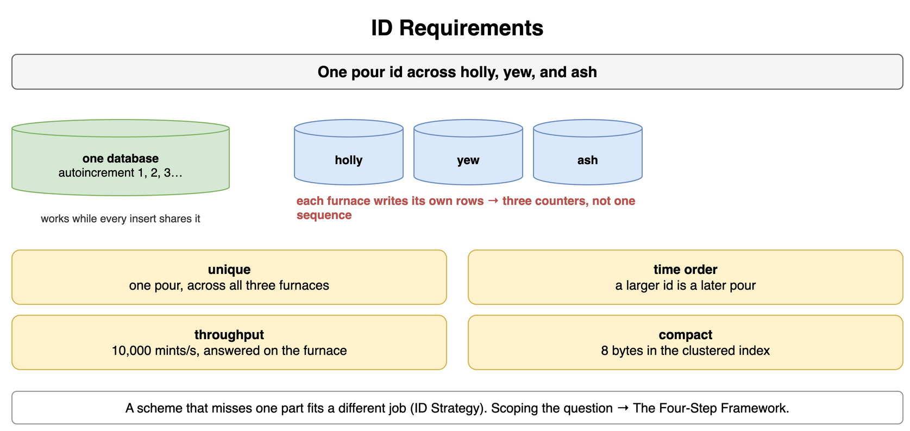
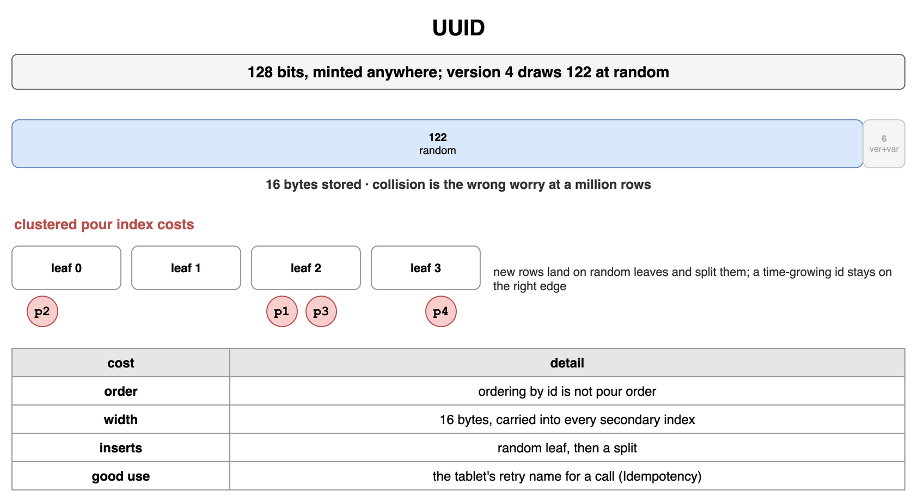
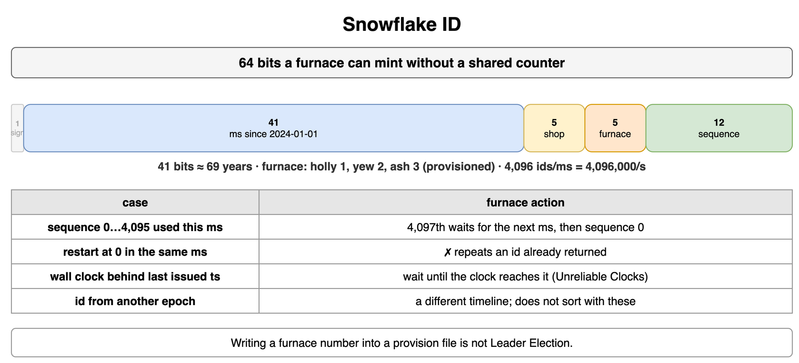
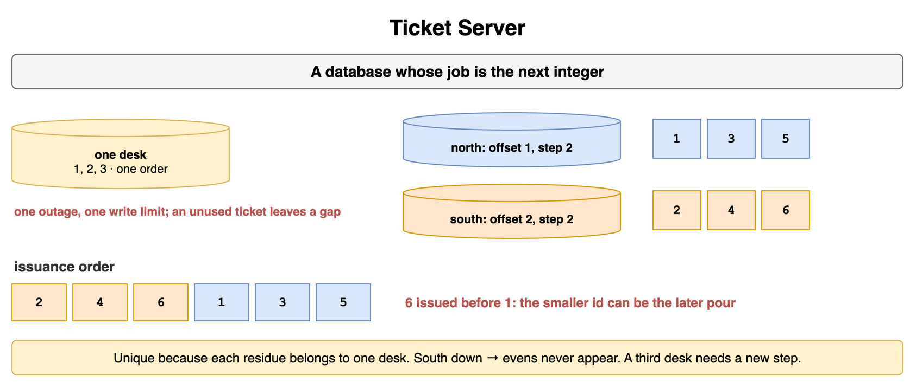
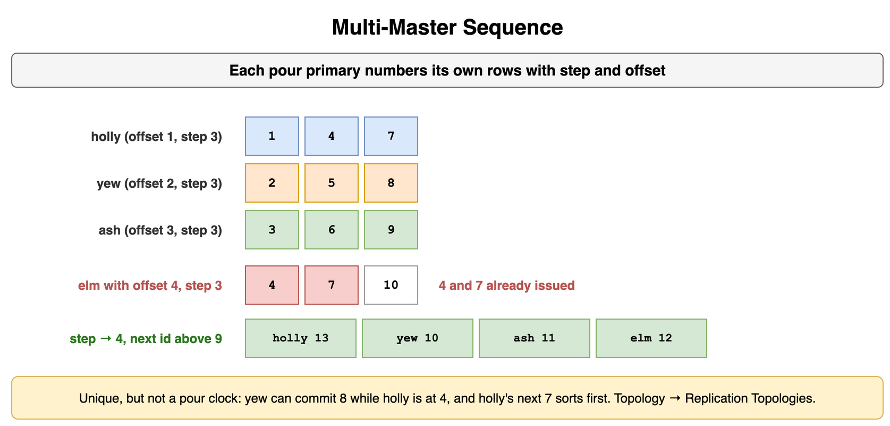
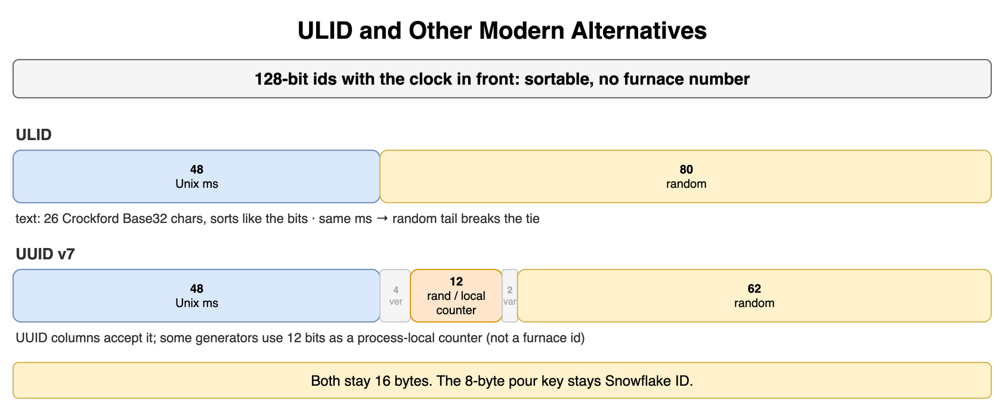
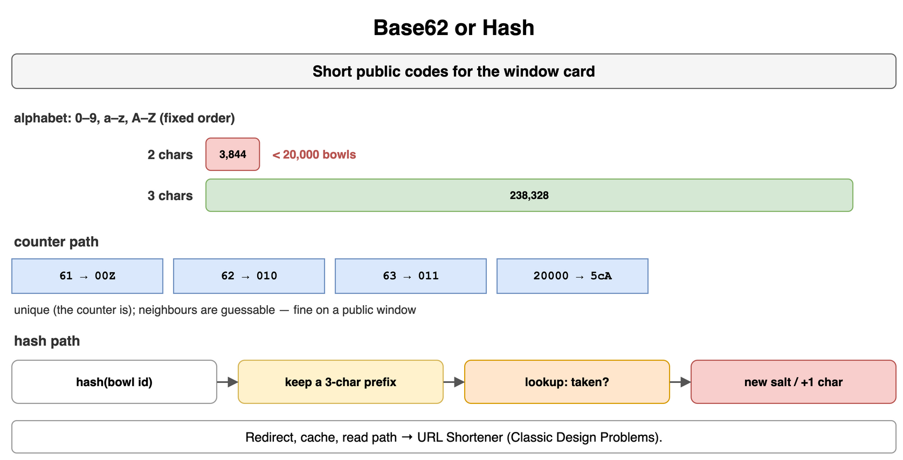
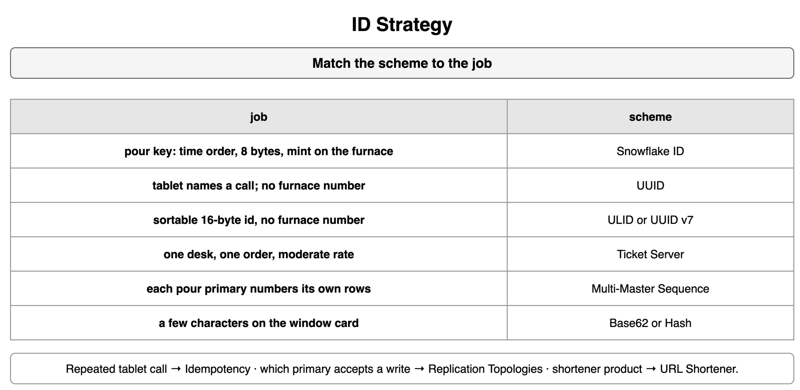

## ID Requirements

Rowan Glassworks logs every pour from three furnaces, holly, yew, and ash. One database with an autoincrement counter can number those pours while every insert goes to that database. Once each furnace writes its own rows, that counter is no longer one sequence. An id still has to name one pour across the shop.

The shop's bar for a pour id has four parts. It is unique across holly, yew, and ash. It sorts in pour order, so the log can order by the id. One furnace can mint 10,000 ids a second and get the answer on that furnace. The id occupies 8 bytes in the clustered index. A scheme that misses one of those parts fits a different job, which is ID Strategy. How to scope the interview question is The Four-Step Framework in [Interview Framework and Process](../01_Interview_Framework_and_Process/).

```text
unique         one pour, across holly, yew, and ash
time order     a larger id is a later pour
throughput     10,000 mints a second, on the furnace
compact        8 bytes in the clustered index
one database   autoincrement, while every insert shares it
```



*Source: [`diagrams/unique-id.drawio`](/content/09_System_Design_Interview/19_Unique_ID_Generation/diagrams/unique-id.drawio), page 1.*

## UUID

A UUID is 128 bits. A furnace or a tablet can mint one without asking the others. Version 4 draws 122 of those bits at random. The other 6 mark the version and the variant. The stored key is 16 bytes. Two minters collide when they draw the same 122 bits. The shop's million-row log sits far below that meeting, so a collision is the wrong worry.

The clustered pour index still pays three costs. The id does not grow with time, so ordering by id is not pour order. The key is twice an 8-byte id, and every secondary index that carries it pays that width. A new row lands on a random B-tree leaf and splits leaves across the index. An id that grows with time stays on the right edge. A tablet can still create a UUID before it logs a pour and send that value as the name of the call. What the server does when the same call arrives again is Idempotency in [Networking and Communication](../10_Networking_and_Communication/).

```text
width        128 bits, 16 bytes stored
version 4    122 random bits
order        ordering by id is not pour order
insert       a random leaf, then a split
retry name   a UUID the tablet mints
the call     Idempotency
```



*Source: [`diagrams/unique-id.drawio`](/content/09_System_Design_Interview/19_Unique_ID_Generation/diagrams/unique-id.drawio), page 2.*

## Snowflake ID

A Snowflake id is 64 bits, packed so a furnace can mint without a shared counter. The layout Rowan uses is the split this scheme made common. The high bit stays 0, so the value remains positive in a signed 64-bit integer. The next 41 bits are milliseconds since an epoch the shop picks, 2024-01-01, and a 41-bit millisecond field covers about 69 years. The next 5 bits are the shop. The next 5 are the furnace: holly 1, yew 2, ash 3. Those numbers are written down when the furnace is provisioned. The last 12 bits are a sequence. One furnace mints 4,096 ids in one millisecond, which is 4,096,000 in one second, above the shop's bar of 10,000. Ids from different milliseconds sort by the timestamp. An id from another epoch does not share this timeline.

The sequence counts 0 through 4,095. The 4,097th mint in that same millisecond waits until the timestamp advances, then starts the sequence at 0. Starting again at 0 inside the same millisecond repeats an id this furnace already returned. Holly also stores the last timestamp it issued. When the wall clock reads an earlier millisecond, holly waits until the clock reaches that stored timestamp. An id stamped with the earlier millisecond sorts ahead of pours already in the log, and sequence 0 at that millisecond can be a pair holly has already used. Why a wall clock steps is Unreliable Clocks in [Distributed System Failure Modes](../15_Distributed_System_Failure_Modes/). Writing a furnace number into a provision file is not Leader Election in [Transactions and Concurrency Control](../16_Transactions_and_Concurrency_Control/).

```text
0            sign, left clear
41           milliseconds since 2024-01-01, about 69 years
5 + 5        shop, then furnace, provisioned
12           sequence, 4,096 ids in one millisecond
4,097th      wait for the next millisecond
clock behind wait for the last issued timestamp
other epoch  a different timeline
```



*Source: [`diagrams/unique-id.drawio`](/content/09_System_Design_Interview/19_Unique_ID_Generation/diagrams/unique-id.drawio), page 3.*

## Ticket Server

A ticket server is a database whose job is the next integer. The furnaces ask it, then write the pour in their own stores. One desk and one counter give a single increasing order. That desk is one outage and one write limit, and a pour that must be numbered during the outage waits. A ticket the desk hands out and the furnace never stores leaves a gap. The next ticket is still larger.

Two desks share a step of 2 and take different offsets. North starts at 1 and issues 1, 3, 5. South starts at 2 and issues 2, 4, 6. Each residue belongs to one desk, so the pair stays unique. While south is down, north keeps issuing odds and the evens never appear. The numbers are not a shop-wide pour order. South can hand out 6 before north hands out 1, and the smaller id is the later pour. A third desk needs a new step. These desks only mint. The same step and offset on the pour primaries themselves is Multi-Master Sequence.

```text
one desk      1, 2, 3, one order, one outage
north         offset 1, step 2 → 1, 3, 5
south         offset 2, step 2 → 2, 4, 6
unique        each residue belongs to one desk
order         6 can be issued before 1
third desk    the step changes
```



*Source: [`diagrams/unique-id.drawio`](/content/09_System_Design_Interview/19_Unique_ID_Generation/diagrams/unique-id.drawio), page 4.*

## Multi-Master Sequence

Holly, yew, and ash each accept pour inserts on their own primary. Which nodes accept writes, how a primary ships its log, and what happens when two primaries write one key are Replication Topologies and Conflict Resolution in [Consistency and Replication](../09_Consistency_and_Replication/). The numbering on those primaries is the scheme here.

Each primary uses the step 3 and its own offset. Holly issues 1, 4, 7. Yew issues 2, 5, 8. Ash issues 3, 6, 9. The three residues never meet. They are not a pour clock. Yew can commit 8 while holly is still at 4, and holly's next pour receives 7, which sorts first. A fourth primary, elm, has no free residue while the step stays 3. Offset 4 repeats holly's 4 and 7. Before elm mints, the step becomes 4, each primary takes a distinct offset, and every next id is greater than the largest id already issued.

```text
step 3        holly 1, yew 2, ash 3
series        1, 4, 7 · 2, 5, 8 · 3, 6, 9
three         no shared id
time order    not across primaries
elm           step 4, next id above the ids already issued
topology      Replication Topologies
```



*Source: [`diagrams/unique-id.drawio`](/content/09_System_Design_Interview/19_Unique_ID_Generation/diagrams/unique-id.drawio), page 5.*

## ULID and Other Modern Alternatives

A ULID is 128 bits with the clock in front. The first 48 bits are a Unix millisecond timestamp. The other 80 are random. The text form is 26 characters of Crockford Base32, and that string sorts in the same order as the bits. A furnace mints one with no shop number and no sequence table. Two pours in the same millisecond sort by the random tail. The key is as wide as a UUID.

UUID version 7 puts a 48-bit Unix millisecond timestamp in front of a UUID, then random bits, with the version and variant in their fixed places. UUID columns and parsers accept it, and the values sort by time. Some generators use 12 of those bits as a counter inside the millisecond, local to the process that holds it. That counter is not a provisioned furnace id, and it is not the 4,096-wide sequence in a 64-bit Snowflake id. Both forms let a process mint without a furnace number. Both stay 16 bytes. The 8-byte pour key stays Snowflake ID.

```text
ULID         48-bit milliseconds + 80 random bits
text         26 Crockford Base32 characters
same ms      the random tail breaks the tie
UUID v7      48-bit milliseconds, then random, sorts as a UUID
local counter some v7 generators use 12 bits inside the millisecond
width        16 bytes
8-byte key   Snowflake ID
```



*Source: [`diagrams/unique-id.drawio`](/content/09_System_Design_Interview/19_Unique_ID_Generation/diagrams/unique-id.drawio), page 6.*

## Base62 or Hash

A window card is a short public code for a finished bowl. The desk takes the next counter value and writes it in base 62. Rowan fixes the alphabet as the 10 digits, then the 26 lowercase letters, then the 26 uppercase letters, and every desk uses that order. Two characters cover 3,844 bowls. Three cover 238,328. The shop expects 20,000 bowls, so the counter path uses 3 characters. Each code is unique because the counter was. Neighboring counters become neighboring codes, so a visitor can guess the next card. The card is public, and a guessable code is acceptable on the window.

A hash path hashes the bowl id and keeps a prefix of the digest in that same alphabet. A prefix of 3 characters has the same 238,328 slots and does not fill them in order. Two bowls can land on one prefix. The desk looks the code up. When another bowl holds it, the desk mixes in a new salt and hashes again, or it keeps one more character, and it checks again. The counter path has no lookup. The redirect, the cache, and the read-heavy path of a short link are URL Shortener in [Classic Design Problems](../24_Classic_Design_Problems/). Schema bytes stay in [Encoding Serialization and Schema Evolution](../14_Encoding_Serialization_and_Schema_Evolution/). The short-code encoding is this card.

```text
alphabet     10 digits, 26 lower, 26 upper
2 characters 3,844 bowls
3 characters 238,328 bowls
20,000 bowls the counter uses 3 characters
hash prefix  a lookup, then a new salt or one more character
product      URL Shortener
```



*Source: [`diagrams/unique-id.drawio`](/content/09_System_Design_Interview/19_Unique_ID_Generation/diagrams/unique-id.drawio), page 7.*

## ID Strategy

The pour log, the tablet, and the window card do not share one id. The fit is the line that matches the job.

```text
pour key, time order, 8 bytes, mint on the furnace   Snowflake ID
tablet names the call, no furnace number             UUID
sortable 16-byte id, no furnace number               ULID or UUID v7
one desk, one order, a moderate rate                 Ticket Server
each pour primary numbers its own rows               Multi-Master Sequence
a few characters on the window card                  Base62 or Hash
```

What a repeated tablet call means is Idempotency in [Networking and Communication](../10_Networking_and_Communication/). Which primary accepts a write is Replication Topologies in [Consistency and Replication](../09_Consistency_and_Replication/). The shortener product is URL Shortener in [Classic Design Problems](../24_Classic_Design_Problems/).



*Source: [`diagrams/unique-id.drawio`](/content/09_System_Design_Interview/19_Unique_ID_Generation/diagrams/unique-id.drawio), page 8.*
