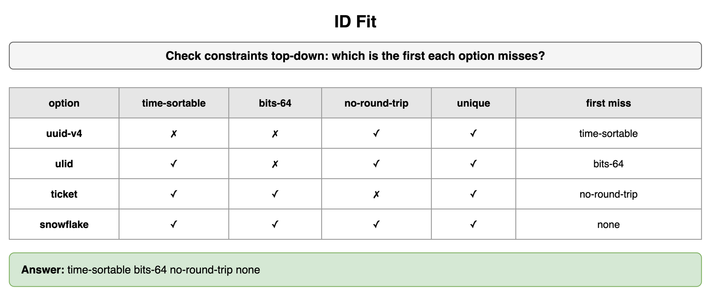
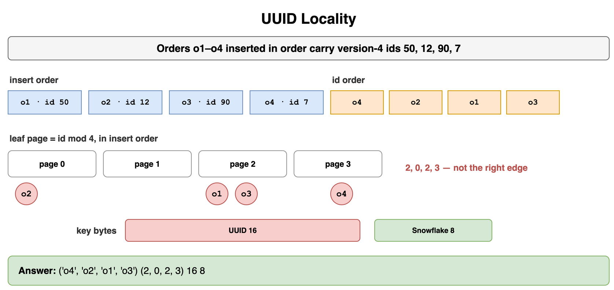
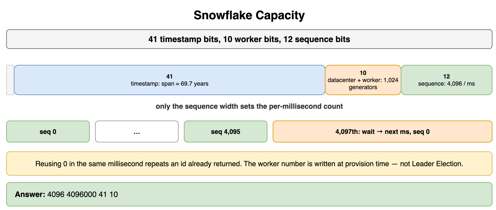
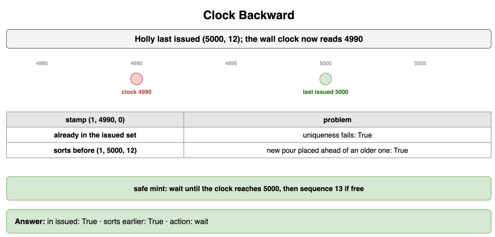
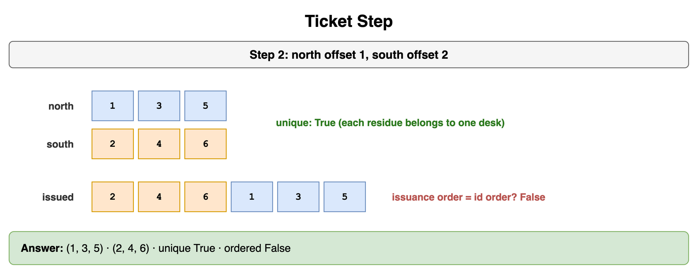
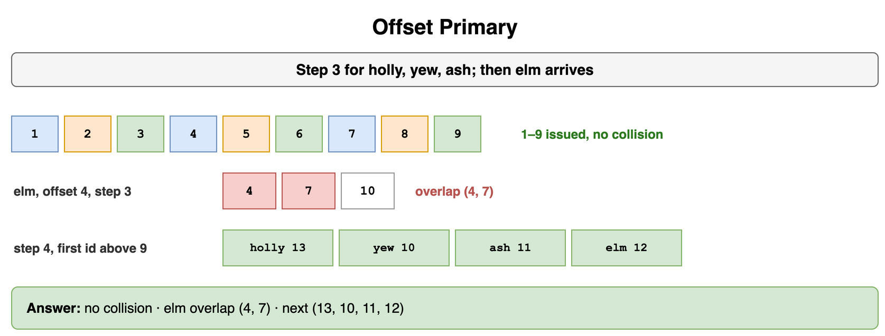
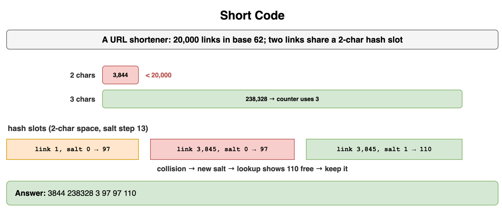
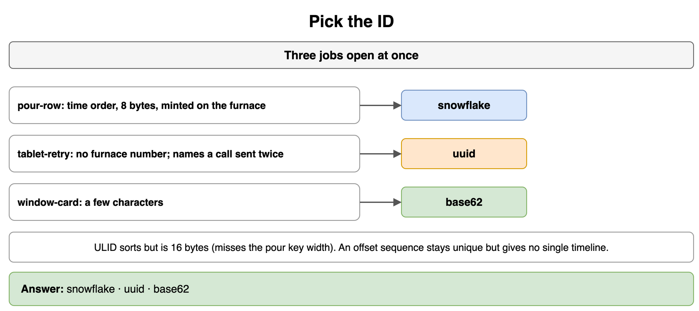

# Unique ID Generation — Drills

Original practice for which constraint removes an id scheme, how a packed id behaves, and how a short code spends its alphabet. Each card is one exercise: commit to an answer, then check it. The numbers are small on purpose: an order log, version-4 keys, one Snowflake worker, two ticket servers, three MySQL primaries, and a URL shortener with 20,000 links. Why a wall clock steps stays in Distributed System Failure Modes. What a repeated call means stays in Networking and Communication. Which primary accepts a write stays in Consistency and Replication. Schema bytes stay in Encoding Serialization and Schema Evolution. A provisioned worker number is configuration. Leader election stays in Transactions and Concurrency Control. The redirect and the cache of a short link stay in Classic Design Problems.

## ID Fit

The order log needs every constraint in `ORDER`, checked from the top. Which constraint is the first one `uuid-v4` misses, the first one `ulid` misses, and the first one `ticket` misses? Which option misses none?

```python
ORDER = ("time-sortable", "bits-64", "no-round-trip", "unique")
OPTIONS = {
    "uuid-v4": ("unique", "no-round-trip"),
    "ulid": ("unique", "time-sortable", "no-round-trip"),
    "ticket": ("unique", "time-sortable", "bits-64"),
    "snowflake": ("unique", "time-sortable", "bits-64", "no-round-trip"),
}
```

**Answer:** `uuid-v4` misses time-sortable first. It is also wider than 64 bits, and the order log fails it on time order before it fails it on width. `ulid` has the timestamp and needs no round trip, and it misses bits-64. `ticket` is unique, time-sortable, and 64 bits, and it misses no-round-trip because the writer asks a ticket server. `snowflake` meets all four. A client that must mint with no worker number is a different bar, and that bar is where the UUID fits.

```python
ORDER = ("time-sortable", "bits-64", "no-round-trip", "unique")
OPTIONS = {
    "uuid-v4": ("unique", "no-round-trip"),
    "ulid": ("unique", "time-sortable", "no-round-trip"),
    "ticket": ("unique", "time-sortable", "bits-64"),
    "snowflake": ("unique", "time-sortable", "bits-64", "no-round-trip"),
}


def ruling(have: tuple[str, ...]) -> str:
    owned = set(have)
    for constraint in ORDER:
        if constraint not in owned:
            return constraint
    return "none"


print(*(ruling(OPTIONS[name]) for name in ("uuid-v4", "ulid", "ticket", "snowflake")))
# time-sortable bits-64 no-round-trip none
```



*Source: [`diagrams/unique-id-drills.drawio`](/content/09_System_Design_Interview/19_Unique_ID_Generation/diagrams/unique-id-drills.drawio), page 1.*

## UUID Locality

Four orders were inserted in the order o1, o2, o3, o4. Each carries a version-4 id, shown here as a small integer so the sort is easy to see. Sort those rows by the id. If a leaf page is `id mod 4`, which page does each insert hit, in insert order? How many bytes is the key beside an 8-byte Snowflake id?

```python
ORDERS = (("o1", 50), ("o2", 12), ("o3", 90), ("o4", 7))
UUID_BYTES = 16
SNOW_BYTES = 8
```

**Answer:** The id order is o4, o2, o1, o3. Insert order and id order are different sequences, so a clustered index on this key is not a time log. The inserts hit pages 2, 0, 2, 3. A time-ordered key would keep appending at the right edge of the B-tree. These four do not. The key is 16 bytes next to 8. Uniqueness still holds: 122 random bits, and these four values do not meet. The client's retry name can be a UUID. The meaning of the retry stays on Idempotency.

```python
ORDERS = (("o1", 50), ("o2", 12), ("o3", 90), ("o4", 7))
UUID_BYTES = 16
SNOW_BYTES = 8


def by_id(rows: tuple[tuple[str, int], ...]) -> tuple[str, ...]:
    return tuple(name for name, _key in sorted(rows, key=lambda row: row[1]))


def pages(rows: tuple[tuple[str, int], ...]) -> tuple[int, ...]:
    return tuple(key % 4 for _name, key in rows)


print(by_id(ORDERS), pages(ORDERS), UUID_BYTES, SNOW_BYTES)
# ('o4', 'o2', 'o1', 'o3') (2, 0, 2, 3) 16 8
```



*Source: [`diagrams/unique-id-drills.drawio`](/content/09_System_Design_Interview/19_Unique_ID_Generation/diagrams/unique-id-drills.drawio), page 2.*

## Snowflake Capacity

One worker's id uses 41 timestamp bits, 10 worker bits, and 12 sequence bits. How many ids can that worker mint in one millisecond, and how many is that in one second? The 4,097th mint of that millisecond has no unused sequence value. What does the worker do with it?

```python
TIMESTAMP_BITS = 41
WORKER_BITS = 10
SEQUENCE_BITS = 12
```

**Answer:** The sequence width alone sets the millisecond count: 2^12 is 4,096 ids in that millisecond, and a thousand of those milliseconds make 4,096,000 ids in one second. The 41-bit field is the span of the clock, about 69.7 years, and the 10 worker bits name 1,024 generators (32 datacenters × 32 workers when the field is split 5 and 5). Neither number raises the count inside one millisecond. Values in the sequence run from 0 through 4,095. The 4,097th mint waits for the next millisecond and then uses sequence 0. Using 0 again inside the same millisecond repeats an id this worker already returned. The datacenter and worker numbers in those 10 bits are assigned when the process is provisioned. That assignment is configuration. Leader Election is a separate problem.

```python
TIMESTAMP_BITS = 41
WORKER_BITS = 10
SEQUENCE_BITS = 12


def per_millisecond(sequence_bits: int) -> int:
    return 1 << sequence_bits


one_ms = per_millisecond(SEQUENCE_BITS)
print(one_ms, one_ms * 1000, TIMESTAMP_BITS, WORKER_BITS)
# 4096 4096000 41 10
```



*Source: [`diagrams/unique-id-drills.drawio`](/content/09_System_Design_Interview/19_Unique_ID_Generation/diagrams/unique-id-drills.drawio), page 3.*

## Clock Backward

Worker 1's last id used timestamp 5000 and sequence 12. The wall clock now reads 4990. The pair `(worker 1, 4990, 0)` is already in the issued set. What is true of a new id stamped 4990 with sequence 0, and what does a mint that keeps uniqueness do when its policy is to wait?

```python
WORKER = 1
LAST = (5000, 12)
CLOCK_TS = 4990
ISSUED = {(WORKER, 4990, 0), (WORKER, 5000, 12)}
```

**Answer:** The new id is already in the issued set, so uniqueness fails, and `(1, 4990, 0)` sorts before `(1, 5000, 12)`, so the order log would place the new order ahead of one already written. A mint whose policy is to wait returns `wait` while the wall clock is behind the last timestamp this worker issued. The worker mints again when the clock reaches 5000. On that same millisecond the next sequence is 13 if that slot is free. Twitter's generator refuses this call instead of waiting. This exercise uses the wait policy. Why the clock stepped is Unreliable Clocks.

```python
WORKER = 1
LAST = (5000, 12)
CLOCK_TS = 4990
ISSUED = {(WORKER, 4990, 0), (WORKER, 5000, 12)}


def bad(worker: int, clock_ts: int) -> tuple[int, int, int]:
    return (worker, clock_ts, 0)


def safe(last: tuple[int, int], clock_ts: int) -> str:
    last_ts, _seq = last
    if clock_ts < last_ts:
        return "wait"
    return "mint"


bad_id = bad(WORKER, CLOCK_TS)
print(bad_id in ISSUED, bad_id < (WORKER, LAST[0], LAST[1]), safe(LAST, CLOCK_TS))
# True True wait
```



*Source: [`diagrams/unique-id-drills.drawio`](/content/09_System_Design_Interview/19_Unique_ID_Generation/diagrams/unique-id-drills.drawio), page 4.*

## Ticket Step

Two ticket servers share a step of 2. Server A takes offset 1 and server B takes offset 2, which is the odd/even split Flickr used. List the first three ids from each server. Are the six ids unique? Server B issues its three before server A issues any. Does issuance order match id order?

```python
STEP = 2
COUNT = 3
OFFSET_A = 1
OFFSET_B = 2
```

**Answer:** Server A issues 1, 3, 5. Server B issues 2, 4, 6. The six ids are unique because each residue belongs to one server. Issuance order is 2, 4, 6, 1, 3, 5, which is not id order, so the smaller id can be the later order. A gap is the same arithmetic: while server B is down, server A's next ids are still the odds, and the evens never appear. One server with one counter would keep a single order and would also be one outage. These two servers only mint. The database primaries that store the rows are Offset Primary.

```python
STEP = 2
COUNT = 3
OFFSET_A = 1
OFFSET_B = 2


def series(offset: int, step: int, count: int) -> tuple[int, ...]:
    return tuple(offset + step * i for i in range(count))


server_a = series(OFFSET_A, STEP, COUNT)
server_b = series(OFFSET_B, STEP, COUNT)
unique = len(set(server_a + server_b)) == len(server_a) + len(server_b)
issued = server_b + server_a
print(server_a, server_b, unique, issued == tuple(sorted(issued)))
# (1, 3, 5) (2, 4, 6) True False
```



*Source: [`diagrams/unique-id-drills.drawio`](/content/09_System_Design_Interview/19_Unique_ID_Generation/diagrams/unique-id-drills.drawio), page 5.*

## Offset Primary

Three MySQL primaries use step 3 and offsets 1, 2, and 3. Each primary has issued three ids. Do those nine ids collide? A fourth primary then tries offset 4 while the step is still 3. Which of its first three ids are already issued? The step then becomes 4, the offsets are 1, 2, 3, and 4, and every next id must be greater than the largest id already issued. What is the first id for each offset?

```python
OLD_STEP = 3
NEW_STEP = 4
OFFSETS = (1, 2, 3, 4)
COUNT = 3
```

**Answer:** The nine ids are 1 through 9, with no collision. The fourth primary's old series is 4, 7, 10, and 4 and 7 are already issued. There is no fourth residue modulo 3. After the step becomes 4, the first ids above 9 are 13 for offset 1, 10 for offset 2, 11 for offset 3, and 12 for offset 4. Who is allowed to accept an insert is Replication Topologies. The residues are the id scheme.

```python
OLD_STEP = 3
NEW_STEP = 4
OFFSETS = (1, 2, 3, 4)
COUNT = 3


def series(offset: int, step: int, count: int) -> tuple[int, ...]:
    return tuple(offset + step * i for i in range(count))


issued: set[int] = set()
for offset in OFFSETS[:3]:
    issued.update(series(offset, OLD_STEP, COUNT))
fourth_old = series(4, OLD_STEP, COUNT)
overlap = tuple(sorted(set(fourth_old) & issued))
high = max(issued)


def first_above(offset: int, step: int, high_id: int) -> int:
    start = offset
    while start <= high_id:
        start += step
    return start


starts = tuple(first_above(offset, NEW_STEP, high) for offset in OFFSETS)
print(len(issued) == 9, overlap, starts)
# True (4, 7) (13, 10, 11, 12)
```



*Source: [`diagrams/unique-id-drills.drawio`](/content/09_System_Design_Interview/19_Unique_ID_Generation/diagrams/unique-id-drills.drawio), page 6.*

## Short Code

A URL shortener will label 20,000 links in base 62. How many codes do 2 characters hold, how many do 3 hold, and how many characters does the counter path use? Link 1 and link 3,845 share a 2-character hash slot when the salt is 0. What is that slot, and what slot does link 3,845 take when its salt becomes 1?

```python
LINKS = 20_000
BASE = 62
SALT_STEP = 13
```

**Answer:** Two characters hold 3,844 codes, which is short of 20,000. Three characters hold 238,328, so the counter path uses 3 and does not look the code up. A 2-character hash prefix has those same 3,844 slots. Link 1 and link 3,845 both land on slot 97 when the salt is 0, because 3,845 is one full space past 1 and the slot width cannot tell them apart. Salt 1 moves link 3,845 to slot 110, and the service keeps that code only after the lookup shows the slot free. The same lookup, with a new salt or one more character, is the collision path at any prefix length. The redirect and the cache of a short link stay on URL Shortener.

```python
LINKS = 20_000
BASE = 62
SALT_STEP = 13


def space(chars: int, base: int) -> int:
    return base**chars


def slot(link: int, salt: int, space_size: int) -> int:
    return (link * 97 + salt * SALT_STEP) % space_size


two = space(2, BASE)
three = space(3, BASE)
counter_chars = 3 if two < LINKS <= three else 0
print(two, three, counter_chars, slot(1, 0, two), slot(1 + two, 0, two), slot(1 + two, 1, two))
# 3844 238328 3 97 97 110
```



*Source: [`diagrams/unique-id-drills.drawio`](/content/09_System_Design_Interview/19_Unique_ID_Generation/diagrams/unique-id-drills.drawio), page 7.*

## Pick the ID

Three jobs are open at once: the order row, the name the client puts on a call it may send twice, and the code in a short URL. Which scheme fits each job?

```python
OBJECTS = ("order-row", "client-retry", "short-link")
```

**Answer:** The order row is a Snowflake id: time order, 8 bytes, minted on the writer. The client retry is a UUID, because the client has no worker number. What that name means when the call is repeated is Idempotency. The short link is a base-62 counter. A ULID would sort and would still be 16 bytes, so it misses the order key's width. An offset sequence on three primaries would stay unique and would give each primary its own series, so the order log would have no single timeline.

```python
OBJECTS = ("order-row", "client-retry", "short-link")
PICK = {
    "order-row": "snowflake",
    "client-retry": "uuid",
    "short-link": "base62",
}

print(*(PICK[name] for name in OBJECTS))
# snowflake uuid base62
```



*Source: [`diagrams/unique-id-drills.drawio`](/content/09_System_Design_Interview/19_Unique_ID_Generation/diagrams/unique-id-drills.drawio), page 8.*
