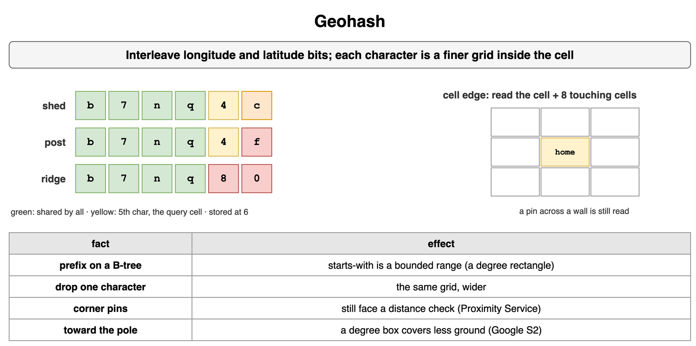
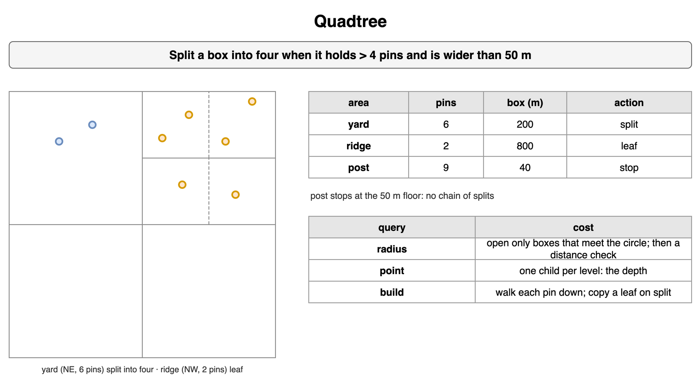
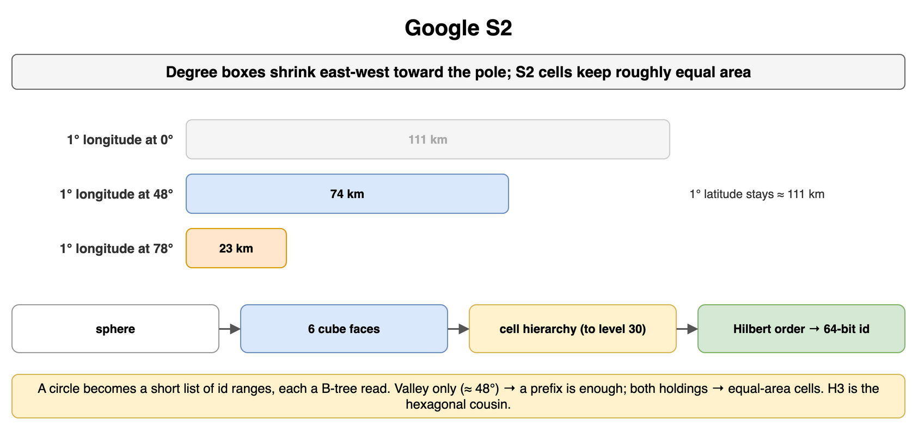
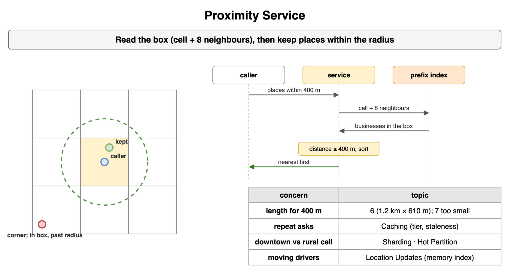
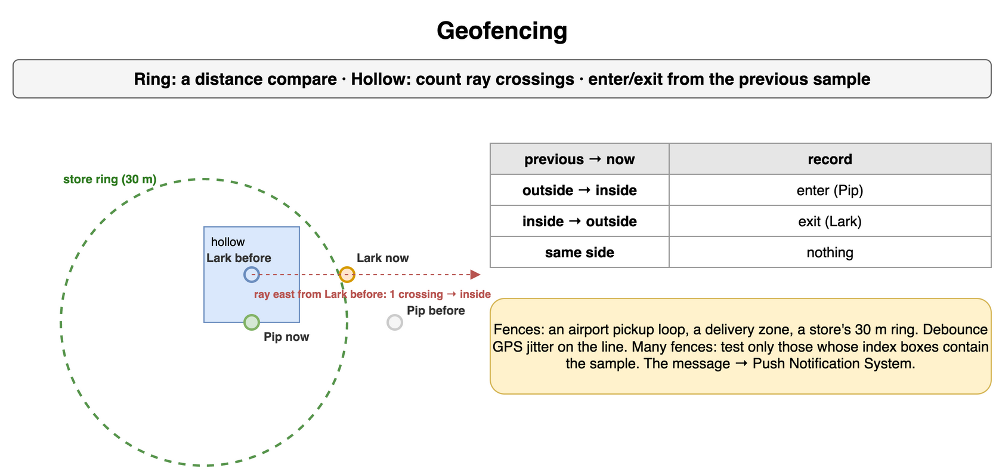
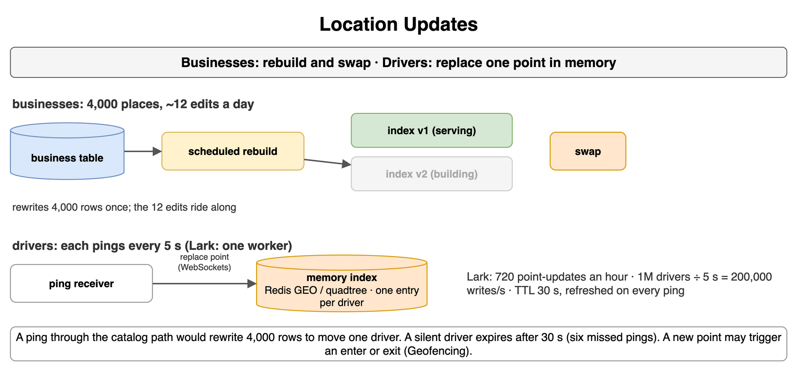

## Geohash

Cindermoss Survey stores a plot pin as a short string. The string interleaves a longitude bit and a latitude bit, longitude first, and writes each five bits as one character. The drying shed is `b7nq4c`. The post up the row is `b7nq4f`. Those two share `b7nq4`. Lark's pin on the north ridge is `b7nq80`, which shares only `b7nq`. A shared prefix is one cell. Each added character is a finer grid inside that cell. The survey stores six characters on the row and reads by a five-character prefix. In this valley that prefix is a box a few kilometers across. The sixth character is the smaller box inside it, on the order of a kilometer along its long side.

The column is an ordinary string, so a B-tree answers a starts-with predicate as a bounded range. That range is a rectangle of degrees. Two pins a few meters apart can stand on either side of a cell wall and fail to share the prefix the query used. The read is that cell plus the eight cells that share a side or a corner with it. Dropping one character widens the same grid. A neighbor whose code breaks on the boundary is a separate range. Pins that sit in the corners of those rectangles still face a distance check, which is Proximity Service. A degree rectangle that covers less ground toward the pole is Google S2.

```text
interleave   longitude and latitude, five bits to a character
shed, post   b7nq4c and b7nq4f share b7nq4
ridge        b7nq80 shares b7nq and leaves the five-character cell
index        the prefix is a range on a B-tree
edge         the cell and the eight that touch it
```



*Source: [`diagrams/geospatial.drawio`](/content/09_System_Design_Interview/20_Geospatial_and_Location_Based_Services/diagrams/geospatial.drawio), page 1.*

## Quadtree

The yard holds most of the pins. The ridge holds a few. A quadtree keeps the valley in memory as nested boxes. The root is one box. A node splits into northwest, northeast, southwest, and southeast when it holds more than 4 pins and the box is still wider than 50 meters. The yard, 6 pins in a 200-meter box, splits. The ridge, 2 pins, stays a leaf. Nine pins on one post, in a box already 40 meters wide, stop at that floor. The floor keeps that post from chaining the tree.

A radius query opens a child only when that child's box meets the circle. A box that misses the circle stays unread, and so do the pins under it. Pins in the boxes that remain still take a distance check, because a box can touch the circle at a corner and hold a pin outside the radius. A point query follows one child at each level, so the cost is the depth. The 50-meter floor caps that depth. A tree that stays balanced is logarithmic in the pin count. Building it walks every pin down its path and copies a leaf when that leaf splits. The string on disk is Geohash. Cells of roughly equal ground area are Google S2.

```text
split    more than 4 pins, and the box is wider than 50 m
yard     6 pins, 200 m, splits
ridge    2 pins, stays a leaf
one post 9 pins, 40 m, stops
query    a box that misses the circle stays unread
```



*Source: [`diagrams/geospatial.drawio`](/content/09_System_Design_Interview/20_Geospatial_and_Location_Based_Services/diagrams/geospatial.drawio), page 2.*

## Google S2

A geohash cell is a rectangle of degrees. A degree of latitude stays near 111 kilometers. A degree of longitude is about 74 kilometers at the valley's 48°, and about 23 kilometers at the polar holding's 78°, taking the equatorial degree as 111 kilometers. The same prefix length is a different patch of ground. S2 starts from the sphere. It projects the earth onto the six faces of a cube, splits each face into a hierarchy of cells, and numbers those cells along a Hilbert curve. Cells that sit close on a face receive nearby 64-bit ids. Cells at one level have roughly the same area, in the valley and at the polar holding.

A circle becomes a short list of those id ranges, and each range is a B-tree read. The finest split in the scheme is level 30. A prefix answers the valley while every pin stays near 48° and one cell size fits the radius the caller asked. The polar holding, and one catalog that spans both, is where equal area earns the machinery. H3 is the hexagonal cousin: another global grid for the same covering job. It stays a cousin on this card.

```text
east-west      about 74 km at 48°, about 23 km at 78°
S2             six faces, Hilbert order, 64-bit id
one level      roughly equal ground area
valley only    a prefix
both holdings  equal-area cells
cousin         H3
```



*Source: [`diagrams/geospatial.drawio`](/content/09_System_Design_Interview/20_Geospatial_and_Location_Based_Services/diagrams/geospatial.drawio), page 3.*

## Proximity Service

A caller at the shed asks for posts within 400 meters. The service encodes the caller's point, reads the five-character cell and the eight cells that touch it, and holds every pin in those rectangles. It then measures the distance from the caller to each pin and drops any pin past 400 meters. A pin in the corner of a neighbor cell is inside the box and past the radius, so the distance check removes it. What remains is ordered by distance.

Pin reads outnumber pin edits by a wide margin, so a repeated ask for the same prefix and kind can be served from a cache. Where that copy sits, and when it is allowed to go stale, are When Caching Helps and Cache Tier Placement in [Caching](../05_Caching/). The valley prefix and the polar prefix can live on different shards. How a key picks a shard, and what to do when the yard prefix takes most of the reads, are Horizontal Partitioning (Sharding) and Hot Partition Mitigation in [Data Partitioning and Consistent Hashing](../08_Data_Partitioning_and_Consistent_Hashing/). A crew position that moves every few seconds is Location Updates.

```text
read     the cell and eight neighbors, a box
keep     distance within 400 m
drop     a corner pin the box included
cache    When Caching Helps, Cache Tier Placement
shards   Horizontal Partitioning, Hot Partition Mitigation
crews    Location Updates
```



*Source: [`diagrams/geospatial.drawio`](/content/09_System_Design_Interview/20_Geospatial_and_Location_Based_Services/diagrams/geospatial.drawio), page 4.*

## Geofencing

The work ring is a circle around the shed. A sample is inside when its distance from the shed is under 30 meters. The frost hollow is a polygon. Cast a ray east from the sample and count the edges it crosses. An odd count is inside. An even count is outside. The survey keeps the previous sample for that crew. Outside, then inside, is an enter. Inside, then outside, is an exit. A sample that stays on the same side records no edge.

A handful of fences can be tested one by one. A long list of fences uses the same spatial index as the pins, and only the fences whose boxes meet this sample are tested. The ring stays a distance compare. The hollow pays for one test per edge, which is why a round boundary is stored as a circle. The enter and the exit are the decision. The message a crew would receive is Push Notification System in [Real-Time and Notification Systems](../21_Real_Time_and_Notification_Systems/).

```text
ring         under 30 m from the shed
hollow       odd ray crossings, inside
enter        outside, then inside
exit         inside, then outside
many fences  the boxes the index returns
send         Push Notification System
```



*Source: [`diagrams/geospatial.drawio`](/content/09_System_Design_Interview/20_Geospatial_and_Location_Based_Services/diagrams/geospatial.drawio), page 5.*

## Location Updates

The pin table holds 4,000 rows, and a day edits about 12 of them. The survey rebuilds the prefix index from that table on a schedule and swaps the new index in when the build finishes. Searches during the build keep reading the previous index. A pin edited at noon can wait for the swap. Rows that did not change are rewritten because the whole index is replaced, and that cost fits a catalog edited a dozen times a day.

Lark's receiver sends a position every five seconds, 720 times in an hour of walking. The catalog path rewrites all 4,000 rows on its schedule. The ping path replaces Lark's point in a second index that lives in memory. The next radius read over crews uses the same box and the same distance filter against that memory index. The connection that carries the ping is WebSockets and SSE in [Networking and Communication](../10_Networking_and_Communication/). The enter and the exit that may follow the new point are Geofencing.

```text
catalog   4,000 pins, about 12 edits a day, one rebuild
swap      the previous index serves until the new one lands
ping      every 5 seconds, replace one memory entry
an hour   720 point-updates
pipe      WebSockets and SSE
```



*Source: [`diagrams/geospatial.drawio`](/content/09_System_Design_Interview/20_Geospatial_and_Location_Based_Services/diagrams/geospatial.drawio), page 6.*
