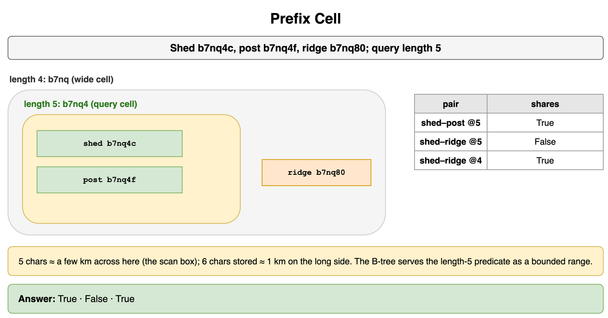
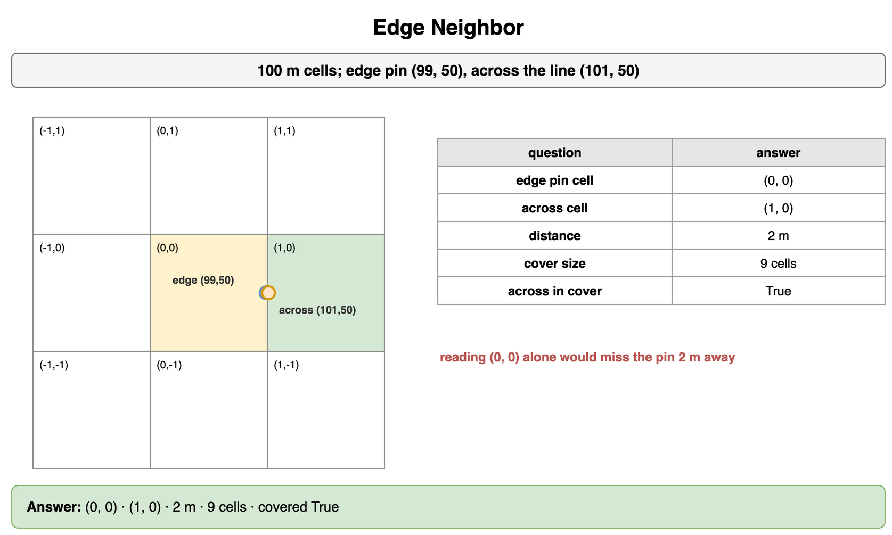
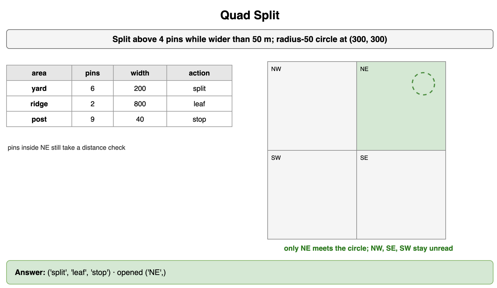
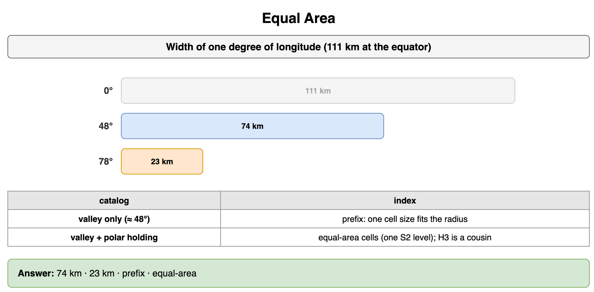
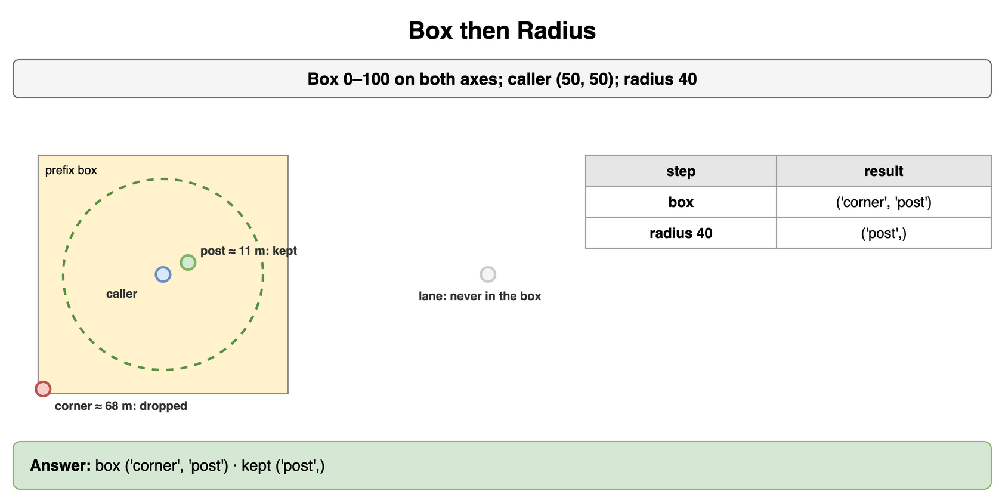
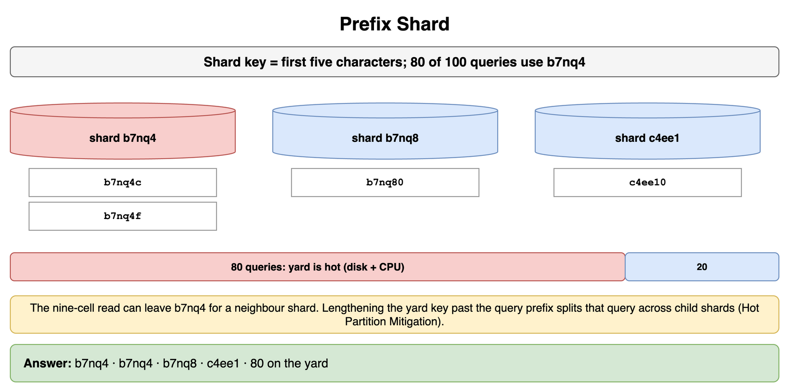
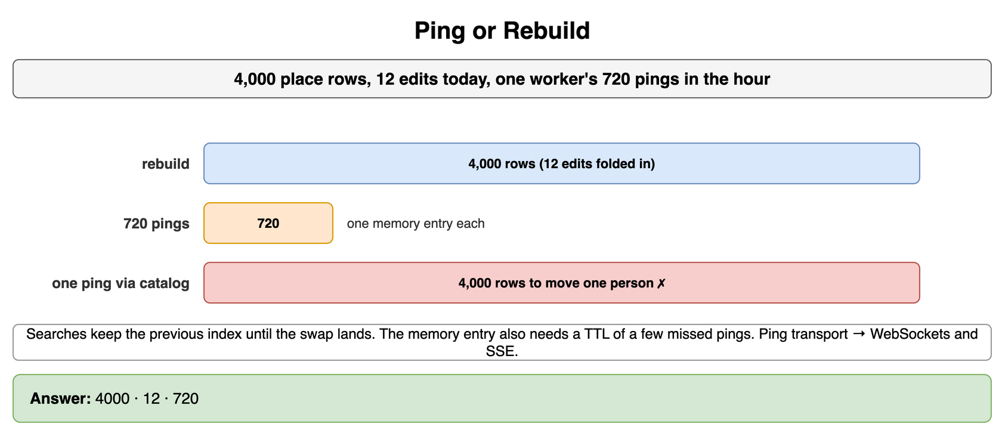
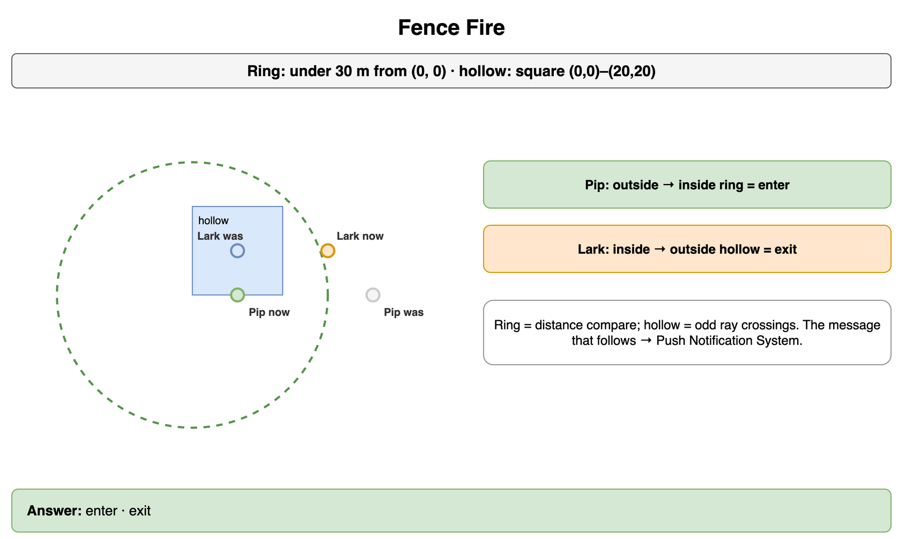

# Geospatial and Location-Based Services — Drills

Practice for a shared prefix, a cell edge, and a box that still needs a distance check. Each card is one exercise: commit to an answer, then check it. The numbers are small and made up so the arithmetic stays in your head. A cache tier stays in Caching. Placing a shard and cooling a hot prefix stay in Data Partitioning and Consistent Hashing. The connection that carries a location ping stays in Networking and Communication. The message after a fence fires stays in Real-Time and Notification Systems. A keyword match on a place name stays in Search Autocomplete and Information Retrieval.

## Prefix Cell

Three stored geohashes are `b7nq4c`, `b7nq4f`, and `b7nq80`. The diagram labels them shed, post, and ridge. Which pairs share a cell at length 5? Does `b7nq80` share the first code's cell at length 4? The query uses 5 characters and the stored hash has 6. What does that length mean on the ground?

```python
SHED = "b7nq4c"
POST = "b7nq4f"
RIDGE = "b7nq80"
QUERY = 5
```

**Answer:** `b7nq4c` and `b7nq4f` share `b7nq4`, so a length-5 query reads them in one range. `b7nq80` differs at the fifth character, so that range leaves it out. At length 4 all three share `b7nq`, a wider cell. Length 5 is the box the query is willing to scan: about 4.9 km by 4.9 km at the equator, and narrower east-west as cos(latitude) shrinks a degree of longitude. Length 6 is the finer code stored on the row, about 1.2 km by 610 m at the equator. The B-tree serves the length-5 predicate as a bounded range on the string.

```python
SHED = "b7nq4c"
POST = "b7nq4f"
RIDGE = "b7nq80"
QUERY = 5


def same(left: str, right: str, length: int) -> bool:
    return left[:length] == right[:length]


print(same(SHED, POST, QUERY), same(SHED, RIDGE, QUERY), same(SHED, RIDGE, QUERY - 1))
# True False True
```



*Source: [`diagrams/geospatial-drills.drawio`](/content/09_System_Design_Interview/20_Geospatial_and_Location_Based_Services/diagrams/geospatial-drills.drawio), page 1.*

## Edge Neighbor

Cells are 100 m squares. One point sits at (99, 50), just inside its cell. The point across the line sits at (101, 50). Which cells are they in, how many meters apart are they, and does a cover of the first point's cell plus its eight neighbors include the cell across the line?

```python
CELL = 100
EDGE = (99, 50)
ACROSS = (101, 50)
```

**Answer:** The points are 2 m apart and sit in cells (0, 0) and (1, 0). A read of (0, 0) alone misses the point across the line. The cover is nine cells, the home cell and the eight that touch it, and (1, 0) is one of them. The distance filter still drops a point that landed in one of those cells and is far from the caller. The nine-cell read is how a place just across a cell wall stays in the candidate set.

```python
CELL = 100
EDGE = (99, 50)
ACROSS = (101, 50)


def cell_of(point: tuple[int, int]) -> tuple[int, int]:
    return (point[0] // CELL, point[1] // CELL)


def covers(origin: tuple[int, int]) -> tuple[tuple[int, int], ...]:
    x, y = cell_of(origin)
    return tuple((x + dx, y + dy) for dy in (-1, 0, 1) for dx in (-1, 0, 1))


print(cell_of(EDGE), cell_of(ACROSS), ACROSS[0] - EDGE[0], len(covers(EDGE)), cell_of(ACROSS) in covers(EDGE))
# (0, 0) (1, 0) 2 9 True
```



*Source: [`diagrams/geospatial-drills.drawio`](/content/09_System_Design_Interview/20_Geospatial_and_Location_Based_Services/diagrams/geospatial-drills.drawio), page 2.*

## Quad Split

A leaf splits when it holds more than 4 points and the box is still wider than 50 m. A crowded box already at that floor stops. A sparse box stays a leaf. Three boxes, named yard, ridge, and post on the diagram: 6 points in 200 m, 2 points in 800 m, and 9 points in 40 m. What does each do? A circle centered at (300, 300) with radius 50 meets the four children of a larger square. Which boxes does the query open?

```python
CAP = 4
FLOOR_M = 50
ROWS = (("yard", 6, 200), ("ridge", 2, 800), ("post", 9, 40))
QUADS = (
    ("NE", (0, 0, 400, 400)),
    ("NW", (-400, 0, 0, 400)),
    ("SE", (0, -400, 400, 0)),
    ("SW", (-400, -400, 0, 0)),
)
CENTER = (300, 300)
RADIUS = 50
```

**Answer:** The 200 m box splits. The 800 m box stays a leaf, because two points are under the cap. The 40 m box stops, because 9 points are over the cap and the box is already inside the 50 m floor. The circle sits inside NE. NW, SE, and SW miss it, so those three stay unread, including every point under them. Points inside NE still take a distance check. The floor is what keeps the 40 m crowd from splitting into a chain.

```python
CAP = 4
FLOOR_M = 50
ROWS = (("yard", 6, 200), ("ridge", 2, 800), ("post", 9, 40))
QUADS = (
    ("NE", (0, 0, 400, 400)),
    ("NW", (-400, 0, 0, 400)),
    ("SE", (0, -400, 400, 0)),
    ("SW", (-400, -400, 0, 0)),
)
CENTER = (300, 300)
RADIUS = 50


def action(count: int, width: int) -> str:
    if count > CAP and width > FLOOR_M:
        return "split"
    if count > CAP:
        return "stop"
    return "leaf"


def hits(box: tuple[int, int, int, int], center: tuple[int, int], radius: int) -> bool:
    x0, y0, x1, y1 = box
    cx, cy = center
    nearest_x = min(max(cx, x0), x1)
    nearest_y = min(max(cy, y0), y1)
    return (nearest_x - cx) ** 2 + (nearest_y - cy) ** 2 <= radius**2


opened = tuple(name for name, box in QUADS if hits(box, CENTER, RADIUS))
print(tuple(action(count, width) for _name, count, width in ROWS), opened)
# ('split', 'leaf', 'stop') ('NE',)
```



*Source: [`diagrams/geospatial-drills.drawio`](/content/09_System_Design_Interview/20_Geospatial_and_Location_Based_Services/diagrams/geospatial-drills.drawio), page 3.*

## Equal Area

Take a degree of longitude as 111 km at the equator. How wide is that degree at 48°, and how wide at 78°? One catalog stays near 48°. Another also includes places near 78°. Which index does each catalog use?

```python
import math

EQ_KM = 111
VALLEY_LAT = 48
POLAR_LAT = 78
```

**Answer:** The degree is about 74 km wide at 48° and about 23 km wide at 78°, because the east-west length scales with cos(latitude). A degree of latitude stays near 111 km, so a degree-box near 78° covers less ground. A catalog that stays near one latitude can keep a geohash prefix: one cell size fits the radius. A catalog that also holds places near 78° wants equal-area cells, one S2 level, so the same radius covers a similar patch in both places. H3 would hold that area with hexes. The diagram labels the two catalogs "valley" and "valley + polar holding."

```python
import math

EQ_KM = 111
VALLEY_LAT = 48
POLAR_LAT = 78


def lon_km(lat: int) -> int:
    return round(EQ_KM * math.cos(math.radians(lat)))


def index_for(scope: str) -> str:
    if scope == "valley":
        return "prefix"
    return "equal-area"


print(lon_km(VALLEY_LAT), lon_km(POLAR_LAT), index_for("valley"), index_for("both"))
# 74 23 prefix equal-area
```



*Source: [`diagrams/geospatial-drills.drawio`](/content/09_System_Design_Interview/20_Geospatial_and_Location_Based_Services/diagrams/geospatial-drills.drawio), page 4.*

## Box then Radius

The prefix read returns the box from 0 to 100 on both axes. The caller stands at (50, 50) and asks for places within 40 m. Three candidates are (2, 2), (60, 55), and (180, 50), labeled corner, post, and lane on the diagram. Which points did the box return, and which points survive the radius?

```python
BOX = (0, 100, 0, 100)
CENTER = (50, 50)
RADIUS = 40
PINS = (("corner", (2, 2)), ("post", (60, 55)), ("lane", (180, 50)))
```

**Answer:** The box returns the corner and the post. The lane point, at x 180, was never in the rectangles the prefix named. The corner is about 68 m from the caller, past 40 m, so the distance check drops it. The post is about 11 m away and stays. The prefix read is the box. The radius is the circle inside it.

```python
BOX = (0, 100, 0, 100)
CENTER = (50, 50)
RADIUS = 40
PINS = (("corner", (2, 2)), ("post", (60, 55)), ("lane", (180, 50)))


def in_box(pin: tuple[int, int], box: tuple[int, int, int, int]) -> bool:
    x, y = pin
    x0, x1, y0, y1 = box
    return x0 <= x <= x1 and y0 <= y <= y1


def within(pin: tuple[int, int], center: tuple[int, int], radius: int) -> bool:
    return (pin[0] - center[0]) ** 2 + (pin[1] - center[1]) ** 2 <= radius**2


boxed = tuple(name for name, pin in PINS if in_box(pin, BOX))
kept = tuple(name for name, pin in PINS if in_box(pin, BOX) and within(pin, CENTER, RADIUS))
print(boxed, kept)
# ('corner', 'post') ('post',)
```



*Source: [`diagrams/geospatial-drills.drawio`](/content/09_System_Design_Interview/20_Geospatial_and_Location_Based_Services/diagrams/geospatial-drills.drawio), page 5.*

## Prefix Shard

The shard key is the first five characters, the same length the query uses. Where do `b7nq4c`, `b7nq4f`, `b7nq80`, and `c4ee10` land? Of 100 queries, 80 use the prefix `b7nq4`. What does that 80 do to the cluster?

```python
CODES = ("b7nq4c", "b7nq4f", "b7nq80", "c4ee10")
YARD_SHARE = 80
```

**Answer:** `b7nq4c` and `b7nq4f` land on `b7nq4`. `b7nq80` lands on `b7nq8`. `c4ee10` lands on `c4ee1`. A query for one prefix stays on one shard with the places in that cell. Eighty of every hundred queries sit on `b7nq4`. The diagram calls that dense prefix the yard. That shard's disk and its processor are the hot spot, the same shape as a downtown cell that holds the busy blocks. A neighbor prefix can live on another shard, so the nine-cell read can leave `b7nq4` and touch a second machine. Lengthening the key past the query prefix splits that one query across child shards. Moving shards, and salting one key, stay on Horizontal Partitioning (Sharding) and Hot Partition Mitigation.

```python
CODES = ("b7nq4c", "b7nq4f", "b7nq80", "c4ee10")
YARD_SHARE = 80


def home(code: str) -> str:
    return code[:5]


print(*(home(code) for code in CODES), YARD_SHARE)
# b7nq4 b7nq4 b7nq8 c4ee1 80
```



*Source: [`diagrams/geospatial-drills.drawio`](/content/09_System_Design_Interview/20_Geospatial_and_Location_Based_Services/diagrams/geospatial-drills.drawio), page 6.*

## Ping or Rebuild

The place table has 4,000 rows and 12 edits today. The catalog path rebuilds the index once and swaps it in. One moving worker emits 720 pings in the hour. How many rows does the rebuild write, and how many point-updates do the pings write?

```python
PINS = 4000
EDITS = 12
PINGS = 720
```

**Answer:** The rebuild writes 4,000 rows once and folds the 12 edits into that swap. Searches keep the previous index until the swap lands. The 720 pings write 720 point-updates, one memory entry each. A ping that took the catalog path would write 4,000 rows to move one person. The memory entry still needs a TTL, a few missed intervals, so a silent device disappears. That expiry is separate from the 720 writes. The connection that carries the ping is WebSockets and SSE. The radius read over those memory entries is the same box-then-distance path as the catalog.

```python
PINS = 4000
EDITS = 12
PINGS = 720


def rows(path: str) -> int:
    if path == "rebuild":
        return PINS
    return 1


print(rows("rebuild"), EDITS, rows("ping") * PINGS)
# 4000 12 720
```



*Source: [`diagrams/geospatial-drills.drawio`](/content/09_System_Design_Interview/20_Geospatial_and_Location_Based_Services/diagrams/geospatial-drills.drawio), page 7.*

## Fence Fire

A circular fence is inside when a point is under 30 m from (0, 0). Sample Pip was at (40, 0) and is now at (10, 0). A square fence has corners (0, 0), (20, 0), (20, 20), and (0, 20). Sample Lark was at (10, 10) and is now at (30, 10). What does the service record for each sample?

```python
RING_M = 30
PIP_PREV = (40, 0)
PIP_NOW = (10, 0)
HOLLOW = ((0, 0), (20, 0), (20, 20), (0, 20))
LARK_PREV = (10, 10)
LARK_NOW = (30, 10)
```

**Answer:** Pip was outside the circle and is inside, so the service records an enter. Lark was inside the square and is outside, so the service records an exit. The circle is a distance compare. The square counts edges a ray toward increasing x crosses, and an odd count is inside. The service stops at those two decisions. The message either user would receive is Push Notification System.

```python
RING_M = 30
PIP_PREV = (40, 0)
PIP_NOW = (10, 0)
HOLLOW = ((0, 0), (20, 0), (20, 20), (0, 20))
LARK_PREV = (10, 10)
LARK_NOW = (30, 10)


def in_ring(point: tuple[int, int], radius: int) -> bool:
    return point[0] ** 2 + point[1] ** 2 < radius**2


def in_polygon(point: tuple[int, int], polygon: tuple[tuple[int, int], ...]) -> bool:
    x, y = point
    inside = False
    for index, (x1, y1) in enumerate(polygon):
        x2, y2 = polygon[(index + 1) % len(polygon)]
        if (y1 > y) != (y2 > y):
            cross = x1 + (y - y1) * (x2 - x1) / (y2 - y1)
            if x < cross:
                inside = not inside
    return inside


def crossed(was_in: bool, now_in: bool) -> str:
    if not was_in and now_in:
        return "enter"
    if was_in and not now_in:
        return "exit"
    return "still"


pip = crossed(in_ring(PIP_PREV, RING_M), in_ring(PIP_NOW, RING_M))
lark = crossed(in_polygon(LARK_PREV, HOLLOW), in_polygon(LARK_NOW, HOLLOW))
print(pip, lark)
# enter exit
```



*Source: [`diagrams/geospatial-drills.drawio`](/content/09_System_Design_Interview/20_Geospatial_and_Location_Based_Services/diagrams/geospatial-drills.drawio), page 8.*
