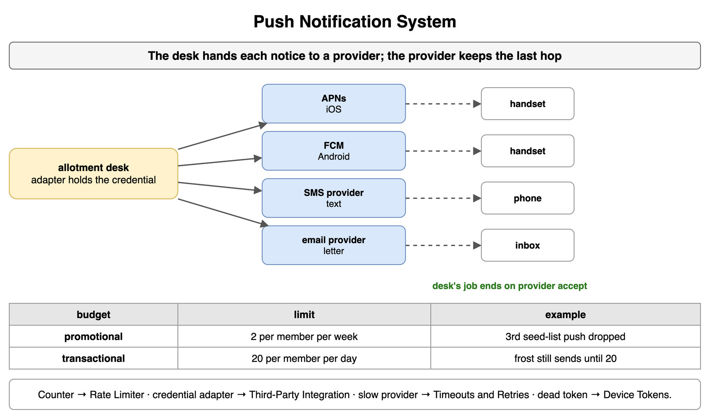
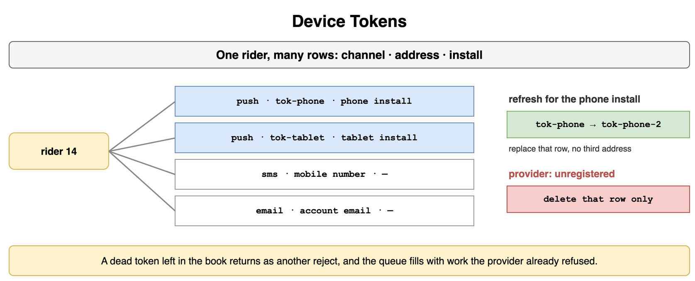
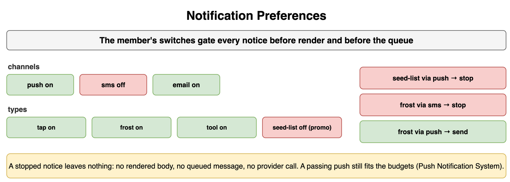
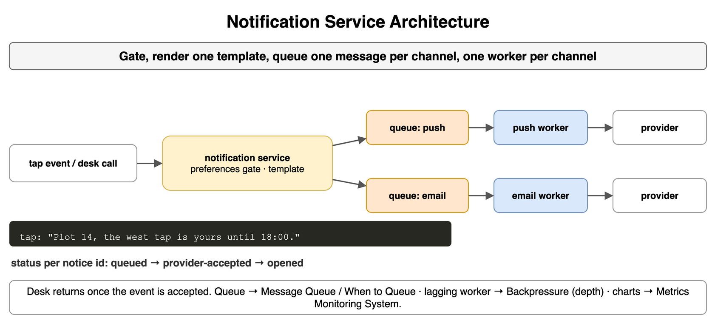
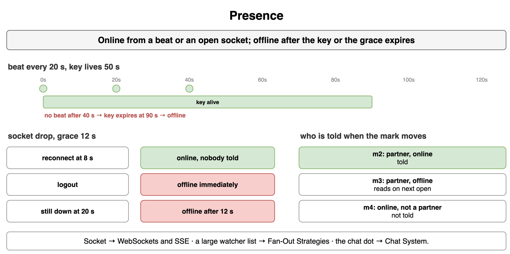
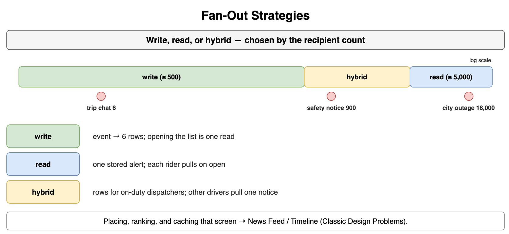
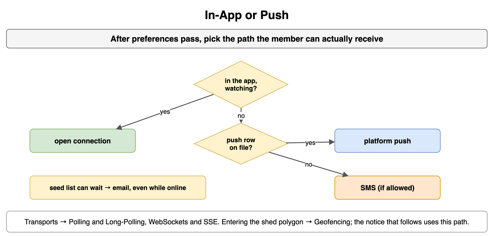
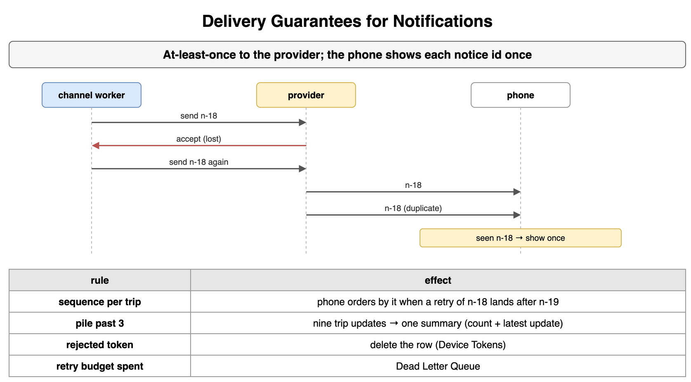

## Push Notification System

**What it is.** A push notification system delivers a short alert to a phone without your servers holding a connection to that phone. iOS alerts go to Apple Push Notification service (APNs). Android alerts go to Firebase Cloud Messaging (FCM). Texts go to an SMS provider. Mail goes to an email provider.

**Why it exists.** A ride-hailing app has to say "your driver is outside" while the rider's app is closed. The phone's operating system already keeps a long-lived connection to APNs or FCM. Your API servers do not, and opening one connection per installed app would not survive a phone moving between networks. The provider owns that last hop. The same shape carries a food-delivery "order at the door" alert.

**How it works.**

1. The app registers with APNs or FCM and receives a device token for that install. Where the token is stored is Device Tokens.
2. A trip event reaches the notification service. The service chooses a channel, fills a short payload, and calls the matching provider.
3. The call uses a server credential: an APNs provider token (or a provider certificate) for Apple, and an FCM service account for the HTTP v1 API. The phone never receives that credential. The adapter that holds it is Third-Party Integration in [Microservices and System Decomposition](../12_Microservices_and_System_Decomposition/).
4. APNs returns HTTP 200 when it accepts the request to `POST /3/device/<token>`. FCM accepts an Android registration token the same way. Acceptance means the provider took the message. The lock screen can still stay dark if the phone is off, the rider disabled alerts, or a low-priority push is delayed. A success response that is lost on the way back is covered by Delivery Guarantees for Notifications.
5. Two product caps are counted separately. A promotional push, such as a weekly deals blast, stops at 2 per rider per week. A transactional push, such as driver assigned, driver arrived, or a payment problem, stops at 20 per rider per day, so a stream of location updates cannot page the afternoon away. The third deals push of the week is dropped. A driver-arrived alert in that same hour still sends, until the day's count reaches 20. The window and the counter are the Rate Limiter in [Rate Limiting and Throttling](../17_Rate_Limiting_and_Throttling/). This card names the budgets.
6. A provider that answers HTTP 429 is asking the sender to slow down. The wait is Timeouts and Retries in [Distributed System Failure Modes](../15_Distributed_System_Failure_Modes/). APNs returns HTTP 410 with reason `Unregistered`, and FCM returns `UNREGISTERED` (HTTP 404), when the token is no longer active. That row is removed on Device Tokens.

**Trade-offs.** Calling APNs for iOS and FCM for Android keeps each payload in that platform's format. Sending every platform through FCM is a working alternative: FCM forwards an iOS message to APNs, so you operate one server integration. You still store an address per install, and a dead token is still deleted. SMS and email cost more per send and reach people who never allowed push. They carry receipts and digests well. They are a poor default for a live trip. Provider priority is a separate hint that sits beside your caps. APNs priority 10 asks for immediate delivery of a visible alert. Priority 5, and the lower priority 1, let the device defer the alert to save power, and some of those alerts are never shown. FCM message priority `high` tries to deliver while the phone is dozing. FCM `normal` can wait when the app is in the background.

**In an interview.** Name the provider for each platform, and say your attempt is finished when that provider accepts. Split promotional and transactional traffic into two counters, and give the numbers you would enforce. Keep the provider credential on the server. Decide out loud what happens when the rider has disabled push: SMS for the arrival, email for the receipt.

**Recap.**

| Channel | Who keeps the last hop | Worked example |
| --- | --- | --- |
| iOS push | APNs | Driver is outside |
| Android push | FCM | Driver is outside |
| SMS | SMS provider | Same arrival, with no push token |
| Email | Email provider | Weekly deals, or a receipt |

- This product allows 2 promotional pushes per rider each week and 20 transactional pushes per rider each day.
- The Rate Limiter owns the counter. Third-Party Integration owns the credential. Timeouts and Retries owns a 429. Device Tokens owns a dead token.



*Source: [`diagrams/notifications.drawio`](/content/09_System_Design_Interview/21_Real_Time_and_Notification_Systems/diagrams/notifications.drawio), page 1.*

## Device Tokens

**What it is.** A device token is the opaque address APNs or FCM assigns to one install of your app. The address book maps one rider to many rows. Each row is a channel, an address, and the install it belongs to.

**Why it exists.** A rider can have the app on a phone and a tablet. Push has to reach the install that registered, and a later token for that same install has to take the place of the old one. The SMS row is the mobile number on the account. The email row is the account email. Those are addresses in the same book. They are not device tokens, and a push provider will not accept a phone number in the token field.

**How it works.**

1. The rider allows alerts. APNs or FCM returns a token for that install. The app posts the token to your backend together with a stable install id.
2. The book stores one row per install: channel `push`, the token, and the install id. The phone and the tablet are two rows.
3. A later token for the same install replaces that row. The tablet row stays. A refresh does not leave the old phone token sitting beside the new one.
4. When a send comes back unregistered — APNs HTTP 410 reason `Unregistered`, or FCM `UNREGISTERED` — delete that row and leave every other row. The next send uses what remains.
5. A dead token left in the book comes back as another reject. The queue then fills with work the provider has already refused.

**Trade-offs.** Keeping every historical token for an install makes a debug log. It also keeps an address the provider will keep rejecting. Replacing the row for that install id is the book you want at send time. Deleting every row for the rider when one token dies would also drop the tablet, the SMS number, and the email. Delete the rejected push row only. APNs `BadDeviceToken` means the token string itself is malformed. FCM `INVALID_ARGUMENT` can mean a bad token or a bad payload, so delete a row for that error only when the payload is valid. The unregistered responses above mean this install is gone.

**In an interview.** Say the token names an install, and one person can have several. Replace on refresh, delete on 410 or `UNREGISTERED`, and keep the other devices. Say the phone number and the email live in the same book and survive a dead push token.

**Recap.**

- One rider has many rows: a push token per install, plus an SMS number and an email address.
- A refresh replaces the row for that install and leaves the other install in place.
- An unregistered token deletes that row only. The next send uses the rows that remain.
- A dead token left in the book is retried work the provider has already refused.



*Source: [`diagrams/notifications.drawio`](/content/09_System_Design_Interview/21_Real_Time_and_Notification_Systems/diagrams/notifications.drawio), page 2.*

## Notification Preferences

**What it is.** Notification preferences are the rider's switches: one set for channels and one set for notice types. The service reads both on every notice.

**Why it exists.** A rider can want trip alerts and refuse weekly deals, or want email and refuse SMS. Sending first and filtering later spends a template render, a queue write, and sometimes a paid SMS on a message the rider has already declined. The gate is how the product keeps the settings screen honest.

**How it works.** The channels in this design are push, SMS, and email. The types are trip alerts, which are transactional, and deals, which are promotional. The gate runs before a template is rendered and before a message is written to a queue. Take a rider with push on, SMS off, email on, deals off, and trip alerts on.

- A deals push stops, because the type is off.
- A trip text stops, because SMS is off.
- A trip push passes both switches.
- A notice that fails the gate leaves nothing behind: no rendered body, no queued message, no provider call.
- A notice that passes still has to fit the budgets on Push Notification System. The counter under those budgets is the Rate Limiter in [Rate Limiting and Throttling](../17_Rate_Limiting_and_Throttling/).

**Trade-offs.** One master "notifications off" switch is smaller to build and coarser than a delivery app's settings screen. Per-channel and per-type switches match the choices riders already expect. Checking the switches inside the provider call is late: the body is already rendered and the message is already queued. This design checks before either of those writes. A second check when the worker actually sends is the stricter alternative if a message can sit in the queue for minutes after the rider flips a switch. The required gate is the early one.

**In an interview.** Say you drop the notice before render and before the queue, and that a dropped notice writes nothing. Treat channel and type as independent. Then apply the promotional or transactional cap to whatever passed.

**Recap.**

| Notice | Switches | Result |
| --- | --- | --- |
| Deals via push | Deals off, push on | Stop. Nothing is rendered or queued. |
| Trip alert via SMS | Trip on, SMS off | Stop. Nothing is rendered or queued. |
| Trip alert via push | Trip on, push on | Pass the gate, then face the daily transactional cap. |



*Source: [`diagrams/notifications.drawio`](/content/09_System_Design_Interview/21_Real_Time_and_Notification_Systems/diagrams/notifications.drawio), page 3.*

## Notification Service Architecture

**What it is.** The notification service turns one product event into one queued message for each channel the rider still allows.

**Why it exists.** The trip service should return as soon as "driver arrived" is recorded. Rendering a template and calling APNs, FCM, or an SMS provider are slower than that write, and they fail independently. A queue gives each channel its own worker so a stalled email vendor does not stall the arrival push.

**How it works.**

1. A trip event, or a call from an operations console, enters the notification service.
2. The service applies Notification Preferences.
3. It fills one template for the notice type. A trip template reads "Your driver is outside until 18:00." The wording lives in the template, so a deals notice and a trip notice share the rest of the path.
4. It writes one message for each channel that passed. Those buffers are a Message Queue in [Message Queues and Async Processing](../11_Message_Queues_and_Async_Processing/). Whether the provider call belongs off the request is When to Queue in that topic.
5. One worker per channel performs the provider call. The API returns once the event is accepted onto the queue.
6. The service stores a status on the notice id: queued, accepted by the provider, or opened. Opened is recorded when the app reports that the rider tapped the alert. Provider acceptance means the provider took the message.
7. A worker that falls behind shows up as queue depth. That depth is Backpressure in the queue topic. A product that charts it is Metrics Monitoring System in [Classic Design Problems](../24_Classic_Design_Problems/).

**Trade-offs.** One shared queue with a channel field is simpler to operate, and a slow SMS provider then sits in front of push messages. A queue per channel, with one worker on each, isolates that stall. The figure for this card is the split. Calling the provider inside the trip request avoids a queue and ties the trip write to APNs latency. That is a reasonable first version at low volume. A queue per channel is the shape once a provider stall would otherwise fail the "driver arrived" record.

**In an interview.** Walk the path in order: accept the event, gate, fill one template, enqueue one message per allowed channel, workers call providers, status moves from queued to provider-accepted to opened. Say the caller returns at enqueue. Use queue depth as the lag signal, and leave the broker's internals in the queue topic.

**Recap.**

- Preferences run first. A failing gate produces no template and no queue message.
- One template per notice type. One queued message per channel that passed. One worker per channel calls the provider.
- Status on the notice id is queued, then provider-accepted, then opened when the app reports a tap.
- Queue depth is Backpressure. A chart of that depth is Metrics Monitoring System.



*Source: [`diagrams/notifications.drawio`](/content/09_System_Design_Interview/21_Real_Time_and_Notification_Systems/diagrams/notifications.drawio), page 4.*

## Presence

**What it is.** Presence is the record of who is online right now. A Slack-style chat uses it for the active and away dot next to a teammate.

**Why it exists.** The roster should survive a subway blip, and it should update when someone actually leaves. Marking offline on every dropped packet makes the dot flicker. Publishing every heartbeat to every teammate wakes the whole company every 20 seconds.

**How it works.** There are two ways to hold the mark.

The heartbeat. The app sends a beat every 20 seconds, and each beat refreshes a key that lives 50 seconds. A quiet stretch of 20 seconds still finds the key, so the person stays online. Fifty seconds from the last beat expires the key, and the person is offline. In the worked timeline, beats land at 0, 20, and 40 seconds. If the beat due at 60 never arrives, the key set at 40 expires at 90, and the person is offline then.

The socket. An open connection is the other mark. How that socket is held is WebSockets and SSE in [Networking and Communication](../10_Networking_and_Communication/). When it closes, a grace of 12 seconds starts. A reconnect at 8 seconds keeps the person online, and nobody is told, because the mark did not change. An explicit logout expires the mark immediately. The 12 seconds belong to a dropped connection. A logout is a deliberate leave. A drop that is still open at 20 seconds is past the grace, so the mark becomes offline.

A change is published only when the mark actually moves, and only to people who subscribe to this user and are online now. An offline subscriber reads the mark the next time they open the app. Someone online who does not subscribe to this user is not told. A user watched by a large list is a choice on Fan-Out Strategies. The screen that paints the dot is Chat System in [Classic Design Problems](../24_Classic_Design_Problems/).

**Trade-offs.** A heartbeat alone fits a mobile client that cannot hold a socket. A socket alone fits a desktop client that stays connected, and a killed process looks offline only after the grace. Using both matches a Slack-style client: the socket is the live signal, and the heartbeat covers an open app whose socket is unreliable. A TTL equal to the 20-second interval marks people offline on a single lost beat. A much longer TTL hides real departures. Fifty seconds against a 20-second beat is this design's compromise, and these timers are the design's numbers.

**In an interview.** State both timers and the 12-second grace. Say you publish transitions, and only to subscribers who are online. Logout skips the grace. If the watcher list is huge, point at fan-out and publish the transition to the people who can see it.

**Recap.**

| Signal | Timing in this design | What observers see |
| --- | --- | --- |
| Heartbeat | Every 20 seconds, key TTL 50 seconds | A 20-second gap stays online. Silence for 50 seconds is offline. Last beat at 40s expires at 90s. |
| Socket reconnect | 8 seconds, inside a 12-second grace | Stays online. Nobody is told. |
| Logout | Immediate | Offline now. The grace does not apply. |
| Socket still down | 20 seconds, past the grace | Offline. |
| Who hears a real change | Subscribed and online | Offline subscribers read the mark on the next open. |



*Source: [`diagrams/notifications.drawio`](/content/09_System_Design_Interview/21_Real_Time_and_Notification_Systems/diagrams/notifications.drawio), page 5.*

## Fan-Out Strategies

**What it is.** Fan-out is how one event becomes a notice for many people. The choice is write, read, or hybrid, and it follows the size of the recipient set.

**Why it exists.** Six people in a trip chat and 18,000 riders in a city-wide outage cannot share a write path. Copying a row into every inbox makes the open cheap and the publish expensive. Storing the notice once makes the publish a single row and makes every open do more work.

**How it works.** This design draws two lines. At or under 500 recipients, fan-out on write. At or over 5,000, fan-out on read. Between the lines, hybrid.

Fan-out on write copies the notice into each recipient's list when the event is saved. Six people share a trip chat. Six is at or under 500, so the event becomes six rows, and opening the list is one read of that person's rows.

Fan-out on read stores the notice once. A city outage names 18,000 riders, at or over 5,000. Each rider pulls recent shared alerts on open and keeps the ones that name them. The write is a single row.

A safety notice names 900 drivers. That count sits between the lines. Copying 900 inbox rows is already an expensive write, and a pure pull makes every one of those 900 opens assemble the notice. The service writes a row for each on-duty dispatcher inside the 900, and stores one notice for the other recipients to pull. That split is the hybrid.

Placing the written rows beside the pulled notice, ranking that screen, and caching it are News Feed in [Classic Design Problems](../24_Classic_Design_Problems/).

```python
WRITE_MAX = 500
READ_MIN = 5000


def pick(recipients: int) -> str:
    if recipients <= WRITE_MAX:
        return "write"
    if recipients >= READ_MIN:
        return "read"
    return "hybrid"


print(pick(6), pick(900), pick(18000))
# write hybrid read
```

**Trade-offs.** Write favors the reader and punishes a huge recipient set: one blast becomes one insert per person. Read favors the writer and makes every open heavier. Hybrid spends inserts on the people who must see the notice immediately and leaves a shared row for everyone else. The lines are a product choice. 500 and 5,000 are the lines this design uses so a small group, a mid-size safety list, and a city blast fall into three shapes. Rank and cache stay on the feed card.

**In an interview.** Ask for the recipient count before you pick a shape. Say 6 is a write, 900 is a hybrid that writes the on-duty subset and lets the rest pull, and 18,000 is a read. Offer to move the lines if the product's "small" is different. Leave timeline ranking and the feed cache on News Feed.

**Recap.**

| Recipients | Shape | What is stored |
| --- | --- | --- |
| 6, at or under 500 | Write | One inbox row per recipient. Open reads that person's rows. |
| 900, between the lines | Hybrid | One row per on-duty dispatcher. Everyone else pulls one shared notice. |
| 18,000, at or over 5,000 | Read | One stored notice. Each person pulls it on open. |



*Source: [`diagrams/notifications.drawio`](/content/09_System_Design_Interview/21_Real_Time_and_Notification_Systems/diagrams/notifications.drawio), page 6.*

## In-App or Push

**What it is.** After preferences allow a notice, this choice picks the pipe: the connection the app already holds, a platform push, email, or SMS.

**Why it exists.** A rider staring at the trip screen already has a live connection. A platform push to that same phone is a second banner for news the screen is about to show. A rider who locked the phone has no connection to write on. A weekly deals mail can wait in either case.

**How it works.** The path is chosen after Notification Preferences have passed the notice.

- The rider is in the app, watching the trip. The notice rides the connection the app already holds. How that connection is kept, including a poll or a long poll, is Polling and Long-Polling and WebSockets and SSE in [Networking and Communication](../10_Networking_and_Communication/).
- The rider is away, and Device Tokens still has a push row. The same trip notice goes out as a platform push on Push Notification System.
- Weekly deals can wait, so they go by email even while the rider is online.
- A driver-arrived alert with no push row, while SMS is still allowed, goes by text.
- A stream of positions along the route uses that same transport topic. The test that the rider entered the pickup polygon is Geofencing in [Geospatial and Location-Based Services](../20_Geospatial_and_Location_Based_Services/). The notice that follows the test uses the path above.

**Trade-offs.** Always pushing is one code path, and it double-notifies people who are already looking at the trip. Always waiting for the app to poll misses the locked phone. Email for an arrival hides a driver standing at the curb. SMS for every trip update is expensive and ignores a working push token. The order here is: an open screen uses the open connection, an absent rider with a token gets a platform push, mail carries what can wait, and SMS is the urgent fallback when push has nowhere to go.

**In an interview.** Say the decision is per notice, after the preference gate. Ask whether the user is looking at that screen, then whether a push token exists. Put socket mechanics in the networking topic and the polygon test in geofencing. This card only chooses the pipe.

**Recap.**

| Situation | Pipe |
| --- | --- |
| In the app, watching the trip | The connection the app already holds |
| Away, with a push token on file | APNs or FCM |
| Weekly deals, including while online | Email |
| Urgent alert, no push token, SMS allowed | SMS |



*Source: [`diagrams/notifications.drawio`](/content/09_System_Design_Interview/21_Real_Time_and_Notification_Systems/diagrams/notifications.drawio), page 7.*

## Delivery Guarantees for Notifications

**What it is.** Delivery to the provider is at-least-once. The phone makes a duplicate harmless by showing each notice id once.

**Why it exists.** The channel worker retries when a call fails. The awkward case is a call that succeeded and whose success response was lost. The worker sends the same notice again, and the phone can receive it twice. Exactly-once delivery would require the provider's accept and the phone's display to commit together. Those two sides have no shared commit, so the practical contract is at-least-once plus a notice id the phone has already shown.

**How it works.**

1. The channel worker calls the provider until the provider accepts the notice.
2. A lost accept produces a second send of the same id. The broker's promise on the queued message is the same class of promise: Message Delivery Guarantees in [Message Queues and Async Processing](../11_Message_Queues_and_Async_Processing/).
3. The phone keeps the ids it has shown and displays each id once. A second copy of `n-18` is the same notice.
4. Notices for one trip also carry a sequence. The phone orders by that sequence when a retry of an older notice arrives after a later one, so `n-19` appearing first still renders in trip order.
5. A rider who was away can have a pile waiting. Nine trip updates become one summary once the pile passes 3. The summary names the count and the latest update. The nine rows stay on the server. Three waiting reminders sit at the line, so each one is still sent.
6. A token the provider rejects is deleted on Device Tokens. The pause between tries is Timeouts and Retries in [Distributed System Failure Modes](../15_Distributed_System_Failure_Modes/). After that retry budget, the message goes to a Dead Letter Queue in [Message Queues and Async Processing](../11_Message_Queues_and_Async_Processing/).

**Trade-offs.** A single attempt avoids duplicates and drops any notice whose response was lost. Retrying until accept keeps the arrival alert and requires the phone to dedupe. APNs can merge lock-screen banners that share an `apns-collapse-id` of at most 64 bytes. On Android, an FCM collapse key keeps the latest message for that key while the device is offline, and FCM stores at most four distinct collapse keys per device at once. Notification messages collapse even when you omit a custom key. That coalesces one visible banner. The stored rows stay, and this is separate from the summary the service sends once a pile passes 3.

**In an interview.** Say at-least-once to the provider, dedupe by notice id on the phone, and order one trip by sequence. Say a pile larger than 3 leaves as one summary while the rows stay stored. Put the pause in Timeouts and Retries, and put a message that has spent its retry budget on the Dead Letter Queue.

**Recap.**

- The worker retries until the provider accepts. A lost accept sends the same notice id again.
- The phone shows each notice id once, and orders one trip by sequence when a retry arrives late.
- More than 3 waiting updates for that trip become one summary. The rows stay on the server.
- An unregistered token is deleted. The retry pause is Timeouts and Retries. A spent retry budget is a Dead Letter Queue.



*Source: [`diagrams/notifications.drawio`](/content/09_System_Design_Interview/21_Real_Time_and_Notification_Systems/diagrams/notifications.drawio), page 8.*
