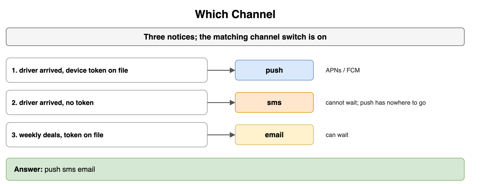
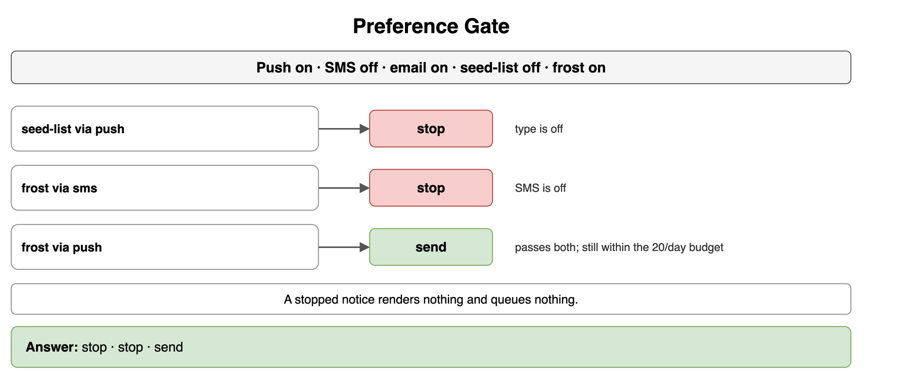
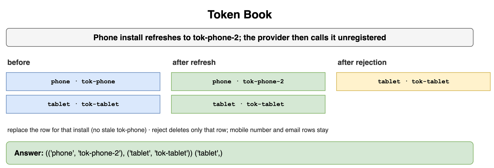
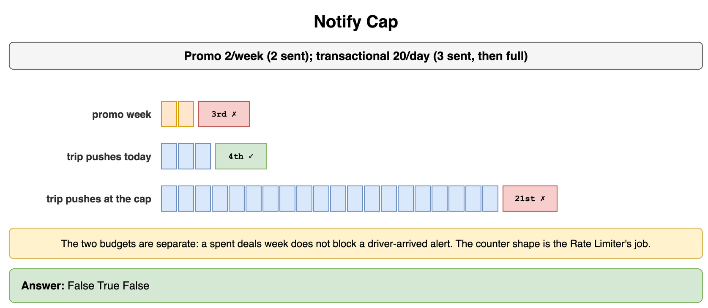
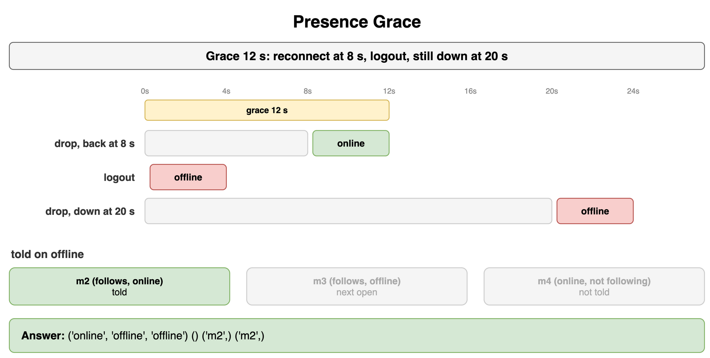
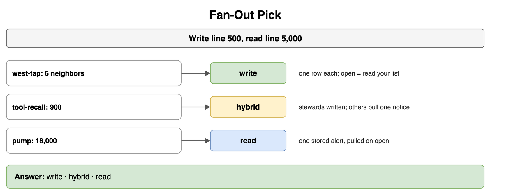
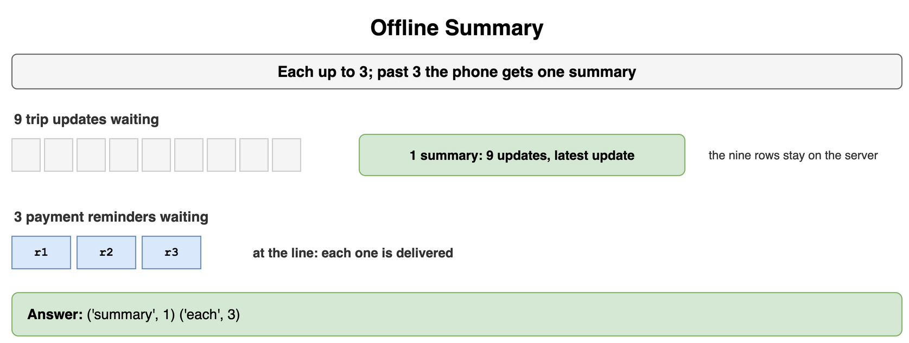
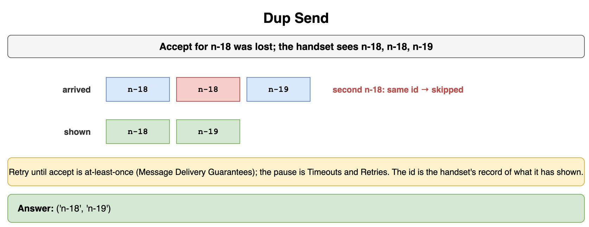

# Real-Time and Notification Systems — Drills

Original practice for which channel leaves the service, which switch stops a send, and which fan-out a recipient count selects. Each card is one exercise: commit to an answer, then check it. The numbers are a worked example for a ride-hailing app and a Slack-style chat. How a socket is held stays in Networking and Communication. The broker's promise, the queue, and a parked message stay in Message Queues and Async Processing. The provider adapter stays in Microservices and System Decomposition. The wait between tries stays in Distributed System Failure Modes. The counter that enforces a budget stays in Rate Limiting and Throttling. A polygon test stays in Geospatial and Location-Based Services. The chat screen, feed ranking, and a feed cache stay in Classic Design Problems.

## Which Channel

Three notices are ready for a rider who is not looking at the trip screen. The matching channel switch is on. Which path does each one take?

```python
EVENTS = (
    ("arrived", True),
    ("arrived", False),
    ("deals", True),
)
```

**Answer:** A driver-arrived alert with a device token is a platform push. The same alert with no token is SMS, because it cannot wait and push has nowhere to go. Weekly deals can wait, so they are email even though a token is on file. APNs and FCM are the push providers. The open-app path is a different choice, on In-App or Push, and it applies when the rider is in the app watching the trip.

```python
EVENTS = (
    ("arrived", True),
    ("arrived", False),
    ("deals", True),
)


def channel(kind: str, has_token: bool) -> str:
    if kind == "deals":
        return "email"
    if has_token:
        return "push"
    return "sms"


print(*(channel(kind, has_token) for kind, has_token in EVENTS))
# push sms email
```



*Source: [`diagrams/notifications-drills.drawio`](/content/09_System_Design_Interview/21_Real_Time_and_Notification_Systems/diagrams/notifications-drills.drawio), page 1.*

## Preference Gate

A rider's switches: push on, SMS off, email on, deals off, trip alerts on. What happens to a deals push, a trip text, and a trip push?

```python
TYPE_ON = {"arrived": True, "deals": False}
CHANNEL_ON = {"push": True, "sms": False, "email": True}
NOTICES = (("deals", "push"), ("arrived", "sms"), ("arrived", "push"))
```

**Answer:** The deals push stops because the type is off. The trip text stops because SMS is off. The trip push passes both switches. Stopping means the service renders nothing and writes nothing to a queue. The trip push that passes still has to fit the transactional budget on Push Notification System. The counter under that budget is the Rate Limiter.

```python
TYPE_ON = {"arrived": True, "deals": False}
CHANNEL_ON = {"push": True, "sms": False, "email": True}
NOTICES = (("deals", "push"), ("arrived", "sms"), ("arrived", "push"))


def gate(kind: str, channel_name: str) -> str:
    if not TYPE_ON[kind] or not CHANNEL_ON[channel_name]:
        return "stop"
    return "send"


print(*(gate(kind, channel_name) for kind, channel_name in NOTICES))
# stop stop send
```



*Source: [`diagrams/notifications-drills.drawio`](/content/09_System_Design_Interview/21_Real_Time_and_Notification_Systems/diagrams/notifications-drills.drawio), page 2.*

## Token Book

A rider has the app on a phone and a tablet. The phone install refreshes its token to `tok-phone-2`. The provider then calls that current phone token unregistered. What is stored after the refresh, and what remains after the rejection?

```python
ROWS = (("phone", "tok-phone"), ("tablet", "tok-tablet"))
REFRESHED = "tok-phone-2"
```

**Answer:** The refresh replaces the phone row. The book still has two installs: `tok-phone-2` and `tok-tablet`. Appending the new token beside `tok-phone` would leave a stale address in the book. The rejection deletes the row that now holds `tok-phone-2` and leaves the tablet. The account email and the mobile number are other rows in the same book. They are addresses, and this rejection does not drop them.

```python
ROWS = (("phone", "tok-phone"), ("tablet", "tok-tablet"))
REFRESHED = "tok-phone-2"


def refresh(rows: tuple[tuple[str, str], ...], install: str, token: str) -> tuple[tuple[str, str], ...]:
    return tuple((name, token if name == install else current) for name, current in rows)


def drop(rows: tuple[tuple[str, str], ...], token: str) -> tuple[str, ...]:
    return tuple(name for name, current in rows if current != token)


updated = refresh(ROWS, "phone", REFRESHED)
print(updated, drop(updated, REFRESHED))
# (('phone', 'tok-phone-2'), ('tablet', 'tok-tablet')) ('tablet',)
```



*Source: [`diagrams/notifications-drills.drawio`](/content/09_System_Design_Interview/21_Real_Time_and_Notification_Systems/diagrams/notifications-drills.drawio), page 3.*

## Notify Cap

Promotional push is capped at 2 per rider each week. Transactional push is capped at 20 per rider each day. This rider has already been sent 2 deals pushes this week and 3 trip pushes today. A third deals push, a fourth trip push, and a 21st trip push arrive. Which ones leave?

```python
PROMO_CAP = 2
TX_CAP = 20
PROMO_SENT = 2
TX_SENT = 3
TX_FULL = 20
```

**Answer:** The third deals push stops. The fourth trip push leaves, because 3 is under 20. The 21st trip push stops. The two budgets are separate, so a spent promotional week does not block a driver-arrived alert. This card states the product numbers. Token bucket, leaky bucket, and the window counters are the Rate Limiter. None of those shapes is selected here.

```python
PROMO_CAP = 2
TX_CAP = 20
PROMO_SENT = 2
TX_SENT = 3
TX_FULL = 20


def allow(sent: int, cap: int) -> bool:
    return sent < cap


print(allow(PROMO_SENT, PROMO_CAP), allow(TX_SENT, TX_CAP), allow(TX_FULL, TX_CAP))
# False True False
```



*Source: [`diagrams/notifications-drills.drawio`](/content/09_System_Design_Interview/21_Real_Time_and_Notification_Systems/diagrams/notifications-drills.drawio), page 4.*

## Presence Grace

The connection grace is 12 seconds. Three things happen on a teammate's socket in a Slack-style chat: a drop that reconnects at 8 seconds, an explicit logout, and a drop that is still open at 20 seconds. What is the mark each time? Three other people are visible: m2 follows this teammate and is online, m3 follows this teammate and is offline, and m4 is online and does not follow them. Who is told when the mark becomes offline?

```python
GRACE_S = 12
PEERS = (("m2", True, True), ("m3", True, False), ("m4", False, True))
CASES = ((8, False), (0, True), (20, False))
```

**Answer:** The 8-second reconnect stays online, and nobody is told, because the mark did not change. Logout is offline immediately, and the grace does not apply. The drop that lasts 20 seconds is past 12, so the mark is offline. Offline is told to m2 only. m3 follows this teammate and will read the mark on the next open. m4 is online and is not subscribed to this teammate. A beat every 20 seconds with a key that lives 50 is the other grace: a 20-second gap stays online, and a 50-second gap expires. The socket those marks sit on is WebSockets and SSE.

```python
GRACE_S = 12
PEERS = (("m2", True, True), ("m3", True, False), ("m4", False, True))
CASES = ((8, False), (0, True), (20, False))


def mark(drop_s: int, logout: bool) -> str:
    if logout:
        return "offline"
    if drop_s <= GRACE_S:
        return "online"
    return "offline"


def told(state: str) -> tuple[str, ...]:
    if state != "offline":
        return ()
    return tuple(name for name, interested, online in PEERS if interested and online)


states = tuple(mark(drop_s, logout) for drop_s, logout in CASES)
print(states, *(told(state) for state in states))
# ('online', 'offline', 'offline') () ('m2',) ('m2',)
```



*Source: [`diagrams/notifications-drills.drawio`](/content/09_System_Design_Interview/21_Real_Time_and_Notification_Systems/diagrams/notifications-drills.drawio), page 5.*

## Fan-Out Pick

Three events name a recipient count. The write line is 500. The read line is 5,000. Which shape does each count take?

```python
WRITE_MAX = 500
READ_MIN = 5000
COUNTS = (("trip-chat", 6), ("safety-notice", 900), ("city-outage", 18000))
```

**Answer:** Six people in a trip chat are a write: one row in each list, and the read is that list. Eighteen thousand riders in a city outage are a read: one stored alert, pulled on open. Nine hundred drivers in a safety notice are the hybrid. The on-duty dispatchers inside that set get a written row, and the other recipients pull one shared notice. The screen that sets those two beside each other, any ranking of it, and any cache of it are News Feed. Those steps are not part of this choice.

```python
WRITE_MAX = 500
READ_MIN = 5000
COUNTS = (("trip-chat", 6), ("safety-notice", 900), ("city-outage", 18000))


def pick(recipients: int) -> str:
    if recipients <= WRITE_MAX:
        return "write"
    if recipients >= READ_MIN:
        return "read"
    return "hybrid"


print(*(pick(count) for _name, count in COUNTS))
# write hybrid read
```



*Source: [`diagrams/notifications-drills.drawio`](/content/09_System_Design_Interview/21_Real_Time_and_Notification_Systems/diagrams/notifications-drills.drawio), page 6.*

## Offline Summary

A rider was away from the trip screen. Nine trip updates are waiting. Earlier in the week, three payment reminders were waiting. What does the phone receive in each case?

```python
EACH_MAX = 3
PILES = (9, 3)
```

**Answer:** Nine is past 3, so the phone receives one summary: the count, and the latest update. The nine rows stay on the server. Three is at the line, so the phone receives each reminder. A pile delivered one by one is how a night of location flaps becomes a lock screen of stale turns. The summary is the notice. The stored rows are the record.

```python
EACH_MAX = 3
PILES = (9, 3)


def plan(waiting: int) -> tuple[str, int]:
    if waiting > EACH_MAX:
        return ("summary", 1)
    return ("each", waiting)


print(*(plan(waiting) for waiting in PILES))
# ('summary', 1) ('each', 3)
```



*Source: [`diagrams/notifications-drills.drawio`](/content/09_System_Design_Interview/21_Real_Time_and_Notification_Systems/diagrams/notifications-drills.drawio), page 7.*

## Dup Send

The provider accepted notice `n-18`. The accept was lost, so the worker sent `n-18` again, and then sent `n-19`. The phone observes `n-18`, `n-18`, `n-19`. What does it show?

```python
ARRIVED = ("n-18", "n-18", "n-19")
```

**Answer:** The phone shows `n-18` once and then `n-19`. The second `n-18` is the same notice. The worker's retry until accept is at-least-once, and a lost accept is how the duplicate is produced. Message Delivery Guarantees is that broker promise. The pause before the resend is Timeouts and Retries. A per-trip sequence still orders the screen when `n-19` arrives first. The queue is at-least-once, and the id is the phone's record of what it has already shown.

```python
ARRIVED = ("n-18", "n-18", "n-19")


def shown(ids: tuple[str, ...]) -> tuple[str, ...]:
    seen: set[str] = set()
    kept: list[str] = []
    for notice_id in ids:
        if notice_id in seen:
            continue
        seen.add(notice_id)
        kept.append(notice_id)
    return tuple(kept)


print(shown(ARRIVED))
# ('n-18', 'n-19')
```



*Source: [`diagrams/notifications-drills.drawio`](/content/09_System_Design_Interview/21_Real_Time_and_Notification_Systems/diagrams/notifications-drills.drawio), page 8.*
