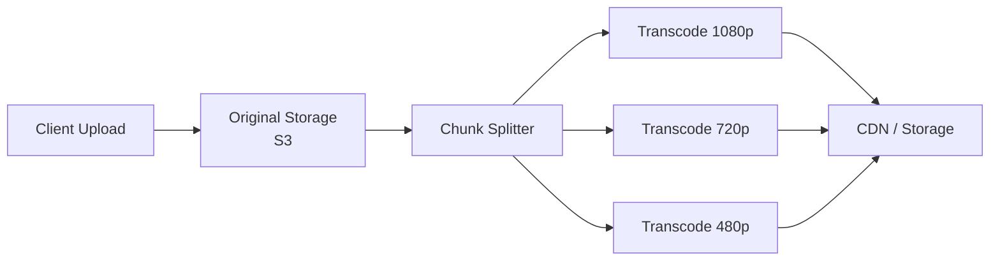

## Why a CDN

A CDN is a set of caches placed near users that serve the same bytes over and over, so the origin does not. Use one when three things are true together: the bytes are shared across users, those users are spread across regions, and the origin's latency or bandwidth is the limit you are cutting.

Skip it when every response is unique. A per-user feed, a checkout total, and an authenticated account page do not get faster by parking a copy in another city. Those stay on the application cache in Caching. A single-region product whose users already sit next to the origin gains little too: you would pay for an extra hop in front of a cache you could have kept in Redis.

In an interview, "static assets on a CDN" is the stage after the application cache, not a substitute for it. Say what is shared, who is far away, and which requests the origin stops seeing.

## Edge and Origin

The origin holds the source of truth: object storage, or the application that can build the response. An edge is a cache in one point of presence that holds a copy. The user talks to the edge. The edge talks to the origin only when it does not already have a fresh copy.

```text
Pull (the default):
  The first request in that PoP misses.
  The edge fetches from the origin, stores the object, and answers the user.
  Later requests in that PoP hit until the TTL ends.
  Cold objects cost nothing until someone asks.

Push:
  The origin uploads the object before anyone requests it.
  Use it for a premiere, a client release, or a file you know will be hot everywhere.
  You pay to fill edges that might never see a viewer.
```

A long catalog uses pull. Push is a scheduled bet that the object will be requested in many places at once. Ordinary video uploads later in this topic use pull. A premiere uses push.

## Cacheable and Dynamic

An edge may store a response only when a second user can safely receive the same bytes.

```text
Store at the edge:
  Images, CSS, JS, fonts, video segments, public thumbnails.
  A GET with Cache-Control: public, or an s-maxage the edge is allowed to keep.

Do not store at the edge:
  A response that depends on a cookie, an Authorization header, or the caller.
  Cache-Control: private or no-store.
  Feed JSON, a cart, an account balance.

A header that looks harmless can pin the wrong copy:
  Vary: Cookie makes almost every user a distinct object.
  A cache-buster query on a static file does the same.
```

Personalized HTML can still link to shared images. Serve the HTML from the application and the image from the edge. Mixing them is how a private page gets cached for the next visitor.

## CDN TTL

TTL is how long one edge may serve its copy before it revalidates or fetches again. It is a per-PoP lifetime on an HTTP object.

```text
Long TTL (hours or days):
  Immutable files, especially a name that contains a content hash.
  Nearly every request hits. The origin sees about one fetch per edge per TTL.

Short TTL (seconds):
  An object that changes in place and must not stay wrong for long.
  Fresher, and the origin sees proportionally more fetches.

s-maxage is the lifetime for a shared cache.
max-age is what the browser keeps.
Set them apart when the edge and the browser should not share one number.
```

A hot object requested at rate R, cached on E edges, with TTL T, produces about E / T origin fetches per second when each edge refreshes once per TTL and there is no shield. The hit ratio on that traffic is 1 minus misses divided by R. Raise T, or collapse E through a shield, when the origin is the thing falling over.

## Purge and Invalidation

TTL is the safety net: a purge you forget still expires. A purge deletes a URL from the edges before that timer. It is slower than it sounds, because every PoP has to hear it, and a PoP that misses the message keeps serving the old bytes until TTL.

Prefer a new URL for anything you can rename. `app.8f3a.js` with a multi-day TTL never needs a purge. The next deploy references the new name, and the old name ages out unused. Reserve the purge API for a URL that is part of a contract: `/terms`, `/latest.json`, a video manifest you overwrite in place.

```text
Hashed filename, long TTL:   no purge. The old URL dies by disuse.
Stable URL, must change now: purge that one URL, and keep a short TTL behind it.
Purge the whole zone:        a last resort. The next minute is a miss storm on the origin.
```

Name which of the two you are using. "We purge" without a URL scheme means the catalog is mutable and the origin has to survive a stampede of misses.

## PoPs and Placement

A point of presence is one cache site. DNS or anycast sends the user to a nearby one. The win is the round trip you removed, so a map that misses your users is an extra proxy in front of the origin.

```text
Where are the users, and is there a PoP in that region?
Where does a miss go? A PoP in São Paulo that fetches from Virginia
  still pays the long haul on every cold object.
Does one provider cover the region badly enough that you need a second?
A second origin region is a different decision. A CDN does not replace
  a multi-data-center design when the problem is writes or private data.
```

Coverage is a requirement you check. If the prompt's users are in one city next to the origin, say you would not add a CDN yet.

## Origin Shield

When a popular object expires, every edge can miss in the same second and call the origin. An origin shield is one designated mid-tier cache. Edges miss to the shield. Only the shield misses to the origin. Forty edge misses become one origin fetch, and the other thirty-nine are served from the shield.

```text
User → edge PoP → origin shield → origin

Use a shield when the origin is expensive or easy to overwhelm:
  object-storage GET cost, a small app tier, a store with a request cap,
  and many PoPs holding the same hot object.

Skip it when misses are rare. The shield is an extra hop on every cold
request, and a cold catalog does not repay that hop.
```

The shield protects the origin. It does not decide which titles deserve a copy in every city. That choice is the cost card below.

## Video Uploading and Transcoding

Uploaded videos must be split into chunks, transcoded into multiple resolutions and formats, and stored for streaming. This is the heaviest processing pipeline in most media systems.



```text
Processing pipeline:
  1. Client uploads video (resumable upload for large files).
  2. Store original in object storage (S3).
  3. Enqueue transcoding job (message queue).
  4. DAG scheduler breaks the job into stages:
     Split → Transcode (parallel per resolution) → Merge → Thumbnail → Metadata.
  5. Each variant stored in S3, registered in metadata DB.
  6. The edge pulls the variant on the first view in that PoP.
     A premiere is pushed ahead of time instead.

Resumable upload:
  Large videos (>1 GB) use chunked upload protocols (tus, GCS resumable).
  Client uploads in chunks; server tracks progress.
  If upload fails, resume from the last successful chunk.
```

## Adaptive Bitrate Streaming

The video player switches between quality levels based on network conditions, providing the best possible experience without buffering.

```text
How it works:
  1. Video is pre-transcoded into multiple bitrate variants:
     4K (15 Mbps), 1080p (5 Mbps), 720p (2.5 Mbps), 480p (1 Mbps).
  2. Each variant is split into small segments (2–10 seconds).
  3. A manifest file lists all segments and their URLs.
  4. Player downloads segments, measures throughput, and switches
     variant mid-stream based on available bandwidth.

Protocols:
  HLS (HTTP Live Streaming):  Apple's standard. .m3u8 manifest.
  DASH (Dynamic Adaptive Streaming over HTTP): industry standard. .mpd manifest.
  Both use HTTP — works with standard CDNs and caches.

Manifest example (simplified HLS):
  #EXTM3U
  #EXT-X-STREAM-INF:BANDWIDTH=5000000,RESOLUTION=1920x1080
  1080p/playlist.m3u8
  #EXT-X-STREAM-INF:BANDWIDTH=2500000,RESOLUTION=1280x720
  720p/playlist.m3u8
  #EXT-X-STREAM-INF:BANDWIDTH=1000000,RESOLUTION=854x480
  480p/playlist.m3u8
```

## CDN Cost Optimization

After the edge, the TTL, and the shield are chosen, the bill is which bytes you copy to every city and how fat those bytes are. A media catalog is skewed: a small slice of titles produces most of the watched bytes.

```text
Hot titles on every edge:
  Often about 10% of titles and most of the views.
  Long TTL. Push the object before a scheduled premiere.

Long tail off the full edge map:
  A title watched a few times a month does not earn a copy in every PoP.
  Serve it from the origin, or from the one regional shield.
  The hot set still uses the edges. Cold objects stop filling them.

Shield, not a second full copy:
  Edge → shield → origin, as in Origin Shield.
  The shield cuts origin fetches. It is not a reason to cache the long tail everywhere.

Smaller bytes:
  H.265 or AV1 at the same picture is often 30–50% fewer bytes than H.264.
  You spend encoding CPU to cut egress. A viewer who can take a lower rendition
  moves less data on the same edge.
```

## File Sync and Conflict Resolution

Cloud storage systems (Google Drive, Dropbox) keep files synchronized across devices. The hard part is handling concurrent edits to the same file from different devices.

```text
Sync architecture:
  1. Block-level storage:
     Files are split into chunks (4 MB blocks).
     Only changed blocks are uploaded/downloaded.
     Deduplication: identical blocks stored once.

  2. Metadata database:
     Tracks: file_id, version, block_list, modified_by, modified_at.
     Each edit creates a new version.

  3. Notification service:
     When a file changes, notify other devices via long-polling or WebSocket.
     "File X version 5 is available."

Conflict resolution:
  Same file edited on two devices while offline:
    Device A saves version 5a.
    Device B saves version 5b.
    On sync: conflict detected (both branched from version 4).

  Resolution strategies:
    Last-write-wins: keep the later timestamp. Simple but loses edits.
    Keep both: save as "file.txt" and "file (conflict).txt".
    Merge: for structured files (text), attempt automatic three-way merge.

  Most consumer products (Dropbox, Google Drive) keep both versions
  and let the user resolve manually.
```

## Image Processing and Optimization

Handling images at scale requires resizing, format conversion, and efficient serving — often on-the-fly.

```text
On-upload processing:
  Generate thumbnails (150px, 300px, 600px).
  Strip EXIF metadata (privacy, file size).
  Convert to WebP or AVIF for smaller file sizes.
  Store all variants in object storage.

On-the-fly processing:
  URL-based transformations:
    /images/photo.jpg?w=300&h=300&fit=crop&format=webp
  An image service (Cloudflare Images, imgix, Cloudinary) resizes at the edge
  and stores the result. The result is one more public object: its own URL and TTL.
  + No pre-generation of every size combination.
  - First request for each variant is slower.

Storage optimization:
  Progressive JPEG: renders low-quality first, then refines.
  Lazy loading: browser loads images only when scrolled into view.
  Responsive images:  serves the right size per device.
```
