## Why a CDN

A CDN is a set of caches placed near users that serve the same bytes over and over, so the origin does not. Use one when three things are true together: the bytes are shared across users, those users are spread across regions, and the origin's latency or bandwidth is the limit you are cutting.

Skip it when every response is unique. A per-user feed, a checkout total and an authenticated account page do not get faster from a copy parked in another city, so they stay on the application cache in Caching. A single-region product whose users already sit next to the origin gains little too. You would pay for an extra hop in front of a cache you could have kept in Redis.

In an interview, "static assets on a CDN" is the stage after the application cache, not a substitute for it. Say what is shared, who is far away, and which requests the origin stops seeing.

```text
shared bytes     images, scripts, video segments
spread users     viewers in several regions
origin limit     latency or bandwidth the edge removes
skip             unique responses, or users next to the origin
```

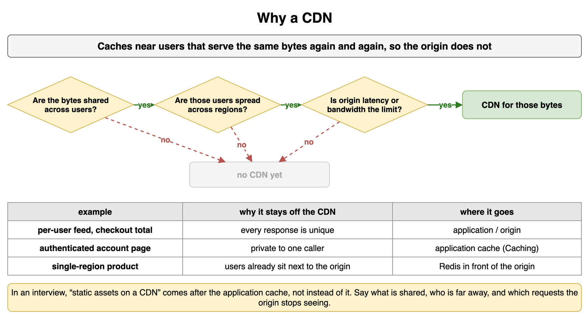

*Source: [`diagrams/content-distribution.drawio`](/content/09_System_Design_Interview/22_Content_Distribution_and_Media/diagrams/content-distribution.drawio), page 1.*

## Edge and Origin

The origin holds the source of truth: object storage, or the application that can build the response. An edge is a cache in one point of presence that holds a copy. The user talks to the edge, and the edge talks to the origin only when it does not already have a fresh copy.

Pull is the default. The first request in a PoP misses, the edge fetches from the origin, stores the object and answers the user, and later requests in that PoP hit until the TTL ends. A cold object costs nothing until someone asks for it, which is why a long catalog uses pull, including the ordinary video uploads later in this topic.

Push uploads the object before anyone requests it. It is a scheduled bet that the object will be requested in many places at once: a premiere, a client release, a file you know will be hot everywhere. You pay to fill edges that might never see a viewer.

```text
pull    first request in a PoP misses, then hits until TTL
push    the origin fills edges before the first request
pick    long catalog -> pull, premiere -> push
```

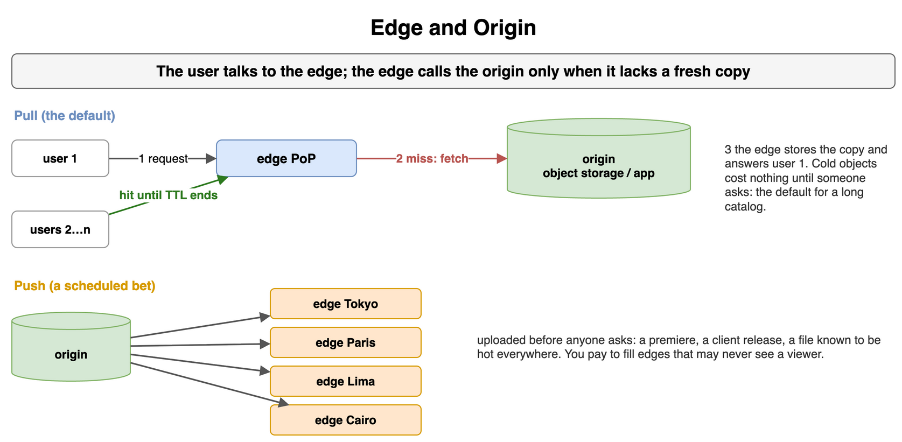

*Source: [`diagrams/content-distribution.drawio`](/content/09_System_Design_Interview/22_Content_Distribution_and_Media/diagrams/content-distribution.drawio), page 2.*

## Cacheable and Dynamic

An edge may store a response only when a second user can safely receive the same bytes. Images, CSS, JS, fonts, video segments and public thumbnails qualify, as does a GET with `Cache-Control: public` or an `s-maxage` the edge is allowed to keep. A response that depends on a cookie, an `Authorization` header or the caller does not, and neither does anything marked `private` or `no-store`. Feed JSON, a cart and an account balance stay off the edge.

A header that looks harmless can pin the wrong copy. `Vary: Cookie` makes almost every user a distinct object, and a cache-buster query on a static file does the same, so the edge stores many copies and hits almost none.

Personalized HTML can still link to shared images. Serve the HTML from the application and the image from the edge. Mixing them is how a private page gets cached for the next visitor.

```text
edge       public GETs: images, CSS, JS, fonts, segments
not edge   cookie, Authorization, private, no-store
trap       Vary: Cookie or a cache-buster query
split      personalized HTML from the app, shared images from the edge
```

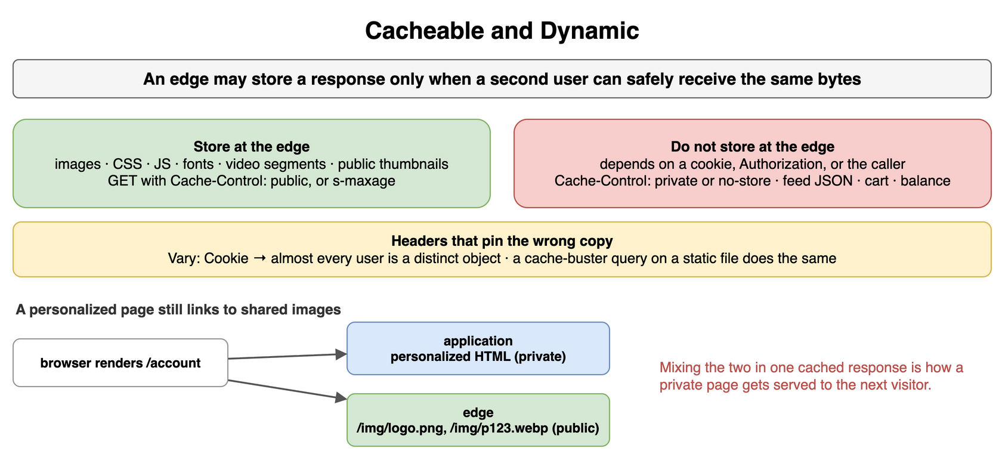

*Source: [`diagrams/content-distribution.drawio`](/content/09_System_Design_Interview/22_Content_Distribution_and_Media/diagrams/content-distribution.drawio), page 3.*

## CDN TTL

TTL is how long one edge may serve its copy before it revalidates or fetches again. It is a per-PoP lifetime on an HTTP object. A long TTL of hours or days suits immutable files, especially a name that contains a content hash: nearly every request hits, and the origin sees about one fetch per edge per TTL. A short TTL of seconds suits an object that changes in place and must not stay wrong for long. It is fresher, and the origin sees proportionally more fetches.

`s-maxage` is the lifetime for a shared cache, and `max-age` is what the browser keeps. Set them apart when the edge and the browser should not share one number.

A hot object requested at rate R, cached on E edges with TTL T, produces about E / T origin fetches per second when each edge refreshes once per TTL and there is no shield. The hit ratio on that traffic is 1 minus misses divided by R. When the origin is the thing falling over, raise T, or collapse E through a shield.

```text
long TTL    hashed, immutable files: ~1 fetch per edge per TTL
short TTL   in-place changes: fresher, more origin fetches
headers     s-maxage for the edge, max-age for the browser
origin      ~E / T fetches per second without a shield
```

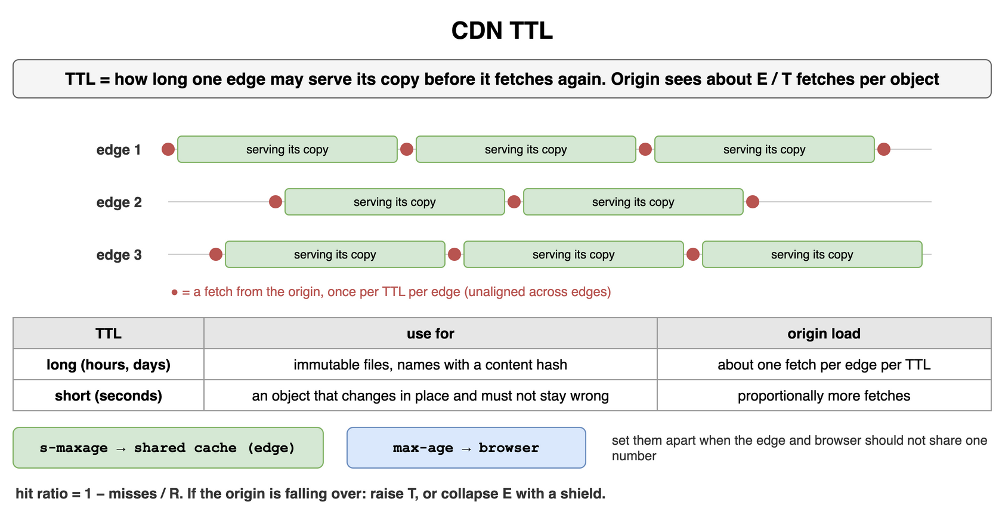

*Source: [`diagrams/content-distribution.drawio`](/content/09_System_Design_Interview/22_Content_Distribution_and_Media/diagrams/content-distribution.drawio), page 4.*

## Purge and Invalidation

TTL is the safety net: a purge you forget still expires. A purge deletes a URL from the edges before that timer. It is slower than it sounds, because every PoP has to hear it, and a PoP that misses the message keeps serving the old bytes until the TTL ends.

Prefer a new URL for anything you can rename. `app.8f3a.js` with a multi-day TTL never needs a purge. The next deploy references the new name, and the old name ages out unused. Reserve the purge API for a URL that is part of a contract, such as `/terms`, `/latest.json` or a video manifest you overwrite in place. Purge that one URL and keep a short TTL behind it. Purging the whole zone is a last resort, because the next minute is a miss storm on the origin.

Name which of the two you are using. "We purge" without a URL scheme means the catalog is mutable and the origin has to survive a stampede of misses.

```text
hashed name, long TTL     no purge, the old URL dies by disuse
stable URL, change now    purge that URL, short TTL behind it
whole zone                last resort, a miss storm follows
```

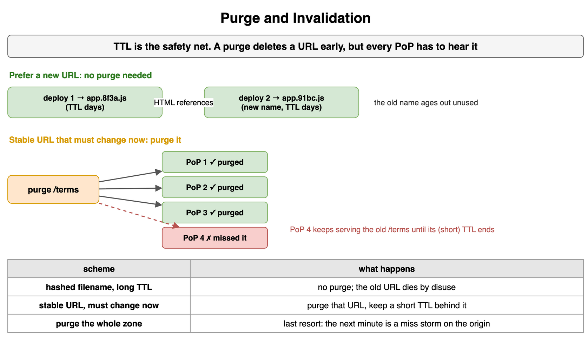

*Source: [`diagrams/content-distribution.drawio`](/content/09_System_Design_Interview/22_Content_Distribution_and_Media/diagrams/content-distribution.drawio), page 5.*

## PoPs and Placement

A point of presence is one cache site. DNS or anycast sends the user to a nearby one. The win is the round trip you removed, so a PoP map that misses your users is just an extra proxy in front of the origin.

Check coverage as a requirement. Where are the users, and is there a PoP in that region? Where does a miss go? A PoP in São Paulo that fetches from Virginia still pays the long haul on every cold object. Does one provider cover a region badly enough that you need a second? A second origin region is a different decision: a CDN does not replace a multi-data-center design when the problem is writes or private data.

If the prompt's users are in one city next to the origin, say you would not add a CDN yet.

```text
users      is there a PoP in their region?
misses     São Paulo -> Virginia still pays the long haul
providers  a second CDN for a badly covered region
origins    writes and private data need multi-region, not a CDN
```

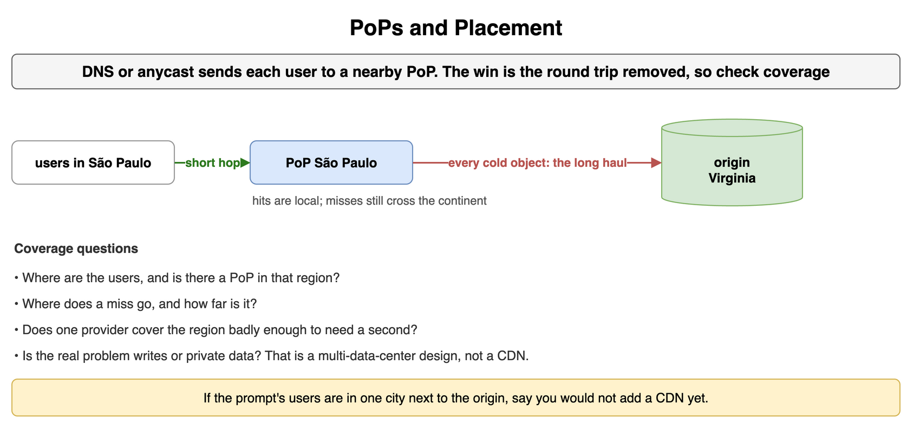

*Source: [`diagrams/content-distribution.drawio`](/content/09_System_Design_Interview/22_Content_Distribution_and_Media/diagrams/content-distribution.drawio), page 6.*

## Origin Shield

When a popular object expires, every edge can miss in the same second and call the origin. An origin shield is one designated mid-tier cache. Edges miss to the shield, and only the shield misses to the origin. Forty edge misses become one origin fetch, and the other thirty-nine are served from the shield.

Use a shield when the origin is expensive or easy to overwhelm: an object-storage GET cost, a small app tier, a store with a request cap, and many PoPs holding the same hot object. Skip it when misses are rare. The shield is an extra hop on every cold request, and a cold catalog does not repay that hop.

The shield protects the origin. It does not decide which titles deserve a copy in every city. That choice is CDN Cost Optimization.

```text
path    user -> edge PoP -> origin shield -> origin
win     40 edge misses -> 1 origin fetch
use     costly or fragile origin, one object hot on many PoPs
skip    rare misses, where the extra hop does not pay
```

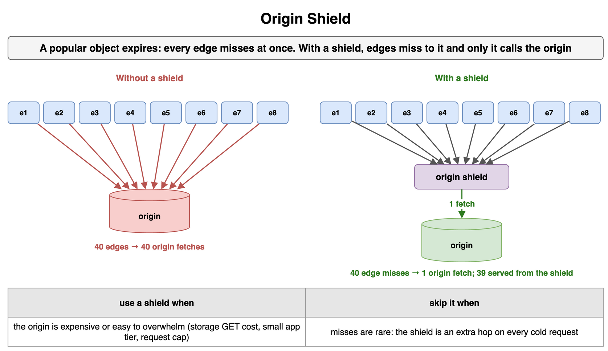

*Source: [`diagrams/content-distribution.drawio`](/content/09_System_Design_Interview/22_Content_Distribution_and_Media/diagrams/content-distribution.drawio), page 7.*

## Video Uploading and Transcoding

An uploaded video is split into chunks, transcoded into several resolutions and formats, and stored for streaming. This is the heaviest processing pipeline in most media systems. A large upload, over about 1 GB, uses a resumable protocol such as tus or a GCS resumable upload. The client sends chunks, the server tracks progress, and a failed upload resumes from the last chunk that arrived.

The original lands in object storage such as S3, and a transcoding job goes on a message queue. A DAG scheduler breaks the job into stages: split, transcode in parallel per resolution, merge, thumbnail, metadata. Each variant is stored in S3 and registered in the metadata database. The upload request returns long before the transcode finishes.

Delivery follows Edge and Origin. The edge pulls a variant on the first view in that PoP, and a premiere is pushed ahead of time instead.

```text
upload     resumable chunks for files over ~1 GB
store      original in object storage, job on a queue
DAG        split -> transcode per resolution -> merge -> thumbnail -> metadata
serve      variants in S3, pulled by the edge, pushed for a premiere
```

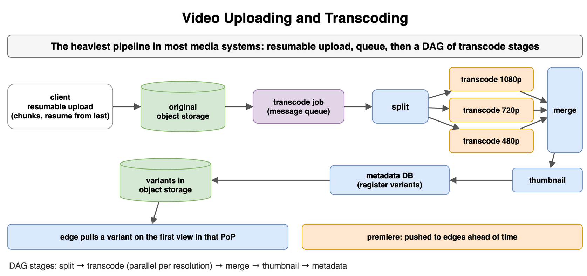

*Source: [`diagrams/content-distribution.drawio`](/content/09_System_Design_Interview/22_Content_Distribution_and_Media/diagrams/content-distribution.drawio), page 8.*

## Adaptive Bitrate Streaming

Adaptive bitrate streaming lets the video player switch between quality levels as the network changes, so the viewer gets the best picture the connection can hold without buffering. The video is transcoded ahead of time into several bitrate variants, such as 4K at 15 Mbps, 1080p at 5 Mbps, 720p at 2.5 Mbps and 480p at 1 Mbps. Each variant is split into segments of 2 to 10 seconds.

A manifest lists the variants and their segment URLs. The player downloads segments, measures throughput, and moves to a lower or higher variant between segments. HLS, Apple's standard, uses an `.m3u8` manifest. DASH, the industry standard, uses an `.mpd` manifest. Both run over plain HTTP, so every segment is an ordinary cacheable object on a standard CDN.

```text
#EXTM3U
#EXT-X-STREAM-INF:BANDWIDTH=5000000,RESOLUTION=1920x1080
1080p/playlist.m3u8
#EXT-X-STREAM-INF:BANDWIDTH=2500000,RESOLUTION=1280x720
720p/playlist.m3u8
#EXT-X-STREAM-INF:BANDWIDTH=1000000,RESOLUTION=854x480
480p/playlist.m3u8
```

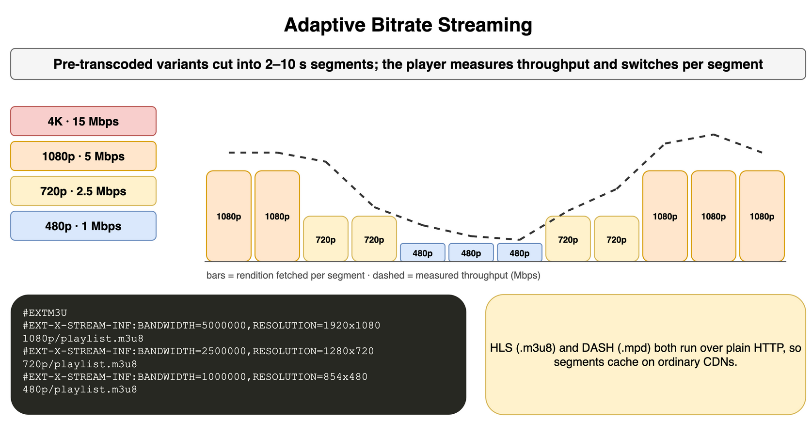

*Source: [`diagrams/content-distribution.drawio`](/content/09_System_Design_Interview/22_Content_Distribution_and_Media/diagrams/content-distribution.drawio), page 9.*

## CDN Cost Optimization

After the edge, the TTL and the shield are chosen, the bill comes down to which bytes you copy to every city and how big those bytes are. A media catalog is skewed. Often about 10% of titles produce most of the views. Those hot titles belong on every edge with a long TTL, and a scheduled premiere is pushed ahead of time.

The long tail stays off the full edge map. A title watched a few times a month does not earn a copy in every PoP, so serve it from the origin or from the one regional shield. The hot set still uses the edges, and cold objects stop filling them. The shield from Origin Shield cuts origin fetches. It is not a reason to cache the long tail everywhere.

The other lever is smaller bytes. H.265 or AV1 at the same picture quality is often 30 to 50% fewer bytes than H.264. You spend encoding CPU to cut egress, and a viewer who can take a lower rendition moves less data through the same edge.

```text
hot ~10%     every edge, long TTL, push before a premiere
long tail    origin or one shield, not every PoP
shield       cuts origin fetches, does not widen the edge set
codec        H.265 / AV1: often 30-50% fewer bytes than H.264
```

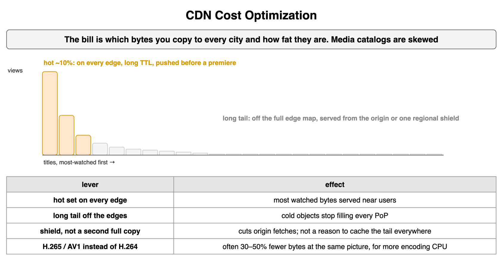

*Source: [`diagrams/content-distribution.drawio`](/content/09_System_Design_Interview/22_Content_Distribution_and_Media/diagrams/content-distribution.drawio), page 10.*

## File Sync and Conflict Resolution

Cloud storage such as Google Drive or Dropbox keeps files synchronized across devices. The hard part is two devices editing the same file at the same time. Files are split into 4 MB blocks, and only changed blocks are uploaded or downloaded. Identical blocks are stored once. A metadata database tracks `file_id`, version, block list, `modified_by` and `modified_at`, and each edit creates a new version. When a file changes, a notification service tells the other devices, over long polling or a WebSocket, that "file X version 5 is available."

The conflict case is two offline edits. Device A saves version 5a, device B saves version 5b, and on sync the service sees both branched from version 4. Last-write-wins keeps the later timestamp, which is simple and loses an edit. Keep-both saves `file.txt` and `file (conflict).txt`. Merge tries an automatic three-way merge, which works only for structured text. Most consumer products keep both versions and let the user resolve.

```text
blocks     4 MB, upload only changed blocks, dedupe identical ones
metadata   one new version per edit
notify     long poll or WebSocket: "version 5 is available"
conflict   5a and 5b from 4 -> last-write-wins, keep both, or merge
```

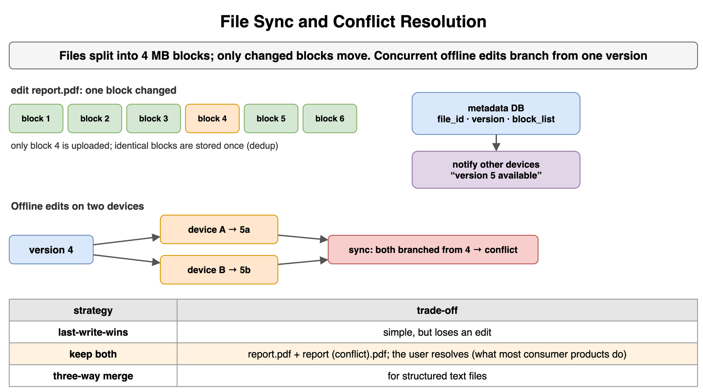

*Source: [`diagrams/content-distribution.drawio`](/content/09_System_Design_Interview/22_Content_Distribution_and_Media/diagrams/content-distribution.drawio), page 11.*

## Image Processing and Optimization

Images at scale need resizing, format conversion and efficient serving, often on the fly. Processing on upload generates fixed thumbnails at 150, 300 and 600 px, strips EXIF metadata for privacy and size, converts to WebP or AVIF, and stores every variant in object storage.

Processing on the fly encodes the transformation in the URL, such as `/images/photo.jpg?w=300&h=300&fit=crop&format=webp`. An image service such as Cloudflare Images, imgix or Cloudinary resizes at the edge and stores the result, which becomes one more public object with its own URL and TTL. Nothing has to pre-generate every size combination, and the first request for each variant is slower.

The browser side saves bytes too. A progressive JPEG renders a low-quality pass first and then refines. Lazy loading fetches an image only when it scrolls into view. Responsive images with `` serve the right size per device.

```text
on upload    thumbnails 150/300/600 px, strip EXIF, WebP/AVIF
on the fly   URL parameters -> resized object with its own URL and TTL
browser      progressive JPEG, lazy loading, srcset
```

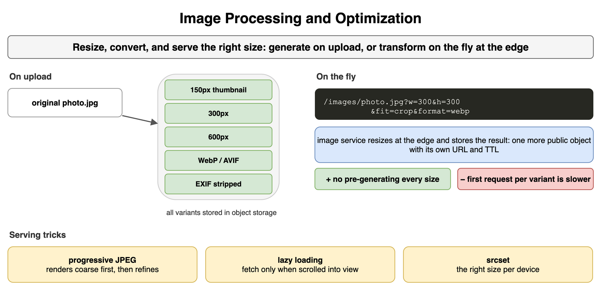

*Source: [`diagrams/content-distribution.drawio`](/content/09_System_Design_Interview/22_Content_Distribution_and_Media/diagrams/content-distribution.drawio), page 12.*
