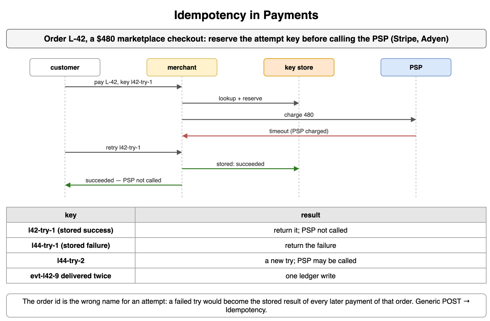
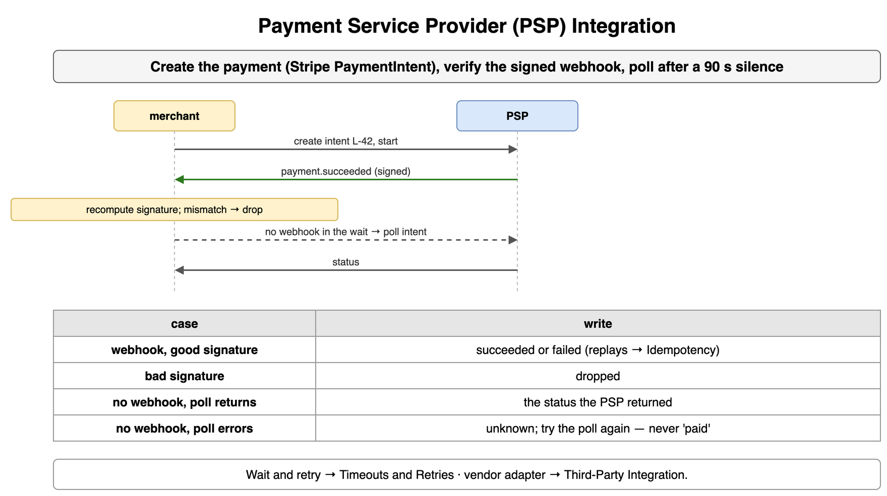
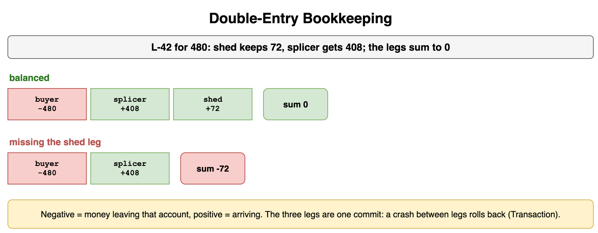
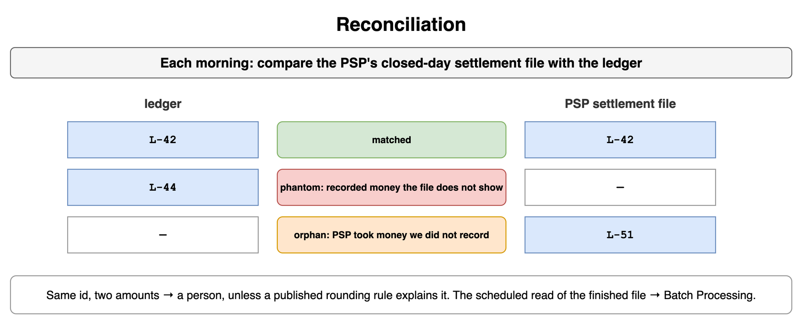
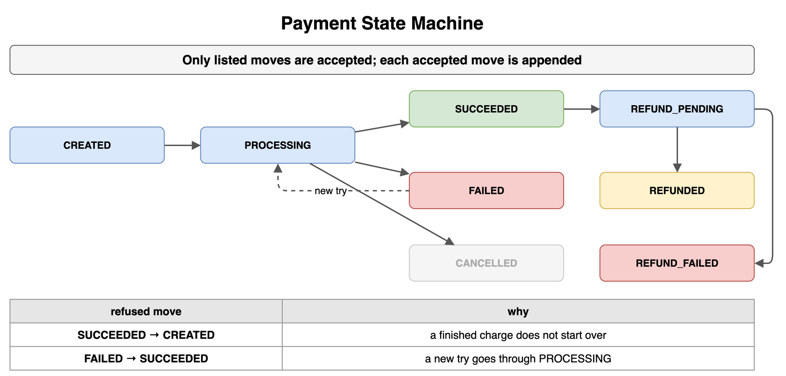
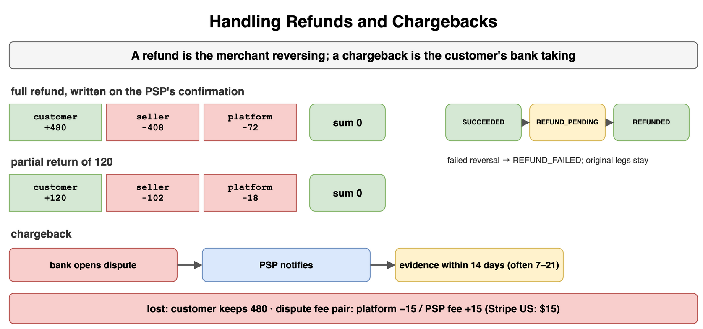
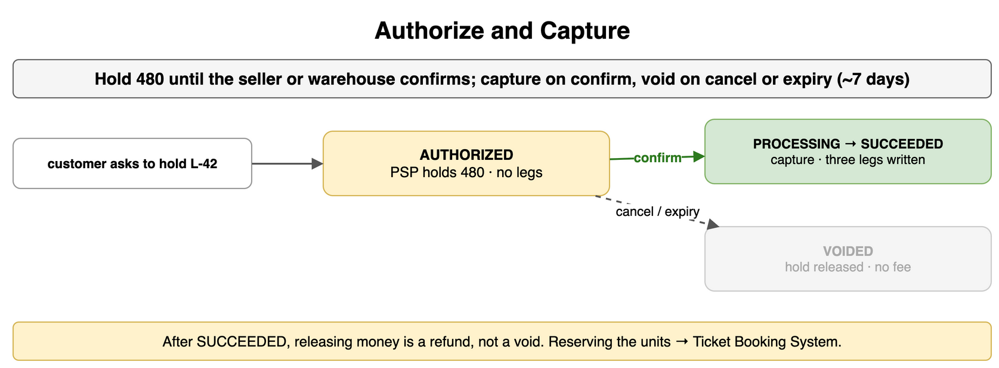

## Idempotency in Payments

An idempotency key names one payment attempt. A retry of that attempt returns the result already stored for the key, and it does not create a second charge. The call to the payment service provider can time out after the provider has already charged the card. The customer can double-click Pay, and a webhook can arrive twice. Each of those has to be the same attempt, with one ledger posting. Order L-42 is a $480 marketplace checkout, and the client mints one key for that click, `l42-try-1`.

The merchant looks the key up and reserves an in-progress row before it calls Stripe, Adyen or whichever PSP moves the money. A retry that finds a stored success or a stored failure returns it without calling the PSP. A retry that finds the row in progress keeps the same key, reads the PSP for that attempt and fills in the result. A timeout is an unknown outcome, so it keeps the original key. A decline the PSP actually executed is a finished attempt, so paying again is a new attempt with a new key: `l44-try-2` after `l44-try-1` failed. That is why the order id is the wrong key. Stored under the order id, the failure would be the result of every later payment of the order. On Stripe, a request rejected before execution, such as a malformed amount, can be retried with the same key once it is fixed. Stripe keeps an executed POST's result for at least 24 hours, rejects a different amount under a remembered key, and may start a new charge for a key reused after that window. The merchant's row outlives the PSP's cache.

Storing the key only after the PSP answers skips the in-progress row, and a crash in that gap charges the customer twice. A fresh key on every HTTP retry is the same second charge. A webhook that arrives twice for `evt-l42-9` is one event. The attempt key guards the charge, and the event id guards the ledger write. The generic meaning of a repeated POST is Idempotency in [Networking and Communication](../10_Networking_and_Communication/).

```text
l42-try-1 stored success    return it, no PSP call
l44-try-1 stored failure    return it, no PSP call
l44-try-2 no row            reserve, a new attempt may call the PSP
in progress after timeout   keep the key, read the PSP
evt-l42-9 delivered twice   write the ledger once
```



*Source: [`diagrams/payments.drawio`](/content/09_System_Design_Interview/23_Payment_and_Financial_Systems/diagrams/payments.drawio), page 1.*

## Payment Service Provider (PSP) Integration

A PSP such as Stripe or Adyen moves the money between the customer's card, the card network and the merchant. The merchant creates a payment, checks a signed webhook when it finishes, and polls when the webhook has not arrived. The merchant needs a durable answer to one question: was the $480 for order L-42 actually taken? The PSP holds the card number, the messages to Visa or Mastercard and the settlement, so the shop stores a payment id. The browser landing on a success page only says the customer came back to the shop.

The merchant creates the payment for 480 with the attempt key from Idempotency in Payments. Stripe calls this a PaymentIntent, and Adyen identifies it by your merchant reference. The PSP sends the authorization to the issuer, and some methods finish later, after a 3-D Secure challenge, a bank redirect or a wallet approval. The PSP then sends a webhook, `payment.succeeded` or `payment.failed` here. Stripe names them `payment_intent.succeeded` and `payment_intent.payment_failed`, and Adyen's AUTHORISATION notification carries a success flag. The handler recomputes the signature over the raw body with the endpoint secret and drops a mismatch. Stripe's libraries also reject a stale signature timestamp, which limits replay. Duplicate deliveries still need the event-id record.

In this example the merchant waits 90 seconds. With no webhook by then, it polls the PSP and writes the status returned. A poll that errors leaves the payment unknown and is tried again. Stripe retries a failing endpoint for up to about three days, so webhooks can be late, doubled or missing, and the poll closes that gap. The deadline and retry budget are Timeouts and Retries in [Distributed System Failure Modes](../15_Distributed_System_Failure_Modes/). The adapter that knows the PSP's URLs is Third-Party Integration in [Microservices and System Decomposition](../12_Microservices_and_System_Decomposition/). Connecting to the card networks yourself drops the fee and takes on PCI scope, scheme rules and issuer certification.

```text
webhook, signature matches    write its status, once per event id
signature mismatch            drop the delivery
no webhook in 90 s            poll, write what the PSP returns
poll errors                   unknown, poll again
success URL                   nothing about the money
```



*Source: [`diagrams/payments.drawio`](/content/09_System_Design_Interview/23_Payment_and_Financial_Systems/diagrams/payments.drawio), page 2.*

## Double-Entry Bookkeeping

Every posting is a set of legs whose signed amounts sum to 0. A negative amount is money leaving an account and a positive amount is money arriving. The ledger refuses a set that does not balance. A marketplace charge has to record three facts together: the customer paid 480, the seller is owed 408, and the marketplace keeps a fee of 72, which is 15% of 480. A single `balance += 480` can drop the fee, pay the seller the whole charge, or die after only one account has moved.

The three legs are customer −480, seller +408 and platform fee +72, written in one database commit, and they sum to 0. Customer −480 and seller +408 with the fee left out sum to −72, so the commit is refused for a missing leg. Seller +480 with no fee leg also sums to 0, and the check passes even though the seller got the marketplace's 72. So check the sum, then check the accounts. A crash between legs rolls the whole set back, because the inserts are one commit. That atomic write is a Transaction in [Transactions and Concurrency Control](../16_Transactions_and_Concurrency_Control/), where isolation and two-phase commit stay.

Accounting journals put debits and credits in two equal columns. This ledger stores one signed integer per leg, so the same rule reads `sum(legs) == 0`. A production book stores the minor unit, such as cents, so amounts cannot drift through floating point. On the marketplace's own journal the same economics are a debit to cash at the PSP for 480, a credit to seller payable for 408 and a credit to fee revenue for 72. That journal replaces the customer leg with the cash debit, and adding both would count 480 twice. Tax, shipping and a refund reserve are more legs under the same sum.

```text
customer −480, seller +408, platform +72   sum 0     correct
customer −480, seller +408                 sum −72   fee missing, refuse
customer −480, seller +480                 sum 0     balanced, wrong account
```



*Source: [`diagrams/payments.drawio`](/content/09_System_Design_Interview/23_Payment_and_Financial_Systems/diagrams/payments.drawio), page 3.*

## Reconciliation

Reconciliation compares the PSP's settlement file for a closed day with the merchant's ledger. It lists every payment that appears on only one side, and every payment whose two amounts disagree. Webhooks and polls are what the PSP said during the day. The settlement file is the set of payments in a payout to the merchant's bank. Stripe exposes it as balance transactions and payout reports, and Adyen as a settlement detail report. A missed webhook leaves the customer charged and the seller uncredited. A ledger row for a charge that never settled pays the seller from money the payout will not contain.

Each morning the merchant reads the file for the day that just closed and joins it to the ledger on payment id. L-42 is on both sides for 480, so it matches. L-51 is in the file and missing from the ledger. That is an orphan: the PSP took money the merchant has no row for. Confirm the id and amount with the PSP, then post the missing legs so the seller is credited. L-44 is in the ledger and missing from the file. That is a phantom. Hold the seller payout for it, and reverse the legs if a later file for the right day still lacks it. One id with two amounts waits for a person, unless a rounding rule the merchant already published explains the gap, such as a currency conversion rounded to the cent. 480 against 408 is a different split, and a person has to look.

A daily file lags by hours and matches the way these PSPs pay out, one closed batch at a time. Comparing on every webhook finds an orphan the same day, but the payout file is still the check against the bank. Automatically editing an amount mismatch would also "repair" a real fee bug. The scheduled read of a finished file is Batch Processing in [Storage and Data Processing at Scale](../13_Storage_and_Data_Processing_at_Scale/), and a payment that arrives during the run waits for the next file.

```text
L-42 in both, 480 = 480     match
L-51 file only              orphan: confirm, post the missing legs
L-44 ledger only            phantom: hold payout, reverse if still absent
same id, two amounts        a person looks, unless a published rounding rule
```



*Source: [`diagrams/payments.drawio`](/content/09_System_Design_Interview/23_Payment_and_Financial_Systems/diagrams/payments.drawio), page 4.*

## Payment State Machine

A charge has one current state. The handler accepts a move only when that pair of states is in the table, and it appends every accepted move so support can read why an order looks stuck. The expensive bugs are illegal jumps. A declined card gets marked succeeded because a later webhook was applied to the wrong row, or a captured charge is put back to CREATED and sent to the PSP again. One current state plus a list of accepted moves turns that jump into a refused write.

CREATED moves to PROCESSING when the merchant asks the PSP to take the money. PROCESSING moves to SUCCEEDED when the PSP reports success and the settled legs can be written, to FAILED on a decline, or to CANCELLED if the charge is stopped first. FAILED may return to PROCESSING only as a new attempt with a new idempotency key, and replaying the old key returns the stored decline. SUCCEEDED moves to REFUND_PENDING when the merchant asks for a refund, then to REFUNDED when the PSP confirms, or to REFUND_FAILED with the original legs kept. Every other pair is refused. SUCCEEDED → CREATED is refused because a finished charge stays finished. FAILED → SUCCEEDED is refused because only PROCESSING may become SUCCEEDED, so a late failure event for a SUCCEEDED charge is refused and looked at. A retry of the same attempt stays on PROCESSING with the original key. AUTHORIZED and VOIDED belong to Authorize and Capture, because a hold has not posted settled legs.

A free-form status string is a small column and gives support no edge to point at. A closed table is stricter. A 3-D Secure challenge, or a bank debit that clears on a later day, has to be mapped onto PROCESSING or given its own REQUIRES_ACTION state. A separate state makes the wait visible and is one more edge to draw.

```text
CREATED -> PROCESSING
PROCESSING -> SUCCEEDED | FAILED | CANCELLED
FAILED -> PROCESSING            new attempt, new key
SUCCEEDED -> REFUND_PENDING -> REFUNDED | REFUND_FAILED
refused: SUCCEEDED -> CREATED, FAILED -> SUCCEEDED
```



*Source: [`diagrams/payments.drawio`](/content/09_System_Design_Interview/23_Payment_and_Financial_Systems/diagrams/payments.drawio), page 5.*

## Handling Refunds and Chargebacks

A refund is the merchant asking the PSP to reverse a charge the merchant accepts. A chargeback is the customer's bank taking the funds back while the merchant may still stand behind the sale. Both can end with the customer holding the money again, but they start in different places, run on different clocks and write different ledger rows. One "reversed" flag for both will claw the seller back twice, or never post the dispute fee.

The customer returns order L-42. The merchant asks the PSP to reverse 480, and the charge moves to REFUND_PENDING. It moves to REFUNDED when the PSP confirms, or REFUND_FAILED with the original legs kept. The opposite legs are written once, on confirmation: customer +480, seller −408, platform −72, summing to 0. A partial refund of 120 uses the same 15% fee: customer +120, seller −102, platform −18. The customer's statement may take several business days, and the merchant's state is already REFUNDED.

A chargeback starts at the issuer. The PSP notifies the merchant and removes the 480 from the available balance while the case is open. The merchant sends evidence before the dispute's deadline: the receipt, proof of delivery and the customer messages. This example uses 14 days. Across networks the window is often 7 to 21 days, and the deadline on the PSP's dispute object is the one that counts. A win returns the 480, and a loss leaves it with the customer. The dispute fee, 15 here, is its own pair, platform −15 and PSP fee +15. On Stripe in the US, the $15 is taken when the dispute opens and generally stays taken after a win. Refund only while the order is undisputed, because a refund during an open dispute races the PSP's own movement. Who bears a lost 480 is a marketplace rule, and either posting still sums to 0. Append the new legs and keep the original 480, 408 and 72 rows as history.

```text
refund       merchant starts   opposite legs on PSP confirm   72 or 18 fee returns
chargeback   issuer starts     480 held while open            fee pair −15 / +15
failure      REFUND_FAILED, original legs stay | evidence due, or accept the loss
```



*Source: [`diagrams/payments.drawio`](/content/09_System_Design_Interview/23_Payment_and_Financial_Systems/diagrams/payments.drawio), page 6.*

## Authorize and Capture

Authorization places a hold on the customer's card. Capture turns that hold into a taken payment, and it is the moment the settled legs are written. A void releases the hold and books no fee. A marketplace often waits to take the $480 until the seller accepts the order, and a shop waits until the warehouse can ship, but the funds still have to be set aside. A digital good delivered on the success webhook can capture immediately.

The merchant asks the PSP to authorize 480, which on Stripe is a PaymentIntent with manual capture, and records AUTHORIZED. No customer, seller or fee legs are written: the hold reduces the customer's available funds, and the seller is not yet owed 408. When the seller accepts, the merchant asks the PSP to capture. The charge follows Payment State Machine through PROCESSING to SUCCEEDED, and the three settled legs are written on that success. If the customer cancels or the hold expires, the PSP releases the 480, the merchant records VOIDED, and no fee is booked. A release after SUCCEEDED is a refund.

Visa, Mastercard, American Express and Discover keep a customer-initiated online hold for about 7 days. A merchant-initiated Visa authorization lasts about 5 days. Hotels and rentals can get extended authorizations of up to about 30 days. The PSP returns a capture-by time for each charge. A row still AUTHORIZED past that time is a hold the bank already dropped, so record VOIDED and expect a late capture to fail. Capturing less than 480 is a partial capture, and the rest of the hold is released. Capturing more is overcapture, which only some card payments allow, within a limit the PSP reports. The reserved seat or stock is Ticket Booking System in [Classic Design Problems](../24_Classic_Design_Problems/). Tie the two at one point: capture succeeds, then confirm the stock, and capture fails or the hold expires, then release it.

```text
authorize 480        AUTHORIZED                no legs, hold on the card
capture              PROCESSING -> SUCCEEDED   −480 / +408 / +72
cancel or expiry     VOIDED                    no legs, no fee
after SUCCEEDED      refund path               opposite legs
```



*Source: [`diagrams/payments.drawio`](/content/09_System_Design_Interview/23_Payment_and_Financial_Systems/diagrams/payments.drawio), page 7.*
