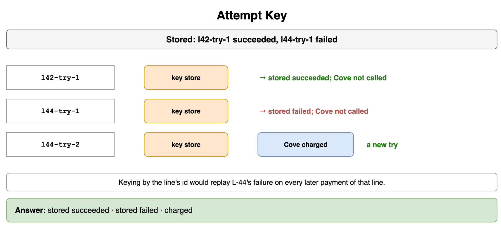
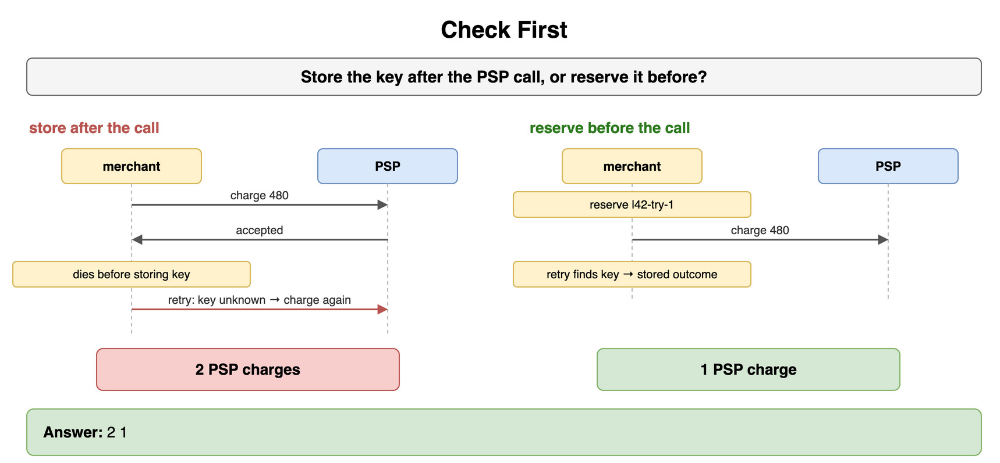
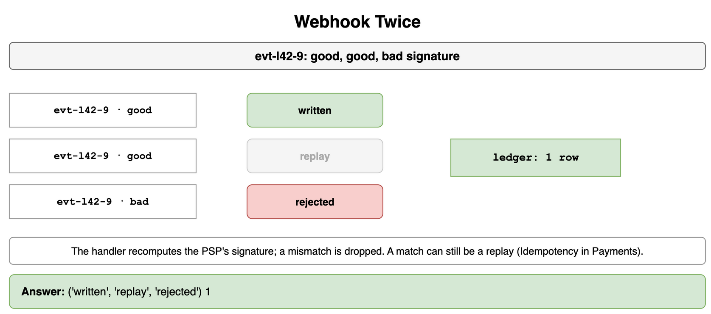
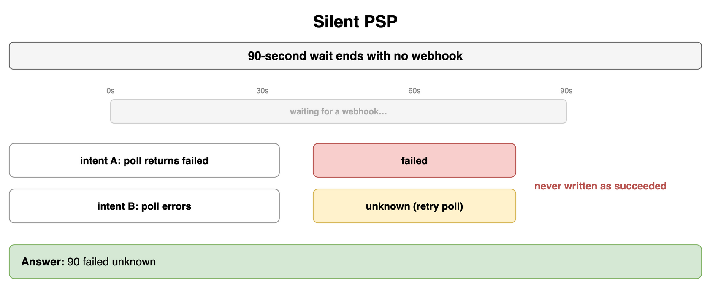
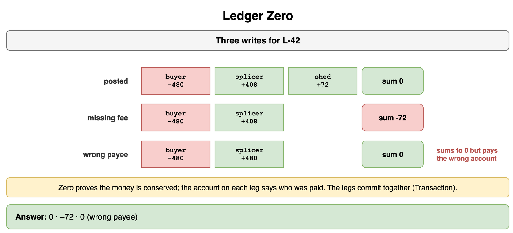
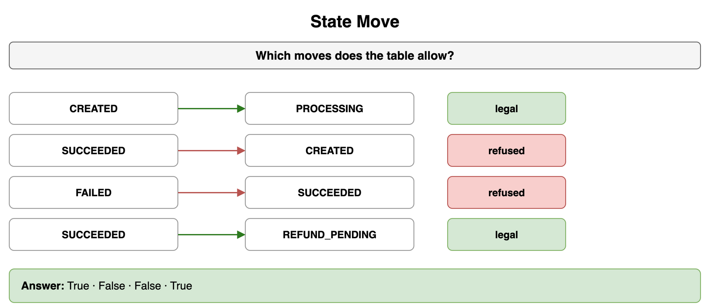
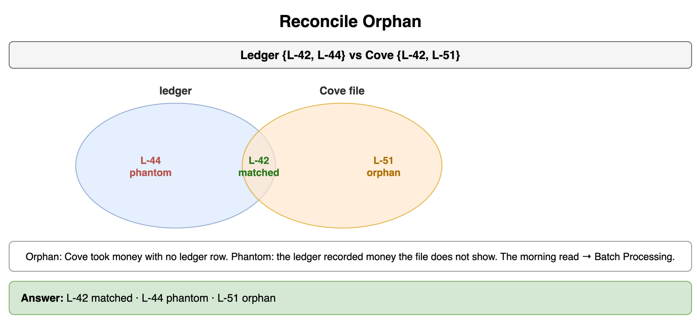
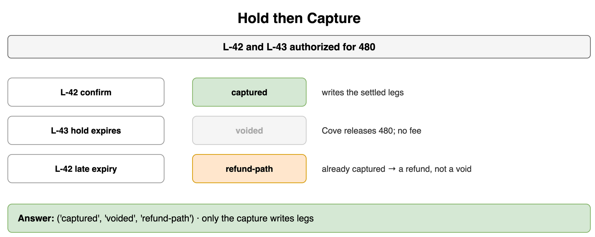

# Payment and Financial Systems — Drills

Original practice for an attempt key, a signed webhook, a ledger that sums to zero, and a hold that becomes a capture or a void. Each card is one exercise: commit to an answer, then check it. The numbers are for a marketplace checkout. The customer pays 480, the seller is credited 408, and the marketplace keeps a fee of 72. Stripe or Adyen stands in as the PSP, and the card networks stand behind that PSP. What a repeated POST means stays in Networking and Communication. The vendor adapter stays in Microservices and System Decomposition. The shape of the morning job stays in Storage and Data Processing at Scale. The wait and the retry stay in Distributed System Failure Modes. The atomic commit of the legs stays in Transactions and Concurrency Control. A reserved seat or unit of stock stays in Classic Design Problems.

## Attempt Key

Order L-42 succeeded under `l42-try-1`. Order L-44 was declined under `l44-try-1`. The customer sends `l42-try-1` again, then `l44-try-1` again, then starts a new payment as `l44-try-2`. Which calls charge the PSP, and which return a stored result?

```python
STORED = {"l42-try-1": "succeeded", "l44-try-1": "failed"}
CALLS = ("l42-try-1", "l44-try-1", "l44-try-2")
```

**Answer:** Only `l44-try-2` charges the PSP. `l42-try-1` returns the stored success. `l44-try-1` returns the stored decline, so that retry never reaches the PSP. The new key is a new attempt, and the merchant may charge it. Using the order id as the key would behave like the failed key: every later payment of L-44 would replay the decline. What a repeated POST means in general stays on Idempotency.

```python
STORED = {"l42-try-1": "succeeded", "l44-try-1": "failed"}
CALLS = ("l42-try-1", "l44-try-1", "l44-try-2")


def take(store: dict[str, str], key: str) -> tuple[str, str]:
    if key in store:
        return store[key], "stored"
    store[key] = "succeeded"
    return "succeeded", "charged"


store = dict(STORED)
print(tuple(take(store, key) for key in CALLS))
# (('succeeded', 'stored'), ('failed', 'stored'), ('succeeded', 'charged'))
```



*Source: [`diagrams/payments-drills.drawio`](/content/09_System_Design_Interview/23_Payment_and_Financial_Systems/diagrams/payments-drills.drawio), page 1.*

## Check First

One handler calls the PSP and stores `l42-try-1` afterward. It dies after the PSP has accepted the 480 and before that store. The customer retries the same key, and the retry completes the store. The other handler reserves the key and then calls the PSP. The retry finds the key. How many PSP charges does each handler produce?

```python
KEY = "l42-try-1"
```

**Answer:** The late store produces 2 charges. The first acceptance was real, the key was never written, and the retry called the PSP again. The early reserve produces 1 charge. The retry finds `l42-try-1` and returns the stored outcome. The lookup and the reserve happen before the PSP call. A key that is only in progress is resolved by reading the PSP for that same key, which is still one charge.

```python
KEY = "l42-try-1"


def psp_charges(reserve_first: bool) -> int:
    seen: set[str] = set()
    charges = 0
    for attempt in range(2):
        if KEY in seen:
            continue
        if reserve_first:
            seen.add(KEY)
        charges += 1
        if reserve_first or attempt == 1:
            seen.add(KEY)
    return charges


print(psp_charges(False), psp_charges(True))
# 2 1
```



*Source: [`diagrams/payments-drills.drawio`](/content/09_System_Design_Interview/23_Payment_and_Financial_Systems/diagrams/payments-drills.drawio), page 2.*

## Webhook Twice

The PSP delivers `evt-l42-9` twice with a valid signature, and once with a bad signature. How many ledger rows does the merchant keep for that event, and what does each delivery do?

```python
DELIVERIES = (
    ("evt-l42-9", "good"),
    ("evt-l42-9", "good"),
    ("evt-l42-9", "bad"),
)
```

**Answer:** One ledger row. The first good signature writes it. The second good signature finds the event already applied and writes nothing. The bad signature is dropped before any ledger write. The labels `good` and `bad` stand in for the comparison the handler actually does: recompute the PSP's signature from the raw body and the endpoint secret, and drop a mismatch. A matching signature can still be a replay, which is Idempotency in Payments.

```python
DELIVERIES = (
    ("evt-l42-9", "good"),
    ("evt-l42-9", "good"),
    ("evt-l42-9", "bad"),
)


def accept(seen: set[str], event_id: str, signature: str) -> str:
    if signature != "good":
        return "rejected"
    if event_id in seen:
        return "replay"
    seen.add(event_id)
    return "written"


seen: set[str] = set()
print(
    tuple(accept(seen, event_id, signature) for event_id, signature in DELIVERIES),
    len(seen),
)
# ('written', 'replay', 'rejected') 1
```



*Source: [`diagrams/payments-drills.drawio`](/content/09_System_Design_Interview/23_Payment_and_Financial_Systems/diagrams/payments-drills.drawio), page 3.*

## Silent PSP

The merchant waits 90 seconds. The wait ends with no webhook. A poll of the PSP for that payment returns failed. A second payment also has no webhook, and its poll errors. What does the merchant write in each case?

```python
WAIT_S = 90
CASES = ((None, "failed"), (None, None))
```

**Answer:** The first payment is failed, the status the PSP returned. The second stays unknown. Succeeded is written only when the PSP reports succeeded, which neither of these reads did. A missing webhook leaves the charge unknown. The merchant polls, writes what the PSP reports, and tries the poll again when the poll itself fails. The 90-second deadline and that retry stay on Timeouts and Retries.

```python
WAIT_S = 90
CASES = ((None, "failed"), (None, None))


def settle(webhook: str | None, polled: str | None) -> str:
    if webhook is not None:
        return webhook
    if polled is not None:
        return polled
    return "unknown"


print(WAIT_S, *(settle(hook, polled) for hook, polled in CASES))
# 90 failed unknown
```



*Source: [`diagrams/payments-drills.drawio`](/content/09_System_Design_Interview/23_Payment_and_Financial_Systems/diagrams/payments-drills.drawio), page 4.*

## Ledger Zero

Order L-42 is posted as customer −480, seller +408, platform fee +72. A second write drops the fee leg. A third write pays the seller +480 and has no fee leg. Which writes sum to 0, and which of those still pays the wrong account?

```python
LEGS = (("customer", -480), ("seller", 408), ("platform", 72))
MISSING_FEE = (("customer", -480), ("seller", 408))
WRONG_PAYEE = (("customer", -480), ("seller", 480))
```

**Answer:** The posted split sums to 0. The missing fee leg sums to −72, and that write is refused. Paying the seller the whole 480 also sums to 0. The zero check shows that the legs conserve the money. The account on each leg shows who was paid. The three posted legs commit together. That atomic write is a Transaction. Isolation and lock order stay on that card.

```python
LEGS = (("customer", -480), ("seller", 408), ("platform", 72))
MISSING_FEE = (("customer", -480), ("seller", 408))
WRONG_PAYEE = (("customer", -480), ("seller", 480))


def net(legs: tuple[tuple[str, int], ...]) -> int:
    return sum(amount for _name, amount in legs)


print(net(LEGS), net(MISSING_FEE), net(WRONG_PAYEE))
# 0 -72 0
```



*Source: [`diagrams/payments-drills.drawio`](/content/09_System_Design_Interview/23_Payment_and_Financial_Systems/diagrams/payments-drills.drawio), page 5.*

## State Move

Which of these moves are legal? CREATED to PROCESSING, SUCCEEDED to CREATED, FAILED to SUCCEEDED, and SUCCEEDED to REFUND_PENDING.

```python
MOVES = (
    ("CREATED", "PROCESSING"),
    ("SUCCEEDED", "CREATED"),
    ("FAILED", "SUCCEEDED"),
    ("SUCCEEDED", "REFUND_PENDING"),
)
```

**Answer:** CREATED to PROCESSING is legal. SUCCEEDED to CREATED is refused: a finished charge stays finished. FAILED to SUCCEEDED is refused: a new attempt goes FAILED to PROCESSING, and only PROCESSING may become SUCCEEDED. SUCCEEDED to REFUND_PENDING is legal, and a refund starts there. The handler refuses any pair the table does not list.

```python
LEGAL = {
    "CREATED": ("PROCESSING",),
    "PROCESSING": ("SUCCEEDED", "FAILED", "CANCELLED"),
    "FAILED": ("PROCESSING",),
    "SUCCEEDED": ("REFUND_PENDING",),
    "REFUND_PENDING": ("REFUNDED", "REFUND_FAILED"),
}
MOVES = (
    ("CREATED", "PROCESSING"),
    ("SUCCEEDED", "CREATED"),
    ("FAILED", "SUCCEEDED"),
    ("SUCCEEDED", "REFUND_PENDING"),
)


def allowed(src: str, dst: str) -> bool:
    return dst in LEGAL.get(src, ())


print(*(allowed(src, dst) for src, dst in MOVES))
# True False False True
```



*Source: [`diagrams/payments-drills.drawio`](/content/09_System_Design_Interview/23_Payment_and_Financial_Systems/diagrams/payments-drills.drawio), page 6.*

## Reconcile Orphan

The PSP's closed-day settlement file contains orders L-42 and L-51. The ledger contains L-42 and L-44. Which order is the orphan, and which order is the phantom?

```python
LEDGER = {"L-42", "L-44"}
PSP_FILE = {"L-42", "L-51"}
```

**Answer:** L-51 is the orphan: the PSP took the money and the ledger has no row. L-44 is the phantom: the ledger recorded a charge the file does not show. L-42 is in both, so it matches. The morning read of that finished file is Batch Processing. Which side is missing is the rule on this card.

```python
LEDGER = {"L-42", "L-44"}
PSP_FILE = {"L-42", "L-51"}


def classify(line: str) -> str:
    in_ledger = line in LEDGER
    in_psp = line in PSP_FILE
    if in_psp and not in_ledger:
        return "orphan"
    if in_ledger and not in_psp:
        return "phantom"
    return "matched"


print(*(f"{line}:{classify(line)}" for line in ("L-42", "L-44", "L-51")))
# L-42:matched L-44:phantom L-51:orphan
```



*Source: [`diagrams/payments-drills.drawio`](/content/09_System_Design_Interview/23_Payment_and_Financial_Systems/diagrams/payments-drills.drawio), page 7.*

## Hold then Capture

Orders L-42 and L-43 are authorized for 480 while the warehouse checks that the units can ship. The buyer of L-42 confirms. The hold on L-43 expires. A later expiry notice arrives for L-42, which is already captured. What is each result, and which result writes the settled legs?

```python
HOLDS = {"L-42": "authorized", "L-43": "authorized"}
STEPS = (("L-42", "confirm"), ("L-43", "expire"), ("L-42", "expire"))
```

**Answer:** Confirm captures L-42, and that is the result that writes the settled legs. Expiry voids L-43: the PSP releases the 480, and no fee is booked. The late expiry on L-42 is a refund. The capture already took the money, and giving it back is Handling Refunds and Chargebacks. The unit of stock held during the authorization is Ticket Booking System. This card is the money.

```python
HOLDS = {"L-42": "authorized", "L-43": "authorized"}
STEPS = (("L-42", "confirm"), ("L-43", "expire"), ("L-42", "expire"))


def apply(holds: dict[str, str], line: str, event: str) -> str:
    if holds[line] == "captured":
        return "refund-path"
    if event == "confirm":
        holds[line] = "captured"
        return "captured"
    holds[line] = "voided"
    return "voided"


results = tuple(apply(HOLDS, line, event) for line, event in STEPS)
print(results, tuple(name == "captured" for name in results))
# ('captured', 'voided', 'refund-path') (True, False, False)
```



*Source: [`diagrams/payments-drills.drawio`](/content/09_System_Design_Interview/23_Payment_and_Financial_Systems/diagrams/payments-drills.drawio), page 8.*
