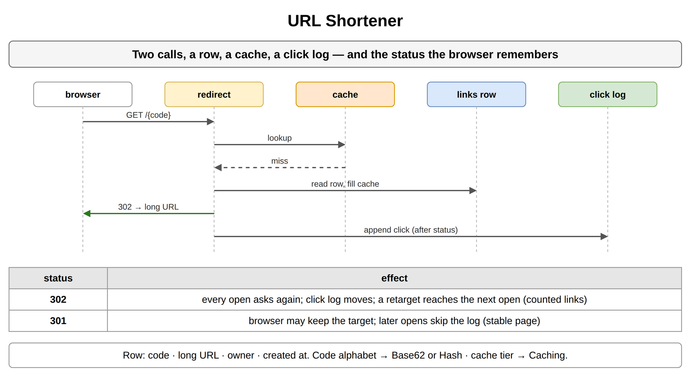
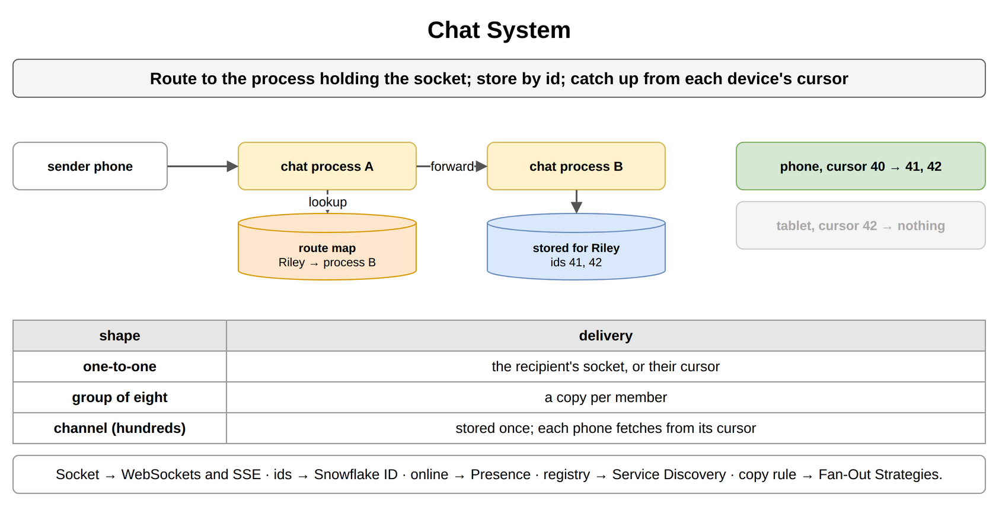
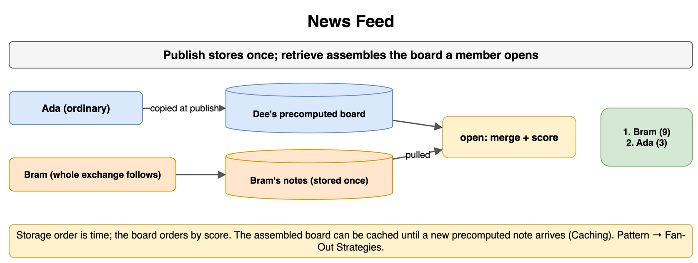
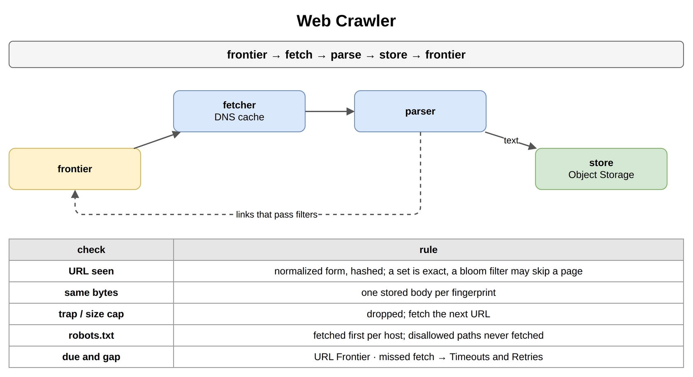
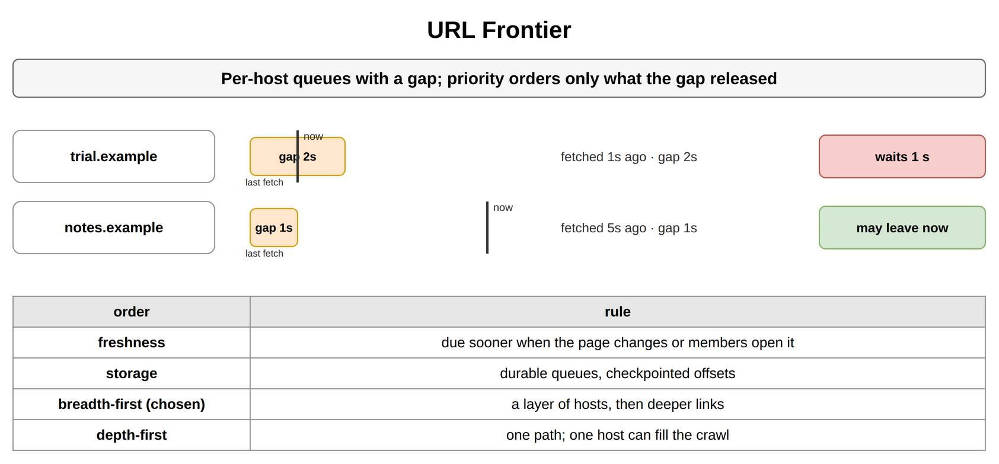
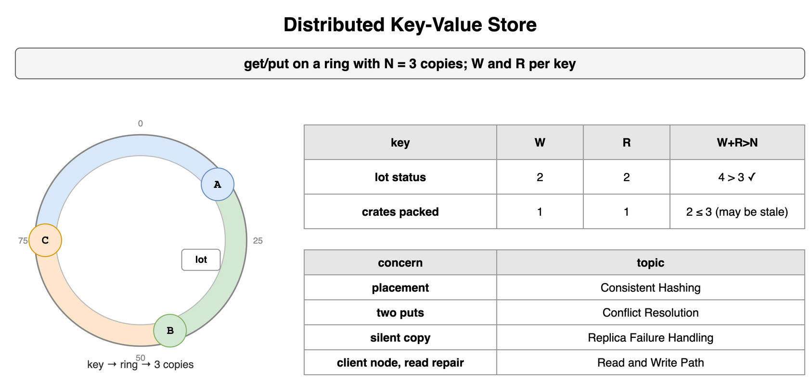
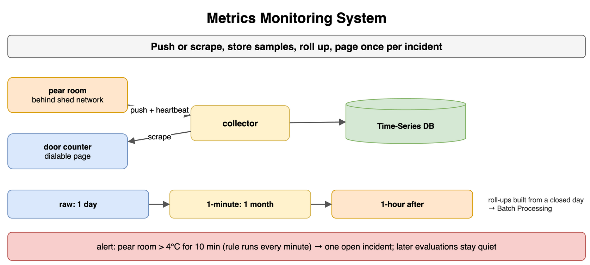
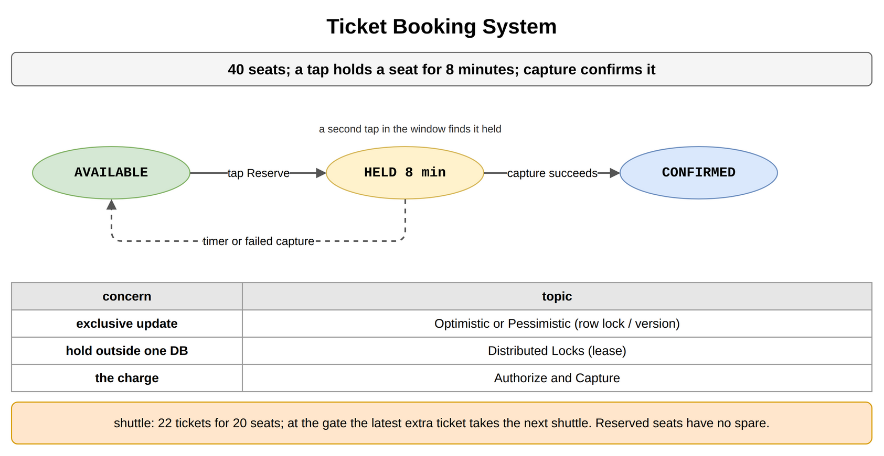
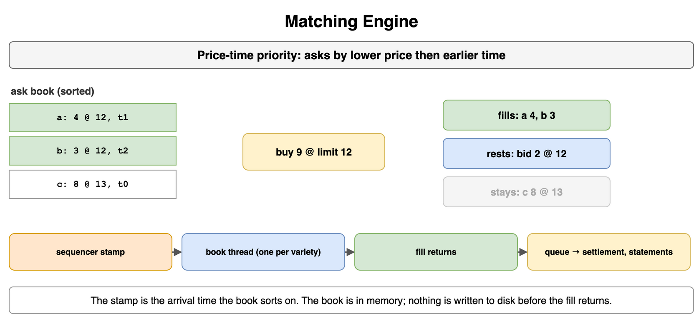

## URL Shortener

A URL shortener turns a long URL into a short code and sends the browser to the long URL when that code is opened. The product shape is the one people know from bit.ly: one call creates the code, and one call redirects.

The long URL is awkward to print, paste, or fit in a message. The short code is the public name. The service still has to count opens when the product owner wants a click log, and it has to send people to a new target when a campaign changes, without handing out a new code.

**Requirements.** Create a link, redirect it, and optionally record the click. Redirects dominate creates. A create is rare and can take tens of milliseconds. A redirect should finish in a few milliseconds after the cache hop. Codes stay valid for years unless the owner sets an expiry.

**Estimate.** Assume 50 million new links a month, 80 redirects per new link, a 4× peak, 500 bytes per stored row, and 3 years of retention. A 30-day month has about 2.6 million seconds, so creates average about 20 per second and peak near 80. Redirects average about 1,600 per second and peak near 6,400. Three years is 1.8 billion rows, about 1 TB at 500 bytes each. That is one database with room to spare, plus a cache in front of the read path. The fleet shows up because the redirect has to stay up, not because 6,400 reads per second need hundreds of machines.

**Flow.** `POST /links` takes the long URL and returns the code. The row stores the code, the long URL, the owner, and the time it was created. An optional expiry and a disabled flag live on that same row. `GET /{code}` looks the code up in a shared cache. A miss reads the row and fills the cache. The handler then chooses the status and returns. The click, with the code, the time, and the referrer, is appended after that choice, so the browser waits on the lookup and the status. A lost click is an analytics gap. It is acceptable here because the redirect already happened.

**Decisions.** The code is either a counter written in base 62 or a hash prefix in that alphabet. Six characters cover 62^6, about 57 billion codes, so a counter needs 6 characters for 1.8 billion links and never collides. A random prefix does collide. In a 7-character space (about 3.5 trillion slots) the chance of some unchecked collision reaches about 50% at a bit over 2 million codes. The hash path looks the candidate up and, on a collision, salts again or keeps one more character. At 1.8 billion stored links that 7-character space is about 0.05% full, so a new salt almost always hits a free slot. The alphabet, the counter, and that retry are Base62 or Hash in [Unique ID Generation](../19_Unique_ID_Generation/). The shared cache, eviction, and a stampede on one hot code are [Caching](../05_Caching/). A create limit stops a client from minting the keyspace. That limiter is [Rate Limiting and Throttling](../17_Rate_Limiting_and_Throttling/).

**Trade-offs.** A 302 tells the browser the mapping is temporary. Browsers ask again on the next open unless the response sets an explicit cache lifetime, so the click log moves and a changed long URL is what the next open receives. A 301 tells the browser the mapping can be stored. Later opens can go straight to the long URL, those opens miss the log, and a retarget stays behind the stored copy. Counted campaign links use 302. A stable page that the product does not count, such as an about page, uses 301. A 307 is the method-preserving temporary redirect. Short links are opened with GET, so 302 is the status this design returns.

**In an interview.** Say the two calls, the row, and the cache first. Then pick 302 or 301 from whether the product counts clicks or may retarget. Put the click write after the response decision. Name the code scheme and point at the id topic for the alphabet.

**Recap.**

- Create returns a code. Redirect returns the long URL and a status.
- The redirect path is almost all reads: cache, then the row, then fill.
- 302 keeps every open on the shortener. 301 lets the browser skip it.
- The row holds the code, the long URL, the owner, and the created time.
- The click log is code, time, and referrer, written after the status is chosen.
- A counter in base 62 is short and unique. A hash prefix needs a collision check.

*Source: [`diagrams/classic-problems.drawio`](/content/09_System_Design_Interview/24_Classic_Design_Problems/diagrams/classic-problems.drawio), page 1.*

## Chat System

A chat system delivers a message to a person, a small group, or a large channel, including devices that were offline when it was sent. The product shape is WhatsApp: a phone holds a live connection, a second device has its own place in the history, and a message waits when nobody is connected.

People expect a message to show up on the device that is open, and to appear later on the device that was in a pocket. The server that accepted one phone's connection is not the server that holds the recipient's connection. Offline time can be hours. A retry from a flaky network must not insert the same message twice.

**Requirements.** One-to-one messages, groups of about 8, and channels with hundreds of members. Delivery to an online socket within a small fraction of a second on the same continent. Durable history. Each device catches up from the last message it applied. A user can be online on one device and offline on another.

**Estimate.** Assume 15 million people active in a day, 30 messages sent per person, a 4× evening peak, and 8% of those people connected at the peak. Sends average about 5,200 per second and peak near 21,000. The peak is 1.2 million open sockets. At about 8,000 sockets per chat server, that is about 150 servers. One stored copy at 250 bytes is 450 million messages a day, about 110 GB a day, about 41 TB a year. The copy-per-member choice below multiplies the bytes for small groups. It does not multiply them for a large channel.

**Flow.** A signed-in phone opens a connection the server can write on. The upgrade, the frames, and the fact that the socket stays on the process that accepted it are WebSockets and SSE in [Networking and Communication](../10_Networking_and_Communication/). The chat tier keeps a map from user to the process that holds that socket. A message from one person to another looks up the recipient's process and forwards the frame. How a caller learns the current address of that process is Service Discovery in [Microservices and System Decomposition](../12_Microservices_and_System_Decomposition/).

The message is stored under the recipient, ordered by message id. Those ids are Snowflake ID in [Unique ID Generation](../19_Unique_ID_Generation/), so order follows the id. Each device remembers the last id it applied. On reconnect it sends that cursor and receives the ids after it. A phone whose cursor is 40, with 41 and 42 stored, receives 41 then 42. A tablet whose cursor is already 42 receives nothing. A retried frame whose id is already applied is dropped.

Whether the recipient counts as online, and the heartbeat behind that mark, are Presence in [Real-Time and Notification Systems](../21_Real_Time_and_Notification_Systems/). This product uses the mark to choose a live socket or the mailbox.

**Decisions.** A one-to-one message has one recipient. The server writes it to that socket or, with no socket, leaves it for that recipient's cursor. A group of eight keeps a copy in each member's history, so opening the group reads one member's own rows. A channel with hundreds of members stores the message once, and each phone fetches from its own cursor. Copying at send time or at read time is Fan-Out Strategies in [Real-Time and Notification Systems](../21_Real_Time_and_Notification_Systems/). Eight copies are a small write and a cheap read. A channel of hundreds stores the message once, because most of those members are offline and would not read a copy written at send time.

**Trade-offs.** A copy per member makes the inbox one query and makes a send more expensive as the group grows. One shared log stays cheap to write and makes every reader scan or index from a cursor. Sticky connections make fan-out a routing problem. A design that keeps no routing table can only reach a user by publishing on a bus every server listens to, which turns one message into work on all 150 servers. The cursor makes reconnect exact. A "last 50 messages" pull is simpler and can duplicate or skip when two devices disagree.

**In an interview.** Draw the socket pinned to one process, the user-to-process map, and the mailbox ordered by id. Then split the product into one recipient, a small group copied at send time, and a large channel stored once. Say the cursor out loud with two devices on different ids.

**Recap.**

- The socket stays on the process that accepted it, so delivery is a lookup in the route map.
- Messages are stored under the recipient and ordered by snowflake id.
- Each device catches up with the ids after its cursor, and an id already applied is dropped.
- One-to-one writes one recipient. A group of eight writes a copy per member.
- A channel of hundreds stores one copy, and each device reads from its cursor.
- Presence decides online. Service discovery finds the process. Fan-out is the copy rule.

*Source: [`diagrams/classic-problems.drawio`](/content/09_System_Design_Interview/24_Classic_Design_Problems/diagrams/classic-problems.drawio), page 2.*

## News Feed

A news feed shows a person the posts published by accounts they follow. Publish and retrieve are different calls. The product shape is a Twitter or Facebook home feed: one post is written once, and opening the app returns a ranked page.

The follower list is large, and most accounts have a modest audience. A few accounts are followed by millions. Copying every post into every follower's page at publish time melts on those accounts. Building every page from scratch at read time melts on the open rate. The feed also has an order that is time in storage and a score on the screen.

**Requirements.** Publish a post once. Return a page of posts when someone opens the feed. Ordinary accounts should not make the open call scan every follow. A post from an account with a huge audience should not write one row per follower. The page can rank a timely post ahead of an older one. The next open for the same person should be able to skip the merge.

**Estimate.** Assume 40 million people active in a day, 8 feed opens each, a 3× peak, and 5% of them publishing once. Opens average about 3,700 per second and peak near 11,000. Posts average about 23 per second. An ordinary account has 150 followers, and those copies are written at publish time: about 3,500 inbox writes per second. One account with 5 million followers is a single post of 5 million writes, about 24 minutes of that ordinary fan-out. That post is the one this design does not copy.

**Flow.** Publish stores the post once, with its author and its time. For an author under the cutoff, a worker then appends a reference into each follower's precomputed inbox. For an author at or above the cutoff, the worker stops after the single stored post. This design puts the cutoff at 5,000 followers. One post at that size is about 5,000 inbox writes, roughly a second and a half of the ordinary fan-out, which is the spike this design refuses to take on the write path.

Retrieve loads the reader's precomputed inbox, pulls posts from the huge accounts they follow that are not already in that inbox, and merges. Storage order is time. The page order is a score applied at assembly, so a post about an event happening today can sort ahead of an older post with a lower score. In the small case, an ordinary post scored 3 and a celebrity post scored 9 come back celebrity first.

The assembled page can sit in a cache under the reader, so the next open skips the merge. A new post from an account in the precomputed set is the event that drops that cache entry. Eviction and a stampede on a hot page are [Caching](../05_Caching/). The copy-at-write versus copy-at-read rule is Fan-Out Strategies in [Real-Time and Notification Systems](../21_Real_Time_and_Notification_Systems/).

**Decisions.** Hybrid fan-out is the design. Ordinary posts are paid for at publish, when 150 writes are cheap. Huge-account posts are paid for at read, and only by people who actually open the feed. Ranking runs at assembly, on the merged set, so a score can use recency and the kind of post. The cache holds the assembled page, not the raw follow graph.

**Trade-offs.** Copy-on-write makes the open call a single inbox read and makes a celebrity post a write storm. Copy-on-read makes publish a single insert and makes every open scan the follow list. The hybrid pays the cheap writes and refuses the expensive ones. Ranking at read can put a new post under a cached page until that entry is dropped. Ranking at write freezes the score before later signals exist. A purely chronological feed skips the score and is the right product when the promise is "latest," which is a different screen from a ranked home feed.

**In an interview.** Separate publish from retrieve. Name the follower cutoff and the arithmetic that justifies it. Then say the open call merges the precomputed inbox with the pulled posts, sorts by score, and may cache that page until a new precomputed post arrives.

**Recap.**

- Publish stores the post once. Retrieve returns the page a person opens.
- Ordinary accounts are copied into follower inboxes at publish.
- An account followed by a huge audience is stored once and pulled at read.
- This design flips at 5,000 followers. A 5 million follower post would be about 24 minutes of ordinary fan-out.
- Storage order is time. The page order is a score applied when the page is assembled.
- The assembled page can be cached until a new precomputed post arrives.

*Source: [`diagrams/classic-problems.drawio`](/content/09_System_Design_Interview/24_Classic_Design_Problems/diagrams/classic-problems.drawio), page 3.*

## Web Crawler

A web crawler fetches public pages, stores their text, and follows the links it is allowed to follow. The product shape is Googlebot: start from seeds, download a page, remember it, and come back when the page is due again.

Search and archival products need a copy of the public web that is fresh enough to be useful and polite enough that one site is not the whole crawl. The web is a graph with loops, duplicates, and pages that generate a new link forever. The crawler has to make progress across many hosts and still obey each host's rules.

**Requirements.** Fetch a stated number of pages per day. Visit a host no faster than its gap. Honor `robots.txt` before any page on that host. Store a body once when the bytes match a body already kept. Skip a URL already taken in this cycle. Drop a trap and an oversized body. Resume after a fetcher crash.

**Estimate.** Assume 5 million page fetches a day, 80 KB of HTML on average, and a default gap of one fetch per second per host. That is about 60 fetches per second. At one fetch per second per host, about 60 hosts are in flight at once. The HTML is about 400 GB a day before duplicate bodies are collapsed. A seen-set of 20 million URLs is 320 MB if each entry is a 16-byte hash. A bloom filter aimed at a 1% false-positive rate for that same set is about 23 MB. Google's real crawl is far larger. The shape of the pipeline does not change when you multiply the fetcher count. The per-host gap still caps how much of the crawl any one site can absorb.

**Flow.** Seeds enter the frontier. A fetcher takes the next URL the frontier releases, resolves the host through a cache of recent DNS answers, and downloads the page with a deadline. A parser pulls the text and the links. The text is stored. Links that pass the filters return to the frontier. A page that keeps inventing new links, or a body past the size cap, is dropped, and the fetcher takes the next URL.

A URL already taken in this cycle is skipped. The check uses a normalized form: lowercase host, fragment removed, default port removed, and one policy for a trailing slash. The crawler stores a hash of that form. A set answers exactly. A bloom filter is the compact check. A false positive skips a page the crawler has not fetched. A URL that was inserted is reported as seen. A standard bloom filter does not forget an inserted URL. A body whose fingerprint matches bytes already kept is stored once, even when two hosts serve the same page. The blob under a key is Object Storage in [Storage and Data Processing at Scale](../13_Storage_and_Data_Processing_at_Scale/).

A host's `robots.txt` is fetched and kept before any page on that host. A disallowed path never reaches the fetcher. The file is refreshed on the crawler's own schedule. The due time, and the per-host gap that decides whether a due URL may leave now, are the URL Frontier card. A fetch that hits its deadline is tried again with a growing wait, a spread, and a cap. That wait is Timeouts and Retries in [Distributed System Failure Modes](../15_Distributed_System_Failure_Modes/).

**Decisions.** Politeness is a gate in front of throughput. Adding fetchers speeds the crawl only while new hosts are available to fetch. Dedup is two checks: the URL, so the same address is not downloaded twice in a cycle, and the bytes, so two addresses that share a body occupy one object. Traps are discarded by a budget (links per page, body size), not by trying to understand the page.

**Trade-offs.** An exact seen-set never skips a new URL and costs more memory. A bloom filter is smaller and will skip some pages it has not fetched. Near-duplicate detection, such as a similarity hash, collapses pages that differ by a footer. An exact content hash collapses only identical bytes, which is the check this design uses. Caching DNS saves repeated lookups and can keep a stale address until the cached TTL ends. A `crawl-delay` line in `robots.txt` is how some crawlers set the per-host gap. Googlebot does not honor `crawl-delay`. It applies its own per-host rate. The frontier still waits out whatever gap this crawler has chosen.

**In an interview.** Walk one URL around the loop: frontier, fetch, parse, store, links back. Then name politeness, `robots.txt`, the two dedup checks, and the trap budget. Leave the queue internals to the frontier card.

**Recap.**

- The loop is frontier, fetch, parse, store, and the links that pass filters go back.
- DNS answers are cached. A missed deadline retries with a growing wait, a spread, and a cap.
- A normalized URL hash is remembered for the cycle, in a set or a bloom filter.
- Identical bytes are stored once, as an object keyed by the content hash.
- A trap or a body past the size cap is dropped.
- `robots.txt` is kept per host, and a disallowed path is never fetched.

*Source: [`diagrams/classic-problems.drawio`](/content/09_System_Design_Interview/24_Classic_Design_Problems/diagrams/classic-problems.drawio), page 4.*

## URL Frontier

The URL frontier is the list of URLs still to fetch, and it is the gate in front of the fetcher. In a Googlebot-style crawler it decides which host may be touched now, which URL on that host goes next, and where the crawl resumes after a crash.

Without the gate, a crawler follows whatever link it just parsed. One host with a deep path can fill the crawl, and a site can be hit as fast as the fetchers can open connections. The frontier turns "URLs we know about" into "the next URL that is legal to fetch."

**Requirements.** One queue per host. A gap after each fetch of that host, so a higher-priority URL still waits. Priority among URLs the gap has released. A due time so a changed or popular page comes back sooner than a page that has sat still. Durable queues and checkpointed offsets so a crashed fetcher resumes.

**Estimate.** The crawler card budgets about 60 fetches per second with a one-second default gap, so about 60 host queues are releasing a URL at any moment. A host whose gap is 2 seconds, fetched 1 second ago, still has 1 second of wait even when its URL is the priority recrawl. A host whose gap is 1 second, fetched 5 seconds ago, may leave now. A waiting list of 20 million URLs at about 100 bytes each is about 2 GB, small enough to keep durable on one log per fetcher partition. The cost that matters is the checkpoint. After a crash the fetcher resumes from the last flushed offset, and URLs handed out since that offset are fetched again.

**Flow.** Each host has its own queue. After a fetch, that host waits out its gap before another of its URLs may leave. When the crawler honors `crawl-delay`, that line is the gap. When it does not, the gap is the crawler's own per-host rate. Priority orders URLs the gap has released. It does not jump the gap.

The list is ordered by more than arrival. A page due today, because the site changed it, outranks a page that has sat unchanged for a season. A page people open often is due sooner. A stable page nobody opened is due later. The queues are stored durably, and the offsets are checkpointed.

**Decisions.** The walk across the graph sits beside that order. A breadth-first walk takes a layer of links before it follows one path down, so many hosts move and one host is a slice of the crawl. A depth-first walk follows one path to its end. That path can sit on one host and spend the crawl there while other seeds wait, and the per-host gap makes the path even slower. This crawler walks breadth-first. Priority is a bias among the URLs the gate has released in that layer.

**Trade-offs.** A single global priority queue is easy to explain and hard to make polite: the highest score can be the same host, again. Per-host queues make the gap a local clock and make "pick the next host that is ready" the scheduling problem. Freshness as a due time spends crawl budget on pages that change. A strict round-robin spends it evenly, including on pages that have not changed in a year. Checkpointing often shortens the replay after a crash and adds write traffic. Checkpointing rarely does the opposite.

**In an interview.** Say the per-host queue and the gap before you say priority. Use the two-host example: the priority URL still waits inside its gap, and the other host leaves. Then pick breadth-first so one site cannot fill the crawl.

**Recap.**

- Each host has one queue, and a gap after each fetch of that host.
- Priority sorts URLs the gap has already released.
- Freshness is a due time: changed and popular pages are due sooner.
- The queues are durable, and the offsets are checkpointed.
- Breadth-first keeps one host as a slice of the crawl.
- Depth-first can spend the crawl on one path and one host.

*Source: [`diagrams/classic-problems.drawio`](/content/09_System_Design_Interview/24_Classic_Design_Problems/diagrams/classic-problems.drawio), page 5.*

## Distributed Key-Value Store

A distributed key-value store offers `get(key)` and `put(key, value)` across many machines, with a chosen number of copies and a chosen number of acknowledgements. The product shape is Dynamo: the key picks a place on a ring, a write waits for W copies, and a read waits for R copies.

One machine holding every key is a single disk and a single outage. Applications also disagree about staleness. An order status has to return the put that was acknowledged. A page-view counter can be a few seconds behind. The store is the same API. The knobs are per key.

**Requirements.** Point reads and point writes by key. A predictable owner for each key, and a share of the keys that moves when a node joins. N copies. A pair (W, R) per workload. A defined result when two puts land on the same key and neither saw the other. A defined result when a copy is silent.

**Estimate.** Assume 200 million keys, 800 bytes average, N = 3, and a peak of 8,000 gets per second and 2,000 puts per second. One copy is 160 GB. Three copies are 480 GB, plus indexes and headroom, so a handful of nodes. The bytes would fit one large machine. The copies are there so one node can be down while a write with W = 2 still completes on the other two, and so a read can be required to overlap that write.

**Flow.** The key lands on a ring, so it has a predictable node and a new node takes a share of the keys. That placement is Consistent Hashing in [Data Partitioning and Consistent Hashing](../08_Data_Partitioning_and_Consistent_Hashing/). Each key is kept on N copies. This store uses N = 3. The client talks to a coordinator, which may be one of the replicas. On a put the coordinator sends the value to the N copies and acknowledges after W of them accept. On a get it asks R copies and returns the newest value among the answers. If one answer is older, it can write the newer value back. That write-back is read repair. The coordinator, the wait, and the repair are Read and Write Path in [Consistency and Replication](../09_Consistency_and_Replication/).

**Decisions.** Order status has to return the put that was acknowledged, so its write set and its read set share a copy: W = 2 and R = 2. With N = 3, any two copies and any other two copies overlap, which is the condition W + R > N. A page-view counter may show a stale count, so it uses W = 1 and R = 1. Those sets can miss, and a read can land on copies that never saw the write. The overlap rule is Quorum Reads and Writes in [Consistency and Replication](../09_Consistency_and_Replication/).

Two puts that neither saw the other leave two values. Last-write-wins keeps one. Keeping both until the application merges them is the other choice. That choice is Conflict Resolution in [Consistency and Replication](../09_Consistency_and_Replication/). A copy that stops answering, and a write held aside until it returns, are Replica Failure Handling there. A deadline on the way to a copy is Timeouts and Retries in [Distributed System Failure Modes](../15_Distributed_System_Failure_Modes/).

**Trade-offs.** W = 3 and R = 1 makes every later read able to ask any one copy, and a single silent replica stalls the write. W = 1 and R = 1 stays available and can serve a stale value. W = 2 and R = 2 is the middle this design uses for order status: one replica may be silent, and a successful read still overlaps a successful write. A sloppy quorum counts a stand-in when a preferred replica is down. That keeps the write available and breaks the overlap until the hint is delivered. Hinted handoff is that stand-in. Use it for a short outage. Do not describe it as the same guarantee as a strict quorum.

**In an interview.** Write N, W, and R on the board for two keys, and show W + R > N only for the key that must see the acknowledged put. Then name one failure: a silent replica, and whether this write uses a strict quorum or a hinted stand-in.

**Recap.**

| Key | N | W | R | What a read can claim |
| --- | --- | --- | --- | --- |
| Order status | 3 | 2 | 2 | It overlaps every acknowledged write |
| Page views | 3 | 1 | 1 | It can miss the latest write |

- Placement is consistent hashing. The client path is a coordinator that waits for W and reads R.
- Read repair writes a newer value back onto an older answer.
- Concurrent puts are resolved by last-write-wins or kept for a merge.
- A silent copy is a deadline, then hinted handoff or a failed write if the strict quorum is short.

*Source: [`diagrams/classic-problems.drawio`](/content/09_System_Design_Interview/24_Classic_Design_Problems/diagrams/classic-problems.drawio), page 6.*

## Metrics Monitoring System

A metrics system collects numeric samples over time, stores them so a range query is cheap, and pages a person when a rule stays true. The product shape is Prometheus: scrape a `/metrics` page on an interval when the collector can dial the target, and accept a push when it cannot.

Hosts and jobs are too many to check by hand. A chart needs a sample with a name, a time, a value, and labels such as service and route. A dead target has to look different from a target that is healthy and quiet. Old samples have to get cheaper, or the disk fills with one-second data nobody graphs.

**Requirements.** Collect from long-lived servers and from jobs the collector cannot dial. Store samples as time series. Keep raw data for a short window and coarser series after that. Evaluate alert rules on a schedule. Send one page for one ongoing incident, and send it again after the incident clears or after a repeat interval.

**Estimate.** Assume 2,000 servers, 80 series each, a scrape every 15 seconds, and about 16 bytes per sample on the wire. That is about 11,000 samples per second, about 15 GB a day before the store compresses them. A time-series layout compresses timestamps and values hard, often down to a byte or two per sample, so plan disk from a measurement and keep the 15 GB figure as the uncompressed ceiling. At 10× the host count the scrape tier and the disk grow together. The push path does not change that arithmetic. It changes who opens the connection.

**Flow.** A scrape has the collector read a metrics page on an interval. A long-lived API server can be dialed, so it is scraped. A missed scrape is the server going silent. Prometheus records that miss as `up = 0` for the target. A push has the job send each sample to a collector. A batch job behind a firewall the collector cannot dial pushes. On the push path a heartbeat is what makes silence visible, because a job with nothing new and a job that has stopped look the same until that heartbeat is late. The Prometheus Pushgateway keeps the last pushed value until something deletes it, which is why a stuck push looks healthy unless the heartbeat or an expiry removes it.

A sample is a metric name, a time, a value, and labels. The store that appends samples and answers a range is Time-Series Database in [Databases NoSQL and Specialized](../07_Databases_NoSQL_and_Specialized/). This design keeps raw samples for a day, a one-minute series for a month, and a one-hour series after that. Stock Prometheus keeps one resolution for its retention window. The coarser series are built on purpose: a compactor rolls a closed day into the longer buckets, or a recording rule maintains them as the raw samples arrive. The job shape is Batch Processing in [Storage and Data Processing at Scale](../13_Storage_and_Data_Processing_at_Scale/).

**Decisions.** The page in this design fires when the API error ratio stays above 1% for 10 minutes. The rule runs every minute. One open incident for that service and that rule means later evaluations in the same stretch stay quiet. A page repeats after the incident is resolved, or after the repeat interval the rule names. The same shape applies to any gauge that must hold for a duration: the condition, the 10 minutes, the one-minute evaluation, and the single open incident.

**Trade-offs.** Scrape makes silence a failed read and makes the collector responsible for the interval. It cannot see a target it cannot dial. Push reaches those targets and needs an explicit heartbeat, or a dead job keeps its last good sample on the gateway. Raw samples make precise graphs and a large disk. Rollups make year-long queries cheap and hide spikes shorter than the bucket. Paging on every true evaluation wakes someone once a minute for the same incident. One open incident stays quiet, and a repeat interval is what speaks again if nobody resolves it.

**In an interview.** Pick scrape or push from whether the collector can dial the target. Add the heartbeat only on the push path. Then say the retention steps and the alert: true for 10 minutes, one open incident, repeat on resolve or on the interval.

**Recap.**

- A dialable `/metrics` page is scraped. A missed scrape is the silence signal.
- A job the collector cannot dial pushes, and a heartbeat is what makes a dead push visible.
- A sample is a name, a time, a value, and labels, stored in a time-series database.
- Raw samples last a day, one-minute series a month, and one-hour series after that.
- The coarser series are a batch job over a closed day.
- One open incident pages once, then again on resolve or on the repeat interval.

*Source: [`diagrams/classic-problems.drawio`](/content/09_System_Design_Interview/24_Classic_Design_Problems/diagrams/classic-problems.drawio), page 7.*

## Ticket Booking System

A ticket system lets one person reserve one specific seat, hold it while they pay, and release it if they do not. The product shape is Ticketmaster: the seat is named, two buyers cannot both end the night with it, and the hold lasts a few minutes.

A popular onsale sends thousands of taps at a few dozen seats. The row for seat 7 has to move to one buyer and stay there for the hold. Charging a card that never gets a seat, or confirming a seat that was never charged, is the failure the state machine is built to avoid. A different kind of inventory, a shuttle, can sell more tickets than seats. A reserved seat cannot.

**Requirements.** A seat is `AVAILABLE`, `HELD` for one buyer, or `CONFIRMED`. The hold in this design lasts 8 minutes. A second buyer in that window finds the seat held. Payment that captures inside the window confirms it. The timer, or a capture that fails, sets the seat back to `AVAILABLE`. The same buyer retrying sees their own hold. A reserved seat is never double-sold.

**Estimate.** The worked inventory is 40 seats, which is a small room, not a storage problem. The load is the onsale: 5,000 taps in the same second, almost all of them losing. Each tap is one conditional update on one seat row. The database serializes the winners. The other requests finish as "held" or "sold" and do not need a second inventory service. Scale the web tier for the 5,000 arrivals. Keep the seat update on one row, in one database, until the inventory itself is partitioned by event.

**Flow.** The tap takes a hold. The seat is `HELD` for 8 minutes under that buyer. A second tap in the window finds it held. Capture before the 8 minutes elapse confirms it. The timer, or a capture that fails, sets the seat back to `AVAILABLE`.

The exclusive update is a row lock or a version check, Optimistic or Pessimistic in [Transactions and Concurrency Control](../16_Transactions_and_Concurrency_Control/). The conditional form is: update the seat to `HELD` for this buyer where the status is still `AVAILABLE`. Zero rows updated means another buyer won. A pessimistic path locks the row first, then does the same change. A lease on the hold, when the hold lives outside that database, is Distributed Locks in that topic. The lease TTL is the 8 minutes. The seat row still has to move to `HELD` in the same decision, or a crash between the lease and the row leaves them apart.

The charge that turns a hold into a confirmation is Authorize and Capture in [Payment and Financial Systems](../23_Payment_and_Financial_Systems/). Confirmation runs after the capture succeeds. A failed capture, or a hold that reaches 8 minutes with no capture, returns the seat. An authorization that never captures is released with the seat.

**Decisions.** The 40 seats stop at 40 confirmed holders. A shuttle with 20 seats is a separate inventory. It sells 22 tickets, because about two riders miss the departure. At the gate, the latest of those extra tickets is moved onto the next shuttle. A reserved seat has no such spare. Two people who both arrive each need their own seat. Overbooking is a policy for fungible seats with a predictable no-show rate. It is a bug for a numbered seat.

**Trade-offs.** A conditional update needs no lock held across the payment call. The 8 minutes live in `held_until`, and a sweeper releases rows whose time has passed. A lock held for the whole 8 minutes pins a database connection to a person who may have walked away. A lease outside the database survives a database you did not want to hold open, and it can disagree with the row if the two writes are not one decision. Authorizing at hold time reserves the money early and expires with the hold. Capturing only on confirm means a failed payment never becomes a confirmed seat.

**In an interview.** Draw `AVAILABLE` → `HELD` → `CONFIRMED`, and the timer back to `AVAILABLE`. Show the conditional update that makes the second buyer lose. Say confirmation waits for a successful capture. Mention overbooking only as a different inventory, with the 22-for-20 shuttle.

**Recap.**

- Forty seats, each `HELD` for 8 minutes under one buyer, then confirmed or released.
- Confirm means capture succeeded inside the 8 minutes.
- Release means the timer fired, or the capture failed.
- The row changes only if it is still `AVAILABLE`, by a version check or a row lock.
- A lease outside that database expires with the hold and has to agree with the row.
- A shuttle may sell 22 tickets for 20 seats. A numbered seat has no spare.

*Source: [`diagrams/classic-problems.drawio`](/content/09_System_Design_Interview/24_Classic_Design_Problems/diagrams/classic-problems.drawio), page 8.*

## Matching Engine

A matching engine pairs buy and sell orders for one instrument and emits trades. The product shape is a stock exchange: an order book per symbol, price-time priority, and a fill that is reported before settlement finishes its own work.

Traders send orders that must be matched in a single total order. Two orders that arrive "at the same time" still need one of them to be first. The match has to be fast enough that a disk write is the wrong thing to put in front of the fill, and the trade still has to reach settlement, the seller's statement, and the buyer's receipt.

**Requirements.** A bid book and an ask book per symbol. Price-time priority. A buy crosses when its limit is at least the best ask, and it fills at the resting order's price. Quantity the buy cannot take rests on the bid book at the buyer's limit. One total order of arrival. The fill returns without waiting for settlement.

**Estimate.** Budget one busy symbol at 15,000 orders per second. The match is a handful of memory updates on one core: find the best price, walk the orders at that price, and rest any remainder. That rate is a target for this design, not a claim about a particular exchange. A second symbol is a second core, because this design does not share a book across threads. Settlement can lag. It reads a queue at its own pace, so a statement that takes milliseconds does not sit on the match.

**Flow.** An ask rests with a price, the time it arrived, and a share count. Asks are ordered by price ascending, and by time ascending at one price. Bids are ordered by price descending, then time ascending. A buy crosses when its limit is at least the best ask. It fills at the resting ask's price, earlier time first at that price, then walks to the next ask. Shares the buy cannot take, because the next ask is above the limit, rest on the bid book at the buy's limit.

One book looks like this. Four shares ask 12 at time 1, three shares ask 12 at time 2, and eight shares ask 13 at time 0. Time 0 is earlier, and price 13 still sorts after both asks at 12, because price leads time. A buy of nine shares at limit 12 takes four from the earlier ask and three from the later ask at 12. Two shares rest as a bid at 12. The eight shares at 13 stay on the ask book. The trade price is 12, the resting price, on both fills.

Every order takes a sequencer stamp before it reaches a book. The stamp is one increasing number, and that number is the arrival time the book sorts on. Two orders that met at the door have one order after the stamp. The match for one symbol runs on one thread, with the book in memory, so that thread keeps the book consistent on its own. A second symbol is a second thread.

**Decisions.** The fill returns before anything is written to disk. The trade is then handed to a queue. Settlement, the seller's statement, and the buyer's receipt read that queue on their own pace. The buffer and the later consumer are Message Queue in [Message Queues and Async Processing](../11_Message_Queues_and_Async_Processing/). This is a latency choice. A crash after the fill is returned and before the queue write can drop a trade the client already saw. The alternative is a replicated log write before the acknowledgement. That closes the gap and puts the log's latency on the match. Say which one you picked.

**Trade-offs.** Price-time is what a Nasdaq-style continuous book uses for displayed orders: best price first, then earliest time. Pro-rata at a price level splits the fill across resting orders by size and is a different venue rule. One thread per symbol avoids locks on the book and caps that symbol at one core. Splitting a symbol across threads requires a partition of the book that still has one total order, which is a harder design than a second symbol on a second thread. Returning the fill from memory keeps the disk off the path. Waiting for a replicated log makes the fill durable and slower.

**In an interview.** Sort the ask book out loud, price then time, and walk the nine-share buy until the remainder rests. Then name the sequencer as the only arrival clock, one thread per symbol, and whether the ack waits for the durable trade log.

**Recap.**

| Order | Price | Time | Size | What the buy of 9 at limit 12 does |
| --- | --- | --- | --- | --- |
| Ask a | 12 | 1 | 4 | Fills all 4 |
| Ask b | 12 | 2 | 3 | Fills all 3 |
| Ask c | 13 | 0 | 8 | Stays. 13 is above the limit |
| Resting bid | 12 | the buy's stamp | 2 | The shares the asks could not take |

- The sequencer stamp is the arrival time. One symbol is one thread and an in-memory book.
- The fill returns, then the trade enters a queue for settlement and statements.
- A log write before the ack is the durable alternative, and it sits on the match latency.

*Source: [`diagrams/classic-problems.drawio`](/content/09_System_Design_Interview/24_Classic_Design_Problems/diagrams/classic-problems.drawio), page 9.*
