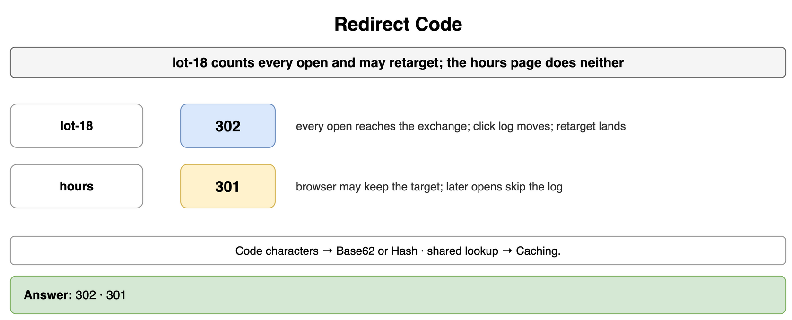
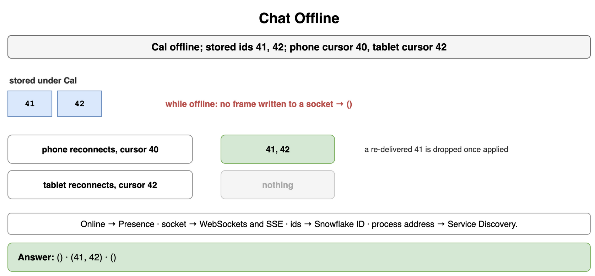
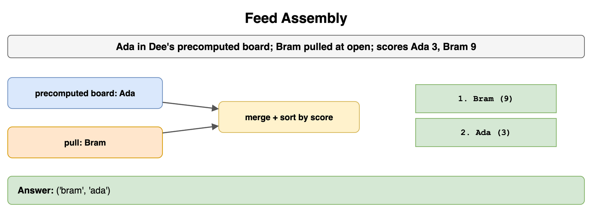
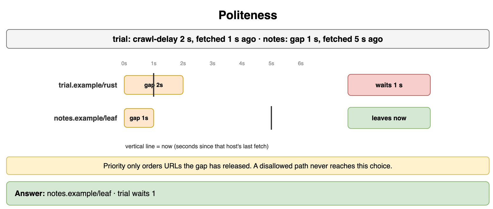
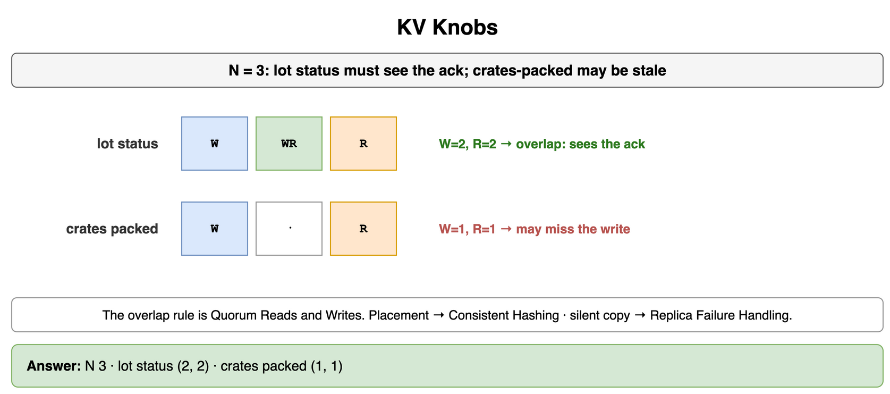
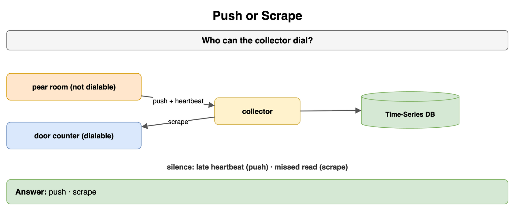
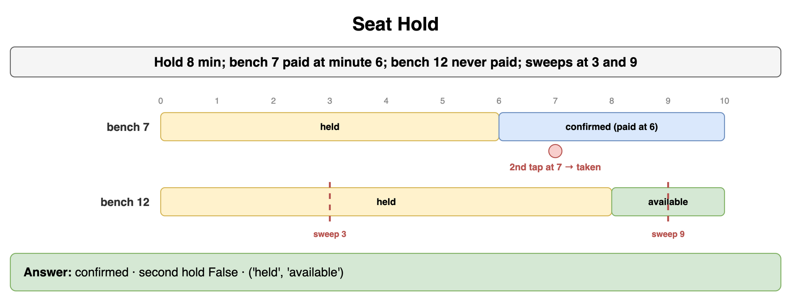
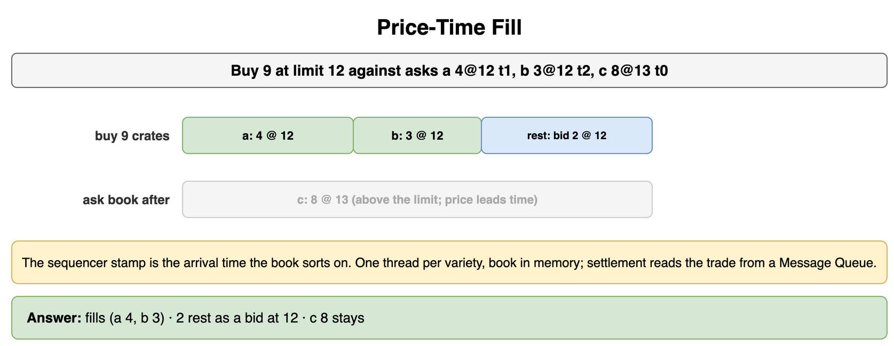

# Classic Design Problems — Drills

Original practice for assembling a product from blocks that live elsewhere. Each card is one exercise: commit to an answer, then check it. The numbers are invented for Lumen Orchard Exchange, a packing shed that prints crate-card links, carries picker chat, opens a growers' board, crawls public trial pages, keeps lot status in a key-value store, samples cold rooms, holds grafting benches, and runs a morning crate call. The short code stays in Unique ID Generation. The socket stays in Networking and Communication. Presence and the fan-out pattern stay in Real-Time and Notification Systems. The ring stays in Data Partitioning and Consistent Hashing. The overlap rule stays in Consistency and Replication. A fetch deadline stays in Distributed System Failure Modes. The lock and the lease stay in Transactions and Concurrency Control. The charge stays in Payment and Financial Systems. The sample store stays in Databases NoSQL and Specialized. The crawled blob and the roll-up job stay in Storage and Data Processing at Scale. The queue after a fill stays in Message Queues and Async Processing. The lookup cache and the assembled board stay in Caching.

## Redirect Code

Lot card `lot-18` must log every open, and the desk sometimes points that code at a new lot page. The hours page never changes, and the desk does not count it. Which status does each link answer with? The characters in the code are a separate choice.

```python
LINKS = {"lot-18": True, "hours": False}
```

**Answer:** `lot-18` answers 302. Every open asks the exchange, the click log moves, and a new target is the page the next open receives. The hours page answers 301. The browser may keep that target, and later opens never reach the log. The alphabet and a colliding hash prefix are Base62 or Hash. The shared lookup the redirect reads is Caching.

```python
LINKS = {"lot-18": True, "hours": False}


def status(count_clicks: bool) -> int:
    if count_clicks:
        return 302
    return 301


print(status(LINKS["lot-18"]), status(LINKS["hours"]))
# 302 301
```



*Source: [`diagrams/classic-problems-drills.drawio`](/content/09_System_Design_Interview/24_Classic_Design_Problems/diagrams/classic-problems-drills.drawio), page 1.*

## Chat Offline

Nia sends "wagon at gate" to Cal. Cal's socket is down. The stored message ids are 41 and 42. Cal's phone last applied 40, and the shed tablet last applied 42. What does the exchange do while Cal is offline, what does the phone receive on reconnect, and what does the tablet receive?

```python
STORED = (41, 42)
PHONE = 40
TABLET = 42
ONLINE = False
```

**Answer:** The note is stored under Cal. No frame is written to a socket while `ONLINE` is false. On reconnect the phone sends cursor 40 and receives 41 and 42. The tablet sends cursor 42 and receives nothing further. A second delivery of 41 to the phone is dropped once that id is already applied. Whether Cal counts as online is Presence. The socket is WebSockets and SSE. The ids are Snowflake ID. The map from Cal to the process that holds the socket is the routing table on this card. How that process registers its address is Service Discovery.

```python
STORED = (41, 42)
PHONE = 40
TABLET = 42
ONLINE = False


def catch_up(stored: tuple[int, ...], cursor: int) -> tuple[int, ...]:
    return tuple(message_id for message_id in stored if message_id > cursor)


sent_now = () if not ONLINE else catch_up(STORED, PHONE)
print(sent_now, catch_up(STORED, PHONE), catch_up(STORED, TABLET))
# () (41, 42) ()
```



*Source: [`diagrams/classic-problems-drills.drawio`](/content/09_System_Design_Interview/24_Classic_Design_Problems/diagrams/classic-problems-drills.drawio), page 2.*

## Feed Assembly

Ada is an ordinary grower. Her note is already in Dee's precomputed board. Bram is followed by the whole exchange. His note was stored once and was not copied into that board. Dee's scores are Ada 3 and Bram 9. What does Dee's open call return, and in what order?

```python
INBOX = ("ada",)
PULL = ("bram",)
SCORE = {"ada": 3, "bram": 9}
```

**Answer:** The open call starts with the precomputed board, pulls Bram because his note is not in it, and sorts by score. Bram leads, then Ada. The choice to copy Ada at publish and pull Bram at retrieve is Fan-Out Strategies. This exercise is the merge and the score. The assembled board can sit in Caching until a new precomputed note arrives.

```python
INBOX = ("ada",)
PULL = ("bram",)
SCORE = {"ada": 3, "bram": 9}


def board(inbox: tuple[str, ...], pull: tuple[str, ...]) -> tuple[str, ...]:
    rows = inbox + pull
    return tuple(sorted(rows, key=lambda name: -SCORE[name]))


print(board(INBOX, PULL))
# ('bram', 'ada')
```



*Source: [`diagrams/classic-problems-drills.drawio`](/content/09_System_Design_Interview/24_Classic_Design_Problems/diagrams/classic-problems-drills.drawio), page 3.*

## Politeness

`trial.example` publishes a crawl-delay of 2 seconds, and the frontier fetched it 1 second ago. `notes.example` has no crawl-delay, so the exchange uses a 1-second gap, and that host was fetched 5 seconds ago. Both URLs are due. `trial.example/rust` is the priority recrawl. Which URL may leave now, and how long does the other host still wait?

```python
HOSTS = {
    "trial.example": {"gap": 2, "elapsed": 1},
    "notes.example": {"gap": 1, "elapsed": 5},
}
DUE = (("trial.example", "rust", 1), ("notes.example", "leaf", 2))
```

**Answer:** `notes.example/leaf` may leave. `trial.example/rust` waits 1 more second. Priority orders URLs the gap has released, and the priority recrawl is still inside its crawl-delay. A path robots.txt disallows would never reach this choice. The queues and the due time are URL Frontier. A fetch that then hits its deadline is Timeouts and Retries.

```python
HOSTS = {
    "trial.example": {"gap": 2, "elapsed": 1},
    "notes.example": {"gap": 1, "elapsed": 5},
}
DUE = (("trial.example", "rust", 1), ("notes.example", "leaf", 2))


def wait(host: str) -> int:
    row = HOSTS[host]
    return max(0, row["gap"] - row["elapsed"])


def next_url() -> str:
    allowed = [item for item in DUE if wait(item[0]) == 0]
    allowed.sort(key=lambda item: item[2])
    host, path, _priority = allowed[0]
    return f"{host}/{path}"


print(next_url(), wait("trial.example"))
# notes.example/leaf 1
```



*Source: [`diagrams/classic-problems-drills.drawio`](/content/09_System_Design_Interview/24_Classic_Design_Problems/diagrams/classic-problems-drills.drawio), page 4.*

## KV Knobs

Lot status has to return the put that was acknowledged. The packed-today counter on the shed door may be stale. N is 3. Which W and R does each key use, and which topic owns the rule that makes the lot-status pair valid?

```python
N = 3
MUST_SEE_ACK = {"lot-status": True, "crates-packed": False}
```

**Answer:** Lot status uses W = 2 and R = 2. Crates packed today uses W = 1 and R = 1. The reason the first pair shares a copy with every acknowledged write is Quorum Reads and Writes. That card owns the overlap rule. Where the key sits is Consistent Hashing. A copy that stops answering is Replica Failure Handling. A deadline on the way to a copy is Timeouts and Retries. This exercise records the pair the product picked.

```python
N = 3
MUST_SEE_ACK = {"lot-status": True, "crates-packed": False}


def knobs(must_see_ack: bool) -> tuple[int, int]:
    if must_see_ack:
        return (2, 2)
    return (1, 1)


print(
    N,
    knobs(MUST_SEE_ACK["lot-status"]),
    knobs(MUST_SEE_ACK["crates-packed"]),
)
# 3 (2, 2) (1, 1)
```



*Source: [`diagrams/classic-problems-drills.drawio`](/content/09_System_Design_Interview/24_Classic_Design_Problems/diagrams/classic-problems-drills.drawio), page 5.*

## Push or Scrape

Pear room sits behind the shed network. The collector cannot dial it. The door counter exposes a metrics page the collector can dial, and a silent counter has to show up as a missed read. Which collection mode does each one use, and where do the samples land?

```python
SOURCES = {
    "pear": {"dialable": False},
    "door": {"dialable": True},
}
```

**Answer:** Pear room pushes. The door counter is scraped, so a missed read is the silence signal. Pear room adds a heartbeat, because a push with nothing new and a push that has stopped are the same until that heartbeat is late. The samples append to a Time-Series Database. A one-hour series built from a closed day is Batch Processing. The page for a room that stays above 4°C is one open incident, so the next evaluation in that stretch stays quiet.

```python
SOURCES = {
    "pear": {"dialable": False},
    "door": {"dialable": True},
}


def mode(dialable: bool) -> str:
    if dialable:
        return "scrape"
    return "push"


print(mode(SOURCES["pear"]["dialable"]), mode(SOURCES["door"]["dialable"]))
# push scrape
```



*Source: [`diagrams/classic-problems-drills.drawio`](/content/09_System_Design_Interview/24_Classic_Design_Problems/diagrams/classic-problems-drills.drawio), page 6.*

## Seat Hold

Bench 7 is HELD at minute 0 for 8 minutes. The member's capture succeeds at minute 6. Another member taps Reserve on that bench at minute 7. Bench 12 was held at minute 0 and never captured. The sweeper runs at minute 3 and again at minute 9. What is bench 7 at minute 7, may the second member hold it, and what is bench 12 at each sweeper run?

```python
HOLD_MIN = 8
BENCH_7_PAID = 6
SWEEPS = (3, 9)
```

**Answer:** At minute 7 bench 7 is confirmed, and the second tap finds it taken. Capture at minute 6 is inside the 8 minutes, so the hold has become a confirmation. Bench 12 is still held at minute 3. At minute 9 the sweeper releases it to available. The row lock or the version check is Optimistic or Pessimistic. A lease outside one database is Distributed Locks. The capture itself is Authorize and Capture. The wagon's 22 tickets for 20 seats are a different inventory. This bench has no spare.

```python
HOLD_MIN = 8
BENCH_7_PAID = 6
SWEEPS = (3, 9)


def bench(now: int, paid_at: int | None) -> str:
    if paid_at is not None and paid_at < HOLD_MIN:
        return "confirmed"
    if now >= HOLD_MIN:
        return "available"
    return "held"


def can_hold(state: str) -> bool:
    return state == "available"


print(
    bench(7, BENCH_7_PAID),
    can_hold(bench(7, BENCH_7_PAID)),
    tuple(bench(now, None) for now in SWEEPS),
)
# confirmed False ('held', 'available')
```



*Source: [`diagrams/classic-problems-drills.drawio`](/content/09_System_Design_Interview/24_Classic_Design_Problems/diagrams/classic-problems-drills.drawio), page 7.*

## Price-Time Fill

The ask book for one variety is four crates at 12 with time 1, three crates at 12 with time 2, and eight crates at 13 with time 0. A buy of nine crates arrives with limit 12, after the sequencer stamp. What fills, what rests on the bid book, and what stays on the ask book?

```python
ASKS = (
    (12, 1, 4, "a"),
    (12, 2, 3, "b"),
    (13, 0, 8, "c"),
)
BUY = (12, 9)
```

**Answer:** The buy fills four crates from the earlier ask at 12, then three from the later ask at 12. Two crates rest as a bid at 12. The eight crates at 13 stay on the ask book, because 13 is above the limit. Price leads time, so that ask stays put even though its time is 0. The sequencer stamp is the arrival time the book sorts on, and this buy is one stamp behind the asks it walks. One thread owns this variety, with the book in memory. Settlement reads the trade from a Message Queue after the fill returns.

```python
ASKS = (
    (12, 1, 4, "a"),
    (12, 2, 3, "b"),
    (13, 0, 8, "c"),
)
BUY = (12, 9)


def fill(limit: int, qty: int) -> tuple[tuple[tuple[str, int], ...], int, tuple[tuple[str, int], ...]]:
    book = [list(row) for row in sorted(ASKS)]
    taken: list[tuple[str, int]] = []
    for row in book:
        price, _time, avail, name = row
        if price > limit or qty == 0:
            break
        take = min(avail, qty)
        taken.append((name, take))
        row[2] = avail - take
        qty -= take
    resting = tuple((row[3], row[2]) for row in book if row[2] > 0)
    return tuple(taken), qty, resting


print(fill(*BUY))
# ((('a', 4), ('b', 3)), 2, (('c', 8),))
```



*Source: [`diagrams/classic-problems-drills.drawio`](/content/09_System_Design_Interview/24_Classic_Design_Problems/diagrams/classic-problems-drills.drawio), page 8.*
