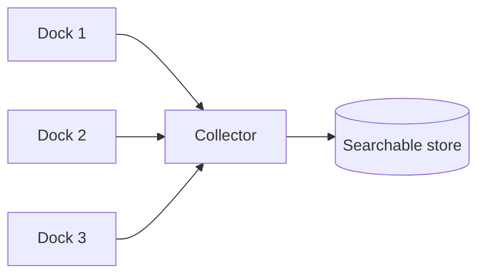
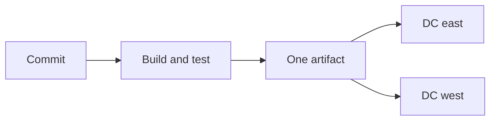

## Per-Server Logs

Each process appends lines to a file on the machine that handled the request. With one or two hosts you open that file. The line exists only there: rotation deletes it, and a replaced host takes the file with it.

```text
one host:    ssh dock-1 && tail -f unlock.log
many hosts:  the failed unlock may be on dock-14, dock-31, or dock-2
```

A load balancer chooses the host. If you cannot search every host, the error is on a disk you did not open. Local files are a sound first version. They stop being a diagnosis tool once you can no longer name the machine.

## Centralized Logs

A collector copies each line to one store you can query by request id, dock id, status, and time. The process still writes locally, so a collector outage does not stall the unlock. Diagnosis happens in the store.



Keep the line structured and small: timestamp, service, host, request id, level, message. A query is then a filter. Sample or drop high-volume success lines, and keep the failures. Leave tokens, payment numbers, and raw location traces out of the line.

```python
def log_line(service: str, host: str, request_id: str, level: str, message: str) -> dict[str, str]:
    return {
        "service": service,
        "host": host,
        "request_id": request_id,
        "level": level,
        "message": message,
    }
```

## Error Logs

An error log is what you read after a rider reports a failed unlock. It names the request, the dock, and the immediate cause: lock timeout, unknown bike, upstream 503. A stack trace with no request id cannot be matched to that rider. A success line on every unlock buries the one failure.

```text
keep:   level=error request=9f2 dock=14 cause=lock_timeout
drop:   level=info  request=9f3 dock=14 cause=unlocked
```

If the handler returned 500 and no error line was written, the bug is the missing log. Write the line on the failure path, including the caught case that still returns a polite message to the rider.

## Host Metrics

CPU, memory, disk queue, and network on one machine. They say that a box is hot or full. They do not say that unlocks are failing, because that failure is spread across docks and a lock service.

Page a person for one host's CPU only when that host is a singleton you cannot lose, such as the only database primary. One dock at high CPU with the rest of the tier idle is a machine to drain or replace, not a fleet incident.

```python
def host_is_hot(cpu_percent: float, threshold: float = 90) -> bool:
    return cpu_percent >= threshold
```

## Tier Metrics

Roll the same measurement up by service: request rate, error rate, and latency percentiles for the unlock tier, not for dock-14. Sum the counters. Merge the histograms. One sick host hides inside a healthy total, and a calm host average hides a tier that is failing on every host. Keep both views. The page belongs on the tier, checked against the target already set in High Availability.

```python
def tier_error_rate(hosts: list[dict[str, int]]) -> float:
    requests = sum(host["requests"] for host in hosts)
    errors = sum(host["errors"] for host in hosts)
    if requests == 0:
        return 0.0
    return errors / requests
```

## Business Metrics

Counts the product promised: unlocks completed, trips paid, bikes reported stuck. A tier can return HTTP 200 while completed unlocks fall, because a client stopped calling or a flag hid the button. Error rate does not see that. Put the business counter on the same time axis as the technical one so a quiet failure is visible.

```text
technical:  unlock handler 200s stay flat
business:   completed unlocks drop from about 40/min to 1/min
action:     treat the business drop as the incident
```

## Continuous Integration

Every check-in builds and runs the tests. The artifact that passes is the only one you may deploy. Tests that run only on a laptop mean production is whatever someone remembered to run, and two regions can be running two different memories.

```python
def may_deploy(tests_passed: bool, artifact_id: str | None) -> bool:
    return tests_passed and bool(artifact_id)
```

The gate sits on the commit, before the artifact is promoted. A red build stops the line. Re-running tests by hand during an incident does not replace the gate that should have failed on yesterday's commit.

## Repeatable Deploys

Build the artifact once. Deploy that same artifact to every host and every data center. Hand-built machines drift: one region has a library, a config file, or a half-applied copy the other region does not, and the bug exists only there.



A rollback is the same pipeline pointed at the previous artifact id. Rebuilding from a moving branch during the incident produces a third version. One pipeline keeps every data center on the same artifact, and it keeps a small group shipping after the host count passes what one person can touch by hand.

## Fleet Growth

Four docks: you can open a shell, read a local file, and copy a binary. Two hundred docks in two cities: the failed request is on an unknown host, a CPU average hides one hot tier, and a manual copy in one city leaves the other city old. The practices stay the same as the fleet grows. Skipping them costs more once a person cannot finish a pass before the rider leaves.

```text
4 hosts   × 45 s to inspect = 3 minutes. A person can finish this.
240 hosts × 45 s to inspect = 3 hours. The rider has already left.
```

Add searchable logs, tier and business metrics, and one pipeline when inspection by hand no longer finishes before users notice. In an interview, name those three and the signal you would page on. A trace across services, the error-budget policy, and who receives the page are the next questions. They are not a second design in the same answer.
